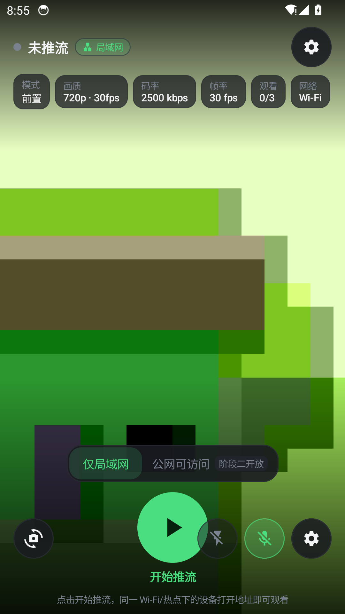

# CamPush 工程化文档集

> 由《Android 摄像头实时推流产品方案手册 v1.0》（下称 PRD）派生的**可执行工程设计文档集**：回答“怎么建、边界在哪、怎么验、怎么排期、风险谁背”。
> 本仓库只交付文档与校验脚本，**不包含 App / 服务端 / 播放页代码实现**。

| 项目 | 值 |
|---|---|
| 文档集状态 | 基线（Baseline v1.1，LAN-first 交付分期） |
| 交付顺序 | **P1 局域网 → P2 公网 → P3 专业化/商业化** |
| 契约基线版本 | [00-conventions.md](./docs/00-conventions.md) **v1.5** |
| 需求基线 | [PRD v1.0](./docs/PRD-v1.0.md) |
| 实现状态 | **P1 已实现**：Android 客户端 + 端侧服务 + LAN 播放页；46 项测试通过（[实现说明](./docs/12-p1-implementation.md)） |
| 文档规模 | 14 份（00–12 + PRD），约 1.6 万行，70 张 Mermaid 图，650+ 张表格 |
| 质量门禁 | `python3 scripts/check_docs.py --strict`（当前：通过） |
| 维护人 | Team Lead |
| 最后更新 | 2026-10-20 |

---

## 1. 这套文档解决什么

PRD 定义 **What / Why**；本集定义 **How / 边界 / 验收 / 排期 / 风险**。三条不可谈判的产品约束贯穿全部文档：

1. **推流协议与播放协议分离**：推流只有 WHIP / SRT / RTMP；HLS、HTTP-FLV 只存在于播放页内部。
2. **标准模式只输出一个播放地址**：复制、二维码、分享、本机预览全部指向同一个 `playUrl`，且协议热切换时字符串不变。
3. **服务端能力按访问范围拆分**：`仅局域网` 由端侧服务承担；`公网可访问` 依赖云端媒体服务，客户端场景开关二选一。

**v1.1 交付顺序调整**：先把 Android 客户端在局域网内做通（P1，零云端依赖），再把公网能力与专业化作为 P2/P3；`Top5` 决策项固化为 P2 的启动门禁。

---

## 2. 交付路线图（LAN-first）

### 2.1 三阶段

| 阶段 | 周期 | 时间窗 | 目标 | 工作量 | 门禁 |
|---|---|---|---|---|---|
| **P1 局域网可用闭环** | 8 周 | 2026-10-26 → 12-18 | 手机起服务，同网浏览器打开唯一地址即可看；停止即失效 | 138 pd（+24 pd P2 前置） | M0-LAN（E6 必过、E7 伴随项）+ P1 验收 |
| **P2 公网可访问 + 专业化起步** | 12 周 | 2026-12-21 → 2027-03-12 | 云端接入 + WAN 播放页 + 切源/失效 + 双摄 PiP + SRT/RTMP | 235 pd | **Top5 全关** + M0-WAN（E2/E4/E5）+ P1 验收 + 云环境就绪 |
| **P3 专业化与商业化** | 8 周 | 2027-03-15 → 05-07 | 双路独立、多地址、BYO、录制、套餐、观众端 | 205 pd | P2 GA + 商业化方案定稿 |

> 全期 28 周 / 净产能 931 pd / 计划 578 pd（62.1%）/ 缓冲 353 pd（37.9%）；118 Task / 31 Feature / 4 Epic 编号全部保留，仅重排阶段归属。排期与产能明细见 [09 §2](./docs/09-task-plan.md)。

### 2.2 阶段范围

**P1（只做客户端 + 局域网，不接云端）**

- 客户端：权限、单摄预览/前后热切、H.264/AAC 编码、分辨率/码率/帧率、静音/闪光灯、前台服务 + 通知栏、访问范围控件（LAN 可选、WAN 置灰“阶段二开放”）、LAN 设置分组、地址卡（复制/二维码/本机预览）、网络检测/IP 变化/AP 隔离提示、省电模式基础。
- 端侧服务：HTTP server、内联播放页、HTTP-FLV + MJPEG、pageToken/mediaToken、PIN、并发 1–3、≤1 s 停止失效、端口 8089→顺延。
- 播放页：LAN 降级链 `flv → mjpeg`，移动浏览器兼容（iOS Safari / Android Chrome / 微信内置）。
- **不做**：WAN/云端、HLS、TURN、SRT/RTMP 推流、双摄合成、录制/水印/多地址、账号套餐。

**P2（公网闭环）**：WHIP/SRT/RTMP 接入、SFU、FLV/HLS、TURN、房间/token/额度、WAN 播放页降级、协议热切换地址不变、双摄 PiP/分屏、WAN 指标与 SLO。

**P3（专业化/商业化）**：双路独立推流、多地址、BYO 自定义地址、录制/水印、套餐与账号体系、观众端。

### 2.3 Top5 决策门禁（P2 启动前必须关闭）

| ID | 决策项 | 推荐结论 | 决策人 | 最晚时点 | 阻塞的 P2 工作 | 不决策后果 |
|---|---|---|---|---|---|---|
| D-1 | 默认访问范围：长期“公网”还是按网络自动推荐 | 保持公网 + 首次引导 | 产品 | 2026-12-18 | WAN 默认值、首启引导、AC-09 | 无法定义首启体验 |
| D-2 | 公网托管：自建媒体面 vs 第三方媒体云 | v1 自建（Mediasoup + SRS 终结）+ D2 评估混合 | 技术 + 产品 | 2026-12-18（延期时 M0-WAN 按“自建”先行） | 接入/SFU 选型、成本模型、E2 环境 | 云端工作无法开工 |
| D-3 | 双摄白名单门槛与灰度 | 支持率 ≥40% 才作 v1 卖点，否则实验性 | 产品 + Android | 2026-12-11（输入来自 M0-LAN E1） | 双摄 PiP、白名单、AC-05 | 双摄范围无法冻结 |
| D-4 | 局域网端侧是否支持 RTMP | P1 仅本地直出 FLV/MJPEG；RTMP 进 P2 评估 | 架构 | 2026-12-11 | P1 协议锁定、P2 LAN 增强 | P1 范围摇摆 |
| D-5 | RTMPS 是否进入 P2 | 进入 P2 评估；v1 明文 + UI 明示 | 安全 + 产品 | 2026-12-18 | RTMP 安全方案、合规评估 | 安全遗留项无归属 |

> **P2-GATE = 2026-12-25**：Top5 全关 + M0-WAN（E2/E4/E5 必过、E3 条件项）+ P1 验收通过 + 云环境就绪，缺一不启动 P2 开发。阶段与功能版本 M0–M3 的映射见 [00 §20.5](./docs/00-conventions.md)，决策台账见 [11 §2.6](./docs/11-risk-adr.md)。

### 2.4 P1 实现（已交付）

| 项 | 内容 |
|---|---|
| 代码 | `app/`（Compose + CameraX 客户端）、`lan-core/`（纯 JVM 端侧服务）、`tools/player-selftest/`（播放页自检） |
| 构建 | `scripts/setup-toolchain.sh` → `scripts/build.sh :app:assembleDebug`（沙箱内 SDK/Gradle 全部落在 workspace） |
| 自动化 | `:lan-core:test` **49/49**；播放页 Node 自检 **26/26**；APK 构建通过 |
| 端到端 | Android 14 模拟器：播放页 200（43 KB）、MJPEG/FLV 出流、3 观看者上限、PIN 校验、端口 8090、停止即失效；Chrome 实播 FLV→MSE `readyState=4` |
| 细节 | [docs/12-p1-implementation.md](./docs/12-p1-implementation.md) |



---

## 3. 文档地图

| 编号 | 文档 | 内容 | 主要读者 |
|---|---|---|---|
| 00 | [conventions](./docs/00-conventions.md) | 契约基线：枚举、地址、token、错误码、状态机、性能预算、埋点，**§20 交付分期与契约启用矩阵**，v1.1–v1.5 裁定 | 全员（先读） |
| 01 | [architecture](./docs/01-architecture.md) | 双模式拓扑与部署、组件职责、端到端数据流、选型结论、容量成本、SLO | 架构 / 技术负责人 |
| 02 | [client-modules](./docs/02-client-modules.md) | Android 14 模块、UDF 状态模型、四线程模型、CameraX 双摄、MediaCodec/ABR、OpenGL 合成、保活与降级 | Android |
| 03 | [cloud-service](./docs/03-cloud-service.md) | P2 云端：WHIP/SRT/RTMP 接入、SFU、切源、FLV/HLS、TURN、房间与额度、容量成本 | 服务端 / SRE |
| 04 | [interface-contracts](./docs/04-interface-contracts.md) | REST/SSE/媒体面契约、LAN/WAN 对照、状态机映射、时序图、OpenAPI 片段、契约测试 | 服务端 / 客户端 / Web / QA |
| 05 | [lan-service](./docs/05-lan-service.md) | **P1 核心**：端侧 HTTP 服务、MJPEG/FLV 分发与背压、PIN、并发 1–3、AP 隔离、≤1 s 停止 | Android / 测试 |
| 06 | [playback-page](./docs/06-playback-page.md) | 播放页状态机、WAN/LAN 降级阶梯、token 续期、切源处理、兼容矩阵、E2E | Web / QA |
| 07 | [security-privacy](./docs/07-security-privacy.md) | STRIDE、token 撤销、PIN 防爆破、隐私清单、日志脱敏、合规、渗透清单、Go/No-Go | 安全 / 法务 |
| 08 | [m0-verification](./docs/08-m0-verification.md) | **两段式验证**：M0-LAN（E6/E7 必过，E1 可选）与 M0-WAN（E2/E4/E5 必过，E3 条件项），设备矩阵、阈值、回退 | 测试 / 架构 |
| 09 | [task-plan](./docs/09-task-plan.md) | **P1/P2/P3 排期**：WBS 118 Task、依赖 DAG、关键路径、DoR/DoD、AC 映射、缓冲与裁剪 | 项目管理 / 全员 |
| 10 | [observability](./docs/10-observability.md) | 指标分阶段启用（P1 LAN / P2 WAN）、24 事件埋点、漏斗、SLO、23 条告警、埋点 QA | 数据 / QA |
| 11 | [risk-adr](./docs/11-risk-adr.md) | 20 条风险、Top5 决策门禁、ADR-001～013（含 LAN-first 分期）、降级路径 | 产品 / 技术负责人 |
| 12 | [p1-implementation](./docs/12-p1-implementation.md) | **P1 实现说明**：代码结构、构建运行、功能清单、验收证据、已知限制 | 研发 / QA |
| 13 | [p1-acceptance](./docs/13-p1-acceptance.md) | **P1 验收报告（G1 证据包）**：M0-LAN、AC/N 对照、DoD、未完成项与收尾计划 | 产品 / QA / Lead |
| 14 | [p1-acceptance-kit](./docs/14-p1-acceptance-kit.md) | **P1 验收执行包**：Top12/E7 矩阵、86 条用例、安全用例、AC-01 计时、M0 评审、UI/埋点/看板/发布模板 | QA / 产品 / 研发 |
| 15 | [p2-kickoff](./docs/15-p2-kickoff.md) | **P2 启动记录**：P1 条件 G1、Top5 门禁、WAN Gate 周任务（WHIP/WHEP/房间 REST）、云资源清单与风险 | 全员 |
| 16 | [android-release](./docs/16-android-release.md) | **APK 构建与发布**：GitHub Actions、versionCode/versionName 规则、Artifacts/Release、本地等价构建、签名 | Android / 发布 |
| 17 | [local-dev-env](./docs/17-local-dev-env.md) | **本地 Docker 环境**：SRS 域名/容器 IP/端口、WHIP/WHEP/FLV/HLS 命令、禁止改网络约束 | 研发 / QA |
| 18 | [p2-acceptance](./docs/18-p2-acceptance.md) | **P2 滚动验收**：任务状态/证据/阻塞（真机 WHIP、TURN、双摄），可复现命令 | 全员 |
| — | [PRD v1.0](./docs/PRD-v1.0.md) | 用户提供的需求原文（不改写，仅引用） | 全员 |
| — | [scripts/check_docs.py](./scripts/check_docs.py) | 8 类文档一致性 CI 门禁 | 全员 |

---

## 4. 推荐阅读路径

| 角色 | 顺序 | 重点 |
|---|---|---|
| 产品 / 负责人 | README §2 → 09 §2.1 → 11 §2.6 → 10 §2.1 | 三阶段、Top5 门禁、指标启用 |
| Android（P1 主力） | 00 → 02 → 05 → 06 LAN 章 → 08 M0-LAN → 09 P1 任务 | 采集/编码/端侧服务/停止失效 |
| 服务端（P2 启动前） | 00 §4–9 → 03 → 04 → 11 ADR-005/013 | 契约冻结、选择托管形态 |
| Web / 播放页 | 00 §4/5/10 → 06 → 04 §3–4 → 05 §8 | LAN 页优先，WAN 页 P2 实现 |
| 安全 / 合规 | 07 → 00 §5/§9/§11 → 04 → 11 | P1 无 HTTPS 风险接受、P2 RTMPS |
| QA / 交付 | 08 → 10 → 09 §2.9 → 06 §12 | 两段门禁与验收映射 |

---

## 5. 关键不变量（可测试，不可谈判）

| ID | 不变量 | 验证方式 |
|---|---|---|
| INV-1 | 标准模式同一会话内 `playUrl` 字符串恒定（含协议热切换） | 04 §3.4 断言 SW-1～SW-10；E2E 比对字符串 |
| INV-2 | 切源不重建播放会话：`playSessionId` 不变，地址栏不变 | 03 §6 时序；06 E2E-12 |
| INV-3 | 停止推流后地址失效：LAN `connection refused` ≤1 s，WAN 媒体端点 `410` ≤2 s | 05 §3.3；04 §3.3；09 AC-04/07 |
| INV-4 | 推流协议枚举只有 `whip/srt/rtmp`；HLS/FLV 不出现在推流设置 | 00 §3；文档 CI 枚举扫描 |
| INV-5 | 双摄不支持设备不出现不可用选项（`1004` 降级并解释原因） | 02 §7；08 E1；09 AC-05 |
| INV-6 | 专业模式（双路/多地址/BYO）必须显式提示多地址，且不影响 INV-1 | 11 ADR-008；02 §11 |

---

## 6. Agent 协作约定（项目级记忆）

见 [AGENTS.md](./AGENTS.md)。**架构与模块解耦是最高优先级红线**：

- 依赖严格单向：`app-ui / app-service / app-streaming / app-camera → app-core → lan-core`，`lan-core` 不依赖 Android；
- `app-ui` 只依赖 `P1Controller` / `P1UiState` 契约，禁止直接操作相机、编码器、引擎内部；
- CameraX、Camera2+MediaRecorder Surface 等采集/编码管线必须隐藏在统一抽象后，新增管线只加实现与适配器；
- 唯一播放地址、停止即失效、`3002/3003` 语义、局域网停止 ≤1s 等契约不得破坏；
- 新管线失败必须回退兼容管线，回退不改变播放地址。

## 7. 契约基线速查（详见 00）

### 6.1 枚举

`accessScope`: `lan` / `wan`（推流中锁定）
`captureMode`: `single_back` / `single_front` / `dual`
`pushProtocol`: `whip` / `srt` / `rtmp`
`playProtocol`: `webrtc` / `flv` / `hls` / `mjpeg`（用户不可见）
`roomState`: `created` / `live` / `switching` / `stopping` / `closed` / `failed`

### 6.2 地址

| 用途 | 模板 |
|---|---|
| 公网唯一播放地址（P2） | `{playHost}/s/{roomId}?token={pageToken}` |
| 局域网唯一播放地址（P1） | `http://{lanIp}:{port}/s/{pageToken}` |
| 云端 API（P2） | `{apiHost}/api/v1/...` |
| HTTP-FLV / HLS | `{playHost}/live/{roomId}.flv?mt=` / `{playHost}/hls/{roomId}/index.m3u8?mt=` |

### 6.3 token

| token | 位置 | TTL | 撤销 |
|---|---|---|---|
| `pageToken` | 播放地址 query / LAN 路径段 | 60 min | 房间关闭即失效 |
| `mediaToken` | 媒体面 `?mt=` / WHEP Bearer | 300 s，可续期 | 房间关闭 / 并发上限 |
| `ingestToken` | WHIP/SRT/RTMP 接入（P2） | ≤12 h | 切源后 5 s grace |

### 6.4 降级阶梯与预算

- WAN（P2）：`webrtc(2.5s) → flv(2.0s) → hls(5.0s)`；LAN（P1）：`flv(2.0s) → mjpeg(2.0s)`。
- 首帧 < 2 s；端到端延迟 p50 ≈250 ms / p95 ≈630 ms；点击→地址 ≤3 s；停止→失效 ≤1 s（LAN）/≤2 s（WAN）；切源中断 ≤3 s（p95 ≤5 s）。
- 错误码号段：1xxx 客户端、2xxx 房间、3xxx 鉴权、4xxx 推流、5xxx 播放、6xxx 端侧、7xxx 网络性能。

### 6.5 契约启用顺序

| 契约面 | P1 | P2 | P3 |
|---|---|---|---|
| LAN API（00 §8） | ✅ | ✅ | ✅ |
| WAN REST/媒体面（00 §6/§7） | —（WAN 置灰） | ✅ | ✅ |
| HLS / TURN | — | ✅ | ✅ |
| 埋点（00 §11） | LAN 子集 | 全量 | 全量 |
| 错误码（00 §9） | LAN 相关 | 全量 | 全量 |

---

## 7.1 Android APK 下载与版本

- **最新预发布（P1，正式签名）**：[GitHub Releases v1.0.0-p1.1](https://github.com/mbpz/camPush/releases/tag/v1.0.0-p1.1)（APK + SHA256SUMS）；
- **每次提交**：GitHub → Actions → 对应 run → Artifacts → `campush-apk-<versionName>-<versionCode>`；
- **正式/预发布**：GitHub → Releases（push `v*` tag 自动创建）下载 APK + `SHA256SUMS.txt`；
- 版本规则：`versionCode = git 提交数`、`versionName = tag`（去 `v` 前缀）；设置页「关于 → 构建」显示注入的提交 SHA；
- 本地等价构建与发版流程见 [docs/16-android-release.md](./docs/16-android-release.md)。

## 8. 质量门禁

```bash
python3 scripts/check_docs.py --strict
```

检查 8 类问题，当前结果：**0 error / 0 warning**。

| # | 检查项 | 失败后果 |
|---|---|---|
| 1 | 文件存在与行数下限 | 文档被裁剪或占位 |
| 2 | 必需章节（验收检查点/开放问题/变更记录） | 不可评审、不可验收 |
| 3 | Mermaid 代码块闭合与存在 | 文档渲染失败 |
| 4 | 相对链接可达 | 阅读断链 |
| 5 | PRD §1–§19 引用合法 | 需求追溯断裂 |
| 6 | 错误码必须命中 00 §9.2 号段 | 客户端分支错乱 |
| 7 | 占位域名白名单（禁止真实域名/公网 IP） | 信息泄露/不可复现 |
| 8 | 密钥/token 明文与疑似 JWT | 安全事件 |

---

## 9. 文档规模与版本

| 文档 | 行数 | 图 | 状态 |
|---|---|---|---|
| 00 conventions | 777 | 2 | 基线 v1.5 |
| 01 architecture | 1422 | 11 | 基线 v1.2 |
| 02 client-modules | 1714 | 12 | 基线 v1.0 |
| 03 cloud-service | 1371 | 7 | 基线 v1.0 |
| 04 interface-contracts | 2111 | 6 | 基线 v1.1 |
| 05 lan-service | 1181 | 9 | 基线 v1.1 |
| 06 playback-page | 991 | 6 | 基线 v1.1 |
| 07 security-privacy | 1048 | 6 | 基线 v1.0 |
| 08 m0-verification | 1287 | 4 | 基线 v1.1（两段式） |
| 09 task-plan | 960 | 3 | 基线 v1.1（P1/P2/P3） |
| 10 observability | 876 | 2 | 基线 v1.1（阶段启用） |
| 11 risk-adr | 512 | 2 | 基线 v1.2（ADR-013） |
| 12 p1-implementation | 499 | 0 | 实现基线 v1.0 |
| 13 p1-acceptance | 181 | 0 | 验收证据 v1.0 |
| 14 p1-acceptance-kit | 330 | 0 | 执行包 v1.0 |
| 15 p2-kickoff |      118 | 0 | P2 启动 v0.1 |
| 16 android-release |       76 | 0 | 发布规范 v1.0 |
| 17 local-dev-env |       72 | 0 | 环境记录 v1.0 |
| 18 p2-acceptance |       59 | 0 | P2 验收 v1.0 |
| PRD v1.0 | 643 | 0 | 需求基线（原文） |

> 子文档中 “00 v1.1/v1.2” 的引用为其写作时点；以 00 当前版本 v1.5 为准。

---

## 10. 待决策事项

**P2 启动门禁（Top5，必须关闭）**：D-1～D-5，见 §2.3 与 [11 §2.6](./docs/11-risk-adr.md)。

**P3 及后续（不阻塞 P1/P2）**

| # | 决策项 | 推荐 | 决策人 | 时点 |
|---|---|---|---|---|
| D-6 | 双路独立推流入口是否收在专业模式二级页 | 是，且强提示多地址 | 产品 + 设计 | P3 设计前 |
| D-7 | 埋点数据面自建 vs 第三方 | 自建上报 + 数仓 | 数据 + 安全 | P2 中期 |
| D-8 | HLS 容器 fMP4 vs TS | v1 fMP4，TS 作兼容开关 | 播放页 + 服务端 | 已定（00 §19） |
| D-9 | 盈利模式 | 流量/时长套餐 + BYO 免费工具双轨 | 产品 | P3 前 |
| D-10 | 是否建设观众端 App | P3 评估，先 H5 | 产品 | P3 末 |

---

## 11. 目录结构

```text
camPush/
├── README.md                 # 本导航
├── app/                      # P1 Android 客户端（Compose/CameraX/前台服务）
├── lan-core/                 # P1 端侧服务（纯 JVM，含 player.html）
├── tools/player-selftest/    # 播放页 Node 自检
├── scripts/                  # setup-toolchain.sh / build.sh / check_docs.py
├── docs/
│   ├── PRD-v1.0.md           # 需求原文基线（不改写）
│   ├── 00-conventions.md     # 契约基线 + 交付分期 + v1.1–v1.5 裁定
│   ├── 01-architecture.md
│   ├── 02-client-modules.md
│   ├── 03-cloud-service.md
│   ├── 04-interface-contracts.md
│   ├── 05-lan-service.md
│   ├── 06-playback-page.md
│   ├── 07-security-privacy.md
│   ├── 08-m0-verification.md
│   ├── 09-task-plan.md
│   ├── 10-observability.md
│   └── 11-risk-adr.md
└── scripts/
    └── check_docs.py         # 文档一致性 CI
```

---

## 12. 使用与维护

1. **契约优先**：字段/路径/枚举/错误码变更先改 [00](./docs/00-conventions.md) 并升次版本；破坏性变更升主版本。
2. **交付顺序以 P 为准**：功能何时存在可用“M1/M2 起”；何时交付、验收、门禁必须写 P1/P2/P3（映射见 00 §20.5）。
3. **门禁强制**：合并前 `python3 scripts/check_docs.py --strict` 必须通过；CI 非零退出即阻断。
4. **Top5 决策闭环**：每项有决策人/最晚时点/阻塞项；未关闭则 P2 不启动（D-2 可按推荐值先行）。
5. **不修改 PRD 原文**：产品口径变更须由产品更新 PRD 并同步本集。

---

## 13. 变更记录

| 版本 | 日期 | 变更人 | 内容 |
|---|---|---|---|
| v1.0 | 2026-10-20 | Team Lead | 首次交付：13 份文档 + 一致性门禁；契约基线 v1.4 |
| v1.1 | 2026-10-20 | Team Lead | 交付顺序改为 LAN-first：新增 P1/P2/P3 路线图与 Top5 决策门禁；09/10/11/08 阶段化重排；00 升 v1.5（§20 契约启用矩阵）；PRD 引用与门禁同步 |
| v1.2 | 2026-10-20 | Team Lead | **P1 实现落地**：app + lan-core + player.html + 构建脚本；46 项 JVM 测试、26 项播放页自检、模拟器/浏览器 E2E 通过；新增 docs/12 实现说明与截图 |
| v1.3 | 2026-10-20 | Team Lead | 1080p 性能修复：AVC Level 按分辨率选择、16:9 分辨率选择、ABR 策略修正、MJPEG 降采样、编码延迟保护、播放端追帧阈值；新增实际编码分辨率显示 |
| v1.4 | 2026-10-20 | Team Lead | 低帧率诊断与自动降级：编码诊断日志（5s）、相机分析分辨率日志、尺寸抖动去抖+缩放喂入、连续低 fps 自动降 720p 并提示 |
| v1.5 | 2026-10-20 | Team Lead | 相机被抢占黑屏修复：帧流看门狗、端侧服务保持、自动重绑与 IDR 恢复、30s 超时兜底；新增恢复截图与实测记录 |
| v1.6 | 2026-10-20 | Team Lead | 30fps 优先：MJPEG 按需编码、推流屏幕常亮、异常低帧率才降分辨率且播放地址不变、10–29fps 仅提示不降画质；设置页与文档同步 |
| v1.7 | 2026-10-20 | Team Lead | 局域网 14fps 修复：强制 AE 30fps 范围（不支持自动回退）、诊断日志增加 inFps/outFps |
| v1.8 | 2026-10-20 | Team Lead | 画质优先：移除低帧率自动降档、AVC High Profile、码率上限 8 Mbps/新增 6000 档、帧率不足仅提示不降画质 |
| v1.9 | 2026-10-20 | Team Lead | **30fps 关键修复**：推流时释放 CameraX Preview、仅保留 ImageAnalysis，App 预览改由编码管线 JPEG 渲染；实测 720p 30fps/1080p 29–30fps |
| v1.10 | 2026-10-20 | Team Lead | 推流瞬间掉 2fps 修复：枚举并优先硬件 H.264 编码器、按能力选择 NV12/I420/ Flexible 输入、YUV 转换复用缓冲、日志输出 encoder choice |
| v1.11 | 2026-10-20 | Team Lead | 极低帧率救援：1080p 连续 3s 仅 1–4fps 时自动切 720p（播放地址不变），提示语更新；配合硬件编码器选择排查真机 2fps |
| v1.12 | 2026-10-20 | Team Lead | 低帧率提示携带编码器名称/软硬编与 in/out fps；播放器追帧阈值 1.2s→0.6s 降低观看延迟 |
| v2.32 | 2026-10-21 | Team Lead | TURN 本地可用：coturn 镜像源启动，STUN/UDP 分配验证通过；文档更新；跨 NAT 待真实网络 |
| v2.31 | 2026-10-21 | Team Lead | T0-A3 双摄 PiP 实验原型：Camera2 双路 + OpenGL 合成，模拟器 56fps/thermal=0，设置页入口 |
| v2.30 | 2026-10-21 | Team Lead | 新增 P2 滚动验收文档（T0-S1 闭环证据、RTMP E2E、真机/TURN/双摄阻塞）；docs/18 |
| v2.29 | 2026-10-21 | Team Lead | T0-S1 闭环通过：WHIP 发布→SRS→cloud WHEP 代理→播放页 `readyState=4/320x240` 首帧；CDP 证据 |
| v2.28 | 2026-10-21 | Team Lead | 本地 WebRTC ICE 打通：SRS CANDIDATE=容器 IP 192.168.107.2，WHIP publisher/WHEP subscriber established；cloud player WHEP 首帧待桌面确认 |
| v2.27 | 2026-10-21 | Team Lead | App RTMP 旁路 E2E：模拟器 Tee→SRS `publish.active=true`/5.3MB，FLV 可下载；修复 tcUrl/createStream null |
| v2.26 | 2026-10-21 | Team Lead | D-4 端侧 RTMP ingest E2E：ffmpeg→模拟器 1935→MediaHub→FLV，状态 `rtmpFrames:60`；新增状态字段 |
| v2.25 | 2026-10-21 | Team Lead | App 接入 RTMP 旁路：设置页 URL + StreamStartOptions + 引擎 Tee；旁路失败不影响 LAN 主链路 |
| v2.24 | 2026-10-21 | Team Lead | D-4 客户端 `RtmpPushClient`（握手/AMF0/H264+AAC）与 `TeeLanMediaPublisher`；回环测试通过，lan-core 52/52 |
| v2.23 | 2026-10-21 | Team Lead | D-4 端侧 RTMP ingest 骨架（RtmpIngestServer：握手/AMF0/publish/H264+AAC），LanConfig.rtmpPort；lan-core 测试 50/50 |
| v2.22 | 2026-10-21 | Team Lead | 房间额度 maxRooms（429/2004）与测试；cloud-core 10/10 |
| v2.21 | 2026-10-21 | Team Lead | T0-A1 双摄能力探测（逻辑多摄/并发组合）写入 P1UiState 与设置页，作为 D-3 门槛数据 |
| v2.20 | 2026-10-21 | Team Lead | cloud-core SSE 增加 viewer-count/ended（watch join/close），测试 9/9 |
| v2.19 | 2026-10-21 | Team Lead | App 接入 WAN 房间流程（cloud-core 创建房间→WHIP→停止回收）；模拟器房间创建成功，WHIP 受 H264/ICE 限制 |
| v2.18 | 2026-10-21 | Team Lead | HLS 同源代理 `/hls`（playlist 分段改写+token），播放页三级兜底全部走 cloud-core；cloud-core 8/8 |
| v2.17 | 2026-10-21 | Team Lead | play-session/播放页接入 TURN（urls/username/credential）；记录本地 Docker ICE 媒体面未通（信令正常、frames=0） |
| v2.16 | 2026-10-21 | Team Lead | 播放页补 PIN（3004/3005）与 HUD（分辨率/fps/kbps）；cloud-core 测试 7/7 |
| v2.15 | 2026-10-21 | Team Lead | 云端播放页补 FLV 兜底（mpegts.js + 同源 `/live` 代理），配置增加 playbackHost/Port；cloud-core 测试 6/6 |
| v2.14 | 2026-10-21 | Team Lead | 新增云端播放页 `/s/{roomId}`（WHEP 优先+HLS 兜底，内置 hls.js）与 CloudServerMain；cloud-core 测试 6/6 |
| v2.13 | 2026-10-21 | Team Lead | T0-A2：Android WHIP 客户端（WebRTC SDK+Camera2）与设置页联调入口；offer 到达 SRS，模拟器因无 H264 硬编被 5018 拒绝，待真机验证 |
| v2.12 | 2026-10-21 | Team Lead | cloud-core 增加 WHIP/WHEP 反向代理（token+CORS，后端 SRS），测试 5/5 |
| v2.11 | 2026-10-21 | Team Lead | cloud-core 补房间 SSE（state+heartbeat+retry），测试 4/4；T1-S1 骨架继续完善 |
| v2.10 | 2026-10-21 | Team Lead | cloud-core 地址可配置：新增 CloudConfig + `/config` 配置页/API，默认本地 SRS 域名与端口；测试 3/3 |
| v2.9 | 2026-10-21 | Team Lead | 启动 T1-S1：新增 `cloud-core` 房间 REST 骨架（创建/查询/停止/play-session/status、HS256 token），测试 2/2 通过；CI 加入 cloud-core 测试 |
| v2.8 | 2026-10-21 | Team Lead | 记录本地 SRS 环境（srs.m0-wan.orb.local / 192.168.107.2 / 8080·1985·1935·8000）；新增 docs/17，后续本地开发直接使用 |
| v2.7 | 2026-10-21 | Team Lead | 明确 M0-WAN 只用宿主机端口，不修改宿主/OrbStack 网络；移除 proxy/域名 label 方案 |
| v2.6 | 2026-10-21 | Team Lead | M0-WAN：SRS 启用 RTC/WHIP（vhost rtc、8000 udp/tcp），headless Chrome fake media 成功发起 WHIP publish；WHEP 播放待首帧验证 |
| v2.5 | 2026-10-21 | Team Lead | 首个正式签名 Release：v1.0.0-p1.1 由 release keystore 签名（CI apksigner 校验 SHA-256 ace6137c…），APK `campush-1.0.0-p1.1-33.apk` |
| v2.4 | 2026-10-21 | Team Lead | release 签名接入：本地生成 keystore + 4 个 GitHub Secrets 模板；tag workflow decode→assembleRelease→apksigner 校验；未配置时回退 debug |
| v2.3 | 2026-10-21 | Team Lead | GitHub Actions 首次构建/发布成功：main 构建 Artifact（a9770f4-30），tag v1.0.0-p1 自动创建 Pre-release 并上传 APK/SHA256；APK 文件名清洗修复 |
| v2.2 | 2026-10-21 | Team Lead | GitHub Actions Android CI：push/PR 自动构建 APK 并上传 Artifact，tag 自动创建 Release；versionCode=提交数、versionName=tag、注入 git SHA；新增 docs/16 |
| v2.1 | 2026-10-21 | Team Lead | P2 启动：Top5 决策记录（D-1 按网络自动推荐、D-2 自建、D-3 ≥40%、D-4 LAN RTMP 纳入 P2、D-5 评估）；M0-WAN 本机 SRS 验证 RTMP→FLV/HLS 通过 |
| v2.0 | 2026-10-21 | Team Lead | **P1 条件 G1 完成，P2 进入 Gate 周**：新增 docs/15 P2 启动记录；Top5/云资源待确认后开工 WAN |
| v1.24 | 2026-10-21 | Team Lead | **P1 条件 G1 通过（内测范围）**：AC-01 采样完成（点击 p50 95ms/p95 124ms；冷启动 p50 1.82s/p95 7.20s）、iOS Safari 通过、独立日志服务、简化豁免登记 |
| v1.23 | 2026-10-21 | Team Lead | 独立诊断日志服务：应用打开即启动（设置入口，18089–18099 + token），累计落盘/轮转、不依赖推流；iOS Safari 确认 VPN 问题已通过；新增 DiagnosticLogServer 测试 |
| v1.22 | 2026-10-21 | Team Lead | 修复 iOS Safari 5004：Surface 管线增加 640×480 ImageReader→JPEG，恢复 MJPEG 降级；新增单真机简化验收方案（条件 G1） |
| v1.21 | 2026-10-21 | Team Lead | P1 收尾：埋点离线补报、86 条验收用例、Top12/E7 矩阵与执行包 docs/14；交付物 31/31，G1 待真机证据 |
| v1.20 | 2026-10-21 | Team Lead | 补齐 P1 埋点与验收：App 队列/批量上报、端侧事件计数、PIN 限速/锁定测试；新增 docs/13 P1 验收报告 |
| v1.19 | 2026-10-21 | Team Lead | 画面方向修复：按传感器+屏幕旋转生成 `?rot=`，播放页 CSS 旋转并提供「旋转」按钮，解决手机向上/画面向右的 90° 错位 |
| v1.18 | 2026-10-21 | Team Lead | 1080p 进一步清晰化：自动 12 Mbps + 档位 12000；启动等待 SurfaceView 避免黑屏重建；恢复相机原生预览尺寸 |
| v1.17 | 2026-10-21 | Team Lead | 1080p 清晰度修复：码率档位到 10 Mbps、1080p 自动 ≥8 Mbps、AVC High Profile；修复停止推流时 CameraAccessException 崩溃 |
| v1.16 | 2026-10-20 | Team Lead | 管线抽象重构：新增 core.MediaPipeline/Factory 契约，Camera2/CameraX 适配器移入 streaming/pipeline，引擎只依赖契约；AGENTS/docs/00 同步 | 2026-10-20 | Team Lead | 局域网诊断日志下载：地址卡「日志」一键复制 `播放地址/logs`，电脑浏览器下载 App 内日志/状态/崩溃栈；lan-core 新增 `/s/{token}/logs` |
| v1.14 | 2026-10-20 | Team Lead | 项目级 Agent 记忆：新增 AGENTS.md，架构/模块解耦列为最高红线；docs/00 §0 同步 |
| v1.13 | 2026-10-20 | Team Lead | **零拷贝 Surface 管线**：Camera2→MediaRecorder(TS)→TsDemuxer→FLV，原生 SurfaceView 预览与 1080p30 硬件编码；切换摄像头/时间戳/回退兼容处理 |
