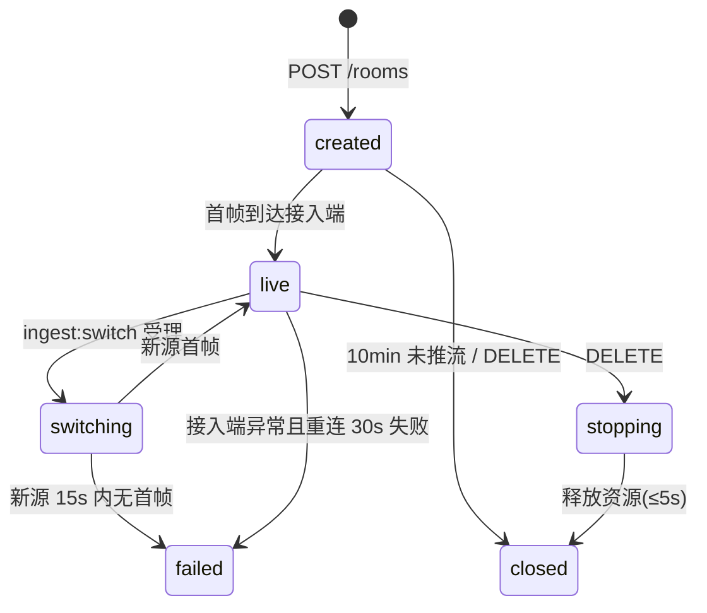
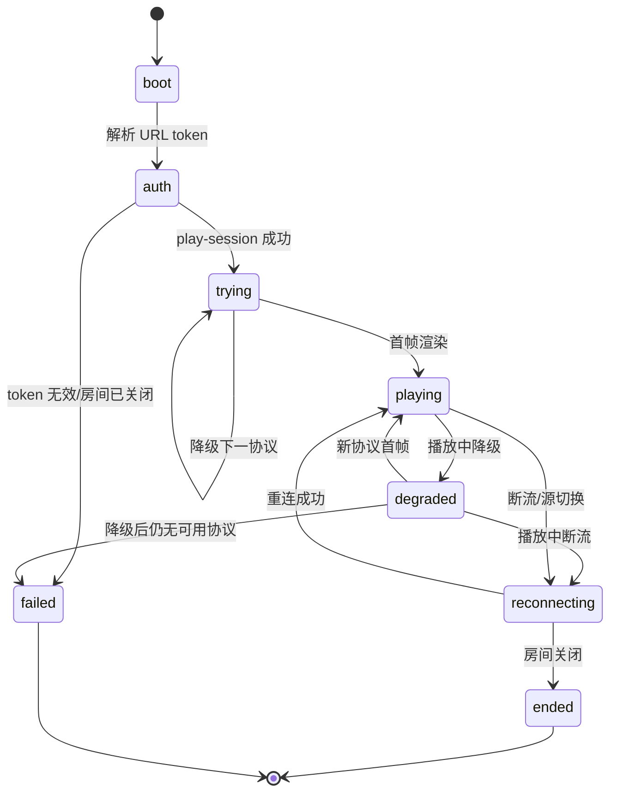

# 00 · 工程化文档统一约定（契约基线）

| 项目 | 值 |
|---|---|
| 文档状态 | 基线（Draft → Baseline，供全部子文档引用） |
| 文档版本 | v1.5（v1.0 基线 + v1.1–v1.4 裁定 + v1.5 架构解耦红线，见 §16–§20） |
| 适用 PRD | [PRD v1.0](./PRD-v1.0.md) |
| 维护人 | Team Lead |
| 最后更新 | 2026-10-20 |

> 本文件是 `docs/01`–`docs/11` 的**唯一契约来源**。任何子文档中的 URL 模板、字段名、枚举值、token 声明、错误码、状态机、性能数字，必须与本文件一致；子文档只能“细化”，不得“改写”。若发现本文件有缺口或冲突，写入子文档的“开放问题”章节并向 Lead 回报，由 Lead 统一修订本文件。

---

## 0. 工程红线：架构与模块解耦（v1.5）

> 本节为项目级 Agent 记忆（同时写入仓库根目录 `AGENTS.md`），优先级高于任何临时实现方案。

1. **单向依赖**：`app-ui/app-service/app-streaming/app-camera → app-core → lan-core`；`lan-core` 严禁依赖 Android/app。
2. **UI 只依赖契约**：`app-ui` 只能 import `com.campush.app.core` 的 `P1Controller`/`P1UiState`，禁止直接触碰相机、编码器、引擎、Service 内部实现。
3. **管线可替换**：CameraX、Camera2+MediaRecorder Surface、未来零拷贝/WebRTC 管线必须置于统一抽象之后；新增管线只允许新增实现与适配器，不得在 UI/控制器里写分支。
4. **契约冻结**：唯一播放地址、停止即失效、`3002/3003` 语义、局域网停止 ≤1s 不得破坏；跨模块能力先改契约再实现。
5. **可回退**：新管线失败必须回退兼容管线，回退不得改变播放地址与对外契约。
6. **验证门禁**：跨模块改动必须通过 `scripts/build.sh :lan-core:test :app:assembleDebug`；播放页改动跑 `tools/player-selftest`；文档改动跑 `scripts/check_docs.py --strict`。

违反以上任一条的改动，Agent 必须先与用户/Lead 确认，不得以“先写通”为由合入。

---

## 1. 文档体系与文件地图

| 编号 | 文件 | 内容 | 主责 |
|---|---|---|---|
| 00 | `00-conventions.md` | 契约基线：枚举、地址、鉴权、API、错误码、状态机、预算、写作规范 | Lead |
| 01 | `01-architecture.md` | 总体架构：双模式拓扑、组件职责、数据流、部署、技术选型与取舍 | 架构 |
| 02 | `02-client-modules.md` | Android 客户端模块拆分、包结构、线程/状态模型、保活、降级 | 架构 |
| 03 | `03-cloud-service.md` | 公网服务端：接入、转封装、WHEP、FLV、HLS、TURN、房间生命周期、容量 | 服务端 |
| 04 | `04-interface-contracts.md` | 接口契约：REST / 媒体面 / SSE / 时序 / 幂等 / 版本兼容 | 服务端 |
| 05 | `05-lan-service.md` | 局域网端侧服务：HTTP 服务、MJPEG/FLV 分发、PIN、并发、AP 隔离 | 端侧 |
| 06 | `06-playback-page.md` | H5 播放页：自适应降级、重连、UI 状态、兼容矩阵、埋点 | 播放页 |
| 07 | `07-security-privacy.md` | 鉴权模型、威胁建模、隐私合规、日志脱敏、渗透测试清单 | 安全 |
| 08 | `08-m0-verification.md` | M0 技术验证：假设、实验方法、设备矩阵、通过标准、退出条件 | 交付 |
| 09 | `09-task-plan.md` | WBS、依赖图、里程碑、人力、排期、Definition of Done | 交付 |
| 10 | `10-observability.md` | 指标定义、埋点契约、看板、验收口径映射（PRD §16） | 交付 |
| 11 | `11-risk-adr.md` | 风险登记册、开放问题、ADR 决策记录 | 交付 |

命名规则：`{两位编号}-{kebab-case-主题}.md`；编号即阅读顺序，新增文档只允许追加编号，不复用、不改号。

---

## 2. 术语与缩写

沿用 PRD §19，并补充工程口径：

| 术语 | 工程口径 |
|---|---|
| 推流面（Ingest Plane） | App → 接入端，协议仅 WHIP / SRT / RTMP |
| 播放面（Playback Plane） | 播放页 → 媒体源，协议仅 WebRTC(WHEP) / HTTP-FLV / HLS（局域网为 FLV / MJPEG，M2 起含 WebRTC P2P） |
| 页面面（Page Plane） | 播放页自身与房间状态的 REST/SSE 交互 |
| 源切换（Source Switch） | 推流协议变更时，服务端在不改 roomId、不改 playUrl 的前提下切换播放源 |
| 端侧服务 | 运行在 App 进程/前台服务内的 HTTP 媒体服务，仅在 LAN 模式存在 |
| 唯一地址不变量 | 标准模式下，同一推流会话内 UI/剪贴板/二维码/分享中的播放地址字符串恒定 |

**易混点消歧**：`accessScope` 决定“服务端在哪”；`pushProtocol` 决定“怎么把流送进去”；`playProtocol` 由播放页内部决定，用户不可见、不可选。

---

## 3. 全局枚举（wire 值一律小写）

| 枚举 | wire 值 | 说明 | 终态 |
|---|---|---|---|
| `accessScope` | `"lan"` / `"wan"` | 访问范围；推流中锁定 | 是（随推流会话） |
| `captureMode` | `"single_back"` / `"single_front"` / `"dual"` | 采集模式；`dual` 不支持时 UI 不呈现 | 否 |
| `dualLayout` | `"pip"` / `"split_h"` / `"split_v"` | 双摄合成方式，仅 `dual` 有效 | 否 |
| `dualPrimary` | `"back"` / `"front"` | 双摄主画面，PiP 与分屏均适用 | 否 |
| `pushProtocol` | `"whip"` / `"srt"` / `"rtmp"` | 推流协议；默认 `"whip"` | 否（WAN 可热切，LAN 锁定） |
| `playProtocol` | `"webrtc"` / `"flv"` / `"hls"` / `"mjpeg"` | 播放协议；播放页内部降级链使用 | — |
| `roomState` | `"created"` / `"live"` / `"switching"` / `"stopping"` / `"closed"` / `"failed"` | 房间状态 | `closed`/`failed` |
| `ingestState` | `"connecting"` / `"publishing"` / `"reconnecting"` / `"ended"` / `"failed"` | 单条推流会话状态 | `ended`/`failed` |
| `playerState` | `"boot"` / `"auth"` / `"trying"` / `"playing"` / `"degraded"` / `"reconnecting"` / `"ended"` / `"failed"` | 播放页状态 | `ended`/`failed` |

客户端内部 Kotlin/Java 枚举用 `UPPER_SNAKE`，序列化到 JSON 时统一转小写；文档表格同时给出两者时写作 `WHIP / "whip"`。

### 3.1 状态机（三个，必须与 03/04/05/06 章节一致）





---

## 4. 标识与地址模型

### 4.1 ID 规范

| 字段 | 格式 | 示例 |
|---|---|---|
| `roomId` | `r` + 9 位 Crockford Base32（小写，去掉 `0 1 i l o u`） | `r7k2m9x4qp` |
| `ingestId` | `ing_` + 16 位 Crockford | `ing_9f3k2m7q4x8p1t5w` |
| `playSessionId` | `pls_` + 16 位 Crockford | `pls_3m8x2k9q7p4t1w6z` |
| `switchId` | `sw_` + 12 位 Crockford | `sw_8k2m9x4qp7t3` |
| `requestId` | `req_` + 16 位 Crockford，服务端生成，回写响应头 `X-Request-Id` | `req_…` |

Crockford Base32 字符集：`abcdefghjkmnpqrstuvwxyz23456789`（32 字符）。

### 4.2 URL 模板（子文档一律引用本表，不得自造）

| 用途 | 模板 |
|---|---|
| 公网唯一播放地址 | `{playHost}/s/{roomId}?token={pageToken}` |
| 局域网唯一播放地址 | `http://{lanIp}:{port}/s/{pageToken}` |
| 云端 API | `{apiHost}/api/v1/...` |
| WHIP 接入 | `{whipHost}/whip/{roomId}` |
| WHEP 播放 | `{whepHost}/whep/{roomId}` |
| HTTP-FLV | `{playHost}/live/{roomId}.flv?mt={mediaToken}` |
| HLS | `{playHost}/hls/{roomId}/index.m3u8?mt={mediaToken}` |
| 房间事件 SSE | `{apiHost}/api/v1/rooms/{roomId}/events?mt={mediaToken}` |
| 局域网流 | `http://{lanIp}:{port}/live.flv?mt=…` / `…/stream.mjpg?mt=…` |
| 埋点批量上报（WAN 播放页） | `{apiHost}/api/v1/telemetry/batch` |
| 埋点批量上报（LAN 播放页） | `http://{lanIp}:{port}/api/v1/telemetry/batch` |

默认占位实参：`playHost=play.example.com`、`apiHost=api.example.com`、`whipHost=ingest.example.com`、`whepHost=ingest.example.com`。所有子文档出现域名时必须使用这些占位值，禁止出现真实客户域名。

### 4.3 唯一地址不变量（可测试）

1. 同一 `roomId` 生命周期内，`playUrl` 字符串在 `created → live → switching → live → stopping` 全程不变。
2. 协议热切换、播放页降级、播放页重连均**不得**改变浏览器地址栏 URL。
3. 停止后 `closed` 态访问 `playUrl` 必须返回 `410 Gone`（页面可渲染“已结束”态），且媒体端点返回 `410`/`404`，不得继续返回媒体字节。
4. 局域网模式停止后，`http://{lanIp}:{port}` 连接必须 `connection refused`（服务已关闭），不得仅返回错误页。

### 4.4 局域网检测

| 检测项 | 判定 | 用户提示 |
|---|---|---|
| 网络类型 | `WIFI` / `CELLULAR` / `NONE` | 非 Wi-Fi 且无热点 → 禁用 LAN 模式（错误码 `6003`） |
| 局域网 IP | 从 `ConnectivityManager`/`LinkProperties` 取非 loopback IPv4 | 取不到 → 禁用 LAN 模式 |
| AP 隔离 | 端侧服务启动后自检：`GET http://{lanIp}:{port}/healthz` 成功但外部设备不可达，结合用户反馈判定 | 提示“疑似 AP 隔离/防火墙”+ 排查清单 |
| IP 变化 | 1s 轮询 `LinkProperties` 变化 | 地址变化 → 播放地址更新并提示重新复制，旧 token 立刻失效 |
| 热点 | `WifiManager.isWifiEnabled` 且有 `SoftAp` 或 `WifiSsid` 为空 | 提示“观看设备需连接本机热点” |

---

## 5. 鉴权与 token 契约

### 5.1 token 体系（全部 JWT，HS256；WAN 由云端签名，LAN 由设备本地随机密钥签名）

| token | 携带位置 | `aud` | `scope` | TTL | 签发方 | 撤销 |
|---|---|---|---|---|---|---|
| `pageToken` | 播放地址 query `?token=` / LAN 路径段 | `page` | `["play"]` | 60 min，且 ≤ 房间剩余寿命 | WAN：云端；LAN：端侧 | 房间 `closed` 即失效（不依赖 exp） |
| `mediaToken` | 媒体面 query `?mt=`、WHEP `Authorization: Bearer` | `media` | `["play"]` | 300 s，可续期 | 云端 / 端侧 | 房间关闭、token exp、并发上限 |
| `ingestToken` | WHIP `Authorization: Bearer`、RTMP `?token=`、SRT `streamid` | `ingest` | `["publish"]` | 房间寿命（≤12 h） | 云端 | 房间关闭、协议切换后旧 token 有 5 s grace |

JWT claims（全部 token 共用）：

| claim | 类型 | 必填 | 说明 |
|---|---|---|---|
| `iss` | string | 是 | `campush` |
| `sub` | string | 是 | `roomId` |
| `aud` | string | 是 | `page` / `media` / `ingest` |
| `scope` | string[] | 是 | 见上表 |
| `iat` / `exp` | number | 是 | 秒级时间戳，`exp - iat` 不超过上表 TTL |
| `jti` | string | 是 | 16 位随机串，用于审计与重放检测 |
| `sid` | string | 否 | `ingestId` 或 `playSessionId` |
| `pin` | boolean | 否 | `true` 表示还需 PIN 二次校验（仅 `pageToken`） |
| `lan` | boolean | 否 | `true` 表示端侧签发（仅 LAN） |

规则：

- **推流密钥不出现在任何 UI、剪贴板、二维码、分享文案、日志、埋点中**；`ingestToken` 只存在于内存与推流 SDK 配置中。
- 播放地址中的 `pageToken` 是“可传递凭证”，UI 必须提示“任何拿到链接的人可观看”，开启口令后仍提示。
- `pageToken` 刷新：`POST /api/v1/rooms/{roomId}/page-token:refresh`，Header `Authorization: Bearer <pageToken>`，返回新 `pageToken`；播放页仅在内存/sessionStorage 保存新值，**不改地址栏**。
- `mediaToken` 续期：`POST /api/v1/rooms/{roomId}/play-session`（带 `X-Page-Token`，同会话可复用 `playSessionId`）在剩余 ≤ 60 s 时由播放页触发；LAN 模式 TTL 同为 300 s。
- 撤销语义：房间关闭后所有 token 立即失效；服务端校验顺序为 `签名 → exp → 房间状态 → 会话/并发`，错误码见 §9。
- 算法与密钥：WAN 密钥按环境隔离、90 天轮换，支持 `kid`；LAN 密钥每次推流会话随机生成 256 bit，停止即销毁，不持久化。

### 5.2 PIN（观看口令）

- 4–6 位纯数字，房间级，`pinRequired=true` 时启用；创建房间时由 App 生成或用户自定义。
- 校验点：`POST /api/v1/rooms/{roomId}/play-session` 请求体 `{"pin":"1234"}`；未携带或错误返回 `401` + 错误码 `3004` / `3005`。
- 限速：同一 IP 5 次/分钟，连续 10 次失败锁定 10 分钟（`3006` + `Retry-After`）；LAN 模式同规则，端侧内存计数。
- PIN 不得出现在 URL、二维码中；分享文案只提示“需要口令”。

---

## 6. 云端 REST 契约（WAN）

统一前缀 `{apiHost}/api/v1`；请求/响应 `application/json; charset=utf-8`；时间一律 RFC 3339 UTC（`2026-10-20T00:00:00Z`）；幂等键 `Idempotency-Key` 用于创建与停止。

### 6.1 端点总表

| 方法 | 路径 | 鉴权 | 成功码 | 用途 |
|---|---|---|---|---|
| `POST` | `/rooms` | 账号 Bearer | `201` | 创建房间与推流凭证 |
| `GET` | `/rooms/{roomId}` | 账号 Bearer | `200` | 查房间（App 侧） |
| `DELETE` | `/rooms/{roomId}` | `ingestToken` | `204` | 停止推流并销毁房间 |
| `POST` | `/rooms/{roomId}/ingest:switch` | `ingestToken` | `202` | 热切换推流协议，地址不变 |
| `GET` | `/rooms/{roomId}/status` | `pageToken` | `200` | 播放页/App 查状态 |
| `POST` | `/rooms/{roomId}/play-session` | `pageToken` | `200` | 换 `mediaToken`、校验 PIN、返回可用播放协议 |
| `POST` | `/rooms/{roomId}/page-token:refresh` | `pageToken` | `200` | 刷新页面 token |
| `GET` | `/rooms/{roomId}/events` | `mediaToken` (query `mt`) | `200` SSE | 房间状态/源切换事件 |
| `POST` | `/whip/{roomId}` | `ingestToken` | `201` | WHIP SDP Offer → Answer |
| `PATCH` | `/whip/{roomId}` | `ingestToken` | `204` | ICE Trickle |
| `DELETE` | `/whip/{roomId}` | `ingestToken` | `204` | 结束推流会话 |
| `POST` | `/whep/{roomId}` | `mediaToken` | `201` | WHEP SDP Offer → Answer |
| `DELETE` | `/whep/{roomId}/{playSessionId}` | `mediaToken` | `204` | 结束播放会话 |
| `GET` | `/live/{roomId}.flv` | `mediaToken` (query `mt`) | `200` | HTTP-FLV 长连接 |
| `GET` | `/hls/{roomId}/index.m3u8` | `mediaToken` (query `mt`) | `200` | HLS 播放列表 |
| `GET` | `/hls/{roomId}/{segment}` | 会话 Cookie `cmp_ps` | `200` | HLS 分片 |

### 6.2 关键请求/响应（字段名冻结）

`POST /rooms` 请求（可选字段 `pin`：仅 `pinRequired=true` 时由 App 生成 4–6 位数字并上行；服务端只存哈希，永不下发、不回显、不写日志）：

```json
{
  "accessScope": "wan",
  "captureMode": "single_back",
  "pushProtocol": "whip",
  "maxDurationSec": 43200,
  "pinRequired": false,
  "client": { "platform": "android", "appVersion": "1.0.0", "deviceModel": "Pixel 8" }
}
```

`POST /rooms` 响应（`201`）：

```json
{
  "roomId": "r7k2m9x4qp",
  "state": "created",
  "createdAt": "2026-10-20T08:00:00Z",
  "expireAt": "2026-10-20T20:00:00Z",
  "playUrl": "https://play.example.com/s/r7k2m9x4qp?token=eyJ...",
  "ingest": {
    "protocol": "whip",
    "whipUrl": "https://ingest.example.com/whip/r7k2m9x4qp",
    "rtmpUrl": "rtmp://ingest.example.com/live/r7k2m9x4qp?token=eyJ...",
    "srtUrl": "srt://ingest.example.com:10080?streamid=#!::r=r7k2m9x4qp,t=eyJ...",
    "token": "eyJ..."
  },
  "turn": {
    "urls": ["turn:turn.example.com:3478?transport=udp"],
    "username": "1729400000:r7k2m9x4qp",
    "credential": "base64..."
  },
  "limits": { "maxViewers": 100, "maxDurationSec": 43200 }
}
```

`POST /rooms/{roomId}/play-session` 请求：Header `X-Page-Token`，body `{"pin":"1234","protocolPreference":"auto"}`；响应：

```json
{
  "playSessionId": "pls_3m8x2k9q7p4t1w6z",
  "mediaToken": "eyJ...",
  "expiresIn": 300,
  "pinRequired": false,
  "roomState": "live",
  "source": { "pushProtocol": "whip", "switchedAt": "2026-10-20T08:03:00Z" },
  "protocols": {
    "webrtc": { "url": "https://ingest.example.com/whep/r7k2m9x4qp" },
    "flv": { "url": "https://play.example.com/live/r7k2m9x4qp.flv" },
    "hls": { "url": "https://play.example.com/hls/r7k2m9x4qp/index.m3u8", "segmentDurationSec": 2 }
  }
}
```

`POST /rooms/{roomId}/ingest:switch` 请求 `{"targetProtocol":"srt"}`；响应 `202`：

```json
{ "switchId": "sw_8k2m9x4qp7t3", "state": "switching", "graceMs": 5000, "playUrlUnchanged": true }
```

`GET /rooms/{roomId}/status` 响应 `200`：`{roomId, state, ingestState, pushProtocol, viewers, pinRequired, expireAt, lastFrameAt}`。

SSE 事件类型：`state`（`{roomState, ingestState}`）、`source-switched`（`{pushProtocol, switchedAt}`）、`viewer-count`（`{viewers}`）、`ended`（`{reason}`）、`heartbeat`（15 s）。

### 6.3 幂等、限流、版本

- `POST /rooms` 与 `DELETE /rooms/{roomId}` 支持 `Idempotency-Key`，24 h 内同键返回首次结果。
- 限流：账号维度 `30 req/min`；`play-session` 按 IP `60 req/min`；PIN 校验见 §5.2。超限 `429` + `Retry-After`，错误码见 §9。
- 版本：路径版本 `v1`；破坏性变更升 `v2` 并双跑 ≥ 90 天；新增字段必须可选，客户端忽略未知字段。
- 房间上限：单账号并发 `live` 房间数按套餐（默认 1）；超过返回 `2004`。

---

## 7. 媒体面契约要点

| 面 | 协议 | 鉴权 | 关键约束 |
|---|---|---|---|
| WHIP 推流 | HTTP POST SDP，`201` 返回 Answer；支持 Trickle ICE（`PATCH`）、`DELETE` 结束 | `Authorization: Bearer <ingestToken>` | 仅 H.264 + Opus；`a=setup:actpass`；服务端必须回 ICE/DTLS 参数；单 roomId 同时只允许 1 条 `publishing` 会话，新会话顶掉旧会话（旧会话 `409`/错误码 `4004`） |
| SRT 推流 | `srt://…?streamid=#!::r={roomId},t={ingestToken}` | streamid token | 仅 listener 模式；`latency=200`；支持 `messageapi` 关闭 |
| RTMP 推流 | `rtmp://…/live/{roomId}?token=` | query token | 仅 H.264/AAC；GOP ≤ 2 s |
| WHEP 播放 | HTTP POST SDP | `Authorization: Bearer <mediaToken>` | 服务端为 SFU 单转发；浏览器需 `recvonly`；ICE 优先 host/srflx，失败回落 TURN（`7005`） |
| HTTP-FLV | HTTP 长连接 | `?mt=` | `Content-Type: video/x-flv`；`Cache-Control: no-store`；每 5 s 至少 1 个 FLV tag 保活 |
| HLS | m3u8 + fMP4（`init.mp4` + `seg-{n}.m4s`，v1 定稿；TS 作为兼容开关，M2 再评估） | playlist `?mt=`，分片 Cookie `cmp_ps` | `EXT-X-TARGETDURATION:2`；保留 6 个分片；直播窗口 ≥ 12 s；`#EXT-X-ENDLIST` 在 `closed` 时写入 |

推流编码基线（客户端与服务端共守）：H.264 Baseline/Main、`yuv420p`、关键帧间隔 2 s（弱网可 1 s）、音频 AAC-LC 48 kHz 立体声 128 kbps（可降 64 kbps 单声道）、总码率默认 2.5 Mbps（720p30），自适应区间 800 kbps–4 Mbps。

---

## 8. 局域网端侧服务契约（LAN）

前缀 `http://{lanIp}:{port}`，默认端口 `8089`，占用则 `8090`–`8099` 顺延；`Server` 头 `CamPush-LAN/1.0`。

| 方法 | 路径 | 鉴权 | 说明 |
|---|---|---|---|
| `GET` | `/s/{pageToken}` | token 校验 | 返回内嵌播放页（单文件 HTML，≤ 64 KB，无外链 CDN） |
| `GET` | `/api/v1/status` | `X-Page-Token` | `{state, lanIp, port, viewers, maxViewers, pinRequired, mediaProtocols:[…], uptimeSec}` |
| `POST` | `/api/v1/play-session` | `X-Page-Token` | body `{pin?}` → `{playSessionId, mediaToken, expiresIn:300, protocols:{flv,mjpeg}, pinRequired}` |
| `GET` | `/live.flv?mt=` | `mediaToken` | HTTP-FLV（主通道） |
| `GET` | `/stream.mjpg?mt=` | `mediaToken` | MJPEG（`multipart/x-mixed-replace; boundary=--frame`） |
| `GET` | `/healthz` | 无 | `200 {"ok":true}`，仅用于本机自检，不返回房间信息 |
| `OPTIONS` | `*` | 无 | 仅允许同源，`Access-Control-Allow-Origin` 不设置 |

约束：

- 绑定 `0.0.0.0`；仅 Wi-Fi/热点网络可用；无公网可达承诺。
- 并发观看上限默认 3（可配 1–3），超限 `429` + 错误码 `6005`；`viewers` 计数以“持有有效 `mediaToken` 且连接存活”为准。
- 停止推流：先回 `204` 结束播放会话、发 `Connection: close`，再关闭 `ServerSocket`，最后销毁 token 密钥；全过程 ≤ 1 s。
- 播放页与 API 同源，不依赖外网（字体/图标全部内联），断外网仍可打开。
- 不提供 HLS；不提供 HTTPS（证书不可信，明确提示“仅限可信局域网”）；不提供跨域。

---

## 9. 错误码与错误信封

### 9.1 信封

```json
{
  "code": 3003,
  "error": "token_expired",
  "message": "Playback token has expired",
  "retryable": false,
  "userHint": "播放凭证已过期，请向分享者重新获取地址",
  "requestId": "req_9f3k2m7q4x8p1t5w"
}
```

HTTP 状态映射：`400/401/403/404/409/410/413/425/429/500/502/503/504` 按语义选用；`code` 为唯一业务判定依据，客户端不得仅凭 HTTP 状态分支。

### 9.2 号段与常用码

| 号段 | 域 | 示例码 |
|---|---|---|
| 1xxx | 客户端采集/编码 | `1001` camera_permission_denied、`1002` mic_permission_denied、`1003` camera_in_use、`1004` dual_camera_unsupported、`1005` encoder_init_failed、`1006` composition_failed、`1007` foreground_service_denied |
| 2xxx | 房间/生命周期/额度 | `2001` room_not_found、`2002` room_closed、`2003` room_expired、`2004` room_quota_exceeded、`2005` room_busy、`2006` switch_in_progress、`2007` invalid_state、`2008` max_viewers_reached、`2009` unsupported_capture_mode |
| 3xxx | 鉴权 | `3001` token_missing、`3002` token_invalid、`3003` token_expired、`3004` pin_required、`3005` pin_invalid、`3006` pin_locked、`3007` ingest_token_invalid、`3008` rate_limited |
| 4xxx | 推流接入 | `4001` ingest_connect_failed、`4002` ingest_protocol_unsupported、`4003` ingest_timeout、`4004` ingest_rejected、`4005` ingest_codec_unsupported、`4006` ingest_bitrate_exceeded |
| 5xxx | 播放 | `5001` webrtc_unavailable、`5002` flv_unavailable、`5003` hls_unavailable、`5004` no_media、`5005` playback_unsupported、`5006` ice_failed、`5007` whep_rejected |
| 6xxx | 端侧服务 | `6001` lan_service_start_failed、`6002` port_in_use、`6003` lan_not_connected、`6004` ap_isolation_suspected、`6005` viewer_limit_reached、`6006` media_pipeline_error、`6007` lan_https_unavailable |
| 7xxx | 网络/性能 | `7001` network_unstable、`7002` upstream_bandwidth_low、`7003` thermal_throttle、`7004` battery_low、`7005` turn_unavailable、`7006` dns_failed |

规则：`retryable=true` 时播放页/客户端才展示“重试”；新增码只追加不复用；同一语义在 WAN/LAN 必须复用同一码（如 token 过期固定 `3003`）。

---

## 10. 性能预算基线（所有文档引用本表）

### 10.1 端到端延迟（WAN）

| 环节 | p50 | p95 | 说明 |
|---|---|---|---|
| 采集 + 编码 | 40 ms | 70 ms | 720p30 硬编 |
| 上行网络 + 接入 | 40 ms | 120 ms | 同城；跨地域另计 |
| 服务端转发 | 20 ms | 60 ms | SFU 内转发 |
| 下行网络 | 40 ms | 120 ms | — |
| 抖动缓冲 | 80 ms | 200 ms | 自适应 60–250 ms |
| 解码 + 渲染 | 30 ms | 60 ms | — |
| **合计** | **≈ 250 ms** | **≈ 630 ms** | 目标 200–800 ms，PRD §6.1 |

### 10.2 首帧预算（WAN 播放页，目标 < 2 s）

| 阶段 | 预算 | 失败阈值（进入降级） |
|---|---|---|
| HTML/JS 加载（内联，无外链） | 300 ms | 2 s |
| token 校验 + `play-session` | 250 ms | 2 s |
| WHEP 信令 + ICE/DTLS | 600 ms | 2.5 s |
| 等待首个关键帧 | 500 ms | 计入 2.5 s |
| 解码首帧 + 渲染 | 200 ms | — |
| **合计** | **≤ 1.85 s** | 阶梯兜底总耗时 ≤ 10 s |

降级阶梯（WAN）：`webrtc(2.5s) → flv(2.0s) → hls(5.0s)`；任一侧 `unsupported` 立即跳过；全部失败 → `playerState=failed` 展示错误码与重试。LAN：`flv(2.0s) → mjpeg(2.0s)`（M2 起 `webrtc(2.5s) → flv → mjpeg`）。

### 10.3 关键业务时延

| 指标 | 目标 | 口径 |
|---|---|---|
| 冷启动到可推流（已授权） | ≤ 10 s | PRD §16.2；含相机首帧预览 |
| 点击“开始推流”到播放地址可用 | ≤ 3 s | `created → live` 且首帧到达接入端 |
| 推流协议热切换中断 | ≤ 3 s（p95 ≤ 5 s） | 旧源断流到新源首帧 |
| 停止到地址失效 | ≤ 1 s（LAN）/ ≤ 2 s（WAN 410） | 从点击停止计时 |
| 播放页降级切换 | ≤ 1 s 额外等待 | 不含上一协议失败判定时间 |

### 10.4 资源预算（Android）

| 场景 | CPU（8 核设备） | 温度上升（10 min） | 功耗 | 内存 |
|---|---|---|---|---|
| 单摄 720p30 WHIP | ≤ 25% | ≤ 6 ℃ | ≤ 1.4 W·h / 10 min | ≤ 220 MB |
| 双摄 PiP 720p30 | ≤ 45% | ≤ 10 ℃ | ≤ 2.2 W·h / 10 min | ≤ 320 MB |
| LAN 模式 + 3 观看者 | ≤ 35% | ≤ 8 ℃ | ≤ 1.8 W·h / 10 min | ≤ 260 MB |

阈值：`thermalStatus ≥ SEVERE` 或电池 ≤ 20% 且未充电 → 触发降级（`7003`/`7004`），UI 必须提示。

---

## 11. 埋点与可观测事件契约

事件名 `snake_case`，公共属性：

| 属性 | 类型 | 说明 |
|---|---|---|
| `sessionId` | string | App 前台会话 ID |
| `traceId` | string | 一次推流/播放链路的关联 ID，WAN 下发、LAN 本地生成 |
| `accessScope` | enum | `lan`/`wan` |
| `pushProtocol` | enum | `whip`/`srt`/`rtmp` |
| `appVersion` / `osVersion` / `deviceModel` | string | 设备维度 |
| `networkType` | enum | `wifi`/`cellular`/`none` |
| `roomIdHash` | string | `SHA-256(roomId)` 前 8 字节 hex，**不上报明文 roomId** |

必埋事件（10 号文档细化）：

| 分组 | 事件 | 关键属性 |
|---|---|---|
| 会话 | `app_open` | `launchSource`、`coldStartMs`、`firstRun` |
| 推流 | `push_start_clicked`、`push_start_success`、`push_failed`、`push_stop` | `durationMs`、`code` |
| 播放 | `play_page_open`、`play_first_frame`、`play_fallback`、`play_failed`、`play_stall_start`、`play_stall_end` | `playProtocol`、`timeToFirstFrameMs`、`from`→`to`、`reason`、`stallDurationMs` |
| 切源 | `protocol_switch_start`、`protocol_switch_end` | `interruptMs` |
| 地址 | `address_copied`、`qr_shown`、`share_clicked` | `accessScope` |
| 局域网 | `lan_viewer_join`、`lan_viewer_leave`、`ap_isolation_detected` | `viewers` |
| 性能 | `degrade_triggered`、`thermal_sample`、`latency_sample` | `reason`、`thermalStatus`、`batteryTempC`、`e2eMs`、`parts` |
| 权限 | `permission_denied`、`permission_granted` | `permission` ∈ `camera`/`mic`/`notification`/`foreground_service` |

上报通道：

- WAN 播放页：`POST {apiHost}/api/v1/telemetry/batch`，`Authorization: Bearer <mediaToken>`，单批 ≤ 50 条、间隔 ≥ 10 s，失败静默丢弃。
- LAN 播放页：`POST http://{lanIp}:{port}/api/v1/telemetry/batch`，端侧转发；断网丢弃、不缓存。
- App 端：走统一 SDK，队列化 + 离线补报（≤ 7 天、≤ 1000 条），补报同样受禁止字段约束。

禁止上报：`pageToken`/`mediaToken`/`ingestToken`/PIN、完整 roomId、完整播放地址、IP 地址、Wi-Fi SSID、原始视频/音频、通讯录。

---

## 12. 客户端与服务端边界（同步给 01/02/03）

| 能力 | LAN 模式 | WAN 模式 |
|---|---|---|
| 房间生命周期 | App 内 `LanServiceManager` | 云端 `RoomService` |
| 鉴权签发 | 端侧随机密钥 | 云端 KMS/HMAC |
| 媒体分发 | 端侧 `HttpMediaServer`（MJPEG/FLV） | 云端 SFU + 转封装 + HLS |
| 推流接入 | 本地环回（`127.0.0.1` 管道/共享内存/进程内回调） | WHIP/SRT/RTMP 公网接入 |
| 播放页资源 | 打包进 APK 的 `assets/lan/player.html`，单文件内联 | CDN 静态资源，版本化 `player-{semver}.js` |
| 端口/域名 | `{lanIp}:8089` | 占位域名 |
| 失效判定 | 服务关闭 + 密钥销毁 | 房间销毁 + 410 |

**不可跨边界承诺**：LAN 不承诺公网可达、HLS 兜底、弹性并发、TURN；WAN 不承诺“无账号可用”。

---

## 13. 写作与图表规范

1. 每份文档首部必须有元信息表：文档状态、版本、依赖文档、适用 PRD 章节。
2. 每份文档必须有：目的与范围、设计主体、失败与降级、验收检查点、开放问题、变更记录。
3. 图一律 Mermaid（`flowchart`、`sequenceDiagram`、`stateDiagram-v2`），禁止外链图片；复杂部署图可用 ASCII 图补充。
4. 表格优先于长段落；数字必须带单位与口径。
5. 引用格式：`PRD §16.2`、`[04-interface-contracts.md §6.2](./04-interface-contracts.md#62-...)`。
6. 不得出现真实域名、真实密钥、真实手机号、真实 IP；示例一律用占位值或文档专用网段（`192.0.2.0/24`、`198.51.100.0/24`）。
7. 中文正文；协议名、字段名、代码、错误标识保留英文原样。
8. 禁止把“待定”当结论：不确定项必须进入“开放问题”，给出候选方案、推荐项与决策人。
9. 文档长度参考：01/02/03/04 每份 ≥ 500 行；05/06/07/08 ≥ 350 行；09/10/11 ≥ 300 行；宁实不虚。

---

## 14. 文档模板（子文档必须遵循）

```markdown
# NN · 标题

| 项目 | 值 |
|---|---|
| 文档状态 | 基线 / 草案 |
| 版本 | v1.0 |
| 依赖文档 | 00-conventions.md、… |
| 适用 PRD | §x、§y |

## 1. 目的与范围
## 2. 设计（含 Mermaid 图）
## 3. 契约与接口（如适用）
## 4. 失败、降级与边界
## 5. 验收检查点（可勾选、可测试）
## 6. 开放问题（候选方案 / 推荐 / 决策人）
## 7. 变更记录（版本 / 日期 / 变更人 / 内容）
```

---

## 15. 冲突与变更流程

1. 子文档与本文冲突：以本文为准，子文档作者在回报中标注冲突点。
2. 需要改契约：提交“契约变更请求”（说明影响文档、兼容性、迁移成本），由 Lead 更新本文并通知全部作者。
3. 版本号：契约变更升次版本（v1.0 → v1.1），破坏性变更升主版本并同步改 PRD 引用。
4. 任何文档的“一个播放地址”承诺不得被削弱；任何新增地址展示入口必须标注“专业模式”。

---

## 16. 变更记录

| 版本 | 日期 | 变更人 | 内容 |
|---|---|---|---|
| v1.0 | 2026-10-20 | Lead | 首次建立契约基线：枚举、地址、token、REST/媒体面/端侧 API、错误码、状态机、性能预算、埋点、写作规范 |
| v1.1 | 2026-10-20 | Lead | 吸收 07/08 评审意见，补充裁定：PIN 双层限速与用码、并发/额度超限码映射、麦克风拒绝语义、403/404/410 状态映射、密钥轮换与长会话、RTMPS 定位（§17） |
| v1.2 | 2026-10-20 | Lead | 吸收 03/04 评审意见，冻结 REST 补充形状：GET /rooms 响应、page-token:refresh 响应、POST /rooms `pin`、status 鉴权头、切换后凭证获取路径、`X-Trace-Id`、play-session 可选 `turn`、限流补充、HLS fMP4 定稿（§18） |
| v1.3 | 2026-10-20 | Lead | 勘误与端侧/播放页补齐：§9.1 示例改为 `3003`+`retryable=false`、播放页状态机补 `degraded→failed`、LAN 续期与字段冻结、WAN 跨源 CORS、埋点上报端点、单房间观看上限澄清（§19） |
| v1.4 | 2026-10-20 | Lead | 吸收 10/11 CR：§11 事件清单扩为分组表并补 `app_open`/`play_stall_*`/`latency_sample`/`thermal_sample`，§4.2 补埋点端点，§17.3 统一 `permission_denied{foreground_service}`，§19.7 裁定 AC-01 起算口径 |
| v1.5 | 2026-10-20 | Lead | 交付顺序改为 LAN-first：新增 §20 交付分期与契约启用顺序（P1 仅 LAN、P2 公网 + Top5 门禁、P3 专业化），契约本身不删减、仅分期启用 |

---

## 17. 裁定与澄清（v1.1，对全部子文档生效）

以下条款为 v1.1 新增裁定，优先级高于子文档中的“建议值”；子文档若与之不一致，以本节为准。

### 17.1 PIN 限速（补充 §5.2）

| 层级 | 限制 | 超限码 | HTTP | 说明 |
|---|---|---|---|---|
| 单 IP | 5 次/分钟 | `3008` rate_limited | `429` + `Retry-After` | 滑动窗口 |
| 单房间 | 20 次/分钟 | `3008` rate_limited | `429` | 防止分布式撞库拖垮房间 |
| 连续失败锁定 | 10 次失败 → 锁 10 分钟 | `3006` pin_locked | `429`/`423` | 锁定与 IP、房间同时计数 |

### 17.2 并发/额度超限错误码统一映射

| 场景 | 错误码 | HTTP | 备注 |
|---|---|---|---|
| WAN 房间数/套餐额度超限 | `2004` room_quota_exceeded | `402`/`429` | 创建房间阶段 |
| WAN 观看并发超限 | `2008` max_viewers_reached | `429` | `play-session` 阶段 |
| LAN 观看者超限（1–3） | `6005` viewer_limit_reached | `429` | 端侧计数 |
| 账号级请求限流 | `3008` rate_limited | `429` | 与 PIN 限流共码，靠 `message`/`context` 区分 |

### 17.3 权限拒绝语义（补充 PRD §9.1、§14）

| 权限 | 拒绝行为 | 错误码 | UI 要求 | 埋点 |
|---|---|---|---|---|
| 摄像头 | **阻断**，不可推流 | `1001` | 引导系统设置，说明“无法采集画面” | `permission_denied` |
| 麦克风 | **静音继续**，不阻断；后续授权可热开启 | `1002`（记录/提示用，非致命） | 顶部常驻“无声音”标识 + 一次性说明 | `permission_denied` |
| 通知/前台服务 | 降级为前台 Activity 推流，提示可能被系统回收 | `1007` | 引导通知权限与电池白名单 | `permission_denied{permission="foreground_service"}` |

理由：核心承诺是“打开即可看到画面”，音频缺失不应阻断主路径；该取舍由产品负责人确认后生效（见 11 号文档开放问题）。

### 17.4 HTTP 状态与业务码映射（补充 §9.1）

| 业务状态 | HTTP | 页面行为 |
|---|---|---|
| 房间不存在 `2001` | `404` | 播放页展示“地址无效” |
| 房间已关闭/已过期 `2002`/`2003` | `410` | 播放页展示“直播已结束”，不自动重试；`playUrl` 路由仍返回 `410` + 已结束态 HTML |
| 切换中 `switching` | `200`（`roomState=switching`） | 播放页展示“切换中”，保持旧源继续播 |
| 请求限流 `3008` | `429` | 展示“请求过于频繁，请稍后重试” |

### 17.5 密钥轮换与长会话（补充 §5.1）

- WAN 签名密钥 90 天轮换，采用双 `kid` 并存，旧 `kid` 至少保留 `2 × 最大 token TTL`（即 ≥ 30 天），保证 ≤12 h 房间不受轮换中断。
- 轮换不得导致已签发 token 提前失效；撤销只由房间关闭触发。
- LAN 设备密钥为会话级，进程重启或停止推流即销毁；不做持久化、不支持跨会话复用。

### 17.6 RTMP 传输安全定位

- v1 契约只承诺 RTMP 明文接入（PRD §6.1 口径）；RTMPS 作为 M2 可选增强项，不改变 v1 接口与错误码。
- 风险与合规处理见 07 号文档威胁 `T-S3`；是否列入 M2 由 11 号文档 ADR 决策，客户端不得自行降级为明文以外的实现。

### 17.7 文档一致性自动化

- `scripts/check_docs.py` 为文档 CI 门禁：行数、章节、Mermaid、坏链、PRD 引用、错误码、占位域名、密钥泄漏共 8 类检查。
- 任何文档修改后必须 `python3 scripts/check_docs.py --strict` 通过；CI 中以非零退出码阻断合并。

---

## 18. REST 契约补充冻结（v1.2，以 04 号文档 §3 为准）

本节把 04 号文档中“已冻结但 00 未列”的形状正式并入契约基线。子文档引用时以本节 + 04 §3 为准，两者冲突时以本节为准。

### 18.1 `GET /rooms/{roomId}`（App 侧）

- 鉴权：账号 `Authorization: Bearer <accountToken>`；非本人房间统一 `404` + `2001`（不泄露存在性）。
- 响应 `200` 字段：`roomId`、`state`、`accessScope`（固定 `"wan"`）、`captureMode`、`pushProtocol`、`createdAt`、`expireAt`、`liveAt?`、`closedAt?`、`failReason?`、`playUrl`（不变）、`ingest{whipUrl,rtmpUrl,srtUrl,token}`（当前有效凭证）。
- 用途：停止前状态确认；**协议切换 `202` 后获取目标协议的最新 `ingest.token`**（v1 唯一的凭证下发路径，switch 响应不携带新凭证）。

### 18.2 `POST /rooms/{roomId}/page-token:refresh`

- 鉴权：`Authorization: Bearer <pageToken>`；响应 `200`：`{"pageToken":"<new>","expiresIn":3600}`，`exp ≤ min(now+3600, room.expireAt)`。
- 旧 token 在 `exp` 前继续有效（可重试）；播放页只更新内存/sessionStorage，**不改地址栏**。

### 18.3 `POST /rooms/{roomId}/play-session` 补充

- 可选响应字段 `turn`：`{urls,username,credential,expiresIn}`；当房间级 TURN 凭证剩余寿命 < 60 min 时必须返回，供长时观看续期。
- 请求体 `protocolPreference` 在 v1 只接受 `"auto"`（用户不可见、不可选）。
- PIN 校验失败：`401` + `3004`/`3005`；限流 `429` + `3008`；锁定 `429` + `3006`。

### 18.4 `GET /rooms/{roomId}/status`

- 鉴权：`Authorization: Bearer <pageToken>`，兼容 `X-Page-Token` 头（播放页可任选其一）。
- 响应字段：`{roomId,state,ingestState,pushProtocol,viewers,pinRequired,expireAt,lastFrameAt}`。
- 房间 `closed` 时返回 `200` + `state="closed"`（便于页面渲染结束态）；媒体端点仍返回 `410`（§4.3）。

### 18.5 限流补充（并入 §6.3）

| 维度 | 限制 | 超限 |
|---|---|---|
| `GET /rooms/{roomId}/events` 单房间 SSE 连接 | `2 × maxViewers`（上限 200） | `429`+`2008` |
| `POST /whip/{roomId}` 建连 | 10 次/分钟/房间 | `429`+`4004` |
| `POST /rooms/{roomId}/ingest:switch` | 5 次/分钟/房间 | `429`+`2006` |

### 18.6 追踪头

- 所有 REST 请求可携带 `X-Trace-Id: <16–32 位 hex>`；缺省由服务端生成并在响应回显。
- 与埋点 `traceId`（§11）为同一值；播放页从 `play-session` 响应头读取并透传到 SSE/媒体请求，实现端到端排障。
- 该头为可选，缺失不影响功能；不得包含用户标识。

### 18.7 幂等冲突

- 同一 `Idempotency-Key` 正在处理中：返回 `409` + `2005`（`retryable=true`，`Retry-After: 1`），不使用 `425 Too Early`。
- 事件流 `heartbeat.data` 固定为 `{}`；SSE 重连支持 `Last-Event-ID`，服务端重放最近 100 条。

### 18.8 协议与容器定稿

- v1 WHIP 不启用 Simulcast；`WHIP`/`WHEP` 仅 H.264 + Opus。
- v1 HLS 使用 fMP4（`init.mp4` + `seg-{n}.m4s`）；TS 作为兼容开关保留到 M2 评估。
- HLS 播放列表分片命名：`seg-{n}.m4s`，序号单调递增、不复用。

---

## 19. 勘误与端侧/播放页补齐（v1.3，对 05/06/10 生效）

### 19.1 勘误：§9.1 错误信封示例

- 原示例 `code=3002` + `error="token_expired"` 与 §9.2 号段冲突。**已修正为 `code=3003`、`retryable=false`**；`3002` 仅表示签名/格式/权限不匹配，`retryable=false`。
- 客户端与播放页分支以 §9.2 的 `code→error` 映射为准，不得依据旧示例实现。

### 19.2 播放页状态机补充

- 新增边：`degraded → failed`（降级后仍无可用协议）、`degraded → reconnecting`（播放中断流）。
- `switching` 期间播放页**保持旧源继续播**，只有旧源真实中断才进入 `reconnecting`；回退到旧源成功时**不发送** `source-switched`，播放页不展示切源提示。

### 19.3 LAN 端侧 API 补齐（并入 §8）

| 方法 | 路径 | 鉴权 | 说明 |
|---|---|---|---|
| `POST` | `/api/v1/page-token:refresh` | `X-Page-Token` | 续期页面 token；响应 `{pageToken, expiresIn}`，`exp ≤ min(now+3600, 房间剩余寿命)`；旧 token 在 `exp` 前仍有效；页面只更新内存，不改地址栏 |
| `POST` | `/api/v1/play-session` | `X-Page-Token` | 请求体可带可选 `playSessionId`：携带时复用会话与 `mediaToken` 续期（不重复计观看者），不携带时新建会话并计数 |

**实施口径（回应 05 O-05-1 / 06 O-06-2）**：M1 可暂不实现 LAN 续期，页面在 `pageToken` 过期（60 min）后提示“地址已过期，请向分享者重新获取”；端点定义供 M2 启用，启用后行为与 WAN 一致（不改地址栏）。选择 B 的理由：LAN 会话通常短于 60 min，M1 优先保证停止即失效与 PIN 链路。

LAN 字段冻结：

- `GET /api/v1/status` 的 `state` 取值域：`created` / `live` / `stopping` / `closed` / `failed`（LAN 无 `switching`）。
- `play-session` 响应 `protocols` 形状：`{"flv":{"url":"/live.flv"},"mjpeg":{"url":"/stream.mjpg"}}`（相对路径，M2 可增 `webrtc`）。
- `mediaToken` 续期：复用 play-session，响应 `expiresIn=300`；旧 `mediaToken` 在其 `exp` 前仍有效，最多并存 2 个。
- LAN 不提供 HLS、不提供 HTTPS、不提供公网；停止后端口必须 `connection refused`。

### 19.4 WAN 跨源（CORS）要求

播放页源 `https://{playHost}` 调用 `{apiHost}`（REST/SSE）与 `{whepHost}`（WHEP）时必须满足：

| 项 | 值 |
|---|---|
| `Access-Control-Allow-Origin` | `https://{playHost}`（精确匹配，禁止 `*`） |
| `Access-Control-Allow-Methods` | `GET, POST, PATCH, DELETE, OPTIONS` |
| `Access-Control-Allow-Headers` | `Authorization, Content-Type, X-Page-Token, X-Trace-Id, Last-Event-ID` |
| `Access-Control-Expose-Headers` | `X-Request-Id, X-Trace-Id, Retry-After` |
| 预检缓存 | `Access-Control-Max-Age: 600` |
| Credentials | 仅 HLS 分片 Cookie `cmp_ps`（同源 `{playHost}`，不跨源） |

SSE 需 `Content-Type: text/event-stream`、关闭代理缓冲（`X-Accel-Buffering: no`）；防火墙/网关不得剥离 `Last-Event-ID`。

### 19.5 埋点上报端点（并入 §11）

- WAN 播放页：`POST {apiHost}/api/v1/telemetry/batch`，`Authorization: Bearer <mediaToken>`，body `{"events":[{"name":"play_first_frame","ts":…,"props":{…}}]}`；单批 ≤ 50 条、间隔 ≥ 10 s；失败静默丢弃（不重试、不阻塞播放）。
- LAN 播放页：`POST http://{lanIp}:{port}/api/v1/telemetry/batch`，由端侧转发；断外网时端侧丢弃，不缓存用户数据。
- 公共属性（§11）在 Web 端映射：`sessionId` = App 下发的 `traceId`；`appVersion`/`deviceModel` 由服务端从房间元数据补齐；补充 `pageVersion`、`browser`、`osName`。禁止上报 token、完整地址、IP。
- 播放页离线上报不得使用第三方域名；不得依赖外链脚本。
- 测试事件：`debug` 包允许 `qa_` 前缀事件，仅写入测试表；生产 schema 直接拒收（回应 CR-10-06）。

### 19.6 容量口径澄清

- §6.2 `limits.maxViewers=100` 为**单房间**上限；平台级并发容量按 03 §11 与 01 §8.4 的「房间数 × 单房间码率」折算，两处数字口径不同但不得互相替代。
- 01 的 1000 并发指**平台级同时观看**（示例 R=50 房间 × 20 观看）；03 的成本样例以实际码率与出流量为准，采购报价以 03 为准。

### 19.7 AC-01 起算口径裁定（回应 OQ-09-01 / OQ-10-01）

PRD §16.2 “已授权用户从打开到拿到可访问播放地址 ≤ 10 s” 为**端到端验收口径**，拆成两个都必须通过的预算：

| 编号 | 口径 | 目标 | 测量点 |
|---|---|---|---|
| AC-01a | 冷启动“打开 App”→ 播放地址可用（权限已授予、默认设置、网络正常） | ≤ 10 s | App 进程启动 → 地址卡可复制（p50 ≤ 7 s，p95 ≤ 10 s） |
| AC-01b | 点击“开始推流”→ 地址可用 | ≤ 3 s | 点击事件 → 地址卡可复制（00 §10.3） |

- 二者不矛盾：AC-01b 是 AC-01a 的子区间；任一不达标即 AC-01 不通过。
- 测量条件：Top 20 机型、Wi-Fi/5G 各半、冷启动（进程未驻留）、首次安装后二次启动。
- 权限首次申请弹窗耗时不计入 AC-01a，但计入漏斗 `app_open → permission_granted` 时长。

---

## 20. 交付分期与契约启用顺序（v1.5）

### 20.1 分期定义

> 功能版本标签 M0–M3 保留用于**功能归属**；自 v1.5 起，**交付顺序以 P1/P2/P3 为准**。其余文档中的“M1/M2 起”按 §20.5 映射理解，涉及排期与门禁时以 P1/P2/P3 为准。

| 阶段 | 名称 | 核心目标 | 关键特征 |
|---|---|---|---|
| **P1** | 局域网可用闭环 | Android 客户端在**零云端依赖**下完成采集→编码→端侧分发→浏览器播放 | 单摄、LAN 播放页、token/PIN、并发 1–3、停止失效 |
| **P2** | 公网可访问闭环 | 云端媒体面 + WAN 播放页 + 唯一地址/切源/失效 | 依赖 Top5 决策关闭与 M0-WAN 通过 |
| **P3** | 专业化与商业化 | 双路独立、多地址、BYO、录制、套餐、观众端 | 商业化与专业模式 |

### 20.2 阶段门禁

| 阶段 | 启动条件 | 退出条件（全部满足） |
|---|---|---|
| P1 | 立项 + 本文基线冻结 | **技术门禁**：M0-LAN 的 E6 通过，E7 作为伴随项（8 类播放环境各 ≥1 条可用路径，缺口可带条件）；**开发验收**：LAN E2E、停止 ≤1 s 失效、PIN/token、并发 1–3、崩溃率、PRD §16.2 的 LAN 相关 AC 全部通过。M0-LAN 只是 P1 的前置技术门禁，不能单独宣布 P1 Go |
| P2 | **Top5 决策全部关闭** + M0-WAN（E2/E4/E5 必过，E3 条件项）通过 + P1 验收通过 | WAN 唯一地址可打开；首帧 < 2 s；协议热切换地址不变；停止后 410；播放页降级链可用；WAN 相关 AC 通过 |
| P3 | P2 GA + 商业化方案定稿 | 专业模式与商业化验收（见 09） |

### 20.3 契约启用矩阵（不删减契约，仅分期启用）

| 契约面 | P1 | P2 | P3 |
|---|---|---|---|
| 端侧 LAN API（§8） | ✅ 启用 | ✅ | ✅ |
| WAN REST（§6） | — 不启用（客户端 WAN 开关置灰） | ✅ | ✅ |
| 媒体面 WHIP/SRT/RTMP/WHEP/FLV/HLS（§7） | — | ✅ | ✅ |
| HLS / TURN | — | ✅ | ✅ |
| 双摄 / 双路 / 多地址 / BYO | — | 双摄按 D-3；其余按 D-4/D-5 | ✅ |
| 埋点（§11） | LAN 子集 | 全量 | 全量 |
| 错误码（§9） | LAN 相关码 | 全量 | 全量 |

约束：

1. P1 的“访问范围”控件必须呈现 WAN 选项但置灰，文案“公网可访问 · 阶段二开放”，不得静默隐藏（避免用户误以为产品无公网能力）。
2. P1 不得以“先实现 LAN”为由修改、裁剪或新建私有契约；P2 实现必须复用本基线，不得另起一套字段。
3. P1 验收不得依赖任何云端资源、账号或额度。
4. 本文其余章节（枚举、token、错误码、性能预算）在 P1 即生效，LAN 相关部分必须按基线实现。
5. **P1 默认访问范围 = LAN**：WAN 未交付，无法满足 PRD §4.2 “首次默认公网”；P1 必须呈现 WAN 置灰并文案说明，P2 按 D-1 恢复“默认公网”后与 PRD 对齐（登记于 09 OQ-09-06）。

### 20.4 Top5 决策门禁（P2 启动前必须关闭）

| ID | 决策项 | 推荐结论 | 决策人 | 最晚决策时点 | 阻塞的 P2 工作 | 不决策的后果 |
|---|---|---|---|---|---|---|
| D-1 | 默认访问范围是否长期保持“公网”，还是按网络自动推荐 | 保持公网 + 首次引导 | 产品 | P2 启动前（2026-12-18） | WAN 默认值、首启引导、AC-09 | P2 无法定义首启体验 |
| D-2 | 公网托管：自建媒体面 vs 第三方媒体云 | v1 自建（Mediasoup + SRS 终结）+ D2 评估混合 | 技术 + 产品 | P2 启动前（2026-12-18）；若延期，M0-WAN 按推荐值“自建”先行 | 接入/SFU 选型、成本模型、E2 环境 | 云端工作无法开工 |
| D-3 | 双摄白名单门槛与灰度策略 | 支持率 ≥40% 才作为 v1 卖点，否则实验性 | 产品 + Android | P2 启动前（2026-12-11，数据来自 M0-LAN E1） | 双摄 PiP、白名单、AC-05 | 双摄范围无法冻结 |
| D-4 | 局域网端侧是否支持 RTMP | P1 仅本地直出 FLV/MJPEG；RTMP 进 P2 评估 | 架构 | P2 启动前（2026-12-11） | P1 协议锁定、P2 LAN 增强 | P1 范围摇摆 |
| D-5 | RTMPS 是否进入 P2 | 进入 P2 评估；v1 明文 + UI 明示 | 安全 + 产品 | P2 启动前（2026-12-18） | RTMP 安全方案、合规评估 | 安全遗留项无归属 |

> 时点口径：上述时点均早于 **P2-GATE（2026-12-25）**；D-2 若延期，M0-WAN 可按推荐值“自建”先行，不阻塞实验；其余四项未关闭则 P2 不启动。

### 20.5 阶段与功能版本映射

| 阶段 | 对应功能版本 | 内容 |
|---|---|---|
| P1 | M0 的 LAN 部分 + M1 的 LAN 子集 | LAN 端侧服务验证、单摄客户端、LAN 播放页、token/PIN/并发/失效 |
| P2 | M0 的 WAN 部分 + M1 的 WAN 子集 + M2 的云端与双摄部分 | 云端接入/SFU/FLV/HLS/TURN、WAN 播放页、切源、双摄（D-3 后） |
| P3 | M2 剩余 + M3 | 双路独立、多地址、BYO、录制、套餐、观众端 |

> 引用约定：涉及**功能何时存在**时可用“M2 起”表述；涉及**何时交付、何时验收、门禁条件**时必须写 P1/P2/P3。
