# 01 · 总体架构设计与技术选型

| 项目 | 值 |
|---|---|
| 文档状态 | 基线草案（Baseline Draft，供 02/03/05/06/08/09 引用） |
| 版本 | v1.2（对齐 [00-conventions.md](./00-conventions.md) v1.1 §17 裁定） |
| 依赖文档 | [00-conventions.md](./00-conventions.md)（契约唯一来源）、[PRD-v1.0.md](./PRD-v1.0.md) |
| 适用 PRD 章节 | §1（核心决策）、§3（概念与约束）、§4（访问范围）、§5（采集模式）、§6（推流协议）、§7（播放地址）、§11（技术架构）、§12（端侧服务）、§13（公网服务端）、§14（边界）、§16（指标）、§18（风险） |
| 下游文档 | [02-client-modules.md](./02-client-modules.md)、[03-cloud-service.md](./03-cloud-service.md)、[04-interface-contracts.md](./04-interface-contracts.md)、[05-lan-service.md](./05-lan-service.md)、[06-playback-page.md](./06-playback-page.md)、[10-observability.md](./10-observability.md) |
| 维护人 | 架构文档作者（architect） |
| 最后更新 | 2026-10-20 |

> 口径声明：本文件的全部枚举值、URL 模板、token 声明、错误码、状态机、性能预算均**引用** [00-conventions.md](./00-conventions.md)，不重复定义、不重新取值。若本文件与 00 冲突，以 00 为准，并在 §16 开放问题登记冲突点。

---

## 目录

1. 目的与范围
2. 架构原则与不变量
3. 系统上下文（L0）
4. 逻辑架构：组件拓扑与职责
5. 端到端数据流
6. 部署拓扑
7. 技术选型与结论
8. 容量与成本测算模型
9. 性能预算的架构落点
10. SLO、错误预算与故障域
11. 可观测性接入点
12. 安全与合规的架构落点
13. 与 02 / 03 / 05 的职责边界
14. 失败与降级
15. 验收检查点
16. 开放问题
17. 变更记录

---

## 1. 目的与范围

### 1.1 目的

本文回答四个问题，且只回答这四个问题：

1. **CamPush 由哪些组件构成**，在「仅局域网（`accessScope="lan"`）」与「公网可访问（`accessScope="wan"`）」两种模式下，组件拓扑与部署拓扑分别是什么。
2. **数据从摄像头到观看端浏览器要经过哪些跳**，每跳归属哪个组件、受哪条契约约束、消耗多少延迟预算。
3. **技术选型的结论是什么**，为什么是这个结论，以及在什么阈值下应当推翻结论。
4. **能力边界在哪里**：哪些能力是 LAN 模式承诺的、哪些是 WAN 模式承诺的、哪些两者都不承诺。

### 1.2 范围

| 在范围内 | 说明 |
|---|---|
| 双模式组件拓扑 | WAN / LAN 两套逻辑拓扑 + 部署拓扑 |
| 组件职责与接口归属 | 每个组件的职责、读写的契约面、上游下游 |
| 端到端数据流 | 采集 → 编码 → 合成 → 推流 → 接入 → 转发 → 播放 |
| 技术选型结论 | 推流接入、SFU、转封装、HLS、TURN、Android 采集/编码/合成链路 |
| 容量与成本模型 | 100 / 1000 并发观看的公式、样例数字、假设、敏感性 |
| SLO 与故障域 | SLI/SLO、错误预算、故障域划分与降级动作 |
| 可观测性接入点 | 指标、追踪、日志、埋点的采集位置 |

### 1.3 非目标（明确不在本文解决）

| 非目标 | 归属文档 |
|---|---|
| REST / 媒体面 / SSE 的字段级契约 | [04-interface-contracts.md](./04-interface-contracts.md) |
| 云端服务内部实现（接入适配、房间生命周期实现、分片细节） | [03-cloud-service.md](./03-cloud-service.md) |
| Android 模块、包结构、线程、UiState、Kotlin 签名 | [02-client-modules.md](./02-client-modules.md) |
| 端侧 HTTP 服务的协议细节、并发计数、PIN 校验实现 | [05-lan-service.md](./05-lan-service.md) |
| 播放页 UI 状态与降级实现的函数级细节 | [06-playback-page.md](./06-playback-page.md) |
| 威胁建模、隐私合规、渗透测试清单 | [07-security-privacy.md](./07-security-privacy.md) |
| 埋点字段级契约与看板 | [10-observability.md](./10-observability.md) |
| WBS、排期、人力 | [09-task-plan.md](./09-task-plan.md) |

### 1.4 读者与用法

| 读者 | 用法 |
|---|---|
| 客户端开发者 | 读 §4、§5、§9、§13 确认「哪些逻辑归 App」；实现细节去 02 |
| 服务端开发者 | 读 §4、§5、§6、§7、§8 确认「哪些服务必须有、部署形态、容量口径」；字段去 03/04 |
| 端侧服务开发者 | 读 §4.2、§5.4、§7、§13 确认「端侧服务在整体中的位置与边界」；协议去 05 |
| 交付/测试 | 读 §10、§15 确认验收口径；M0 实验设计去 08 |
| 决策人 | 读 §2、§7.9、§8、§16 |

### 1.5 与 PRD 的口径关系

本文不新增产品承诺，只把 PRD 的承诺翻译成架构约束。PRD §1.3 的八条核心决策在本文的落点：

| PRD §1.3 决策 | 本文落点 |
|---|---|
| 推流协议只列 WHIP / SRT / RTMP | §4.1、§7.1、§7.4、§7.5；`pushProtocol ∈ {"whip","srt","rtmp"}` |
| 对外只输出一个播放地址 | §2.1「唯一地址不变量」、§5.5；地址来自 00 §4.2 模板 |
| 播放页内部自适应 | §4.3 P-ADAPT、§7.6；降级阶梯见 00 §10.2 |
| 服务端能力分两种场景 | §4 两套拓扑、§4.4 能力边界矩阵 |
| 客户端「访问范围」开关 | §4.1、§4.2；`accessScope` 推流中锁定 |
| 公网协议切换地址不变 | §5.3 时序、§2.1 不变量 1/2 |
| 停止后地址失效 | §5.5 时序、§10.4 故障域 F-01 |
| 双路独立推流是专业模式例外 | §4.4 能力边界（本文只留接口位，不做架构展开） |

---

## 2. 架构原则与不变量

### 2.1 五条不变量（可测试）

| 编号 | 不变量 | 测试方法 | 违反即阻断发布 |
|---|---|---|---|
| INV-1 | **唯一地址**：同一 `roomId` 生命周期内，`playUrl` 字符串在 `created → live → switching → live → stopping` 全程不变 | 协议热切换前后对 `playUrl` 做字符串全等断言 | 是 |
| INV-2 | **地址栏不变**：协议热切换、播放页降级、播放页重连均不改变浏览器地址栏 URL | 端到端用例：切换期间每 200 ms 采样 `location.href`，断言全等 | 是 |
| INV-3 | **停止即失效**：`roomState="closed"` 后 `playUrl` 返回 `410 Gone`，媒体端点返回 `410`/`404`，不得再返回媒体字节；LAN 模式停止后 `http://{lanIp}:{port}` 必须 `connection refused` | 停止后 1 s（LAN）/ 2 s（WAN）内探测 20 次，0 字节媒体返回 | 是 |
| INV-4 | **推流密钥不可见**：`ingestToken` 不出现在 UI、剪贴板、二维码、分享文案、日志、埋点 | 静态扫描 + 剪贴板钩子 + 日志脱敏用例 | 是 |
| INV-5 | **模式互斥**：`accessScope` 是唯一决定「服务端在哪」的开关；同一推流会话内不得同时依赖云端与端侧服务 | 代码层：`LanServiceManager` 与云端 `RoomService` 由同一 `SessionOrchestrator` 二选一注入 | 是 |

以上 1–3 与 00 §4.3 逐条对齐；4 与 00 §5.1 对齐；5 与 00 §2「易混点消歧」对齐。

### 2.2 六条设计原则

| 原则 | 含义 | 反例（明确不做） |
|---|---|---|
| P1 推流/播放解耦 | 推流面协议变化不穿透到播放面；由「源切换」吸收 | 客户端把裸流地址给用户 |
| P2 契约中心 | 所有跨进程/跨网络交互以 00 为唯一字段来源 | 子文档自造字段名 |
| P3 单栈从简（受契约约束） | 默认追求组件最少；一旦单栈无法满足「源切换不重建播放会话」「WHEP 语义可控」等硬契约，允许为契约引入专用组件，但必须记录理由、代价与回退阈值 | MVP 堆三套媒体栈却说不出各解决了哪条契约；或为省一套组件而破坏 INV-1 |
| P4 失败分层降级 | 每一跳独立失败、独立降级，不整链失败 | WebRTC 播放失败 → 整个播放页失败 |
| P5 端侧零成本优先 | LAN 模式不产生任何云端依赖与费用 | LAN 模式偷偷回调云端鉴权 |
| P6 可观测前置 | 每个跨跳边界都必须有指标或事件 | 只在 App 里打日志 |

### 2.3 与 00 的状态机关系

本文只**引用** 00 §3.1 的三个状态机（`roomState`、`playerState`、`ingestState`），不新增状态。架构上，三个状态机的归属如下：

| 状态机 | 权威持有方 | 观察方 |
|---|---|---|
| `roomState` | WAN：云端 `RoomService`；LAN：端侧 `LanServiceManager` | App、播放页（SSE / `GET /api/v1/status` / `GET /api/v1/rooms/{roomId}/status`） |
| `ingestState` | App 的 `PushSession`（客户端权威）+ 云端接入端（服务端权威） | App UI、云端状态查询；两者不一致时以**接入端**为准并触发客户端状态对齐 |
| `playerState` | 播放页（浏览器内） | 播放页自身；通过埋点 `play_first_frame` / `play_fallback` / `play_failed` 外泄 |

---

## 3. 系统上下文（L0）

### 3.1 上下文图

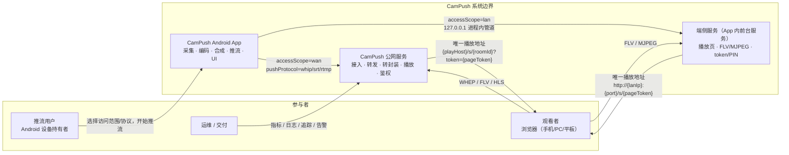

> 图中 `{playHost}=play.example.com`、`{apiHost}=api.example.com`、`{whipHost}={whepHost}=ingest.example.com`，均为 00 §4.2 规定的占位值。

### 3.2 外部依赖清单

| 依赖 | 用途 | 缺失时影响 | 归属文档 |
|---|---|---|---|
| `playHost` 域名 + 证书 | 播放页与 FLV/HLS 分发 | WAN 播放页打不开；LAN 不受影响 | 03 |
| `apiHost` 域名 + 证书 | 房间创建/查询/停止、SSE | App 无法创建房间 → 只能回退 LAN | 03 |
| `whipHost` / `whepHost` 域名 + 证书 | 推流接入与 WebRTC 播放 | `pushProtocol="whip"` 不可用 → 降级 `srt`/`rtmp`；WHEP 不可用 → 播放页降级 `flv` | 03 |
| 公网 UDP | WebRTC 媒体、SRT、TURN | WebRTC/SRT 不可用 → 降级 RTMP | 03 |
| CDN 静态资源 | 播放页 JS 版本化分发 | 播放页仍可由 `playHost` 直出兜底 | 06 |
| 账号/额度服务 | WAN 房间创建鉴权 | `accessScope="wan"` 置灰，引导 LAN（PRD §4.2） | 03/11 |

---

## 4. 逻辑架构：组件拓扑与职责

### 4.1 WAN 模式组件拓扑

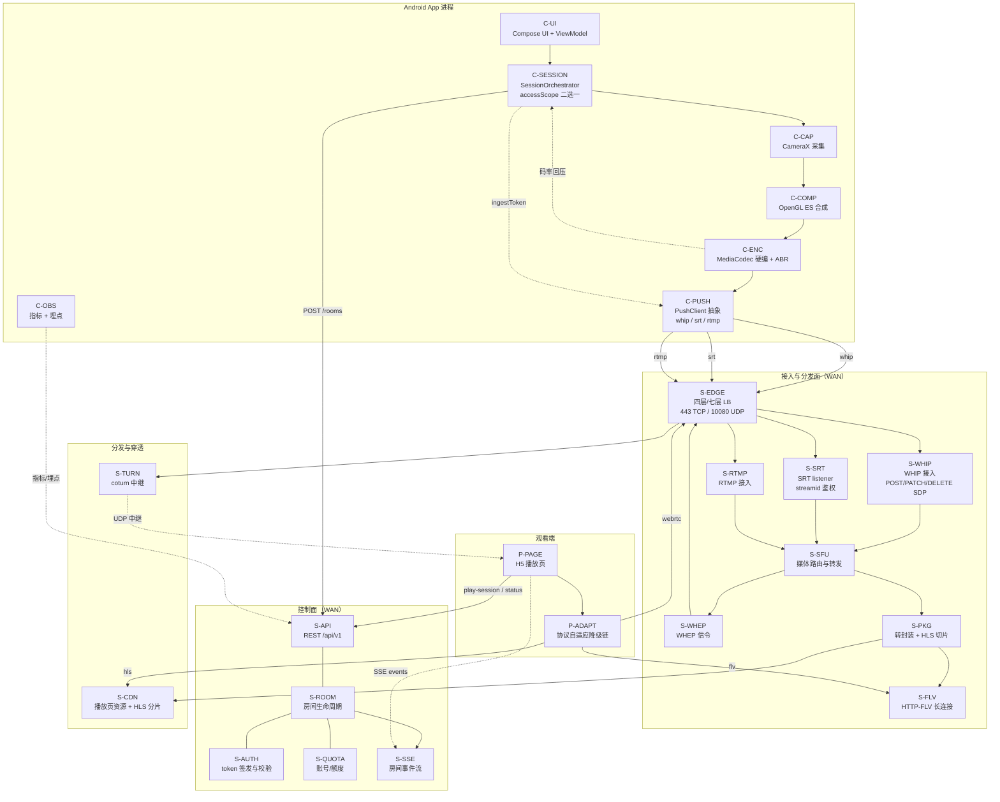

### 4.2 LAN 模式组件拓扑

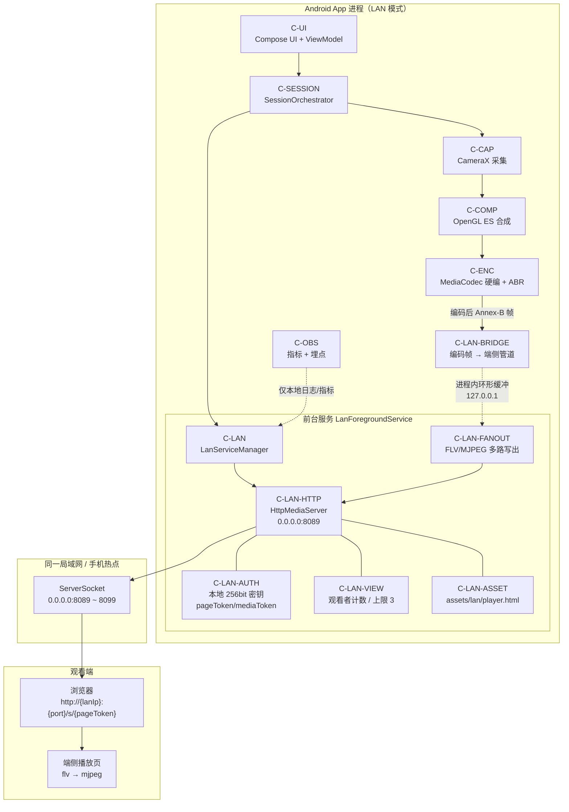

> LAN 模式**不出现任何云端组件**（P5）。`C-LAN-BRIDGE` 走进程内环形缓冲或 `127.0.0.1` 本地 socket，属于 00 §12 表中的「本地环回」实现；具体管道形态见 [05-lan-service.md](./05-lan-service.md)。

### 4.3 组件职责表

#### 4.3.1 客户端组件（细节归 02）

| 编号 | 组件 | 职责 | 输入 | 输出 | 契约引用 | 归属文档 |
|---|---|---|---|---|---|---|
| C-UI | UI 层 | 状态呈现、操作入口、地址卡片/二维码/分享 | `UiState` | 用户意图 | 00 §3 枚举 | 02 |
| C-SESSION | 会话编排 | `accessScope` 二选一注入、`roomId` 生命周期、`pushProtocol` 切换、整体状态聚合 | 房间凭证 | 组件间指令 | 00 §3、§4.2 | 02 |
| C-CAP | 采集 | CameraX 绑定、`captureMode` 切换、Multi-Camera 能力检测 | 设备能力 | `Surface`/`ImageProxy` | `captureMode`、`1004` | 02 §6 |
| C-COMP | 合成 | 双摄 PiP / `split_h` / `split_v` 合成、`dualPrimary` 交换 | 双路 OES 纹理 | 单路输出 Surface | `dualLayout`、`dualPrimary`、`1006` | 02 §8 |
| C-ENC | 编码 | MediaCodec 硬编、关键帧对齐、ABR 决策 | 合成/单路 Surface | Annex-B / AVCC 帧 + 元数据 | 00 §7 编码基线、`1005`、`7002`、`7003`、`7004` | 02 §7 |
| C-PUSH | 推流抽象 | `PushClient` 可插拔（whip/srt/rtmp）、重连、`ingestState` | 编码帧 + `ingestToken` | 网络流 | `ingestState`、`4001`–`4006` | 02 §9 |
| C-LAN | 端侧服务管理 | 启停、端口分配、密钥生命周期、并发上限 | 编码帧、LAN 检测结果 | 唯一 LAN 播放地址 | 00 §8、`6001`–`6007` | 05 |
| C-OBS | 可观测 | 埋点事件与指标上报 | 全链路事件 | 事件流 | 00 §11 | 10 |

#### 4.3.2 云端组件（细节归 03）

| 编号 | 组件 | 职责 | 有状态 | 扩缩依据 | 关键错误码 |
|---|---|---|---|---|---|
| S-EDGE | 边缘 LB | TLS 终止、按 SNI/路径分流、四层 UDP 转发 | 否 | 连接数 / 带宽 | `7006` |
| S-WHIP | WHIP 接入 | SDP Offer → Answer、Trickle ICE、单房间单 `publishing` 会话 | 是（会话） | 房间数 | `4001`、`4003`、`4004`、`4005` |
| S-SRT | SRT 接入 | listener 模式、`streamid` 鉴权、`latency=200` | 是（会话） | 房间数 | `4001`、`4003` |
| S-RTMP | RTMP 接入 | query token 鉴权、GOP ≤ 2 s 校验 | 是（会话） | 房间数 | `4001`、`4005`、`4006` |
| S-SFU | 媒体转发 | 按 `roomId` 路由、单房间单源、向 WHEP 观看者转发 | 是（路由表） | 出网带宽 | `5001`、`5006` |
| S-WHEP | WHEP 信令 | SDP 交换、`recvonly` 校验、`playSessionId` 绑定 | 是（会话） | 观看会话数 | `5007`、`3002`、`3003` |
| S-PKG | 转封装/HLS | 不转码 remux → FLV / HLS(TS)、2 s 分片、保留 6 片 | 是（缓冲） | 房间数 | `5002`、`5003` |
| S-FLV | FLV 分发 | 长连接、5 s 保活 tag、`no-store` | 是（连接） | 连接数 | `5002` |
| S-API | REST | 房间 CRUD、`play-session`、`page-token:refresh`、限流、幂等 | 否（水平扩） | QPS | `2001`–`2009`、`3001`–`3008` |
| S-ROOM | 房间生命周期 | 状态机、`created` 10 min 超时、`stopping` ≤ 5 s 释放 | 是（Redis） | 房间数 | `2001`、`2002`、`2003`、`2007` |
| S-AUTH | 鉴权 | `pageToken`/`mediaToken`/`ingestToken` 签发校验、`kid` 轮换 | 是（KMS，外部） | 低 | `3001`–`3003`、`3007` |
| S-QUOTA | 额度 | 套餐、并发 `live` 房间数（默认 1） | 是（DB） | 低 | `2004` |
| S-SSE | 事件流 | `state`/`source-switched`/`viewer-count`/`ended`/`heartbeat`(15 s) | 是（连接） | 连接数 | — |
| S-TURN | 中继 | coturn，UDP 3478 / TLS 5349，TTL 凭证 | 是（分配） | 中继带宽 | `7005` |
| S-CDN | 静态与分片分发 | `player-{semver}.js` 版本化、HLS 分片边缘缓存 | 否 | 带宽 | `5003` |

**逻辑组件 → 03 部署单元的映射**（组件编号只在本文使用，落地名以 [03-cloud-service.md §4/§10](./03-cloud-service.md) 为准）：

| 本文组件 | 03 部署单元 | 实现 |
|---|---|---|
| S-WHIP | `ingest-whip` | 薄封装 WHIP HTTP 层 + Mediasoup `WebRtcTransport` |
| S-SRT | `ingest-srt` | SRS 6.x（协议终结器：SRT → RTP） |
| S-RTMP | `ingest-rtmp` | SRS 6.x（协议终结器：RTMP → RTP） |
| S-SFU | `media-sfu` 内的 Mediasoup Worker | Mediasoup `Router`/`Transport`/`Producer`/`Consumer` |
| S-WHEP | 与 SFU 同进程的 WHEP 信令层 | 薄封装 WHEP HTTP 层 |
| S-PKG / S-FLV | `flv-remux`、`hls-packager`（同节点 sidecar） | 自研 |
| S-TURN | `turn` DaemonSet | coturn |
| S-API / S-ROOM / S-AUTH / S-QUOTA / S-SSE | `control` Deployment | 03 §8 |
| S-EDGE / S-CDN | `edge-gateway` + 托管 CDN | 03 §10 |

#### 4.3.3 播放页组件（细节归 06）

| 编号 | 组件 | 职责 | 状态归属 |
|---|---|---|---|
| P-PAGE | 播放页外壳 | 首屏渲染、`playerState` 状态机、错误与重试 UI、`pageToken` 刷新（不改地址栏） | `playerState` |
| P-ADAPT | 降级链 | `webrtc(2.5 s) → flv(2.0 s) → hls(5.0 s)`；LAN `flv(2.0 s) → mjpeg(2.0 s)` | 00 §10.2 |

### 4.4 双模式能力边界矩阵

| 能力 | LAN（`accessScope="lan"`） | WAN（`accessScope="wan"`） | 依据 |
|---|---|---|---|
| 房间生命周期 | App 内 `LanServiceManager` | 云端 `RoomService` | 00 §12 |
| 鉴权签发 | 端侧每次会话随机 256 bit 密钥 | 云端 KMS/HMAC，90 天轮换 | 00 §5.1 |
| 推流接入 | 本地环回（进程内管道 / `127.0.0.1`） | WHIP / SRT / RTMP 公网接入 | 00 §12 |
| 媒体分发 | 端侧 FLV / MJPEG | SFU + 转封装 + FLV + HLS | PRD §4.3 |
| 播放协议 | `flv` → `mjpeg`（M2 起前置 `webrtc`） | `webrtc` → `flv` → `hls` | 00 §10.2 |
| 播放页资源 | APK `assets/lan/player.html`，单文件 ≤ 64 KB，无外链 | CDN 静态资源 `player-{semver}.js` | 00 §8、§12 |
| 公网可达 | **不承诺** | 承诺（PRD §4.5） | 00 §12 |
| HLS 兜底 | **不承诺** | 承诺（播放页内部） | PRD §4.3 |
| 多观看者 | 1–3（默认 3），受上行带宽/CPU 限制 | 按套餐/额度，默认 `maxViewers=100` | 00 §8、§6.2 |
| TURN 中继 | 不提供 | coturn 提供 | 00 §7 |
| 端口/域名 | `{lanIp}:8089`（占用顺延 8090–8099） | 占位域名 + 443 | 00 §4.2、§8 |
| 失效判定 | 服务关闭（`connection refused`）+ 密钥销毁 | 房间销毁 + `410 Gone` | 00 §4.3 |
| 单次会话时长上限 | `maxDurationSec` 默认 43200（12 h） | `maxDurationSec` 默认 43200（12 h） | 00 §6.2 |
| 协议热切换 | 不支持（MVP），需停止后改 | 支持，地址不变 | PRD §6.2 |

**不可跨边界承诺**（与 00 §12 一致）：

- LAN 不承诺：公网可达、HLS 兜底、弹性并发、TURN、HTTPS。
- WAN 不承诺：无账号可用、离线可用、零成本。

---

## 5. 端到端数据流

### 5.1 主链路：采集 → 编码 → 合成 → 推流 → 接入 → 转发 → 播放

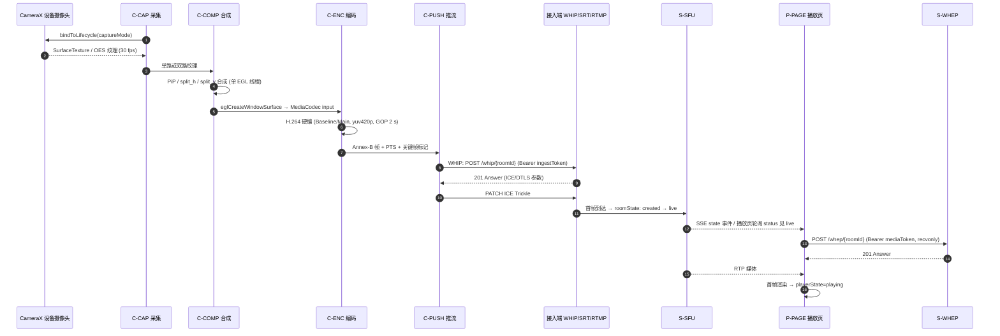

**关键时序约束**：

| 约束 | 值 | 依据 |
|---|---|---|
| 点击「开始推流」到播放地址可用 | ≤ 3 s（`created → live` 且首帧到达接入端） | 00 §10.3 |
| 已授权冷启动到可推流 | ≤ 10 s（含相机首帧预览） | 00 §10.3、PRD §16.2 |
| WAN 播放页首帧 | ≤ 1.85 s 预算，目标 < 2 s | 00 §10.2 |
| 编码关键帧间隔 | 2 s（弱网 1 s） | 00 §7 |
| RTMP GOP | ≤ 2 s（服务端校验） | 00 §7 |

### 5.2 数据流跳数与预算分摊

| 跳 | 位置 | 组件 | 延迟项（对齐 00 §10.1） | p50 | p95 | 数据形态 |
|---|---|---|---|---|---|---|
| H1 | 设备 | C-CAP + C-ENC | 采集 + 编码 | 40 ms | 70 ms | YUV → H.264 NAL |
| H2 | 设备→云端 | C-PUSH + S-EDGE + S-WHIP/S-SRT/S-RTMP | 上行网络 + 接入 | 40 ms | 120 ms | RTP / MPEG-TS(SRT) / FLV(RTMP) |
| H3 | 云端 | S-SFU | 服务端转发 | 20 ms | 60 ms | RTP 转发（不转码） |
| H4 | 云端→观看端 | S-EDGE + CDN | 下行网络 | 40 ms | 120 ms | RTP / HTTP-FLV / HLS |
| H5 | 观看端 | P-PAGE | 抖动缓冲 | 80 ms | 200 ms | 自适应 60–250 ms |
| H6 | 观看端 | P-PAGE | 解码 + 渲染 | 30 ms | 60 ms | H.264 → 画面 |
| — | 合计 | — | — | **≈ 250 ms** | **≈ 630 ms** | 目标区间 200–800 ms |

> 本表与 00 §10.1 一一对应，仅增加「跳」的归属标注。H4 在 FLV 路径下为长连接单向下行，在 HLS 路径下额外引入 ≥ 2 s 分片延迟（HLS 仅兜底，不参与延迟 SLO）。

### 5.3 数据流：WAN 推流协议热切换（地址不变）

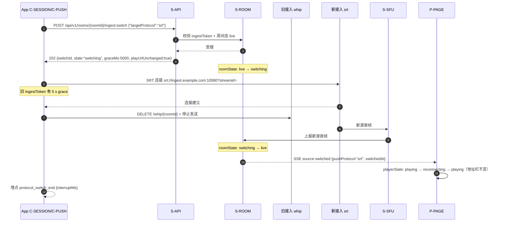

**约束**：

| 约束 | 值 | 依据 |
|---|---|---|
| 切换中断（旧源断流 → 新源首帧） | ≤ 3 s，p95 ≤ 5 s | 00 §10.3 |
| `switching` 超时 | 新源 15 s 内无首帧 → `roomState="failed"` | 00 §3.1 |
| 旧 `ingestToken` 宽限期 | 5 s | 00 §5.1 |
| 播放地址 | 字符串恒定（INV-1/INV-2） | 00 §4.3 |
| 并发切换 | 已有 `switching` 时再次请求 → `2006 switch_in_progress` | 00 §9.2 |

### 5.4 数据流：LAN 模式

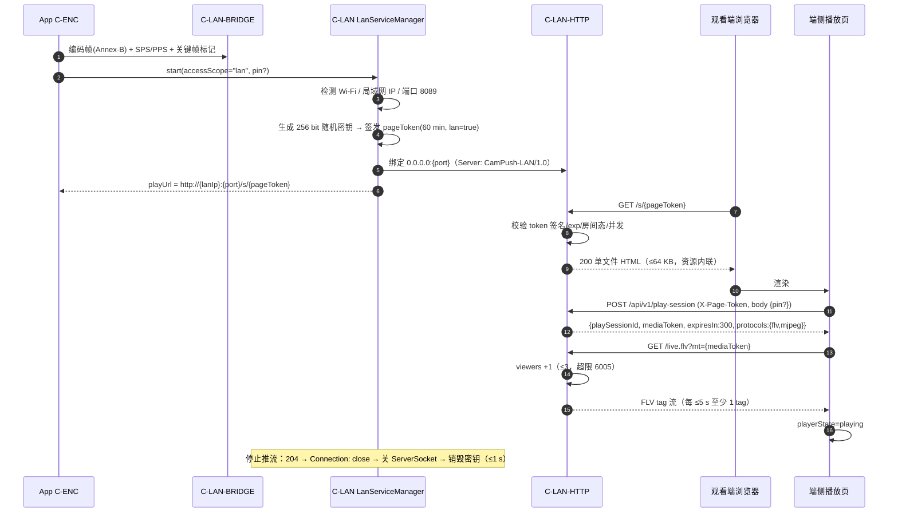

**约束**：

| 约束 | 值 | 依据 |
|---|---|---|
| 播放页文件大小 | ≤ 64 KB，单文件，无外链 CDN | 00 §8 |
| 并发观看上限 | 默认 3（可配 1–3），超限 `429` + `6005` | 00 §8 |
| `mediaToken` TTL | 300 s | 00 §5.1 |
| 停止到 `connection refused` | ≤ 1 s | 00 §8、§10.3 |
| 端口 | 8089；占用则 8090–8099 顺延 | 00 §8 |
| IP 变化 | 1 s 轮询 `LinkProperties`，变化即换地址并提示重新复制 | 00 §4.4 |

### 5.5 数据流：停止与失效

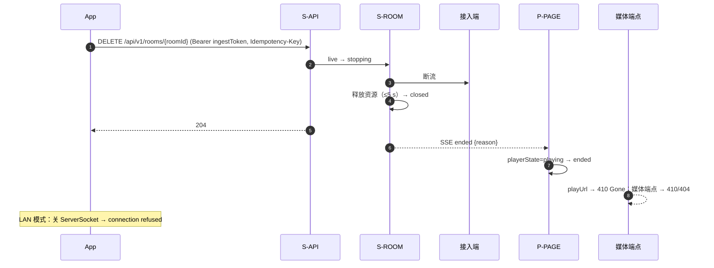

| 失效目标 | WAN 时限 | LAN 时限 | 依据 |
|---|---|---|---|
| 播放页 | ≤ 2 s 返回 `410` | 连接已拒 | 00 §4.3、§10.3 |
| FLV / HLS / WHEP 媒体 | ≤ 2 s 停止返回字节 | — | 00 §4.3 |
| 全部 token | `closed` 即刻失效，不依赖 `exp` | 密钥销毁即刻失效 | 00 §5.1 |

---

## 6. 部署拓扑

### 6.1 WAN 部署拓扑

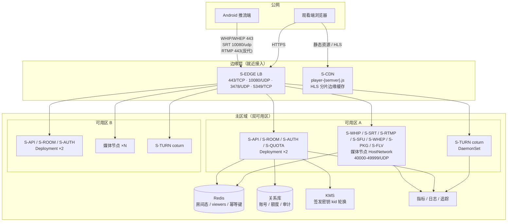

### 6.2 LAN 部署拓扑（APK 内）

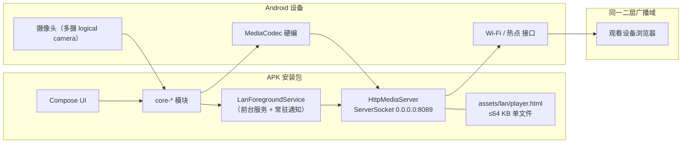

> 部署特征：无独立进程外组件；端侧服务与 App 共享进程（前台服务提升优先级），无 root、无系统权限；`ServerSocket` 仅绑定 Wi-Fi/热点接口可达地址。

### 6.3 部署单元表

| 单元 | 类型 | 副本（MVP） | 网络暴露 | 有状态 | 扩缩依据 | 单实例约束 |
|---|---|---|---|---|---|---|
| S-API | Deployment | 2（跨 AZ） | 443 | 否 | QPS / 连接数 | 限流：账号 30 req/min |
| S-ROOM | 与 S-API 同进程（MVP） | 2 | 内部 | 是（Redis） | 房间数 | 单账号默认 1 个 `live` 房间 |
| S-WHIP/SRT/RTMP 接入 | 媒体节点（StatefulSet/HostNetwork） | ≥2 | 443 / 10080·UDP | 是（会话） | 房间数、接入带宽 | 单 roomId 单 `publishing` 会话 |
| S-SFU | 与接入同节点（MVP 合并） | ≥2 | 40000–49999·UDP | 是（路由表） | 出网带宽 | 房间粘性：同房间固定节点 |
| S-WHEP | 与 SFU 同节点 | ≥2 | 443 | 是（会话） | 观看会话数 | 会话绑定 `playSessionId` |
| S-PKG/S-FLV | 与 SFU 同节点 | ≥2 | 443 | 是（缓冲） | 房间数 | HLS 保留 6 分片 |
| S-TURN | DaemonSet（coturn） | 每 AZ ≥1 | 3478/UDP、5349/TCP | 是（分配表） | 中继带宽 | 凭证 TTL 与 `pageToken` 对齐 |
| S-CDN | 托管 CDN | — | 443 | 否 | 带宽 | 播放页资源版本化 |
| Redis | 托管集群 | 3 节点 | 内部 | 是 | 内存/连接 | 房间态、幂等键 24 h |
| 关系库 | 托管主备 | 2 | 内部 | 是 | 容量 | 账号/额度/审计 |

### 6.4 网络与端口清单

| 用途 | 协议/端口 | 暴露面 | 备注 |
|---|---|---|---|
| HTTPS / WSS | TCP 443 | 公网 | API、播放页、FLV、HLS、WHIP、WHEP 统一走 443 |
| SRT 接入 | UDP 10080 | 公网 | 与 00 §6.2 的 `srt://ingest.example.com:10080` 一致 |
| RTMP 接入 | TCP 1935（LB 反代到 443） | 公网 | 客户端可用 1935 或 `rtmp://` 443 变体，M0 验证 |
| TURN | UDP 3478 / TCP 5349 | 公网 | 与 00 §6.2 `turn:turn.example.com:3478?transport=udp` 一致 |
| WebRTC 媒体 | UDP 40000–49999 | 公网（经 LB） | SFU 单节点端口池，节点规格决定范围 |
| LAN 端侧 HTTP | TCP 8089（占用顺延 8090–8099） | 局域网 | 00 §8 |
| 集群内部 | 内部 mTLS | 不暴露 | API↔Redis↔KMS |

### 6.5 多区域与容量伸缩

| 阶段 | 区域策略 | 触发条件 | 代价 |
|---|---|---|---|
| M1/M2 | 单区域双 AZ | — | 跨地域观看 RTT 增加，延迟预算按「同城」口径 |
| M3 | 双区域（就近接入） | 跨区域观看占比 > 30% 或 p95 首帧 > 3 s | 房间粘性路由、跨区 TURN 成本 |
| 缩容保护 | 媒体节点缩容前先迁移房间 | `roomState` 非终态的节点不缩容 | 缩容期间禁止新房间调度 |

---

## 7. 技术选型与结论

> 选型原则：**契约优先于单栈（P3）**——每个选型必须给出「结论 + 理由 + 推翻阈值 + 验证方式」。未验证项进 M0（见 [08-m0-verification.md](./08-m0-verification.md)）。
>
> **v1.1 对齐声明**：§7.1–§7.6 的媒体面选型已与 [03-cloud-service.md §4](./03-cloud-service.md) 的详细论证对齐（主 SFU 选 Mediasoup、SRS 仅作协议终结器、remux 自研、HLS 用 fMP4）。v1.0 曾主张「SRS 单栈」，因未充分计入「源切换不得重建播放会话」这一硬契约而被替代，理由与代价见 §7.2；变更见 §17。

### 7.1 WHIP 推流接入

| 候选 | 说明 | 优势 | 风险 |
|---|---|---|---|
| A. SRS 内置 WHIP | SRS 5.0+ 提供 WHIP/WHEP endpoint | 免自研 SDP 状态机 | 接入产生的流需再桥接进 Mediasoup SFU（多一跳、双源风险），且 WHEP 语义与控制粒度受限 |
| B. **薄封装 WHIP HTTP 层 + Mediasoup `WebRtcTransport`** | 自研 HTTP 层（SDP 转发、会话互斥、鉴权）+ Mediasoup 承载媒体 | 与 §7.2 主 SFU 同栈；`Producer` 直接可替换（源切换）；ICE/TURN 凭证完全可控 | 需实现 `a=setup:actpass`、ICE 汇总、`DELETE` 清理；Trickle 需实测 |
| C. MediaMTX 等轻量网关 | 支持 WHIP | 简单 | 无 SFU/生态外溢，仍要第二套 |

**结论：选 B（薄封装 WHIP HTTP 层 + Mediasoup `WebRtcTransport`）**。理由：

1. **与主 SFU 同栈**：[03-cloud-service.md §4](./03-cloud-service.md) 已裁定主 SFU 为 Mediasoup；WHIP 接入的本质是"在 Mediasoup 上 `produce()` 一个 `Producer`"。若改用 SRS 内置 WHIP，还得把 SRS 的流桥接进 SFU，多一跳且出现"同一 `roomId` 两个接入真相"的风险。
2. **00 §7 的 WHIP 语义可控**：仅 H.264 + Opus、`a=setup:actpass`、服务端回 ICE/DTLS、单 `roomId` 单 `publishing` 会话、新会话顶旧（`4004`）——这些都落在薄 HTTP 层 + Mediasoup `WebRtcTransport` 上，代码量可控且完全可测。
3. **客户端不变**：客户端仍只需 `POST /whip/{roomId}`（`Authorization: Bearer <ingestToken>`）、`PATCH`（Trickle）、`DELETE`，SDP 生成/解析交给 WebRTC Android SDK，见 [02-client-modules.md §9](./02-client-modules.md)。

**推翻阈值**：

| 条件 | 动作 |
|---|---|
| M0 两周内无法打通 `WHIP → Mediasoup Producer → WHEP` 全链路 | 临时用 ZLMediaKit 单机验证链路（03 §4.3 备选路径），**生产架构不切换** |
| `PATCH` Trickle 更新丢失导致 ICE 失败率 > 0.5% | 关闭 Trickle，改为半 trickle（`POST` 汇总全部候选） |
| 单媒体节点 WHIP 接入建立 p95 > 800 ms | 排查信令与 ICE，必要时接入层独立扩容 |

**验证方式**：M0 用 20 台真机并发 WHIP 推流，采集「接入建立 p50/p95」「首帧到达时延」「Trickle 失败率」「源切换成功率」；见 08。

### 7.2 SFU 选型

| 维度 | Mediasoup | Janus | SRS 6.x | ZLMediaKit |
|---|---|---|---|---|
| 语言/运行时 | Node.js + C++ worker | C | C++（StateThreads） | C++ |
| 定位 | 纯 SFU 库/服务 | 通用 WebRTC 网关（插件式） | 流媒体服务器（全协议栈） | 流媒体服务器（全协议栈） |
| WHIP/WHEP 支持 | 需薄封装（官方示例） | 需插件/封装 | 内建 | 内建 |
| RTMP / SRT 接入 | 无（需旁路） | 无 | 内建 | 内建 |
| HTTP-FLV / HLS | 无（需自研或旁路） | 无 | 内建 | 内建 |
| **源切换（换源不重建播放会话）** | **原生支持**（addProducer/removeProducer，Consumer 不动） | 需插件改造 | 需重建播放会话 | 需重建播放会话 |
| WHEP 语义可控性（`recvonly`、ICE/TURN 下发、单转发） | 高 | 中 | 中 | 中 |
| 运维复杂度 | 中高（Node + worker 多进程、自建房间路由） | 高 | 低 | 低 |
| 许可 | ISC | GPLv3 | MIT | MIT |
| 与本项目契合度 | **契约契合度最高**（代价：FLV/HLS/接入需配套） | 需改造 | 单栈覆盖但源切换不达标 | 单栈覆盖，源切换不达标 |

**结论：主 SFU 选 Mediasoup；SRT/RTMP 接入由 SRS 6.x 仅作「协议终结器」；FLV/HLS remux 自研。**

与 [03-cloud-service.md §4](./03-cloud-service.md) 一致，理由：

1. **源切换是唯一不可妥协的需求**：00 §4.3 要求 `playUrl` 全程不变（INV-1/INV-2），意味着服务端必须在**播放会话不重建**的前提下替换媒体源。Mediasoup 的 `Router/Transport/Producer/Consumer` 模型允许「`produce()` 新 Producer → Consumer 切流 → 关闭旧 Producer」，播放端只感知短暂停顿；SRS/ZLMediaKit 的转发与播放会话耦合，换源往往要重建会话，直接违背契约。
2. **WHEP 语义完整可控**：`recvonly`、ICE 服务器（含 TURN 凭证）下发、`a=setup`、单房间单转发、按房间计数观看者，都需应用层精确控制；Mediasoup API 粒度足够，Janus 需改插件、长期维护成本高。
3. **SRS 只做"协议终结器"**：SRT/RTMP 解封装为 RTP 后注入 SFU，不承担转发与播放会话管理——这既避开了 SRS 的源切换短板，又复用了它成熟的接入实现。
4. **代价（必须承认）**：不再有「单栈」；FLV/HLS 需要自研 `flv-remux` 与 `hls-packager`，集群需自建房间路由与粘性（见 03 §10.4）。这是工作量与运维成本，但**不是架构风险**；用 P3 的例外条款承载（§2.2）。
5. **备选保留**：ZLMediaKit 仅用于 M0 两周内打通链路的临时验证，**生产不切换**（理由同第 1 条）。

**回退阈值（推翻结论的唯一合法路径）**：

| 指标 | 阈值 | 处置 |
|---|---|---|
| 源切换失败率（`switching → failed` ÷ 切换次数） | > 0.5% | 先修 Producer 替换与首帧判定；连续两版未收敛才启动回退评估 |
| 源切换中断 `interruptMs` p95 | > 5 s（00 §10.3 上限） | 同上 |
| 单 cell 观看者数 | > 300 或节点 CPU > 70% | **扩容/拆 cell，不是换实现** |
| WHEP 首帧 p95 | > 2 s | 排查 ICE/TURN 与转发路径；仍不达标则评估播放面独立 SFU 节点 |

> 回退到「需重建播放会话」的实现（SRS/ZLMediaKit 直转）将破坏 INV-1/INV-2，属契约级变更，必须按 00 §15 提交契约变更请求，**不得静默回退**。

**验证方式**：M0 压测 Mediasoup：单房间 1 推 100 观看、20 房间并发、连续 20 次协议热切换；记录 CPU、首帧 p95、切换中断、Producer 替换失败率；数据进 08 与 §8 容量模型。

### 7.3 转封装（Remux）与编码策略

| 候选 | 说明 | 结论 |
|---|---|---|
| A. 自研 `flv-remux` + `hls-packager`（RTP → FLV / fMP4，不解码） | 与 Mediasoup 同进程数据面，零转码 | **采用**（见 03 §5.2/§5.3） |
| B. SRS 内置 remux | 单栈简单 | 不采用（与主 SFU 不同栈，需把 RTP 再喂回 SRS） |
| C. 独立 ffmpeg 转码进程 | 可降码率/改分辨率 | 不采用（成本与延迟不可接受） |

**结论：只做 remux，不做服务端转码（M1/M2）**。理由：

1. 服务端转码使单房间 CPU 成本上升一个数量级（§8 成本模型按「零转码」测算），且引入 ≥ 200 ms 额外延迟，直接击穿 00 §10.1 的 250 ms p50 预算。
2. 客户端已具备 ABR（00 §7：800 kbps–4 Mbps），码率适配在端侧完成，服务端不再二次处理。
3. 输出基线：H.264 Baseline/Main、`yuv420p`、关键帧 2 s（弱网 1 s）、音频 AAC-LC 48 kHz 立体声 128 kbps（可降 64 kbps 单声道）——全部由客户端保证，服务端只**校验**（03 §3.5 护栏），不修正。

**推翻阈值**：出现「必须对同一房间提供多档码率（如 1000 观看者中 40% 在移动网络）」的产品需求，且实测端侧 ABR 无法覆盖 → 在 M3 引入 ABR ladder 转码，并接受 §8.5 的转码成本增量（+75 vCPU 量级）。

### 7.4 SRT 接入

| 候选 | 结论 |
|---|---|
| SRS 6.x 内置 SRT（libsrt），仅作协议终结器 | **采用** |
| 独立 srt-live-transmit 网关 | 不采用（多一跳、多一套进程） |
| Mediasoup 原生 SRT | 不存在（Mediasoup 不内建 SRT） |

**结论**：采用 SRS 6.x 内置 SRT，仅承担**协议终结**：listener 模式，`streamid=#!::r={roomId},t={ingestToken}`，`latency=200`，按 00 §7 关闭 `messageapi`；解封装为 MPEG-TS 后 demux 成 RTP 注入 Mediasoup SFU。客户端 SRT 适配器见 [02-client-modules.md §9](./02-client-modules.md)。

**理由**：00 §7 已冻结 SRT 参数；Mediasoup 不内建 SRT，因此必须旁路终结。**源切换的地址不变量（INV-1）由 SFU 的 Producer 替换保证，而不是由接入端保证**，所以 SRS 只做解封装不影响契约。音频由 AAC 转码为 Opus 供 WebRTC 播放，FLV/HLS 侧透传 AAC（03 §3.3）。

**推翻阈值**：SRT 推流在 5% 丢包下卡顿率高于 WHIP 的 2 倍，或 `latency=200` 无法维持（需 > 500 才稳定）→ 重新评估 SRT 是否保留在 M2（可降级为「实验性」，但**不删除枚举**）。

### 7.5 RTMP 接入

| 候选 | 结论 |
|---|---|
| SRS 6.x 内置 RTMP，仅作协议终结器 | **采用** |
| 自研 RTMP 服务 | 不采用 |

**结论**：采用 SRS 6.x 内置 RTMP（RTMP → RTP 注入 SFU）；约束「仅 H.264/AAC、GOP ≤ 2 s」（00 §7）；鉴权走 query token（`?token=`），不用 `streamKey` 双因子，避免第二套密钥。RTMP 定位为「最后降级档」：当 WHIP 与 SRT 均不可用（UDP 被封、企业网限制）时兜底，延迟 1–3 s 可接受（PRD §6.1）。v1 只承诺明文 RTMP，RTMPS 为 M2 可选增强，不改变接口与错误码（00 §17.6）。

**推翻阈值**：目标网络环境中 UDP 可用率 > 99%（连续 30 天埋点 `ingestState` 统计），且 RTMP 房间占比 < 1% → M3 评估下线 RTMP 接入（**不删除枚举**，`pushProtocol="rtmp"` 保留兼容）。

### 7.6 HLS 打包

| 决策项 | 结论 | 依据 |
|---|---|---|
| 分片格式 | **fMP4（CMAF，init 与分片分离）** | 与 `flv-remux` 共用 fMP4 封装，减少双份封装代码；体积小、便于后续 LL-HLS 演进；00 §7 已允许「TS/fMP4」二选一；兼容矩阵由 [06-playback-page.md](./06-playback-page.md) 确认 |
| 分片时长 | 2 s | 00 §7 `EXT-X-TARGETDURATION:2` |
| 保留分片数 | 6 | 00 §7 |
| 直播窗口 | ≥ 12 s | 00 §7 |
| 结束标记 | `closed` 时写 `#EXT-X-ENDLIST` | 00 §7 |
| 鉴权 | playlist `?mt={mediaToken}`，分片 Cookie `cmp_ps` | 00 §6.1 |
| 打包位置 | 与 SFU 同节点 sidecar（每房间 1 实例） | 避免二次拉流（03 §5.3） |

**结论**：自研 `hls-packager`，fMP4 切片，2 s/片，保留 6 片，`closed` 写 ENDLIST。HLS **不参与延迟 SLO**，只保证「能看」（00 §10.2 阶梯中 HLS 失败判定 5.0 s）。

**推翻阈值**：任一条件成立即切回 **TS**（不需改契约，00 §7 允许两者）：

| 条件 | 口径 |
|---|---|
| 目标浏览器矩阵 fMP4 失败率 > 2% | 06 兼容矩阵 + `play_fallback` 埋点 |
| HLS 兜底首帧 p95 > 8 s | `play_first_frame.timeToFirstFrameMs` |
| `5003 hls_unavailable` 占播放失败 > 30% | `campush_play_failed_total{code="5003"}` |

### 7.7 TURN 选型

**结论：coturn。**

| 维度 | 结论 |
|---|---|
| 实现 | coturn，UDP 3478 + TLS 5349 |
| 部署 | 每可用区 DaemonSet，与媒体节点同区域 |
| 凭证 | 短期 TTL 凭证，`username=<expiry>:<roomId>`，由 `S-AUTH` 下发（00 §6.2 `turn` 字段） |
| 触发 | WHEP ICE 优先 host/srflx，失败回落 TURN（00 §7、`7005`） |
| 配额 | 单房间 TURN 中继观看者比例按 15% 建模（§8） |

**理由**：coturn 是 WebRTC 事实标准，支持长期/短期凭证与 `TURNS`；自研中继无收益。**推翻阈值**：中继比例长期 > 30% 且单节点带宽打满 → 改为「按区域多实例 + 就近调度」，而非更换实现。

### 7.8 Android 采集、编码、合成链路

| 环节 | 结论 | 理由 | 推翻阈值 |
|---|---|---|---|
| 采集 | **CameraX + Multi-Camera API**（Camera2 作为 fallback 探测层） | 统一生命周期绑定；CameraX 封装 logical multi-camera 检测，避免厂商 Camera2 差异 | 目标机型中 CameraX 双摄打开失败率 > 10% → 对失败机型下钻 Camera2 直连 |
| 编码 | **MediaCodec 硬编（H.264）为主，软编仅兜底** | 硬编满足 00 §10.4 资源预算（单摄 ≤ 25% CPU）；软编无法满足双摄 ≤ 45% | 硬编不可用率 > 2% 或 `1005` 高频 → 评估软编默认档 |
| 合成 | **OpenGL ES 3.0 + 单 EGL 线程 + SurfaceTexture(OES)** | 零拷贝直通 MediaCodec input Surface；PiP/分屏仅一次 draw call 级开销 | 双摄 PiP 导致编码帧率 < 24 fps → 降低合成分辨率或改分屏 |
| 音频 | MediaCodec AAC-LC 48 kHz 立体声 128 kbps（可降 64 kbps 单声道） | 00 §7 基线 | — |
| 关键帧 | 2 s（弱网 1 s） | 00 §7；影响首帧与 ABR 恢复 | 首帧 p95 > 2 s 且确认与 GOP 相关 → 弱网默认为 1 s |

**链路结论（与 02 §6–§9 对齐）**：

```text
CameraX (Surface) → OES 纹理 → [单摄直通 | 双摄 GL 合成]
  → eglCreateWindowSurface(MediaCodec input) → MediaCodec 硬编
  → Annex-B 帧 → PushClient(whip | srt | rtmp)
```

**不做**：不在服务端做分辨率/帧率适配；不在端侧做超分/降噪（M1/M2）；不引入第三方推流 SDK 作为主链路（Whip/SRT/RTMP 适配器自研，见 02 §9）。

### 7.9 选型决策汇总

| 决策 | 结论 | 推翻阈值（摘要） | 验证阶段 |
|---|---|---|---|
| WHIP 接入 | 薄封装 WHIP HTTP 层 + Mediasoup `WebRtcTransport` | Trickle 失败率 > 0.5% 或 M0 两周未打通 | M0 |
| SFU | **Mediasoup**（主）/ SRS 6.x 仅协议终结器 | 源切换失败率 > 0.5% 或中断 p95 > 5 s；单 cell > 300 观看者/CPU > 70% 只扩容不换实现 | M0–M2 |
| 转封装 | 自研 remux（`flv-remux`/`hls-packager`），不转码 | 产品需要多档码率且端侧 ABR 不足 | M3 |
| SRT | SRS 6.x 终结器，`latency=200` → RTP 注入 SFU | 5% 丢包下卡顿率 > WHIP 的 2 倍 | M2 |
| RTMP | SRS 6.x 终结器，最后降级档 | UDP 可用率 > 99% 且 RTMP 占比 < 1% | M3 |
| HLS | fMP4，2 s/片，6 片，ENDLIST | 兼容失败率 > 2% 或首帧 p95 > 8 s → 切 TS | M1–M2 |
| TURN | coturn | 中继比例 > 30% 且单节点打满 | 持续 |
| 采集 | CameraX + Multi-Camera | 双摄失败率 > 10% | M0 |
| 编码 | MediaCodec 硬编 | 不可用率 > 2% | M0 |
| 合成 | OpenGL ES 3.0 单 EGL 线程 | 编码帧率 < 24 fps | M0 |
| LAN 端侧引擎 | 进程内管道 + 自研 `HttpMediaServer` | 3 观看者下 FLV 丢帧 > 5% 或 CPU > 35% | M0/M1 |

---

## 8. 容量与成本测算模型

> 本节数字为**测算模型与假设**，用于架构决策与容量规划，不构成商务报价；单价假设需商务与财务复核后写入 [03-cloud-service.md](./03-cloud-service.md) 与 [11-risk-adr.md](./11-risk-adr.md)。

### 8.1 符号与假设

| 符号 | 含义 | 取值 | 来源/性质 |
|---|---|---|---|
| `R` | 活跃 `live` 房间数 | 场景给定 | 输入 |
| `V` | 并发观看者数 | 场景给定 | 输入 |
| `B_avg` | 单观看者平均码率 | 2.5 Mbps | 00 §7 默认总码率 |
| `B_peak` | 单观看者峰值码率 | 4 Mbps | 00 §7 自适应上限 |
| `OH` | 传输封装开销系数 | 1.05（+5%） | RTP/FLV 头部开销假设 |
| `f_turn` | 走 TURN 中继的观看者比例 | 15% | 对称 NAT/CGNAT 估算假设 |
| `f_hls` | 走 HLS 兜底的观看者比例 | 5% | 00 §11「HLS 兜底触发率」目标 |
| `m_hls` | HLS 相对码率倍数 | 1.2 | 分片 + playlist 开销假设 |
| `C_sfu` | 单 vCPU 转发能力 | 400 Mbps 出网（**保守**） | 压测假设；03 §11.1 用 `S_sfu=250 路/vCPU`，按 `B_avg=2.5 Mbps` 折算 ≈ 625 Mbps/vCPU，故本表取值偏保守，两类口径在 08 校准 |
| `C_room` | 单 vCPU 可承载接入房间数 | 80 房间 | 压测假设，M0 校准 |
| `P_bw` | 出网流量单价 | 0.08 USD/GB | 商务假设（≈ ¥0.57/GB，03 §11.1 取 ¥0.50/GB） |
| `P_cpu` | vCPU 小时单价 | 0.04 USD/vCPU·h | 商务假设（≈ ¥0.29，03 §11.1 取 ¥0.30） |
| `H_day` | 日均并发观看小时 | 8 h | 场景假设（**满码率播放小时**口径，区别于 03 的 `k_duty=0.20` 峰值折算） |
| `GB_vh` | 1 观看小时 @2.5 Mbps 流量 | 1.125 GB | 2.5 Mbps × 3600 s ÷ 8 ÷ 1000（与 03 §11.2 `R × 0.45` 同源） |

**与 [03-cloud-service.md §11](./03-cloud-service.md) 的口径关系（必读）**：

| 维度 | 本文 §8（架构级） | 03 §11（采购级） | 使用约定 |
|---|---|---|---|
| 驱动变量 | 带宽（Mbps）驱动 | 路数（vCPU/路）驱动 | 架构评审用本文，采购预算用 03 |
| 币种/单价 | USD（跨厂商对比） | CNY（实际账单） | 对外报价只引用 03 |
| 时间口径 | 日均 8 h 满码率播放小时 | `h_peak=720 h` × `k_duty=0.20` | 换算系数约 1.67（240 h vs 144 h） |
| TURN 口径 | `f_turn=15%`，上下行各一份 | `ρ×τ = 0.8×0.2 = 16%` 单方向 | 两者同量级，不合并计算 |
| HLS 口径 | `f_hls=5%` × 1.2 倍码率 | HLS 仅计在线存储（分片可从 FLV 复用） | 差异可忽略 |
| 结论一致性 | 100 并发 ≈ 3.3k USD/月；1000 并发 ≈ 29.5k USD/月 | 100 并发 ≈ ¥9.3k/月；1000 并发 ≈ ¥92k/月 | 差异由时间口径（×1.67）、固定成本与币种解释，**量级一致** |

> **裁定**：带宽单价（`P_bw`/`c_egress`）是第一敏感项（本文 §8.5 与 03 §11.4 结论一致）。两套模型的统一校准由 [08-m0-verification.md](./08-m0-verification.md) 负责，M0 后只保留一套生效参数。

### 8.2 容量公式

| 编号 | 指标 | 公式 |
|---|---|---|
| F1 | 接入带宽 | `B_in = R × B_avg` |
| F2 | WebRTC 出网带宽 | `B_eg = V × B_avg × OH` |
| F3 | TURN 中继带宽（上下行各一份） | `B_turn = V × f_turn × B_avg × 2` |
| F4 | HLS 出网带宽 | `B_hls = V × f_hls × B_avg × m_hls` |
| F5 | 总出网带宽 | `B_total = B_eg + B_turn + B_hls` |
| F6 | SFU vCPU 需求 | `N_sfu = ceil(B_eg ÷ C_sfu) + HA冗余(1)` |
| F7 | 接入 vCPU 需求 | `N_ing = ceil(R ÷ C_room) + HA冗余(1)` |
| F8 | 月度流量 | `GB_month = 观看小时数 × GB_vh × (1 + f_turn×2 + f_hls×(m_hls−1))` |
| F9 | 月度带宽成本 | `Cost_bw = GB_month × P_bw` |
| F10 | 月度计算成本 | `Cost_cpu = (N_sfu + N_ing) × 730 h × P_cpu` |
| F11 | 单观看小时成本 | `Unit = (Cost_bw + Cost_cpu + Cost_fixed) ÷ 观看小时数` |

### 8.3 样例 A：100 并发观看（M1 目标规模）

假设：`R=10` 房间、`V=100` 观看者、`B_avg=2.5 Mbps`、日均 8 h（月度 24,000 观看小时）。

| 项 | 计算 | 结果 |
|---|---|---|
| 接入带宽 `B_in`（F1） | 10 × 2.5 Mbps | **25 Mbps** |
| WebRTC 出网 `B_eg`（F2） | 100 × 2.5 × 1.05 | **262.5 Mbps** |
| TURN 中继 `B_turn`（F3） | 100 × 0.15 × 2.5 × 2 | **75 Mbps** |
| HLS 出网 `B_hls`（F4） | 100 × 0.05 × 2.5 × 1.2 | **15 Mbps** |
| 总出网 `B_total`（F5） | 262.5 + 75 + 15 | **352.5 Mbps** |
| 峰值总出网（按 `B_peak`） | 352.5 × (4 ÷ 2.5) | **564 Mbps** |
| SFU vCPU `N_sfu`（F6） | ceil(262.5 ÷ 400) + 1 | **2 vCPU** |
| 接入 vCPU `N_ing`（F7） | ceil(10 ÷ 80) + 1 | **2 vCPU** |
| 月流量 `GB_month`（F8） | 24,000 × 1.125 × (1 + 0.30 + 0.01) | **≈ 35,370 GB（34.5 TB）** |
| 月带宽成本（F9） | 35,370 × 0.08 | **≈ 2,830 USD** |
| 月计算成本（F10） | 4 × 730 × 0.04 | **≈ 117 USD** |
| 月固定成本（LB/Redis/DB/CDN/监控） | 估算 | **≈ 400 USD** |
| 月总成本 | 2,830 + 117 + 400 | **≈ 3,347 USD** |
| 单观看小时成本（F11） | 3,347 ÷ 24,000 | **≈ 0.139 USD/观看小时** |

### 8.4 样例 B：1000 并发观看（M3 目标规模）

假设：`R=50` 房间、`V=1000` 观看者、`B_avg=2.5 Mbps`、日均 8 h（月度 240,000 观看小时）。

| 项 | 计算 | 结果 |
|---|---|---|
| 接入带宽 `B_in`（F1） | 50 × 2.5 Mbps | **125 Mbps** |
| WebRTC 出网 `B_eg`（F2） | 1000 × 2.5 × 1.05 | **2,625 Mbps（2.625 Gbps）** |
| TURN 中继 `B_turn`（F3） | 1000 × 0.15 × 2.5 × 2 | **750 Mbps** |
| HLS 出网 `B_hls`（F4） | 1000 × 0.05 × 2.5 × 1.2 | **150 Mbps** |
| 总出网 `B_total`（F5） | 2,625 + 750 + 150 | **3,525 Mbps（3.525 Gbps）** |
| 峰值总出网（按 `B_peak`） | 3,525 × 1.6 | **5.64 Gbps** |
| SFU vCPU `N_sfu`（F6） | ceil(2,625 ÷ 400) + 1 | **8 vCPU** |
| 接入 vCPU `N_ing`（F7） | ceil(50 ÷ 80) + 1 | **2 vCPU** |
| 月流量 `GB_month`（F8） | 240,000 × 1.125 × 1.31 | **≈ 353,700 GB（345 TB）** |
| 月带宽成本（F9） | 353,700 × 0.08 | **≈ 28,296 USD** |
| 月计算成本（F10） | 10 × 730 × 0.04 | **≈ 292 USD** |
| 月固定成本（含 CDN 最低消费/多 AZ） | 估算 | **≈ 900 USD** |
| 月总成本 | 28,296 + 292 + 900 | **≈ 29,488 USD** |
| 单观看小时成本（F11） | 29,488 ÷ 240,000 | **≈ 0.123 USD/观看小时** |

### 8.5 成本敏感性与拐点

| 变量 | 变化 | 样例 B 月成本变化 | 结论 |
|---|---|---|---|
| `f_turn` 15% → 30% | 中继占比翻倍（±15pp） | +81,000 GB → **+6,480 USD**（约 **+22%**） | TURN 是**显著**成本项：优化方向是提高直连成功率以压低 `f_turn`，而不是移除 TURN；同时中继带宽峰值会打满单节点，需按峰值扩容 |
| `f_hls` 5% → 20% | HLS 兜底占比翻 4 倍 | +8,100 GB → **+648 USD**（约 **+2.2%**） | HLS 兜底对成本影响小，但对**延迟与体验**影响大；仍需在播放页侧优化 WebRTC 成功率（`f_hls ≤ 5%`） |
| `P_bw` ±50% | 单价波动 | 总成本 ±约 **48%** | **带宽单价是第一敏感项**（占样例 B 成本 96%），商务谈判优先级最高 |
| 引入服务端转码（3 档 ladder） | 50 房间 × 3 档 = 150 路转码，按 0.5 vCPU/路 | 计算成本 +75 vCPU ⇒ **+2,190 USD/月（+7.4%）**；出网基本持平（每观看者仍只收 1 路），但峰值与切片开销上升 | 明确不在 M1/M2 做（§7.3） |
| 观看者密度下降（`R` 从 50 → 500，`V` 不变） | 接入成本上升 | 接入 vCPU 2 → 8；`B_in` 125 → 1,250 Mbps | 「低密度多房间」是接入侧主要成本压力，非出网 |

### 8.6 LAN 模式容量模型

| 约束 | 公式 | 取值 | 结论 |
|---|---|---|---|
| 上行带宽约束 | `V_max_bw = floor(U × 0.8 ÷ B_avg)` | 保守 `U=20 Mbps` → `floor(16 ÷ 2.5) = 6` | 带宽不是瓶颈 |
| 产品并发上限 | 00 §8 默认 3（可配 1–3） | `V_max = 3` | **取 min(带宽约束, 产品上限) = 3** |
| CPU 约束 | 00 §10.4：LAN + 3 观看者 ≤ 35% | 35% | 达标才允许放开到 3 |
| 高码率场景 | `B_avg=4 Mbps` → `floor(16 ÷ 4) = 4`，仍受上限 3 | 3 | 320p/4 Mbps 下仍可 3 人 |
| 弱上行场景 | `U=10 Mbps` → `floor(8 ÷ 2.5) = 3` | 3（临界） | 上行 < 10 Mbps 时提示降级或减并发 |

**LAN 成本结论**：端侧服务零云端成本；成本体现为设备侧（功耗、温升，见 00 §10.4 与 02 §12）。这是 LAN 模式的核心商业价值（P5）。

---

## 9. 性能预算的架构落点

> 数值全部来自 00 §10，本节只回答「哪一跳、由哪个组件负责」。

### 9.1 端到端延迟（WAN）

| 环节 | 预算 p50 / p95 | 架构落点 | 责任组件 | 违约时的架构动作 |
|---|---|---|---|---|
| 采集 + 编码 | 40 / 70 ms | 设备 | C-CAP + C-ENC | 降分辨率/帧率（02 §12） |
| 上行网络 + 接入 | 40 / 120 ms | 设备→边缘 | C-PUSH + S-EDGE + S-WHIP | 降码率；切 SRT；重连 |
| 服务端转发 | 20 / 60 ms | 区域内部 | S-SFU | 房间迁移到低负载节点 |
| 下行网络 | 40 / 120 ms | 边缘→观看端 | S-EDGE + CDN | 降级 FLV（更长缓冲） |
| 抖动缓冲 | 80 / 200 ms | 观看端 | P-PAGE | 自适应 60–250 ms |
| 解码 + 渲染 | 30 / 60 ms | 观看端 | P-PAGE | 降级到硬解 |
| **合计** | **≈ 250 / ≈ 630 ms** | — | — | 目标区间 200–800 ms（PRD §6.1） |

### 9.2 首帧预算与降级阶梯

| 阶段 | 预算 | 失败阈值（进入降级） | 架构落点 |
|---|---|---|---|
| HTML/JS 加载（内联，无外链） | 300 ms | 2 s | S-CDN / S-FLV 直出 |
| token 校验 + `play-session` | 250 ms | 2 s | S-API + S-AUTH |
| WHEP 信令 + ICE/DTLS | 600 ms | 2.5 s | S-WHEP + S-TURN |
| 等待首个关键帧 | 500 ms | 计入 2.5 s | C-ENC（GOP 2 s） |
| 解码首帧 + 渲染 | 200 ms | — | P-PAGE |
| **合计** | **≤ 1.85 s** | 阶梯总耗时 ≤ 10 s | — |

降级阶梯（00 §10.2）：WAN `webrtc(2.5 s) → flv(2.0 s) → hls(5.0 s)`；LAN `flv(2.0 s) → mjpeg(2.0 s)`（M2 起 `webrtc(2.5 s) → flv → mjpeg`）。

**架构含义**：

1. HLS 的 5.0 s 失败判定意味着 HLS 只能作为最后一跳，不能前置（否则首帧预算被击穿）。
2. 降级链路的**协议探测**由 P-ADAPT 统一调度，`play-session` 响应必须一次性返回 `protocols.{webrtc,flv,hls}`（00 §6.2），避免逐次请求增加 RTT。
3. 关键帧间隔 2 s 直接影响「等待首个关键帧 500 ms」的可达性 → 客户端必须在开始推流时立即强制 IDR（02 §7）。

### 9.3 资源预算落点

| 场景 | CPU（8 核） | 温升（10 min） | 功耗 | 内存 | 主要消耗组件 |
|---|---|---|---|---|---|
| 单摄 720p30 WHIP | ≤ 25% | ≤ 6 ℃ | ≤ 1.4 W·h/10 min | ≤ 220 MB | C-CAP + C-ENC + C-PUSH |
| 双摄 PiP 720p30 | ≤ 45% | ≤ 10 ℃ | ≤ 2.2 W·h/10 min | ≤ 320 MB | C-COMP + 双路 C-CAP + C-ENC |
| LAN + 3 观看者 | ≤ 35% | ≤ 8 ℃ | ≤ 1.8 W·h/10 min | ≤ 260 MB | C-LAN-* + C-ENC |

阈值：`thermalStatus ≥ SEVERE` 或电池 ≤ 20% 且未充电 → 触发降级（`7003`/`7004`），UI 必须提示（00 §10.4、02 §12）。

---

## 10. SLO、错误预算与故障域

> 本节 SLO 为 01 的**架构提案**，需由 [10-observability.md](./10-observability.md) 承接为可计算 SLI 与看板，并回写 PRD §16.1 指标口径。

### 10.1 SLI / SLO 提案

| 编号 | SLI | 计算口径 | SLO（30 天滚动） | 错误预算 | 关联 PRD §16.1 指标 |
|---|---|---|---|---|---|
| SLI-1 | WAN 推流建立成功率 | `push_start_success ÷ push_start_clicked`（不含权限拒绝） | ≥ 99.5% | 0.5% ≈ 3.6 h | 推流成功率 |
| SLI-2 | WAN 播放页可打开率 | `play_page_open ÷ 分享/访问次数` | ≥ 99.9% | 0.1% ≈ 43 m 12 s | 播放页可打开率 |
| SLI-3 | 首帧达标率 | `play_first_frame.timeToFirstFrameMs ≤ 2000` 占比 | ≥ 95% | 5% | 首帧时间 |
| SLI-4 | WebRTC 端到端延迟 p95 | 采样 RTT + 缓冲估算 | ≤ 800 ms | — | 端到端延迟估算 |
| SLI-5 | 卡顿率 | 播放中断 > 500 ms 次数 ÷ 播放时长 | ≤ 2% | — | 卡顿率 |
| SLI-6 | 协议热切换中断 | `protocol_switch_end.interruptMs` p95 | ≤ 5 s（目标 ≤ 3 s p50） | — | 协议切换中断时长 |
| SLI-7 | 停止失效准确率 | 停止后 2 s 内探测到 `410`/拒连的比例 | 100% | 0 | 地址失效准确率 |
| SLI-8 | 唯一地址不变率 | INV-1/INV-2 断言通过率 | 100% | 0 | — |
| SLI-9 | 局域网并发失败率 | `429`/`6005` ÷ LAN 播放会话数 | ≤ 1% | — | 局域网并发失败率 |
| SLI-10 | HLS 兜底触发率 | `play_fallback(to=hls) ÷ play_first_frame` | ≤ 5% | — | 公网 HLS 兜底触发率 |
| SLI-11 | 双摄降级触发率 | `degrade_triggered(reason=thermal/battery)` ÷ 双摄会话数 | ≤ 10% | — | 双摄温升与降级触发率 |
| SLI-12 | 崩溃率 | 崩溃会话 ÷ 总会话 | ≤ 0.5% | — | 崩溃率 |

**错误预算策略**：

| 预算消耗 | 动作 |
|---|---|
| < 50% | 正常迭代 |
| 50%–80% | 冻结非必要媒体链路变更，优先修稳定性 |
| > 80% | 仅允许修复类变更；架构评审强制 |
| 100% 耗尽 | 停止发布，进入根因整改；在 [11-risk-adr.md](./11-risk-adr.md) 登记 |

### 10.2 故障域划分

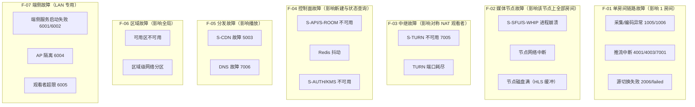

### 10.3 故障域 → 降级动作矩阵

| 故障域 | 典型触发 | 用户可见表现 | 系统动作 | 恢复目标 |
|---|---|---|---|---|
| F-01 单房间 | `ingestState="reconnecting"` 持续 30 s | App 显示重连中 → 失败 | `roomState="failed"`；App 提示重试并保留 `playUrl` 失效提示 | 用户手动重试 |
| F-01 源切换失败 | `switching` 15 s 无首帧 | 播放页 `reconnecting` → `failed` | `roomState="failed"`；提示切回原协议 | 重新创建房间 |
| F-02 媒体节点 | 节点健康检查失败 | 该节点房间推流中断 | 房间标记迁移；App 重连到 LB 调度的新节点；播放页保持 `playUrl` 不变重连 | 30 s 内可重连 |
| F-03 TURN | `7005 turn_unavailable` | WebRTC 播放失败 | 播放页降级 `flv` → `hls`（INV-2：地址栏不变） | 即时 |
| F-04 控制面 | `S-API` 5xx | 无法创建房间 | App 置灰 WAN 选项并提示切换 LAN（PRD §4.2）；已推流房间不受影响 | ≤ 5 min |
| F-04 鉴权 | `3002`/`3003` | 播放页 `auth` → `failed` | 播放页尝试 `page-token:refresh`（不改地址栏），失败展示错误码 | 即时 |
| F-05 CDN | `5003` | HLS 失败 | 播放页保持当前协议，不额外降级（已在末阶）；`playerState="failed"` + 重试 | ≤ 2 min |
| F-05 DNS | `7006` | 页面打不开 | 客户端重试 + 提示网络问题 | 依赖 DNS 恢复 |
| F-06 区域 | AZ 故障 | 该 AZ 房间中断 | 跨 AZ 调度新房间；旧房间 `failed` | 新建 ≤ 5 min |
| F-07 端侧 | `6001`/`6002` | LAN 模式不可用 | 提示换端口或切 WAN；`6004` 给出 AP 隔离排查清单 | 即时 |

### 10.4 故障注入验收

| 注入项 | 方法 | 通过标准 | 归属 |
|---|---|---|---|
| 媒体节点进程 kill | 压测环境 kill SFU | 受影响房间 ≤ 30 s 重连成功；`playUrl` 不变 | 03/08 |
| TURN 端口封禁 | 防火墙丢 3478/UDP | 播放页 ≤ 5 s 降级到 `flv` 并出首帧 | 06/08 |
| 接入端拒绝 WHIP | 返回 `4004` | App 自动降级 `pushProtocol="srt"`；地址不变 | 02/08 |
| 停止后探测 | 停止后 1 s/2 s 各探测 20 次 | 0 字节媒体返回；`410`/拒连 | 03/05/08 |
| 断网 10 s | 设备断网再恢复 | `ingestState="reconnecting"` → `publishing`；播放页 `reconnecting` → `playing` | 02/06 |

---

## 11. 可观测性接入点

> 事件名与公共属性严格引用 00 §11；本文只定义**接入位置**与**指标命名**，字段级契约归 10。

### 11.1 接入点拓扑

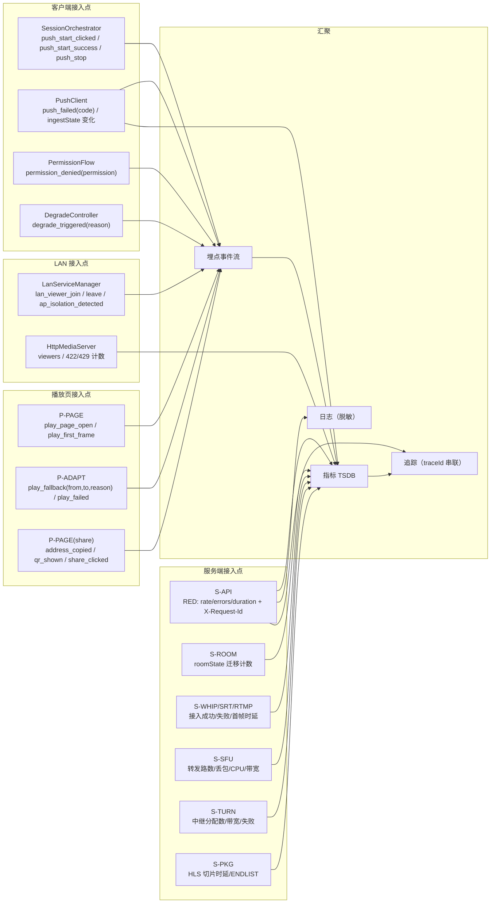

### 11.2 指标命名与采集点

| 指标 | 类型 | 采集点 | 标签 | 告警阈值（提案） |
|---|---|---|---|---|
| `campush_ingest_sessions_total` | counter | S-WHIP/S-SRT/S-RTMP | `protocol`, `result` | 失败率 > 1%（5 min） |
| `campush_ingest_first_frame_ms` | histogram | 接入端 | `protocol` | p95 > 1,000 ms |
| `campush_room_state_transitions_total` | counter | S-ROOM | `from`, `to` | `switching→failed` > 0.5% |
| `campush_sfu_egress_bps` | gauge | S-SFU | `node` | > 80% 节点带宽 |
| `campush_sfu_viewers` | gauge | S-SFU | `node`, `room` | 单节点 > 300（§7.2 阈值） |
| `campush_turn_allocations` | gauge | S-TURN | `node` | > 80% 端口池 |
| `campush_play_first_frame_ms` | histogram | P-PAGE → 上报 | `protocol`, `networkType` | p95 > 2,000 ms |
| `campush_play_fallback_total` | counter | P-PAGE | `from`, `to`, `reason` | `to="hls"` 占比 > 5% |
| `campush_play_failed_total` | counter | P-PAGE | `code` | 5 min 内 > 50 |
| `campush_switch_interrupt_ms` | histogram | App | `from`, `to` | p95 > 5,000 ms |
| `campush_address_invalid_probe_total` | counter | 自动化探针 | `result` | `result="media"` > 0（INV-3） |
| `campush_lan_viewers` | gauge | C-LAN | `device` 维度不上报明文 | 持续 = 3 超过 10 min 提示 |
| `campush_degrade_total` | counter | App | `reason`（`thermal`/`battery`/`bandwidth`） | 比例 > 10% |
| `campush_crash_rate` | gauge | App | `appVersion`, `deviceModel` | > 0.5% |

**指标禁忌**（对齐 00 §11）：不得以 `roomId` 明文、IP、SSID、token 作为标签；房间维度统一用 `roomIdHash`（SHA-256 前 8 字节 hex）。

### 11.3 分布式追踪

| 场景 | trace 起点 | 跨跳传播 | 采样 |
|---|---|---|---|
| WAN 推流 | App `push_start_clicked` | `traceId` 随 `POST /rooms` 与 WHIP 请求头透传（WAN 下发，LAN 本地生成） | 首日 100%，稳定后 5%（错误 100%） |
| WAN 播放 | P-PAGE `play_page_open` | `traceId` 由 `play-session` 响应下发，随 SSE / 媒体请求透传 | 同上 |
| 停止失效 | App `push_stop` | `requestId`（`X-Request-Id`）串联 | 100% |

### 11.4 日志与脱敏接入点

| 位置 | 必记 | 禁记 |
|---|---|---|
| App `PushClient` | `ingestState` 迁移、协议、错误码、重连次数 | `ingestToken`、完整播放地址 |
| App `LanServiceManager` | 端口、viewers、token 签发次数、IP 变化事件（不含 SSID） | LAN 密钥、PIN |
| S-API | `requestId`、路径、状态码、`roomIdHash`、耗时 | 请求体中的 token、PIN |
| S-SFU | 房间哈希、丢包率、转发路数 | 媒体内容、裸 RTP |
| P-PAGE | `playerState` 迁移、降级链、错误码 | `pageToken`/`mediaToken`、完整 URL |

---

## 12. 安全与合规的架构落点

> 威胁建模与合规细节归 [07-security-privacy.md](./07-security-privacy.md)；本节只列架构必须提供的机制。

| 机制 | 架构落点 | 契约 |
|---|---|---|
| token 三件套（`pageToken`/`mediaToken`/`ingestToken`） | S-AUTH 签发；LAN 由 C-LAN-AUTH 本地签发 | 00 §5.1 |
| token 撤销即时性 | `roomState="closed"` 后校验顺序「签名 → exp → 房间状态 → 会话/并发」 | 00 §5.1 |
| 推流密钥不可见 | `ingestToken` 只在内存与推流 SDK 配置中 | INV-4、00 §5.1 |
| PIN 二次校验 | S-API / C-LAN-HTTP 的 `play-session` | 00 §5.2 |
| 限速 | S-API 账号 30 req/min、`play-session` 60/min/IP、PIN 5/min | 00 §6.3、§5.2 |
| LAN 无 HTTPS 的明示 | 播放页顶部提示「仅限可信局域网」 | 00 §8 |
| 日志脱敏 | 全接入点统一脱敏中间件 | 00 §11 |
| 合规（内容审核/ICP） | WAN 侧需在 03 中给出审核接入位 | PRD §15 |

**架构硬约束**：LAN 模式端侧服务**不得**回传任何观看数据到云端（P5 + 隐私优先）；唯一例外是用户显式开启的脱敏埋点（00 §11 允许的聚合事件）。

---

## 13. 与 02 / 03 / 05 的职责边界

### 13.1 边界表

| 主题 | 01（本文） | 02 客户端 | 03 云端 | 05 端侧服务 |
|---|---|---|---|---|
| 双模式拓扑 | **定** | 消费 | 消费 | 消费 |
| 技术选型结论 | **定** | 落地客户端部分 | 落地服务端部分 | 落地端侧部分 |
| 容量与成本模型 | **定**（口径与公式） | 提供资源实测 | 提供压测实测 | 提供 LAN 并发实测 |
| SLO 提案 | **定** | 提供埋点 | 提供指标 | 提供指标 |
| 组件内外接口 | 只定「谁调谁」 | **屏幕级/接口级签名** | REST/媒体面实现 | HTTP 端点实现 |
| 字段级契约 | 不定义 | 引用 04 | **03/04 定义** | **05 定义** |
| 状态机归属 | 定「谁权威」 | 实现 `ingestState` | 实现 `roomState` | 实现 LAN `roomState` |
| 协议细节 | 只给约束与阈值 | 推流适配器细节 | 接入/转发/切片细节 | HTTP/FLV/MJPEG 细节 |
| 降级策略 | **定阶梯与阈值** | 端侧降级实现 | 服务端降级实现 | LAN 降级实现 |

### 13.2 与 02 的接口点

| 接口点 | 01 提供 | 02 消费 |
|---|---|---|
| `accessScope` 二选一 | INV-5、P5 | `SessionOrchestrator` 注入 |
| 推流抽象层 | 协议枚举与切换语义（§5.3） | `PushClient` 可插拔设计 |
| 编码基线 | 00 §7 + §7.8 结论 | MediaCodec 参数与 ABR |
| 资源预算 | 00 §10.4 + §9.3 | 降级触发实现 |
| 合成方式 | `dualLayout`/`dualPrimary` 语义 | OpenGL ES 实现 |

### 13.3 与 03 的接口点

| 接口点 | 01 提供 | 03 消费 |
|---|---|---|
| 媒体引擎选型 | §7.1–§7.6 结论 | 部署与实现 |
| 接入/转封装/HLS 约束 | §7 阈值与参数 | 实现与压测 |
| TURN | §7.7 coturn | 部署与配额 |
| 容量公式 | §8 F1–F11 | 容量规划与自动扩缩 |
| 故障域 | §10.2 F-02/F-04 | 高可用实现 |

### 13.4 与 05 的接口点

| 接口点 | 01 提供 | 05 消费 |
|---|---|---|
| 端侧服务位置 | §4.2（前台服务内） | 进程/线程模型 |
| 管道形态 | 「进程内环形缓冲或 `127.0.0.1`」 | 具体实现 |
| 并发上限 | 3（可配 1–3） | 计数与拒绝策略 |
| 失效语义 | `connection refused`（INV-3） | 关闭顺序（≤1 s） |
| 播放页资源 | APK 内 `assets/lan/player.html` | 打包与体积约束 |

### 13.5 交叉引用规则

- 引用契约：写 `[00-conventions.md §10](./00-conventions.md)`，不复制数值。
- 引用 PRD：写 `PRD §16.2`。
- 引用下游：写 `[02-client-modules.md §9](./02-client-modules.md)`。
- 本文档**不定义**任何 00 未定义的字段名。

---

## 14. 失败与降级

### 14.1 分层降级总表

| 层 | 失败 | 检测 | 降级动作 | 用户提示 | 错误码 |
|---|---|---|---|---|---|
| 采集 | 双摄不支持 | 启动检测 | 隐藏 `dual` 选项，回退 `single_back` | 「该设备不支持前后同时开启」 | `1004` |
| 采集 | 摄像头权限拒绝 | 系统回调 | **阻断**，不可推流；引导系统设置 | 说明「无法采集画面」 | `1001` |
| 采集 | 麦克风权限拒绝 | 系统回调 | **不阻断**：静音继续推流，顶部常驻「无声音」标识 + 一次性说明；后续授权可热开麦 | 说明「当前无声音」，不阻断主路径 | `1002`（非致命，记录/提示用） |
| 采集 | 摄像头被占用 | `CameraDevice` 错误 | 提示关闭其它应用 | — | `1003` |
| 编码 | 硬编初始化失败 | `MediaCodec` 异常 | 尝试软编；再失败终止 | 「设备编码器初始化失败」 | `1005` |
| 合成 | GL 合成失败 | FBO/draw 错误 | 回退单摄直通 | 「双摄合成不可用，已切换单摄」 | `1006` |
| 推流 | WHIP 不可用 | 接入建立失败 | 降级 `srt` → `rtmp` | 「当前网络不支持超低延迟，已自动切换」 | `4001`/`4002` |
| 推流 | 编码不支持 | 服务端校验失败 | 切换基线编码参数重试一次 | — | `4005` |
| 推流 | 码率超限 | 服务端反馈 | ABR 下调至 ≤ 上限 | — | `4006` |
| 推流 | 弱网 | 丢包/抖动阈值 | ABR 下调、开 FEC（SRT）、提示 SRT | 「网络不稳定，已降低画质」 | `7001`/`7002` |
| 播放 | WebRTC 失败 | 2.5 s | 降级 `flv` | 无感 | `5001`/`5006`/`7005` |
| 播放 | FLV 失败 | 2.0 s | 降级 `hls` | 无感 | `5002` |
| 播放 | 全部失败 | 阶梯耗尽 | `playerState="failed"` + 重试 | 明确错误与重试按钮 | `5003`/`5004` |
| 房间 | 额度超限 | `POST /rooms` 返回 | 置灰 WAN，引导 LAN | 「公网额度不足」 | `2004` |
| 房间 | 切换失败 | 15 s 无首帧 | `roomState="failed"`，提示回原协议 | — | `2006`/`2007` |
| 端侧 | 启动失败/端口占用 | bind 失败 | 顺延 8090–8099；全占用则失败 | 提示换网络或切 WAN | `6001`/`6002` |
| 端侧 | AP 隔离 | 外部不可达 + 用户反馈 | 展示排查清单 | 「疑似 AP 隔离/防火墙」 | `6004` |
| 端侧 | 观看超限 | 计数 ≥ 3 | `429` + 提示切 WAN | 「局域网模式并发受限，建议切换公网模式」 | `6005` |
| 网络 | 非 Wi-Fi | `networkType!="wifi"` | 禁用 LAN 选项 | 「仅局域网需连接 Wi-Fi/热点」 | `6003` |
| 性能 | 过热/低电 | `thermalStatus ≥ SEVERE` / 电量 ≤ 20% 未充电 | 降分辨率/帧率/码率，双摄降单摄 | 必须提示 | `7003`/`7004` |

### 14.2 降级不变量

1. **降级不得改变播放地址**（INV-1/INV-2）。
2. **降级必须在埋点留痕**：`play_fallback`（`from`/`to`/`reason`）、`degrade_triggered`（`reason`）。
3. **降级不得静默**：涉及画质/协议/模式的降级必须给出用户可见提示（PRD §10.3）。
4. **降级有上限**：WAN 协议降级最多 2 级（`whip→srt→rtmp`）；播放最多 2 级（`webrtc→flv→hls`）；超过即失败并提示。

### 14.3 恢复顺序

| 场景 | 恢复顺序 |
|---|---|
| 网络恢复（弱网→正常） | 先恢复码率（每 10 s 上调 ≤ 20%）→ 再评估协议回切（需用户确认或产品策略） |
| 温度回落（`SEVERE` → `LIGHT`）持续 60 s | 逐级恢复分辨率/帧率，不自动恢复双摄 |
| 电量回升（充电中且 > 30%） | 逐级恢复，不自动恢复双摄 |
| 播放器降级后网络变好 | 保持当前协议，不主动回切（避免抖动）；重连时重新走阶梯 |

---

## 15. 验收检查点

> 全部可勾选、可测试；测试数据进 [08-m0-verification.md](./08-m0-verification.md)。

### 15.1 拓扑与组件

- [ ] **A-01** WAN 拓扑图包含全部 S-* 组件，且每个组件在 §4.3.2 有职责行。
- [ ] **A-02** LAN 拓扑图**不含任何云端组件**（P5 检查：图内无 S-API/S-SFU/S-TURN）。
- [ ] **A-03** 双模式能力边界矩阵（§4.4）每行都能在 00 §12 或 PRD §4.3 找到出处。
- [ ] **A-04** 每个组件都有明确「归属文档」，且不存在两篇文档同时定义同一字段。
- [ ] **A-05** Mermaid 图 ≥ 4 张，且渲染无语法错误。

### 15.2 端到端数据流

- [ ] **A-06** §5.1 主链路覆盖「采集→编码→合成→推流→接入→转发→播放」全部 7 段。
- [ ] **A-07** §5.2 延迟分摊与 00 §10.1 逐行一致（含 p50/p95）。
- [ ] **A-08** §5.3 热切换时序中，`playUrl` 未发生任何变更（INV-1）。
- [ ] **A-09** §5.5 停止时序中，LAN 与 WAN 的失效判定分别可测（`connection refused` / `410`）。
- [ ] **A-10** 点击「开始推流」到播放地址可用 ≤ 3 s 的约束在 §5.1 有引用（00 §10.3）。

### 15.3 技术选型

- [ ] **A-11** §7 每个选型都给出「结论 + 理由 + 推翻阈值 + 验证方式」四要素。
- [ ] **A-12** WHIP 选型与 00 §7 的「单 roomId 单 `publishing` 会话、新会话顶旧（`4004`）」一致。
- [ ] **A-13** SFU 选型给出可量化推翻阈值（单节点观看者 > 300、首帧 p95 > 2 s、CPU > 70%）。
- [ ] **A-14** 转封装结论明确「不转码」，并与 00 §7 编码基线一致。
- [ ] **A-15** TURN 结论为 coturn，端口与 00 §6.2 的 `turn:turn.example.com:3478?transport=udp` 一致。
- [ ] **A-16** HLS 参数（2 s/片、6 片、ENDLIST）与 00 §7 一致。

### 15.4 容量与成本

- [ ] **A-17** §8 的公式 F1–F11 可被独立复算，样例数字与公式自洽（误差 < 1%）。
- [ ] **A-18** 100 并发与 1000 并发两份样例均给出单位（Mbps / GB / USD / 观看小时）。
- [ ] **A-19** 全部单价标注为「假设」且未声称是报价。
- [ ] **A-20** 敏感性分析至少覆盖 `f_turn`、`f_hls`、`P_bw` 三个变量。
- [ ] **A-21** LAN 容量结论为 3（与 00 §8 默认一致），并给出带宽/CPU 双重约束。

### 15.5 SLO 与故障域

- [ ] **A-22** §10.1 每条 SLI 都有计算口径与关联 PRD §16.1 指标。
- [ ] **A-23** 错误预算给出 30 天换算值（如 99.9% → 43 m 12 s）。
- [ ] **A-24** §10.2 故障域覆盖 F-01 ~ F-07，且每条在 §10.3 有降级动作。
- [ ] **A-25** 故障注入用例 ≥ 5 条，每条有可量化通过标准。

### 15.6 可观测性与边界

- [ ] **A-26** §11.2 指标标签中不含 `roomId` 明文、IP、SSID、token。
- [ ] **A-27** §11.1 接入点覆盖 00 §11 全部必埋事件（逐条对照）。
- [ ] **A-28** §13 边界表中，01 与 02/03/05 无重叠定义。
- [ ] **A-29** 全文无真实域名/密钥/IP；示例使用 00 §4.2 占位值或文档专用网段。
- [ ] **A-30** 全文无「视情况而定」式结论；未决项全部进入 §16。

---

## 16. 开放问题

| 编号 | 问题 | 候选方案 | 推荐 | 决策人 | 阻塞对象 | 截止 |
|---|---|---|---|---|---|---|
| Q-01 | Mediasoup 集群的房间粘性路由与 Producer 替换（源切换）能否在 M0 达标 | A. 自建 roomId→cell 粘性路由（本文推荐，03 §10.4）；B. 单 cell 起步、M2 再分片；C. 引入托管 SFU | A（B 作为 M1 过渡） | 架构 + 服务端 | 03 | M0 末 |
| Q-01b | 若源切换失败率超阈值，回退路径是否接受「重建播放会话」 | A. 不接受（维护 INV-1/INV-2，继续优化 Producer 替换）；B. 接受并提交契约变更（00 §15） | A | 架构 + Lead | 00/03/06 | M2 前 |
| Q-02 | RTMP 接入在 M3 是否下线 | A. 保留；B. 下线接入但保留枚举；C. 完全移除 | B | 产品 + 架构 | 03/04 | M3 |
| Q-03 | 服务端是否引入多档码率转码 | A. 不做（本文推荐）；B. 仅在 1000+ 观看者房间开启 | A | 产品 + 商务 | 03 | M3 |
| Q-04 | 是否在 LAN 模式 M1 就提供端侧 WebRTC P2P | A. M1 仅 FLV/MJPEG；B. M1 起 WebRTC P2P | A（与 PRD §12.4 一致） | 产品 + 端侧 | 05 | M1 |
| Q-05 | CDN 是否必须（播放页资源可否由 `playHost` 直出） | A. 必须 CDN；B. 直出 + 缓存 | A（HLS 分片需要） | 架构 | 03/06 | M1 |
| Q-06 | 客户端 `traceId` 的生成与下发给 LAN 模式的本地链路是否统一格式 | A. 与 WAN 同格式；B. LAN 独立格式 | A | 架构 + 客户端 | 02/10 | M1 |
| Q-07 | 00 §7 的编码「关键帧 2 s」与首帧预算（等待关键帧 500 ms）在弱网下是否冲突 | A. 弱网强制 1 s；B. 推流启动强制 IDR + 常规 2 s | A + B 组合（启动 IDR，弱网 1 s） | 架构 + 客户端 | 02 | M0 |
| Q-08 | 单价假设（`P_bw=0.08 USD/GB`、`P_cpu=0.04 USD/vCPU·h`）是否与最终商务一致 | A. 云厂商现价；B. CDN 阶梯价 | 需商务确认 | 商务 + 财务 | 03/11 | M1 前 |
| Q-09 | 双区域部署的触发阈值（跨区观看占比 > 30%）是否合适 | A. 30%；B. 按 p95 首帧 > 3 s 单独触发 | A | 架构 | 03 | M3 |
| Q-10 | `maxViewers=100`（00 §6.2）与 1000 并发观看样例（§8.4）口径冲突：后者需多房间聚合 | A. 100 为单房间上限，1000 为全平台并发；B. 上调单房间上限 | A（§8.4 已按 `R=50` 多房间建模） | 架构 + 产品 | 03/04 | M1 |
| Q-11 | **契约缺口**：00 §9.1 错误信封示例用 `code=3002` + `retryable=true` + `"error":"token_expired"`，而 §9.2 号段定义 `3002=token_invalid`、`3003=token_expired` | A. 修订 00 §9.1 示例为 `code=3003`；B. 保留示例、在 00 增加「示例非规范」注记 | A | Lead（契约维护人） | 00 / 02 / 04 / 06 | M0 前 |

> Q-10 是本文与 00 §6.2 的**口径澄清**，非冲突：`limits.maxViewers=100` 为**单房间**上限，§8.4 的 1000 为**平台级**并发观看者总量（50 个房间）。建议 03/04 在文档中显式标注该区别。
>
> Q-11 是**契约缺口**而非本文偏离：本文按 00 §9.2 号段落地（`3002=token_invalid`、`3003=token_expired`）。当前落地分歧：04 对 `3002` 取 `retryable=false`（语义正确，本文认同），02 §13 为不与 00 §9.1 示例冲突而取 `true`——两者需统一，建议统一为 **`false`** 并由 Lead 在 00 v1.2 中把 §9.1 示例码修订为 `3003`（其 `error` 字段本就是 `token_expired`）。

---

## 17. 变更记录

| 版本 | 日期 | 变更人 | 内容 |
|---|---|---|---|
| v1.0 | 2026-10-20 | 架构文档作者（architect） | 首版：双模式组件/部署拓扑、端到端数据流、技术选型结论（WHIP/SFU/remux/HLS/TURN/Android 链路）、容量与成本模型（100/1000 并发）、SLO 与故障域、可观测性接入点、与 02/03/05 边界 |
| v1.1 | 2026-10-20 | 架构文档作者（architect） | ①对齐 00 v1.1 §17.3：摄像头权限拒绝（`1001`）阻断、麦克风拒绝（`1002`）静音继续并常驻提示；②媒体面选型与 03 §4 对齐——主 SFU 改为 **Mediasoup**、WHIP 改为薄封装 HTTP 层 + `WebRtcTransport`、SRT/RTMP 由 SRS 6.x 仅作协议终结器、remux 改为自研 `flv-remux`/`hls-packager`、HLS 分片改为 **fMP4**（附切回 TS 阈值）；③补充 §8 与 03 §11 的成本口径裁定、§4.3.2 逻辑组件→部署单元映射、Q-01/Q-01b 开放问题 |
| v1.2 | 2026-10-20 | 架构文档作者（architect） | 登记契约缺口 Q-11（00 §9.1 示例用 `3002` + `retryable=true`，与 §9.2 号段 `3002=token_invalid`/`3003=token_expired` 不一致，建议 Lead 修订示例为 `3003`） |

---

**上游契约**：[00-conventions.md](./00-conventions.md)（唯一来源） · **产品基线**：[PRD-v1.0.md](./PRD-v1.0.md)
**下游落地**：[02-client-modules.md](./02-client-modules.md)（客户端） · 03（云端） · 05（端侧服务） · 06（播放页） · 08（M0 验证） · 10（可观测性）
