# 02 · Android 客户端模块设计

| 项目 | 值 |
|---|---|
| 文档状态 | 基线草案（Baseline Draft，供 03/05/06/08/09/10 引用） |
| 版本 | v1.0 |
| 依赖文档 | [00-conventions.md](./00-conventions.md)（契约唯一来源）、[01-architecture.md](./01-architecture.md)（总体架构与选型）、[PRD-v1.0.md](./PRD-v1.0.md) |
| 适用 PRD 章节 | §4（访问范围）、§5（采集模式）、§6（推流协议）、§8（功能清单）、§9（用户流程）、§10（界面交互）、§11.1（客户端统一能力）、§12（端侧服务）、§14（边界）、§16（指标） |
| 下游/关联文档 | [05-lan-service.md](./05-lan-service.md)（端侧协议细节）、[06-playback-page.md](./06-playback-page.md)、[07-security-privacy.md](./07-security-privacy.md)、[10-observability.md](./10-observability.md) |
| 维护人 | 架构文档作者（architect） |
| 最后更新 | 2026-10-20 |

> 口径声明：本文的枚举、错误码、性能数字、编码基线、埋点事件名全部**引用** [00-conventions.md](./00-conventions.md)。包名 `com.example.campush` 为占位（RFC 2606 保留域），不代表最终发布包名。本文只给**接口签名与流程**，不给实现代码。

---

## 目录

1. 目的与范围
2. 模块总览（模块清单 / Gradle / 包结构 / 依赖规则）
3. 单向数据流与状态模型
4. 线程模型
5. 权限与生命周期
6. 采集：CameraX 与 Multi-Camera 检测降级
7. 编码：MediaCodec 硬编与自适应码率
8. 合成：OpenGL ES 双摄 PiP / 分屏
9. 推流抽象层（whip / srt / rtmp 可插拔）
10. LAN 端侧服务模块边界
11. 前台服务保活与电池优化
12. 热与电量降级
13. 错误码映射表
14. 测试策略
15. 关键接口签名与流程伪代码
16. 失败与降级
17. 验收检查点
18. 开放问题
19. 变更记录

---

## 1. 目的与范围

### 1.1 目的

把 [01-architecture.md](./01-architecture.md) 的架构结论落成**可交付的 Android 工程结构**：

1. **模块怎么切**：Gradle 模块、包结构、依赖方向，以及「谁能依赖谁」的硬规则。
2. **状态怎么流**：单向数据流（UDF）+ `StateFlow`/`UiState`，保证 UI 只有唯一事实源。
3. **线程怎么排**：采集、GL、编码、推流、端侧服务各自跑在哪个线程，背压怎么处理。
4. **能力怎么探测与降级**：双摄检测失败 → `1004`；硬编失败 → `1005`；合成失败 → `1006`；过热/低电 → `7003`/`7004`。
5. **协议怎么插拔**：`whip`/`srt`/`rtmp` 三个适配器如何在不改调用方的前提下替换。
6. **怎么验**：测试分层与真机矩阵。

### 1.2 范围

| 在范围内 | 说明 |
|---|---|
| Gradle 模块与包结构 | 模块清单、依赖矩阵、包名约定 |
| 单向数据流 | `UiState`、`UiIntent`、`UiEffect`、`StateFlow` 暴露规则 |
| 线程模型 | 线程清单、调度器、队列与背压、跨线程数据传递 |
| 权限与生命周期 | 权限矩阵、前台服务生命周期、后台/横竖屏切换 |
| 采集 | CameraX 绑定、Multi-Camera 能力检测、`1004` 降级 |
| 编码 | MediaCodec 硬编、参数基线、ABR 控制器 |
| 合成 | OpenGL ES 双摄 PiP / `split_h` / `split_v`、`dualPrimary` 交换 |
| 推流 | `PushClient` 抽象、三适配器、重连、协议切换 |
| 端侧服务边界 | 与 [05-lan-service.md](./05-lan-service.md) 的接口契约（**不含协议细节**） |
| 保活与降级 | 前台服务、电池优化白名单、`7003`/`7004` |
| 错误码映射 | 客户端异常 → 00 §9.2 错误码 → UI 文案 → 是否可重试 |
| 测试策略 | 单测/仪器/真机矩阵 |

### 1.3 非目标

| 非目标 | 归属 |
|---|---|
| 总体拓扑、容量、SLO、技术选型论证 | [01-architecture.md](./01-architecture.md) |
| 端侧 HTTP 端点、FLV/MJPEG 封装、PIN 校验实现、并发计数实现 | [05-lan-service.md](./05-lan-service.md) |
| 播放页（浏览器端）实现 | [06-playback-page.md](./06-playback-page.md) |
| REST/媒体面字段级契约 | [04-interface-contracts.md](./04-interface-contracts.md) |
| 云端服务端实现 | [03-cloud-service.md](./03-cloud-service.md) |
| 界面视觉稿与像素级规范 | 设计稿（本文只约束状态与交互语义） |
| 埋点字段级契约 | [10-observability.md](./10-observability.md) |

### 1.4 术语与枚举引用

本文出现的一切枚举**必须**取 00 §3 的 wire 值，客户端内部 Kotlin 枚举用 `UPPER_SNAKE`，序列化转小写：

| 枚举 | Kotlin 定义（内部） | wire 值 | 本文出现位置 |
|---|---|---|---|
| `accessScope` | `enum class AccessScope { LAN, WAN }` | `"lan"` / `"wan"` | §3、§5、§9、§10 |
| `captureMode` | `enum class CaptureMode { SINGLE_BACK, SINGLE_FRONT, DUAL }` | `"single_back"` / `"single_front"` / `"dual"` | §6、§8 |
| `dualLayout` | `enum class DualLayout { PIP, SPLIT_H, SPLIT_V }` | `"pip"` / `"split_h"` / `"split_v"` | §8 |
| `dualPrimary` | `enum class DualPrimary { BACK, FRONT }` | `"back"` / `"front"` | §8 |
| `pushProtocol` | `enum class PushProtocol { WHIP, SRT, RTMP }` | `"whip"` / `"srt"` / `"rtmp"` | §9 |
| `ingestState` | `enum class IngestState { CONNECTING, PUBLISHING, RECONNECTING, ENDED, FAILED }` | `"connecting"` / `"publishing"` / `"reconnecting"` / `"ended"` / `"failed"` | §3、§9 |
| `roomState` | 仅消费，不定义 | `"created"`/`"live"`/`"switching"`/`"stopping"`/`"closed"`/`"failed"` | §3、§10 |

---

## 2. 模块总览

### 2.1 模块清单与职责

| Gradle 模块 | 类型 | 职责 | 关键产出 | 禁止事项 |
|---|---|---|---|---|
| `:app` | application | 应用入口、依赖注入装配、`Application`、Manifest 合并 | `CamPushApp`、DI 图 | 不写业务逻辑 |
| `:feature:main` | feature | 主界面（预览、开始/停止、地址卡片、状态栏） | `MainScreen`、`MainViewModel` | 不直接持有 Camera/MediaCodec |
| `:feature:settings` | feature | 设置页（访问范围/协议/画质/局域网/公网） | `SettingsScreen`、`SettingsViewModel` | 不直接调推流 |
| `:feature:preview` | feature | 本机边推边看（App 内低延迟预览） | `LocalPreviewScreen` | 不复用播放页逻辑 |
| `:core:model` | library | 领域模型与枚举、`PlayAddress`、`StreamMetrics` | 纯 Kotlin 数据类 | 不依赖 Android 框架（除 `@Keep`） |
| `:core:common` | library | `Result`/`CampushError`/错误码、Dispatchers、时间源 | 错误模型 | 不含业务 |
| `:core:design` | library | Compose 设计系统（按钮、状态条、地址卡片） | UI 组件 | 不含状态逻辑 |
| `:core:session` | library | `SessionOrchestrator`、用例、`SessionRepository` | 会话编排 | 不做 IO |
| `:media:capture` | library | CameraX 绑定、Multi-Camera 检测、`captureMode` 切换 | `CaptureController`、`DualCameraCapability` | 不做编码 |
| `:media:encoder` | library | MediaCodec 硬编、`EncoderController`、ABR | `EncodedFrame` 流 | 不做网络 |
| `:media:compositor` | library | OpenGL ES 合成、EGL 管理、布局 | 合成后 `Surface` | 不做编码 |
| `:media:audio` | library | 麦克风采集、AAC 编码、静音 | `AudioFrame` 流 | — |
| `:push:api` | library | `PushClient` 接口、`PushConfig`、`PushEvent`、工厂注册表 | 抽象层 | 不含任何协议实现 |
| `:push:whip` | library | WHIP 适配器（WebRTC + HTTP 信令） | `WhipPushClient` | 不引用 srt/rtmp |
| `:push:srt` | library | SRT 适配器 | `SrtPushClient` | 不引用 whip/rtmp |
| `:push:rtmp` | library | RTMP 适配器 | `RtmpPushClient` | 不引用 whip/srt |
| `:lan:api` | library | `LanServiceManager` 接口、`LanConfig`、`LanStatus` | 端侧服务抽象 | 不含 HTTP 实现 |
| `:lan:service` | library | 端侧服务实现（**细节归 05**） | `HttpMediaServer` 等 | 不定义协议（由 05 定） |
| `:lan:player-asset` | assets-only | `assets/lan/player.html`（≤ 64 KB，单文件） | 播放页资源 | 无外链 |
| `:platform:permission` | library | 权限请求编排、`PermissionGate` | 权限状态 | 不含 UI |
| `:platform:fgs` | library | `PushForegroundService`、通知、`WakeLock` | 前台服务 | 不做编码 |
| `:platform:device` | library | 热状态、电量、网络类型、局域网 IP | 设备信号 | 不含业务 |
| `:observability` | library | 埋点与指标门面 | `Telemetry` | 不落盘敏感数据 |
| `:testing` | library（test） | Fakes：假采集、假编码、假推流、假端侧服务 | 测试替身 | 不进 release |

### 2.2 Gradle 模块依赖图

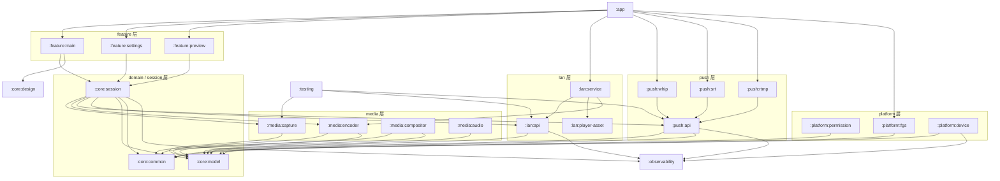

### 2.3 包结构

```text
com.example.campush
├── app                         :app
│   ├── CamPushApp.kt
│   ├── di/                     AppModule, MediaModule, PushModule, LanModule
│   └── MainActivity.kt
├── feature
│   ├── main/                   :feature:main
│   │   ├── MainScreen.kt
│   │   ├── MainViewModel.kt
│   │   ├── MainUiState.kt
│   │   └── component/          AddressCard, StatusBar, SourcePicker, StartButton
│   ├── settings/               :feature:settings
│   └── preview/                :feature:preview
├── core
│   ├── model/                  :core:model
│   │   ├── AccessScope.kt CaptureMode.kt DualLayout.kt DualPrimary.kt
│   │   ├── PushProtocol.kt IngestState.kt RoomState.kt
│   │   ├── PlayAddress.kt StreamMetrics.kt SessionConfig.kt
│   │   └── ErrorCode.kt        （00 §9.2 全量常量）
│   ├── common/                 :core:common
│   │   ├── CampushError.kt CampushResult.kt Dispatchers.kt TimeSource.kt
│   │   └── RetryPolicy.kt
│   ├── session/                :core:session
│   │   ├── SessionOrchestrator.kt
│   │   ├── StartPushUseCase.kt StopPushUseCase.kt SwitchProtocolUseCase.kt
│   │   ├── SessionRepository.kt PlayAddressFactory.kt
│   │   └── state/              SessionState.kt
│   └── design/                 :core:design
├── media
│   ├── capture/                :media:capture
│   │   ├── CaptureController.kt CameraBinder.kt
│   │   ├── DualCameraDetector.kt DualCameraCapability.kt DualUnsupportedReason.kt
│   │   └── CameraModeSwitcher.kt
│   ├── encoder/                :media:encoder
│   │   ├── EncoderController.kt VideoEncoderConfig.kt EncodedFrame.kt
│   │   ├── AdaptiveBitrateController.kt BitrateLadder.kt
│   │   └── CodecCapabilityProbe.kt
│   ├── compositor/             :media:compositor
│   │   ├── CompositeRenderer.kt EglCore.kt EglSurfaceBase.kt
│   │   ├── Layout.kt PipLayout.kt SplitLayout.kt
│   │   └── GlShader.kt
│   └── audio/                  :media:audio
├── push
│   ├── api/                    :push:api
│   │   ├── PushClient.kt PushConfig.kt PushEvent.kt
│   │   ├── PushClientFactory.kt PushRegistry.kt
│   │   └── NetworkStats.kt
│   ├── whip/                   :push:whip
│   ├── srt/                    :push:srt
│   └── rtmp/                   :push:rtmp
├── lan
│   ├── api/                    :lan:api
│   │   ├── LanServiceManager.kt LanConfig.kt LanStatus.kt LanBridge.kt
│   └── service/                :lan:service
│       └── （实现与端点由 05 定义）
├── platform
│   ├── permission/             :platform:permission
│   ├── fgs/                    :platform:fgs
│   │   ├── PushForegroundService.kt PushNotification.kt WakeLockHolder.kt
│   └── device/                 :platform:device
│       ├── ThermalMonitor.kt BatteryMonitor.kt NetworkMonitor.kt LanNetworkInfo.kt
└── observability/              :observability
    ├── Telemetry.kt EventNames.kt MetricNames.kt
    └── Redaction.kt            （token/roomId/IP 脱敏）
```

### 2.4 依赖规则（Enforced by build）

| 规则 | 内容 | 校验方式 |
|---|---|---|
| DEP-1 | 依赖方向只能是 `:app → feature → core:session → media/push/lan → core:model → core:common`，禁止反向 | `build.gradle` 不写反向依赖 + `dependencyGuard` 任务 |
| DEP-2 | `:core:model` 不依赖 Android SDK（`java-library` 纯 Kotlin） | Gradle 插件类型约束 |
| DEP-3 | `:push:api` 不依赖任何 `:push:*` 实现 | 代码评审 + 编译约束 |
| DEP-4 | `:push:whip`/`:push:srt`/`:push:rtmp` 互不依赖，只在 `:app` 装配 | `:app` 的 DI 模块是唯一装配点 |
| DEP-5 | `feature` 层不得直接 import `android.hardware.camera2`、`android.media.MediaCodec`、`android.opengl.*` | Detekt 自定义规则（`ForbiddenImport`） |
| DEP-6 | `:lan:service` 只能通过 `:media:encoder` 的 `EncodedFrame` 接收媒体，不得直接持有 Camera | 接口签名约束（§10） |
| DEP-7 | 所有跨模块数据类必须在 `:core:model`，禁止模块内自定义跨模块类型 | 评审 + API 检查 |
| DEP-8 | `:observability` 只能被上层依赖，不得反向依赖 feature | 依赖矩阵 |

---

## 3. 单向数据流与状态模型

### 3.1 UDF 全景

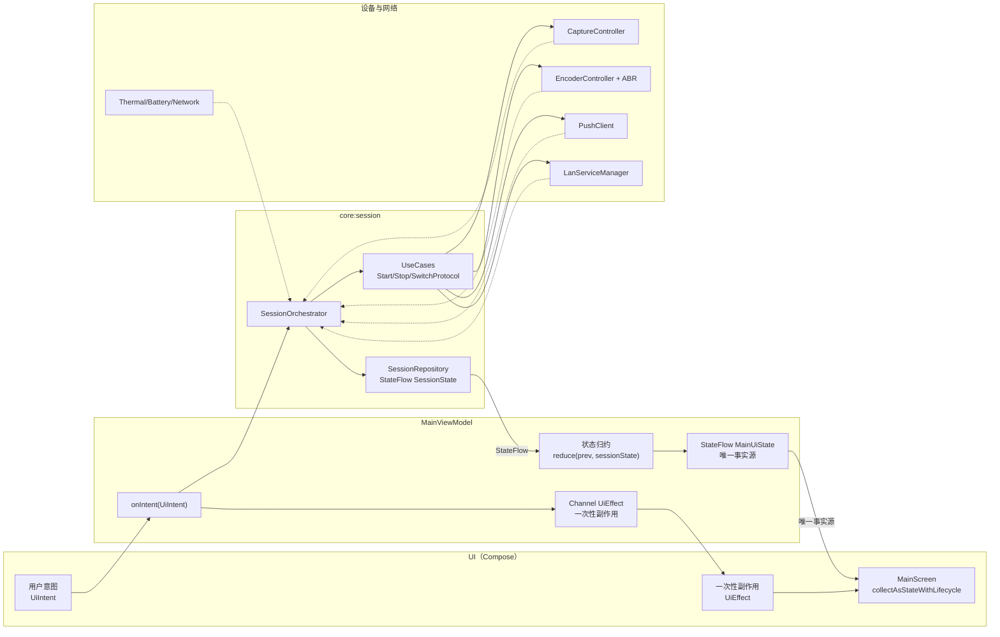

**硬规则**：

1. UI **只**读 `StateFlow<MainUiState>`，不读任何 `SessionRepository` 子状态。
2. UI **只**发 `UiIntent`，不直接调用 use case。
3. 一次性事件（复制成功、打开分享面板）走 `Channel<UiEffect>`，不进 `UiState`（避免旋转屏重放）。
4. `MainUiState` 必须 `data class` + 全部 `val`，且 `@Immutable`。
5. 状态归约必须是纯函数：`reduce(prev: MainUiState, event: SessionState): MainUiState`，可单测。

### 3.2 `MainUiState` 结构（字段签名）

```kotlin
@Immutable
data class MainUiState(
    // ---- 顶部状态栏 ----
    val accessScope: AccessScope = AccessScope.WAN,
    val accessScopeLocked: Boolean = false,          // 推流中置灰（PRD §4.2）
    val captureMode: CaptureMode = CaptureMode.SINGLE_BACK,
    val dualSupported: Boolean = false,              // false 时 UI 不呈现 dual（PRD §5.2）
    val dualUnsupportedReason: DualUnsupportedReason? = null,
    val pushProtocol: PushProtocol = PushProtocol.WHIP,
    val pushProtocolSwitchable: Boolean = true,      // LAN 推流中锁协议（PRD §6.2）
    // ---- 会话状态 ----
    val session: SessionUiState = SessionUiState.Idle,
    val playAddress: PlayAddress? = null,            // 标准模式唯一地址
    val metrics: StreamMetrics = StreamMetrics.EMPTY,
    // ---- 环境与降级 ----
    val banner: Banner? = null,
    val degraded: DegradedState = DegradedState.NONE,
    val thermalStatus: ThermalStatus = ThermalStatus.NONE,
    val batteryPercent: Int = 100,
    val networkType: NetworkType = NetworkType.NONE,
    // ---- 设置回显 ----
    val videoConfig: VideoConfig = VideoConfig.Default720p30,
)

sealed interface SessionUiState {
    data object Idle : SessionUiState
    data class Preparing(val step: PrepareStep) : SessionUiState
    data class Live(
        val ingestState: IngestState,
        val elapsedSec: Long,
        val addressRevealed: Boolean,
    ) : SessionUiState
    data class Switching(val from: PushProtocol, val to: PushProtocol) : SessionUiState
    data class Stopping : SessionUiState
    data class Failed(val error: CampushError) : SessionUiState
}

enum class PrepareStep { PERMISSIONS, CAPTURE, ENCODER, COMPOSITOR, ROOM, CONNECT }
```

### 3.3 `UiIntent` / `UiEffect`

```kotlin
sealed interface UiIntent {
    data class SelectAccessScope(val scope: AccessScope) : UiIntent
    data class SelectCaptureMode(val mode: CaptureMode) : UiIntent
    data class SelectDualLayout(val layout: DualLayout) : UiIntent
    data object SwapDualPrimary : UiIntent
    data class SelectPushProtocol(val protocol: PushProtocol) : UiIntent   // WAN 推流中 = 热切换
    data object StartPush : UiIntent
    data object StopPush : UiIntent
    data object CopyAddress : UiIntent
    data object ShowQr : UiIntent
    data object Share : UiIntent
    data class ToggleFlash(val on: Boolean) : UiIntent
    data class ToggleMute(val muted: Boolean) : UiIntent
    data object DismissBanner : UiIntent
    data object OpenSettings : UiIntent
}

sealed interface UiEffect {
    data class Toast(val text: String) : UiEffect
    data object AddressCopied : UiEffect
    data class OpenShareSheet(val url: String) : UiEffect
    data class OpenQrDialog(val url: String) : UiEffect
    data class RequestPermission(val permissions: List<String>) : UiEffect
    data object OpenSystemSettings : UiEffect
    data class OpenPlayPage(val url: String) : UiEffect
}
```

> `CopyAddress`/`ShowQr`/`Share` 的 payload **只能**是 `playAddress.url`（标准模式唯一地址，INV-1）。专业模式的多地址能力不在本文实现范围（PRD §3.4）。

### 3.4 `StateFlow` 暴露与合流规则

| 规则 | 内容 |
|---|---|
| SF-1 | `SessionRepository` 暴露 `StateFlow<SessionState>`，`MainViewModel` 用 `combine` 与本地设置状态合成 `MainUiState` |
| SF-2 | 所有 `StateFlow` 用 `stateIn(viewModelScope, SharingStarted.WhileSubscribed(5_000), initial)`，禁止 `WhileSubscribed(0)` |
| SF-3 | 高频指标（码率/帧率）合并为 1 个 `StreamMetrics`，采样 **1 s** 一次（`sample(1_000)`），避免每帧刷新 UI |
| SF-4 | `metrics` 只保留近 30 个采样点用于迷你趋势图，其余丢弃 |
| SF-5 | `banner` 为单槽位，新 banner 覆盖旧 banner；必须带 `autoDismissMs`（默认 5 s，错误类 0 = 常驻） |
| SF-6 | 状态归约在 `Dispatchers.Main.immediate` 执行，确保顺序与 UI 帧对齐 |

**采样与节流表**：

| 数据 | 生产频率 | UI 频率 | 策略 |
|---|---|---|---|
| 码率 `bitrateBps` | 编码器每帧回调 | 1 Hz | `sample(1_000)` |
| 帧率 `fps` | 每帧 | 1 Hz | 计数窗口 1 s |
| 丢包 `lossPct` | 推流端 1 s | 1 Hz | 直接透传 |
| RTT | 推流端 1–2 s | 1 Hz | 直接透传 |
| 温度 | `PowerManager` 回调（事件驱动） | 事件驱动 | 状态变化才发 |
| 电量 | `ACTION_BATTERY_CHANGED` | 事件驱动 | 变化 ≥ 1% 才发 |
| 会话计时 | 1 Hz | 1 Hz | `tickerFlow` |

### 3.5 状态映射：内部状态 → UI

| `SessionState`（内部） | `SessionUiState` | 顶部标签 | 按钮 | 地址卡片 | 依据 |
|---|---|---|---|---|---|
| `Idle` | `Idle` | 模式标签 + 协议 | 「开始推流」可用 | 隐藏 | PRD §10.1 |
| `Preparing(PERMISSIONS → CONNECT)` | `Preparing(step)` | 「准备中」 | 禁用 + 进度 | 隐藏 | — |
| `Live(ingestState=CONNECTING)` | `Live` | 「连接中」 | 「停止推流」可用 | 隐藏 | — |
| `Live(ingestState=PUBLISHING)` | `Live` | 「推流中」+ `accessScope` 标签 | 「停止推流」 | **显示唯一地址** | PRD §9.1 |
| `Live(ingestState=RECONNECTING)` | `Live` | 「重连中」 | 「停止推流」 | 保留显示（地址不变） | INV-1 |
| `Switching` | `Switching` | 「正在重新连接，播放地址不变」 | 「停止推流」 | 保留显示 | PRD §10.3 |
| `Stopping` | `Stopping` | 「停止中」 | 禁用 | 置灰 | — |
| `Live(ingestState=ENDED)` | `Idle` | 模式标签 | 「开始推流」 | 隐藏（地址失效） | INV-3 |
| `Failed(error)` | `Failed(error)` | 「失败」+ 错误码 | 「重试」 | 隐藏 | 00 §9 |

---

## 4. 线程模型

### 4.1 线程清单

| 线程/调度器 | 归属模块 | 数量 | 职责 | 禁止 |
|---|---|---|---|---|
| `main` | Android | 1 | Compose 组合、`StateFlow` 收集、状态归约 | 任何阻塞 IO / 编解码 |
| `cameraExecutor` | `:media:capture` | 1（单线程） | CameraX 回调、能力探测、模式切换 | 丢帧处理以外的重活 |
| `glThread`（`HandlerThread` + EGL） | `:media:compositor` | 1 | EGL 初始化、纹理上传、合成绘制、`eglSwapBuffers` | 网络、磁盘 |
| `encoderThread`（`HandlerThread`） | `:media:encoder` | 1 | `dequeueInputBuffer`/`dequeueOutputBuffer`、ABR 计算 | 阻塞等待 > 5 ms |
| `push-io`（每个 `PushClient` 内部） | `:push:*` | 1/客户端 | 连接、发送、重连计时 | 触碰 GL/Codec |
| `lan-server`（由 05 定义） | `:lan:service` | 1 + N（观看者） | `ServerSocket` accept、每连接写出 | 触碰编码器内部状态 |
| `Dispatchers.Default` | `:core:session` | 池 | 轻量计算（布局计算、码率阶梯） | 长任务 |
| `Dispatchers.IO` | 数据层 | 池 | DataStore、日志、文件 | UI 状态写 |
| `Telemetry` 上报 | `:observability` | 1 串行 | 事件排队与批量上报 | 阻塞调用方 |

### 4.2 线程间数据流与背压

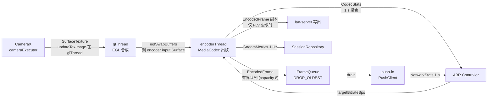

| 队列 | 容量 | 满时策略 | 理由 |
|---|---|---|---|
| GL 待合成帧 | 2 | `DROP_OLDEST`（丢弃旧帧，永不阻塞相机） | 相机不得被阻塞，否则 ANR/黑屏 |
| 编码输出帧 → 推流 | 8（约 260 ms @30 fps） | `DROP_OLDEST` 且仅丢非 IDR 帧 | 丢 IDR 会导致播放端长时间花屏 |
| 编码输出帧 → LAN 写出 | 8 | 超限则断开最慢观看者（05 侧执行） | LAN 不允许拖慢编码 |
| 埋点事件 | 512 | 丢弃并计数 `telemetry_dropped_total` | 埋点不得影响主链路 |
| 日志 | 4 MB 环形 | 覆盖最旧 | 导出时脱敏 |

**硬规则**：

1. 任何线程都**不得**阻塞等待 GL 或编码线程完成（超时 5 ms 即视为失败并降级）。
2. `glThread` 与 `encoderThread` 的耗时必须采样上报：`gl_frame_ms`、`encode_frame_ms`，`p95` 超阈值触发降级（§12）。
3. `push-io` 发送超时由适配器内部处理，**不得**向上抛到 `main`。

### 4.3 耗时预算（客户端内部）

| 阶段 | p50 | p95 | 来源 |
|---|---|---|---|
| 采集 + 编码（整体） | 40 ms | 70 ms | [00-conventions.md §10.1](./00-conventions.md)（与本文"采集+编码"同口径） |
| GL 合成单帧（双摄 PiP） | ≤ 6 ms | ≤ 10 ms | 本地设计目标，M0 实测校准 |
| `encode_frame_ms`（喂帧） | ≤ 3 ms | ≤ 8 ms | 本地设计目标 |
| 开始推流 → `Preparing` 完成 | ≤ 1 s | ≤ 2 s | 支撑 00 §10.3「点击到地址可用 ≤ 3 s」 |

---

## 5. 权限与生命周期

### 5.1 权限矩阵

| 权限 | 声明 | 运行时请求 | 缺失后果 | 错误码 |
|---|---|---|---|---|
| `android.permission.CAMERA` | 是 | 首次进入主界面 | 无法预览/推流 | `1001` |
| `android.permission.RECORD_AUDIO` | 是 | 首次开始推流 | 可视频无声（提示后继续或阻止，取「提示后继续静音推流」） | `1002` |
| `android.permission.POST_NOTIFICATIONS`（API 33+） | 是 | 首次开始推流 | 前台服务通知不可见，**不阻断**推流 | — |
| `android.permission.FOREGROUND_SERVICE` | 是 | 否（普通权限） | 无法启动前台服务 | `1007` |
| `android.permission.FOREGROUND_SERVICE_CAMERA`（API 34+） | 是 | 否 | 前台服务启动即崩溃 | `1007` |
| `android.permission.FOREGROUND_SERVICE_MICROPHONE`（API 34+） | 是 | 否 | 同上 | `1007` |
| `android.permission.INTERNET` | 是 | 否 | WAN 不可用 | `7001`/`4001` |
| `android.permission.ACCESS_NETWORK_STATE` | 是 | 否 | LAN 检测失效 | `6003` |
| `android.permission.ACCESS_WIFI_STATE` | 是 | 否 | 局域网 IP 获取可能失败 | `6003` |
| `android.permission.NEARBY_WIFI_DEVICES`（API 33+，`neverForLocation`） | 是 | 是（LAN 模式首次） | 热点/SSID 判定退化，**不阻断** | — |
| `android.permission.WAKE_LOCK` | 是 | 否 | 后台推流可能被休眠 | `7001` |
| `android.permission.REQUEST_IGNORE_BATTERY_OPTIMIZATIONS` | 是 | 引导（不强制） | 后台保活下降 | — |
| `android.permission.MODIFY_AUDIO_SETTINGS` | 是 | 否 | 静音/路由异常 | — |

**明确不申请的权限**（隐私最小化）：`ACCESS_FINE_LOCATION`（热点检测改用 `NEARBY_WIFI_DEVICES` + `WifiManager`）、`READ_PHONE_STATE`、`READ_EXTERNAL_STORAGE`（录制走 MediaStore，M2 再评估）。

### 5.2 权限请求流程

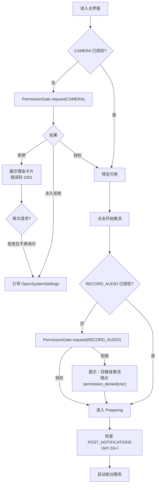

**规则**：

1. 权限请求必须绑定 `ActivityResultContracts.RequestMultiplePermissions`，结果回到 `PermissionGate`，**不得**在 Composable 内直接处理。
2. 拒绝必须可解释：`1001`/`1002` 的 `userHint` 必须说明「缺失该权限会导致哪个功能不可用」（PRD §14）。
3. `permission_denied` 埋点只上报 `permission` 字段与 `code`，不上报其他信息（00 §11）。

### 5.3 会话生命周期状态机

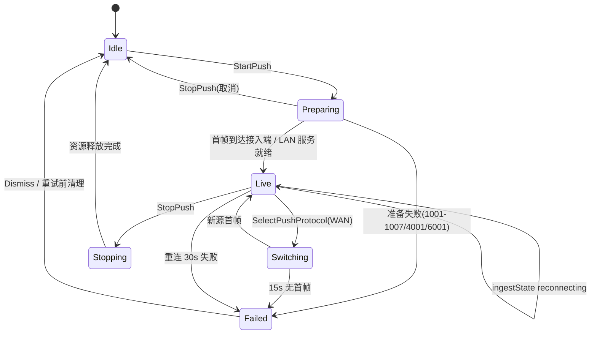

> 与 00 §3.1 的 `roomState`/`ingestState` 关系：本状态机是**客户端 UI 会话**状态，不是契约状态机。映射见 §3.5；`Live` 内部的 `ingestState` 直接取 00 §3 的五个值。

### 5.4 前后台与配置变化

| 场景 | 行为 | 依据 |
|---|---|---|
| 切到后台（推流中） | 前台服务继续、`CameraX` 不解绑、保持 `PUBLISHING`；通知栏常驻控制 | PRD §8.1 |
| 切到后台（未推流） | 解绑相机、释放 GL、停计时 | 隐私最小化 |
| 息屏（推流中） | 持 `PARTIAL_WAKE_LOCK`（仅推流期间） | PRD §8.1 |
| 横竖屏切换 | **不重建** `MainViewModel` 与媒体管线；UI 仅重排 | PRD §10.1 |
| 多窗口/分屏 | 预览比例自适应，状态保留 | — |
| 来电/音频焦点丢失 | 暂停音频上行，视频继续；恢复后自动恢复 | — |
| 系统回收进程（后台） | 前台服务降低概率；恢复后重置为 `Idle` 并提示「推流已结束」 | — |

**配置变化硬规则**：`android:configChanges="orientation|screenSize|keyboardHidden"` 仅用于 `MainActivity`；媒体管线由 `ViewModel`/前台服务持有，`Activity` 重建不得触发 `stopPush`。

---

## 6. 采集：CameraX 与 Multi-Camera 检测降级

### 6.1 绑定策略

| `captureMode` | CameraX 绑定 | 输出 | 说明 |
|---|---|---|---|
| `SINGLE_BACK` | `bindToLifecycle(DEFAULT_BACK_CAMERA, Preview, ImageAnalysis?)` | 单 `SurfaceProvider` | 默认模式（PRD §5.1） |
| `SINGLE_FRONT` | `bindToLifecycle(DEFAULT_FRONT_CAMERA, ...)` | 单 `SurfaceProvider` | — |
| `DUAL` | `bindToLifecycle(listOf(SingleCameraConfig(FRONT), SingleCameraConfig(BACK)))` | 双 `SurfaceProvider` | CameraX Multi-Camera API；失败即降级 |

**统一管线**：无论单摄双摄，相机输出都进入 **GL 合成**（单摄直通 = 一次全屏 blit），保证后续水印/滤镜/录制只有一条路径。

### 6.2 Multi-Camera 能力检测流程

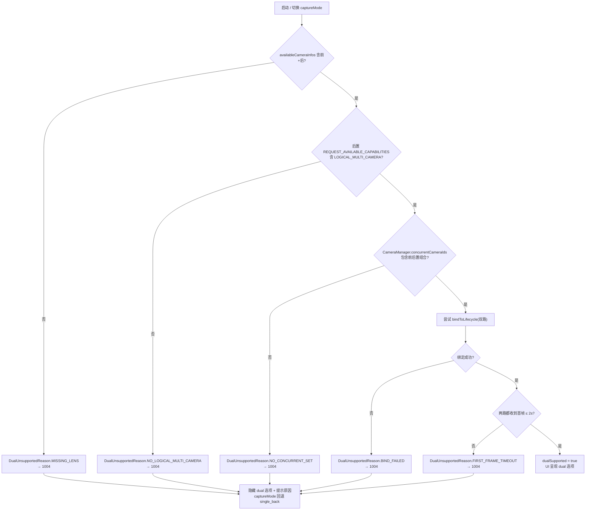

### 6.3 `DualUnsupportedReason` 与 1004 映射

```kotlin
enum class DualUnsupportedReason(val wire: String) {
    MISSING_LENS("missing_lens"),                       // 只有单摄像头（无前或无后）
    NO_LOGICAL_MULTI_CAMERA("no_logical_multi_camera"), // 无 LOGICAL_MULTI_CAMERA 能力
    NO_CONCURRENT_SET("no_concurrent_set"),             // concurrentCameraIds 无前后置组合
    BIND_FAILED("bind_failed"),                         // 双路绑定抛异常
    FIRST_FRAME_TIMEOUT("first_frame_timeout"),         // 2 s 内未双路出帧
    DEVICE_BLOCKLIST("device_blocklist"),               // 已知机型黑名单
    RESOURCE_BUSY("resource_busy"),                     // 其它 App 占用
}
```

| 字段 | 值 | 说明 |
|---|---|---|
| 错误码 | `1004 dual_camera_unsupported` | 00 §9.2 |
| `retryable` | `false`（`RESOURCE_BUSY` 为 `true`） | — |
| `userHint` | 「该设备不支持前后摄像头同时开启」+ 原因细分 | PRD §5.2 |
| UI 动作 | 隐藏 `dual` 选项；若当前为 `dual` 则回退 `single_back` | PRD §14 |
| 埋点 | `degrade_triggered(reason="dual_unsupported")` | 00 §11 |

### 6.4 检测结果缓存策略

| 项 | 策略 |
|---|---|
| 存储 | DataStore，key = `SHA-256(deviceModel + Build.FINGERPRINT + apiLevel)` 前 8 字节 |
| 值 | `DualCameraCapability(supported, reason, probedAtMs, cameraXVersion)` |
| 有效期 | 30 天或 CameraX 版本变更即失效 |
| 黑名单 | 服务端下发（可热更新），命中即 `DEVICE_BLOCKLIST`；仅影响 `dual` 选项，不影响单摄 |
| 探测时机 | 首次进入主界面（后台协程，不阻塞 UI）；`DUAL` 被选择时若缓存为空则同步探测 |

**规则**：缓存只用于「隐藏/展示 `dual` 选项」，**每次真正进入 `DUAL` 仍需实际绑定验证**（避免缓存误导导致黑屏）。

### 6.5 采集层关键约束

| 约束 | 值 | 理由 |
|---|---|---|
| 目标分辨率 | 1080p 采集 → 720p 编码（默认） | 为 GL 缩放留余量，避免相机输出非目标尺寸导致拉伸 |
| 目标帧率 | 30 fps（`TargetFrameRate(30)`） | 00 §7 默认 720p30 |
| 采集格式 | `Surface`（`Preview` use case） | 零拷贝进 GL |
| 双摄降级 | 默认 `DUAL` 目标 720p30；若 `bindToLifecycle` 只支持 720p24 则接受 24 fps 并提示 | 00 §10.4 双摄 CPU ≤ 45% |
| 相机切换（前后热切换） | `unbind` → `bind`，GL 管线不重建，切换间隙 GL 输出最后一帧 | PRD §8.2 |
| 相机被占用 | 捕获 `CameraDevice.StateCallback.ERROR_CAMERA_IN_USE` → `1003` | 00 §9.2 |

---

## 7. 编码：MediaCodec 硬编与自适应码率

### 7.1 编码管线

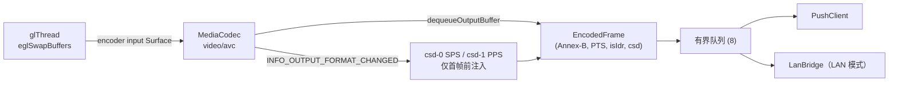

### 7.2 编码参数基线（对齐 00 §7）

| 参数 | 取值 | 说明 |
|---|---|---|
| `MIME` | `video/avc` | H.264 Baseline/Main |
| 色彩格式 | `COLOR_FormatSurface` | 零拷贝 |
| `profile` | `AVCProfileBaseline`（默认）/ `Main`（>= API 26 且设备支持） | 00 §7「Baseline/Main」 |
| `level` | 按分辨率/码率自动（720p30 → Level 3.1） | 编码器 `codecInfo` 选择 |
| 分辨率阶梯 | 720p（1280×720）→ 540p（960×540）→ 480p（854×480） | ABR 降档 |
| 帧率 | 30 fps（双摄可 24） | 00 §7 |
| 关键帧间隔 | **2 s**（弱网 1 s） | 00 §7 |
| 码率模式 | `BITRATE_MODE_VBR`（默认）/ `CBR`（SRS 兼容问题时的兜底） | M0 校准 |
| 码率 | 默认 **2.5 Mbps**；自适应区间 **800 kbps–4 Mbps** | 00 §7 |
| 起始码 | **启动即强制 IDR**（`requestKeyFrame()`） | 首帧预算（00 §10.2 等关键帧 500 ms） |
| 音频 | AAC-LC，48 kHz，立体声 128 kbps（可降 64 kbps 单声道） | 00 §7 |
| 时间戳 | `presentationTimeUs` 来自相机帧，不重新生成 | 避免音画漂移 |

### 7.3 硬编与软编策略

| 阶段 | 行为 |
|---|---|
| 首选 | `MediaCodec.createEncoderByType("video/avc")` + `CodecCapabilityProbe` 校验 `COLOR_FormatSurface` 支持与最大实例数 |
| 校验项 | 支持 720p30；支持 `KEY_BITRATE_MODE`；`hardwareAccelerated` 标记（API 29+） |
| 失败 | 依次尝试：主 profile 降级为 Baseline → 分辨率降 540p → 换硬件编码器；全部失败才落软编 |
| 软编兜底 | 仅在 `1005` 路径下启用，强制 480p、单路、24 fps，且 UI 必须提示「使用软件编码，画质与功耗受限」 |
| 错误码 | 初始化失败 `1005 encoder_init_failed`；运行中崩溃/超时 → `1005` + 重启管线一次 |
| 埋点 | `degrade_triggered(reason="software_encoder")` |

**明确不做**：不做 H.265 默认编码（WHIP 契约仅 H.264 + Opus，00 §7）；H.265 仅在「本地录制」场景（M2）评估。

### 7.4 自适应码率（ABR）

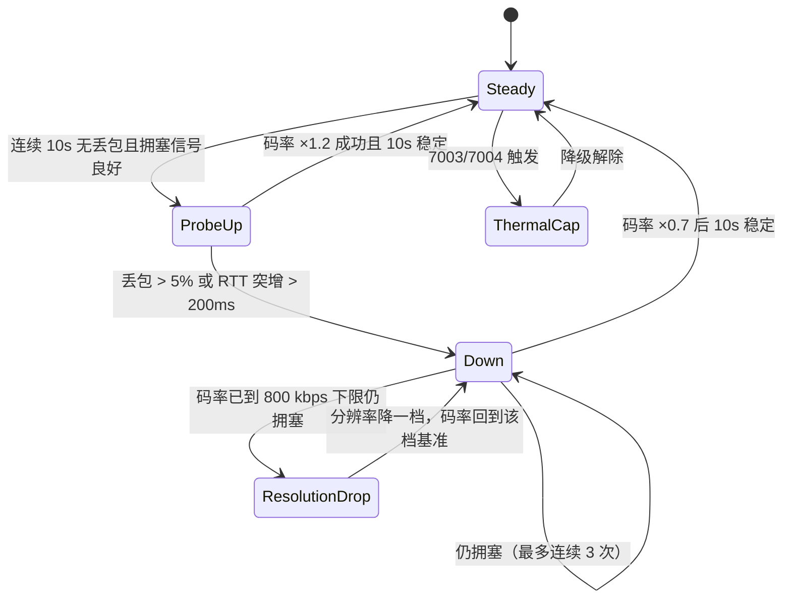

**控制器输入/输出（签名）**：

```kotlin
interface AdaptiveBitrateController {
    fun onEncodeStats(stats: EncodeStats)        // 1 Hz
    fun onNetworkStats(stats: NetworkStats)      // 1 Hz
    fun onThermal(state: ThermalStatus)          // 事件
    fun onBattery(percent: Int, charging: Boolean) // 事件
    val target: StateFlow<BitrateTarget>          // bps + resolution + fps
}

data class BitrateTarget(
    val bitrateBps: Int,     // 800_000 .. 4_000_000
    val width: Int,          // 1280 / 960 / 854
    val height: Int,         // 720 / 540 / 480
    val fps: Int,            // 30 / 24
    val keyFrameIntervalSec: Int, // 2 / 1（弱网）
)
```

**决策规则表**：

| 条件 | 动作 | 步长 | 依据 |
|---|---|---|---|
| 连续 10 s `lossPct < 1%` 且 RTT 稳定 | 上调码率 | ×1.2 | 00 §7 上限 4 Mbps |
| `lossPct > 5%` 连续 3 s | 下调码率 | ×0.7 | — |
| RTT 突增 > 200 ms（相对 30 s 基线） | 下调码率 | ×0.7 | — |
| 码率已 ≤ 800 kbps 且仍拥塞 | 分辨率降一档 | 720p→540p→480p | 00 §7 下限 800 kbps |
| 弱网（`lossPct > 8%`） | 关键帧间隔 2 s → 1 s | — | 00 §7 |
| `thermalStatus ≥ SEVERE` | 强制单摄 + 码率 ≤ 1.5 Mbps + 540p | 固定档 | 00 §10.4、`7003` |
| 电量 ≤ 20% 且未充电 | 同过热档 | 固定档 | 00 §10.4、`7004` |
| 用户开启省电模式 | 强制 `single_back` + 1 Mbps + 480p + 24 fps | 固定档 | PRD §8.4 |
| 降级解除后恢复 | 每 10 s 上调一档，最高回到用户设定 | 渐进 | 避免抖动 |

**滞后与防抖**：所有阈值判断需连续满足 3 个采样周期（⇒ 3 s）才生效；上调冷却 10 s、下调冷却 5 s。

---

## 8. 合成：OpenGL ES 双摄 PiP / 分屏

### 8.1 EGL 与纹理链

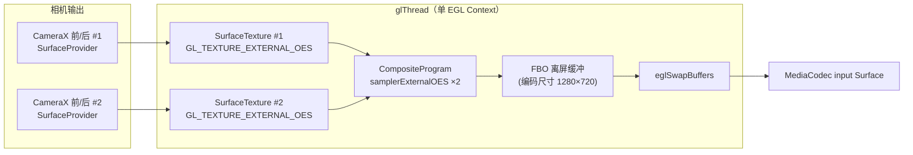

**渲染流程（每帧一次）**：

1. `SurfaceTexture.updateTexImage()`（两路）；取 `getTransformMatrix()` 处理旋转/镜像。
2. 设置 viewport 为编码尺寸，`glBindFramebuffer(FBO)`。
3. 绘制主画面：全屏 quad（按 `dualPrimary` 选择纹理源），aspect 采用 `CENTER_CROP`。
4. 绘制副画面：按 `dualLayout` 计算目标矩形，带 2 px 描边与可选圆角遮罩。
5. `glBindFramebuffer(0)`，`eglMakeCurrent` 到 encoder surface，blit FBO → `eglSwapBuffers`（设置 `EGL_ANDROID_presentation_time` 或 `eglPresentationTimeANDROID`）。
6. 若 `dualLayout == PIP`：PiP 位置来自归一化拖拽坐标 `(x∈[0,1], y∈[0,1])`，默认右上 `(0.78, 0.06)`。

### 8.2 布局参数

| `dualLayout` | 主画面 | 副画面 | 默认尺寸 | 可调 |
|---|---|---|---|---|
| `pip` | 全屏（`CENTER_CROP`） | 右下/可拖拽悬浮窗 | 宽度 = 0.28 × 屏宽（等比） | 位置（拖拽）、缩放（1.0–1.6×，捏合） |
| `split_h` | 左半屏 | 右半屏 | 各 50% × 100%，中缝 2 px | 比例固定（M1）；M2 可拖动分隔条 |
| `split_v` | 上半屏 | 下半屏 | 各 100% × 50%，中缝 2 px | 同上 |

**`dualPrimary` 交换**：仅交换「主/副纹理绑定」，**不重建 GL 管线**、**不重新绑定相机**；交换在下一帧生效（< 33 ms）。

### 8.3 渲染约束

| 约束 | 值 | 说明 |
|---|---|---|
| EGL 上下文数 | 1 个共享 context | 避免纹理跨 context 复制 |
| 双摄合成分辨率 | 编码尺寸（默认 1280×720） | FBO 与编码 Surface 同尺寸 |
| 合成分辨率上限 | 1280×720（双摄）；1080p 仅单摄 | 00 §10.4 双摄 CPU ≤ 45% |
| 单帧合成耗时 | p50 ≤ 6 ms，p95 ≤ 10 ms | §4.3 |
| 丢帧策略 | GL 输入队列容量 2，满则丢最旧 | 不阻塞相机 |
| 后台上/前台切换 | `eglMakeCurrent` 在 glThread 内完成，不跨线程 | — |
| 失败码 | 合成链路异常 → `1006 composition_failed`，回退单摄直通 | 00 §9.2 |
| 旋转处理 | 相机 `getTransformMatrix()` 推导，不重新创建 SurfaceTexture | 避免旋转跳帧 |

### 8.4 合成失败降级

| 失败 | 检测 | 动作 |
|---|---|---|
| EGL 初始化失败 | `eglGetDisplay`/`eglCreateContext` 返回空 | `1006`；回退「相机 Surface → 编码 Surface」直通（单摄） |
| Shader 编译失败 | 编译日志非空 | `1006`；使用内置简化 shader（无描边/圆角） |
| FBO 不完整 | `glCheckFramebufferStatus` | `1006`；改用编码 Surface 直接绘制（无离屏） |
| 双摄其中一路断流 | 该路 `onFrameAvailable` 超时 1 s | 保留最后帧 + 提示「相机异常」；10 s 未恢复 → 回退单摄 |

---

## 9. 推流抽象层（whip / srt / rtmp 可插拔）

### 9.1 抽象接口

```kotlin
interface PushClient {
    val protocol: PushProtocol
    val events: StateFlow<IngestState>

    suspend fun connect(config: PushConfig): CampushResult<Unit>
    fun submit(frame: EncodedFrame)          // 非阻塞；队列满时内部丢弃并计数
    suspend fun disconnect(reason: DisconnectReason)
    fun networkStats(): StateFlow<NetworkStats>
}

data class PushConfig(
    val roomId: String,                      // 00 §4.1 格式
    val ingestToken: String,                 // 仅内存，禁止日志
    val protocol: PushProtocol,
    val endpoints: IngestEndpoints,          // whipUrl / srtUrl / rtmpUrl（00 §4.2 模板）
    val video: VideoEncoderConfig,
    val audio: AudioEncoderConfig,
    val rtcConfig: RtcConfig?,              // 仅 whisk/webrtc：ICE servers（含 TURN）
)

class PushClientFactory(
    private val registry: Map<PushProtocol, Provider<PushClient>>,
) {
    fun create(protocol: PushProtocol): PushClient
}
```

### 9.2 适配器职责矩阵

| 项 | `WhipPushClient`（`:push:whip`） | `SrtPushClient`（`:push:srt`） | `RtmpPushClient`（`:push:rtmp`） |
|---|---|---|---|
| 底层 | WebRTC Android SDK（`PeerConnection`）+ 自研 WHIP HTTP | libsrt（JNI 或成熟封装） | RTMP 客户端库 |
| 信令 | `POST {whipHost}/whip/{roomId}` → `201 Answer`；`PATCH` Trickle；`DELETE` 结束 | 无 HTTP 信令，连接即推流 | 无 HTTP 信令 |
| 鉴权 | `Authorization: Bearer <ingestToken>` | `streamid=#!::r={roomId},t={ingestToken}` | `rtmp://.../live/{roomId}?token={ingestToken}` |
| 传输 | SRTP over UDP（ICE） | UDP（SRT，`latency=200`） | TCP |
| 编码约束 | H.264 + Opus | H.264 + AAC | H.264 + AAC，GOP ≤ 2 s |
| 首帧行为 | 等 ICE/DTLS 完成再送 | 连接成功即送 | 握手完成即送 |
| 统计 | `getStats()`：RTT/丢包/可用带宽 | SRT 统计：RTT/丢包/发送缓冲 | RTMP 写缓冲/丢包 |
| 重连 | 重新 `POST` 新 offer（新会话顶旧 → `4004` 时退避） | 重建 socket，退避 0.5/1/2/4/8 s | 重建 TCP |
| 协议切换 | 由 `SwitchProtocolUseCase` 调 `ingest:switch` | 同左 | 同左 |
| 明确不负责 | 房间生命周期、地址生成 | 同左 | 同左 |

**统一约束**（三适配器共守）：

1. `submit()` **必须**非阻塞，返回即丢弃/入队，不得等待网络。
2. `connect()` 超时 **10 s**，超时返回 `CampushResult.Failure(4003)`。
3. 错误码映射：网络不可达 `4001`；协议被拒 `4004`；编码不支持 `4005`；码率超限 `4006`；服务端 `5xx`/超时 `4003`。
4. `ingestToken` 只存在内存，`toString()` 必须脱敏（INV-4）。
5. 播放地址与推流地址**互不传递**：`PushClient` 不知道 `playUrl`。

### 9.3 协议切换流程（WAN 热切换）

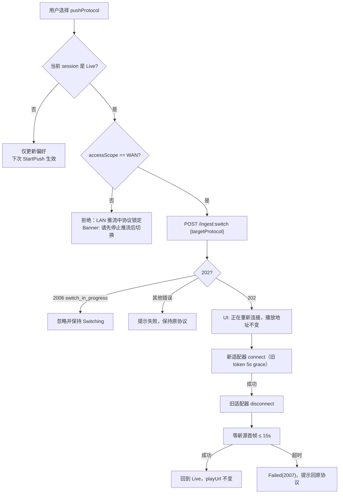

**不变量**：整个过程中 `playAddress` 字段**不发生任何变更**（INV-1/INV-2），UI 地址卡片保持展示。

### 9.4 重连策略

| 协议 | 退避序列 | 最大尝试 | 之后 |
|---|---|---|---|
| `whip` | 0.5 / 1 / 2 / 4 / 8 s | 5 次（约 30 s） | `ingestState="failed"` → `roomState="failed"`（00 §3.1「重连 30s 失败」） |
| `srt` | 0.5 / 1 / 2 / 4 / 8 s | 5 次 | 同上 |
| `rtmp` | 1 / 2 / 4 / 8 s | 4 次 | 同上 |

重连期间 UI 必须显示「重连中」，且**不**清空播放地址（INV-1）。

---

## 10. LAN 端侧服务模块边界

> 本节只定义**客户端与端侧服务之间的模块契约**；HTTP 端点、FLV/MJPEG 封装、PIN 校验、并发计数、AP 隔离判定的细节归 [05-lan-service.md](./05-lan-service.md)。

### 10.1 边界图

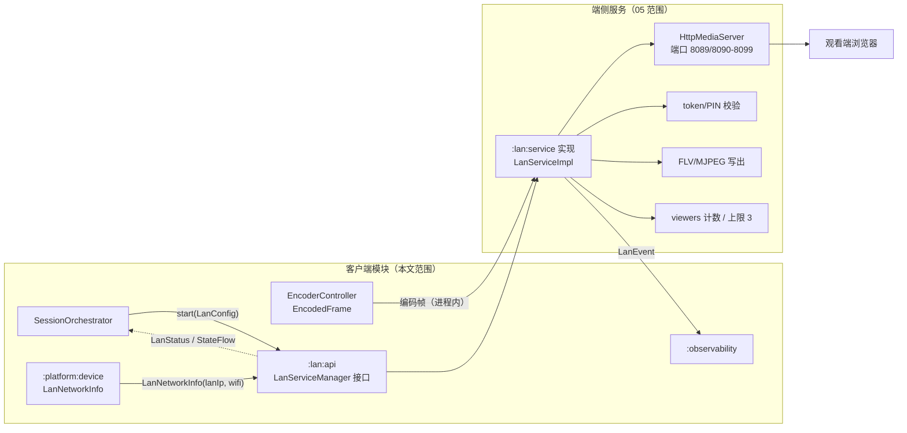

### 10.2 模块契约（`LanServiceManager`）

```kotlin
interface LanServiceManager {
    val status: StateFlow<LanStatus>
    val events: SharedFlow<LanEvent>

    suspend fun start(config: LanConfig): CampushResult<PlayAddress>
    suspend fun stop(): CampushResult<Unit>
    fun onEncodedFrame(frame: EncodedFrame)   // 非阻塞
}

data class LanConfig(
    val port: Int = 8089,                     // 占用则 8090–8099 顺延（00 §8）
    val maxViewers: Int = 3,                  // 默认 3，可配 1–3（00 §8）
    val pinRequired: Boolean = false,
    val pin: String? = null,                  // 4–6 位数字（00 §5.2）
    val mediaProtocols: List<LanMediaProtocol> = listOf(LanMediaProtocol.FLV, LanMediaProtocol.MJPEG),
    val pageTokenTtlSec: Long = 3600,         // 00 §5.1：60 min
    val mediaTokenTtlSec: Long = 300,         // 00 §5.1：300 s
    val bindAddress: String = "0.0.0.0",
)

data class LanStatus(
    val running: Boolean,
    val lanIp: String?,                       // 占位示例：192.0.2.10
    val port: Int,
    val viewers: Int,
    val maxViewers: Int,
    val pinRequired: Boolean,
    val uptimeSec: Long,
    val lastError: CampushError?,
)

sealed interface LanEvent {
    data class ViewerJoined(val count: Int) : LanEvent
    data class ViewerLeft(val count: Int) : LanEvent
    data object ApIsolationSuspected : LanEvent
    data class IpChanged(val newIp: String) : LanEvent
    data object PortFallback(val usedPort: Int) : LanEvent
}
```

### 10.3 边界硬规则

| 编号 | 规则 | 理由 |
|---|---|---|
| LAN-1 | `:lan:service` **不得**依赖 `:push:*` 或云端 API | LAN 零云端依赖（01 §2 P5） |
| LAN-2 | 编码帧通过 `onEncodedFrame(frame)` 进程内传递（环形缓冲），**不**走网络回环再做 | 00 §12「本地环回」、01 §5.4 |
| LAN-3 | `start()` 必须在 **≤ 1 s** 返回 `PlayAddress`，否则失败 `6001` | 00 §8 停止 ≤1 s、PRD §9.2 |
| LAN-4 | `PlayAddress.url` 由 `:lan:service` 生成，格式 `http://{lanIp}:{port}/s/{pageToken}`，`PlayAddressFactory` 只做校验不做拼接 | 00 §4.2 |
| LAN-5 | views/PIN/token 校验**全部**在端侧完成，客户端不得旁路 | 00 §8 |
| LAN-6 | 停止顺序：`stop()` → 端侧先结束会话（`204`）→ `Connection: close` → 关 `ServerSocket` → 销毁密钥，全过程 ≤ 1 s | 00 §8、INV-3 |
| LAN-7 | 非 Wi-Fi（`networkType != WIFI`）时 `start()` 直接返回 `6003` | 00 §4.4 |
| LAN-8 | 端侧服务**不得**上报观看数据到云端（脱敏聚合埋点除外） | 01 §12 |

### 10.4 与 05 的接口清单

| 本文提供 | 05 提供 |
|---|---|
| `LanServiceManager` 接口签名（本节） | `LanServiceImpl` 实现 |
| `LanConfig`/`LanStatus`/`LanEvent` 模型 | HTTP 端点实现（`/s/{pageToken}`、`/live.flv`、`/stream.mjpg`、`/healthz` 等，00 §8） |
| 端口 8089 / 8090–8099 顺延语义 | 端口探测与 `6002` 处理 |
| `maxViewers=3` 上限语义 | 计数口径与 `429`+`6005` |
| token TTL（3600/300 s） | 签发/校验实现 |
| 停止 ≤1 s 与 `connection refused` 要求 | 关闭顺序实现 |
| 播放页资源位置（`:lan:player-asset`） | 页面内容（内联、≤ 64 KB） |

---

## 11. 前台服务保活与电池优化

### 11.1 前台服务配置

| 项 | 值 | 依据 |
|---|---|---|
| 服务类 | `PushForegroundService` | PRD §8.1 |
| `foregroundServiceType` | `camera\|microphone` | Android 14+ 必需 |
| 通知渠道 | `push_session`（低优先级、常驻、不可滑除） | — |
| 通知内容 | 状态、`accessScope` 标签、`pushProtocol`、码率、观看数（LAN）、「停止」动作 | PRD §8.1 |
| 常驻间隔 | 每 5 s 刷新一次通知（`setOnlyAlertOnce(true)`） | 避免打扰 |
| 启动时机 | `StartPush` 且权限就绪；**先** `startForeground`（≤ 5 s）**再**启动媒体管线 | 避免 `ForegroundServiceDidNotStartInTimeException` |
| 停止时机 | `StopPush` 完成资源释放后 `stopForeground(STOP_FOREGROUND_REMOVE)` + `stopSelf()` | — |
| 失败 | 前台服务启动被拒 → `1007 foreground_service_denied`，阻止推流并提示 | 00 §9.2 |

### 11.2 保活策略

| 手段 | 是否采用 | 说明 |
|---|---|---|
| 前台服务 + 常驻通知 | **采用** | 唯一必须手段（PRD §11.1） |
| `PARTIAL_WAKE_LOCK` | 采用（仅 `PUBLISHING` 期间） | 超时保护：`acquire(12 h)` 上限 |
| 电池优化白名单引导 | 采用（引导，不强制） | `ACTION_REQUEST_IGNORE_BATTERY_OPTIMIZATIONS`，仅首次提示且可永久忽略 |
| `AlarmManager` 唤醒 | 不采用 | 无意义且耗电 |
| 双进程守护 / 相互拉起 | **明确不做** | 违反 Play 政策、耗电、无收益 |
| `START_STICKY` | 采用 | 系统回收后尝试恢复；恢复后重置为 `Idle` 并提示 |
| 厂商自启动白名单 | 引导（M2） | 提供「后台保活设置」入口，不做自动跳转 |

### 11.3 通知栏控制契约

| 动作 | 行为 |
|---|---|
| 「停止推流」 | 等价 `UiIntent.StopPush`；若 UI 已销毁，仍能执行 |
| 「打开 App」 | 打开 `MainActivity` 并恢复前台 |
| 协议切换（WAN） | M1 不在通知栏提供；M2 评估 |
| LAN 观看数 | 通知副标题显示 `观看者 N/3` |

### 11.4 电池优化与功耗

| 项 | 策略 |
|---|---|
| 屏幕关闭 | 保持推流；预览 Surface 可暂停渲染（仅推流帧率保持） |
| 省电模式（App 内） | 强制 `single_back` + 1 Mbps + 480p + 24 fps（PRD §8.4） |
| 系统省电模式 | 检测 `PowerManager.isPowerSaveMode` → 提示并建议开启 App 省电模式 |
| 待机耗电预算 | 单摄推流 ≤ 1.4 W·h/10 min；双摄 ≤ 2.2 W·h/10 min（00 §10.4） |

---

## 12. 热与电量降级

### 12.1 降级阶梯

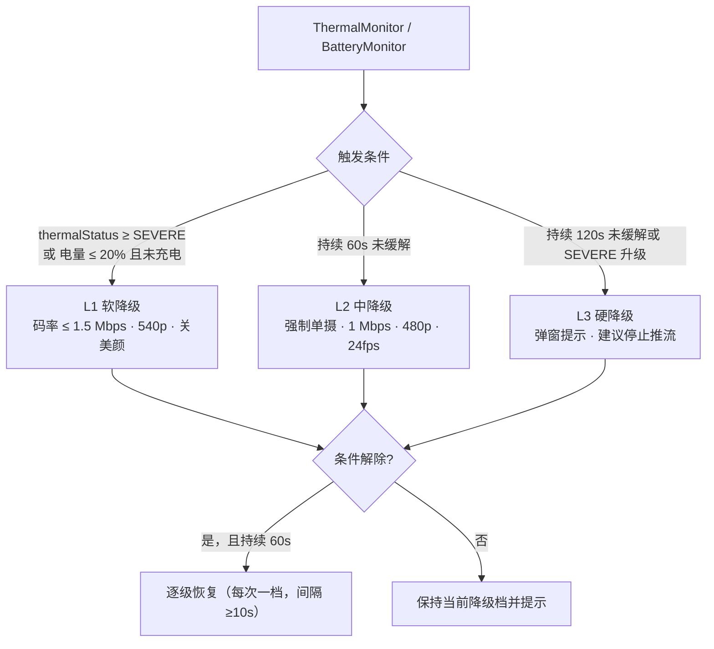

### 12.2 触发条件与阈值（对齐 00 §10.4）

| 触发 | 阈值 | 错误码 | UI |
|---|---|---|---|
| 过热 | `PowerManager.getCurrentThermalStatus() >= THERMAL_STATUS_SEVERE` | `7003 thermal_throttle` | 顶部告警条 + 降级说明 |
| 电量低 | `batteryPercent <= 20%` 且 `!charging` | `7004 battery_low` | 顶部告警条 + 建议充电 |
| 上行带宽不足 | 30 s 均值 < 800 kbps 或 `lossPct > 8%` | `7002 upstream_bandwidth_low` | 提示「网络不稳定，已降低画质」 |
| 网络抖动 | 丢包突增/RTT > 500 ms | `7001 network_unstable` | 提示（可静默） |
| TURN 不可用 | ICE 失败 | `7005 turn_unavailable` | 播放页侧处理，客户端仅记录 |

### 12.3 降级矩阵

| 档位 | `captureMode` | 分辨率 | 码率上限 | 帧率 | 美颜/滤镜 | `dualLayout` |
|---|---|---|---|---|---|---|
| 正常 | 用户选择 | 720p | 4 Mbps | 30 | 可用 | 用户选择 |
| L1 软降级 | 保持 | 720p | **1.5 Mbps** | 30 | 关闭 | 保持 |
| L2 中降级 | **强制 `single_back`** | **540p→480p** | **1 Mbps** | **24** | 关闭 | 不适用 |
| L3 硬降级 | `single_back` | 480p | 800 kbps | 24 | 关闭 | 不适用 |
| 省电模式 | `single_back` | 480p | 1 Mbps | 24 | 关闭 | 不适用 |

**硬规则**：

1. 降级必须上报 `degrade_triggered(reason)`（`thermal`/`battery`/`bandwidth`），00 §11。
2. 涉及 `captureMode` 的降级（L2 起）必须显式提示用户「已切换为仅后置」，不得静默。
3. 降级不得改变 `playAddress`（INV-1）。
4. 恢复必须渐进（每次一档、间隔 ≥ 10 s），避免来回抖动。
5. 温度回落判定用 `THERMAL_STATUS_LIGHT`（而非 `NONE`），提供更大缓冲带。

### 12.4 双摄专项保护

| 保护 | 阈值 | 动作 |
|---|---|---|
| 双摄启动提示 | 首次以 `DUAL` 开始推流 | 首次提示「双摄更耗电、发热更快」（PRD §10.3） |
| 双摄温升监测 | 10 min 温升 > 10 ℃（00 §10.4 上限） | 触发 L1 |
| 双摄 CPU | 持续 > 45% | 触发 L1（降合成分辨率到 540p） |
| 双摄帧率下降 | 合成后 < 24 fps 持续 10 s | 触发 L2（降单摄） |

---

## 13. 错误码映射表

> 错误码全部取自 [00-conventions.md §9.2](./00-conventions.md)，本文只定义「谁触发、怎么展示、是否可重试」。新增码只追加，不复用。

| 错误码 | 名称 | 客户端触发点 | 模块 | `retryable` | UI 文案（`userHint`） | UI 动作 |
|---|---|---|---|---|---|---|
| `1001` | camera_permission_denied | `PermissionGate` | `:platform:permission` | 否 | 「未授予摄像头权限，无法预览与推流」 | 引导设置页 |
| `1002` | mic_permission_denied | `PermissionGate` | `:platform:permission` | 否 | 「未授予麦克风权限，将静音推流」 | 继续（静音） |
| `1003` | camera_in_use | `CameraDevice.StateCallback` | `:media:capture` | 是 | 「摄像头被其他应用占用，请关闭后重试」 | 重试按钮 |
| `1004` | dual_camera_unsupported | `DualCameraDetector` | `:media:capture` | 否 | 「该设备不支持前后摄像头同时开启」+ 细分原因 | 隐藏 `dual`、回退 `single_back` |
| `1005` | encoder_init_failed | `EncoderController` | `:media:encoder` | 是 | 「视频编码器初始化失败，请重试」 | 重试（软编兜底后仍失败） |
| `1006` | composition_failed | `CompositeRenderer` | `:media:compositor` | 是 | 「双摄合成不可用，已切换单摄」 | 自动回退单摄 |
| `1007` | foreground_service_denied | `PushForegroundService` | `:platform:fgs` | 否 | 「无法启动后台推流服务，请检查系统设置」 | 阻止推流 |
| `2001` | room_not_found | `POST /rooms` 后查询/`switch` | `:core:session` | 否 | 「房间不存在或已过期」 | 重新创建 |
| `2002` | room_closed | `ingest:switch`/状态查询 | `:core:session` | 否 | 「推流已结束」 | 回到 Idle |
| `2003` | room_expired | 状态查询（`expireAt` 已过） | `:core:session` | 否 | 「本次推流已达时长上限」 | 停止并提示 |
| `2004` | room_quota_exceeded | `POST /rooms` 返回 | `:core:session` | 否 | 「公网额度不足，可切换仅局域网」 | 置灰 WAN，引导 LAN（PRD §4.2） |
| `2005` | room_busy | `POST /rooms` | `:core:session` | 是 | 「当前有进行中的推流」 | 停止后重试 |
| `2006` | switch_in_progress | `ingest:switch` | `:core:session` | 是 | 「正在切换协议，请稍候」 | 忽略重复请求 |
| `2007` | invalid_state | 状态机非法迁移 | `:core:session` | 是 | 「当前状态不支持该操作」 | 刷新状态 |
| `2008` | max_viewers_reached | `play-session`（播放页侧） | — | 是 | 播放页处理 | — |
| `2009` | unsupported_capture_mode | `POST /rooms`（`captureMode="dual"` 但套餐不支持等） | `:core:session` | 否 | 「当前套餐不支持该采集模式」 | 回退单摄 |
| `3001` | token_missing | 请求缺 token | `:core:session` | 否 | 「凭证缺失，请重新开始推流」 | 重新创建房间 |
| `3002` | token_invalid | 签名错误 | `:core:session` | 否 | 「凭证无效，请重新开始推流」 | 重新创建房间 |
| `3003` | token_expired | `mediaToken` 过期 | 播放页 | 是 | 「播放凭证已过期，请向分享者重新获取地址」 | 刷新 token（不改地址栏） |
| `3004` | pin_required | `play-session` 未带 PIN | 播放页/端侧 | 否 | 「需要观看口令」 | 展示 PIN 输入 |
| `3005` | pin_invalid | PIN 错误 | 播放页/端侧 | 是 | 「口令错误」 | 重输 |
| `3006` | pin_locked | 连续 10 次失败 | 播放页/端侧 | 否 | 「尝试过多，请 10 分钟后重试」 | 禁用输入 + `Retry-After` |
| `3007` | ingest_token_invalid | 接入端拒绝 | `:push:*` | 否 | 「推流凭证无效，请重新开始推流」 | 终止会话 |
| `3008` | rate_limited | 限流 | `:core:session` | 是 | 「操作过于频繁，请稍后重试」 | 退避重试 |
| `4001` | ingest_connect_failed | `PushClient.connect` | `:push:*` | 是 | 「推流连接失败，正在重试」 | 自动重连（§9.4） |
| `4002` | ingest_protocol_unsupported | 服务端不支持该协议 | `:core:session` | 是 | 「当前网络不支持该推流方式，已自动切换」 | 降级下一协议 |
| `4003` | ingest_timeout | `connect` 10 s 超时 | `:push:*` | 是 | 「推流连接超时」 | 重连/降级 |
| `4004` | ingest_rejected | 新会话顶掉旧会话 / 鉴权被拒 | `:push:*` | 是 | 「推流会话被拒绝」 | 退避后重建 |
| `4005` | ingest_codec_unsupported | 服务端编码校验失败 | `:media:encoder` | 是 | 「编码格式不被支持，已调整后重试」 | 切 Baseline 重试一次 |
| `4006` | ingest_bitrate_exceeded | 码率超限 | `:media:encoder` | 是 | 「码率超出限制，已自动降低」 | ABR 强制下调 |
| `5001` | webrtc_unavailable | 播放页 | 播放页 | 是 | 播放页处理 | — |
| `5002` | flv_unavailable | 播放页 | 播放页 | 是 | 播放页处理 | — |
| `5003` | hls_unavailable | 播放页 | 播放页 | 是 | 播放页处理 | — |
| `5004` | no_media | 播放页（房间 `live` 但无帧） | 播放页 | 是 | 播放页处理 | — |
| `5005` | playback_unsupported | 播放页 | 播放页 | 否 | 播放页处理 | — |
| `5006` | ice_failed | 播放页 | 播放页 | 是 | 播放页处理 | — |
| `5007` | whep_rejected | 播放页 | 播放页 | 是 | 播放页处理 | — |
| `6001` | lan_service_start_failed | `LanServiceManager.start` | `:lan:service` | 是 | 「局域网服务启动失败，请重试」 | 重试/切 WAN |
| `6002` | port_in_use | 端口绑定失败（8089→8099 全占用） | `:lan:service` | 是 | 「端口被占用，正在尝试其他端口」 | 顺延重试 |
| `6003` | lan_not_connected | 非 Wi-Fi/热点 | `:platform:device` | 否 | 「仅局域网需连接同一 Wi-Fi 或热点」 | 禁用 LAN 选项（00 §4.4） |
| `6004` | ap_isolation_suspected | 端侧自检 + 用户反馈 | `:lan:service` | 否 | 「疑似路由器 AP 隔离或防火墙，观看设备可能无法访问」 | 展示排查清单 |
| `6005` | viewer_limit_reached | `viewers >= maxViewers(3)` | `:lan:service` | 是 | 「局域网模式并发受限，建议切换公网模式」 | 拒绝新观看者（429） |
| `6006` | media_pipeline_error | 端侧媒体管线异常 | `:lan:service` | 是 | 「媒体分发异常」 | 重启端侧服务一次 |
| `6007` | lan_https_unavailable | 播放页提示 | `:lan:service` | 否 | 「局域网连接未加密，仅限可信网络」 | 明示提示（00 §8） |
| `7001` | network_unstable | `NetworkStats` | `:push:*` | 是 | 「网络不稳定，正在自适应」 | ABR 下调 |
| `7002` | upstream_bandwidth_low | ABR | `:media:encoder` | 是 | 「上行带宽不足，已降低画质」 | 降档 |
| `7003` | thermal_throttle | `ThermalMonitor` | `:platform:device` | 是 | 「设备温度过高，已降低画质」 | L1→L2 降级（§12） |
| `7004` | battery_low | `BatteryMonitor` | `:platform:device` | 是 | 「电量过低，已降低画质」 | L1→L2 降级（§12） |
| `7005` | turn_unavailable | 播放页 ICE | 播放页 | 是 | 播放页处理（降级 FLV） | — |
| `7006` | dns_failed | 任意网络调用 | `:core:common` | 是 | 「网络解析失败，请检查网络」 | 退避重试 |

**映射规则**：

1. `code` 是**唯一**业务判定依据，客户端不得仅凭 HTTP 状态分支（00 §9.1）。
1a. 口径说明：00 §9.1 示例曾误用 `code=3002` 表示 `token_expired`，已在 00 v1.3 §19.1 勘误为 `3003` 且 `retryable=false`。本文以 §9.2 号段为准：`3002=token_invalid`（不可重试）、`3003=token_expired`（需重新获取地址）。原 Q-11 已关闭。
2. `retryable=true` 才展示「重试」。
3. 错误展示必须包含可读文案；禁止把原始异常栈或服务端英文 `message` 直接给用户。
4. 所有错误都必须带 `requestId`（若有）写入本地日志（脱敏后），便于对齐 03/04。

---

## 14. 测试策略

### 14.1 测试金字塔

| 层 | 范围 | 工具 | 目标数量占比 | 运行时长目标 |
|---|---|---|---|---|
| 单元测试 | `:core:session`、ABR 决策、布局计算、错误映射、状态归约 | JUnit5 + MockK + Turbine | 60% | < 3 min |
| 组件/仪器测试 | `:media:*`、`:lan:*`、`ViewModel` | Robolectric + Compose UI Test + AndroidX Test | 30% | < 15 min |
| 端到端（真机） | 全链路推流/播放/降级 | 真机矩阵 + 自动化脚本 | 10% | 夜间 |

### 14.2 单测清单

| 目标 | 用例 | 断言 |
|---|---|---|
| `reduce(prev, event)` | 全部 `SessionState` → `MainUiState` 映射 | 与 §3.5 表逐行一致 |
| `AdaptiveBitrateController` | 丢包 6% 持续 3 s | 码率 ×0.7，冷却 5 s |
| `AdaptiveBitrateController` | 连续 10 s 无丢包 | 码率 ×1.2，不超过 4 Mbps |
| `AdaptiveBitrateController` | `thermalStatus=SEVERE` | 强制 ≤1.5 Mbps + 540p |
| `BitrateLadder` | 码率下限 | 不低于 800 kbps，继续降分辨率 |
| `DualCameraDetector` | 6 种 `DualUnsupportedReason` | 均映射 `1004` 且 `retryable=false`（除 `RESOURCE_BUSY`） |
| 布局计算 | 三种 `dualLayout` × 横竖屏 × 主副交换 | 矩形不重叠、不越界、比例正确 |
| `ErrorMapper` | 00 §9.2 全部码 | 文案非空；`retryable` 与表一致 |
| `PlayAddressFactory` | WAN/LAN 模板 | 严格匹配 00 §4.2 模板 |
| `PushRegistry` | 三协议注册 | 工厂返回正确实现；无实现时抛明确异常 |
| `Redaction` | token/roomId/IP | 输出中不出现原始值 |

### 14.3 仪器测试清单

| 目标 | 用例 | 断言 |
|---|---|---|
| Compose UI | 推流中 `accessScope` 选择器 | 置灰 + 点击提示「请先停止推流后切换访问范围」 |
| Compose UI | `dualSupported=false` | `dual` 选项不出现 |
| Compose UI | `Live(PUBLISHING)` | 地址卡片显示且唯一 |
| `RotateTest` | 横竖屏切换（推流中） | 会话不中断、地址不变 |
| `ForegroundServiceTest` | 启动/停止 | 通知出现/消失；`stopForeground` 后无残留 |
| `PermissionTest` | 拒绝 CAMERA | 显示 `1001` 引导 |
| `EncoderTest`（真机） | 720p30 60 s | 出帧率 ≥ 28 fps，无花屏 |
| `CompositeTest`（真机） | 双摄 PiP 60 s | 合成帧率 ≥ 24 fps，PiP 可拖拽 |
| `LanServiceTest`（真机） | 3 观看者 | 第 4 个返回 `429`+`6005` |
| `LanStopTest`（真机） | 停止 | ≤1 s 内 `connection refused` |

### 14.4 真机矩阵

| 维度 | 覆盖 |
|---|---|
| Android 版本 | API 26（Go 边缘）、29、31、33、34、35（最新） |
| 厂商/机型 | Pixel 8（参考机）、Samsung Galaxy S23、Xiaomi 13/Redmi Note（低端）、OPPO/vivo（国产 ROM 后台策略）、Huawei（无 GMS，WebRTC 可用性验证） |
| 芯片 | 骁龙 8 系 / 骁龙 7 系 / 天玑 8000 系 / 联发科低端 |
| 双摄能力 | `DUAL` 支持机（≥3 台）、`DUAL` 不支持机（≥3 台，验证 `1004`） |
| 网络 | Wi-Fi 5/6、手机热点、5G、弱网模拟（丢包 5%/8%/15%，RTT 100/300 ms） |
| 电源 | 满电、≤20% 未充电、充电中 |
| 散热 | 常温、边充边推 10 min（触发 `7003` 的机型） |

### 14.5 M0 必验项（与 01 §7.9 对齐）

| 编号 | 验证项 | 通过标准 | 关联 |
|---|---|---|---|
| V-01 | 目标机型双摄并发支持率 | 抽样 ≥ 20 机型，支持率统计进 08 | 01 §7.8 |
| V-02 | CameraX 双路绑定稳定性 | 30 min 无掉线、无 ANR | §6 |
| V-03 | MediaCodec 硬编 720p30 | 单摄 CPU ≤ 25%，温升 ≤ 6 ℃/10 min | 00 §10.4 |
| V-04 | 双摄 PiP 合成 | CPU ≤ 45%，温升 ≤ 10 ℃/10 min，≥24 fps | 00 §10.4 |
| V-05 | WHIP 首帧 | 点击开始到首帧 ≤ 3 s（含信令） | 00 §10.3 |
| V-06 | 协议热切换 | 中断 p95 ≤ 5 s，地址不变 | INV-1 |
| V-07 | LAN 3 观看者 | CPU ≤ 35%，温升 ≤ 8 ℃/10 min | 00 §10.4 |
| V-08 | 前台服务后台存活 | 后台 30 min 不断流（白名单内） | PRD §8.1 |

---

## 15. 关键接口签名与流程伪代码

> 本节仅给**签名与流程**，不含实现。所有数字引用 00 §7/§10。

### 15.1 会话编排

```kotlin
class SessionOrchestrator(
    private val capture: CaptureController,
    private val compositor: CompositeRenderer,
    private val encoder: EncoderController,
    private val pushRegistry: PushClientFactory,
    private val lan: LanServiceManager,
    private val fgs: ForegroundServiceGateway,
    private val telemetry: Telemetry,
) {
    /**
     * 流程（不实现）：
     * 1. PermissionGate.ensure() → 失败 return Failure(1001/1002)
     * 2. fgs.start() → 失败 return Failure(1007)
     * 3. capture.bind(captureMode) → 失败 return Failure(1003/1004)
     * 4. compositor.attach(capture.surfaces(), dualLayout, dualPrimary)
     * 5. encoder.start(videoConfig) → 失败 return Failure(1005)
     * 6. when (accessScope):
     *      WAN -> rooms.create() → pushClient.connect() （10 s 超时 → 4003）
     *      LAN -> lan.start(LanConfig(...)) （≤1 s → 6001/6002/6003）
     * 7. 首帧到达 → ingestState=PUBLISHING；LAN → status.running
     * 8. telemetry.push_start_success(durationMs)
     */
    suspend fun start(intent: StartRequest): CampushResult<PlayAddress>

    /**
     * 流程：
     * 1. WAN: DELETE /rooms/{roomId}（Idempotency-Key）→ 等 roomState=closed（≤2 s）
     * 2. LAN: lan.stop()（≤1 s）
     * 3. push.disconnect() / encoder.stop() / capture.unbind() / compositor.release()
     * 4. fgs.stop()
     * 5. telemetry.push_stop()
     */
    suspend fun stop(): CampushResult<Unit>

    /**
     * 流程：
     * 1. accessScope != WAN 或 state != Live → 拒绝（LAN 协议锁定，PRD §6.2）
     * 2. POST /rooms/{roomId}/ingest:switch {targetProtocol}
     * 3. 202 → 启动新 PushClient（旧 token 5 s grace）→ 等新源首帧（≤15 s）
     * 4. 成功 → 旧 client.disconnect()；playAddress 字段不变
     * 5. 失败 → 保持原协议并提示（2006/2007）
     */
    suspend fun switchProtocol(target: PushProtocol): CampushResult<Unit>
}
```

### 15.2 采集接口

```kotlin
interface CaptureController {
    val surfaces: StateFlow<List<SurfaceRequest.Surface>>   // 1 或 2 路
    val capability: StateFlow<DualCameraCapability>

    suspend fun bind(mode: CaptureMode): CampushResult<Unit>       // 1003/1004
    suspend fun unbind()
    suspend fun switchLens(mode: CaptureMode): CampushResult<Unit> // 热切换前后置
    fun setZoom(ratio: Float)
    fun setFlash(on: Boolean)
}

interface DualCameraDetector {
    /** 探测流程见 §6.2；结果缓存 30 天（§6.4） */
    suspend fun detect(): DualCameraCapability
}

data class DualCameraCapability(
    val supported: Boolean,
    val reason: DualUnsupportedReason?,
    val maxConcurrentWidth: Int?,   // 双路并发时单路上限
    val maxConcurrentFps: Int?,
    val probedAtMs: Long,
)
```

### 15.3 编码接口

```kotlin
interface EncoderController {
    val frames: SharedFlow<EncodedFrame>       // 有界队列上游，容量 8
    val stats: StateFlow<EncodeStats>          // 1 Hz

    suspend fun start(config: VideoEncoderConfig): CampushResult<Unit>  // 1005
    suspend fun stop()
    fun requestKeyFrame()
    fun applyTarget(target: BitrateTarget)     // 来自 ABR
    val inputSurface: Surface                // 交给 CompositeRenderer
}

data class EncodedFrame(
    val data: ByteArray,          // Annex-B（SPS/PPS 在首个 IDR 前注入）
    val presentationTimeUs: Long,
    val isKeyFrame: Boolean,
    val isConfig: Boolean,
    val size: Int,
)

data class VideoEncoderConfig(
    val width: Int = 1280,
    val height: Int = 720,
    val fps: Int = 30,
    val bitrateBps: Int = 2_500_000,      // 00 §7 默认
    val keyFrameIntervalSec: Int = 2,     // 00 §7
    val profile: AvcProfile = AvcProfile.BASELINE,
    val bitrateMode: BitrateMode = BitrateMode.VBR,
)
```

### 15.4 合成接口

```kotlin
interface CompositeRenderer {
    val inputSurface: Surface               // 指向 EncoderController.inputSurface
    fun attach(
        sources: List<SurfaceTextureSource>, // 1（单摄直通）或 2（双摄）
        layout: DualLayout,
        primary: DualPrimary,
    )
    fun updateLayout(layout: DualLayout, primary: DualPrimary)
    fun updatePipTransform(xNorm: Float, yNorm: Float, scale: Float)
    fun release()
}

/** 布局纯函数，可单测（§14.2） */
object LayoutMath {
    fun pipRect(viewW: Int, viewH: Int, srcW: Int, srcH: Int,
                xNorm: Float, yNorm: Float, scale: Float): RectF
    fun splitHRects(viewW: Int, viewH: Int, dividerPx: Int): Pair<RectF, RectF>
    fun splitVRects(viewW: Int, viewH: Int, dividerPx: Int): Pair<RectF, RectF>
    fun centerCrop(srcW: Int, srcH: Int, dstW: Int, dstH: Int): RectF
}
```

### 15.5 推流接口（含三实现）

```kotlin
interface PushClient {
    val protocol: PushProtocol
    val events: StateFlow<IngestState>
    suspend fun connect(config: PushConfig): CampushResult<Unit>
    fun submit(frame: EncodedFrame)
    suspend fun disconnect(reason: DisconnectReason)
    fun networkStats(): StateFlow<NetworkStats>
}

class WhipPushClient(private val rtc: PeerConnectionFactory) : PushClient { /* 见 §9.2 */ }
class SrtPushClient(private val srt: SrtSocketFactory) : PushClient { /* 见 §9.2 */ }
class RtmpPushClient(private val rtmp: RtmpConnectionFactory) : PushClient { /* 见 §9.2 */ }

/** 装配（:app 唯一装配点，DEP-4） */
@Module
object PushModule {
    @Provides fun registry(
        whip: Provider<WhipPushClient>,
        srt: Provider<SrtPushClient>,
        rtmp: Provider<RtmpPushClient>,
    ): PushClientFactory = PushClientFactory(
        mapOf(
            PushProtocol.WHIP to whip,
            PushProtocol.SRT to srt,
            PushProtocol.RTMP to rtmp,
        )
    )
}
```

### 15.6 设备信号接口

```kotlin
interface ThermalMonitor {
    val status: StateFlow<ThermalStatus>   // NONE/LIGHT/MODERATE/SEVERE/CRITICAL
}
interface BatteryMonitor {
    val state: StateFlow<BatteryState>     // percent, charging
}
interface NetworkMonitor {
    val type: StateFlow<NetworkType>       // WIFI/CELLULAR/NONE
    val upstreamEstimateBps: StateFlow<Int?>  // 估算，可空
}
interface LanNetworkInfo {
    /** 非 loopback IPv4；无则 null（00 §4.4）。示例占位：192.0.2.10 */
    suspend fun currentLanIp(): String?
    suspend fun isWifiOrHotspot(): Boolean
    fun observeIpChanges(): Flow<String>
}
```

### 15.7 ViewModel 装配

```kotlin
class MainViewModel(
    private val orchestrator: SessionOrchestrator,
    private val repo: SessionRepository,
    private val settings: SettingsRepository,
    private val permissionGate: PermissionGate,
) : ViewModel() {

    val state: StateFlow<MainUiState> = combine(
        repo.state, settings.state, deviceSignals, _localState
    ) { session, prefs, dev, local -> reduce(session, prefs, dev, local) }
        .stateIn(viewModelScope, SharingStarted.WhileSubscribed(5_000), MainUiState())

    val effects: Flow<UiEffect> = _effect.receiveAsFlow()

    fun onIntent(intent: UiIntent) { /* 分发到 use case 或 _localState */ }

    /** 纯函数，可单测；映射见 §3.5（此处仅签名，无实现体） */
    private fun reduce(
        session: SessionState,
        prefs: SettingsState,
        dev: DeviceSignalState,
        local: LocalUiState,
    ): MainUiState
}
```

### 15.8 关键流程伪代码（不含实现）

```kotlin
// ---- 启动推流（§15.1）----
suspend fun startFlow(req: StartRequest): CampushResult<PlayAddress> {
    // 1) 权限
    permissionGate.ensure(req.accessScope, req.captureMode)?.let { return Failure(it) }
    // 2) 前台服务（先 startForeground，再起管线）
    fgs.start(notificationFor(req))?.let { return Failure(it) }   // 1007
    // 3) 采集 + 能力校验
    capture.bind(req.captureMode).onFailure { fgs.stop(); return it }  // 1003/1004
    // 4) 合成
    compositor.attach(capture.surfaces.value, req.dualLayout, req.dualPrimary)
    // 5) 编码（启动即请求 IDR；首帧预算 00 §10.2）
    encoder.start(req.videoConfig).onFailure { cleanup(); return it }   // 1005
    encoder.requestKeyFrame()
    // 6) 按 accessScope 二选一（INV-5）
    val address = when (req.accessScope) {
        AccessScope.WAN -> {
            val room = rooms.create(req) ?: return Failure(2004)       // 00 §6.2
            push = pushRegistry.create(req.pushProtocol)
            push.connect(configOf(room)).onFailure { return it }       // 4001..4006
            room.playUrl                                                // 唯一地址
        }
        AccessScope.LAN -> {
            if (!lanInfo.isWifiOrHotspot()) return Failure(6003)
            lan.start(LanConfig(port = 8089, maxViewers = 3, pinRequired = req.pinRequired))
                .getOrElse { return it }                                // 6001/6002
        }
    }
    // 7) 首帧 → PUBLISHING
    return Success(address)
}

// ---- ABR 单次决策（§7.4）----
fun abrTick(enc: EncodeStats, net: NetworkStats, thermal: ThermalStatus, battery: BatteryState): BitrateTarget {
    // 1) 硬约束优先：热/电 → 固定档（7003/7004）
    // 2) 拥塞：loss>5% 或 rtt 突增 → ×0.7（冷却 5 s）
    // 3) 余量：连续 10 s 无丢包 → ×1.2（冷却 10 s，上限 4 Mbps）
    // 4) 下限 800 kbps → 降分辨率一档（720p→540p→480p）
    // 5) 弱网 loss>8% → keyFrameIntervalSec = 1
}

// ---- 双摄探测（§6.2）----
suspend fun detectDual(): DualCameraCapability {
    // 1) availableCameraInfos 含前+后 → 否则 MISSING_LENS
    // 2) 后置 capabilities 含 LOGICAL_MULTI_CAMERA → 否则 NO_LOGICAL_MULTI_CAMERA
    // 3) CameraManager.concurrentCameraIds 含前后组合 → 否则 NO_CONCURRENT_SET
    // 4) 尝试 bindToLifecycle(双路) → 异常 BIND_FAILED
    // 5) 两路首帧 ≤2 s → 否则 FIRST_FRAME_TIMEOUT
    // 6) 成功 → supported=true（缓存 30 天，但每次进入 DUAL 仍实际绑定）
}
```

---

## 16. 失败与降级

### 16.1 模块级失败矩阵

| 模块 | 失败 | 检测 | 降级/恢复 | 错误码 |
|---|---|---|---|---|
| `:platform:permission` | 权限拒绝 | 回调 | 引导设置页；麦克风拒绝则静音推流 | `1001`/`1002` |
| `:platform:fgs` | 前台服务被拒 | `startForeground` 抛异常 | 阻止推流 | `1007` |
| `:media:capture` | 双摄不支持 | §6.2 探测 | 隐藏 `dual`，回退 `single_back` | `1004` |
| `:media:capture` | 相机被占用 | `ERROR_CAMERA_IN_USE` | 提示关闭其他应用 + 重试 | `1003` |
| `:media:compositor` | EGL/Shader 失败 | GL 错误 | 单摄直通 / 简化 shader | `1006` |
| `:media:encoder` | 硬编失败 | `createEncoderByType` 异常 | Baseline → 降分辨率 → 软编 | `1005` |
| `:media:encoder` | 码率超限 | 服务端 `4006` | ABR 强制下调 | `4006` |
| `:push:*` | 连接失败 | `connect` 异常/超时 | 重连（§9.4）→ 协议降级 | `4001`/`4003` |
| `:push:*` | 协议不支持 | `4002` | 降级 `whip→srt→rtmp` | `4002` |
| `:lan:service` | 启动失败 | bind 异常 | 端口顺延 8090–8099 | `6001`/`6002` |
| `:lan:service` | 观看超限 | `viewers >= 3` | `429` 拒绝 + 提示切 WAN | `6005` |
| `:platform:device` | 过热/低电 | 系统回调 | L1→L2→L3 降级 | `7003`/`7004` |
| `:core:session` | 房间失效 | 状态查询 | 回到 Idle + 提示 | `2001`–`2003` |

### 16.2 降级不变量（客户端）

1. 降级不改 `playAddress`（INV-1）。
2. 降级必须埋点（`degrade_triggered` / `play_fallback` 由播放页负责）。
3. 模式/采集方式/画质降级必须可见提示（PRD §10.3）。
4. 降级链路有上限：协议最多降 2 级、分辨率最多降 2 档、编码最多 1 次软编兜底。
5. 降级不得导致 ANR：任何降级动作在 `Dispatchers.Default` 或专用线程执行，主线程零阻塞。

### 16.3 恢复策略

| 场景 | 恢复顺序 | 频率限制 |
|---|---|---|
| 网络恢复 | 码率每 10 s 上调 ≤20% → 评估协议（需用户确认） | 10 s |
| 温度回落（`LIGHT` 持续 60 s） | 分辨率/码率逐级恢复，不自动恢复双摄 | 10 s/档 |
| 充电且 >30% | 逐级恢复，不自动恢复双摄 | 10 s/档 |
| LAN 观看者离开 | `viewers` 递减；不改变服务状态 | — |
| 相机恢复（占用解除） | 需用户手动重试 | — |

---

## 17. 验收检查点

### 17.1 模块与结构

- [ ] **B-01** §2.1 模块清单中每个模块都有职责、产出、禁止事项三列内容。
- [ ] **B-02** `:core:model` 为纯 Kotlin（不依赖 Android SDK），可用 `./gradlew :core:model:dependencies` 验证。
- [ ] **B-03** `:push:whip`/`:push:srt`/`:push:rtmp` 三者互不依赖（依赖图无交叉边）。
- [ ] **B-04** `feature` 层无 `android.media.MediaCodec`、`android.opengl.*`、`android.hardware.camera2` 的直接 import（Detekt 规则通过）。
- [ ] **B-05** 包结构中不存在跨模块重复定义的数据类（§2.4 DEP-7）。

### 17.2 状态与线程

- [ ] **B-06** UI 只从 `StateFlow<MainUiState>` 读数据（评审可验证：Composable 参数只有 `state` 与回调）。
- [ ] **B-07** `reduce()` 为纯函数，单测覆盖 §3.5 全部映射行。
- [ ] **B-08** 高频指标采样为 1 Hz（`sample(1_000)`），无每帧刷新。
- [ ] **B-09** 所有 `StateFlow` 使用 `WhileSubscribed(5_000)`。
- [ ] **B-10** 编码帧队列为有界（容量 8）且满时丢弃策略为 `DROP_OLDEST`（不阻塞）。
- [ ] **B-11** 主线程无编解码、GL、网络调用（StrictMode 测试通过）。

### 17.3 采集、编码、合成

- [ ] **B-12** 双摄不支持机型上 `dual` 选项**不出现**（PRD §16.2），且 `1004` 有细分原因。
- [ ] **B-13** 双摄支持机型上 `pip`/`split_h`/`split_v` 三种布局均可切换，`dualPrimary` 交换 < 33 ms 生效。
- [ ] **B-14** 编码参数输出为 H.264、`yuv420p`、GOP 2 s、默认 2.5 Mbps、区间 800 kbps–4 Mbps（00 §7）。
- [ ] **B-15** 开始推流时**立即**产生 IDR（抓包验证首个 NAL 为 IDR）。
- [ ] **B-16** ABR：丢包 >5% 3 s 内降档；恢复后上调不超过 4 Mbps；有 5 s/10 s 冷却。
- [ ] **B-17** 硬编失败时依次尝试 Baseline → 降分辨率 → 软编，且 UI 有提示（`1005`）。

### 17.4 推流与端侧服务

- [ ] **B-18** `PushClient` 三实现可通过 `PushClientFactory` 无改调用方替换（换协议不改 `SessionOrchestrator`）。
- [ ] **B-19** WAN 推流中切换协议：`playAddress` 字符串全程不变（INV-1 自动化断言）。
- [ ] **B-20** LAN 推流中协议选择被拒绝并提示（PRD §6.2）。
- [ ] **B-21** `:lan:service` 不依赖 `:push:*` 与云端 API（依赖图验证）。
- [ ] **B-22** LAN 停止后 ≤1 s 连接被拒（`connection refused`），非错误页。
- [ ] **B-23** LAN 观看者第 4 个被拒（`429`+`6005`），前 3 个不受影响。

### 17.5 生命周期、保活、降级

- [ ] **B-24** 推流中切后台 30 min 不断流（电池优化白名单内）。
- [ ] **B-25** 横竖屏切换不重建 `ViewModel`，会话不中断，地址不变。
- [ ] **B-26** `thermalStatus=SEVERE` 或电量 ≤20% 未充电时，≤10 s 内进入 L1 降级并提示（`7003`/`7004`）。
- [ ] **B-27** 双摄首次推流有耗电/发热提示（PRD §10.3）。
- [ ] **B-28** 省电模式：强制单摄 + 1 Mbps + 480p + 24 fps（PRD §8.4）。

### 17.6 错误码与测试

- [ ] **B-29** §13 表覆盖 00 §9.2 全部客户端可达码，且 `retryable` 与 00 一致。
- [ ] **B-30** 客户端无任何 UI/日志/埋点出现 `ingestToken`、`pageToken`、`mediaToken`、PIN（INV-4，静态扫描 + 运行时钩子）。
- [ ] **B-31** 单测/仪器测试按 §14.1 分层落地，单测 < 3 min 跑完。
- [ ] **B-32** 真机矩阵（§14.4）覆盖 ≥ 12 台设备、≥ 5 个 API 版本、6 种网络条件。
- [ ] **B-33** M0 必验项 V-01~V-08 全部有数据并写入 08。

---

## 18. 开放问题

| 编号 | 问题 | 候选方案 | 推荐 | 决策人 | 阻塞对象 | 截止 |
|---|---|---|---|---|---|---|
| CQ-01 | CameraX Multi-Camera 在国产 ROM（MIUI/ColorOS/HarmonyOS）上的稳定性是否达标 | A. 全量用 CameraX；B. 白名单机型用 CameraX、其余 Camera2 直连；C. 全部 Camera2 | B（按 M0 数据裁定，见 01 §7.8 推翻阈值 10%） | 客户端 + 08 | 08/09 | M0 末 |
| CQ-02 | WHIP 客户端用 Google WebRTC Android SDK 还是自研 SDP/ICE | A. WebRTC SDK；B. 自研 | A | 客户端 | `:push:whip` | M0 |
| CQ-03 | SRT 客户端用 JNI 封装 libsrt，还是成熟第三方 Java 库 | A. libsrt JNI；B. 第三方库 | A（可控、可测） | 客户端 | `:push:srt` | M0 |
| CQ-04 | 双摄合成是否引入 GPU 纹理压缩/降采样以进一步省电 | A. 不引入（M1）；B. 引入 | A | 客户端 | `:media:compositor` | M2 |
| CQ-05 | 音频在双摄/弱网下是否降为 64 kbps 单声道（00 §7 允许） | A. 固定 128 kbps；B. 弱网自动降 64 kbps | B | 客户端 | `:media:audio` | M2 |
| CQ-06 | 「省电模式」与系统省电模式同时开启时的优先级 | A. App 省电模式优先；B. 取更严格档 | B（取严格档） | 产品 + 客户端 | §12 | M1 |
| CQ-07 | 协议降级 `whip→srt→rtmp` 是否需用户确认（当前设计为自动 + 提示） | A. 自动；B. 弹窗确认 | A（PRD §6.2「自动降级并提示」） | 产品 | §9.4 | M1 |
| CQ-08 | LAN 模式下 `accessScope` 由客户端在哪一层校验「非 Wi-Fi 禁用」 | A. `:platform:device` 提供信号 + `:core:session` 决策；B. UI 层直接禁用 | A | 客户端 | §5、§10 | M1 |
| CQ-09 | 通知栏是否需要协议切换入口（M2） | A. 需要；B. 不需要（仅 App 内） | 待 M2 评估 | 产品 + 客户端 | §11.3 | M2 |
| CQ-10 | 后台恢复（进程被回收后 `START_STICKY`）是否自动续推 | A. 不自动续推（安全）；B. 自动续推 | A（避免地址/会话歧义） | 产品 + 安全 | §11.2 | M1 |
| CQ-11 | `MediaCodec` 的 `PARAMETER_KEY_REQUEST_SYNC_FRAME` 在低端芯片的可用性 | A. 依赖参数请求；B. 重建编码器强制 IDR | A 为主、B 兜底 | 客户端 | `:media:encoder` | M0 |
| CQ-12 | 是否需要「推流前网络预检」（上行带宽探测） | A. 需要（减少失败率）；B. 不需要（靠 ABR） | A（轻量探测 ≤ 1 s，不阻塞开始） | 产品 + 客户端 | §7.4 | M2 |

---

## 19. 变更记录

| 版本 | 日期 | 变更人 | 内容 |
|---|---|---|---|
| v1.0 | 2026-10-20 | 架构文档作者（architect） | 首版：模块清单与 Gradle/包结构、依赖规则、UDF 与 `StateFlow`/`UiState`、线程模型与背压、权限与生命周期、CameraX Multi-Camera 检测与 `1004` 降级、MediaCodec 硬编与 ABR、OpenGL ES 双摄合成、推流抽象层与三适配器、LAN 端侧服务边界、前台服务保活与电池优化、热/电降级（`7003`/`7004`）、错误码映射表、测试策略与真机矩阵、关键 Kotlin 签名与流程伪代码 |

---

**上游契约**：[00-conventions.md](./00-conventions.md)（唯一来源） · **总体架构**：[01-architecture.md](./01-architecture.md) · **产品基线**：[PRD-v1.0.md](./PRD-v1.0.md)
**下游落地**：[05-lan-service.md](./05-lan-service.md)（端侧协议细节） · [06-playback-page.md](./06-playback-page.md) · [08-m0-verification.md](./08-m0-verification.md)（M0 验证） · [10-observability.md](./10-observability.md)（埋点契约）
