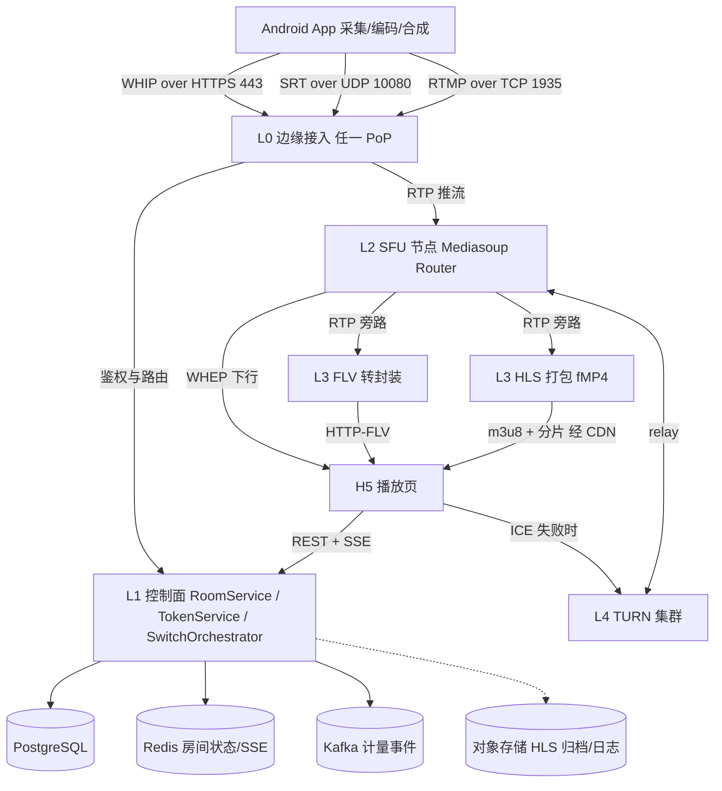
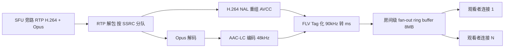
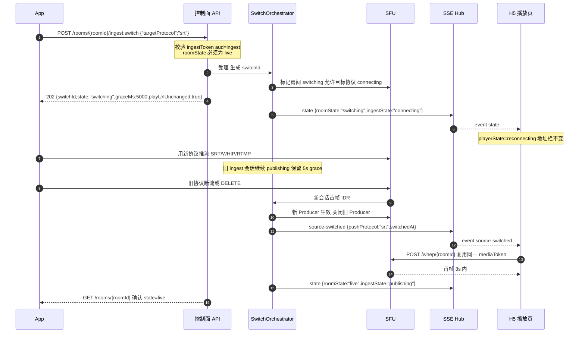
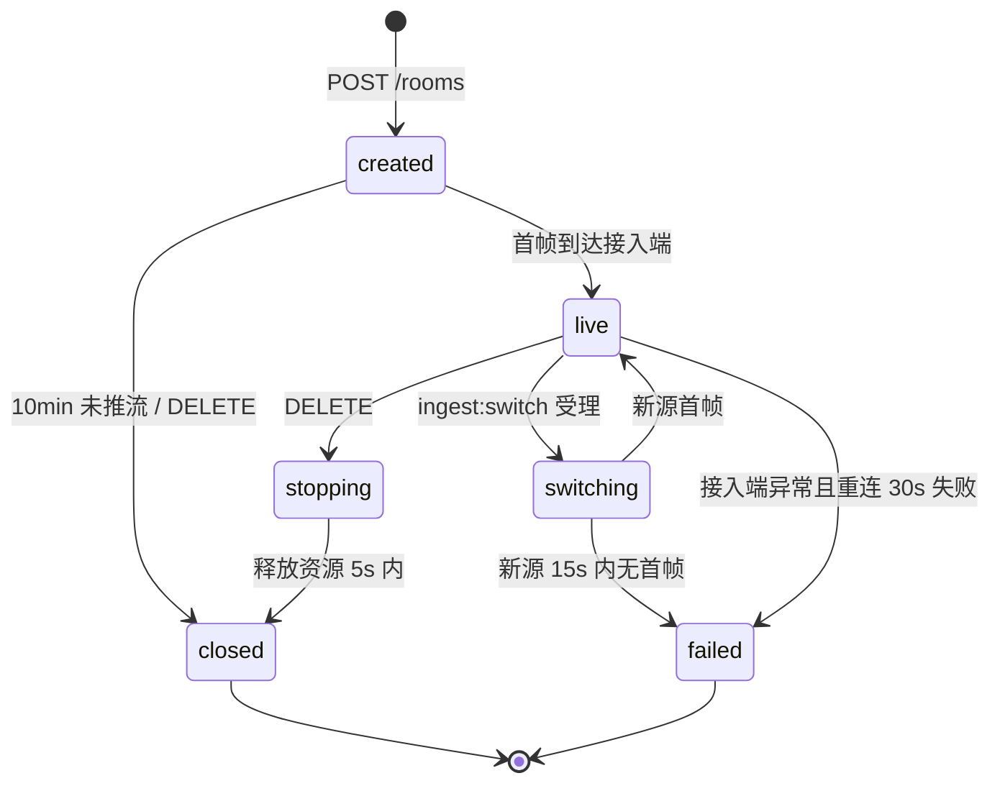
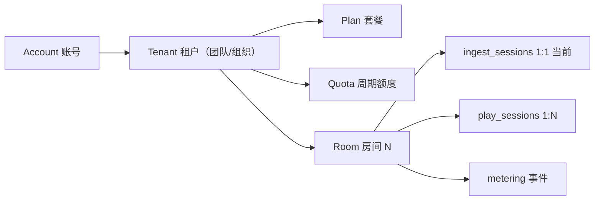
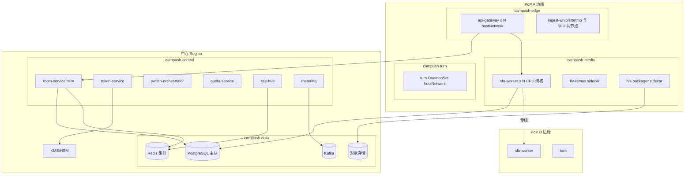
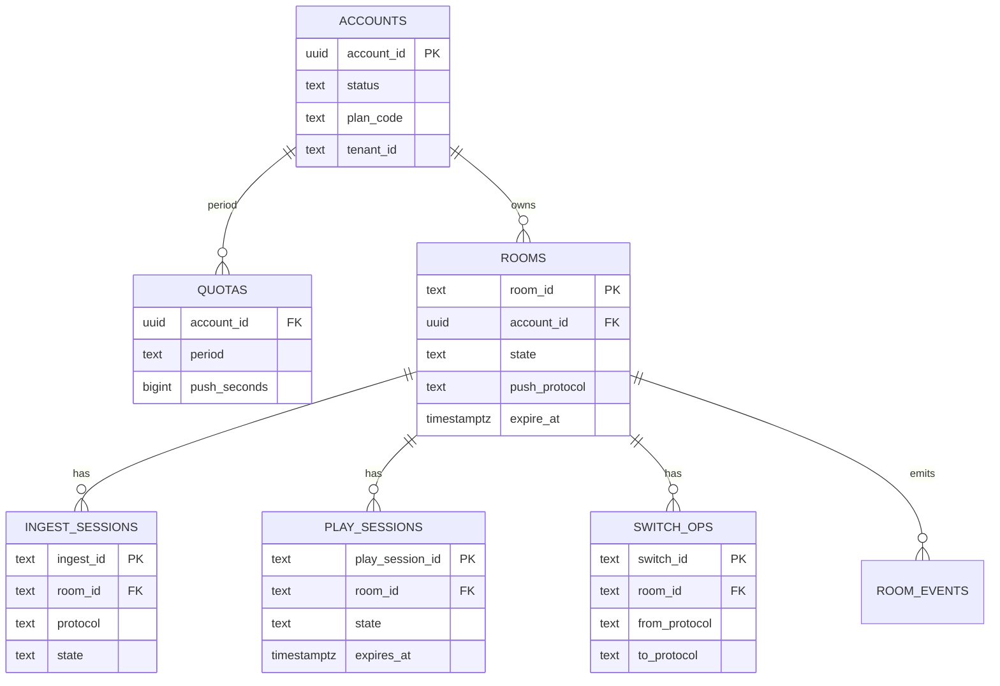

# 03 · 公网服务端设计（Cloud Service）

| 项目 | 值 |
|---|---|
| 文档状态 | 基线（Draft → Baseline） |
| 版本 | v1.0 |
| 依赖文档 | [00-conventions.md](./00-conventions.md)（唯一契约来源）、[PRD-v1.0.md](./PRD-v1.0.md) |
| 适用 PRD | §6.1、§7、§11.2、§11.4、§13、§14、§16.2、§18 |
| 关注契约章节 | 00 §3 枚举/状态机、§4 地址、§5 token、§6 REST、§7 媒体面、§9 错误码、§10 预算、§12 边界 |
| 主责 | 服务端（云服务与接口契约作者） |
| 最后更新 | 2026-10-20 |
| 关联文档 | 接口细节见 [04-interface-contracts.md](./04-interface-contracts.md)；安全见 07；可观测见 10 |

> 本文只描述**公网可访问模式（`accessScope="wan"`）**的云端服务端。局域网模式（`accessScope="lan"`）的端侧服务见 05，不在本文范围。所有 URL、字段名、枚举、错误码、TTL、状态机**逐字引用 00**；本文出现任何与 00 不一致之处，以 00 为准并在 §18 开放问题登记。

---

## 1. 目的与范围

### 1.1 目的

| 编号 | 目标 | 可验证结果 |
|---|---|---|
| G1 | 定义公网服务端的分层、组件与部署单元 | 每个组件有职责边界、状态属性（有状态/无状态）、扩缩容方式 |
| G2 | 给出 WHIP / SRT / RTMP 三条推流接入的落地路径 | 每条协议有接入端点、鉴权、SDP/参数约束、拒绝条件与错误码 |
| G3 | 完成 SFU 选型并说明理由 | 四候选对比结论可复核，选型与 00 §7 媒体面约束不冲突 |
| G4 | **定义协议热切换且 `playUrl` 不变的完整机制** | 10 个可测试断言（§6.12），覆盖 5 s grace、播放会话保持、SSE、首帧判定、失败回退 |
| G5 | 定义 HTTP-FLV 转封装与 HLS 切片链路 | 有封装参数、首帧预算、保活与延迟口径 |
| G6 | 定义 TURN 与对称 NAT/CGNAT 策略 | 有中继凭证格式、端口、占比预算、降级错误码 |
| G7 | 定义房间生命周期与资源回收 | 每个状态的资源清单与定时器可核对 |
| G8 | 定义租户、配额、套餐与计费口径 | 配额检查点覆盖全部入口 |
| G9 | 给出部署拓扑、容量与成本公式及 100/1000 并发样例 | 样例可重算，假设项显式标注 |
| G10 | 定义 SLO、故障域与降级预案 | 每个故障域有检测信号与动作 |

### 1.2 范围内

- 云端 `RoomService`、`AuthTokenService`（page/media/ingest token）、`SwitchOrchestrator`、`QuotaService`、SSE 事件分发。
- 媒体面：SFU、WHEP、HTTP-FLV 转封装、HLS 打包、TURN。
- 接入面：WHIP、SRT、RTMP。
- 房间数据模型、容量模型、SLO、运维 Runbook 摘要。

### 1.3 范围外

| 范围外项 | 归属 |
|---|---|
| Android 采集/编码/合成/保活 | 02-client-modules.md |
| 局域网端侧 HTTP 服务与 MJPEG/FLV | 05-lan-service.md |
| H5 播放页 UI、降级实现、播放器选型 | 06-playback-page.md |
| 威胁建模、等保/ICP 合规细则 | 07-security-privacy.md |
| WBS、排期、人力 | 09-task-plan.md |
| 指标字典与看板 | 10-observability.md |

### 1.4 与 PRD 的映射

| PRD 条款 | 本文落点 |
|---|---|
| §6.1 推流协议优先级 whip > srt > rtmp | §3、§6.10 切换矩阵 |
| §6.2 切换协议后地址不变 | §6 全章 |
| §7.2 播放页 WebRTC → FLV → HLS | §5、§12.3 |
| §11.2 云端负责信令/TURN/转封装/HLS/token/生命周期 | §2、§7、§8 |
| §13.1 最小服务端闭环 | §2.3 组件清单 |
| §13.2 服务端切源 | §6 |
| §14 弱网、额度、降级 | §12 |
| §16.2 首帧 < 2 s、切换地址不变、停止失效 | §12.1 SLO、§17 验收 |

---

## 2. 服务分层与总体架构

### 2.1 分层定义

| 层 | 名称 | 职责 | 状态属性 | 故障影响面 |
|---|---|---|---|---|
| L0 | 边缘接入层（Edge Ingest / API Gateway） | TLS 终止、就近接入、协议终结（WHIP/SRT/RTMP）、限流、token 初验、请求路由 | 无状态（连接亲和） | 单 PoP 新推流失败，已有房间不受影响 |
| L1 | 控制面（Control Plane） | 房间生命周期、token 签发、切换编排、配额、计费计量、SSE 分发 | 无状态 + 外部存储 | 无法创建/切换房间，**已建立媒体不受影响** |
| L2 | 媒体转发层（Media Plane / SFU） | SFU Router、Producer/Consumer、WHEP 传输、ICE/DTLS、关键帧请求 | 有状态（房间粘性） | 单节点上房间中断（`live → failed`） |
| L3 | 转封装与分发层（Remux / Packager / CDN） | RTP→FLV 封装、RTP→fMP4 打包、m3u8 生成、CDN 回源 | 有状态（会话级） | FLV/HLS 播放降级失败，WebRTC 不受影响 |
| L4 | TURN 层 | NAT 中继、对称 NAT/CGNAT 兜底 | 有状态（allocation） | 严格 NAT 用户 WebRTC 播放失败（`7005`） |
| L5 | 数据与平台层 | PostgreSQL、Redis、Kafka、对象存储、KMS、可观测 | 有状态 | 分级：KMS 故障影响新建；DB 故障影响控制面 |

### 2.2 架构图



### 2.3 组件职责表

| 组件 | 部署形态 | 职责 | 关键依赖 | 失败表现 |
|---|---|---|---|---|
| `api-gateway` | K8s Deployment，hostNetwork 可选 | 路由 `/api/v1/*`、`/whip/*`、`/whep/*`、`/live/*`、`/hls/*`；限流；`X-Request-Id` 注入 | Redis 限流桶 | `502`/`504`，客户端按 §04 重试策略 |
| `room-service` | Deployment，HPA 3–30 | 创建/查询/停止房间，生命周期定时器 | PostgreSQL、Redis | 新建失败；已有房间定时器由 leader 接管 |
| `token-service` | Deployment | JWT 签发/校验，`kid` 轮换，JWKS 发布 | KMS/HMAC 密钥 | 新建与刷新失败（`500`），存量 token 因本地 JWKS 缓存可继续用 ≤ 10 min |
| `switch-orchestrator` | Deployment，按 roomId 分片 | 协议热切换状态机、grace、回退判定 | Redis 锁、SFU 控制 API | 切换挂起，15 s 后自动回退/置 `failed` |
| `quota-service` | Deployment | 套餐限额、并发房间、观看并发、TURN 中继配额 | PostgreSQL、Redis | 采用「本地缓存 + 周期对账」，短暂故障放行（fail-open） |
| `metering` | Deployment | 推流分钟、观看流量、TURN 中继量与计费事件 | Kafka | 事件积压，对账延迟，不影响链路 |
| `sse-hub` | Deployment，房间粘性 | 房间事件分发，`heartbeat` 15 s | Redis Pub/Sub | 播放页降级为轮询 `status`（见 §12.3） |
| `ingest-whip` | SFU 节点内进程 | WHIP POST/PATCH/DELETE，SDP 协商 | SFU worker | 新推流失败（`4001`） |
| `ingest-srt` | SRS 进程，media 节点 | listener 10080，streamid 解析，SRT→RTP | SFU | SRT 推流失败（`4002`/`4003`） |
| `ingest-rtmp` | SRS 进程，media 节点 | TCP 1935，RTMP→RTP，AAC 透传/转码 | SFU | RTMP 推流失败 |
| `sfu-worker` | SFU 节点，CPU 绑核 | Router、Transport、Producer/Consumer、ICE/DTLS | 无 | 节点上房间 `failed` |
| `flv-remux` | 与 SFU 同节点 sidecar | 每房间 1 实例 fan-out，RTP→FLV | SFU | FLV 播放失败（`5002`），WHEP 不受影响 |
| `hls-packager` | 与 SFU 同节点 sidecar | 每房间 1 实例，fMP4 2 s 切片 | SFU、对象存储（可选） | HLS 滞后，播放页停留 FLV |
| `turn-cluster` | DaemonSet，hostNetwork | UDP/TCP 3478 中继 | 公网 IP、证书 | 严格 NAT 用户无法播放（`7005`） |

### 2.4 一次 WAN 推流的数据流（编号步骤）

1. App `POST /api/v1/rooms`（账号 Bearer）→ 云端创建房间（`state="created"`），返回 `roomId`、`playUrl`、`ingest.{whipUrl,rtmpUrl,srtUrl,token}`、`turn`、`limits`。
2. App 用 `ingestToken` 连接选定协议端点（WHIP `POST {whipHost}/whip/{roomId}` / SRT / RTMP）。
3. 边缘接入层本地验签 `ingestToken`（JWKS 缓存 10 min）→ 校验房间状态 → 分配到粘性 SFU 节点。
4. SFU 建立 ICE/DTLS，接收首帧（H.264 IDR）→ 落库 `lastFrameAt`，房间 `created → live`，`ingestState="publishing"`。
5. `sse-hub` 广播 `state` 事件 `{roomState:"live",ingestState:"publishing"}`。
6. 播放页打开 `playUrl` → `POST play-session` 换取 `mediaToken` 与 `protocols` → 按 §5 建立播放。
7. SFU 为每个 Consumer 转发；FLV/HLS 旁路按需建立 fan-out（**懒启动**：首个 FLV/HLS 观看者出现才启动，30 s 无消费者回收）。
8. 停止：`DELETE /rooms/{roomId}` → `stopping` → 资源释放 → `closed` → 播放与媒体端点返回 `410`。

### 2.5 有状态与无状态划分

| 类别 | 组件 | 扩缩容 | 迁移 |
|---|---|---|---|
| 无状态 | api-gateway、room-service、token-service、quota-service、metering、sse-hub（房间粘性由 Redis 保证） | HPA 按 CPU/RPS | 直接滚动 |
| 有状态（会话级） | sfu-worker、flv-remux、hls-packager、ingest-* | 按房间数分片调度，**不自动迁移** | 排空（drain）：停止接受新房间，等待房间自然结束 |
| 有状态（集群级） | PostgreSQL、Redis、Kafka、TURN allocation | 主从/分片 | TURN allocation 可重建（客户端 ICE restart 不承诺，见 §18） |

> 设计原则：**控制面可重启，媒体面不迁移**。媒体节点故障的处置是"让房间快速失败并让 App 重推"，而不是"迁移直播中的 SFU 房间"。这与 00 §3.1 状态机 `live → failed`（接入端异常且重连 30 s 失败）一致。

---

## 3. 推流接入层实现

### 3.1 接入方式总表

| 协议 | 端点 | 传输 | 鉴权 | 服务端实现 | 对外错误码 |
|---|---|---|---|---|---|
| WHIP | `{whipHost}/whip/{roomId}` | HTTPS 443（POST/PATCH/DELETE）+ UDP 媒体 | `Authorization: Bearer <ingestToken>` | `ingest-whip` + Mediasoup WebRtcTransport | `3001/3002/3003/3007`、`4001`–`4006`、`2002` |
| SRT | `srt://{whipHost}:10080` | UDP 10080 | `streamid=#!::r={roomId},t={ingestToken}` | SRS SRT listener → RTP | 同上（SRT 层错误映射 `4001`/`4003`） |
| RTMP | `rtmp://{whipHost}/live/{roomId}?token=<ingestToken>` | TCP 1935 | query `token` | SRS RTMP → RTP/RTMP 转封装 | 同上 |

> `whipHost` 与 `whepHost` 在 00 §4.2 中同为 `ingest.example.com`；SRT 端口固定 `10080`（00 §6.2 示例）、RTMP 端口固定 `1935`。所有域名使用 00 占位值，禁止真实域名。

### 3.2 WHIP 推流实现路径

#### 3.2.1 建立会话（POST）

| 步骤 | 服务端动作 | 失败处理 |
|---|---|---|
| 1 | 边缘层解析 `Authorization: Bearer`，本地 JWKS 验签 | 无 token `401`+`3001`；验签失败 `401`+`3002`；过期 `401`+`3003` |
| 2 | 校验 claims：`aud=="ingest"`、`scope` 含 `publish`、`sub==roomId` | 不匹配 `403`+`3007` |
| 3 | 校验房间状态：`created` 或 `live` 或 `switching`（目标协议） | `closed`/`failed` → `410`+`2002`；`stopping` → `409`+`2007` |
| 4 | 单会话互斥：同房间已有 `publishing` 会话时，仅允许 `switching` 窗口内目标协议以 `connecting` 建立 | 否则 `409`+`4004`（旧会话被顶掉，见 00 §7） |
| 5 | 解析 SDP Offer，校验媒体行：必须包含 `m=video`（H.264），可选 `m=audio`（Opus） | 编解码不支持 `415`+`4005` |
| 6 | 创建 `WebRtcTransport`（`enableUdp=true`、`enableTcp=true`、`preferUdp`），`iceServers` 注入 TURN | — |
| 7 | `SetRemoteDescription` → 生成 Answer（含 BUNDLE、`a=setup:active`、候选） | ICE/DTLS 失败 `500`+`4001`，`Retry-After: 2` |
| 8 | 返回 `201`，`Location: /whip/{roomId}`，`Content-Type: application/sdp` | — |

**SDP/ICE 约束（服务端执行，客户端必须满足；逐字段细节见 [04 §5.1](./04-interface-contracts.md#51-whip-推流)）**

| 维度 | 约束 | 违反 |
|---|---|---|
| 视频 | 仅 H.264（`packetization-mode=1`，Baseline `42e01f` / Main `4d0032`），无 B 帧 | `4005` |
| 音频 | 仅 Opus/48000/2，可关闭；SRT/RTMP 侧 AAC 由转码链转 Opus | `4005` |
| ICE | `ice-ufrag`/`ice-pwd`/`fingerprint:sha-256` 必填；服务端 `enableUdp` 优先、`enableTcp` 兜底 | `4001` |
| DTLS | Offer `a=setup:actpass`，Answer 固定 `a=setup:active`（00 §7 的 actpass 指 offerer） | `4001` |
| BUNDLE / rtcp-mux | 必需；单 transport 承载音视频 | `4001` |
| 方向 | 推流 Offer `a=sendonly`；Answer `a=recvonly` | `4001` |
| 码率 | `b=AS` ≤ 6 000 kbps，持续超限 10 s | `4006` |
| Simulcast | v1 关闭；服务端忽略 `a=simulcast`（04 §15 Q9） | — |
| ICE restart | v1 不支持；重推走"新会话顶替旧会话"路径（`409`+`4004` 给旧会话） | `4004` |
| TURN | 服务端候选不足时注入 TURN relay 候选；客户端 `iceServers` 由创建房间 `turn` 字段提供 | `7005` |

#### 3.2.2 Trickle ICE（PATCH）

- `PATCH {whipHost}/whip/{roomId}`，`Content-Type: application/trickle-ice-sdpfrag`，成功 `204`。
- 服务端**只接收**候选，不回候选；服务端候选在 Answer 中一次性下发（host/srflx 优先，对称 NAT 场景由 SFU 侧 TURN allocation 兜底）。
- 重复候选幂等忽略；会话已结束时 PATCH 返回 `204`（幂等）但不再生效。

#### 3.2.3 首帧判定

| 判定项 | 规则 |
|---|---|
| 首帧定义 | 收到该会话第一个包含 IDR 的 H.264 RTP 包，且 SPS/PPS 已缓存 |
| 状态迁移 | `ingestState: connecting → publishing`，房间 `created → live`（若为 `switching` 则 `switching → live`） |
| 超时 | 建连后 **10 s** 无首帧 → 会话 `failed`，`4003`；房间若从未 `live` 则保持 `created` 直到 10 min 超时 |
| 落库 | `ingest_sessions.first_frame_at`、`rooms.last_frame_at` |

#### 3.2.4 结束会话（DELETE）

- `DELETE {whipHost}/whip/{roomId}` → `204`，会话 `ended`（`ended_reason="client_delete"`）。
- 若为房间唯一会话：房间进入 `stopping`，释放资源（≤ 5 s）→ `closed`。
- 旧 token 在切换后 5 s grace 内仍可 `DELETE`（用于收尾），见 §6.4。

### 3.3 SRT 推流实现路径

| 项 | 约定 |
|---|---|
| 监听 | `srt://{whipHost}:10080`，**仅 listener 模式**（禁 rendezvous/caller） |
| 鉴权 | `streamid=#!::r={roomId},t={ingestToken}`；服务端解析 `r`、`t`，按 WHIP 相同顺序验签 |
| 延迟参数 | `latency=200`（毫秒，客户端可 200–800；服务端按 200 规划缓冲） |
| 模式 | 关闭 `messageapi`；`transtype=live`；`pbkeylen` 默认 0（加密见 §18 开放问题） |
| 负载 | MPEG-TS（H.264 + AAC）；服务端 demux 后转 RTP 注入 SFU |
| 音频 | AAC-LC → 转码 Opus（48 kHz 单声道/立体声），供 WebRTC 播放；FLV/HLS 侧透传 AAC |
| 首帧 | 解析到首个 TS 视频关键帧 → `publishing` |
| 错误映射 | 握手失败/鉴权失败 `4001`；TS 不含 H.264 `4005`；码率持续 > 6 Mbps 10 s `4006` |
| 限制 | 不支持 SRT 加密（v1，见 §18）；不支持多流复用；不支持 `streamid` 之外的鉴权头 |

> SRT 由 SRS 6.x 终结并转 RTP，原因是 Mediasoup 不内建 SRT；SRS 作为"协议终结器"只做接入与解封装，不做转发决策，转发仍由 SFU 完成（§4.3）。

### 3.4 RTMP 推流实现路径

| 项 | 约定 |
|---|---|
| 端点 | `rtmp://{whipHost}/live/{roomId}?token=<ingestToken>` |
| 握手/chunk | 标准 RTMP handshake；chunk size 协商 4096；`connect` → `createStream` → `publish` |
| 鉴权 | query `token`；服务端在 `publish` 前校验，失败 `NetStream.Publish.BadName` 并关闭（映射 `4001`） |
| 编码 | 仅 H.264 + AAC（00 §7）；`onMetaData` 中 `videocodec=avc`、`audiocodec=aac` |
| GOP | ≤ 2 s；超过则告警（不拒绝），低于 0.5 s 提示码率浪费 |
| 音频 | AAC 透传给 FLV/HLS；转码 Opus 供 WebRTC |
| 首帧 | AVC sequence header 后的首个 IDR |
| 错误映射 | `4002`（协议/容器不支持）、`4005`（非 H.264/AAC）、`4006`（码率 > 6 Mbps 持续 10 s） |
| 限制 | 不支持 RTMPS（v1）；不支持多 bitrate 同推；不支持 `?token` 之外的鉴权 |

### 3.5 统一编码与拒绝策略

服务端对三条接入链路执行**同一套护栏**（与 00 §7 编码基线一致）：

| 护栏 | 阈值 | 动作 | 错误码 |
|---|---|---|---|
| 视频编码 | 仅 H.264 Baseline/Main，`yuv420p`，B 帧关闭 | 拒绝 | `4005` |
| 分辨率 | ≤ 1920×1080 | 超限拒绝（v1 不降采样） | `4005` |
| 关键帧间隔 | 2 s（弱网可 1 s） | > 3 s 时 FLV/HLS 首帧预算恶化，告警并提示客户端 | 告警，不拒绝 |
| 总码率 | 默认 2.5 Mbps，自适应 0.8–4 Mbps；硬上限 6 Mbps | 持续 10 s > 6 Mbps | `4006` |
| 音频 | AAC-LC 48 kHz，128 kbps（可降 64 kbps 单声道）/ Opus 48 kHz | 非白名单拒绝 | `4005` |
| 时间戳 | 单调递增，允许 ±200 ms 抖动 | 回退 > 1 s 丢弃异常包并告警 | 告警 |

### 3.6 接入节点选择与就近性

- `ingest.example.com` 为 anycast 或 GeoDNS，按 App 出口 IP 就近到 PoP；**同一房间的推流与播放尽量同 PoP**（`roomId` 哈希 → cell，见 §10.5）。
- 跨 PoP 观看（观看者与推流不同地域）：v1 由观看侧就近接入 PoP 后经内部专线回源到房间所在 cell（SFU 级联在 v1 关闭，见 §18）。跨地域延迟不计入 00 §10.1 的"同城"预算，需在 SLO 中单列。
- 接入层与 SFU 同节点部署（sidecar 或 hostNetwork 同机），避免一次额外的 RTP 跨节点跳转。

---

## 4. SFU 选型

### 4.1 候选对比

| 维度 | Mediasoup | Janus | SRS 6.x | ZLMediaKit |
|---|---|---|---|---|
| 语言/运行时 | Node.js + C++ worker | C | C++（StateThreads） | C++ |
| SFU 转发模型 | Router/Transport/Producer/Consumer，控制粒度最细 | 插件化，核心 + 插件 | 单进程多线程，转发逻辑内建 | 内建，转发与协议栈耦合 |
| WHIP 原生 | 需薄封装（官方示例） | 需插件/封装 | 内建 | 内建 |
| WHEP 原生 | 需薄封装 | 部分插件 | 内建 | 内建 |
| SRT 接入 | 无（需旁路） | 无 | 内建 | 内建 |
| RTMP 接入 | 无（需旁路） | 无 | 内建 | 内建 |
| HLS/FLV 内建 | 无 | 无 | 内建 | 内建 |
| 集群/级联 | 需自建 PipeTransport 与房间路由 | 需自建 | 边缘/源站模式，级联能力有限 | 集群能力弱 |
| 源切换（换 Producer 不动 Consumer） | **原生支持**（addProducer/removeProducer） | 需插件改造 | 需重建播放会话 | 需重建播放会话 |
| ICE/TURN 精细控制 | 原生（iceServers、iceTransportPolicy） | 插件层可控 | 较粗 | 较粗 |
| 许可 | ISC | GPLv3 | MIT（SRS 3+ 为 MIT） | MIT |
| 运维复杂度 | 中（Node + worker 多进程） | 高 | 低 | 低 |
| 单机媒体能力 | 高（CPU 绑核、hugepages） | 中 | 中 | 高 |
| 适配 00 §7 媒体面约束 | **完全可满足** | 部分（WHEP 语义需改造） | 大部分（WHEP 单转发/ICE 策略受限） | 大部分（ICE 策略受限） |

### 4.2 评分（1–5 分，权重按本项目诉求）

| 维度 | 权重 | Mediasoup | Janus | SRS | ZLMediaKit |
|---|---|---|---|---|---|
| 源切换控制粒度（§6 强依赖） | 30% | 5 | 3 | 2 | 2 |
| WHEP/WHIP 契约可满足性 | 20% | 5 | 3 | 3 | 3 |
| 转发性能与单机密度 | 15% | 5 | 3 | 3 | 4 |
| 协议接入完备度（SRT/RTMP 需旁路） | 10% | 2 | 1 | 5 | 5 |
| 集群/多 PoP 演进 | 10% | 4 | 3 | 3 | 2 |
| 运维复杂度（反向计分） | 10% | 3 | 2 | 5 | 5 |
| 许可与生态 | 5% | 5 | 3 | 5 | 4 |
| **加权** | 100% | **4.30** | 2.80 | 3.25 | 3.05 |

### 4.3 结论

**主 SFU 选 Mediasoup；SRT/RTMP 接入旁路选 SRS 6.x；FLV/HLS 转封装自研。**

1. **源切换（§6）是唯一不可妥协的需求**：`playUrl` 不变要求服务端在 Consumer 的 `Transport` 不动的前提下替换 `Producer`。Mediasoup 的 `Router` 模型允许 `produce()` 新 Producer → Consumer `setPreferredLayers`/切流 → 移除旧 Producer，播放端仅感知短暂停顿；SRS/ZLMediaKit 的转发与播放会话耦合，切源往往需要重建播放会话，违背 00 §5.1「`playSession` 不重建」。
2. **WHEP 语义完整可控**：`recvonly`、ICE 服务器下发（含 TURN 凭证）、`a=setup`、单转发、按房间计数观看者，需在应用层精确控制，Mediasoup 的 API 粒度足够；Janus 需改插件，长期维护成本高。
3. **SRS 只做"协议终结器"**：SRT/RTMP 解封装为 RTP/裸 H.264+AAC 后注入 SFU。SRS 成熟、单进程稳定、运维简单；不承担转发与播放会话管理，从而规避其源切换能力不足的短板。
4. **缺点与对策**：Mediasoup 无内建录制/HLS/FLV，需自研 `flv-remux` 与 `hls-packager`（§5.2/§5.3），这是工作量而非架构风险；集群需自建房间路由（§10.5 单 cell 粘性）。
5. **备选路径**：若 M0 需要在 2 周内打通端到端，先用 ZLMediaKit 单机验证 `WHIP→WHEP/FLV/HLS` 链路（验证项见 08），但**生产架构不切换**，避免与源切换契约冲突。

### 4.4 选型与契约的耦合点

| 契约要求 | Mediasoup 落点 | 若不满足的后果 |
|---|---|---|
| 单 roomId 仅 1 条 `publishing`（00 §7） | 应用层互斥 + `producer.close()` | 旧会话未关闭导致双源，`source` 二义 |
| 源切换 15 s 首帧判定 | 新 Producer 的首个 IDR 时间戳 | 无法判定 `switching → failed` |
| 每房间观看者计数（`viewers`） | Consumer 数量 + 会话心跳 | `viewer-count` 事件不准 |
| WHEP ICE 失败回落 TURN（`7005`） | `WebRtcTransport` 的 `iceServers`/`iceTransportPolicy` | 对称 NAT 用户无法播放 |
| 首帧埋点（00 §11 `play_first_frame`） | Consumer `on('trace')` + 首帧解码确认 | 无法核算 10.2 预算 |

---

## 5. 播放面（WHEP / HTTP-FLV / HLS）

### 5.1 WHEP 播放

| 项 | 约定 |
|---|---|
| 端点 | `POST {whepHost}/whep/{roomId}`，`Authorization: Bearer <mediaToken>`，`Content-Type: application/sdp` |
| 方向 | 浏览器 offer 必须 `recvonly`；服务端不接收上行媒体 |
| 鉴权 | `aud=="media"`、`scope` 含 `play`、`sub==roomId`；`sid` 为 `playSessionId` |
| 传输 | 单 `WebRtcTransport`，BUNDLE 开启，`rtcp-mux` 必需 |
| 候选 | 服务端 host/srflx 优先；无公网候选时在 Answer 内提供 TURN 候选 |
| TURN 回落 | 客户端 ICE 失败 → 通过 `iceServers`（创建房间时已下发 `turn`）中继；仍失败 `5006`/`7005` |
| 首帧 | Consumer 收到首个可解码 IDR 并成功推送 → 播放页 `playing` |
| 结束 | `DELETE /whep/{roomId}/{playSessionId}` → `204`，`playSessionId` 失效（幂等） |
| 错误 | `3001/3002/3003`、`2002`（`410`）、`2008`（`429`）、`5001`、`5006`、`5007`、`7005` |

> 播放页在源切换后**复用同一 `mediaToken`** 重新 `POST /whep/{roomId}`（`sid` 仍指向同一 `playSessionId`），从而"播放会话不重建"（§6.5）。

### 5.2 HTTP-FLV 转封装链路



| 参数 | 值 | 说明 |
|---|---|---|
| `Content-Type` | `video/x-flv` | 00 §7 |
| `Cache-Control` | `no-store` | 00 §7 |
| FLV header | `FLV\x01\x05\x00\x00\x00\x09` | audio+video |
| 首包 | `onMetaData` + AVC sequence header + AAC sequence header | 保证播放器立即初始化 |
| 视频封装 | `AVCPacketType=1`，`CompositionTime=0`（无 B 帧） | 00 §3.5 编码基线 |
| 音频封装 | `AAC raw`（`SoundFormat=10`） | Opus 已转码 |
| 时间戳 | RTP 90 kHz → FLV ms，音视频以 RTCP SR 对齐 | 抖动缓冲 200 ms |
| 首帧对齐 | 从最近 IDR 开始，丢弃前置非 IDR 与不完整 GOP | 保证首帧可解码 |
| 保活 | 每 5 s 至少 1 个 FLV tag；静默期发 `onMetaData` script tag | 00 §7 |
| 背压 | ring buffer 满时丢弃非关键帧；连续 5 s 无法推进则断连（`5002`） | 慢消费者不拖垮房间 |
| fan-out | 每房间 1 个 remux 实例，多观看者共享 | CPU 与 00 §10 预算的关键 |
| 懒启动/回收 | 首个 FLV Consumer 出现时启动；30 s 无消费者回收 | 成本控制 |
| 首帧预算 | 连接建立 ≤ 2.0 s（00 §10.2 降级阶梯） | 超过 2.0 s 播放页判失败转 HLS |

### 5.3 HLS 切片与低延迟参数

| 参数 | 值 | 依据 |
|---|---|---|
| 容器 | fMP4（CMAF），分片与 init 分离 | 与 00 §7「TS/fMP4」二者之一；选择理由见 §18 Q4 |
| `#EXT-X-TARGETDURATION` | `2` | 00 §7 |
| 分片时长 | 2.0 s（按 IDR 对齐，2.0–2.2 s） | 00 §7 |
| 直播窗口 | ≥ 12 s（保留 6 个分片） | 00 §7 |
| playlist 刷新 | 每 1 s 重写；`Cache-Control: no-store` | 降低发现延迟 |
| 分片缓存 | `Cache-Control: public, max-age=60, immutable` | CDN 命中 |
| 结束标记 | 房间 `closed` 时写 `#EXT-X-ENDLIST` | 00 §4.3/§7 |
| 延迟口径 | 端到端 p50 ≈ 6 s，p95 ≤ 8 s（3 个分片 + 网络） | 仅兜底，不进 00 §10.1 主链路预算 |
| 启动条件 | 首个 HLS 观看者出现且房间 `live`；首分片需完整 GOP | 避免半 GOP 分片 |
| 冷启动 | 房间 `created` 时不切片，避免空转 | 成本 |
| 错误 | 打包失败 `5003`；房间关闭后 playlist `410` 且最后一次响应含 `ENDLIST` | 00 §9 |

---

## 6. 协议热切换且播放地址不变（重点）

### 6.1 不变量（可直接写测试）

1. `playUrl` 字符串在 `created → live → switching → live → stopping → closed` 全程不变（00 §4.3-1）。
2. 浏览器地址栏 URL 不变；播放页不得因切换执行 `location.href` 改写（00 §4.3-2）。
3. `roomId` 不变；`playSessionId` 不变；`mediaToken` 在 TTL 内复用，不因切换重签（除非剩余 ≤ 60 s，按 00 §5.1 续期）。
4. SSE 至少下发一次 `source-switched`，其 `pushProtocol` 等于最终生效源。
5. 切换后房间 `state` 必回到 `live`（成功/回退）或 `failed`（失败），不得长期停留 `switching`。

### 6.2 角色与状态

| 角色/状态 | 说明 |
|---|---|
| 旧 ingest 会话 | 切换前处于 `publishing` 的会话，继续供流直到新源确认 |
| 新 ingest 会话 | 目标协议的新会话，从 `connecting` 开始 |
| `rooms.state` | `live → switching → live/failed`（00 §3.1） |
| `switchId` | 一次切换的幂等标识，`sw_` + 12 位 Crockford（00 §4.1） |
| `graceMs` | `5000`（00 §6.2 `ingest:switch` 响应） |
| 切换窗口 | 受理起 **15 s**，超时判定失败或回退 |

### 6.3 端到端流程



### 6.4 旧 ingest 会话 5 s grace 的精确语义

| 维度 | 语义 | 实现 |
|---|---|---|
| grace 起点 | 服务端**受理** `ingest:switch` 并写入 `switch_ops.required_at`（202 返回）时 | Redis `switch:{roomId}` 记录 `acceptedAt` |
| 旧会话 | 继续 `publishing`，**不立即关闭**；供流用于"零黑屏"与失败回退 | 保留旧 `producer`，标记 `draining=true` |
| 旧 `ingestToken` | 受理后 5 s 内仍可通过鉴权（允许旧连接 PATCH/DELETE 收尾，允许客户端 5 s 内回退）；5 s 后新连接拒绝（`3003`）；**已建立连接不受影响** | token 校验时比对 `switch.acceptedAt + 5000` |
| 新会话 | 允许以目标协议 `connecting` 建立；非目标协议仍按单会话互斥拒绝（`4004`） | 校验 `switch.targetProtocol` |
| 新源首帧 | `graceMs` 到期**不**强制关闭旧源；旧源保留到"新源确认"或"15 s 窗口到期" | `switch-watcher` 定时器 |
| 新源确认 | 新会话首帧到达 + 至少 200 ms 稳定 → 提升为 `publishing`，关闭旧 `producer`，旧会话置 `ended`（`ended_reason="source_switched"`） | `promote(newProducer)` |
| 上限 | 无论成功与否，`switchId` 在 15 s 内必须终结 | 超时任务 |

> 关键点：**5 s grace 管的是"旧 token/旧连接还能收尾"，不是"5 s 后强杀旧源"。** 强杀会导致回退不可用，与 00 §3.1 的 `switching → failed`/回退语义冲突；因此旧源存活期延长到 15 s 窗口，由"新源确认"或"窗口到期"终结。

### 6.5 `playSession` 不重建

| 对象 | 切换时是否变化 | 说明 |
|---|---|---|
| `roomId` | 否 | 不变 |
| `playUrl` | 否 | 不变（00 §4.3） |
| `pageToken` | 否 | 仍是同一 token（TTL 内） |
| `playSessionId` | **否** | 应用层会话保持；`viewers` 计数不抖动 |
| `mediaToken` | 否（TTL 内） | 复用；剩余 ≤ 60 s 时播放页按 00 §5.1 续期 |
| WHEP transport | 可能是新 transport | 传输层可重建，但复用同一 `mediaToken`（`sid` 相同） |
| FLV 长连接 | 服务端可保持（推荐）或客户端重连 | 推荐服务端 fan-out 不中断，客户端无感 |
| HLS | 不中断 | playlist 持续更新，分片序号连续 |

**服务端动作**：`switch` 期间对每个 `playSession` 只做"源替换"，不调用任何使 `playSessionId` 失效的逻辑（不删 Redis 会话、不重签 media token、不重置观看计数）。

### 6.6 `roomState=switching` 的对外表现

| 接口 | `switching` 时的返回 |
|---|---|
| `GET /rooms/{roomId}/status` | `state="switching"`，`pushProtocol`=目标协议，`ingestState="connecting"`，`viewers` 保持，`lastFrameAt` 保持旧值 |
| `POST /play-session` | `roomState="switching"`，`protocols` 三项照常返回（地址不变），`source.pushProtocol` 仍为旧协议直到 `source-switched` 生效 |
| SSE | 先 `state{switching,connecting}`，成功后 `source-switched{pushProtocol:new}` 再 `state{live,publishing}` |
| WHIP 新会话 | 允许（目标协议） |
| 创建新房间 | 不受影响 |
| `DELETE /rooms/{roomId}` | 允许；进入 `stopping`，取消切换并释放 |

### 6.7 `source-switched` 事件下发规则

| 字段 | 类型 | 必填 | 说明 |
|---|---|---|---|
| `pushProtocol` | `"whip"`/`"srt"`/`"rtmp"` | 是 | **最终生效**的推流协议（回退时为旧协议） |
| `switchedAt` | RFC 3339 UTC | 是 | 新源首帧生效时刻 |

- 仅在源**实际生效**时发送；切换失败回退时，若源从"目标"回到"旧协议"且**曾经**生效过目标源，则补发一次 `source-switched{pushProtocol:旧协议}`。
- 若新源从未生效（15 s 内无首帧）且回退旧源，则**不发送** `source-switched`，只发 `state{live,publishing}`，播放页从 `reconnecting` 直接回 `playing`，不重建传输。
- 事件 `id` 单调递增，供 `Last-Event-ID` 续传。

### 6.8 播放页重连与首帧判定

| 阶段 | 播放页动作 | 判定阈值 | 失败动作 |
|---|---|---|---|
| 收到 `state{switching}` | `playerState: playing → reconnecting`；地址栏不变；保留最后一帧画面（冻结帧） | — | — |
| 收到 `source-switched` | 立即重连媒体：WHEP 复用 `mediaToken` 重新 POST；FLV 保持/重连；HLS 继续拉流 | 首帧 ≤ 3 s（p95 ≤ 5 s，00 §10.3） | 超时 → 尝试降级下一协议（`flv`→`hls`） |
| 源切换后 15 s 无首帧 | 保持 `reconnecting`，等待服务端 `state` | 服务端将判 `failed` 或回退 | `roomState=failed` → `playerState=failed`，展示 `5004`/`5007` 与重试 |
| 回退（未发 `source-switched`） | 收到 `state{live,publishing}` 直接恢复播放 | 恢复 ≤ 1 s | 失败 → 按常规降级链 |
| 媒体重连累计 30 s | — | 30 s | `playerState=failed`，错误码为最后一次失败码 |

播放页详细 UI 状态与埋点见 06 与 10；本文只冻结服务端契约与阈值。

### 6.9 失败回退矩阵

| 情形 | 服务端判定 | 最终 `rooms.state` | SSE | App 表现 | 播放页表现 |
|---|---|---|---|---|---|
| 新源 15 s 内首帧 | 成功 | `live` | `source-switched` + `state{live}` | 切换成功提示 | 3 s 内恢复 |
| 新源 15 s 无首帧，旧源仍 `publishing` | 回退 | `live` | 仅 `state{live}` | "切换失败，已回退原协议" | 直接恢复，不降级 |
| 新源 15 s 无首帧，旧源已断 | 失败 | `failed` | `state{failed}` + `ended{reason}` | 提示重推 | `playerState=failed`，重试按钮 |
| 目标协议不支持（设备/服务端） | 立即拒绝 | 保持 `live`（不改） | 无 | `4002` 提示换协议 | 无影响 |
| 切换中再次请求切换 | 拒绝 | 保持 `switching` | 无 | `409`+`2006` | 无影响 |
| 切换中房间被 DELETE | 取消切换并停止 | `stopping → closed` | `ended` | 停止成功 | `ended` |
| 切换中接入节点故障 | 失败 | `failed` | `state{failed}` | 提示 | `failed` |

### 6.10 切换矩阵（旧 → 新）

| 旧 \ 新 | whip | srt | rtmp | 备注 |
|---|---|---|---|---|
| **whip** | 允许（同协议重推，视为源刷新） | 允许 | 允许 | 同协议重推仍分配新 `ingestId`，`source-switched` 照发 |
| **srt** | 允许 | 允许 | 允许 | SRT→RTMP 需音频从 AAC 转 Opus（WebRTC 侧），视频透传 |
| **rtmp** | 允许 | 允许 | 允许 | RTMP→WHIP 需音频 AAC→Opus |
| 跨 PoP | 不支持 | 不支持 | 不支持 | 切换只在房间所在 cell 内完成（§18 Q2） |

### 6.11 幂等与并发控制

- `switchId` 由服务端生成；重复 `POST ingest:switch` 且 `roomState=="switching"` → `409` + `2006`（`retryable=true`，`Retry-After: 2`）。
- 同一 `switchId` 的重复受理（网络重试）返回首次 `202` 结果（Redis 缓存 10 min）。
- `switch` 使用 Redis 分布式锁 `lock:switch:{roomId}`（TTL 20 s），避免多实例编排冲突。
- 切换与 `DELETE` 竞争：`DELETE` 优先，取消 `switch`，房间直接 `stopping`。

### 6.12 可测试断言（对应 17 验收）

| ID | 断言 |
|---|---|
| SW-1 | 切换前后 `playUrl` 字节完全相等（含 query） |
| SW-2 | 切换前后 `playSessionId` 不变，`viewers` 不出现 0 抖动 |
| SW-3 | `POST ingest:switch` 返回 `202` 且 `graceMs=5000`、`playUrlUnchanged=true` |
| SW-4 | 受理后 5 s 内旧 `ingestToken` 仍可 `PATCH/DELETE`；5 s 后新连接返回 `3003` |
| SW-5 | 新源首帧后 SSE 必含 `source-switched`，`pushProtocol` 等于新协议 |
| SW-6 | `state` 在切换窗口内不长期停留 `switching`（≤ 15 s 必转 `live`/`failed`） |
| SW-7 | 15 s 无首帧且旧源存活 → 回退 `live`，播放页无需重建 transport |
| SW-8 | 15 s 无首帧且旧源已断 → `failed`，媒体端点返回 `410` |
| SW-9 | 房间 `closed` 后 `playUrl` 返回 `410`，`/live`、`/hls`、`/whep` 返回 `410`/`404`，不再输出媒体字节 |
| SW-10 | 同协议重推（whip→whip）同样走完整 `switching` 流程且地址不变 |

---

## 7. TURN 与对称 NAT / CGNAT

### 7.1 NAT 类型与策略

| 客户端网络 | WebRTC 播放可行性 | 策略 | 观测方式 |
|---|---|---|---|
| 全锥型/受限锥型 | host/srflx 直连 | 直连，不分配 TURN | ICE 连通性检查成功 |
| 端口受限锥型 | 通常直连 | 直连优先，失败回落 TURN | 候选对失败计数 |
| 对称 NAT | 直连失败概率高 | 必须 TURN 中继（`7005` 为无 TURN 时错误码） | 所有 host/srflx 候选失败 |
| CGNAT（移动网络常见） | 多为对称或端口受限 | TURN 中继兜底；推流侧同理 | App 上报网络类型 + 服务端候选统计 |
| 企业代理/仅 TCP | UDP 全阻断 | TURN over TCP 443 | UDP 探测失败 |

### 7.2 TURN 集群

| 项 | 约定 |
|---|---|
| 实现 | coturn（或等价实现），K8s DaemonSet + hostNetwork |
| 端口 | `3478/udp`、`3478/tcp`；`443/tcp` 备用（仅 TCP）；中继端口 `49152–65535/udp` |
| 公网地址 | 每节点 1 个固定公网 IP（占位：`198.51.100.10`） |
| 临时凭证 | `username = "{expiryEpoch}:{roomId}"`、`credential = base64(HMAC-SHA1(secret, username))`，格式与 00 §6.2 示例一致（示例 `1729400000:r7k2m9x4qp`） |
| 凭证 TTL | 与 `expiresIn` 对齐，默认 **600 s**；续期随 `play-session` 返回新 `turn` 字段（见 04 §3.6）。若 00 拒绝该可选字段（04 §15 Q2 方案 A），则房间级 `turn` 凭证 TTL 必须延长到房间寿命（≤ 12 h），并在 03 §18 Q2 重新评估凭证有效期风险 |
| allocation 生命周期 | 默认 600 s，无流量 60 s 回收 |
| 配额 | 按账号/套餐限制中继时长与并发 allocation（§9） |
| 高可用 | 每 cell ≥ 2 节点；`urls` 数组同时下发多个，客户端按 RTT 选择 |
| 观测 | `turn_allocation_active`、`turn_relay_bytes_total`、`turn_auth_fail_total` |

### 7.3 TURN 中继占比与预算

TURN 中继占比 `τ = 中继流量 / WebRTC 播放流量`，规划口径 **15%（p50 预估）–25%（p95 保守）**，来源：

- 移动网络（CGNAT）用户占比高时上探 25%；
- 企业网络仅 TCP 时中继不可避免；
- 回退到 FLV/HLS 的用户不占 TURN。

容量公式见 §11.2；成本影响见 §11.6。

### 7.4 降级

| 场景 | 动作 | 用户侧 |
|---|---|---|
| TURN 全部不可用 | WHEP 仍下发直连候选；ICE 失败返回 `5006`，`7005` 透传播放页 | 播放页降级 FLV（`webrtc_unavailable`），UI 提示"网络环境受限，已切换兼容模式" |
| 部分节点故障 | 健康检查摘除；`turn.urls` 只下发健康节点 | 无感 |
| TURN 配额耗尽 | 拒绝新 allocation（`7005`），已有不断 | 新观看者降级 FLV/HLS |
| 凭证验签失败 | `401`+`3002` | 播放页重新 `play-session` 获取新凭证 |

---

## 8. 房间生命周期与资源回收

### 8.1 状态机（与 00 §3.1 逐字一致）



> 状态值 wire 形式：`created`/`live`/`switching`/`stopping`/`closed`/`failed`（00 §3，全小写）。本文不新增状态。

### 8.2 各状态的资源占用

| 状态 | SFU Transport | ingest 会话 | playSession | FLV/HLS | TURN allocation | 计费 |
|---|---|---|---|---|---|---|
| `created` | 无 | 无（凭证已签发） | 0 | 无 | 无 | 不计推流时长 |
| `live` | 1 推流 + N 播放 | 1 `publishing` | N | 按需 | 按需 | 推流分钟 + 观看流量 |
| `switching` | 1 旧推流 + 1 新 `connecting` + N 播放 | 1 `publishing` + 1 `connecting` | 保持 | 保持 | 保持 | 同 `live` |
| `stopping` | 关闭中（≤ 5 s） | `ended` | 拒绝新连接 | 停止 fan-out | 回收 | 截止到 `stopping` 时刻 |
| `closed` | 无 | `ended` | 全部失效 | 删除分片 | 无 | 已结算 |
| `failed` | 无（或残留待回收） | `failed` | 失效 | 停止 | 回收 | 截止到失败时刻 |

### 8.3 定时器表

| 定时器 | 时长 | 触发动作 | 归属 |
|---|---|---|---|
| `created` 超时 | **10 min** 未推流（00 §3.1） | `created → closed`，释放凭证，SSE `ended` | room-service sweeper（每 30 s 扫描） |
| 首帧超时 | 建连后 10 s | 会话 `failed`（`4003`） | ingest 层 |
| 断流判定 | 30 s 无 RTP 包 | 若客户端重连中则 `reconnecting`，30 s 仍无 → `failed`（00 §3.1 `live → failed`） | SFU + room-service |
| 切换窗口 | 15 s | `switching → live`（回退）或 `failed` | switch-orchestrator |
| `stopping` 上限 | ≤ 5 s（00 §3.1） | 强制 `closed` | room-service |
| 播放会话空闲 | 60 s 无 consumer/连接 | 回收 `playSession`，`viewers--` | sfu + sse-hub |
| FLV/HLS 无消费者 | 30 s | 停止转封装/打包 | media sidecar |
| SSE 空闲 | `heartbeat` 15 s；5 min 无事件仍保活 | 客户端断线重连 | sse-hub |
| 房间记录保留 | `closed`/`failed` 后 24 h 在线库；审计 90 天 | 归档/清理 | 数据平台 |
| HLS 分片保留 | 房间关闭后 60 s | 删除对象存储分片 | hls-packager |

### 8.4 资源回收清单（`stopping` → `closed`，≤ 5 s）

1. 停止接受该房间所有新连接（`410` 短路）。
2. `switch` 取消（若有），释放锁。
3. 关闭所有 `playSession`，`viewers` 置 0，向 SSE 下发 `ended`。
4. 关闭 Consumer/Producer，`sfu-worker` 回收 Router。
5. 停止 `flv-remux`/`hls-packager`，写 `#EXT-X-ENDLIST`（若已切片）。
6. 回收 TURN allocation（`allocation` 自然过期 ≤ 600 s，主动 `DELETE` 尽力）。
7. 撤销 token：`pageToken`/`mediaToken`/`ingestToken` 因房间状态校验失败而失效（不依赖 `exp`）。
8. 计量结算：推送 `room_ended` 计费事件到 Kafka。
9. 落库 `closed_at`，保留 24 h 后归档。

### 8.5 `closed` 后的 410 语义

| 端点 | 返回 |
|---|---|
| `GET {playHost}/s/{roomId}?token=…` | `410 Gone` + 播放页"已结束"态（HTML 可渲染） |
| `POST /whep/{roomId}` | `410` + `2002` |
| `GET /live/{roomId}.flv` | `410` + `2002` |
| `GET /hls/{roomId}/index.m3u8` | `410` + `2002`，最后一次成功响应含 `ENDLIST` |
| `GET /hls/{roomId}/{segment}` | `404`（分片已删除） |
| `POST /play-session` | `410` + `2002` |
| `GET /rooms/{roomId}/status` | `200` + `state="closed"`（播放页需要渲染结束态，不返回 `410`） |

---

## 9. 多租户、配额与套餐

### 9.1 租户模型



- v1 一个 `Account` 属于一个 `Tenant`（个人账号即 `tenantId == accountId`），为团队共享观看额度预留。
- 所有 REST 与媒体端点都通过 `roomId → tenantId` 关联，鉴权在 token 层完成，不做跨租户查询。

### 9.2 套餐表（示例值，最终定价见 §18 Q8）

| 套餐 | 码值 | 并发 `live` 房间 | `maxViewers` | `maxDurationSec` | HLS 兜底 | TURN 中继 | 价格口径（占位） |
|---|---|---|---|---|---|---|---|
| 免费 | `free` | 1 | 10 | 3 600 | 是 | 受限（30 min/月） | ¥0 |
| 标准 | `plus` | 1 | 50 | 10 800 | 是 | 5 h/月 | ¥29/月 |
| 专业 | `pro` | 2 | 100 | 43 200 | 是 | 20 h/月 | ¥99/月 |
| 企业 | `ent` | 自定义（≥ 5） | 500 | 43 200 | 是 | 自定义 | 合同 |

> 00 §6.2 的 `limits` 示例（`maxViewers=100`、`maxDurationSec=43200`）对应 `pro` 套餐，文档示例保持一致。

### 9.3 配额检查点

| 检查点 | 检查内容 | 超限 HTTP/code |
|---|---|---|
| `POST /rooms` | 账号并发 `live` 房间数、`maxDurationSec`、租户状态 | `403`+`2004` |
| WHIP/SRT/RTMP 建连 | 房间有效、单会话互斥 | `409`+`4004`（非配额） |
| `POST /play-session` | 房间 `viewers` 上限 | `429`+`2008` |
| WHEP/FLV/HLS 建立 | 观看并发（复核，防绕过 `play-session`） | `429`+`2008` |
| TURN allocation | 套餐中继时长 | `403`+`7005` |
| `ingest:switch` | 不计配额（同房间） | — |

### 9.4 计费口径

| 计量项 | 口径 | 粒度 | 用途 |
|---|---|---|---|
| 推流时长 | `live` 首帧至 `stopping` 的秒数，按房间累计 | 60 s 聚合 | 时长套餐 |
| 观看流量 | 每 `playSession` 下行字节（WHEP/FLV/HLS 汇总） | 300 s 聚合 | 流量套餐 |
| TURN 中继 | allocation 双向字节 | 300 s 聚合 | 中继配额 |
| 峰值观看 | 每 5 min 采样 `viewers` 的最大值 | 5 min | 套餐校验 |

- 计费事件经 Kafka 进入结算，幂等键 `{roomId}:{metric}:{windowStart}`。
- 超出套餐时**先限流后断流**：新观看者拒绝（`2008`），已有观看者保留到房间结束，避免"付费中突然中断"。

---

## 10. 部署拓扑

### 10.1 K8s 总览



### 10.2 节点池

| 节点池 | 机型要点 | 数量（示例，单 PoP） | 调度策略 | 用途 |
|---|---|---|---|---|
| `edge-gateway` | 8 vCPU / 16 GB / 10 Gbps | 2 | hostNetwork，反亲和 | TLS 终结、路由、限流 |
| `media-sfu` | 16 vCPU / 32 GB / 10 Gbps，CPU 绑核 | 4 | 按房间数分片，污点独占 | SFU + remux + packager + ingest 旁路 |
| `media-transcode` | 16 vCPU / 32 GB | 2 | 独立池（音频转码/突发） | AAC↔Opus 转码、异常隔离 |
| `turn` | 8 vCPU / 16 GB / 大带宽 | 2 | DaemonSet，hostNetwork | TURN 中继 |
| `control` | 4 vCPU / 8 GB | 3（跨 AZ） | HPA 3–30 | 控制面 |
| `data` | 托管服务 | — | — | PG/Redis/Kafka/OSS |

### 10.3 网络端口

| 端口/协议 | 用途 | 暴露范围 |
|---|---|---|
| `443/tcp` | API、WHIP/WHEP HTTPS、HLS/FLV HTTPS | 公网 |
| `3478/udp`、`3478/tcp` | TURN STUN/TURN | 公网 |
| `443/tcp`（TURN 备用） | TURN over TCP | 公网 |
| `49152–65535/udp` | TURN 中继端口段 | 公网 |
| `10080/udp` | SRT listener | 公网 |
| `1935/tcp` | RTMP | 公网 |
| `40000–49999/udp` | SFU WebRTC 媒体（每节点独立段） | 公网 |
| `8080/tcp` | 内部 gRPC/HTTP | 集群内 |
| `5432`、`6379`、`9092` | PG/Redis/Kafka | 仅 VPC |

### 10.4 多 PoP 与房间粘性

- `roomId → cell` 映射由 `room-service` 创建时决定（哈希 + 容量权重），写入 `rooms.cell_id`。
- 推流与播放均路由到该 cell；跨 PoP 观看通过内部专线回源（v1 单跳）。
- PoP 容量水位 > 70% 时，新房间调度到其他 PoP；**不允许房间迁移**（媒体面不迁移原则）。
- 单 cell 定义：同一地域、同一专线域内的 SFU + TURN + 边缘网关集合，作为爆炸半径单位。

### 10.5 失败域与爆炸半径

| 故障域 | 影响 | 半径 |
|---|---|---|
| 单个 `sfu-worker` Pod | 其上所有房间 `failed` | 单节点（规划 ≤ 60 房间） |
| 单 `api-gateway` | 新建/查询失败，媒体不断 | 单 Pod（LB 摘除） |
| 单 TURN 节点 | 该节点上的中继连接中断，客户端可换节点 | 单节点 |
| 单 PoP | 该 PoP 新房间不可用，存量媒体中断 | 1 个 PoP |
| PostgreSQL 主库 | 控制面写失败；已建立媒体可用 | 全局控制面 |
| KMS 不可用 | 新建 token 失败；本地 JWKS 缓存支撑 10 min | 全局（新推流/播放） |

---

## 11. 容量与成本

> 所有单价、单机承载数均为**规划假设**，需 M0 实测校准（见 08）。公式中符号固定，便于替换实际值重算。

### 11.1 假设

| 符号 | 含义 | 取值 | 来源/备注 |
|---|---|---|---|
| `R` | 单路媒体码率 | 2.5 Mbps | 00 §7 默认 720p30 |
| `N_push` | 并发推流房间数 | 按场景 | — |
| `N_view` | 并发观看连接数 | 按场景 | — |
| `ρ` | WebRTC 播放占比 | 0.80 | 规划假设 |
| `τ` | TURN 中继占 WebRTC 播放比 | 0.20 | §7.3 p95 保守 |
| `h_peak` | 峰值小时/月 | 720 h | 30 天 × 24 h |
| `k_duty` | 日均满载系数 | 0.20 | 峰值 ≠ 平均 |
| `c_egress` | 公网出流量单价 | ¥0.50/GB | 示例单价 |
| `c_relay` | TURN 中继流量单价 | ¥0.40/GB | 示例单价 |
| `c_cpu` | 计算单价 | ¥0.30/vCPU·h | 示例单价 |
| `c_storage` | 对象存储 | ¥0.12/GB·月 | 示例单价 |
| `S_sfu` | 1 vCPU 稳定承载 WebRTC consumer | 250 路 | 待 M0 校准 |
| `S_flv` | 1 vCPU 承载 FLV 连接 | 300 路 | 待校准（fan-out 共享后可更高） |
| `S_hls` | 1 vCPU 承载 HLS 切片房间 | 200 房间 | 待校准 |
| `S_ing` | 1 vCPU 承载 SRT/RTMP 接入路数 | 100 路 | 待校准 |

### 11.2 公式

```text
单路每小时流量        GB/h        = R (Mbps) × 3.6 / 8 / 1000 × 3600 = R × 0.45
                                 （R=2.5 时 = 1.125 GB/h）
观看出流量（峰值）    GB/h        = N_view × R × 0.45
观看出流量（月）      GB/月       = N_view × R × 0.45 × h_peak × k_duty
TURN 中继出流量       GB/月       = N_view × ρ × τ × R × 0.45 × h_peak × k_duty
推流入流量（月）      GB/月       = N_push × R × 0.45 × h_peak × k_duty
HLS 在线存储          GB          = N_room × 6 × 2 s × (R/8) MB/s ÷ 1024
                                  （R=2.5 时单房间 ≈ 3.75 MB）
SFU vCPU              vCPU        = ceil(N_view × ρ / S_sfu / 0.5)   （0.5 = 50% 余量）
FLV vCPU              vCPU        = ceil(N_view × 0.15 / S_flv / 0.5)
HLS vCPU              vCPU        = ceil(N_room × 0.05 / S_hls / 0.5)
接入 vCPU             vCPU        = ceil(N_push / S_ing / 0.5)
月成本                ¥/月        = 出流量×c_egress + 中继×c_relay + vCPU×h_peak×k_duty×c_cpu
```

### 11.3 场景 A：100 并发观看

假设：`N_view=100`，`N_push=10`（平均每房间 10 人），`R=2.5 Mbps`，`k_duty=0.20`。**口径：1 GB = 1 000 MB。**

| 项 | 计算 | 结果 |
|---|---|---|
| 观看出流量（峰值） | 100 × 1.125 GB/h | **112.5 GB/h** |
| 观看出流量（月） | 112.5 × 720 × 0.20 | **16 200 GB/月 = 16.2 TB/月** |
| TURN 中继（月） | 16 200 GB × 0.80 × 0.20 | **2 592 GB/月 ≈ 2.59 TB/月** |
| 推流入流量（月） | 10 × 1.125 × 720 × 0.20 | **1 620 GB/月**（入向通常不计费） |
| SFU vCPU | ceil(100×0.8/250/0.5) | **1 vCPU** |
| FLV vCPU | ceil(100×0.15/300/0.5) | **1 vCPU** |
| HLS vCPU | ceil(10×0.05/200/0.5) | **1 vCPU** |
| 接入 vCPU | ceil(10/100/0.5) | **1 vCPU** |
| 计算合计 | 1+1+1+1 | **4 vCPU**（生产按最小实例规格部署，实际单价高于本计算） |
| HLS 在线存储 | 10 × 3.75 MB | **37.5 MB**（可忽略） |
| 出流量成本 | 16 200 GB × ¥0.50 | **≈ ¥8 100/月** |
| TURN 成本 | 2 592 GB × ¥0.40 | **≈ ¥1 037/月** |
| 计算成本 | 4 vCPU × 720 h × 0.20 × ¥0.30 | **≈ ¥173/月** |
| **合计** | 8 100 + 1 037 + 173 | **≈ ¥9 310/月** |

### 11.4 场景 B：1000 并发观看

假设：`N_view=1000`，`N_push=100`（每房间 10 人），其余同 A。

| 项 | 计算 | 结果 |
|---|---|---|
| 观看出流量（峰值） | 1000 × 1.125 GB/h | **1 125 GB/h = 1.125 TB/h**（≈ 2.5 Gbps 持续） |
| 观看出流量（月） | 1 125 × 720 × 0.20 | **162 000 GB/月 = 162 TB/月** |
| TURN 中继（月） | 162 000 GB × 0.80 × 0.20 | **25 920 GB/月 ≈ 25.9 TB/月** |
| 推流入流量（月） | 100 × 1.125 × 720 × 0.20 | **16 200 GB/月** |
| SFU vCPU | ceil(1000×0.8/250/0.5) | **7 vCPU** |
| FLV vCPU | ceil(1000×0.15/300/0.5) | **1 vCPU** |
| HLS vCPU | ceil(100×0.05/200/0.5) | **1 vCPU** |
| 接入 vCPU | ceil(100/100/0.5) | **2 vCPU** |
| 计算合计 | (7+1+1+2) × 1.2 | **≈ 14 vCPU**（含 20% 系统开销） |
| 出流量成本 | 162 000 GB × ¥0.50 | **≈ ¥81 000/月** |
| TURN 成本 | 25 920 GB × ¥0.40 | **≈ ¥10 368/月** |
| 计算成本 | 14 vCPU × 720 h × 0.20 × ¥0.30 | **≈ ¥605/月** |
| **合计** | 81 000 + 10 368 + 605 | **≈ ¥91 973/月** |

**结构性结论**：出流量占 **88.1%**（¥81 000 / ¥91 973）；TURN 占 **11.3%**；计算仅 **0.7%**。优化优先级：① 降低码率/引入自适应（`R` 从 2.5 → 1.8 Mbps 可省 28% 出流量）；② 提高 WebRTC 直连率（`τ` 20% → 12% 约省 3.2% 总成本）；③ 观看侧 CDN 复用（多观看者同 PoP 时边缘命中）；④ 计算资源不是瓶颈，不要过早优化媒体密度。

### 11.5 推流路数维度

| `N_push` | 接入 vCPU（含余量） | 推流入流量（峰值） | 说明 |
|---|---|---|---|
| 10 | 1 | 11.25 GB/h | 场景 A |
| 100 | 2 | 112.5 GB/h | 场景 B |
| 500 | 10 | 562.5 GB/h | 需 9 个 `media-sfu` 节点（每节点 ≤ 60 房间规划） |
| 1000 | 20 | 1.125 TB/h | 需 17 个节点；建议分 cell + 容量水位调度 |

> 节点数 = ceil(`N_push` / 60)，与 `media-sfu` 单节点房间上限一致（§10.5）；实际部署需再加 1 个热备节点。

### 11.6 TURN 占比敏感性（1000 观看，月出流量 162 000 GB）

| `τ` | 中继流量（月） | 中继成本 | 总成本 | 相比 20% 变化 |
|---|---|---|---|---|
| 10% | 12 960 GB | ≈ ¥5 184 | ≈ ¥86 789 | −5.6% |
| 15% | 19 440 GB | ≈ ¥7 776 | ≈ ¥89 381 | −2.8% |
| **20%** | 25 920 GB | ≈ ¥10 368 | **≈ ¥91 973** | 基线 |
| 25% | 32 400 GB | ≈ ¥12 960 | ≈ ¥94 565 | +2.8% |
| 30% | 38 880 GB | ≈ ¥15 552 | ≈ ¥97 157 | +5.6% |

### 11.7 单位经济性

| 指标 | 值（`R=2.5 Mbps`） |
|---|---|
| 单观看者小时流量 | 1.125 GB |
| 单观看者小时成本（仅出流量） | ≈ ¥0.5625 |
| 单房间 10 人小时成本 | ≈ ¥5.63 |
| 1000 并发观看小时成本 | ≈ ¥562.5（出流量）+ ¥72.0（中继）≈ **¥634.5** |
| 单推流房间月成本（10 人 × 2 h/天） | ≈ ¥11.25/天 → ≈ ¥338/月（仅出流量口径） |

> 成本单价为**示例值**，签约前必须替换为实际采购价；`S_sfu`/`S_flv`/`S_hls`/`S_ing` 需 M0 压测校准（03 §18 Q7）。

---

## 12. SLO、故障域与降级预案

### 12.1 SLO

| 指标 | 目标 | 窗口 | 口径 | 对应 PRD/00 |
|---|---|---|---|---|
| API 可用性 | 99.9% | 30 天 | 非 5xx 比例（排除 4xx 客户端错误） | — |
| 推流接入成功率 | ≥ 99.5% | 7 天 | `publishing` 会话 / WHIP+SRT+RTMP 建连尝试 | PRD §16.1 |
| `created → live` 时延 | p95 ≤ 3 s | 7 天 | 首帧到达接入端 | 00 §10.3 |
| WHEP 首帧 | p95 ≤ 2 s | 7 天 | `play-session` 成功到首帧渲染 | 00 §10.2 |
| 首帧成功率 | ≥ 99% | 7 天 | WHEP 首帧成功 / 尝试 | PRD §16.1 |
| 切换中断 | p95 ≤ 5 s，p50 ≤ 3 s | 7 天 | 旧源断流到新源首帧 | 00 §10.3 |
| 停止到 410 | p99 ≤ 2 s | 7 天 | `DELETE` 到播放端点返回 410 | 00 §10.3 |
| SSE 投递 | p95 ≤ 500 ms | 7 天 | 事件产生到客户端收到 | — |
| HLS 端到端延迟 | p95 ≤ 8 s | 7 天 | 采集到分片可播 | 本文 §5.3 |
| 切换成功率 | ≥ 99% | 7 天 | `switching → live`（新源） / 切换请求 | PRD §16.2 |

### 12.2 故障域与检测

| 故障域 | 检测信号 | 阈值 | 影响 |
|---|---|---|---|
| SFU 节点 | `sfu_health`、房间无帧率 | 连续 3 次探测失败 | 该节点房间 `failed` |
| TURN 集群 | `turn_allocation_active` 骤降、`turn_auth_fail_total` 上升 | 5 min 内 > 30% | 严格 NAT 用户降级 FLV |
| 接入 PoP | 边缘 5xx、SYN 超时 | 1 min 错误率 > 5% | 新推流失败，DNS 摘除 |
| CDN/HLS | `hls_segment_lag_ms`、404 率 | 分片落后 > 12 s 或 404 > 1% | HLS 兜底失效，播放页停留 FLV |
| 控制面 | API 5xx、P99 延迟 | 5xx > 1% 持续 2 min | 新建/切换失败，媒体不断 |
| 数据库 | 主库延迟、连接数 | 延迟 > 2 s | 控制面写失败，进入只读降级 |
| KMS | 签发失败率 | > 1% | 新建 token 失败（本地缓存 10 min） |
| 计费/Kafka | 消费滞后 | > 5 min | 计费延迟，不阻断链路 |

### 12.3 降级预案

| 场景 | 检测 | 自动动作 | 用户可见 | 恢复 |
|---|---|---|---|---|
| TURN 不可用 | TURN 健康检查失败 | ① `turn.urls` 只下发健康节点；② WHEP 失败返回 `5006`+`7005`；③ 播放页降级 FLV（`webrtc_unavailable`） | 播放页提示"网络受限，已切换兼容模式" | TURN 恢复后新会话自动使用 |
| HLS 落后（分片 > 12 s） | `hls_segment_lag_ms` | ① 播放页继续 FLV；② 停止该房间 HLS 打包，返回 `5003`；③ 告警 | 无感（停留 FLV） | 打包恢复后 playlist 重新可用 |
| 接入节点故障 | 节点 NotReady | ① 新房间调度到其他节点；② 故障节点房间 `failed` + SSE `ended{reason:"ingest_node_failure"}`；③ App 30 s 内重连由客户端 SDK 负责（见 02） | "推流已中断，正在重连" | 节点恢复后重新加入调度 |
| 单 PoP 故障 | PoP 级探测 | ① DNS/anycast 摘除；② 该 PoP 房间 `failed`；③ 新房间落到其他 PoP | 跨区恢复，已有房间需重推 | PoP 恢复 |
| 控制面不可用 | 5xx > 1% | ① 已有媒体不中断；② 新建房间返回 `503`+`Retry-After`；③ SSE 保持（sse-hub 独立） | "服务繁忙，请稍后重试" | 自动恢复 |
| SSE 不可用 | 投递延迟 > 5 s | 播放页降级为每 3 s 轮询 `status`（06 实现） | 切换感知延迟增加 ≤ 3 s | SSE 恢复 |
| 数据库主库故障 | 主从切换 | 控制面只读 30 s，新建排队；媒体不断 | 新建延迟 | 主从切换完成 |
| 计费中断 | Kafka 积压 | 放行（fail-open），补对账 | 无 | 事件重放 |

### 12.4 演练清单（季度）

| 演练 | 方法 | 通过标准 |
|---|---|---|
| 杀 SFU 节点 | 随机驱逐 `media-sfu` Pod | 影响房间 ≤ 节点规划上限；SSE `ended` 在 5 s 内送达 |
| TURN 全断 | 禁用 `turn` DaemonSet | 严格 NAT 用户 10 s 内降级 FLV，成功率 ≥ 95% |
| 接入节点故障 | 摘除一个 `edge-gateway` | 新推流 30 s 内恢复正常 |
| HLS 延迟注入 | 人为延迟 packager | 播放页停留在 FLV，无黑屏 |
| 切换风暴 | 1000 房间并发 `ingest:switch` | 切换成功率 ≥ 99%，API p99 ≤ 500 ms |
| 数据库主从切换 | 主动切换 | 控制面 30 s 内恢复 |
| 磁盘/内存压力 | 压力注入 | 无 OOM，按水位驱逐 |

---

## 13. 数据模型

> 表内字段为**内部存储字段**（`snake_case`），与 wire 字段的映射在 04 中给出；wire 字段名以 00 §6 为准。所有表默认含 `created_at`/`updated_at`（UTC）。

### 13.1 ER 图



### 13.2 `rooms`

| 字段 | 类型 | 约束 | 说明 |
|---|---|---|---|
| `room_id` | `text` | PK，`r`+9 位 Crockford | 00 §4.1 |
| `account_id` | `uuid` | NOT NULL, FK | 租户归属 |
| `tenant_id` | `uuid` | NOT NULL | 团队共享 |
| `state` | `text` | NOT NULL, CHECK in (`created`,`live`,`switching`,`stopping`,`closed`,`failed`) | 00 §3 |
| `access_scope` | `text` | NOT NULL, DEFAULT `wan` | 固定 `wan`（本表只存 WAN） |
| `capture_mode` | `text` | NOT NULL | `single_back`/`single_front`/`dual` |
| `push_protocol` | `text` | NOT NULL | `whip`/`srt`/`rtmp` |
| `dual_layout` | `text` | NULL | `pip`/`split_h`/`split_v` |
| `dual_primary` | `text` | NULL | `back`/`front` |
| `pin_required` | `boolean` | NOT NULL DEFAULT false | 00 §5.2 |
| `pin_hash` | `bytea` | NULL | Argon2id，不存明文 |
| `play_url` | `text` | NOT NULL | 冻结字符串（§6.1） |
| `page_token_jti` | `text` | NOT NULL | 当前 pageToken 的 `jti`，用于撤销 |
| `ingest_token_jti` | `text` | NOT NULL | 当前 ingestToken 的 `jti` |
| `ingest_token_jti_prev` | `text` | NULL | 切换 grace 期旧 token 的 `jti` |
| `switch_id` | `text` | NULL | 进行中的切换 |
| `source_switched_at` | `timestamptz` | NULL | 最近一次源生效时刻 |
| `max_viewers` | `int` | NOT NULL | 套餐快照（00 §6.2 `limits`） |
| `viewers` | `int` | NOT NULL DEFAULT 0 | 当前观看者（Redis 权威，DB 周期落盘） |
| `max_duration_sec` | `int` | NOT NULL | 套餐快照 |
| `expire_at` | `timestamptz` | NOT NULL | `created_at + maxDurationSec` |
| `last_frame_at` | `timestamptz` | NULL | 首帧/最近帧 |
| `live_at` | `timestamptz` | NULL | `created → live` |
| `stopping_at` | `timestamptz` | NULL | — |
| `closed_at` | `timestamptz` | NULL | — |
| `fail_reason` | `text` | NULL | `2002`/`4001`/`4003`/`ingest_node_failure` 等 |
| `cell_id` | `text` | NOT NULL | PoP/cell 粘性 |
| `trace_id` | `text` | NULL | 埋点关联（00 §11） |
| `created_at` / `updated_at` | `timestamptz` | NOT NULL | — |

索引：

| 索引 | 列 | 用途 |
|---|---|---|
| `pk_rooms` | `(room_id)` | 主键查询 |
| `ix_rooms_account_state` | `(account_id, state)` | 并发房间配额 |
| `ix_rooms_state_expire` | `(state, expire_at)` | `created` 10 min 超时扫描 |
| `ix_rooms_state_lastframe` | `(state, last_frame_at)` | 断流扫描 |
| `ix_rooms_cell_state` | `(cell_id, state)` | 节点排空与容量水位 |

### 13.3 `ingest_sessions`

| 字段 | 类型 | 约束 | 说明 |
|---|---|---|---|
| `ingest_id` | `text` | PK，`ing_`+16 | 00 §4.1 |
| `room_id` | `text` | NOT NULL, FK | — |
| `protocol` | `text` | NOT NULL | `whip`/`srt`/`rtmp` |
| `state` | `text` | NOT NULL | `connecting`/`publishing`/`reconnecting`/`ended`/`failed` |
| `node_id` | `text` | NOT NULL | SFU 节点 |
| `switch_id` | `text` | NULL | 由切换产生则为该值 |
| `token_jti` | `text` | NOT NULL | 鉴权审计 |
| `remote_addr_hash` | `bytea` | NULL | `SHA-256(IP)` 前 8 字节，不留明文 IP |
| `codec_video` | `text` | NULL | `h264` |
| `codec_audio` | `text` | NULL | `aac`/`opus` |
| `bitrate_kbps` | `int` | NULL | 最近 10 s 均值 |
| `gop_ms` | `int` | NULL | 最近 GOP 时长 |
| `first_frame_at` | `timestamptz` | NULL | 首帧 |
| `ended_at` | `timestamptz` | NULL | — |
| `ended_reason` | `text` | NULL | `client_delete`/`source_switched`/`node_failure`/`timeout` |
| `created_at` | `timestamptz` | NOT NULL | — |

索引：`(room_id, state)`、`(state, created_at)`、`(switch_id)`。

### 13.4 `play_sessions`

| 字段 | 类型 | 约束 | 说明 |
|---|---|---|---|
| `play_session_id` | `text` | PK，`pls_`+16 | 00 §4.1 |
| `room_id` | `text` | NOT NULL, FK | — |
| `state` | `text` | NOT NULL | `active`/`ended`/`expired` |
| `protocol` | `text` | NULL | `webrtc`/`flv`/`hls`（实际使用） |
| `media_token_jti` | `text` | NOT NULL | 续期时更新 |
| `viewer_key_hash` | `bytea` | NOT NULL | 匿名观众标识哈希 |
| `ip_hash` | `bytea` | NULL | 限速与审计 |
| `ua_family` | `text` | NULL | `chrome`/`safari`/`wechat` 等 |
| `expires_at` | `timestamptz` | NOT NULL | `mediaToken` 过期 |
| `last_seen_at` | `timestamptz` | NOT NULL | 心跳/媒体活动 |
| `created_at` | `timestamptz` | NOT NULL | — |

索引：`(room_id, state)`、`(expires_at)`、`(last_seen_at)`。

### 13.5 `accounts`

| 字段 | 类型 | 约束 | 说明 |
|---|---|---|---|
| `account_id` | `uuid` | PK | — |
| `tenant_id` | `uuid` | NOT NULL | v1 等于 `account_id` |
| `status` | `text` | NOT NULL | `active`/`suspended`/`deleted` |
| `plan_code` | `text` | NOT NULL | `free`/`plus`/`pro`/`ent` |
| `region` | `text` | NOT NULL | 数据驻留 |
| `billing_mode` | `text` | NOT NULL | `duration`/`traffic` |
| `created_at` | `timestamptz` | NOT NULL | — |

### 13.6 `quotas`

| 字段 | 类型 | 约束 | 说明 |
|---|---|---|---|
| `account_id` | `uuid` | PK 之一 | — |
| `period` | `text` | PK 之一，`YYYY-MM` | 自然月 |
| `live_rooms_peak` | `int` | NOT NULL | 周期峰值并发房间 |
| `push_seconds` | `bigint` | NOT NULL | 推流秒数 |
| `viewer_bytes` | `bigint` | NOT NULL | 观看流量字节 |
| `turn_relay_seconds` | `bigint` | NOT NULL | 中继秒数 |
| `limit_live_rooms` | `int` | NOT NULL | 套餐快照 |
| `limit_viewers` | `int` | NOT NULL | 套餐快照 |
| `limit_push_seconds` | `bigint` | NOT NULL | 套餐快照（0 = 不限） |
| `updated_at` | `timestamptz` | NOT NULL | — |

索引：`(account_id, period)` 唯一。

### 13.7 `switch_ops`

| 字段 | 类型 | 约束 | 说明 |
|---|---|---|---|
| `switch_id` | `text` | PK，`sw_`+12 | 00 §4.1 |
| `room_id` | `text` | NOT NULL | — |
| `from_protocol` | `text` | NOT NULL | — |
| `to_protocol` | `text` | NOT NULL | — |
| `requested_at` | `timestamptz` | NOT NULL | 受理时间（grace 起点） |
| `grace_ms` | `int` | NOT NULL DEFAULT 5000 | — |
| `old_ingest_id` | `text` | NULL | — |
| `new_ingest_id` | `text` | NULL | — |
| `result` | `text` | NULL | `applied`/`reverted`/`failed` |
| `applied_at` | `timestamptz` | NULL | 新源生效 |
| `finished_at` | `timestamptz` | NULL | 窗口结束 |

索引：`(room_id, requested_at DESC)`、`(result)`。

### 13.8 `room_events`（SSE 事件持久化，用于 `Last-Event-ID` 续传）

| 字段 | 类型 | 说明 |
|---|---|---|
| `event_id` | `bigint` 自增 | SSE `id` |
| `room_id` | `text` | — |
| `type` | `text` | `state`/`source-switched`/`viewer-count`/`ended`/`heartbeat` |
| `payload` | `jsonb` | 与 00 §6.2 字段一致 |
| `created_at` | `timestamptz` | — |

保留：`live` 期间保留最近 100 条；房间结束 1 h 后删除。

### 13.9 数据保留与清理

| 数据 | 在线保留 | 归档 | 清理任务 |
|---|---|---|---|
| `rooms` | 24 h（`closed`/`failed` 后） | 90 天审计 | 每日 03:00 UTC |
| `ingest_sessions` | 7 天 | 90 天 | 每日 |
| `play_sessions` | 24 h | 30 天 | 每小时 |
| `switch_ops` | 7 天 | 90 天 | 每日 |
| `room_events` | 1 h | 不归档 | 每小时 |
| HLS 分片 | 房间关闭后 60 s | 不归档 | 事件触发 |

---

## 14. 运维

### 14.1 发布策略

| 组件 | 策略 | 门禁 |
|---|---|---|
| 控制面（无状态） | 滚动更新，`maxUnavailable=25%`，就绪探针 3 s | 契约测试 + 冒烟（创建→推流→播放→停止） |
| 媒体面（有状态） | 蓝绿/排空：新 Pod 就绪后加入调度，旧 Pod 停止接受新房间，等待存量房间结束（≤ `maxDurationSec`） | 排空窗口 ≥ 房间最长时长；期间不重启 |
| 接入协议栈（SRS） | 同媒体面；SRT/RTMP 维护窗口提前 24 h 公告 | 灰度 PoP |
| TURN | DaemonSet 滚动，一次一个节点 | 中继成功率 |
| 边缘网关 | 金丝雀 5% → 25% → 100% | 5xx、p99 |
| 数据库 | 在线 DDL，向后兼容；先加列后删列 | 迁移脚本双跑 |

### 14.2 扩缩容

| 组件 | 触发 | 方式 | 上下限 |
|---|---|---|---|
| `room-service`/`api-gateway` | CPU > 60% 或 RPS | HPA | 3–30 |
| `sse-hub` | 连接数 > 10k/实例 | HPA + 房间分片 | 3–20 |
| `media-sfu` | 房间数 > 60/节点或 CPU > 65% | Cluster Autoscaler | 每 cell 2–20 |
| `flv-remux`/`hls-packager` | 随 SFU 同节点 sidecar，不独立扩 | — | — |
| `turn` | 中继带宽 > 70% | 增加节点 + 端口段 | 每 cell ≥ 2 |
| `media-transcode` | 转码队列 > 30 s | HPA | 1–8 |

### 14.3 监控指标

| 指标 | 类型 | 说明 |
|---|---|---|
| `rooms_active{state}` | Gauge | 按状态分解 |
| `room_created_total` / `room_closed_total{reason}` | Counter | 生命周期 |
| `ingest_first_frame_seconds` | Histogram | 首帧时延 |
| `ingest_error_total{protocol,code}` | Counter | 接入失败分布 |
| `whep_first_frame_seconds` | Histogram | 播放首帧 |
| `play_fallback_total{from,to,reason}` | Counter | 降级链 |
| `switch_duration_seconds` / `switch_result_total` | Histogram/Counter | 切换 |
| `turn_allocation_active` / `turn_relay_bytes_total` | Gauge/Counter | 中继 |
| `flv_connections` / `hls_segment_lag_ms` | Gauge | 转封装 |
| `sse_delivery_seconds` | Histogram | 事件投递 |
| `egress_bps{cell}` | Gauge | 出流量 |
| `api_requests_total{path,status}` | Counter | 契约健康度 |

### 14.4 日志规范

| 项 | 约定 |
|---|---|
| 格式 | JSON 单行；`ts`、`level`、`traceId`、`requestId`、`roomIdHash`、`msg` |
| 禁止 | token 明文、PIN、完整 `roomId`、IP 明文、SDP 全文（含 ICE 凭证） |
| token 审计 | 记录 `jti` 前 8 字节哈希，可关联不可还原 |
| 采样 | `info` 采样 10%；`warn`/`error` 全量 |
| 保留 | 应用日志 30 天；审计日志 180 天 |
| 关联 | `traceId` 由 App 生成，经 `X-Trace-Id` 透传（见 04 开放问题） |

### 14.5 密钥与轮换

| 项 | 约定 |
|---|---|
| JWT 签名密钥 | KMS 托管，按环境隔离；90 天轮换；`kid` 头标识；旧 key 保留 2 个 TTL 周期（≥ 24 h）供验签 |
| TURN 共享密钥 | 90 天轮换，双密钥并行 24 h |
| 数据库/Redis | 季度轮换，连接池热加载 |
| 证书 | 自动签发（ACME），30 天前告警，到期前 7 天强制轮换 |

### 14.6 Runbook 摘要

| 告警 | 首查 | 处置 |
|---|---|---|
| `WhepFirstFrameP95High` | SFU CPU、丢包、TURN 占比 | 扩容 SFU；检查 TURN 健康 |
| `SwitchDurationHigh` | `switch_ops` 卡住、目标协议接入失败 | 手工触发回退或 `failed`，通知 App 重推 |
| `TurnAuthFailHigh` | 时钟漂移、密钥不一致 | 校准 NTP，检查密钥版本 |
| `HlsLagHigh` | packager CPU、对象存储延迟 | 停该房间 HLS，播放页停留 FLV |
| `RoomStuckSwitching` | `switch-watcher` 是否存活 | 重启 watcher，扫描超时房间 |
| `Api5xxHigh` | 依赖健康（PG/Redis/KMS） | 降级只读，摘除异常实例 |
| `EgressSpike` | 异常房间/盗链/循环播放 | 按 `roomId` 限流，必要时 `DELETE` |

---

## 15. 安全边界

| 项 | 本文约定 | 详见 |
|---|---|---|
| token 签发与校验 | 见 00 §5，本文只定义校验顺序与 JWKS 缓存 | 07 |
| 推流密钥 | 仅出现在 `ingest` 对象中，不落日志、不埋点 | 07 |
| 播放地址 | 可传递凭证；`pinRequired` 时二次校验 | 07 |
| 媒体面 | WHIP/WHEP 强制 TLS；WHEP 强制 `recvonly` | 07 |
| 限流与防刷 | 账号 30 req/min、`play-session` IP 60 req/min、PIN 5 次/分钟 | 04 §2.8 |
| 数据驻留 | `accounts.region` 决定存储区域 | 07 |
| 内容合规 | 公网直播需审核与资质，录制/截图策略见 07 | 07 |
| 渗透测试 | 媒体面 SDP 模糊测试、token 重放、SSE 越权 | 07 测试清单 |

---

## 16. 失败与降级汇总

| 编号 | 失败场景 | 检测 | 服务端动作 | 客户端/播放页 | 错误码 |
|---|---|---|---|---|---|
| F1 | 房间不存在 | 查询 miss | 404 | 展示"地址无效" | `2001` |
| F2 | 房间已关闭 | 状态校验 | 410 | 展示"已结束" | `2002` |
| F3 | 房间过期 | `expire_at` 到期 | 410 + 关闭 | 同上 | `2003` |
| F4 | 切换进行中重复请求 | Redis 锁 | 409 | 提示稍后 | `2006` |
| F5 | 单会话冲突 | 状态校验 | 409，新会话顶掉旧会话 | App 重连 | `4004` |
| F6 | 首帧超时 | 10 s 定时器 | 会话 `failed` | 重试推流 | `4003` |
| F7 | 码率超限 | 10 s 均值 | 拒绝/断流 | 降码率 | `4006` |
| F8 | token 过期 | `exp` | 401 | 刷新后重试 | `3003` |
| F9 | PIN 未提供/错误 | 校验 | 401 | 弹 PIN 输入 | `3004`/`3005` |
| F10 | PIN 锁定 | 计数 | 429 + `Retry-After` | 展示倒计时 | `3006` |
| F11 | 观看并发超限 | `viewers >= max_viewers` | 429 | 提示"房间已满" | `2008` |
| F12 | 账号房间超限 | 配额 | 403 | 引导升级/停止旧房间 | `2004` |
| F13 | TURN 不可用 | ICE 失败 | 返回无 TURN 候选 | 降级 FLV | `7005`/`5006` |
| F14 | WHEP 被拒 | 传输创建失败 | 4xx/5xx | 降级 FLV | `5007` |
| F15 | FLV 不可用 | 转封装异常 | 503 | 降级 HLS | `5002` |
| F16 | HLS 不可用 | 打包失败 | 503 | 展示失败/重试 | `5003` |
| F17 | 无媒体（`live` 但无帧） | `lastFrameAt` 过期 | 标记 `reconnecting` | 等待/降级 | `5004` |
| F18 | 切换 15 s 无首帧 | 窗口定时器 | 回退或 `failed` | 冻结帧→恢复/失败 | `4003`/`5004` |
| F19 | 接入节点故障 | 节点 NotReady | 房间 `failed` + `ended` | 重推 | `4001` |
| F20 | 限流 | 桶耗尽 | 429 + `Retry-After` | 退避重试 | `3008` |

---

## 17. 验收检查点

- [ ] **A1** `POST /rooms` 返回 `201`，字段名与 00 §6.2 完全一致（`roomId`/`state`/`createdAt`/`expireAt`/`playUrl`/`ingest`/`turn`/`limits`）。
- [ ] **A2** `playUrl` 形如 `https://play.example.com/s/{roomId}?token={pageToken}`，无第二个地址。
- [ ] **A3** WHIP 首帧后 `state` 由 `created` 变 `live`，SSE 收到 `state{live,publishing}`。
- [ ] **A4** SRT `streamid` 缺失/错误返回 `401`+`3007`；RTMP token 错误拒绝连接。
- [ ] **A5** `POST ingest:switch` 返回 `202` 且 `graceMs=5000`、`playUrlUnchanged=true`。
- [ ] **A6** 切换全程 `playUrl` 字符串不变（字节比较）。
- [ ] **A7** 切换后 `playSessionId` 不变，`viewers` 不归零。
- [ ] **A8** 切换成功 SSE 必含 `source-switched`，`pushProtocol` 为最终协议。
- [ ] **A9** 新源 15 s 无首帧且旧源存活时回退 `live`；旧源已断时 `failed`。
- [ ] **A10** `DELETE /rooms/{roomId}` 后 2 s 内播放端点返回 `410`，不再输出媒体字节。
- [ ] **A11** HLS playlist 在 `closed` 时含 `#EXT-X-ENDLIST`，分片返回 `404`。
- [ ] **A12** `created` 房间 10 min 未推流自动 `closed`。
- [ ] **A13** `stopping` 在 5 s 内完成，资源清单全部回收。
- [ ] **A14** 单 roomId 同时只有 1 条 `publishing`；冲突返回 `4004`。
- [ ] **A15** 观看并发超 `maxViewers` 返回 `429`+`2008`，错误信封含 `retryable`/`userHint`/`requestId`。
- [ ] **A16** 错误信封字段与 00 §9.1 一致，`code` 为唯一判定依据。
- [ ] **A17** TURN 凭证 `username` 格式为 `{expiryEpoch}:{roomId}`，可被 coturn 校验通过。
- [ ] **A18** 关闭 TURN 后，严格 NAT 播放降级 FLV 成功率 ≥ 95%（受控测试）。
- [ ] **A19** 容量样例可复算：1000 并发观看月出流量 ≈ 162 TB（`k_duty=0.20`、`R=2.5 Mbps`）。
- [ ] **A20** 所有新增合入前通过 OpenAPI lint 与契约测试（04 §11）。

---

## 18. 开放问题

| ID | 问题 | 候选方案 | 推荐 | 影响 | 决策人 |
|---|---|---|---|---|---|
| Q1 | 切换后新 ingest 凭证如何下发给 App？00 §6.2 `ingest:switch` 响应未包含新 `ingest.token` 字段 | A. 保持冻结：App 复用 `POST /rooms` 已拿到的三协议 URL 与同一 `ingestToken`（房间寿命内有效）；B. 扩展开关响应增加 `ingest` 对象（v1.1 向后兼容） | **A（v1 实现）+ B（v1.1 冻结）** | A 无需改契约，但"切换后旧 token 5 s grace"仅对旧连接有效；B 需 Lead 更新 00 | Lead |
| Q2 | 跨 PoP 观看是否需要 SFU 级联 | A. v1 关闭级联，跨区观看回源，延迟 +30–80 ms；B. v1 实现 PipeTransport 级联 | **A**（复杂度与收益不匹配，M0 后再评估） | 跨地域场景延迟不满足 00 §10.1 同城口径，需 SLO 单列 | 架构 + 服务端 |
| Q3 | 音频转码（AAC↔Opus）放在接入侧还是播放侧 | A. 统一在 `media-transcode` 服务（每路 1 条转码链）；B. WebRTC 用 Opus、FLV/HLS 用 AAC，按需转换 | **B**（按需，避免无观看者时空转） | CPU 预算需 +15%，冷启动 +100 ms | 服务端 |
| Q4 | HLS 容器选 fMP4 还是 TS | A. fMP4（CMAF，体积小、LL-HLS 友好）；B. TS（老设备兼容更好） | **A**；Safari 与 hls.js 均支持 fMP4；00 §7 已允许两者 | 极老 Android WebView 可能不支持，需 06 兼容矩阵确认 | 播放页 + 服务端 |
| Q5 | 是否引入 LL-HLS（部分分片/阻塞加载） | A. v1 不做（延迟 6–8 s 可接受，仅兜底）；B. v1 做 | **A**，M3 再评估 | 引入 CDN 阻塞请求与配置复杂度 | 架构 |
| Q6 | TURN 自建还是用云厂商托管 | A. 自建 coturn（成本可控、数据可控）；B. 云托管（运维省） | **A**（配合 §11 成本模型），保留 B 作为异地 PoP 过渡 | 自建需公网 IP 与端口段，云厂商按流量计费更贵 | 架构 + 交付 |
| Q7 | 单 SFU 节点承载上限（`S_sfu`）未实测 | A. 250 路/核（保守）；B. 500 路/核 | **A 规划，M0 实测后修订** | 容量与成本样例随之变化 | 服务端 + 08 |
| Q8 | 套餐与定价未定 | 见 §9.2 占位值 | 沿用 §9.2 作为工程假设，商务定价另定 | 配额检查点与 `limits` 默认值 | 产品 + 商务 |
| Q9 | SSE 是否限制单房间连接数 | A. 不限制（房间 `viewers` 已限）；B. 限制 `2 × maxViewers` | **B**（防事件扇出放大） | 需在 04 增加 `429`+`2008` 语义 | 服务端 |
| Q10 | `X-Trace-Id` 透传是否纳入契约 | A. 纳入（便于端到端排障）；B. 仅服务端生成 `traceId` | **A**（可选头，缺失则服务端生成） | 需在 00 §6 增补请求头约定 | Lead |
| Q11 | SRT 加密（AES）是否 v1 支持 | A. v1 不加密（依赖 TLS 之外的链路信任）；B. v1 支持 passphrase | **B 排期至 M2** | 需要密钥下发通道，`streamid` 不宜携带 | 安全 + 服务端 |
| Q12 | 断流 30 s 判定与 `reconnecting` 的边界 | A. 30 s 直接 `failed`；B. 先 `reconnecting` 再 30 s `failed` | **B**（与 00 §3.1 `live → failed` 的"重连 30 s 失败"一致） | 需 04 明确 `ingestState` 迁移时序 | 服务端 |

> 以上 Q1/Q10 涉及 00 契约增补，按 00 §15 流程提交"契约变更请求"，本文不自行改写 00。

---

## 19. 变更记录

| 版本 | 日期 | 变更人 | 内容 |
|---|---|---|---|
| v1.0 | 2026-10-20 | 云服务与接口契约作者 | 首次建立公网服务端设计：分层、接入、SFU 选型、源切换机制、FLV/HLS、TURN、生命周期、配额、部署、容量成本、SLO、数据模型、运维 |
