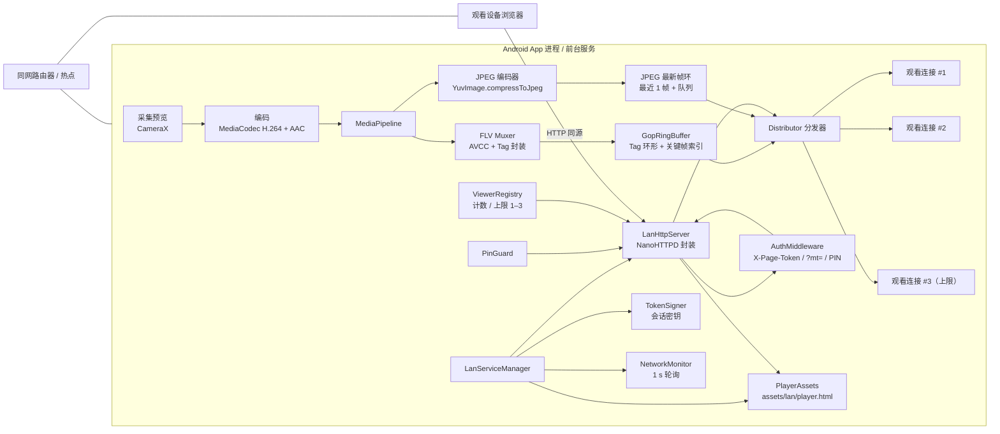
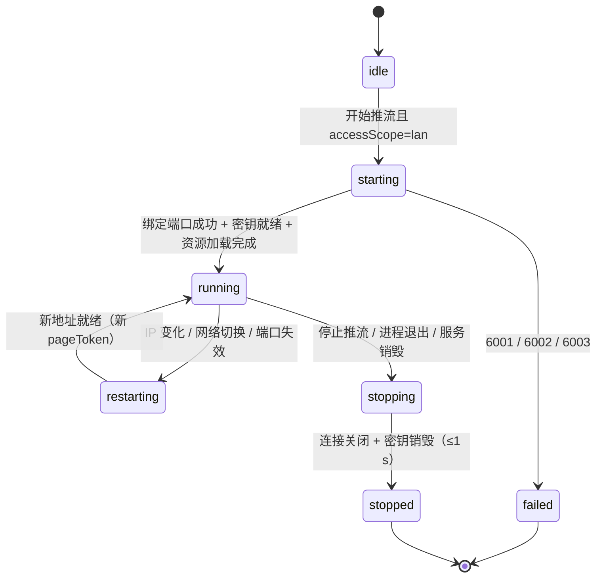
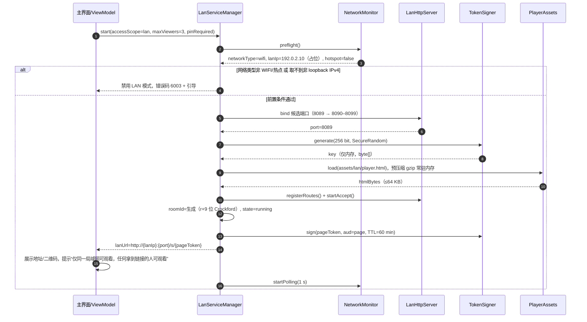
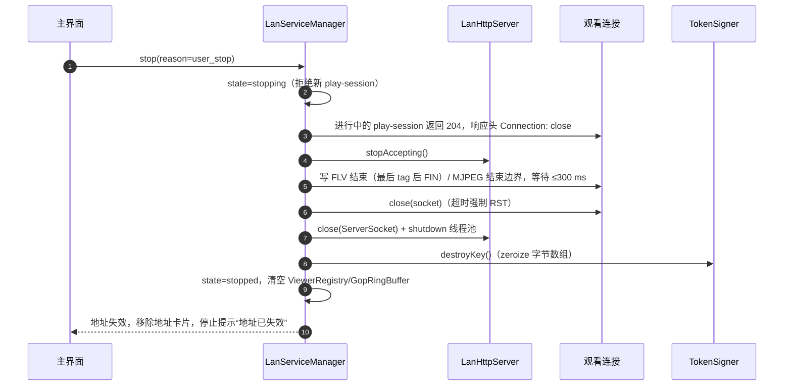
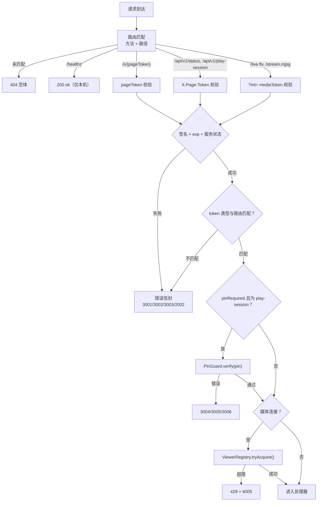
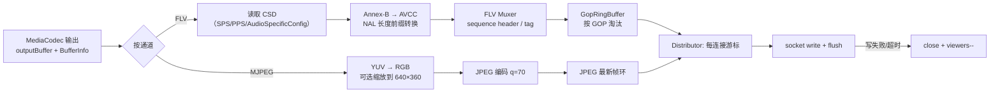
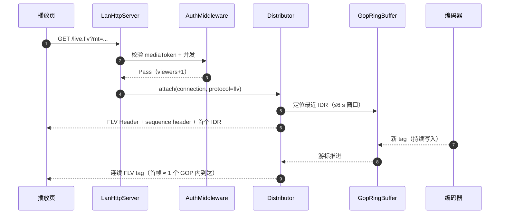
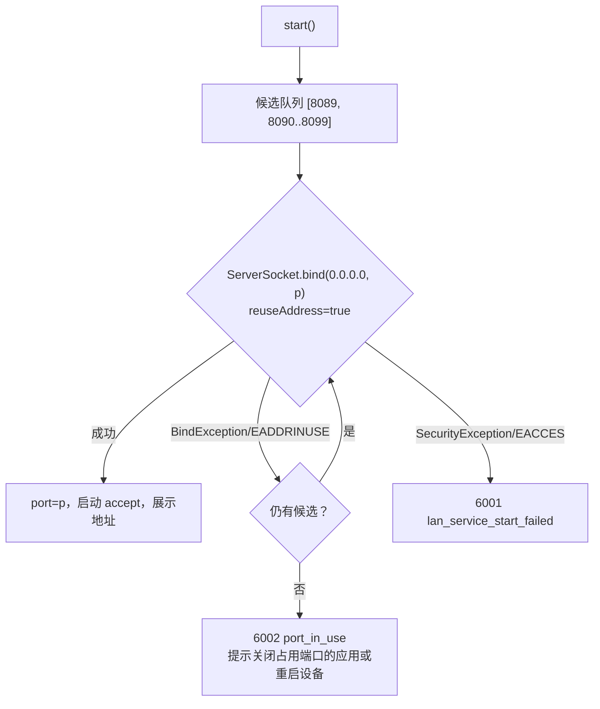
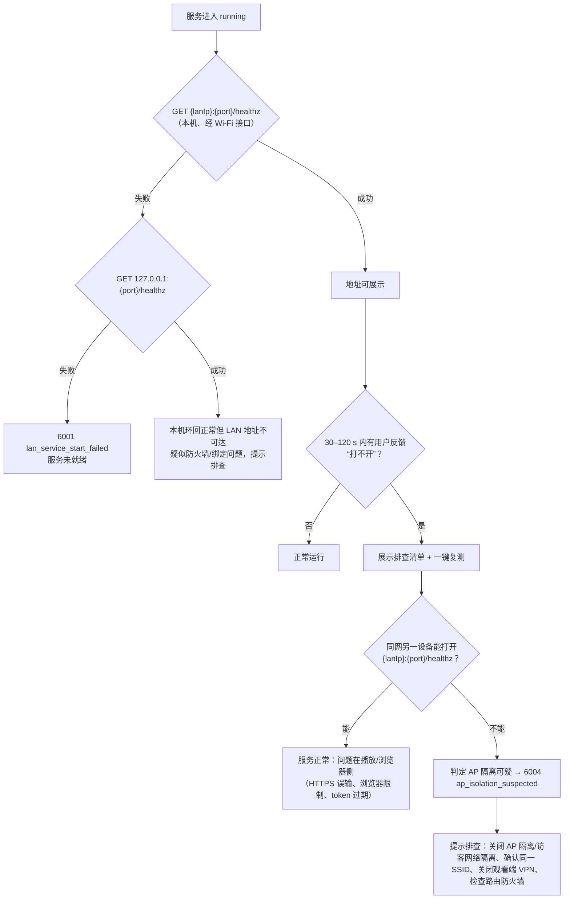

# 05 · 局域网端侧服务（LAN Service）设计

| 项目 | 值 |
|---|---|
| 文档状态 | 草案（提交 Lead 评审后转基线） |
| 文档版本 | v1.1 |
| 文档编号 | 05 |
| 主责 | 端侧服务与播放页作者（media） |
| 依赖文档 | [00-conventions.md](./00-conventions.md)、[PRD-v1.0.md](./PRD-v1.0.md)、[02-client-modules.md](./02-client-modules.md)、[04-interface-contracts.md](./04-interface-contracts.md)、[07-security-privacy.md](./07-security-privacy.md)、[10-observability.md](./10-observability.md)、[11-risk-adr.md](./11-risk-adr.md) |
| 适用 PRD | §4.3、§4.4、§7.3、§9.2、§11.3、§12、§13.2、§14、§15 |
| 契约基线 | 00 v1.1 §4.2 地址、§4.3 失效不变量、§4.4 检测、§5.1 token、§5.2 + §17.1 PIN、§8 端侧 API、§9 错误码、§10.3–10.4 预算、§11 埋点、§12 边界、§17 裁定 |
| 最后更新 | 2026-10-20 |

> 本文只“细化”契约，不改写契约。凡与 00 不一致处，以 00 为准，并在 §19 开放问题与回报中标注。所有域名、IP、token 均为占位值（文档网段 `192.0.2.0/24` 与 `{lanIp}` 模板），不含真实主机信息。

---

## 1. 目的与范围

### 1.1 目的

定义“仅局域网（`accessScope="lan"`）”模式下，运行在 Android App 进程/前台服务内的**端侧服务**的可实现设计方案：HTTP 服务、播放页分发、`/live.flv` 与 `/stream.mjpg` 两条媒体通道、token/PIN 鉴权、观看者并发、端口选择、网络检测与 AP 隔离提示、停止即失效、性能与安全边界，以及可执行的测试清单。

本文服务的验收对象是 PRD §16.2 中与局域网相关的四条：同一 Wi-Fi 下另一设备可播放、停止后地址不可用、PIN/token 生效、AP 隔离有明确提示。

### 1.2 范围

| 范围内（本文负责） | 范围外（引用其他文档） |
|---|---|
| 端侧 HTTP 服务选型、线程模型、路由表、HTTP 语义 | 云端 REST/媒体面契约（03、04）；播放页 UI 与降级（06） |
| 本地 token 签发/校验、PIN 限速、观看者计数 | 全局鉴权模型与威胁建模（07）；埋点管道（10） |
| MediaCodec 输出接入、FLV/MJPEG 封装、GOP 环形缓冲、慢客户端与背压 | 采集/编码参数与 CameraX 生命周期（02）；双摄合成（01、02） |
| 端口选择、网络检测、AP 隔离自检、热点提示 | 访问范围开关与主界面交互（01、02）；推送/分享流程（06 不涉及） |
| 播放页内联资源预算与版本管理（服务侧部分） | 播放页 HTML/JS 内部逻辑（06） |
| 端侧服务安全边界与“无 HTTPS”风险接受 | 风险登记与 ADR 编号（11）、安全结论（07） |

### 1.3 契约对齐声明

| 本文主题 | 00 条款 | 对齐方式 |
|---|---|---|
| 播放地址 | §4.2 `http://{lanIp}:{port}/s/{pageToken}` | 原样引用，不自造地址形态 |
| 失效语义 | §4.3-4：停止后 TCP `connection refused` | 作为停止流程的强制验收项 |
| 网络检测 | §4.4 五项检测 | 逐项落到 §12，频率/判定/提示一致 |
| token | §5.1 表格与 claims | LAN 密钥本地随机 256 bit、`lan:true`、TTL 60 min/300 s |
| 端侧 API | §8 路由与字段 | 路由表逐条复制，不新增公开路由 |
| 错误码 | §9.2 号段 | 只用既有码，不新增号段 |
| 性能 | §10.3 失效 ≤1 s、§10.4 资源 | 直接引用口径，测算在 §14 |
| 埋点 | §11 事件名与禁止项 | 事件名原样复用，禁止项在 §15.4 列出 |

---

## 2. 术语、组件与职责

### 2.1 术语

| 术语 | 定义 |
|---|---|
| 端侧服务（LAN Service） | LAN 模式下由 App 维护的 HTTP 媒体服务进程内实例，PRD §11.3、00 §12 |
| `LanServiceManager` | 服务生命周期唯一入口（02 定义其宿主为前台服务），负责启停、密钥、地址、失败上报 |
| `LanHttpServer` | HTTP/1.1 服务实现，绑定 `0.0.0.0:{port}`，提供 §6 路由 |
| `MediaPipeline` | 从编码器输出到封装器的管线：H.264/AAC → FLV；原始帧 → JPEG |
| `GopRingBuffer` | 按 GOP 组织的环形缓冲，供新观看者快速起播与慢客户端追帧 |
| `ViewerRegistry` | 活跃观看连接表：`viewerId`、`playSessionId`、`remoteIp`、起始时间、游标、丢弃计数 |
| `TokenSigner` | LAN 本地 HS256 签发/校验器，持有每会话 256 bit 随机密钥 |
| `PinGuard` | PIN 校验与限速（5 次/分钟/IP；连续 10 次失败锁 10 分钟） |
| `NetworkMonitor` | 网络类型/IP/热点/AP 隔离可疑检测，1 s 轮询 `LinkProperties` |
| `PlayerAssets` | APK 内 `assets/lan/player.html` 单文件内联页（00 §12） |

### 2.2 组件拓扑



### 2.3 职责与线程模型

| 组件 | 职责 | 线程/执行上下文 | 持有状态 | 失败表现 |
|---|---|---|---|---|
| `LanServiceManager` | 启停编排、状态机、地址生成、错误码上报 | 主线程 + 单线程状态机串行队列 | `ServiceState`、`lanIp`、`port`、`roomId` | `6001`/`6002`/`6003` |
| `LanHttpServer` | accept、请求分发、连接生命周期 | 1 个 accept 线程 + 固定池（4–8 线程）；媒体连接占用线程 | `ServerSocket`、连接表 | 绑定失败 `6002`；运行期异常 `6006` |
| `AuthMiddleware` | token/PIN/并发/状态校验 | 请求线程（读路径无锁） | 无（读 `TokenSigner`/`PinGuard`） | `3001`–`3006`、`6005` |
| `MediaPipeline` | 接入编码输出、封装、写入环形缓冲 | 编码回调线程 → 单写线程 | 序列头、GOP 索引 | `6006` |
| `GopRingBuffer` | 保存最近一段已封装字节、按 GOP 淘汰 | 单写多读（读游标独立） | 字节数组、索引 | 溢出时整 GOP 淘汰并通知分发器跳转 |
| `Distributor` | 每连接游标推进、追帧/丢帧/断连 | 每连接 1 个写线程（阻塞写 socket） | 每连接队列与统计 | 慢客户端按 §8.7 处理 |
| `ViewerRegistry` | 活跃连接与计数 | 并发容器 + 原子计数 | 计数与元数据 | 超限 `6005` |
| `PinGuard` | PIN 尝试计数与锁定 | 请求线程 + 定时清理 | 按 IP 的滑动窗口 | `3005`/`3006`/`3008` |
| `NetworkMonitor` | 网络类型/IP/热点检测、1 s 轮询 | 独立线程或 `ConnectivityManager` 回调 | 上次 IP、稳定计数 | `6003`；变化触发重建 |
| `TokenSigner` | 256 bit 密钥、签发与校验 | 请求线程（HMAC 为 CPU 微秒级） | 当前密钥字节 | 停止/轮换后全部旧 token 失效 |

线程预算：3 个媒体写线程 + 1 accept + 4 请求线程 + 1 编码写线程 ≈ 9 个线程常驻，峰值可控；不使用 `ForkJoinPool.commonPool` 承载阻塞 IO。

---

## 3. 生命周期

### 3.1 服务状态机



状态约束：

- `starting`/`restarting` 期间不对外提供播放页；已有连接在 `restarting` 中全部关闭（旧地址必然失效，见 §12.6）。
- `running` 是唯一可签发 `pageToken`/`mediaToken` 的状态；`stopping` 起拒绝新 `play-session`。
- 访问范围开关在推流中锁定（PRD §4.2）；因此 `running` 期间不存在 `lan→wan` 热切，只有停止后重建。
- 进程被杀不做恢复承诺：无持久化密钥与端口，重启后生成新地址（§3.6）。

### 3.2 启动时序



启动时延预算：端口探测 + 资源加载 + 密钥生成 ≤ 300 ms（p95）；整体“点击开始推流 → 播放地址可用”仍受 00 §10.3 的 ≤3 s 约束（含编码器首帧）。

### 3.3 停止时序（≤1 s）



时效分解（与 00 §10.3 “停止到地址失效 ≤1 s”对齐）：

| 阶段 | 预算 | 说明 |
|---|---|---|
| 标记关闭 + 拒绝新连接 | ≤100 ms | 先置 `closed`，避免新请求进入 |
| 结束进行中的播放会话 | ≤200 ms | `204` + `Connection: close` |
| 关闭客户端 socket | ≤300 ms | 先 FIN，超时强制关闭 |
| 关闭 `ServerSocket` | ≤100 ms | 此后 `connect` 得到 `connection refused`（00 §4.3-4） |
| 销毁密钥与缓冲 | ≤100 ms | HMAC 密钥清零，引用置空 |
| 汇总（p95） | **≤800 ms**，上限 1 s | 超时即视为缺陷，进 §17 用例 |

停止后的可验证事实：同一 `{lanIp}:{port}` 上 `TCP connect` 必须被拒绝；已打开的播放页过期后刷新得到连接失败（浏览器原生错误页），不得返回“错误 JSON”或继续吐媒体字节。

### 3.4 与推流会话的耦合

| 事件 | 端侧服务动作 | 用户可见结果 |
|---|---|---|
| 用户点“开始推流”（LAN） | 启服务、生成地址、写通知栏 | 地址卡片出现 |
| 编码器首帧 | 写 FLV sequence header + IDR，MJPEG 写首帧 | 观看者可起播 |
| 采集暂停/切前后摄 | 编码器重建：重发 sequence header，GOP 重新开始；媒体连接不主动断 | 观看端 1–2 s 卡顿后继续（FLV）；MJPEG 画面更新 |
| 编码器错误（`1005`） | `6006`，关闭媒体连接，保留 HTTP 以展示错误页 | 播放页显示“媒体管线错误” |
| 用户点“停止推流” | 按 §3.3 停止 | 地址立即失效 |
| App 进程被杀 | 无优雅停止；socket 由内核回收 | 连接被重置，重新打开为拒绝 |
| Web 端并发达上限 | 新连接 `429` + `6005` | 播放页提示“并发已达上限” |

### 3.5 网络切换与重建

IP 变化（Wi-Fi 重连、热点开关、双 Wi-Fi 切换）触发 `restarting`：

1. `NetworkMonitor` 检测到新 IP 且连续 2 次采样一致（1 s 间隔）→ 判定稳定变化；
2. 立即按 §3.3 停止旧实例（≤1 s），销毁旧密钥；
3. 重新绑定端口（同一端口通常可复用；若被占用进入 §11 顺延）；
4. 生成新 `roomId`？**否**——LAN 会话内 `roomId` 保持不变（token `sub` 稳定），但密钥与 `pageToken` 重建；
5. 用新 `lanIp`/`port` 重新生成播放地址，UI 提示“网络地址已变化，请重新复制地址”，旧地址与旧 token 因密钥销毁而立即失效（00 §4.4“旧 token 立刻失效”）。

已建立的 TCP 连接在 IP 变化时本就不可达，因此“重建 + 密钥销毁”不会额外损伤体验；不做“同会话保留旧 token”的兼容。

### 3.6 崩溃与重复启动

- 不做密钥/端口持久化：00 §5.1 明确“不持久化”。进程重启后一律为新会话、新地址。
- `start()` 幂等：若 `state ∈ {starting, running}` 直接返回当前地址，不重复绑定端口。
- 客户端崩溃重启后残留 socket 由内核回收；若端口仍处于 `TIME_WAIT`，用 `SO_REUSEADDR` 允许重新绑定（不影响其他 App 正在监听的端口，见 §11.2）。
- 前台服务被系统回收（`1007` 场景由 02 处理）：端侧服务随宿主销毁，播放地址失效；恢复推流即新地址。

---

## 4. 密钥与 token

### 4.1 本地密钥

| 项目 | 设计 |
|---|---|
| 算法 | HS256（JWT，00 §5.1） |
| 密钥长度 | 256 bit，`SecureRandom` 生成 |
| 生成时机 | 每次推流会话启动端侧服务时（含 IP 变化后的重建） |
| 存放 | 仅进程内存 `ByteArray`；不入 `SharedPreferences`、不入文件、不入日志/埋点/崩溃上报 |
| 销毁 | 停止时 `Arrays.fill(key, 0)` 并置空引用；销毁后校验一律失败 |
| 轮换 | 重建（§3.5）即轮换，旧密钥不可恢复 |
| `kid` | 不设；LAN 无多密钥并存需求，失败即失效 |

> 契约依据：00 §5.1“LAN 密钥每次推流会话随机生成 256 bit，停止即销毁，不持久化”。

### 4.2 token 签发参数

| token | 位置 | `aud` | `scope` | TTL | 附加 claims | 撤销 |
|---|---|---|---|---|---|---|
| `pageToken` | 路径段 `/s/{pageToken}` | `page` | `["play"]` | 60 min，且 ≤ 会话剩余寿命 | `jti`、`lan=true`、可选 `pin=true` | 停止/重建即失效（密钥销毁） |
| `mediaToken` | 查询 `?mt=` | `media` | `["play"]` | 300 s，可续期 | `jti`、`lan=true`、`sid=playSessionId` | 停止、exp、并发上限 |

公共 claims 严格按 00 §5.1：`iss="campush"`、`sub=roomId`、`iat`/`exp` 秒级、`jti` 16 位随机串。不新增自定义 claim（`lan` 已在契约内）。

### 4.3 校验顺序

服务端固定顺序（00 §5.1 撤销语义）：**签名 → `exp` → 服务/房间状态 → token 类型与路由匹配 → PIN → 并发/会话**。

| 步骤 | 失败结果 | 错误码 | HTTP |
|---|---|---|---|
| 缺失 token | `token_missing` | `3001` | `401` |
| 签名错误/格式错误 | `token_invalid` | `3002` | `401` |
| 过期 | `token_expired` | `3003` | `401` |
| 服务已停止/房间已关闭 | `room_closed` | `2002` | `410` |
| token 类型不匹配（如用 pageToken 访问 `/live.flv`） | `token_invalid` | `3002` | `401` |
| 需要 PIN 未提供 | `pin_required` | `3004` | `401` |
| PIN 错误 | `pin_invalid` | `3005` | `401` |
| PIN 锁定 | `pin_locked` | `3006` | `429` + `Retry-After` |
| 观看者达上限 | `viewer_limit_reached` | `6005` | `429` |

`requestId`（`req_` + 16 位 Crockford）由服务端生成并回写 `X-Request-Id`；LAN 无云端，`requestId` 仅本地日志与埋点用。

### 4.4 时钟与过期

- `exp` 校验一律用**手机端时钟**（签发与校验同一设备），不存在跨机时钟偏差。
- 观看设备的系统时间不参与判定；页面不读设备时间做本地过期判断，只以服务端响应为准。
- 允许 0 s 时钟回拨容忍；若检测到系统时间回拨超过 60 s（`SystemClock.elapsedRealtime` 与墙钟对比），重建服务以规避“token 永不过期”。

### 4.5 脱敏

- 日志中 token 统一按 `前 6 字符 + "…" + 后 4 字符` 打印（如 `eyJhbG…Xk2p`），完整值只允许出现在内存与网络字节中。
- 埋点禁止项按 00 §11 执行：不上报 `pageToken`/`mediaToken`/PIN、完整 `roomId`（用 `roomIdHash`）、完整播放地址、IP、SSID。

---

## 5. HTTP Server 选型

### 5.1 约束

1. 单进程内嵌、无独立服务进程；APK 体积敏感（增量目标 ≤300 KB）。
2. 必须能**完全掌控响应字节流**：FLV 为无 `Content-Length` 的长连接，MJPEG 为 `multipart/x-mixed-replace`，两者都需要“拿到 `OutputStream` 后自行写、自行 flush、自行断开”。
3. 并发模型要能承受 3 条长连接 + 少量短请求；慢客户端不得阻塞编码线程。
4. 需要能感知客户端断开（写失败/`IOException`），以便及时 `viewers--`。
5. 不做 TLS（00 §8），不依赖 HTTP/2/WebSocket。
6. 许可证可商用；与现有 Kotlin/协程栈冲突小；社区可查。

### 5.2 对比

| 维度 | NanoHTTPD | Ktor CIO | Netty | JLhttp |
|---|---|---|---|---|
| 形态/体积（参考） | 单 jar ≈60 KB，Android 常用 | Ktor server-core + cio + coroutines ≈1.5–2.5 MB | netty-transport+buffer+codec ≈2–3 MB，netty-all 更大 | 单 jar ≈50 KB |
| 线程模型 | 默认每连接一线程（`AsyncRunner` 可换固定池） | 协程 + 事件循环，天然高并发 | Reactor 多线程事件循环 | 每连接一线程 |
| 流式输出控制 | 直接拿 `OutputStream`（`ChunkedResponse`） | `ByteWriteChannel`，需适配 | `Channel`/`ByteBuf`，能力强但代码量大 | 直接 `OutputStream` |
| 客户端断开感知 | 写异常即可感知，简单 | 写挂起失败可感知 | 需处理 `channelInactive` | 写异常可感知 |
| HTTP/1.1 细节（keep-alive/chunked/HEAD） | 够用，边角少 | 完善 | 完善 | 够用，边角更少 |
| 学习/调试成本 | 低 | 中（协程 + Ktor 生命周期） | 高 | 低 |
| 维护活跃度（评估时） | 中（Android 生态广泛使用） | 高 | 高 | 低（更新缓慢） |
| 许可证（需法务复核） | BSD-3-Clause | Apache-2.0 | Apache-2.0 | GPL 家族（据上游说明，闭源分发需确认） |
| 适配本场景结论 | **推荐（M1 基线）** | 备选（M2 若并发/信令需求上升） | 过重 | 不推荐（许可证 + 维护） |

说明：体积为“量级参考”，最终以 M1 集成后 APK 增量实测为准（§17 用例 LAN-T-01 记录）。

### 5.3 结论

**M1 采用 NanoHTTPD（或同 API 形态的维护分支），封装为 `LanHttpServer` 接口；不直接散用其 API。**

理由：

1. 3 条长连接的量级下，“每连接一线程”的代价可接受（3 个写线程 + 少量请求线程），换来的是最直接的字节流控制与断开感知。
2. 体积最小，符合 PRD §11.3“内置轻量 HTTP 服务”的定位；避免为 LAN 模式引入 Ktor 全家桶。
3. 流式响应可自行管理：用 `ChunkedResponse` 写入 FLV tag / MJPEG part，禁用框架缓冲；`Content-Length` 固定响应只用于 `/healthz`、`/api/v1/status`、`/api/v1/play-session`。
4. 抽象边界：路由注册、鉴权、响应头、流式写全部经自有接口（Kotlin 接口签名示例见 §7.4），未来若迁 Ktor CIO，只需重写适配层，不影响路由/管线/鉴权。

反例记录：Netty 的能力（HTTP/2、复杂 pipeline）在“3 观看者 + 无 TLS”场景无处发挥，代码量与排障成本显著上升；JLhttp 体积与 API 合适，但维护活跃度与许可证是阻断项。

### 5.4 线程与连接策略

| 项 | 取值 | 理由 |
|---|---|---|
| accept 线程 | 1 | 绑定 `0.0.0.0`，仅处理连接建立 |
| 请求线程池 | 4–8（固定） | 短请求（`status`/`play-session`/`healthz`）快速返回 |
| 媒体连接 | 独占写线程 | 阻塞式 `socket.write`，天然背压；绝不放入请求线程池 |
| 空闲超时 | 短请求 5 s；媒体连接无读超时，靠写失败/停止事件结束 | 观看端只读不写 |
| 最大并发连接 | `maxViewers + 4` | 防止连接耗尽（超限直接 `429`/`close`） |
| `SO_REUSEADDR` | 开启 | 允许 `TIME_WAIT` 后快速重绑（不绕过正在监听的进程） |
| `TCP_NODELAY` | 开启 | 降低小 tag 的发送延迟 |
| `SO_SNDBUF` | 默认（不手工放大） | 放大只会延迟“慢客户端”判定；需要的是尽快暴露拥塞 |

---

## 6. 路由与 HTTP 语义

### 6.1 路由总表

严格复用 00 §8，不新增公开路由（内部辅助方法不注册为路由）。

| 方法 | 路径 | 鉴权 | 成功 | 主要错误码 | 说明 |
|---|---|---|---|---|---|
| `GET` | `/s/{pageToken}` | 路径 token 校验 | `200` `text/html; charset=utf-8` | `3001`/`3002`/`3003`/`2002` | 返回内联播放页（≤64 KB，无外链） |
| `GET` | `/api/v1/status` | `X-Page-Token` | `200` JSON | `3001`/`3002`/`3003`/`2002` | `{state, lanIp, port, viewers, maxViewers, pinRequired, mediaProtocols, uptimeSec}` |
| `POST` | `/api/v1/play-session` | `X-Page-Token` | `200` JSON | `3004`/`3005`/`3006`/`6005` | body `{pin?}` → `{playSessionId, mediaToken, expiresIn:300, protocols:{flv,mjpeg}, pinRequired}` |
| `GET` | `/live.flv?mt=` | `mediaToken` | `200` `video/x-flv` | `3001`/`3002`/`3003`/`6005`/`6006` | HTTP-FLV 长连接（主通道） |
| `GET` | `/stream.mjpg?mt=` | `mediaToken` | `200` `multipart/x-mixed-replace; boundary=--frame` | 同上 | MJPEG 兜底 |
| `GET` | `/healthz` | 无 | `200` `{"ok":true}` | — | 仅本机自检，不返回房间信息 |
| `OPTIONS` | `*` | 无 | `204` | — | 仅同源；**不设置** `Access-Control-Allow-Origin` |

路由匹配规则：精确匹配优先；`/s/{pageToken}` 的路径段不做 URL 解码后的二次路径解析（防目录穿越，虽然无静态目录）；未知路径返回 `404` 空体（不返回 JSON 错误信封以外的内部信息）。

### 6.2 公共响应头

| 头 | 值 | 适用范围 | 目的 |
|---|---|---|---|
| `Server` | `CamPush-LAN/1.0` | 全部 | 契约要求（00 §8） |
| `Cache-Control` | `no-store` | 全部 | 会话内容不可缓存，防止地址失效后仍可回放 |
| `X-Content-Type-Options` | `nosniff` | 全部 | 防 MIME 嗅探 |
| `Referrer-Policy` | `no-referrer` | `/s/{pageToken}` | 防止路径中的 token 通过 Referer 外泄 |
| `X-Frame-Options` | `DENY` | `/s/{pageToken}` | 禁止被第三方页面嵌套（防点击/套壳） |
| `Content-Security-Policy` | 见 06 §14 | `/s/{pageToken}` | 禁止一切外链资源 |
| `Connection` | `close`（停止阶段）/ `keep-alive`（短请求） | 全部 | 停止时确保连接尽快关闭 |
| `X-Request-Id` | `req_` + 16 位 Crockford | 全部 | 排障关联 |

### 6.3 错误响应

错误信封严格按 00 §9.1：

```json
{
  "code": 3003,
  "error": "token_expired",
  "message": "Playback token has expired",
  "retryable": false,
  "userHint": "播放凭证已过期，请向分享者重新获取地址",
  "requestId": "req_9f3k2m7q4x8p1t5w"
}
```

约定：`/s/{pageToken}` 失败时返回**同源内联错误 HTML**（复用播放页外壳，渲染 `code/userHint`），不返回裸 JSON——浏览器地址栏不变，用户能看到可读提示；媒体端点失败返回 JSON + 对应 HTTP 状态。

### 6.4 同源与跨域

- 播放页与 API 同源（同一 `{lanIp}:{port}`），页面内 `fetch` 无需 CORS。
- `OPTIONS *` 返回 `204` 且**不携带** `Access-Control-Allow-Origin`，浏览器跨源请求会被拦截；这不是安全边界（同网可直连），只是避免被第三方网页静默拉流。
- 不提供 `Access-Control-Allow-Credentials`；不使用 Cookie，`mediaToken` 只经查询参数或请求头传递。
- 禁止 `POST` 跨源简单请求之外的任何预检放行。

### 6.5 请求限制

| 项 | 限制 | 超限处理 |
|---|---|---|
| 请求头总大小 | ≤8 KB | `431`/`400` |
| `play-session` 请求体 | ≤4 KB | `413` |
| 单 IP 短请求速率 | 60 次/分钟（与 00 §6.3 `play-session` 口径一致） | `429` + `Retry-After` |
| 请求行长度 | ≤2 KB | `414` |
| 同时媒体连接 | `maxViewers`（1–3） | `429` + `6005` |

---

## 7. 鉴权中间件

### 7.1 校验管线



### 7.2 中间件规则

| 规则 | 实现 |
|---|---|
| token 位置 | `/s/{pageToken}` 路径段；API 用 `X-Page-Token`；媒体用查询 `?mt=`（00 §8） |
| 常量时间比较 | HMAC 比较与 PIN 比较使用常量时间实现，避免时序侧信道 |
| 重放防护 | `jti` 记录最近 1024 个已用 `jti`（TTL 窗口内），重复 `jti` 拒绝（`3002`）；LAN 短 TTL 下误伤概率极低 |
| 头部缺失 | `401` + `3001`，不区分“没带”与“带错”以外的信息 |
| 日志 | 只记录 `requestId`、路由、错误码、耗时；不记录 token、PIN、完整 URL（路径中的 token 需裁剪） |
| 响应最小化 | 错误响应不返回内部异常栈；`/healthz` 不含房间/网络信息 |
| 并发释放 | 连接 `close/finally` 中统一 `ViewerRegistry.release()`，幂等 |

### 7.3 PIN 交互细节

1. 播放页从 `/api/v1/status` 读到 `pinRequired=true`，在 `auth` 状态弹出 PIN 输入（不跳转、不改地址栏）。
2. 页面 `POST /api/v1/play-session`，body `{"pin":"1234"}`；错误 `3005` 原地提示“口令错误，请重试”，并保留输入框。
3. `3006`（锁定）展示 `Retry-After` 折算的剩余时间，输入框禁用；页面不回退到浏览器错误页。
4. PIN 正确但并发已满：返回 `6005`，页面展示“观看人数已达上限（最多 3 人），请稍后再试或建议分享者切换公网模式”。
5. PIN 不进入 URL、不进入二维码、不进入日志与埋点（00 §5.2、§11）。

### 7.4 中间件接口（Kotlin 签名示意，不含实现）

```kotlin
// 仅表达边界与调用顺序，不写实现
interface LanRequest {
    val method: String
    val path: String                 // 不含 query
    val query: Map<String, String>
    val headers: Map<String, String> // 大小写不敏感访问
    val body: ByteArray
    val remoteIp: String
    val requestId: String
}

sealed interface AuthResult {
    data class Pass(val claims: LanClaims, val playSessionId: String?) : AuthResult
    data class Reject(val code: Int, val http: Int, val retryAfterSec: Int? = null) : AuthResult
}

interface AuthMiddleware {
    fun authenticate(req: LanRequest, required: TokenAudience): AuthResult
}

interface LanHttpServer {
    fun register(route: LanRoute, handler: LanHandler)
    fun start(bind: String /* "0.0.0.0" */, port: Int): Result<Unit>
    fun stop(graceMs: Long = 300): Unit
}

fun interface LanHandler {
    fun handle(req: LanRequest, out: LanResponseStream) // 流式：自行 write/flush/close
}
```

---

## 8. 媒体管线与分发

### 8.1 端到端数据流



### 8.2 编码器输出接入

| 项 | 设计 |
|---|---|
| 输出格式 | `MediaCodec.INFO_OUTPUT_FORMAT_CHANGED` 时取 `csd-0`（SPS）、`csd-1`（PPS）、AAC 的 `csd-0`（AudioSpecificConfig）；LAN 基线为 H.264 + AAC-LC（00 §7） |
| 数据类型 | 视频为 Annex-B 起始码分隔的 NAL；音频为裸 AAC 帧（无 ADTS） |
| 时间戳 | 统一用编码器输出 `presentationTimeUs / 1000` 得毫秒；FLV tag 时间戳以此为基准，首帧归零 |
| 关键帧 | 编码器 GOP 固定 2 s（00 §7：关键帧间隔 2 s，弱网 1 s）；以 `BUFFER_FLAG_KEY_FRAME` 或 NAL type 5（IDR）判定 |
| 背压 | 编码器输出缓冲需及时 `releaseOutputBuffer`；管线写入环形缓冲为 O(1) 追加，不做磁盘/网络等待 |
| 失败 | `MediaCodec` 异常 → `6006`，关闭媒体连接，保留播放页用于展示错误 |

### 8.3 GOP 环形缓冲

| 缓冲 | 内容 | 容量 | 淘汰策略 | 用途 |
|---|---|---|---|---|
| FLV tag 环 | 已封装的完整 FLV tag 字节（含首个 AVC sequence header + AAC sequence header） | 最近 6 s 或 16 MiB，先到者为准 | 以 GOP 为单位整段淘汰（保证任何起点都是 IDR） | 新观看者快速起播、慢客户端追帧 |
| 关键帧索引 | `(timestampMs, ringOffset, isIdr=true)` | 最近 30 个 GOP | 随 GOP 淘汰同步删除 | O(1) 定位最近 IDR |
| JPEG 最新帧 | 最近 1 帧完整 JPEG + 长度 | 1 帧 | 覆盖 | MJPEG 新连接立即出图 |
| JPEG 待发队列 | 最近 8 帧（每连接可选） | 8 帧 | 覆盖 | MJPEG 低帧率均匀发送 |
| 序列头快照 | FLV header + AVC/AAC sequence header 字节 | 1 份 | 重建时替换 | 每个新连接先发序列头 |

设计要点：

- 环形缓冲**只保存已封装字节**，分发器只写游标，只有在 `socket.write` 时才复制/发送，避免每连接一份内存。
- 淘汰以 GOP 为粒度：若某 GOP 仍被慢客户端引用，允许该 GOP 在内存中多存活一个周期（最多额外 1 个 GOP ≈ 2 s），超过则强制淘汰并把该客户端标记为“需追帧”。
- 缓冲总内存上限 16 MiB（单摄 720p 2.5 Mbps 下 6 s ≈ 1.9 MiB，上限主要防御高码率/低帧率异常）。

### 8.4 HTTP-FLV 封装

FLV 字节布局（仅列实现必需字段）：

| 结构 | 字段 | 取值/说明 |
|---|---|---|
| FLV Header | `Signature` | `'F' 'L' 'V'` |
| | `Version` | `1` |
| | `Flags` | `0x01`（有音频时 `\|0x04`），`0x04`（有视频） |
| | `DataOffset` | `9` |
| PreviousTagSize0 | — | `0` |
| Tag Header | `TagType` | `8`=audio，`9`=video，`18`=script（LAN 不发 script tag） |
| | `DataSize` | 24 bit，tag 数据长度 |
| | `Timestamp` | 24 bit 低位（ms） |
| | `TimestampExtended` | 8 bit 高位 |
| | `StreamID` | `0` |
| Tag Data（video） | `FrameType`（高 4 bit）+ `CodecID`（低 4 bit） | `1`（关键帧）/`2`（非关键帧）+ `7`（AVC） |
| | `AVCPacketType` | `0`=sequence header；`1`=NALU |
| | `CompositionTime` | 24 bit；无 B 帧时为 0 |
| | 负载 | sequence header 为 AVCDecoderConfigurationRecord；NALU 为 4 字节长度前缀的 AVCC |
| Tag Data（audio） | `SoundFormat` 高 4 bit | `10`（AAC） |
| | `SoundRate`/`SoundSize`/`SoundType` | 按编码参数；AAC 固定 `3/1/1`（44 kHz 表观念） |
| | `AACPacketType` | `0`=AudioSpecificConfig；`1`=裸 AAC 帧 |
| PreviousTagSize | — | 上一 tag 的 `11 + DataSize` |

实现约束：

- 新连接第一帧序列：FLV Header + PreviousTagSize0 + **AVC sequence header** + 音频 sequence header（如有） + 最近 IDR 所在 GOP。
- 追帧时同样重发序列头再发 IDR，避免解码器状态错乱。
- 静音/暂停时仍每 ≤5 s 写至少 1 个 tag 保活（与 00 §7 HTTP-FLV 保活口径一致）；无音频时写空 video tag（`DataSize=0` 会破坏解码器，改为写最近一帧的重复 tag 或 metadata；设计取“重复最近 tag”）。
- `Content-Type: video/x-flv`，`Cache-Control: no-store`（00 §7）。

### 8.5 JPEG / MJPEG 分发

| 项 | 设计 |
|---|---|
| 帧源 | 编码前的 YUV 帧（`COLOR_FormatYUV420Flexible`），避免解码回读；由编码器输出回调旁路提供 |
| 缩放 | 默认缩放到 640×360（宽度 640，保持比例），降带宽与 JPEG 编码 CPU |
| 质量 | JPEG quality 70；实测单帧 25–40 KB（640×360），720p 直出 60–90 KB |
| 帧率 | 5 fps（可配 2–10）；发送间隔 200 ms，用独立定时器均匀出帧，不与编码帧率耦合 |
| 响应头 | `Content-Type: multipart/x-mixed-replace; boundary=--frame`，`Cache-Control: no-store` |
| Part 格式 | `--frame\r\nContent-Type: image/jpeg\r\nContent-Length: {n}\r\n\r\n{JPEG 字节}\r\n` |
| 新连接 | 立即发送最新一帧，再进入定时发送 |
| 失败 | JPEG 编码异常降级为“暂停 MJPEG 通道”，FLV 不受影响；全部失败 → `6006` |

MJPEG 的带宽显著高于 FLV（见 §14.3），因此**默认仅在 FLV 不可用时启用**；播放页降级链为 `flv(2.0 s) → mjpeg(2.0 s)`（00 §10.2）。

### 8.6 分发器与连接状态

每个媒体连接持有：

| 字段 | 说明 |
|---|---|
| `cursor` | 环形缓冲当前读取位置（绝对偏移） |
| `pendingBytes` | 未写出字节数（来自 socket 写阻塞或缓冲积压） |
| `lastWriteAt` | 最近成功写入时间 |
| `skippedFrames` / `skippedMs` | 追帧丢弃计数 |
| `playSessionId` / `viewerId` | 关联 `ViewerRegistry` |
| `protocol` | `flv` / `mjpeg` |

写循环：读游标 → `socket.write` → 成功则推进游标并清空等待计时；失败按 §8.7 判定。分发器不做任何锁内 IO，环形缓冲只在写入侧短暂加锁。

### 8.7 慢客户端策略

判定基于“积压字节/时间”，不依赖 TCP 层指标（Android 上不可用）：

| 档位 | 判定条件 | 动作 | 用户感知 |
|---|---|---|---|
| 正常 | 积压 ≤1 GOP 且最近写入 <1 s | 正常发送 | 无 |
| 追帧 | 积压 1–2 GOP，或单次 `write` 阻塞 >500 ms | 丢弃至下一个 IDR，重发 FLV 序列头；清空积压 | 卡顿 1–2 s 后恢复 |
| 丢帧（持续） | 积压 >2 GOP，或阻塞 >2 s；连续 3 次追帧 | 仅发关键帧 + 跳过非关键帧；记录 `skippedMs` | 画面跳变、帧率下降 |
| 断连 | 积压 >3 GOP（≈6 s，触及环形缓冲窗口）或单次阻塞 >5 s，或累计跳过 >10 s | `close(socket)`；`viewers--`；埋点 `lan_viewer_leave{reason=slow_client}` | 播放页进入 `reconnecting`，退避重连 |
| 迟到 | 新连接、首字节写失败 | 直接关闭，不计数 | 播放页显示“连接失败”，重试 |

阈值以 720p/2.5 Mbps、GOP 2 s 为口径；码率切换时按“字节阈值等比缩放、时间阈值不变”换算（例如 4 Mbps 时触发线按 6 s 折算为 ≈24 MiB，仍不得超过环形缓冲上限）。

### 8.8 背压模型

1. **编码侧永不阻塞**：编码输出 → 封装 → 环形缓冲的追加是内存写入；缓冲满时按 GOP 整段淘汰，不等待观看者。
2. **分发侧阻塞写**：每连接独立写线程阻塞在 `socket.write`，这就是天然背压；TCP 发送缓冲满 → 写阻塞 → `pendingBytes` 上升 → 触发 §8.7 判定。
3. **缓冲读侧无锁**：分发器只读不写，环形缓冲使用“写指针 + 序号”保证读到的是完整 tag；读到被淘汰区域时跳转到最近 IDR。
4. **限流**：MJPEG 由定时器控制出帧速率，慢客户端进一步通过“跳帧”降速，避免写线程长期阻塞。
5. **可观测**：每秒聚合 `viewers`、`avgPendingBytes`、`skipEvents`、`disconnects`，仅本地日志与埋点（不含媒体内容）。

### 8.9 首帧到播放时序



### 8.10 停止/断流时的媒体收尾

| 场景 | 动作 |
|---|---|
| 用户停止推流 | 对 FLV 写最后 tag 后 `close`，不发伪造结束 tag；对 MJPEG 写结束边界后 `close` |
| 编码器停止（暂停采集） | 保持连接，按 §8.4 保活；超过 15 s 无新帧则关闭连接并标记 `no_media`（页面重连后等待新首帧） |
| 服务停止 | 按 §3.3，`viewers` 归零，播放页下次请求得到连接失败 |
| 观看者主动关闭 | 写失败或读到 EOF → `viewers--`，埋点 `lan_viewer_leave` |

---

## 9. 观看者并发与计数

### 9.1 计数口径

`viewers` = **同时满足**以下条件的连接数（00 §8）：

1. 携带有效 `mediaToken`（签名、`exp`、类型均通过）；
2. 已建立 `/live.flv` 或 `/stream.mjpg` 的 HTTP 响应；
3. 连接未关闭（未 FIN/RST，未触发 §8.7 断连）。

`play-session` 签发、仅打开播放页、SSE（LAN 无）均不计入 `viewers`。

### 9.2 上限与超限

| 项 | 取值 | 说明 |
|---|---|---|
| 默认上限 | 3 | 00 §8 默认 3 |
| 可配范围 | 1–3 | 设置页可调（PRD §10.2 局域网设置） |
| 超限响应 | `429` + `6005` `viewer_limit_reached` | 媒体端点与 `play-session` 双点检查；`play-session` 预检可让用户在拿到 token 前就看到明确提示 |
| UI 提示 | “局域网观看人数已达上限（最多 {maxViewers} 人），建议分享者切换公网模式” | PRD §12.2、§14 |
| 计数一致性 | 原子增减 + `finally` 释放 | 防止异常路径泄漏导致“假满” |
| 计数展示 | `/api/v1/status.viewers` | 设置页/主界面可显示“当前 2/3 人观看” |

### 9.3 并发与资源关系

| 观看者 | 上行需求（FLV 720p 2.5 Mbps + AAC 128 kbps） | CPU 增量（相对单观看者） | 结论 |
|---|---|---|---|
| 1 | ≈2.8 Mbps | +1–2% | 安全 |
| 2 | ≈5.6 Mbps | +2–4% | 安全 |
| 3 | ≈8.3 Mbps（含封装开销） | +3–6% | 00 §10.4 上限 35%，需实测确认 |
| >3 | >11 Mbps | — | 不允许（`6005`） |

---

## 10. PIN 与限速

### 10.1 规则（00 §5.2 + v1.1 §17.1，不增不减）

| 项 | 规则 |
|---|---|
| 形式 | 4–6 位纯数字，房间级，`pinRequired=true` 时启用 |
| 校验点 | `POST /api/v1/play-session` body `{"pin":"1234"}` |
| 未提供/错误 | `401` + `3004` / `3005` |
| 频率限制（IP） | 同一 IP 5 次/分钟 → `3008` + `429` + `Retry-After` |
| 频率限制（房间） | 单房间 20 次/分钟 → `3008` + `429`（00 §17.1） |
| 锁定 | 连续 10 次失败锁定 10 分钟，`3006` + `Retry-After`；锁定与 IP、房间同时计数 |
| 展示约束 | PIN 不出现在 URL、二维码、日志、埋点；分享文案只提示“需要口令” |
| 存储 | 内存计数，不落盘；服务停止即清零 |

### 10.2 计数结构

```
perIp[remoteIp] = {
  windowStartMs,      // 1 分钟滑动窗口起点
  windowCount,        // 窗口内尝试次数（成功/失败都计）
  consecutiveFails,   // 连续失败次数（与房间计数联动）
  lockedUntilMs       // 0 表示未锁定
}
perRoom[roomId] = {
  windowStartMs,
  windowCount,        // 单房间 20 次/分钟（00 §17.1）
  consecutiveFails,   // 房间维度连续失败次数
  lockedUntilMs
}
```

- 清理：每分钟惰性清理过期 key；服务停止时整体丢弃。
- 成功一次即重置 `consecutiveFails`，但不清空窗口计数（防“成功一次再爆破”）。
- 单 IP 达到 5 次/分钟、或单房间达到 20 次/分钟，均返回 `429` + `3008 rate_limited`；连续 10 次失败返回 `429` + `3006` + `Retry-After: 600`。
- LAN 场景只有一个房间（单实例单会话），`perRoom` 即全局计数；该房间计数用于抵御多设备轮换 IP 的撞库，避免只靠 IP 维度被绕过。
- 若多条观看设备经同一 NAT/代理呈现同一源 IP（少见），IP 维度先触发，房间维度兜底；两者取先触发者。

### 10.3 强度说明

| PIN 位数 | 空间 | 锁定策略下最大尝试速率 | 穷举所需时间（全局） | 结论 |
|---|---|---|---|---|
| 4 | 10⁴ | ≈10 次 / 10 min（IP 与房间双锁） | ≈166 h | 仅防随手尝试，不防长期定向攻击 |
| 6 | 10⁶ | 同上 | ≈16 600 h | 足够 |

因此：**PIN 是“防误入/弱分享”手段，不是强认证**；IP 与房间双维度计数（00 §17.1）使多 IP 慢速尝试也受房间级锁定约束，但仍无法抵御长期定向攻击。4 位 PIN 场景需在 UI 提示“口令仅用于防止误入，请勿在不可信网络使用局域网模式”。该结论同步写入 07 与 11 的风险条目。

### 10.4 PIN 相关错误映射

| 情况 | 码 | HTTP | `retryable` | 页面表现 |
|---|---|---|---|---|
| 需要 PIN 但未带 | `3004` | `401` | `false` | 弹出 PIN 输入框 |
| PIN 错误（未触发限速） | `3005` | `401` | `true` | 原地提示，保留输入 |
| IP 5 次/分钟 或 房间 20 次/分钟超限 | `3008` | `429` | `true` | 提示“尝试过于频繁，请稍后再试”，按钮禁用 |
| 连续失败锁定（10 次，IP+房间同时计数） | `3006` | `429`（允许 `423`） | `false` | 显示剩余锁定时间，禁用输入 |

---

## 11. 端口选择与冲突处理

### 11.1 端口策略

| 项 | 取值 |
|---|---|
| 默认端口 | `8089`（00 §8） |
| 冲突顺延 | `8090`–`8099`（共 11 个候选，含默认） |
| 绑定地址 | `0.0.0.0`（IPv4）；不绑定 IPv6，避免双栈双地址带来的地址展示歧义 |
| 绑定失败处理 | 顺延下一个候选；全部失败 → `6002 port_in_use` |
| 端口展示 | 主界面/设置页“当前端口 8089”；地址卡片与二维码使用实际端口 |
| 端口持久化 | 不持久化；每次启动从 8089 重新尝试（可避免“上次顺延端口被长期占用”的隐性状态） |

### 11.2 绑定流程



要点：

- 先 `bind` 再 `listen`；`reuseAddress=true` 允许 `TIME_WAIT` 复用，但**不会**抢占已被其他进程监听的端口（内核仍返回 `EADDRINUSE`）。
- 端口探测与最终绑定之间无 TOCTOU 承诺：直接“尝试绑定”而非“先测后绑”。
- 端口变化时地址随之变化，旧 `pageToken` 内不包含 IP/端口，因此必须同步重建密钥（§3.5）保证旧地址不可用。
- 若用户手工指定端口（设置页），仍以 8089–8099 之外的自定义值为准？**不做**——契约只定义该区间，自定义端口进 02/09 的后续需求，不在 M1 实现。

### 11.3 多网卡与热点

- Wi-Fi 与热点并存时（部分机型可同时），取 `LinkProperties` 中默认路由接口的 IPv4 作为展示地址；另一网卡地址不展示、不承诺可达。
- 热点（SoftAP）场景：`lanIp` 通常为热点网关地址（如文档示例 `192.0.2.1` 形态）；UI 提示“观看设备需连接本机热点后打开此地址”。
- 蜂窝 + Wi-Fi 双活：不通过蜂窝暴露服务（`0.0.0.0` 绑定在 Wi-Fi 接口可达范围内，蜂窝接口无入站能力），不构成公网暴露。

---

## 12. 网络检测与 AP 隔离

### 12.1 检测项（与 00 §4.4 一一对应）

| 检测项 | 判定 | 频率 | 失败/命中处理 |
|---|---|---|---|
| 网络类型 | `WIFI` / `CELLULAR` / `NONE`（`ConnectivityManager`） | 事件回调 + 1 s 兜底轮询 | 非 Wi-Fi 且无热点 → 禁用 LAN，`6003` |
| 局域网 IP | `LinkProperties.linkAddresses` 取非 loopback IPv4 | 1 s 轮询 + 网络回调 | 取不到 → 禁用 LAN（`6003`/`6001`） |
| AP 隔离 | `healthz` 本机可达；外部设备不可达由用户反馈 + 排查向导判定 | 启动后自检 + 用户触发 | 判定可疑 → `6004` + 清单 |
| IP 变化 | 1 s 轮询，`LinkProperties` 地址集合变化 | 1 s | 立刻失效旧 token，重建服务（§3.5） |
| 热点 | `WifiManager.isWifiEnabled` 且存在 `SoftAp`/`WifiSsid` 为空 | 1 s | 提示“观看设备需连接本机热点” |

### 12.2 实现要点

- 使用 `ConnectivityManager.registerDefaultNetworkCallback` 做快速响应，1 s 轮询仅作兜底（部分 ROM 回调缺失）。
- IP 比较使用 `Inet4Address` 字节数组，忽略大小写/格式差异；忽略 `169.254.0.0/16`（链路本地）与 `127.0.0.0/8`。
- 地址抖动抑制：新 IP 需连续 2 次采样一致（≈2 s）才判定“变化”，避免 DHCP 续约/Roaming 造成反复重建。
- 检测结果只上报枚举与布尔值，不上报 IP/SSID（00 §11 禁止项）。

### 12.3 AP 隔离自检与判定



限制说明：手机**无法**从自身证明“外部设备可连”，因此 `6004` 是“自检通过 + 用户反馈不可达”的组合判定，而非纯技术探测。这是 00 §4.4 明确的口径，不在文档中伪装为自动探测。

### 12.4 用户提示文案

| 场景 | 中文 | 英文（留作国际化键） |
|---|---|---|
| 非 Wi-Fi | 当前未连接 Wi-Fi，局域网模式不可用。请连接同一 Wi-Fi 或开启热点后重试。 | No Wi-Fi connection. LAN mode requires the same Wi-Fi or a hotspot. |
| 热点 | 你正在使用手机热点。请让观看设备先连接本机热点，再打开播放地址。 | You are on a hotspot. Connect the viewer device to this hotspot first. |
| IP 变化 | 网络地址已变化，旧地址已失效。请重新复制新的播放地址。 | The network address changed. The old link is now invalid; copy the new one. |
| AP 隔离可疑 | 疑似路由器开启了 AP 隔离（设备隔离），观看设备可能无法访问。请按清单排查。 | AP isolation may be enabled. Follow the checklist to troubleshoot. |
| 并发上限 | 局域网观看人数已达上限（最多 {maxViewers} 人），建议切换公网模式。 | LAN viewer limit reached (max {maxViewers}). Consider WAN mode. |
| 仅可信网络 | 局域网模式为明文 HTTP，仅限可信局域网使用。任何拿到链接的人都可观看。 | LAN mode uses plain HTTP; use only on trusted networks. Anyone with the link can watch. |

### 12.5 AP 隔离排查清单（UI 展示，可复制）

1. 观看设备与本机连接的是同一个 Wi-Fi（SSID 完全一致，含 5G/2.4G 区分）。
2. 路由器管理页关闭“AP 隔离 / 客户端隔离 / 访客网络隔离”。
3. 观看设备关闭 VPN、代理、私有 DNS 相关工具。
4. 本机未开启“限制后台流量/省电模式”导致前台服务被冻结。
5. 路由器防火墙未拦截 `{port}` 端口的 LAN 入站。
6. 换一台观看设备（另一部手机/电脑）复测，排除单设备问题。
7. 若仍失败：建议切换公网模式（PRD §14）。

### 12.6 IP 变化处理细则

| 阶段 | 行为 |
|---|---|
| 检测到变化 | `NetworkMonitor` 通知 `LanServiceManager`，UI 立即置灰地址卡片并提示“网络变化中” |
| 重建 | 停止旧实例（≤1 s）→ 新密钥 → 绑定端口（可顺延）→ 新 `pageToken` |
| 旧地址 | 旧 IP 上的 socket 关闭；若旧 IP 仍有效，旧 token 已因密钥销毁失效（`3002`） |
| 观看者 | 已连接观看者连接断开 → 播放页进入 `reconnecting`；若拿到新地址则重连，否则提示“请向分享者获取新地址” |
| 埋点 | 不上报 IP，只上报 `degrade_triggered{reason=lan_ip_changed}`（按 00 §11 事件名） |

### 12.7 检测结果驱动的 UI 与埋点

| 结果 | UI | 埋点（00 §11 事件名） |
|---|---|---|
| LAN 不可用（`6003`） | 禁用 LAN 选项 + 引导 | 不新增事件；由 `push_failed{code=6003}` 承载 |
| 热点场景 | 地址卡片附“连接本机热点”提示 | 无（避免隐私面扩大） |
| AP 隔离可疑（`6004`） | 排查清单 + 复测按钮 | `ap_isolation_detected`（属性：`reason` 枚举：`healthz_ok_external_fail`） |
| 带宽/温度触发降级 | 顶部提示“已降码率/降分辨率” | `degrade_triggered{reason=bandwidth|thermal|battery}`（引用 00 §11） |

---

## 13. 播放页资源内联与版本管理

### 13.1 预算

| 项 | 约束 | 依据 |
|---|---|---|
| 文件形态 | 单文件 `assets/lan/player.html`，HTML/CSS/JS 全内联 | 00 §12 |
| 未压缩大小 | **≤64 KB** | 00 §8 |
| 外链 | 零外链（字体、图标、脚本、样式、图片全部内联；图标用内联 SVG） | 00 §8 |
| gzip 后大小 | ≤20 KB（参考值，服务端预压常驻内存） | 本文口径 |
| 首字节 | 服务端直接返回内存中字节，无磁盘/网络 IO | 本文口径 |
| 版本 | HTML `<meta name="campush-player-version" content="{semver}">`；文件名不带版本（路径由契约固定） | 本文口径 |

> 64 KB 预算与“内联 FLV 播放器库”存在冲突（flv.js/mpegts.js 体积远超预算）。因此 LAN 播放页的 FLV 能力采用自研最小 FLV→MSE 解复用器（目标 ≤12 KB min），而不是内联第三方库；详见 06 §7 选型结论与 06 §17 开放问题。

### 13.2 构建与加载

| 阶段 | 动作 |
|---|---|
| 构建期 | 收集 HTML/CSS/JS → 内联 → minify → 内联 SVG 图标 → 计算内联脚本/样式的 CSP 哈希 → 体积门禁（>64 KB 构建失败） |
| 打包期 | 放入 APK `assets/lan/player.html`；同时生成 gzip 版本为构建产物（不入 APK，运行时压缩） |
| 运行期 | 服务启动时读入内存（≈64 KB），gzip 预压缩后常驻；请求时按 `Accept-Encoding` 返回 |
| 版本检查 | 端侧服务记录 `playerVersion`；UI“局域网设置”展示当前版本，便于对用户排障 |
| 回滚 | 回滚 = 发新版本 APK；不做服务端热更（契约不允许播放页来自网络） |

### 13.3 缓存与一致

- `/s/{pageToken}` 返回 `Cache-Control: no-store`：避免浏览器在地址失效后仍从缓存打开页面。
- 同一会话内页面不变，无需 ETag 协商；为节省 LAN 带宽可返回 `ETag`（SHA-256 前 16 hex），但 `no-store` 下浏览器不会发条件请求，故 M1 不实现。
- 页面版本与 App 版本绑定：`playerVersion` 必须与 App `versionName` 可映射（构建脚本写入），便于定位“旧页面 + 新接口”的兼容问题。

### 13.4 服务端响应要点

| 项 | 值 |
|---|---|
| `Content-Type` | `text/html; charset=utf-8` |
| `Content-Encoding` | `gzip`（客户端支持时） |
| `Content-Length` | 压缩后字节数（固定长度，便于浏览器渲染） |
| 安全头 | 见 §6.2 |
| 失败 | token 无效时返回内联错误页（§6.3），HTTP `401`/`410` |

---

## 14. 性能测算

### 14.1 上行带宽模型

单观看者下行码率 ≈ 视频码率 + 音频码率 + 封装开销（约 3%）：

| 观看者数 | FLV 720p 2.5 Mbps + AAC 128 kbps | MJPEG 640×360@5fps q70（≈30 KB/帧） | MJPEG 720p@5fps q70（≈75 KB/帧） |
|---|---|---|---|
| 1 | ≈2.8 Mbps | ≈1.2 Mbps | ≈3.0 Mbps |
| 2 | ≈5.6 Mbps | ≈2.4 Mbps | ≈6.0 Mbps |
| 3 | **≈8.3 Mbps** | ≈3.6 Mbps | ≈9.0 Mbps |

口径说明：LAN 模式下观看流量全部经手机 Wi-Fi 发送，占用 Wi-Fi 上行/共享信道；2.4 GHz 常见实测可用 20–40 Mbps，5 GHz 更高。3 观看者 FLV 需 ≈8.3 Mbps 持续上行，占 20 Mbps 链路的约 42%，叠加 TCP 重传与 Wi-Fi 竞争后仍应留出 ≥50% 余量，因此**并发上限 3 是产品与资源双重上限，不是保守值**。

### 14.2 手机侧资源（引用 00 §10.4）

| 场景 | CPU（8 核） | 温升（10 min） | 功耗 | 内存 |
|---|---|---|---|---|
| LAN + 3 观看者 | ≤35% | ≤8 ℃ | ≤1.8 W·h/10 min | ≤260 MB |

分项估算（用于定位超预算原因，不作为新预算）：

| 分项 | 估算 | 说明 |
|---|---|---|
| 720p30 H.264 硬编 + 预览 | 15–25% | 与单摄 WHIP 基线同量级 |
| FLV 封装（每 tag 拷贝） | 1–2% | 2.5 Mbps 下 CPU 可忽略，主要是内存拷贝 |
| 3 路 fan-out 写 socket | 3–6% | 与观看者数近似线性 |
| MJPEG 额外 JPEG 编码 | 单核 8–15%，折 8 核 ≈1–2% | 仅 MJPEG 通道启用时；建议同时只服务 1 人 |
| 合计（FLV ×3） | 20–33% | 处于 00 §10.4 的 35% 上限内，需 M0 实测确认 |

温度与功耗：LAN 模式无公网上行，但 Wi-Fi 持续发送 + 编码仍会升温；达到 `thermalStatus ≥ SEVERE` 或电量 ≤20% 且未充电时触发 `7003`/`7004` 降级（00 §10.4 阈值），端侧服务配合降码率/降分辨率，必要时把并发上限临时降至 1 并在 UI 提示。

### 14.3 FLV 与 MJPEG 对比

| 维度 | HTTP-FLV | MJPEG |
|---|---|---|
| 延迟 | ≈1–2 s（GOP 2 s + 缓冲） | ≈0.2–0.6 s（逐帧） |
| 带宽（720p） | 2.5 Mbps | 3–6 Mbps（5 fps） |
| 兼容性 | 需 MSE（iOS Safari 不支持） | `` 原生支持，全平台可用 |
| 音频 | 支持 AAC | 不支持（仅画面） |
| CPU | 低（透传封装） | 中（JPEG 软件编码） |
| 用途 | LAN 主通道 | 兼容兜底 / iOS 场景 |

### 14.4 失效时延

| 指标 | 目标 | 口径 |
|---|---|---|
| 停止到地址失效 | ≤1 s（00 §10.3） | 从点击停止计时；`connection refused` 为判定证据 |
| 启动到地址可见 | ≤300 ms（本文口径） | 端侧服务自身；不含编码器 |
| 首帧（LAN，FLV） | ≤2.0 s（00 §10.2 阶梯） | 页面加载 + play-session + 定位 IDR |
| 首帧（LAN，MJPEG） | ≤2.0 s（00 §10.2 阶梯） | 页面加载 + play-session + 首帧 JPEG |

### 14.5 容量结论

- M1 并发上限固定 3，不做动态扩容；超过即 `6005` 并引导公网模式（PRD §12.2）。
- 4 观看者的边际成本（≈2.8 Mbps 上行 + 1–2% CPU）看似可接受，但会突破“3 人”产品承诺与 00 §8 上限，**不允许**通过配置绕过。
- 1080p 码率（约 4–6 Mbps）下 3 观看者需 12–18 Mbps 上行，超出多数 2.4 GHz 场景能力；因此 LAN 默认 720p，1080p 需在设置页标注“可能卡顿”并降低并发上限。

---

## 15. 安全与隐私

### 15.1 威胁面

| 威胁 | 场景 | 影响 | 缓解 | 残留风险 |
|---|---|---|---|---|
| 同网嗅探 | 公共/宿舍 Wi-Fi 抓包 | 可读明文 HTTP 与 token，直接拉流 | 短 TTL（60 min/300 s）、PIN、并发上限、停止即销毁、明确“仅可信局域网”提示 | 同网攻击者仍可实时观看（明文不可避免，见 §15.2） |
| 链接转发 | 观看者把地址发给第三方 | 第三方可在同网观看 | PIN、并发上限、短 TTL、停止即失效 | 同网内无法阻止 |
| token 枚举 | 暴力猜 `pageToken`/`mt` | 未授权观看 | JWT 签名 + 256 bit 密钥，枚举不可行 | 无 |
| PIN 爆破 | 反复尝试 PIN | 未授权观看 | 5 次/分钟 + 10 次锁 10 min（§10） | 多 IP 慢速攻击；见 07 |
| 越权访问 API | 未带 token 调 `/api/v1/status` | 泄漏 `viewers`/`lanIp` | 全部 API 需 `X-Page-Token`；`/healthz` 不含敏感字段 | 同网可探测端口存在性 |
| 恶意页嵌套 | 第三方页面 iframe 播放页 | 诱导点击/套壳 | `X-Frame-Options: DENY` + CSP `frame-ancestors 'none'` | 无 |
| 拒绝服务 | 大量连接耗尽线程 | 正常观看失败 | 连接数上限、短请求超时、单 IP 速率限制 | 同网可发起有限 DoS；见 07 |
| 崩溃信息泄漏 | 异常栈含 token | 日志泄漏 | 统一错误信封、异常不上屏、日志脱敏 | 本地日志导出需脱敏（07） |

### 15.2 无 HTTPS 的风险接受

| 项 | 内容 |
|---|---|
| 事实 | LAN 模式仅提供 `http://`，无 TLS（00 §8）；不提供 HTTPS，错误码 `6007 lan_https_unavailable` 用于显式说明该限制 |
| 原因 | 局域网内任意 `{lanIp}` 无法获得受信证书；自签证书在移动浏览器一律告警/阻断，体验不可接受；用户设备无 CA 管理能力 |
| 风险 | 同网设备可被动嗅探明文 token 与媒体内容；可被中间人篡改（注入脚本/替换画面） |
| 接受决策 | **接受**，作为产品级风险接受，需在 07 形成 ADR 并在 11 登记；条件：① UI 明确“仅限可信局域网 + 明文 HTTP”；② 短 TTL + PIN + 并发上限 + 停止即销毁；③ 不做跨域、不引入任何外部资源，降低注入面；④ 分享文案不鼓励在公共 Wi-Fi 使用 |
| 不支持项 | 不提供 HTTPS、不提供证书固定、不提供加密媒体（SRTP-over-HTTP 不存在） |
| 验证 | 07 渗透清单包含“同网抓包可见 token/媒体”条目，验证其已被产品风险接受覆盖 |

> 跨文档依赖：ADR 编号与最终措辞由 11 号文档输出；07 号文档负责威胁建模与用户告知文案的合规审查。本文只声明“已接受 + 缓解措施”，不替代 07/11 的决策记录。

### 15.3 token 与 PIN 保护

- token 只在内存与 HTTP 字节中出现；不写 `localStorage`、不写 Cookie、不写日志（06 §14 给出页面侧约束）。
- 播放页路径含 `pageToken`：通过 `Referrer-Policy: no-referrer` + 零外链 + `X-Frame-Options: DENY` 降低泄漏面；页面内不使用 `document.referrer`。
- 服务端日志对 URL 做裁剪：`/s/{前 6 字符}…`；`?mt=` 只记“存在/缺失”。
- 崩溃上报（如接入）必须过滤 `Authorization`、查询串、路径段 token；该规则由 07 的日志脱敏规范统一约束。

### 15.4 埋点与日志禁止项

按 00 §11 禁止上报：`pageToken`/`mediaToken`/`ingestToken`/PIN、完整 `roomId`（用 `roomIdHash`）、完整播放地址、IP 地址、Wi-Fi SSID、原始音视频、通讯录。端侧服务额外约束：

- `viewer` 相关事件只带 `viewerId`（本地随机）与 `protocol`，不带 `remoteIp`。
- AP 隔离事件只带判定结果枚举，不带 SSID/BSSID/IP。
- 媒体管线错误只带错误码与阶段名，不带 NAL/帧数据。

---

## 16. 失败、降级与边界

### 16.1 失败降级总表

| 失败场景 | 检测点 | 端侧服务动作 | 错误码 | 用户可见结果 |
|---|---|---|---|---|
| 网络不可用/非 Wi-Fi | 启动前置检查（§12.1） | 不启动服务 | `6003` | 禁用 LAN，引导切换 Wi-Fi/热点 |
| 端口全部被占用 | bind 循环耗尽（§11.2） | 不启动服务 | `6002` | 提示关闭占用端口的应用或重启设备 |
| 服务初始化异常 | 绑定成功但 accept/资源加载失败 | 回滚已绑定端口 | `6001` | 提示“局域网服务启动失败，请重试” |
| 编码器初始化失败 | MediaCodec 异常 | 保持 HTTP 存活用于展示错误 | `6006`（页面按 `2002` 收敛） | 播放页显示“媒体管线错误” |
| 麦克风被拒绝（`1002`，非致命） | 权限回调 | 继续推视频；FLV 只发视频 tag，音频 sequence header 不写 | 无（非错误终态） | 播放页提示“无声音”，不阻断画面（00 §17.3） |
| 媒体管线异常（运行期） | 封装/写缓冲异常 | 关闭媒体连接，保留播放页 | `6006` | 播放页进入 `reconnecting`/`failed` |
| 观看者达上限 | 连接时计数（§9.2） | 拒绝连接 | `6005` | 播放页提示“并发已达上限，建议公网模式” |
| 慢客户端 | 积压/阻塞阈值（§8.7） | 追帧 → 丢帧 → 断连 | 连接关闭（页面重连） | 短暂卡顿或重连 |
| token 过期 | `exp` 校验（§4.3） | 拒绝请求 | `3003` | 页面提示重新获取地址 |
| PIN 连续失败 | PinGuard（§10.2） | 锁定 10 分钟 | `3006` + `Retry-After` | 输入禁用并显示剩余时间 |
| IP 变化 | 1 s 轮询（§12.6） | 重建服务、新密钥、旧地址失效 | 旧 token `3002` | 提示重新复制地址 |
| AP 隔离可疑 | 自检 + 用户反馈（§12.3） | 不停止服务 | `6004` | 展示排查清单 |
| 用户停止/前台服务销毁 | 停止流程（§3.3） | 关闭所有连接、销毁密钥 | 连接失败（00 §4.3-4） | “地址已失效” |
| 进程被杀 | 无优雅停止 | 内核回收 socket | 连接重置 | 刷新得到连接失败 |

### 16.2 明确不支持的能力

| 能力 | 结论 | 依据 | 用户可见说明 |
|---|---|---|---|
| HLS | 不提供 | 00 §8、PRD §4.4 | 播放页不出现 HLS 尝试；失败提示不含“切换 HLS” |
| 公网可达 | 不承诺 | PRD §3.3、§12.4 | 地址卡片明确“仅同一局域网” |
| TURN/中继 | 不提供 | 00 §12 | 无 |
| HTTPS | 不提供 | 00 §8、§15.2 | 提示“明文 HTTP，仅限可信局域网” |
| 跨域播放 | 不允许 | 00 §8 | `OPTIONS` 不放行 ACAO |
| 大规模并发 | 不承诺（上限 3） | PRD §4.4、00 §8 | 达到上限提示切换公网 |
| 推流中切换协议 | 不支持（LAN 锁定） | PRD §6.2 | 设置页置灰 |
| 持久化/断点续看 | 不支持 | 00 §5.1（密钥不持久化） | 停止即失效 |
| 端侧 RTMP 接入 | M1 不做（PRD §18.2 开放问题） | PRD §11.3 | 无入口 |

---

## 17. 测试清单

### 17.1 测试分层

| 层 | 范围 | 工具/方法 |
|---|---|---|
| 单元 | token 签发/校验、PIN 限速、端口候选、环形缓冲淘汰、FLV 封装字节 | JUnit + 黄金字节样本比对 |
| 集成 | 路由 + 中间件 + 分发器（本机 `127.0.0.1` 模拟观看端） | 仪器测试 / 本机脚本 |
| 真机 | 多网络（Wi-Fi/热点/双频/弱网）、多浏览器、异常断开 | 手工 + `tcpdump`/Charles（抓包） |
| 稳定性 | 2 h 连续推流 + 3 观看者 | 自动化看门狗 + 电池/温度记录 |
| 安全 | 越权、重放、token 枚举、PIN 爆破、同网嗅探 | 07 渗透清单联动 |

### 17.2 用例表

| ID | 场景 | 前置 | 步骤 | 预期 | 证据 |
|---|---|---|---|---|---|
| LAN-T-01 | 服务启动与地址生成 | Wi-Fi 已连、LAN 模式 | 开始推流 | 地址 `http://{lanIp}:8089/s/{pageToken}` 可打开；`Server: CamPush-LAN/1.0` | 截图 + 响应头 |
| LAN-T-02 | 端口冲突顺延 | 先占用 8089 | 开始推流 | 实际端口 8090；地址与二维码同步变化 | 日志 + 地址截图 |
| LAN-T-03 | 全部端口占用 | 占用 8089–8099 | 开始推流 | `6002`，不生成地址，UI 提示 | 错误码截图 |
| LAN-T-04 | 非 Wi-Fi 禁用 | 仅蜂窝 | 选择 LAN 模式 | LAN 置灰/`6003`，不启动服务 | 截图 |
| LAN-T-05 | 首播（Chrome） | IPv4 同网、Chrome | 打开地址 | ≤2.0 s 首帧，播放页无外链请求 | 录屏 + DevTools Network |
| LAN-T-06 | 未授权访问 API | 无 token | `GET /api/v1/status` | `401` + `3001`，不泄漏 `lanIp` | 抓包 |
| LAN-T-07 | 篡改 token | 任意 | 改 `pageToken` 一位 | `401` + `3002` | 抓包 |
| LAN-T-08 | 过期 token | 人为将 TTL 调为 5 s（测试构建） | 6 s 后打开 | `401` + `3003`，页面显示“凭证已过期” | 截图 |
| LAN-T-09 | PIN 必需 | `pinRequired=true` | 打开地址 | 弹 PIN 框，地址栏不变 | 录屏 |
| LAN-T-10 | PIN 错误 10 次锁定 | 同上 | 连续输错 10 次 | 第 10 次后 `3006` + `Retry-After: 600`，输入禁用 10 min | 抓包 + 计时 |
| LAN-T-11 | PIN 限速 | 同上 | 1 分钟内尝试 6 次 | 第 6 次 `429` + `3008` | 抓包 |
| LAN-T-12 | 并发上限 | `maxViewers=3` | 第 4 个浏览器打开 | `429` + `6005`，页面提示上限 | 截图 |
| LAN-T-13 | 停止即失效 | 正在播放 | 点击停止 | ≤1 s 内 `connection refused`；页面刷新失败 | `nc`/`curl` 计时 |
| LAN-T-14 | 抓包验证 token 不泄漏 | 播放中 | 抓包看请求 | `pageToken` 仅在 `/s/` 与 `X-Page-Token`；`?mt=` 仅在媒体请求；日志无完整 token | pcap + 日志 |
| LAN-T-15 | 异常断开 | 3 观看者 | 强杀一个观看进程 | `viewers` 1 s 内下降；其余连接不受影响；埋点 `lan_viewer_leave` | 日志 + status |
| LAN-T-16 | 慢客户端 | `tc`/弱网浏览器 | 限速至 500 kbps | 触发追帧→断连，服务端 CPU 不飙升，编码不掉帧 | 录屏 + 日志 |
| LAN-T-17 | MJPEG 兜底 | 禁用 MSE 的浏览器/iOS | 打开地址 | 自动降级 MJPEG，≤2.0 s 出图；有埋点 `play_fallback` | 录屏 |
| LAN-T-18 | AP 隔离复现 | 路由器开启 AP 隔离 | 打开地址 | 无法访问；App 提示 `6004` 与清单 | 路由器截图 + App 截图 |
| LAN-T-19 | 热点场景 | 开启手机热点 | 观看设备连热点后打开 | 可播放；提示“需连接本机热点” | 截图 |
| LAN-T-20 | IP 变化 | 切换 Wi-Fi | 播放中切换 | 旧地址失效（`connection refused` 或 `3002`），新地址可用 | 录屏 |
| LAN-T-21 | 2 h 稳定性 | 1 推 + 3 观看 | 连续 2 h | 无崩溃、无内存持续增长（≤260 MB）、温度不超阈值、`viewers` 计数准确 | 监控曲线 + 日志 |
| LAN-T-22 | 重复 start 幂等 | 运行中 | 再次 start | 不重复绑定端口，返回同一地址 | 日志 |
| LAN-T-23 | 进程被杀 | 播放中 | `adb shell am force-stop` | 连接重置，重开失败；重启后新地址 | 录屏 |
| LAN-T-24 | 播放页体积门禁 | 构建 | 构建产物检查 | ≤64 KB；无 `http(s)://` 外链 | CI 报告 |
| LAN-T-25 | 静音/暂停保活 | 播放中 | 静音并暂停采集 10 s | 连接不断（每 ≤5 s 有 tag），恢复后继续播放 | 抓包 |

### 17.3 2 h 稳定性方法

- 设备：1 台推流机（≥8 核、Android 12+）+ 3 台观看端（Android Chrome / iOS Safari / 桌面 Chrome 各一）。
- 采样：每 30 s 记录 `viewers`、CPU、内存、电池温度、上行字节速率；每 10 min 截图一次播放画面。
- 通过标准：无崩溃/ANR；内存峰值 ≤260 MB 且 2 h 内增长 ≤30 MB；温度不触发 `SEVERE`；`viewers` 与真实连接数一致；播放中断次数 ≤1 次且可自愈。
- 失败处置：记录时刻与 `requestId`，保留 pcap 与 logcat 片段，进 §19 开放问题跟进。

### 17.4 AP 隔离复现步骤（环境准备）

1. 路由器（或手机热点）管理页开启“AP 隔离/客户端隔离”（不同厂商命名：Client Isolation、AP Isolation、访客网络隔离）。
2. 推流机连接该网络，开始 LAN 推流，确认地址生成。
3. 观看设备连接同一 SSID，打开地址 → 预期失败（超时/连接被拒）。
4. App 内触发“网络诊断” → 预期 `6004` + 清单；关闭 AP 隔离后复测 → 预期恢复播放。
5. 证据：路由器设置页截图、失败录屏、诊断结果截图。

### 17.5 抓包验证 token 的方法

- 在观看端使用 `tcpdump`（Android root/PC 热点镜像）或浏览器 DevTools（保留请求头/URL）。
- 校验点：① `/s/{pageToken}` 只出现一次（页面加载）；② `X-Page-Token` 只在 `/api/v1/status`、`/api/v1/play-session`；③ `?mt=` 只在 `/live.flv`、`/stream.mjpg`；④ 停止后所有新请求失败；⑤ 日志/埋点中无完整 token 与 PIN。

---

## 18. 验收检查点

- [ ] `accessScope="lan"` 时端侧服务可启动，地址形如 `http://{lanIp}:{port}/s/{pageToken}`，端口 ∈ 8089–8099。
- [ ] 默认端口 8089；被占用时顺延并在 UI 展示实际端口；全部失败返回 `6002`。
- [ ] 播放页单文件 ≤64 KB、零外链、服务端 gzip、`/s/` 响应带安全头。
- [ ] `/api/v1/status`、`/api/v1/play-session` 必须携带 `X-Page-Token`；错误用 00 §9 信封。
- [ ] `/live.flv`、`/stream.mjpg` 必须携带 `?mt=`；`Content-Type` 分别为 `video/x-flv` 与 `multipart/x-mixed-replace; boundary=--frame`。
- [ ] token 校验顺序为签名→exp→状态→类型→PIN→并发；错误码符合 00 §9。
- [ ] 每次会话生成 256 bit 密钥；停止后密钥销毁，旧 token 全部失效。
- [ ] 停止流程 ≤1 s，停止后端口 `connection refused`（00 §4.3-4）。
- [ ] 并发上限默认 3（可配 1–3），超限 `429` + `6005`。
- [ ] PIN 5 次/分钟、连续 10 次失败锁 10 分钟，`3006` 带 `Retry-After`。
- [ ] 网络类型/IP/热点/IP 变化 1 s 轮询；IP 变化后旧地址失效并提示重新复制。
- [ ] AP 隔离可疑时提示 `6004` + 可执行排查清单。
- [ ] 720p/3 观看者上行 ≤8.3 Mbps；CPU/温度/内存符合 00 §10.4（LAN + 3 观看者：≤35%、≤8 ℃、≤1.8 W·h/10 min、≤260 MB）。
- [ ] 无 HTTPS 风险提示在地址卡片与播放页均可见；不提供 HLS/公网/TURN。
- [ ] 2 h 稳定性通过，无内存泄漏与计数漂移。
- [ ] 埋点只用 00 §11 事件名；无 token/PIN/IP/SSID/完整地址上报。

---

## 19. 开放问题

| # | 问题 | 候选方案 | 推荐 | 决策人 | 期限 |
|---|---|---|---|---|---|
| O-05-1 | LAN `pageToken` 过期（60 min）后无续期端点：00 §8 未定义 LAN `page-token:refresh` | A. 00 §8 增补 `POST /api/v1/page-token:refresh`（同 WAN 语义）；B. LAN 不续期，过期即提示重新获取地址；C. 延长 LAN `pageToken` TTL | **B（M1）**：局域网会话通常短于 60 min，A 作为 M2 契约增补 | Lead + 07 | M1 前定稿 |
| O-05-2 | LAN `/api/v1/status` 的 `state` 取值域未冻结（是 `roomState` 还是 `ingestState`） | A. 明确为 `roomState` 子集（`created/live/closed/failed`）；B. 用 `ingestState`（`publishing/ended/failed`）；C. 新增 `lanServiceState` | **A**（与 00 §3 枚举复用，不新增枚举） | Lead | M1 前 |
| O-05-3 | LAN `play-session` 响应 `protocols` 内部结构未定义（`{flv, mjpeg}` 是布尔还是 `{url}`） | A. 复用 WAN §6.2 `{url}` 形状；B. 仅可用性布尔；C. 数组 `["flv","mjpeg"]` | **A**（与 WAN 同构，页面可容错解析） | 04 主责 + Lead | 契约 v1.1 |
| O-05-4 | 64 KB 内联预算与 FLV 播放库体积冲突 | A. 自研最小 FLV→MSE 解复用（≤12 KB）；B. 放宽预算至 160 KB（契约变更）；C. LAN 不提供 FLV，仅 MJPEG | **A**（保持契约，M0 验证自研解复用可行性）；C 为兜底 | Lead + Web | M0 结束前 |
| O-05-5 | IP 变化时用“销毁密钥”实现旧 token 失效，是否允许“同会话 token 代际” | A. 重建 + 新密钥（本文方案，简单可靠）；B. 增加密钥代际与撤销表（不中断新连接时更平滑） | **A**（M1）；B 留 M2 | 01 + 05 | M2 |
| O-05-6 | 端侧服务是否引入 ZLMediaKit Android 版 | A. 自研（本文）；B. ZLMediaKit（功能全但 APK/功耗/稳定性风险） | **A**（M1，PRD §11.3 亦如此定位） | 01 + 11 | M1 前 |
| O-05-7 | MJPEG 音频缺失是否影响“可用性兜底”承诺 | A. 接受无音频（画面兜底）；B. MJPEG 阶段提示“当前无声音” | **B**（UI 明示，避免用户误判故障） | 06 + 产品 | M1 |
| O-05-8 | 2 h 稳定性中的内存增长阈值（本文暂定 ≤30 MB） | A. ≤30 MB；B. ≤50 MB；C. 无泄漏即可 | **A**，待 10 号文档统一指标口径 | 10 + QA | M1 |
| O-05-9 | 4 位 PIN 的强度是否满足“防误入”定位 | A. 允许 4–6 位 + 强提示；B. 强制 ≥6 位 | **A**（保持 00 §5.2），风险由 07 记录 | 07 + 产品 | M1 |
| O-05-10 | `6007 lan_https_unavailable` 的触发时机（仅文档/UI 说明，还是错误码返回） | A. 仅 UI 文案引用，不返回错误；B. 用户误输 `https://` 时返回说明页 | **B**（对误用给出可读指引，不新增路由） | Lead | M1 |

---

## 20. 变更记录

| 版本 | 日期 | 变更人 | 内容 |
|---|---|---|---|
| v1.0 | 2026-10-20 | media | 首版：生命周期与 ≤1 s 停止、256 bit 密钥、HTTP 选型（NanoHTTPD）、路由/鉴权/PIN、FLV 与 MJPEG 分发与慢客户端策略、并发 1–3、端口 8089→8090–8099、网络检测与 AP 隔离、播放页内联预算、性能测算、无 HTTPS 风险接受、测试清单与验收检查点 |
| v1.1 | 2026-10-20 | media | 对齐 00 v1.1 §17 裁定：① PIN 限速改为双层（IP 5 次/分 + 房间 20 次/分 → `3008`；10 次失败锁 10 分钟 `3006`，IP 与房间同时计数），同步修正穷举估算与错误映射；② 补充麦克风拒绝 `1002` 非致命场景（只发视频、页面提示无声音）；③ 契约基线更新为 00 v1.1 |
