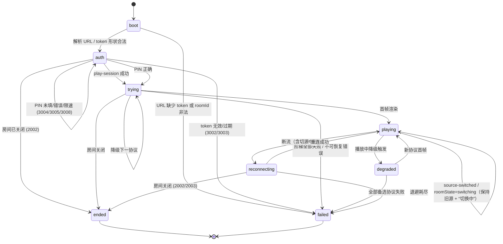
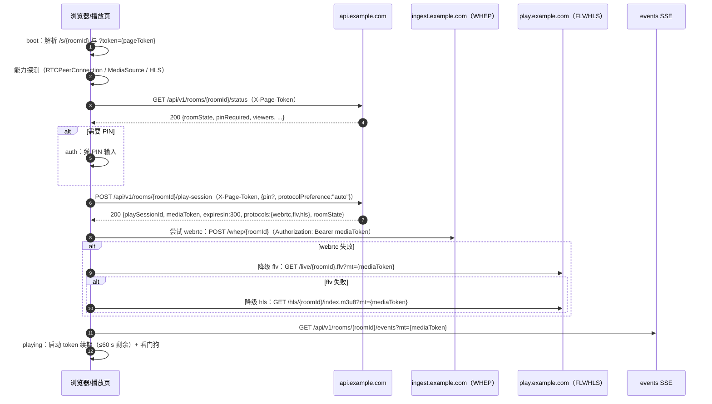
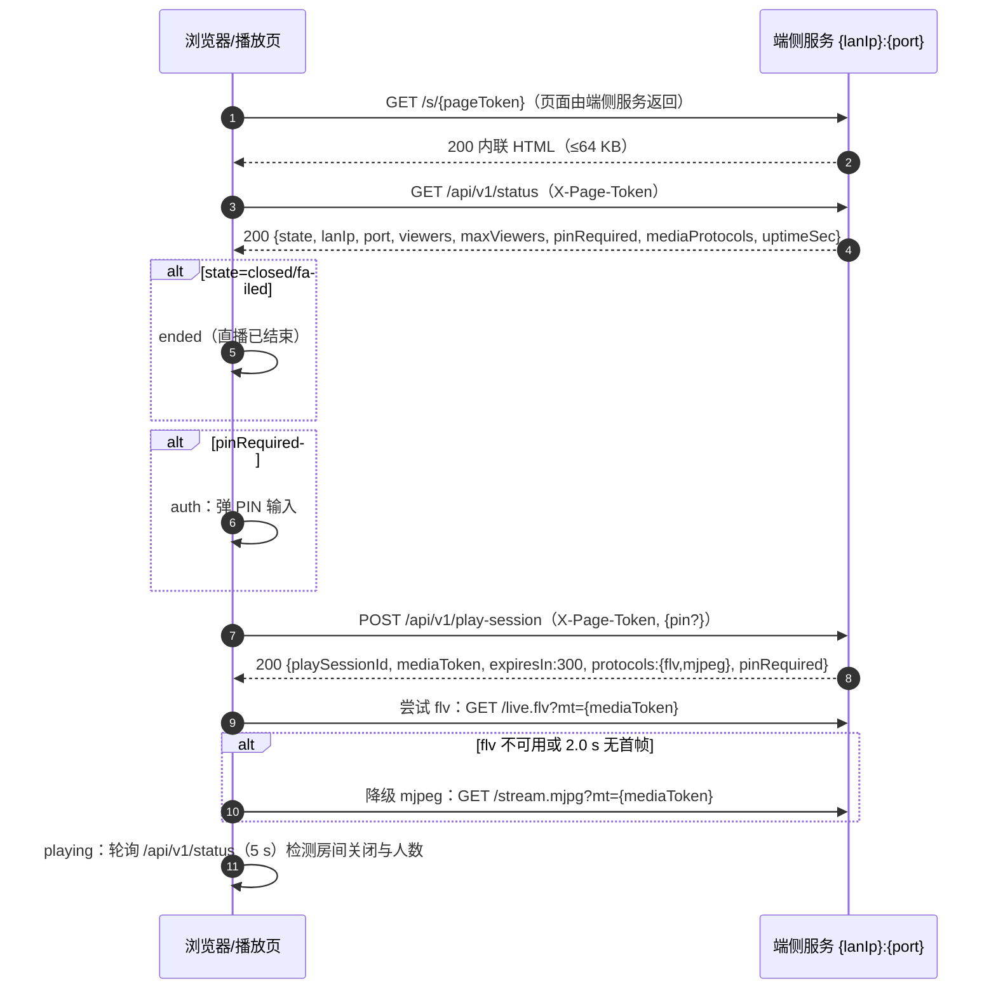
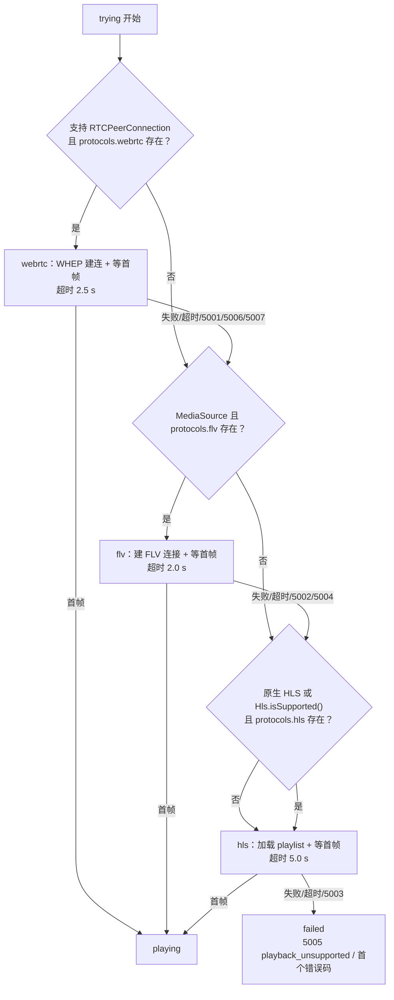
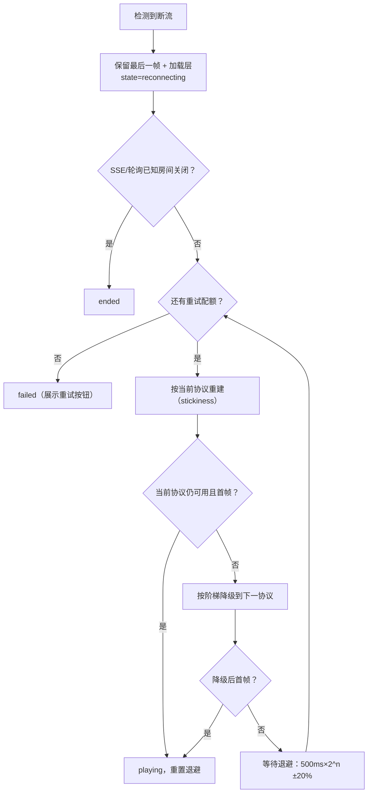
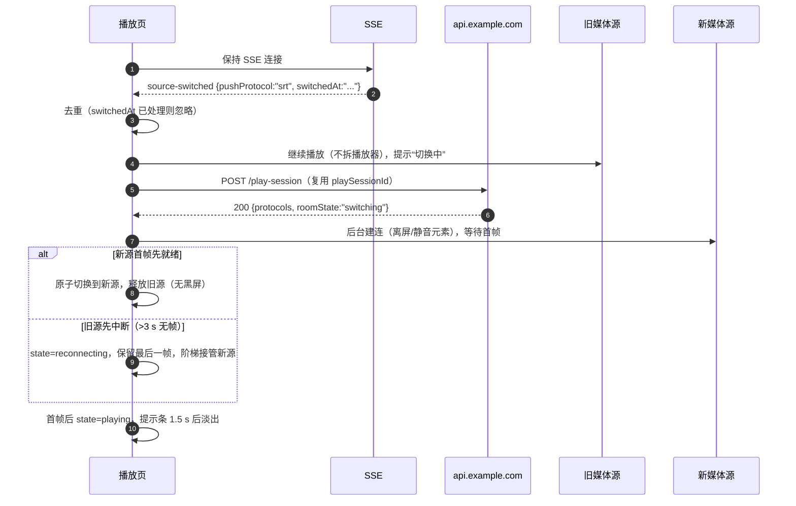

# 06 · H5 播放页（Playback Page）设计

| 项目 | 值 |
|---|---|
| 文档状态 | 草案（提交 Lead 评审后转基线） |
| 文档版本 | v1.1 |
| 文档编号 | 06 |
| 主责 | 端侧服务与播放页作者（media） |
| 依赖文档 | [00-conventions.md](./00-conventions.md)、[PRD-v1.0.md](./PRD-v1.0.md)、[04-interface-contracts.md](./04-interface-contracts.md)、[03-cloud-service.md](./03-cloud-service.md)、[05-lan-service.md](./05-lan-service.md)、[07-security-privacy.md](./07-security-privacy.md)、[10-observability.md](./10-observability.md) |
| 适用 PRD | §4.4、§7.1–7.4、§9.1、§11.4、§14、§15、§16.2 |
| 契约基线 | 00 v1.1 §3.1 播放页状态机、§4.2 地址模板、§4.3 地址不变量、§5.1 token、§5.2 + §17.1 PIN、§6 REST/SSE、§7 媒体面、§9 错误码、§10.1–10.3 预算、§11 埋点、§12 边界、§17 裁定 |
| 最后更新 | 2026-10-20 |

> 本文只细化播放页设计，不改写契约。地址、token、错误码、性能数字、事件名全部复用 00；若发现 00 缺口或冲突，进 §17 开放问题并在回报中标注。示例域名均为占位值（`play.example.com` 等），IP 使用文档网段 `192.0.2.0/24`。

---

## 1. 目的与范围

### 1.1 目的

定义**唯一播放地址**打开后的 H5 播放页：如何从 URL 完成鉴权、如何在 WAN/LAN 两种模式下自动选择播放协议并逐级降级、如何在不改变地址栏的前提下重连与切源、如何向用户解释失败原因，以及兼容性、性能、埋点与安全的实现约束。

播放页是“一个地址”承诺的兑现处（PRD §3.2、00 §4.3）：用户只拿到一个地址，页面内部完成协议选择与降级；地址栏字符串在页面整个生命周期内不得变化。

### 1.2 范围

| 范围内 | 范围外 |
|---|---|
| 页面骨架、状态机、鉴权与 token 续期、降级阶梯、错误映射、重连退避 | 云端 WHEP/FLV/HLS 服务实现（03）、REST/SSE 字段级契约（04） |
| 播放器选型（原生 WebRTC/WHEP、mpegts.js、hls.js、MJPEG） | 推流端编码参数（02、00 §7） |
| UI 文案、错误页、可访问性、兼容矩阵 | 端侧 HTTP 服务与媒体分发实现（05） |
| 页面侧性能预算、CSP、token 存储约束 | 埋点管道与落库（10）；安全威胁建模与合规（07） |
| E2E 验收用例（≥15 条） | 主 App 的复制/二维码/分享交互（02） |

### 1.3 两种模式差异（页面视角）

| 项 | WAN | LAN |
|---|---|---|
| 地址 | `{playHost}/s/{roomId}?token={pageToken}` | `http://{lanIp}:{port}/s/{pageToken}` |
| 页面来源 | CDN 静态资源，版本化 `player-{semver}.js`（00 §12） | 端侧服务内联单文件 `assets/lan/player.html`（≤64 KB，00 §8） |
| 页面 API 域 | `{apiHost}`（可能与页面跨源，需 CORS） | 同源 |
| 状态通道 | SSE `{apiHost}/api/v1/rooms/{roomId}/events?mt=` | 无 SSE，用 `/api/v1/status` 轻量轮询（5 s） |
| 播放协议 | `webrtc(2.5s) → flv(2.0s) → hls(5.0s)` | `flv(2.0s) → mjpeg(2.0s)`；M2 起 `webrtc(2.5s) → flv → mjpeg` |
| 兜底 | HLS | MJPEG（无 HLS 承诺） |
| 外网依赖 | 有（页面、API、媒体） | 无（断外网仍可打开，00 §8） |

---

## 2. 不变量与设计原则

### 2.1 硬不变量

| # | 不变量 | 验证方式 | 依据 |
|---|---|---|---|
| I-1 | 页面生命周期内 `location.href` 不变 | E2E 断言、`history.length` 不变、无 `pushState/replaceState` | 00 §4.3-2 |
| I-2 | 对外只存在一个播放地址 | 页面内不展示/不跳转任何媒体 URL；不发“复制流地址”入口 | PRD §3.2 |
| I-3 | 协议降级/重连/切源均为页面内部行为 | UI 只出现“兼容模式/重连中”，不出现协议名 | PRD §7.2 |
| I-4 | token 不进 referrer、不进 `localStorage`、不进日志 | 检查 `Referrer-Policy`、存储键、console | 00 §5.1、§11 |
| I-5 | 页面不请求任何第三方资源 | Network 面板零第三方域名；CSP `default-src 'none'` | 00 §8（LAN）、07 |
| I-6 | 停止后页面收敛到终态 | `ended`/`failed` 不可回到 `playing`；媒体端点返回 `410`/连接失败 | 00 §4.3-3/4 |
| I-7 | 首帧预算与阶梯超时只用 00 §10.2 的数字 | 代码常量与文档一致 | 00 §10.2 |

### 2.2 设计原则

1. **快速失败、快速降级**：每个协议有明确超时；浏览器不支持时立即跳过（不消耗超时预算）。
2. **不黑屏**：切换/重连期间保留最后一帧作为背景 + 加载层，用户感知是“缓冲”而不是“坏了”。
3. **可解释**：任何终点状态都给出用户能行动的原因（重试、换浏览器、检查 AP 隔离、找分享者要新地址）。
4. **只消费契约**：页面不猜测字段；缺失字段按“不可用”处理并上报 `play_failed`。
5. **失败也可观测**：降级、重连、失败均产生埋点，但绝不带 token/地址/IP。

---

## 3. 信息架构与页面骨架

### 3.1 布局层级

```text
<body>
  <main id="stage" aria-live="polite">
    ① 媒体层     <video>（WebRTC/FLV/HLS）或 （MJPEG）
    ② 最后一帧层  失败/切换时显示的静态帧（canvas 快照，避免黑屏）
    ③ 加载层      骨架屏 + 状态文案 + 进度指示（不遮挡错误按钮）
    ④ 错误层      错误码、userHint、重试按钮、排查入口
    ⑤ 控制层      播放/暂停（直播仅静音/全屏）、音量、重试
    ⑥ 提示条      降级/弱网/温度/切源/观看人数
    ⑦ PIN 弹层    4–6 位数字输入（模态、可键盘、可读屏）
    ⑧ 页脚        极简说明：“请勿分享给不可信的人” + 模式标签（局域网/公网）
  </main>
</body>
```

DOM 规模目标：≤120 个节点；无框架运行时（LAN 版本零依赖；WAN 版本仅按需加载播放器库）。

### 3.2 页面信息架构

| 区域 | WAN | LAN |
|---|---|---|
| 标题 | “CamPush 实时画面” | 同 |
| 模式标签 | “公网可访问” | “局域网（仅同网可看）” |
| 主操作 | 重试 / 取消静音 / 全屏 | 同 |
| 次信息 | 观看人数（SSE `viewer-count`）、延迟提示 | 观看人数（status 轮询 `viewers/maxViewers`） |
| 安全提示 | “任何拿到链接的人可观看” | “明文 HTTP，仅限可信局域网；任何拿到链接的人可观看” |
| 错误辅助 | 重试、刷新获取新地址 | 重试、AP 隔离排查清单、让分享者检查服务状态 |

### 3.3 关键 DOM 与属性（可访问性基线）

| 元素 | 属性要求 |
|---|---|
| `<video>` | `playsinline`、`muted`（初始）、`autoplay`、`controls`（或自绘控制条）、`aria-label="直播画面"` |
| ``（MJPEG） | `alt="直播画面（兼容模式）"`、`decoding="async"` |
| 错误层 | `role="alert"`、`aria-live="assertive"`、焦点自动落“重试” |
| 加载层 | `role="status"`、`aria-live="polite"`、`aria-busy="true"` |
| PIN 弹层 | `role="dialog"`、`aria-modal="true"`、`aria-labelledby`、初始焦点输入框、`Esc` 关闭、焦点圈闭 |
| 提示条 | `role="status"`、`aria-live="polite"`，不抢焦点 |
| 按钮 | 可聚焦、有可见 focus ring、触控目标 ≥44×44 px、图标按钮有 `aria-label` |

---

## 4. 播放页状态机

### 4.1 状态定义（与 00 §3 完全一致）

| 状态 | 含义 | 页面表现 | 终态 |
|---|---|---|---|
| `boot` | 解析 URL、初始化能力检测 | 全屏骨架 + “正在加载…” | 否 |
| `auth` | 校验 token / PIN / 创建播放会话 | 骨架 + （需要时）PIN 弹层 | 否 |
| `trying` | 按阶梯尝试播放协议 | 骨架 + “正在连接…” + 最后一次尝试提示 | 否 |
| `playing` | 首帧已渲染且持续出帧 | 视频 + 控制层 | 否 |
| `degraded` | 播放中发生协议降级，正在尝试新协议 | 最后一帧 + “正在切换兼容模式…” | 否 |
| `reconnecting` | 断流（含切源导致旧源中断）后重建 | 最后一帧 + “正在重连（第 n 次）…” | 否 |
| `ended` | 房间已关闭/直播结束 | “直播已结束” + 说明 | 是 |
| `failed` | 不可恢复失败 | 错误码 + userHint + 重试 | 是 |

### 4.2 状态迁移图（00 §3.1 的细化）



契约对齐说明：

- 与 00 §3.1 相比新增两条边：`auth --> auth`（PIN 等待，未新增状态）与 `degraded --> failed`（全部备选失败）。前者是标注性细化，后者是 00 未显式画出的失败收敛路径，已列入 §17 开放问题建议补边。
- **v1.1 效力**：00 §17.4 裁定“切换中 `switching` 返回 `200` + `roomState=switching`，播放页展示‘切换中’，保持旧源继续播”。因此本文把 00 §3.1 的 `playing → reconnecting: 源切换` 细化为：**只在旧源真实中断时才进入 `reconnecting`**；正常切源期间停留在 `playing`，叠加“切换中”提示并在后台预取新源（§9.2）。这是对 §3.1 的细化而非改写，§17 优先级更高。
- 不新增任何状态；`trying` 内部可以多次换协议，这对应 00 的 `trying --> trying: 降级下一协议`。
- 终态 `ended`/`failed` 只能通过用户刷新页面（重新鉴权）离开，页面内不提供“返回播放”。

### 4.3 迁移触发表

| 当前态 | 事件 | 条件 | 下一态 | 副作用 |
|---|---|---|---|---|
| `boot` | URL 解析完成 | `roomId` 合法（WAN）或路径 token 存在（LAN） | `auth` | 发起 status |
| `boot` | URL 解析失败 | 缺参/形状非法 | `failed` | `3002`，不发请求 |
| `auth` | `status`/`play-session` 200 | 房间 `live`、会话创建成功 | `trying` | 写内存 token；启动首协议 |
| `auth` | `3004` | `pinRequired=true` | `auth` | 弹 PIN |
| `auth` | `3005` | PIN 错误 | `auth` | 原地提示 |
| `auth` | `3006`/`3008` | 锁定/限速 | `auth`→`failed`（锁定）/`auth`（限速） | 展示 `Retry-After` |
| `auth` | `3001/3002/3003` | token 问题 | `failed` | 终止所有请求 |
| `auth` | `2002/2003` | 房间关闭/过期 | `ended` | 停止重试 |
| `auth` | 200 且 `roomState=switching` | 首次进入时源正在切换 | `trying` | 不视为错误；按新源阶梯启动，提示“切换中” |
| `auth` | 410（路由已结束态） | 房间 `closed`/`expired` | `ended` | 不再发任何请求 |
| `trying` | 首帧 | 任一协议首帧 | `playing` | 开始续期/SSE/看门狗 |
| `trying` | 协议失败且还有下一级 | 阶梯未耗尽 | `trying` | `play_fallback` |
| `trying` | 阶梯耗尽 | 全部失败 | `failed` | `play_failed` |
| `playing` | 当前协议异常且可降级 | 还有下一级 | `degraded` | 留存最后一帧 |
| `degraded` | 新协议首帧 | — | `playing` | 更新当前协议 |
| `degraded` | 新协议也失败 | 阶梯耗尽 | `failed` | `play_failed` |
| `playing` | `source-switched` 事件或 `roomState=switching` | 旧源仍在出帧 | `playing` | 顶部“切换中”提示；后台预取新源，不拆当前播放器 |
| `playing` | 断流（旧源中断） | 帧/字节停滞超阈值 | `reconnecting` | 保留最后一帧，清空播放器 |
| `reconnecting` | 重连成功 | 首帧 | `playing` | 重置退避计数 |
| `reconnecting` | `ended` 事件/`2002` | 房间关闭 | `ended` | 停止一切定时器 |
| `reconnecting` | 退避耗尽 | ≥5 次或 >30 s | `failed` | 展示重试 |

---

## 5. 加载与鉴权流程

### 5.1 WAN 启动时序



说明：

- `status` 与 `play-session` 都使用 `X-Page-Token`（与 00 §6.2 的 `play-session` 一致）；`status` 的 header 名 00 未显式冻结，已列入 §17 开放问题。
- `play-session` 请求体字段来自 00 §6.2：`{"pin":"1234","protocolPreference":"auto"}`；`protocolPreference` 固定 `"auto"`——页面不让用户选协议（PRD §7.2）。
- 协议 URL 来自 `protocols.{webrtc,flv,hls}.url`；FLV/HLS 需追加 `?mt={mediaToken}`（00 §4.2 模板），WHEP 用 `Authorization: Bearer`（00 §7）。

### 5.2 LAN 启动时序



说明：

- LAN 地址路径段只有 `pageToken`，没有 `roomId`；页面不需要知道 `roomId`。
- `protocols` 仅用于“可用性判定”；媒体 URL 由页面按 00 §4.2 模板以同源相对路径拼装（`/live.flv?mt=`、`/stream.mjpg?mt=`），不依赖响应内 URL 字段形状（结构未冻结，见 §17）。
- 无 SSE：用 `/api/v1/status` 每 5 s 轮询，检测 `state` 与 `viewers`；这是复用既有端点，不新增路由。

### 5.3 token 应用矩阵

| 请求 | token | 传递方式 | 说明 |
|---|---|---|---|
| `GET status`（WAN/LAN） | `pageToken` | `X-Page-Token` 请求头 | 页面不把 token 拼进 API URL |
| `POST play-session` | `pageToken` | `X-Page-Token` 请求头 + `${pin}` 在 body | PIN 不进 URL |
| `POST play-session`（续期） | `pageToken` | 同上 + 复用 `playSessionId` | 续期请求如何携带 `playSessionId` 00 未定义，见 §17 |
| WHEP `POST/PATCH/DELETE` | `mediaToken` | `Authorization: Bearer`（00 §7） | 跨源需服务端 CORS（§17） |
| FLV / HLS playlist | `mediaToken` | `?mt=` | HLS 分片使用会话 Cookie `cmp_ps`（00 §6.1） |
| SSE | `mediaToken` | `?mt=` | `EventSource` 不支持自定义头 |
| LAN FLV / MJPEG | `mediaToken` | `?mt=` | 同源 |

### 5.4 token 续期

- **mediaToken**：TTL 300 s（00 §5.1）；页面每 15 s 检查一次，当 `remaining ≤ 60 s` 时触发续期。
  - 续期 = `POST play-session`（同 `pageToken`、同 `playSessionId`），返回新 `mediaToken` 与新的 `expiresIn`。
  - 新 token 只写内存；旧 token 立即丢弃。
  - 连接中协议的行为：WHEP 会话不需要换 token（已在会话内）；FLV 长连接在建立时校验，无需中途换；HLS playlist 每次刷新都带 `?mt=`，下一次刷新自动使用新 token；SSE 需要以新 `mt` 重建连接（`EventSource` 无法改 query，实现为 close + new）。
- **pageToken**：TTL 60 min（00 §5.1）；WAN 可调 `POST /api/v1/rooms/{roomId}/page-token:refresh` 换新，**仅存内存/sessionStorage，不改地址栏**（00 §5.1）。
  - 刷新失败（网络/房间关闭）不立刻中断播放，仅记录；等下一次需要 API 时再处理。
  - LAN 无 page-token 刷新端点（00 §8 未定义）→ 60 min 后页面无法自愈，进 §17 开放问题（与 05 O-05-1 同一问题）。
- **续期失败**：连续 3 次失败 → 保持当前播放（若连接仍有效）+ 提示条“网络不稳定”；当 HLS/重连等需要新 token 而续期仍失败时 → `3003` → `failed`。

### 5.5 “地址栏不变”的实现约束

| 约束 | 做法 |
|---|---|
| 不写 history | 禁止 `pushState`/`replaceState`；所有 UI 状态用 DOM 切换 |
| 不导航 | 错误页/重试/PIN 均为同页覆盖层，不用 `location.href` 跳转 |
| 媒体 URL 不导航 | 媒体只经 `fetch`/`XHR`/`<video src>`/`` 使用，绝不作为页面 URL |
| token 刷新不写回 URL | 新 `pageToken` 只存内存/sessionStorage，旧地址栏字符串保留（00 §5.1） |
| 地址失效的呈现 | 不用重定向到错误页；在 `/s/{token}` 上渲染 `ended`/`failed` 态 |

### 5.6 房间结束/切换中的响应语义（00 v1.1 §17.4）

| 场景 | HTTP/响应 | 页面行为 |
|---|---|---|
| 房间已关闭/已过期（`2002`/`2003`） | `410`；`playUrl` 路由本身返回 `410` + 已结束态 HTML | `ended`；不自动重试，文案“直播已结束” |
| 房间不存在（`2001`） | `404` | `ended`；文案“地址无效（直播不存在或已结束）” |
| 切换中（`switching`） | `200` + `roomState=switching`（`status`/`play-session` 均为正常响应） | **不视为错误**：已播放时保持旧源继续播并展示“切换中”；未起播时按新源阶梯正常启动 |
| 请求限流（`3008`） | `429` + `Retry-After` | 展示“请求过于频繁，请稍后重试”；PIN 场景见 §6.4 |
| 媒体端点已结束 | `410`/`404` | 立即停止拉流并收敛 `ended`，不重试 |

> 该表是 v1.1 新增裁定的落地口径，替换早期“切源即进入 `reconnecting`”的实现假设；只在旧源真实中断时才重建（§9.2）。

---

## 6. 失败、降级与错误映射

### 6.1 WAN 降级阶梯



| 级别 | 协议 | 启用条件 | 超时 | 失败判定 | 失败后 |
|---|---|---|---|---|---|
| 1 | `webrtc` | `RTCPeerConnection` 存在，`protocols.webrtc.url` 存在，`roomState=live` | 2.5 s | WHEP 非 2xx（`5007`）、ICE `failed`（`5006`）、2.5 s 内无首帧 | 降级 `flv`；若浏览器不支持则直接跳过 |
| 2 | `flv` | `MediaSource` 可用，`protocols.flv.url` 存在 | 2.0 s | mpegts.js 错误（`5002`）、连接 4xx/5xx、2.0 s 内无首帧（`5004`） | 降级 `hls` |
| 3 | `hls` | 原生 HLS（Safari）或 `Hls.isSupported()`，`protocols.hls.url` 存在 | 5.0 s | playlist/分片加载失败（`5003`）、5.0 s 内无首帧 | `failed` |

规则：

- `unsupported` 级**立即跳过**，不消耗超时预算（00 §10.2）。
- 阶梯总耗时上限 10 s（00 §10.2）；所有级都失败 → `failed`，错误码优先用“最接近成功”的那一级：`webrtc` 失败且后续不支持 → `5001`；`flv` 失败 → `5002`；`hls` 失败 → `5003`；全部“协议不可用” → `5005`。
- 每次降级上报 `play_fallback{from,to,reason,elapsedMs}`（事件名 00 §11）。
- 不在 2.5 s 内反复试探同一协议：每次会话每级最多尝试 1 次，重连阶段重新计。

### 6.2 LAN 降级阶梯

| 级别 | 协议 | 启用条件 | 超时 | 失败判定 | 失败后 |
|---|---|---|---|---|---|
| 1（M2 起） | `webrtc` | 端侧 `mediaProtocols` 含 `webrtc` 且浏览器支持 | 2.5 s | 同 WAN | 降级 `flv` |
| 2 | `flv` | `MediaSource` 可用且 `protocols.flv` 存在 | 2.0 s | 连接失败、2.0 s 无首帧（`5002`/`5004`） | 降级 `mjpeg` |
| 3 | `mjpeg` | 恒可用（`` 原生） | 2.0 s | `img.onerror`、2.0 s 未出图（`5004`/`6006`） | `failed` |

M1（无 WebRTC）实际为 `flv(2.0 s) → mjpeg(2.0 s)`，与 00 §10.2 一致。

### 6.3 首帧判定（可测量）

| 协议 | 判定 | 计时起点 | 计时终点 |
|---|---|---|---|
| `webrtc` | `video` 元素 `requestVideoFrameCallback` 首次回调（无 rVFC 时 `loadeddata` + `videoWidth>0`） | WHEP `POST` 发起 | 首次回调/loadeddata |
| `flv` | MSE 首帧可解码（rVFC 首次回调，或 `loadeddata` + `buffered.length>0`） | FLV 请求发起 | 首帧渲染 |
| `hls` | `MANIFEST_PARSED` + `LEVEL_LOADED` 后 `loadeddata` + 首帧 | playlist 请求发起 | 首帧渲染 |
| `mjpeg` | `img` 的 `load` 事件首次触发（multipart 首 part 解析） | `img.src` 赋值 | 首次 `load` |

埋点 `play_first_frame{playProtocol, timeToFirstFrameMs}` 用上表口径；`timeToFirstFrameMs` 从 `boot` 开始计时（含鉴权），与页面整体体验对齐。

### 6.4 错误码映射（播放页视角）

| 错误码 | 触发阶段 | 页面状态 | 是否重试 | UI 文案（中文） | 备注 |
|---|---|---|---|---|---|
| `3001 token_missing` | auth | `failed` | 否 | 播放链接不完整，请向分享者重新获取地址 | 本地可先检出 |
| `3002 token_invalid` | auth / 重连 | `failed` | 否 | 播放链接无效，请向分享者重新获取地址 | 篡改/旧地址 |
| `3003 token_expired` | auth / 续期失败 / 重连 | `failed` | 否 | 播放凭证已过期，请向分享者重新获取地址 | 不自动重试纯 token 过期 |
| `3004 pin_required` | auth | `auth` | 是（输入 PIN） | 该画面需要观看口令 | — |
| `3005 pin_invalid` | auth | `auth` | 是 | 口令错误，请重试 | 保留输入 |
| `3006 pin_locked` | auth | `failed` | 否（等锁定结束） | 口令尝试次数过多，请 10 分钟后再试 | `429`（允许 `423`）+ `Retry-After`；IP 与房间同时计数（00 §17.1） |
| `3008 rate_limited` | auth | `auth` | 是（稍后） | 请求过于频繁，请稍后重试 | `429`；触发条件为 IP 5 次/分 **或** 房间 20 次/分（00 §17.1） |
| `2001 room_not_found` | auth | `ended` | 否 | 地址无效（直播不存在或已结束） | `404`（00 §17.4） |
| `2002 room_closed` | auth / SSE / 重连 | `ended` | 否 | 直播已结束 | `410` + 已结束态 HTML；停止一切重试（00 §17.4） |
| `2003 room_expired` | auth / 重连 | `ended` | 否 | 直播已结束 | 同 `2002`（`410`） |
| `2008 max_viewers_reached` | auth（WAN，`play-session` 阶段） | `failed` | 是 | 观看人数已达上限，请稍后再试 | `429`；与 LAN `6005` 同语义不同域（00 §17.2） |
| `5001 webrtc_unavailable` | trying/degraded | 保持 `trying`/`degraded` | 降级 | （不直接展示） | 无 WebRTC 能力 |
| `5002 flv_unavailable` | trying/degraded | 同上 | 降级 | （不直接展示） | — |
| `5003 hls_unavailable` | trying/degraded | 同上 | 降级 | （不直接展示） | — |
| `5004 no_media` | trying/playing | `reconnecting` | 是 | 正在等待画面… | 源还没出帧 |
| `5005 playback_unsupported` | trying 结束 | `failed` | 是 | 当前浏览器无法播放该画面，请使用最新版 Safari / Chrome / Edge | 无任何可用协议 |
| `5006 ice_failed` | trying/degraded | 保持 `trying` | 降级 | （不直接展示） | 可尝试 ICE restart 一次 |
| `5007 whep_rejected` | trying/degraded | 保持 `trying` | 降级 | （不直接展示） | 服务端拒绝 |
| `6003 lan_not_connected` | LAN auth | `failed` | 是 | 局域网未连接，请检查 Wi-Fi/热点 | 端侧服务可能已停 |
| `6004 ap_isolation_suspected` | LAN auth/播放 | `failed` | 是 | 疑似路由器开启了 AP 隔离，请按清单排查 | 展示清单（05 §12.5） |
| `6005 viewer_limit_reached` | LAN auth | `failed` | 是 | 局域网观看人数已达上限（最多 3 人） | 429 |
| `6006 media_pipeline_error` | LAN 播放中 | `failed` | 是 | 分享者的媒体服务异常，请稍后重试 | 端侧管线错误 |
| `6007 lan_https_unavailable` | LAN 显示 | 不改变状态 | — | 当前为明文 HTTP，仅限可信局域网使用 | 说明性错误码 |
| `7001 network_unstable` | playing | `degraded`（提示条） | 保持播放 | 网络不稳定，画质可能下降 | 不切协议 |
| `7003 thermal_throttle` | playing | `degraded`（提示条） | 保持播放 | 分享者设备温度较高，画质已降低 | App 侧降级 |
| `7004 battery_low` | playing | `degraded`（提示条） | 保持播放 | 分享者设备电量较低 | App 侧降级 |
| `7005 turn_unavailable` | trying（webrtc） | 保持 `trying` | 降级 | （不直接展示） | 回落 FLV |
| `1002 mic_permission_denied` | 播放中（分享者侧，非致命） | 不变 | — | 顶部小字“无声音” | 相机承诺优先，静音继续（00 §17.3）；页面不报错、不降级 |
| `1005 encoder_init_failed` | — | `ended`/`failed` | 否 | 分享者设备无法启动编码 | 端侧事件，页面据 `2002`/SSE 收敛 |

规则：`retryable=true` 才展示“重试”按钮（00 §9.1）；`ended` 终态不展示“重试”，只提示“直播已结束”。UI 文案以 `userHint` 为准，页面文案表（§10）做兜底。

---

## 7. 播放器选型

### 7.1 WebRTC（WAN/LAN）

| 候选 | 体积 | 优点 | 缺点 | 结论 |
|---|---|---|---|---|
| 原生 `RTCPeerConnection` + 自研 WHEP 客户端（≈100–150 行） | ≈3–5 KB | 无依赖、WHEP 流程简单（POST offer/answer、PATCH trickle、DELETE）、完全可控 | 需自处理 ICE/SDP 边界与重连 | **采用** |
| mediasoup-client | 百 KB 级 | 封装完善 | 依赖 SFU 语义、体积大、与 WHEP 契约不完全对齐 | 否 |
| Janus JS | 百 KB 级 | 功能全 | 需 Janus 专属信令，服务端非 Janus | 否 |
| SIP.js / JsSIP | 百 KB 级 | 协议栈全 | 过重，WHEP 不需要 | 否 |

WHEP 客户端实现要点：

1. 创建 `RTCPeerConnection`（`iceServers` 来自 `play-session`/房间信息；00 §6.2 的 `turn` 字段）。
2. `addTransceiver("video", {direction:"recvonly"})`、`addTransceiver("audio", {direction:"recvonly"})`（00 §7：浏览器需 `recvonly`）。
3. `createOffer` → `setLocalDescription` → `POST {whepHost}/whep/{roomId}`（`Content-Type: application/sdp`，`Authorization: Bearer <mediaToken>`）→ `201` Answer → `setRemoteDescription`。
4. Trickle ICE：`PATCH /whep/{roomId}`（00 §6.1）。
5. 结束：`DELETE /whep/{roomId}/{playSessionId}`。
6. 失败处理：`iceConnectionState=failed` → 一次 ICE restart（`restartIce`），仍失败 → `5006` 降级；`connectionState=disconnected` 持续 >2 s 计入断流（§8）。
7. Safari：需 `playsinline`、`muted` 自动播放策略；H.264 Baseline/Main 兼容（00 §7）；不使用 DataChannel。

### 7.2 HTTP-FLV

| 候选 | 体积（min，量级） | 维护 | 结论（WAN） | 结论（LAN） |
|---|---|---|---|---|
| `mpegts.js`（flv.js 的活跃分支） | 百 KB 级 | 活跃，支持直播追帧（live latency chasing） | **采用** | 受 64 KB 预算限制，不内联 |
| `flv.js`（原 bilibili 项目） | 百 KB 级 | 长期未更新 | 否 | 否 |
| 自研最小 FLV→MSE 解复用 | 目标 ≤12 KB | 自维护 | 否（WAN 允许用成熟库） | **采用**（满足 ≤64 KB，见 05 §13.1） |

WAN 使用 `mpegts.js` 的约束：

- 仅使用 `enableWorker` 默认值（首帧优先，不额外拉长启动时间）；开启 `liveBufferLatencyChasing` 缓解延迟累积。
- 不自动播放音频：默认 `muted`，用户点击后再 `unmute()`（移动端自动播放策略）。
- 断流检测：`mpegts` 的 `error`/`statistics_info` 结合 §8 的字节停滞判定。

LAN 自研解复用的范围（最小可用）：

| 能力 | 必需 | 说明 |
|---|---|---|
| FLV header/tag 解析 | 是 | 视频 tag + AAC 音频 tag（若端侧带音频） |
| AVCC NAL 拆分 | 是 | MSE `SourceBuffer.appendBuffer` 需 AVCC |
| AVC sequence header → `avcC` | 是 | 构建 `SourceBuffer` 的 codec 串 |
| AAC AudioSpecificConfig → `mp4a.40.2` | 条件 | 无音频时可跳过 |
| 时间戳重基 | 是 | `timestampOffset` 处理 |
| 追帧/清缓冲 | 是 | `buffered` 落后 >2 s 时清理 |
| 不支持的能力 | — | 不做 B 帧重排、不做加密、不做多 track |

### 7.3 HLS（WAN 兜底）

| 候选 | 体积 | 结论 |
|---|---|---|
| 原生 HLS（Safari 内置） | 0 | iOS/iPadOS Safari **优先原生**（MSE 不可用，hls.js 无从发挥；原生更省电） |
| `hls.js`（v1.x） | 百 KB 级 | 其他浏览器（Chromium/Firefox/Edge）**采用**；关闭低延迟模式（服务端 `EXT-X-TARGETDURATION:2`，00 §7），`liveSyncDuration` 按 2 个分片起步 |
| 自研 HLS | 不现实 | 否 |

Safari 限制与对策：

- iPhone Safari 原生 HLS 可播；FLV 因无标准 MSE 基本不可用（iOS 17.1+ 的 ManagedMediaSource 覆盖有限，不作为承诺）→ WAN Safari 实际路径为 `webrtc → hls`，`flv` 级直接 `unsupported` 跳过（不浪费 2.0 s）。
- iOS 自动播放：`<video muted playsinline autoplay>`；用户点“取消静音”后才有声音；若自动播放被拒 → 显示大按钮“点击播放”（§10）。
- Safari 全屏/PiP 行为由系统控制，自定义控制条需保留原生 `controls` 兜底。

### 7.4 MJPEG（LAN 兜底）

| 项 | 结论 |
|---|---|
| 播放方式 | ``，原生解析 `multipart/x-mixed-replace` |
| 兼容性 | 所有目标浏览器均支持；无需 MSE/WebRTC |
| 限制 | 无音频；帧率低（≈5 fps）；不支持全屏画质提升；`img` 无法 seek（直播无需 seek） |
| 失败检测 | `onerror` + 超时 2.0 s 未触发 `load` |
| 停止 | `img.src = ""` / 移除节点即断开连接；页面 `ended` 时立即释放 |

### 7.5 选型结论汇总

| 协议 | 页面实现 | 依赖 | 决策 |
|---|---|---|---|
| `webrtc` | 原生 `RTCPeerConnection` + 自研 WHEP 客户端 | 无 | 采用（WAN M1；LAN M2） |
| `flv`（WAN） | `mpegts.js` | CDN 版本化资源 | 采用 |
| `flv`（LAN） | 自研最小 FLV→MSE 解复用（≤12 KB） | 无 | 采用（受 64 KB 约束） |
| `hls` | Safari 原生；其他 `hls.js` | CDN 版本化资源 | 采用（WAN 兜底） |
| `mjpeg` | `` | 无 | 采用（LAN 兜底） |

---

## 8. 重连、退避与断流判定

### 8.1 断流判定

| 协议 | 判定条件 | 观察窗口 | 动作 |
|---|---|---|---|
| `webrtc` | `connectionState=disconnected` 或 `iceConnectionState=disconnected` 持续 >2 s；或 `getStats` 中 `framesReceived` 60 s 无增长 | 2 s / 60 s | 先 ICE restart（一次）；失败 → `reconnecting` |
| `flv` | 连续 >3 s 无新字节（`statistics_info` 无增长）或 `video.buffered.end` 不前进 >3 s | 3 s | `reconnecting` |
| `hls` | playlist 连续 2 次加载失败，或分片连续 2 个 4xx/5xx | 2 次 | 降级/`reconnecting` |
| `mjpeg` | `img` 的 `load` 事件 >3 s 未触发（multipart part 停滞不可直接观测，以“3 s 无 load”近似） | 3 s | `reconnecting` |

断流不等于失败：先走重连退避；房间已关闭则直接 `ended`。

### 8.2 退避策略

| 参数 | 取值 | 说明 |
|---|---|---|
| 最大重试次数 | 5 次 | 第 5 次失败 → `failed` |
| 退避序列 | 500 ms、1 s、2 s、4 s、8 s | 指数退避，上限 8 s |
| 抖动 | ±20% 随机 | 避免多观看者同步重连打爆端侧服务 |
| 总时长上限 | 30 s | 与 00 §3.1 “接入端异常且重连 30 s 失败 → failed” 节奏一致 |
| 成功即重置 | 首帧后计数归零 | — |
| 房间关闭优先 | 任一渠道得知 `closed` → 立即 `ended` | 不再重试 |
| 特殊规则 | `3003`/`3002` 不重试；`3006` 不自动重试；`5005` 重试按钮可用 | 见 §6.4 |

### 8.3 重连流程



要点：

- **协议粘性**：重连优先用当前协议，避免“从 HLS 回到 WebRTC”造成额外延迟；连续失败再降级。
- **不黑屏**：断流时用 `canvas.drawImage(video)` 抓最后一帧铺在媒体层下方；无快照（首次即失败）时显示品牌骨架。
- **不换地址**：重连只影响媒体连接与 API 调用，不触碰 `location`。
- **重连期间停止续期压力**：续期定时器保留（token 仍需有效），但重试请求复用内存中的新 token。

### 8.4 断网/切网场景

| 场景 | 页面行为 | 用户感知 |
|---|---|---|
| 观看端断网 | 所有请求超时 → `reconnecting`；`online` 事件后立即重试（重置退避） | “网络已断开，正在重连…” |
| Wi-Fi ↔ 蜂窝切换 | 同上；WHEP ICE 可能重建，FLV/HLS 重连 | 2–5 s 恢复 |
| 分享者停止推流 | SSE `ended` / 轮询 `state=closed` → `ended` | “直播已结束” |
| 分享者协议切换（WAN） | SSE `source-switched` → `reconnecting` → 新源首帧 | “正在切换播放源…”（不换地址） |
| 端侧服务停止（LAN） | 请求 `connection refused` → `failed`（`6001`/`6003` 兜底文案） | “分享者已停止局域网服务” |

---

## 9. SSE 与源切换

### 9.1 SSE 事件处理（WAN）

连接：`GET {apiHost}/api/v1/rooms/{roomId}/events?mt={mediaToken}`（00 §4.2），事件类型与载荷按 00 §6.2。

| 事件 | 载荷 | 页面处理 | 状态影响 |
|---|---|---|---|
| `state` | `{roomState, ingestState}` | `closed/failed` → `ended`；`stopping` → 提示“正在结束”；`switching` → 保持旧源 + “切换中”；`live` 且 `ingestState=connecting` → 保持/进入 `reconnecting` | 多数不变；`closed/failed` → `ended` |
| `source-switched` | `{pushProtocol, switchedAt}` | 保持旧源继续播，叠加“切换中”提示并在后台预取新源（§9.2）；按 `switchedAt` 去重 | `playing`（旧源中断时 → `reconnecting`） |
| `viewer-count` | `{viewers}` | 更新提示条“X 人正在观看”（仅展示，不影响播放） | 无 |
| `ended` | `{reason}` | 立即 `ended`，停止重试/续期/看门狗 | → `ended` |
| `heartbeat` | — | 刷新心跳时间戳 | 无 |

SSE 实现约束：

- `EventSource` 无法自定义请求头 → `mt` 只能放 query；token 续期后需 `close()` 并用新 `mt` 新建。
- 心跳 15 s（00 §6.2）；**45 s 无任何事件**判定连接僵死 → 重建 SSE（带最新 `mt`），同时拉一次 `status` 做全量对账（防止漏事件）。
- SSE 断开不影响媒体播放：媒体继续，后台按 1 s→2 s→4 s（上限 8 s）退避重连 SSE；SSE 长期不可用不判 `failed`（媒体仍可播）。
- SSE 与媒体共用 `mediaToken`：续期后两者都要用新值；SSE 重连失败而续期成功时，下次重连自然带新 token。

### 9.2 `source-switched` 处理（切源不换地址，保持旧源继续播）



设计要点（00 v1.1 §17.4 优先）：

- **保持旧源继续播**：切源事件到达后不立即拆播放器，用户看到的是“旧画面 + 切换中提示”，而不是黑屏；页面停留在 `playing`。
- **后台预取**：重新 `POST play-session`（`roomState=switching` 是正常响应，不按错误处理），用离屏/静音 `<video>` 或新 `RTCPeerConnection` 建新源，首帧就绪后原子切换，再释放旧源。
- **旧源中断优先**：旧源停滞 >3 s（§8.1）→ `reconnecting`，直接接管已预取的新源，不重新走完整阶梯。
- **切换失败兜底**：服务端 `switching → failed`（新源 15 s 无首帧，00 §3.1）时，页面收到 `state=failed`/`410` → `failed`/`ended`；页面自身阶梯总耗时仍 ≤10 s（00 §10.2）。
- **不改变地址栏**（I-1）；不出现第二个 URL；不重复上报 `protocol_switch_start/end`（由 App/服务端按 00 §11 上报，页面只用本地 trace 记耗时）。

### 9.3 LAN 无 SSE 的替代

- `/api/v1/status` 每 5 s 轮询：`state` 用于检测结束，`viewers/maxViewers` 用于人数提示，`uptimeSec` 可用于“服务已运行”说明。
- 轮询在 `ended`/`failed` 后停止；页面 `visibilitychange` 隐藏时降频到 15 s，可见时恢复 5 s（省电）。
- 端侧服务已停止时轮询直接失败 → `failed`（`6003` 文案兜底）。

---

## 10. UI 文案、错误页与可访问性

### 10.1 状态文案

| 状态 | 中文主文案 | 英文（i18n 键 `play.state.*`） | 辅助信息 |
|---|---|---|---|
| `boot` | 正在加载… | Loading… | — |
| `auth`（PIN 未填） | 请输入观看口令 | Enter viewing PIN | “口令由分享者提供” |
| `trying` | 正在连接画面… | Connecting… | 第 n 次尝试时显示“正在尝试兼容模式” |
| `playing` | （无文案，仅控制层） | — | 人数/模式标签 |
| `degraded` | 正在切换兼容模式… | Switching to compatibility mode… | “画面可能短暂中断” |
| `reconnecting` | 正在重连（第 {n} 次）… | Reconnecting (attempt {n})… | “请检查网络” |
| `ended` | 直播已结束 | Live stream ended | “分享者可重新开始推流” |
| `failed` | 播放失败 | Playback failed | 错误码 + userHint + 重试 |

### 10.2 错误页结构

```text
[图标]
播放失败
{userHint}
（可选）错误码：5005 · 重试
[重试]  [刷新获取新地址]（仅 token 类错误）
排查：① 同一 Wi-Fi/热点？② 路由器 AP 隔离？③ 浏览器是否最新？④ 分享者是否已停止？
```

规则：

- 错误码小字展示（便于客服排障），不展示内部 `message` 英文原文。
- `retryable=true` 才出现“重试”；token 类错误提供“让分享者重新发送地址”文案，不提供“刷新”按钮（刷新也无效，避免误导）。
- LAN 的 `6004` 直接内嵌 AP 隔离清单（05 §12.5 文本），可展开。
- `failed` 后若用户点“重试”：重新从 `auth` 开始（若 `pageToken` 已过期则直接 `3003`），不保留旧 `mediaToken`。

### 10.3 提示条与降级提示

| 触发 | 文案 | 展示时长 | 可关闭 |
|---|---|---|---|
| 降级（WAN → FLV/HLS；LAN → MJPEG） | 已切换为兼容模式，画面更省流 | 5 s | 是 |
| `7001 network_unstable` | 网络不稳定，画质可能下降 | 常驻直到恢复 | 是 |
| `7003 thermal_throttle` | 分享者设备温度较高，画质已降低 | 常驻 | 是 |
| `7004 battery_low` | 分享者设备电量较低 | 常驻 | 是 |
| source-switched / `roomState=switching` | 正在切换播放源（旧画面继续播放）… | 至新首帧 | 否 |
| 无音频轨（分享者麦克风被拒/静音，`1002` 非致命） | 无声音 | 常驻 | 是 |
| LAN 人数上限相关 | 当前 {viewers}/{maxViewers} 人观看 | 常驻（LAN 小字） | 否 |
| 自动播放被拒 | 点击开始播放 | 至用户点击 | 否 |

### 10.4 可访问性（A11y）

| 项 | 要求 |
|---|---|
| 状态播报 | 状态变化通过 `aria-live="polite"` 区域播报；错误用 `role="alert"` |
| 键盘 | `Tab` 可达所有控件；PIN 弹层焦点圈闭；`Esc` 关闭弹层；`Space`/`Enter` 激活按钮 |
| 焦点管理 | 错误出现时焦点移到“重试”；错误解除后焦点回媒体区域 |
| 对比度 | 文本对比度 ≥4.5:1；错误码小字 ≥3:1（非正文） |
| 动效 | `prefers-reduced-motion` 时禁用骨架动画与淡出，只保留静态文案 |
| 图标 | 所有图标按钮有 `aria-label`；不使用纯图标表达状态 |
| 视频 | `playsinline`、`muted` 初始；提供原生 `controls` 兜底；`aria-label="直播画面"` |
| 屏幕阅读器 | “正在播放”“播放失败：{userHint}”可读；人数变化不打断播报（polite） |
| 触控 | 触控目标 ≥44×44 px；横屏控制条不遮挡画面中心 |
| 国际化 | 文案键化，中文/英文两套；数字与时间格式按 `navigator.language` |

### 10.5 页面生命周期

| 行为 | 处理 |
|---|---|
| 页面隐藏（`visibilitychange`） | 继续播放（直播）；降低轮询/心跳频率；不暂停以避免回来时黑屏 |
| 页面恢复 | 立即校验一次 `status`/SSE；若媒体已断则 `reconnecting` |
| `pagehide`/`beforeunload` | `navigator.sendBeacon` 上报未发送埋点（若端点可用）；主动 `DELETE` WHEP 会话（`fetch keepalive`） |
| 内存告警 | 不监听（浏览器无标准 API）；依赖释放旧播放器实例 |

---

## 11. 兼容矩阵

### 11.1 能力矩阵

| 浏览器/环境 | WebRTC（recvonly） | MSE（FLV） | 原生 HLS | MJPEG `` | 自动播放（muted） | 备注 |
|---|---|---|---|---|---|---|
| iOS Safari 16/17 | 支持 | 不支持（ManagedMediaSource 覆盖有限） | 支持 | 支持（M0 真机复验） | 需 muted/手势 | WAN：webrtc→hls；LAN：mjpeg |
| Android Chrome 120+ | 支持 | 支持 | 支持（仍优先 hls.js 统一） | 支持 | 支持 muted | WAN：webrtc→flv→hls；LAN：flv→mjpeg |
| 微信 Android（X5） | 部分支持（内核差异大） | 支持 | 依赖内核 | 支持 | 受限，需手势 | 优先 flv；失败再接 hls/mjpeg |
| 微信 iOS（WKWebView） | 部分支持（需手势/系统版本） | 不支持 | 支持 | 支持 | 受限 | 优先 hls；LAN：mjpeg |
| 桌面 Chromium（Chrome/Edge） | 支持 | 支持 | 不支持（需 hls.js） | 支持 | 支持 muted | 完整阶梯 |
| 桌面 Firefox | 支持 | 支持（mpegts.js） | 不支持（hls.js） | 支持 | 支持 muted | 完整阶梯 |
| 桌面 Safari 17+ | 支持 | 不支持 | 支持 | 支持 | 需 muted | webrtc→hls |

### 11.2 不支持时的降级策略

| 缺失能力 | 判定 | 降级 |
|---|---|---|
| 无 `RTCPeerConnection` | 特性检测 `'RTCPeerConnection' in window` | 跳过 `webrtc`，直接 `flv` |
| 无 `MediaSource` | `'MediaSource' in window` | 跳过 `flv`，直接 `hls`（WAN）/`mjpeg`（LAN） |
| 无原生 HLS 且无 `Hls.isSupported()` | `video.canPlayType('application/vnd.apple.mpegurl')` + `Hls.isSupported()` | WAN 无兜底 → `failed`（`5005`） |
| 无 MJPEG | 无法特性检测；以 `img.onerror` 判定 | LAN 无兜底 → `failed`（`5005`） |
| 自动播放被拒 | `video.play()` reject | 显示“点击播放”大按钮，点击后重试播放（不重新拉流） |
| 低电量模式/省电模式 | 无标准 API | 保持播放，不主动降级（分享者侧负责降码率） |

### 11.3 明确不支持

| 项 | 说明 |
|---|---|
| IE/旧 Android WebView（<Chrome 80） | 不承诺；显示 `5005` 文案 |
| 无 MSE 且无 HLS 的桌面浏览器 | `5005` |
| 页面内切换播放协议 | 用户不可选（PRD §7.2） |
| HLS 低延迟模式 | 不使用（服务端 `EXT-X-TARGETDURATION:2`，00 §7） |
| 下载/录制 | 不提供 |
| 第三方播放器嵌入 | CSP `frame-ancestors 'none'` |

---

## 12. 性能预算

### 12.1 首帧预算（WAN，引用 00 §10.2）

| 阶段 | 预算 | 失败阈值（进入降级） |
|---|---|---|
| HTML/JS 加载（内联/版本化资源） | 300 ms | 2 s |
| token 校验 + `play-session` | 250 ms | 2 s |
| WHEP 信令 + ICE/DTLS | 600 ms | 2.5 s |
| 等待首个关键帧 | 500 ms | 计入 2.5 s |
| 解码首帧 + 渲染 | 200 ms | — |
| **合计** | **≤1.85 s** | 阶梯兜底总耗时 ≤10 s |

页面自检口径：`play_first_frame.timeToFirstFrameMs` 的 p50 目标 ≤1.85 s、p95 ≤3 s；超过 10 s 必须已有错误页（不允许无限加载）。

### 12.2 LAN 首帧

LAN 无公网加载成本（同源、内联、可 gzip），预算复用 00 §10.2 的前两阶段口径：

| 阶段 | 预算 | 说明 |
|---|---|---|
| HTML 加载（内联 ≤64 KB，gzip） | ≤300 ms | 本机 Wi-Fi 传输，实际通常 <50 ms |
| token 校验 + `play-session` | ≤250 ms | 端侧内存计算 + 本机网络 |
| FLV 首帧 | ≤2.0 s | 含追帧定位 IDR（00 §10.2 阶梯） |
| MJPEG 首帧 | ≤2.0 s | 含首帧 JPEG 编码 |
| 降级额外等待 | ≤1 s | 00 §10.3 “播放页降级切换 ≤1 s 额外等待” |

### 12.3 资源预算（页面侧）

| 项 | 目标 | 口径 | 来源 |
|---|---|---|---|
| LAN 页面体积 | ≤64 KB（未压缩） | 构建产物门禁 | 00 §8 |
| LAN 页面 gzip | ≤20 KB | 构建产物记录 | 本文建议 |
| 页面 JS 堆内存 | ≤15 MB | DevTools Memory 采样 | 本文建议（待 10 号确认） |
| 播放器解码内存 | ≤80 MB（720p） | 浏览器任务管理器 | 本文建议（待 10 号确认） |
| 观看端 CPU | ≤10%（单核归一） | DevTools Performance | 本文建议（待 10 号确认） |
| 外部请求 | 0 个第三方域名 | Network 面板 | 00 §8（LAN）、07 |
| 首帧后卡顿率 | ≤1 次/10 min | 播放器 stall 事件统计 | PRD §16.1 口径由 10 落地 |

> 00 未定义观看端设备预算；上表后三项为本文建议值，已列入 §17 开放问题，由 10 号文档统一口径，不作为验收硬门槛。

### 12.4 性能实现要点

1. **LAN 零依赖**：不引入任何第三方库；DOM/事件/解析全部手写；
2. **WAN 懒加载**：`mpegts.js`/`hls.js` 仅在需要该协议时加载（`<script>` 动态插入），避免拖慢 WebRTC 路径的首帧；
3. **不在主线程做重活**：FLV 解复用放 Worker（mpegts.js 默认支持）；HLS 由 hls.js 内部调度；
4. **避免重复解码**：切协议前销毁旧 `MediaSource`/`RTCPeerConnection`，释放 `URL.revokeObjectURL`；
5. **快照降级**：`canvas` 快照只在断流时抓一次（≤1 帧），不持续绘制；
6. **不要预连接所有源**：只对当前尝试的协议发起请求，避免 3 路并发拉流浪费端侧带宽。

---

## 13. 埋点

### 13.1 事件范围（与 00 §11 完全一致）

页面**负责上报**：

| 事件 | 触发 | 属性（除公共属性外） |
|---|---|---|
| `play_page_open` | `boot` 完成、开始鉴权 | `accessScope`、`playProtocol`（未知时不填） |
| `play_first_frame` | 首帧渲染（§6.3 口径） | `playProtocol`、`timeToFirstFrameMs` |
| `play_fallback` | 每次降级/重连降级 | `from`、`to`、`reason`、`elapsedMs` |
| `play_failed` | 进入 `failed` | `code`、`playProtocol`（最后尝试）、`stage`（auth/trying/playing/reconnecting） |

页面**不重复上报**（由 App/服务端承担）：`protocol_switch_start`/`protocol_switch_end`（App/服务端）、`lan_viewer_join`/`lan_viewer_leave`（端侧服务）、`ap_isolation_detected`（App/端侧服务）、`degrade_triggered`（App）、`push_*`、`address_copied`/`qr_shown`/`share_clicked`。

### 13.2 公共属性映射（00 §11）

| 属性 | WAN 播放页取值 | LAN 播放页取值 |
|---|---|---|
| `sessionId` | 页面会话 ID（`crypto.randomUUID()`，仅内存） | 同 |
| `traceId` | 优先取服务端下发的 trace（未下发则页面生成，前缀 `web-`） | 页面本地生成（00 §11：LAN 本地生成） |
| `accessScope` | `wan` | `lan` |
| `pushProtocol` | 来自 `play-session.source.pushProtocol` | 端侧下发的 `pushProtocol`（LAN 固定本地直出，M1 可为空） |
| `appVersion` | 播放页版本（`player-{semver}`） | `playerVersion` |
| `osVersion` | 由 UA 粗粒度解析（仅大类/主版本） | 同 |
| `deviceModel` | UA 家族（如 `iOS-Safari`），不上报完整 UA | 同 |
| `networkType` | 不采集（浏览器无可靠 API）；留空或按 `navigator.connection.type` 粗粒度 | 同 |
| `roomIdHash` | `SHA-256(roomId)` 前 8 字节 hex（页面计算） | LAN 无 roomId：使用端侧下发的 `roomIdHash`（若未下发则留空） |

> **契约缺口**：00 §11 的公共属性是按 App 会话设计的（`appVersion`/`deviceModel` 指 Android 设备）。播放页是浏览器环境，`sessionId`/`appVersion`/`deviceModel`/`networkType` 的口径需要 10 号文档给出 web 映射；本文按上表“最小可用”映射，不新增属性名，列入 §17。

### 13.3 载荷示例

```json
{
  "event": "play_first_frame",
  "common": {
    "sessionId": "ps_1f0c…",
    "traceId": "tr_8m2x…",
    "accessScope": "wan",
    "pushProtocol": "whip",
    "appVersion": "1.0.0",
    "osVersion": "iOS 17",
    "deviceModel": "iOS-Safari",
    "roomIdHash": "9f3a7c02b1d4e6a8"
  },
  "props": { "playProtocol": "webrtc", "timeToFirstFrameMs": 1740 }
}
```

```json
{
  "event": "play_fallback",
  "common": { "accessScope": "wan", "roomIdHash": "9f3a7c02b1d4e6a8" },
  "props": { "from": "webrtc", "to": "flv", "reason": "5006", "elapsedMs": 2510 }
}
```

禁止项（00 §11）：`pageToken`、`mediaToken`、PIN、完整 `roomId`、完整播放地址、IP、SSID、原始音视频。页面额外自查：

- 不把 `location.href` 作为属性上报（含 `pageToken`）；
- 不上报 `playSessionId`（会话标识，非 00 定义属性）；
- `reason` 使用错误码字符串（`"5006"`）或枚举（`"timeout"`/`"unsupported"`/`"stalled"`），不写自由文本。

### 13.4 上报传输（跨文档依赖）

- 00 只冻结事件名与属性，**未定义上报端点**；端点由 10 号文档决定。
- 页面实现要求：上报失败**绝不阻塞/影响播放**；内存队列上限 50 条，超限丢最旧；页面 `pagehide` 时 `sendBeacon` 尽力发送。
- 若端点在 M1 未就绪：WAN 页面以“无副作用 try/catch + 静默失败”实现；LAN 页面因断外网无法直传，需 10/04 决定“端侧服务代收”或“端侧服务从 HTTP 层推导页面事件”，该缺口列入 §17 与回报。

---

## 14. 安全：CSP 与 token

### 14.1 CSP（LAN，端侧服务下发）

```http
Content-Security-Policy: default-src 'none';
  script-src 'sha256-{构建期内联脚本哈希}';
  style-src 'sha256-{构建期内联样式哈希}';
  img-src 'self' data:;
  media-src blob: 'self';
  connect-src 'self';
  base-uri 'none';
  form-action 'none';
  frame-ancestors 'none'
```

### 14.2 CSP（WAN）

```http
Content-Security-Policy: default-src 'none';
  script-src 'self';
  style-src 'self' 'unsafe-inline';
  img-src 'self' data: blob:;
  media-src blob:;
  connect-src https://api.example.com https://play.example.com https://ingest.example.com;
  base-uri 'none';
  form-action 'none';
  frame-ancestors 'none'
```

说明：WAN 的 `unsafe-inline` 仅用于样式（无内联脚本）；脚本走版本化 CDN 文件。若构建链允许，样式也改为哈希以去掉 `unsafe-inline`。

### 14.3 token 安全规则

| 规则 | 实现 | 目的 |
|---|---|---|
| token 不进 referrer | `Referrer-Policy: no-referrer`（HTTP 头 + `<meta>` 双保险） | 防路径/查询 token 外泄 |
| token 不进 `localStorage` | 新 `pageToken` 只存内存/sessionStorage；`mediaToken` 只存内存 | 00 §5.1 |
| token 不进日志 | 生产环境禁用 `console.log`；构建期移除 debug 分支 | 防泄漏 |
| token 不进错误上报 | 上报前过滤 URL 查询串与路径段 | 07 脱敏规范 |
| 不写 Cookie | 页面不设置任何 Cookie；HLS 会话 Cookie `cmp_ps` 由服务端 `Set-Cookie`（00 §6.1） | 减少持久化面 |
| 不导航到媒体 URL | 媒体只作为资源加载 | 防地址栏出现裸流地址（I-2） |
| 页面不可被嵌套 | `frame-ancestors 'none'` + `X-Frame-Options: DENY`（LAN） | 防套壳/点击劫持 |
| 不加载第三方脚本 | CSP + 构建检查 | 防供应链注入 |
| PIN 不进 URL | PIN 只在 `play-session` body | 00 §5.2 |

### 14.4 风险与边界

| 风险 | 说明 | 处理 |
|---|---|---|
| 地址被转发 | 任何拿到链接的人可观看（00 §5.1 明确） | 文案明示 + PIN + 短 TTL + 停止即失效 |
| 页面刷新后 token 已过期 | 地址栏 token 不变导致刷新失败 | 已知限制；错误页提示“向分享者重新获取地址”（§17） |
| LAN 明文 HTTP | 同网可嗅探 token/画面 | 由 05 §15.2 与 07 的风险接受覆盖；页面明示“仅限可信局域网” |
| 跨源 CORS 配置错误 | WAN 页面无法调用 API/WHEP | 依赖 03/04 的 CORS 配置；E2E 用例覆盖（§17） |
| 浏览器扩展注入 | 第三方扩展可读页面 | 不在范围内；建议用户使用无扩展环境 |

---

## 15. E2E 验收用例

> 每例均要求：记录 `location.href` 全程不变（I-1）、Network 面板无第三方域名（I-5）、状态与文案符合 §10、埋点符合 §13。证据列写出最低要求。

| ID | 场景 | 前置条件 | 步骤 | 预期结果 | 证据 |
|---|---|---|---|---|---|
| E2E-01 | WAN WebRTC 首帧 | 房间 `live`、Chrome、WHIP 推流正常 | 打开唯一播放地址 | `boot→auth→trying→playing`；首帧 ≤2 s；`play_first_frame{playProtocol:"webrtc"}` 上报；地址栏不变 | 录屏 + DevTools Network + 埋点 |
| E2E-02 | WAN WebRTC→FLV 降级 | 阻断 WHEP 端口（或 mock 5007） | 打开地址 | `trying` 内 2.5 s 后降级 FLV 并出首帧；`play_fallback{from:"webrtc",to:"flv"}`；无错误页 | 录屏 + 埋点 + 网络日志 |
| E2E-03 | WAN FLV→HLS 降级 | 阻断 FLV 端点；Chromium（hls.js 可用） | 打开地址 | 2.0 s 后降级 HLS，5 s 内首帧；`play_fallback{to:"hls"}` | 录屏 + 埋点 |
| E2E-04 | WAN 全阶梯失败 | 阻断 webrtc/flv/hls 全部端点 | 打开地址 | ≤10 s 进入 `failed`，展示 `5005`/对应码、userHint、重试按钮；无黑屏（骨架/快照） | 录屏 + 截图 |
| E2E-05 | iOS Safari 直接 HLS | iPhone + Safari 16+ | 打开地址 | 跳过 FLV（`unsupported`），`webrtc→hls` 出首帧；无 2 s 无效等待 | 录屏 + 时间戳 |
| E2E-06 | token 过期 | 使用过期 `pageToken`（测试环境生成） | 打开地址 | `auth` 直接 `failed`，文案“凭证已过期”；不自动重试；不上报地址 | 截图 + 埋点 |
| E2E-07 | PIN 全流程 | `pinRequired=true` | 打开→输错 3 次→输对 | 首次弹 PIN；错误原地提示且地址栏不变；正确后 `trying→playing`；第 10 次失败锁定并显示剩余时间 | 录屏 + 抓包（PIN 不在 URL） |
| E2E-08 | 观看人数上限 | WAN `viewers=max`（或 LAN 第 4 个） | 打开地址 | WAN `2008`/LAN `6005`；展示上限文案与重试；不进入 `playing` | 截图 + 抓包 |
| E2E-09 | LAN FLV 正常 | 同网、Chrome、LAN 推流中 | 打开 `http://{lanIp}:{port}/s/{pageToken}` | ≤2.0 s 首帧；无第三方请求；状态/播放会话均带 `X-Page-Token` | 录屏 + Network |
| E2E-10 | LAN iOS → MJPEG | iPhone Safari + LAN 推流 | 打开地址 | FLV 被跳过；MJPEG ≤2.0 s 出图；提示“兼容模式”；无音频提示 | 录屏 + 埋点 |
| E2E-11 | LAN 停止即失效 | LAN 播放中 | 分享者停止推流；观看页等待 | 页面收敛 `ended`/`failed`（`6001`/`6003`）；刷新页面连接失败；≤1 s 内端口 `connection refused` | 录屏 + `curl`/`nc` 计时 |
| E2E-12 | WAN 源切换不换地址、不黑屏 | 推流中切换协议（WHIP→SRT） | 观看页保持打开 | SSE `source-switched` 后旧画面继续播 + “切换中”；新源首帧就绪后接续；仅在旧源中断时短暂 `reconnecting`；地址栏与 `history.length` 不变；中断 ≤3 s（p95 ≤5 s） | 录屏 + 时间戳 + 埋点 |
| E2E-13 | 断流重连退避 | 观看端断网 10 s 后恢复 | 播放中断网再恢复 | 进入 `reconnecting`，按 500 ms→1 s→2 s 退避；恢复后 `playing`；无刷新、无地址变化 | 录屏 + 网络日志 |
| E2E-14 | SSE 僵死恢复 | 阻断 SSE 45 s | 正常运行 | 45 s 无事件后重建 SSE 并拉 `status` 对账；播放不中断 | 日志 + 抓包 |
| E2E-15 | mediaToken 续期 | 持续播放 ≥6 min | 观察 300 s TTL 边界 | `remaining≤60 s` 时自动续期；HLS playlist 用新 `mt`；SSE 以新 `mt` 重建；无 `3003` | 抓包（多个 `mt`）+ 日志 |
| E2E-16 | 地址栏不变（综合） | 触发降级 + PIN + 重连 | 依次触发 | 全程 `location.href` 恒等；`history.length` 不变；无 `pushState` | 脚本断言 + 录屏 |
| E2E-17 | 自动播放被拒 | Safari/微信限制自动播放 | 打开地址 | 显示“点击播放”；点击后无需重新鉴权即播放 | 录屏 |
| E2E-18 | 微信 X5 Android | 微信内置浏览器 | 打开地址 | 按兼容矩阵选择 flv 或 hls；首帧 ≤10 s；无白屏 | 录屏 + UA 记录 |
| E2E-19 | CSP/无外链 | LAN 与 WAN 各一次 | 打开页面 | Network 无第三方域名；Console 无 CSP 违规；`img-src`/`media-src` 均同源 | 截图 + 控制台 |
| E2E-20 | LAN AP 隔离提示 | 路由器开 AP 隔离 | 打开地址失败后触发诊断 | 展示 `6004` 文案 + 可展开清单；关闭隔离后恢复 | 录屏 + 路由器截图 |
| E2E-21 | 页面刷新（token 已过期） | 页面打开超过 60 min 后刷新 | 刷新页面 | 展示 `3003` 错误页且地址栏不变；提示重新获取地址（已知限制） | 录屏 |
| E2E-22 | 移动网络切换 | WAN 播放中 Wi-Fi→蜂窝 | 切换网络 | `reconnecting` 后在 5 s 内恢复；地址栏不变 | 录屏 |

通过标准：22 条全部通过；E2E-01/09/12/16 为阻断项（任一失败不得发版）；证据归档到测试报告（08/10 的验收材料）。

---

## 16. 验收检查点

- [ ] 页面状态与 00 §3.1 一致（8 个状态、迁移边不越界）。
- [ ] WAN 阶梯 `webrtc(2.5 s)→flv(2.0 s)→hls(5.0 s)`，LAN `flv(2.0 s)→mjpeg(2.0 s)`（M2 加 `webrtc`），与 00 §10.2 数字一致。
- [ ] 每级 `unsupported` 立即跳过，不消耗超时；总阶梯 ≤10 s。
- [ ] 首帧判定按 §6.3 口径；`play_first_frame.timeToFirstFrameMs` 可测量。
- [ ] 降级/重连/切源全程地址栏不变，无 `pushState/replaceState`。
- [ ] `status → play-session → mediaToken` 流程与 00 §6.1/§8 一致；PIN 只在 body。
- [ ] `mediaToken` 在剩余 ≤60 s 时自动续期；续期失败 3 次有降级提示。
- [ ] SSE 处理 `state/source-switched/viewer-count/ended/heartbeat`；45 s 无事件判定僵死并重建。
- [ ] 错误码映射覆盖 3001–3008、2001/2002/2003/2008、5001–5007、6003–6007、7001/7003/7004/7005，且 `retryable` 与 00 §9 一致。
- [ ] 重连退避 5 次/30 s 上限，成功归零；房间关闭优先 `ended`。
- [ ] 播放器选型落地：原生 WHEP、mpegts.js（WAN FLV）、hls.js/原生 HLS、LAN 自研 FLV 解复用、MJPEG ``。
- [ ] LAN 页面 ≤64 KB、零外链；WAN 资源版本化 `player-{semver}.js`。
- [ ] 首帧 p50 ≤1.85 s、p95 ≤3 s（WAN）；LAN 首帧 ≤2.0 s；阶梯兜底 ≤10 s。
- [ ] CSP 按 §14 落地；`Referrer-Policy: no-referrer`；token 不进 referrer/`localStorage`/日志。
- [ ] 埋点只用 00 §11 事件名；无 token/PIN/IP/完整地址/完整 `roomId`。
- [ ] 兼容矩阵 7 类环境全部实测；不支持环境展示 `5005` 文案。
- [ ] 可访问性：`aria-live`、焦点管理、键盘可达、44 px 触控、`prefers-reduced-motion`。
- [ ] E2E 22 条全部通过，阻断项无失败。

---

## 17. 开放问题

| # | 问题 | 候选方案 | 推荐 | 决策人 | 期限 |
|---|---|---|---|---|---|
| O-06-1 | 00 §9.1 错误信封示例自相矛盾：示例为 `code:3002` + `error:"token_expired"` + `retryable:true`，但 §9.2 定义 `3002 token_invalid`、`3003 token_expired` | A. 修正示例为 `code:3003`；B. 以 §9.2 表为准，示例视为笔误 | **A**（示例同步修正，避免客户端按 `error` 分支） | Lead | 契约 v1.1 |
| O-06-2 | LAN 无 `page-token:refresh` 端点，60 min 后页面只能失败（与 O-05-1 同源） | A. 00 §8 增补；B. 不续期、过期提示；C. 延长 LAN TTL | **B（M1）**，A 进 M2 | Lead + 07 | M1 前 |
| O-06-3 | `play-session` 续期时如何携带 `playSessionId`（00 §5.1 说“可复用”，但 §6.2 body 无该字段） | A. body 增可选字段 `playSessionId`；B. 请求头 `X-Play-Session-Id`；C. 由 `pageToken`+`sid` 隐式关联 | **A**（body 可选字段，向后兼容，04 冻结） | 04 + Lead | 契约 v1.1 |
| O-06-4 | WAN `GET /rooms/{roomId}/status` 的 pageToken 传递方式未冻结（header 名未写） | A. `X-Page-Token`（与 `play-session` 一致）；B. query `?token=` | **A** | 04 + Lead | 契约 v1.1 |
| O-06-5 | 00 §3.1 状态机缺 `degraded → failed` 边（播放中降级且全部备选失败） | A. 补边 `degraded --> failed`；B. 先回 `reconnecting` 再到 `failed` | **A**（语义更准确） | Lead | 契约 v1.1 |
| O-06-6 | 播放页埋点上报端点与 web 公共属性映射缺失：`sessionId`/`appVersion`/`deviceModel`/`networkType` 无浏览器口径；LAN 页面无外网无法直传 | A. 10 定义端点 + web 映射，LAN 由端侧服务代收；B. 端侧服务从 HTTP 层推导页面事件；C. M1 仅 WAN 上报，LAN 缺失 | **A（M1 先 WAN）+ B（LAN 兜底）**，10/04 落契约 | 10 + 04 + Lead | M1 前 |
| O-06-7 | LAN `play-session.protocols` 结构未冻结（布尔/对象/数组） | A. 复用 WAN `{url}`；B. 布尔可用性；C. 数组 | **A**（同构最好维护，页面可容错） | 04 + Lead | 契约 v1.1 |
| O-06-8 | LAN 64 KB 内联预算与 FLV 库体积冲突 | A. 自研最小解复用（本文）；B. 放宽预算；C. LAN 仅 MJPEG | **A**（M0 验证）；C 兜底 | Lead + Web | M0 结束 |
| O-06-9 | iPhone Safari 对 `multipart/x-mixed-replace` 的 MJPEG 支持需真机确认 | A. M0 真机验证；B. 不支持则 LAN iOS 无兜底 → `5005` | **A**（M0 必测项，08 纳入） | QA + 08 | M0 |
| O-06-10 | WAN 页面与 `{apiHost}`/`{whepHost}` 跨源，CORS 配置未在 03/04 冻结 | A. 03/04 明确允许的 Origin 与头；B. 同域反代 | **A**（`Origin` 白名单 + `X-Page-Token`/`Authorization` 预检） | 03/04 | M1 前 |
| O-06-11 | 观看端资源预算（JS 堆 ≤15 MB、解码 ≤80 MB、CPU ≤10%）无契约来源 | A. 纳入 10 号指标；B. 仅作建议不验收 | **A**（M2 起纳入） | 10 | M2 |
| O-06-12 | 页面刷新时地址栏 token 可能过期（00 要求不改地址栏的必然结果） | A. 错误页引导重新获取；B. 服务端对同 IP 宽限；C. 允许 replaceState 换新 token（违反 I-1） | **A**（保持不变量），B 仅缓解 | Lead | M1 前 |
| O-06-13 | WAN FLV 使用 `mpegts.js` 的版本与体积未锁定 | A. 锁定 semver + SRI；B. 跟随最新 | **A**（可复现构建） | Web + 07 | M1 前 |
| O-06-14 | 自动播放策略在微信内表现差异大 | A. 统一“点击播放”兜底；B. 依赖 muted 自动播放 | **A + B 组合**（先 muted autoplay，失败即按钮） | 06 + QA | M1 前 |

---

## 18. 变更记录

| 版本 | 日期 | 变更人 | 内容 |
|---|---|---|---|
| v1.0 | 2026-10-20 | media | 首版：页面骨架与状态机、WAN/LAN 鉴权与 token 续期流程、WAN/LAN 降级阶梯与 00 §10.2 对齐、错误码映射、播放器选型（原生 WHEP / mpegts.js / hls.js / 自研 LAN FLV / MJPEG）、重连退避、SSE 与 `source-switched`、UI 文案与可访问性、7 类兼容矩阵、性能预算、埋点、CSP 与 token 安全、22 条 E2E 用例与验收检查点 |
| v1.1 | 2026-10-20 | media | 对齐 00 v1.1 §17 裁定：① PIN 双层限速（IP 5 次/分 + 房间 20 次/分 → `3008`）与锁定时 `429/423`；② 房间关闭/过期 `410` + 已结束态 HTML、`2001` → `404`“地址无效”；③ `roomState=switching` 返回 `200` 且**保持旧源继续播**，仅旧源真实中断才进 `reconnecting`（§4、§5.6、§9.2）；④ 麦克风拒绝 `1002` 非致命 → 页面“无声音”提示、不阻断；同步更新 E2E-12 与状态机 |
