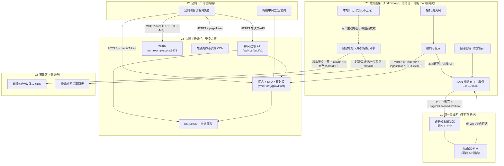
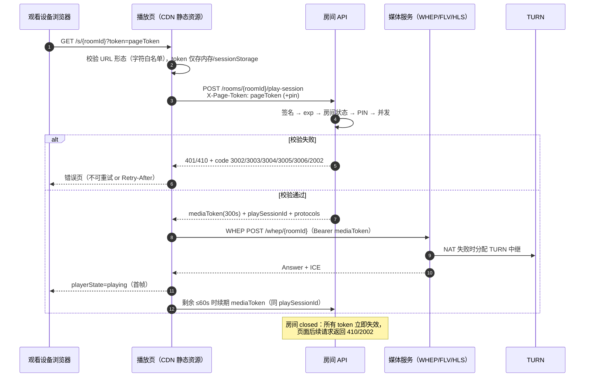
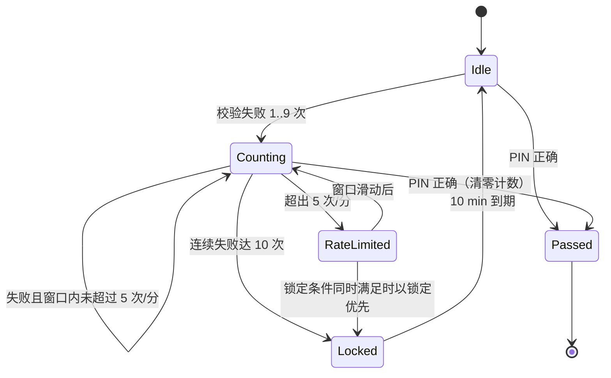
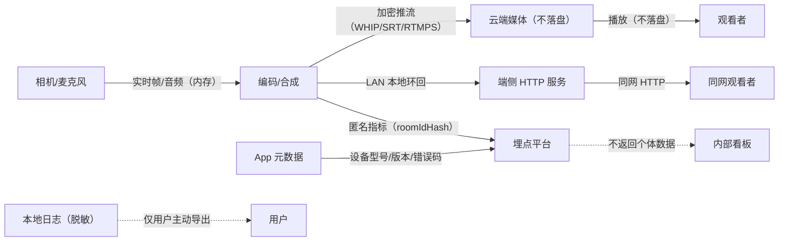
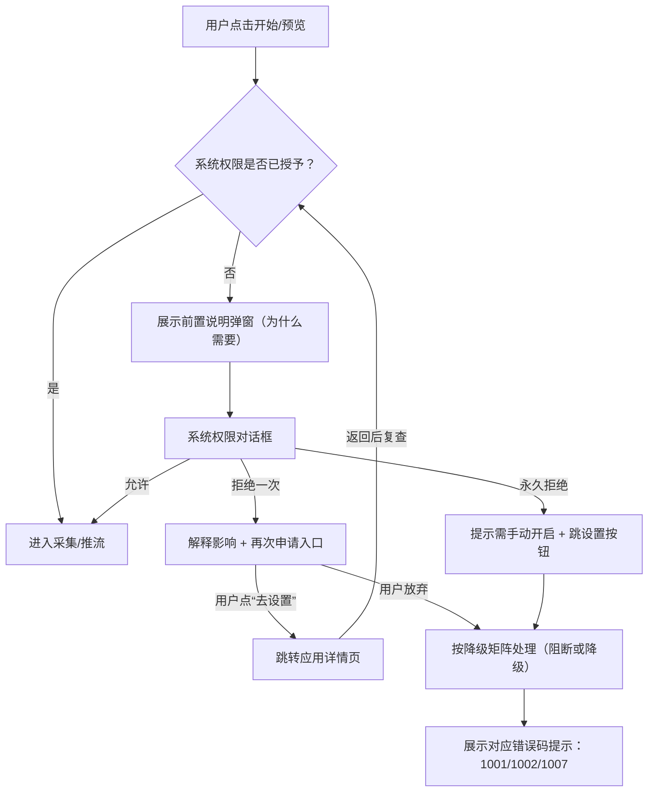
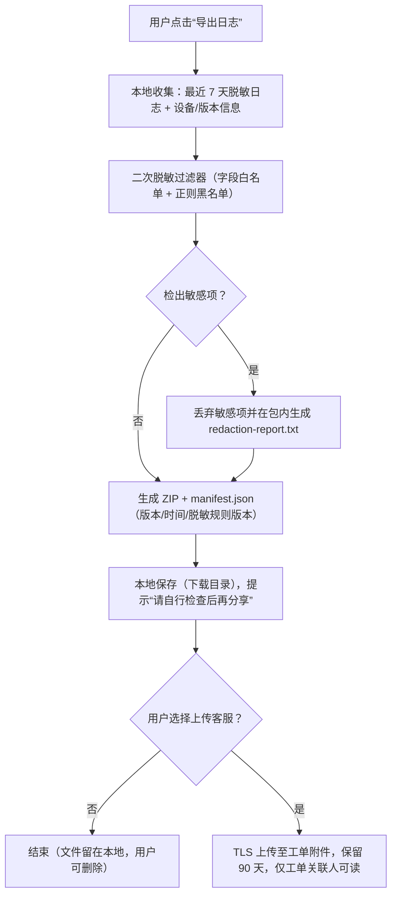

# 07 · 安全、隐私与合规

| 项目 | 值 |
|---|---|
| 文档状态 | 草案（v1.0，随 M0 验证收敛后升基线） |
| 版本 | v1.0 |
| 依赖文档 | [00-conventions.md](./00-conventions.md)、[PRD-v1.0.md](./PRD-v1.0.md)、[01-architecture.md](./01-architecture.md)、[03-cloud-service.md](./03-cloud-service.md)、[04-interface-contracts.md](./04-interface-contracts.md)、[05-lan-service.md](./05-lan-service.md)、[06-playback-page.md](./06-playback-page.md) |
| 适用 PRD | §4、§7.4、§15、§16.2、§18 |
| 主责 | 安全 |
| 评审方 | 架构、服务端、端侧、播放页、法务（外部） |
| 最后更新 | 2026-10-20 |

> 契约声明：本文中所有 token 声明、错误码、URL 模板、埋点禁止项、性能数字均引用 [00-conventions.md](./00-conventions.md)，只做“细化”，不改写。若本文与 00 冲突，以 00 为准；需要变更契约的，提交契约变更请求（00 §15）。

---

## 1. 目的与范围

### 1.1 目的

1. 把 PRD §15 的六条安全承诺，落成可执行、可测试、可审计的工程控制项。
2. 明确“什么资产、在谁的信任边界内、由谁保护、失效时用户看到什么码”。
3. 为 01/03/04/05/06 提供统一的安全约束输入，避免各文档各自发明鉴权与脱敏规则。
4. 给出上线前的安全 Go/No-Go 判定依据，以及可追溯的证据清单。

### 1.2 范围

| 类别 | 范围内 | 范围外 |
|---|---|---|
| 端 | Android 客户端、端侧 HTTP 服务、内置播放页 | 系统相机/系统浏览器自身漏洞 |
| 云 | 房间服务、接入/SFU/转封装、TURN、播放页 CDN 资源、审计日志 | 云厂商 IaaS 层安全（由供应商 SLA 覆盖） |
| 数据 | 音视频流、token、房间元数据、日志、埋点 | 支付与账号体系（M3，另行评审） |
| 合规 | 个人信息保护法、等保 2.0、ICP、内容审核、跨境、未成年人 | 具体资质申办流程（法务/合规主责） |
| 生命周期 | 设计、开发、测试、上线、运营、下线 | 供应链物理安全 |

### 1.3 安全目标（不可被降级突破的不变量）

| 编号 | 不变量 | 可测口径 | 契约来源 |
|---|---|---|---|
| INV-1 | 停止推流即地址失效 | WAN `closed` 后 `playUrl` 返回 `410`；LAN 端口 `connection refused`，端到端 ≤ 1 s（LAN）/ ≤ 2 s（WAN） | [00 §4.3](./00-conventions.md)、[00 §10.3](./00-conventions.md)、PRD §16.2 |
| INV-2 | 推流密钥与 `ingestToken` 永不面向普通用户 | UI/剪贴板/二维码/分享文案/日志/埋点全文搜索为 0 命中 | [00 §5.1](./00-conventions.md)、PRD §7.4 |
| INV-3 | token 与 PIN 不进入日志、埋点、导出包 | 自动化正则扫描 0 命中（见 §9.4） | [00 §11](./00-conventions.md)、PRD §15 |
| INV-4 | 设备侧签名密钥仅存在于内存 | 应用私有目录、备份、崩溃转储中不存在密钥字节；进程结束即丢失 | [00 §5.1](./00-conventions.md) |
| INV-5 | 对外只有一个播放地址，且地址栏不随协议切换变化 | 同一 `roomId` 生命周期内 `playUrl` 字符串恒定；切换/降级/重连不改地址栏 | [00 §4.3](./00-conventions.md)、PRD §7.2 |
| INV-6 | 标准模式不暴露第二个可播放入口 | 点击复制/二维码/分享得到的字符串完全一致 | PRD §3.2、[00 §15](./00-conventions.md) |

**降级底线**：任何网络降级、协议降级、体验降级都不得关闭或绕过 INV-1～INV-6。若必须临时关闭（例如紧急故障止血），只能通过服务端开关关闭“体验降级”，不能关闭“失效语义”；见 §15。

---

## 2. 资产清单与信任边界

### 2.1 资产清单

| ID | 资产 | 形态/位置 | 机密性 | 完整性 | 可用性 | 责任方 |
|---|---|---|---|---|---|---|
| A-01 | 实时音视频流（摄像头+麦克风） | 设备内存 → 云端 SFU（不落盘） | 高（敏感个人信息） | 高 | 高 | 客户端、云端 |
| A-02 | `pageToken` | 播放地址 query / LAN 路径段 / 浏览器内存 | 高 | 高 | 中 | 云端 / 端侧签发 |
| A-03 | `mediaToken` | 媒体面 query、WHEP Bearer、`cmp_ps` Cookie | 高 | 高 | 中 | 云端 / 端侧 |
| A-04 | `ingestToken` | 客户端内存、推流 SDK 配置 | 极高 | 高 | 中 | 云端 |
| A-05 | WAN 签名密钥（HS256） | 云端 KMS，按环境隔离，90 天轮换 | 极高 | 极高 | 高 | 云端 |
| A-06 | LAN 会话签名密钥（256 bit） | 仅 App 进程内存 | 极高 | 极高 | 低（随会话） | 端侧 |
| A-07 | PIN（4–6 位数字） | 房间级配置、服务端校验、LAN 内存计数 | 高 | 中 | 低 | 云端 / 端侧 |
| A-08 | `roomId` / `playUrl` | 云端库、播放页、客户端 UI | 中 | 高 | 高 | 云端 |
| A-09 | 局域网 IP / 端口 / SSID | 设备运行时内存、UI 展示 | 中（可定位） | 中 | 中 | 客户端 |
| A-10 | 设备与运行指标（型号/OS/版本/网络质量） | 埋点、日志 | 低 | 中 | 中 | 客户端 |
| A-11 | 审计日志 | 云端日志库 | 中 | 高（防篡改） | 中 | 云端 |
| A-12 | 崩溃与运行日志 | 设备本地（默认不上传） | 中（可含上下文） | 中 | 低 | 客户端 |
| A-13 | 账号凭证（M3） | 云端 | 极高 | 极高 | 高 | 云端 |
| A-14 | 推送/信令控制通道 | SSE、WebSocket（WHEP 除外） | 中 | 高 | 高 | 云端 |

资产分级口径：**极高**＝泄漏即导致可冒充推流或观看；**高**＝泄漏即导致未授权观看、可关联到个人；**中**＝泄漏造成骚扰或可定位；**低**＝聚合统计价值。

### 2.2 信任边界图



边界说明：Z1 内部即便“端侧服务”也视为**低信任运行环境**（用户可能 root、抓包、改时间）；Z1↔Z2 是本文风险最高的边界（明文 HTTP，见 §6.3）；Z1↔Z4 与 Z3↔Z4 必须加密；Z4 内部服务间走 mTLS 或私网 + 服务身份校验；Z1/Z3→Z5 只允许携带白名单字段。

### 2.3 信任边界表

| ID | 跨边界 | 协议/加密 | 认证方式 | 失败模式与错误码 |
|---|---|---|---|---|
| TB-1 | Z1 → Z4（推流） | WHIP/HTTPS（TLS 1.2+，优先 1.3）、SRT（可选 AES）、RTMP（明文，风险见 §6.2） | `ingestToken`（Bearer / streamid / query） | `3007`、`4001`、`4004` |
| TB-2 | Z3 → Z4（播放页/API） | HTTPS TLS 1.2+，HSTS | `pageToken` → `mediaToken` | `3001/3002/3003/2002` |
| TB-3 | Z3 → Z4（媒体面） | WHEP HTTPS + DTLS-SRTP；FLV/HLS over HTTPS | `mediaToken`、`cmp_ps` Cookie | `5001/5006/5007` |
| TB-4 | Z1 ↔ Z2（LAN 观看） | **HTTP 明文**（明确风险接受） | `pageToken`（路径段）+ 可选 PIN → `mediaToken`（query） | `3001/3004/3005/3006/6005`、`6007` |
| TB-5 | Z1 → Z5（第三方 SDK） | HTTPS | SDK 自带 key（不得含业务 token） | SDK 失败不影响主链路 |
| TB-6 | Z4 内部（API ↔ 媒体 ↔ KMS） | 私网 + mTLS / 服务身份（K8s SPIFFE 或云 IAM） | 服务证书/IAM Role | `500/503`（对外统一 `7001` 或 `503`） |
| TB-7 | Z1 → Z2（热点） | 同上 | 同上 | `6003/6004` |

---

## 3. STRIDE 威胁建模

### 3.1 方法

- 建模粒度：以“信任边界 × 资产”为单元，逐条套 STRIDE；
- 可能性/影响各分 高/中/低三档，组合出风险等级（高×高=严重；其一为高=高；其余中/低）；
- 每条威胁必须有：**缓解措施**（本次实现）、**残留风险**（接受或后续版本处理）、**验证方式**（映射到 §13 用例编号）、**关联错误码**（与 00 §9 一致）；
- 评审节奏：M0 结束时首次评审；M1 RC 前复评；架构或鉴权变更后 5 个工作日内增量评审。责任人：安全（主）、架构（副）。

### 3.2 威胁表（18 条）

| ID | STRIDE | 场景 | 影响 | 缓解 | 残留风险 | 验证方式 | 错误码 |
|---|---|---|---|---|---|---|---|
| T-S1 | Spoofing | 播放链接被转发/截图外泄，非预期者拿到 `pageToken` 打开播放页 | 未授权观看 | token TTL 60 min 且 ≤ 房间寿命；房间 `closed` 立即失效；可选 PIN；分享前提示“任何拿到链接的人可观看” | 转发窗口内有效（设计如此，靠 PIN 与时效收敛） | 越权 SEC-A01/A02 | `3002/3003/2002` |
| T-S2 | Spoofing | 同一 Wi-Fi 内攻击者嗅探 LAN 明文 HTTP，重放 `pageToken`/`mediaToken` | 同网未授权观看、流量分析 | 短 TTL（`mediaToken` 300 s）、停止即销毁密钥、并发上限 3、UI 明示“仅可信局域网” | 同网嗅探无法在应用层根除（无 HTTPS，见 §6.3） | 抓包 SEC-C02 | `6007/3003` |
| T-S3 | Spoofing | 攻击者截获或猜测 `ingestToken` 抢占推流（“顶号”） | 冒充推流者、向观众注入画面 | `ingestToken` 不落 UI/日志/剪贴板；TLS；单 room 仅 1 条 `publishing`，新会话顶旧会话并回 `409`；旧 token 切换后仅 5 s grace | root/调试设备内存读取；服务端日志误采（靠脱敏兜底） | 篡改/重放 SEC-C01 | `3007/4004` |
| T-S4 | Spoofing | 伪造云端 API（DNS 劫持/恶意代理）骗取 `pageToken` | 凭证泄露、中间人观看 | HTTPS + 系统 CA 校验；发布版禁止用户安装的 CA（Android 7+ 默认不信任用户 CA 需显式配置）；可选证书 pinning（M2 评估） | 受控企业网络的合法代理场景 | 中间人 SEC-B03 | `7006` |
| T-T1 | Tampering | 篡改 URL 中 `roomId`/`token` 尝试遍历 | 枚举房间、撞库 | `roomId` 为 9 位 Crockford Base32（组合 ≈ 3.5×10^13）不可顺序推；JWT 签名校验；播放页 `play-session` 按 IP 60 req/min | 分布式低频枚举（成本高于收益） | 枚举 SEC-A04 | `3002/3008/2001` |
| T-T2 | Tampering | 篡改 LAN `play-session` 请求体 PIN 或重放请求 | 绕过口令 | PIN 限速 5 次/分/IP、10 次锁 10 分钟；`mediaToken` 300 s；`playSessionId` 一次性，结束即废 | 局域网客户端可无限换源端口重试（受锁定与房间级兜底抑制） | PIN 爆破 SEC-D01 | `3005/3006` |
| T-T3 | Tampering | 篡改 WHIP SDP/ICE 参数注入畸形媒体或反射流量 | 服务端资源耗尽、畸形流 | 服务端 SDP 白名单校验（仅 H.264 + Opus）、字段长度上限、候选地址格式校验、拒绝 `0.0.0.0`/组播候选 | 复杂 SDP 组合的解析漏洞（依赖库版本） | SDP 注入 SEC-C05 | `4005/4004` |
| T-R1 | Repudiation | 发生“谁分享了什么”纠纷时无审计依据 | 无法举证、合规缺口 | 审计日志记录 `jti`、`roomIdHash`、结果、UA hash、时间；日志只追加、保留 180 天；导出需审批 | 客户端侧分享行为不可证（不采集剪贴板/分享目标，隐私优先） | 审计抽样 SEC-F02 | — |
| T-I1 | Information Disclosure | `pageToken` 经 Referer 泄漏给第三方资源 | token 外泄 | 播放页无外链资源（字体/图标全内联）；`Referrer-Policy: no-referrer`；CSP 限制 connect/img 域；禁止在页面中引入第三方统计脚本 | 浏览器插件/用户主动复制 | URL 泄漏 SEC-B01/B02 | — |
| T-I2 | Information Disclosure | 日志/导出包/崩溃报告包含完整 token 或推流密钥 | 凭证批量泄漏 | 三层脱敏（采集端/落盘前/导出前）；字段白名单；CI 正则扫描；崩溃 SDK 关闭附带 URL | 用户手工截图 | 日志泄漏 SEC-F01 | — |
| T-I3 | Information Disclosure | LAN 媒体端点无 token 直取 | 同网任意人观看 | `/live.flv`、`/stream.mjpg` 强制 `mt`；无效/过期统一 403；`/healthz` 不返回房间信息；同源限制（不设 CORS 头） | 同网可暴力尝试 `mt`（300 s 有效、32 字节随机，不可枚举） | LAN 未授权 SEC-A03 | `3001/3002/3003` |
| T-I4 | Information Disclosure | 推流中进入最近任务/录屏导致画面外泄 | 敏感画面暴露 | 推流中窗口 `FLAG_SECURE`（可配置，默认开启“隐私保护”）；通知栏不展示画面内容；`allowBackup=false` | 用户拍照/外接采集 | 截图 SEC-F03 | — |
| T-I5 | Information Disclosure | 客户端备份/`adb backup` 带走配置与密钥 | 密钥落盘 | 密钥仅内存；`android:allowBackup="false"`；`dataExtractionRules` 排除日志/配置目录；调试版与发布版签名分离 | 已 root 设备的实时内存抓取 | 存储检查 SEC-F04 | — |
| T-D1 | Denial of Service | 对 PIN 进行爆破 | 口令失效 | 同 IP 5 次/分、10 次锁 10 分钟（`3006` + `Retry-After`）；房间级兜底 20 次/分（建议值，见 §5.5）；审计记录 | 多 IP 协同爆破 | PIN 爆破 SEC-D01 | `3006/3008` |
| T-D2 | Denial of Service | 对 LAN 端侧服务发起慢速攻击（slowloris）/连接耗尽 | 手机发热耗电、正常观看被挤掉 | 连接总数上限 8、单 IP 上限 4、请求头 ≤ 8 KB、读超时 10 s、空闲连接 30 s 回收；并发观看 3 上限回 `6005` | 同网攻击者持续重连（可通过停止推流止血） | DoS SEC-D02 | `6005/7001` |
| T-D3 | Denial of Service | 公网刷 `play-session`/播放页，消耗转码与带宽 | 成本激增、正常观众不可用 | 按 IP 60 req/min、账号 30 req/min；边缘 WAF/速率限制；单房间 `maxViewers` 上限；异常流量告警 | 分布式刷量（依赖云 WAF 与账单告警） | DoS SEC-D03 | `3008/429` |
| T-E1 | Elevation of Privilege | LAN 端侧服务被错误暴露到公网（热点共享/路由器端口映射） | 公网未授权观看 | 仅 Wi-Fi/热点启用；启动时校验网络类型；UI 与播放页明示“仅同一局域网”；不监听 IPv6 公网地址；默认端口 8089 非标准端口；停止即关闭 | 用户主动做端口映射且无 PIN | LAN 暴露 SEC-E01 | `6003/6004` |
| T-E2 | Elevation of Privilege | BYO 自定义推流地址被用于 SSRF/内网探测 | 内网资产被探测 | 仅客户端发起推流（云端不拉取用户 URL）；客户端只接受 `rtmp://`/`srt://`/`whip(s)://` scheme；拒绝 loopback/私网/链路本地目标并提示；用户需二次确认 | 用户自有服务端侧的行为（不可控） | SSRF SEC-E02 | `4001/4002` |
| T-E3 | Elevation of Privilege | 播放页被植入恶意脚本（XSS）后窃取 token | 观众凭证失窃 | 播放页无 `innerHTML` 拼接用户输入；`roomId`/`token` 白名单字符校验；CSP `script-src 'self' 'unsafe-inline'`（内联脚本，禁止外部脚本）；HLS 分片走 Cookie 不拼 URL | 内联脚本需谨慎审查（无第三方脚本） | XSS SEC-B04 | — |
| T-E4 | Elevation of Privilege | 第三方 SDK 借宿主权限读取媒体/凭证 | 隐私越界 | SDK 白名单准入（§12）；SDK 运行在独立进程/无相机权限；禁止 SDK 读取剪贴板与 `SharedPreferences` 业务区；发布前 `mobsf`/`jadx` 抽查 | SDK 供应链投毒（依赖版本锁定 + SBOM） | SDK 审查 SEC-G01 | — |

### 3.3 风险热区（Top 5，M1 前必须闭环）

| 排名 | 热区 | 理由 | 闭环动作 | 截止 |
|---|---|---|---|---|
| 1 | TB-4 明文 HTTP | 唯一“设计上不加密”的边界 | 用户提示 + 风险接受记录 + 渗透复测 + M2 评估 TLS/WSS 可行性 | M1 RC |
| 2 | token 泄漏面（Referer/日志/分享） | 泄漏即未授权观看 | §9 脱敏 + §10 文案 + CI 扫描 | M1 RC |
| 3 | PIN 爆破 | 口令是最后的兜底 | §5 限速与锁定 + 审计 + 压测 | M1 RC |
| 4 | 端侧服务暴露 | 手机即服务端，暴露成本低 | 网络类型校验 + 连接上限 + 默认 PIN 建议 | M1 RC |
| 5 | 第三方 SDK | 引入即扩大攻击面 | §12 准入清单 + 许可证审查 | M1 RC |

---

## 4. 鉴权模型与 token 生命周期

### 4.1 token 体系（复核 [00 §5.1](./00-conventions.md)，不改写）

| token | 携带位置 | `aud` | `scope` | TTL | 签发方 | 撤销 |
|---|---|---|---|---|---|---|
| `pageToken` | 播放地址 query `?token=` / LAN 路径段 | `page` | `["play"]` | 60 min 且 ≤ 房间剩余寿命 | WAN 云端 / LAN 端侧 | 房间 `closed` 即失效（不依赖 exp） |
| `mediaToken` | 媒体面 `?mt=`、WHEP `Authorization: Bearer` | `media` | `["play"]` | 300 s，可续期 | 云端 / 端侧 | 房间关闭、exp、并发上限 |
| `ingestToken` | WHIP Bearer、RTMP `?token=`、SRT `streamid` | `ingest` | `["publish"]` | 房间寿命（≤ 12 h） | 云端 | 房间关闭；协议切换后旧 token 5 s grace |

JWT 统一 HS256，claims 必填 `iss=campush`、`sub=roomId`、`aud`、`scope`、`iat`、`exp`、`jti`，可选 `sid`、`pin`、`lan`。安全侧额外要求：

- `jti` 必须由 CSPRNG 生成（不使用时间戳/自增），长度 16 位 Crockford；
- 服务端对 `jti` 建 TTL 索引（保留到 `exp + 5 min`），用于审计与“同 `jti` 重放”检测；
- 客户端不得解析 token 做业务判断，只能透传；
- WAN 与 LAN 使用不同 `kid` 空间（`kid=wan-<env>-<n>` / `kid=lan`），密钥不可互换。

### 4.2 WAN 播放授权时序



### 4.3 撤销矩阵（token × 事件）

| 事件 \ token | `pageToken`（WAN） | `mediaToken`（WAN） | `ingestToken`（WAN） | `pageToken`（LAN） | `mediaToken`（LAN） |
|---|---|---|---|---|---|
| 正常态 | 有效，至 60 min 或房间结束 | 有效 300 s | 有效至房间结束（≤12 h） | 有效至会话结束 | 有效 300 s |
| 到期（exp） | `3003` | `3003`，播放页自动续期一次 | `3007`（推流中断 `4003`） | `3003` | `3003` |
| 房间关闭 `closed` | 立即无效 `2002`/`410` | 立即无效 `2002` | 立即无效 `3007` | 立即无效（服务已关） | 立即无效 |
| 协议热切换 `switching` | **不变**（INV-5） | 不变 | 旧 token 保留 5 s grace，之后 `3007` | 不支持（LAN 锁定协议） | — |
| 密钥轮换（WAN 90 天） | 旧 `kid` 保留 24 h 验签窗口 | 同左 | 同左（长会话需在轮换前重签，服务端提前 24 h 下发新 token） | 不适用 | 不适用 |
| PIN 变更/开启 | 旧 token 若 `pin=false`，下一次 `play-session` 返回 `3004` | 已签发的 `mediaToken` 在 TTL 内仍有效（≤300 s 收敛） | — | 同左 | 同左，≤300 s 收敛 |
| 局域网 IP 变化 | 旧 token 立即失效（端侧生成新密钥+新 token） | 立即失效 | — | 立即失效，UI 提示重新复制 | 立即失效 |
| App 进程被杀/推流停止 | 服务关闭，连接拒绝 | 同左 | 同左 | 同左（`connection refused`，INV-1） | 同左 |
| 并发超限 | 页面可打开，`play-session` 回 `2008`（WAN）/ `6005`（LAN） | 不新增 | — | 同左（LAN 上限 1–3） | 同左 |

### 4.4 校验顺序与失败映射

统一顺序：**签名 → `exp` → `aud`/`scope` → 房间状态 → PIN → 会话/并发**。任何一步失败立即返回，不泄漏后续信息（不区分“房间不存在”与“token 与房间不匹配”的细节给未认证方——统一 `3002`）。

| 失败点 | HTTP | 码 | `retryable` | 播放页/客户端行为 |
|---|---|---|---|---|
| 缺 token | 401 | `3001` | false | 提示“链接不完整，请重新获取” |
| 签名/格式错误 | 401 | `3002` | false | 同上（不提示具体原因） |
| `exp` 过期 | 401 | `3003` | true | 提示“凭证已过期”，LAN 请分享者重新生成；WAN 播放页尝试一次 refresh |
| 房间不存在 | 404 | `2001` | false | 提示“播放地址无效或已失效”（不区分“不存在/无权”） |
| 房间已关闭 | 410 | `2002` | false | 展示“直播已结束” |
| 房间过期 | 410 | `2003` | false | 同上 |
| 需要 PIN | 401 | `3004` | false | 展示 PIN 输入框 |
| PIN 错误 | 401 | `3005` | true（计数） | 提示剩余尝试次数（不显示具体剩余次数亦可，避免辅助爆破；建议仅提示“错误”） |
| PIN 锁定 | 429 | `3006` | true | 展示 `Retry-After` 倒计时 |
| 频率超限 | 429 | `3008` | true | 展示倒计时，禁止循环自动重试 |
| 推流 token 无效 | 401 | `3007` | false | 客户端回主界面并提示重新创建房间 |

### 4.5 密钥管理

| 项 | WAN | LAN |
|---|---|---|
| 生成 | 云端 KMS/HSM 生成或托管，禁止导出明文到应用进程 | 每次推流会话 `SecureRandom` 生成 256 bit |
| 存储 | KMS 加密后落库，密钥材料不出 KMS 边界 | 仅进程内存；不写 `SharedPreferences`/文件/数据库 |
| 轮换 | 90 天；新旧 `kid` 并存 24 h；提前 24 h 通知长会话 | 不轮换（会话级）；停止 1 s 内显式清零并丢弃引用 |
| 销毁 | 轮换后旧密钥 24 h 后删除 | 停止推流、进程结束、切换访问范围时销毁 |
| 隔离 | 按环境（dev/staging/prod）与区域隔离，密钥不共用 | 每会话独立，不复用 |
| 审计 | KMS 调用留痕（谁、何时、哪个 `kid`） | 仅本地事件（不联网） |

### 4.6 重放防护

| 面 | 机制 | 允许的重放窗口 | 说明 |
|---|---|---|---|
| 播放页 `play-session` | `pageToken` + 可选 PIN + 限流 | 无（幂等但受 60 req/min 限制） | 重复请求返回新的 `playSessionId`，旧的仍有效至 TTL |
| 媒体面 | `mediaToken` 短 TTL + `playSessionId` 绑定 | `mediaToken` 生命周期内 | 同一 `mediaToken` 多设备复用不拦截（设计上允许，靠 TTL 收敛） |
| HLS 分片 | `cmp_ps` Cookie（HttpOnly、Secure、SameSite=Lax） | playlist TTL 内 | 分片 URL 不含 token，防 Referer 泄漏 |
| 推流接入 | `ingestToken` + 单 `publishing` 会话 | 协议切换 5 s grace | grace 内旧会话可重连，之后拒绝 |
| WHIP `PATCH`（ICE） | 绑定 `ingestId`，非本会话 `4004` | 会话内 | 防止跨房间注入候选 |

---

## 5. PIN 暴力破解防护

### 5.1 策略（与 [00 §5.2](./00-conventions.md) 一致，只细化）

| 维度 | 规则 | 值 | 说明 |
|---|---|---|---|
| 格式 | 4–6 位纯数字 | `^\d{4,6}$` | 不允许前导空格、全角数字 |
| 生成 | App 生成（默认）或用户自定义 | CSPRNG | 禁止使用 `roomId`/时间后四位等可推导值 |
| 校验点 | WAN `play-session` body `{"pin":"1234"}`；LAN `/api/v1/play-session` | 单点 | 不在 URL query 中校验 |
| 单 IP 速率 | 5 次/分钟（滑动窗口） | 超出回 `3008` + `Retry-After` | 窗口边界以服务端时钟为准 |
| 连续失败锁定 | 10 次连续失败锁 10 分钟 | `3006` + `Retry-After: 600` | 锁定期间即使 PIN 正确也返回 `3006` |
| 成功重置 | 成功后失败计数清零 | — | 但速率窗口仍生效 |
| 计数键 | WAN：`hash(ip + roomId)`；LAN：端侧内存 `hash(ip + roomId)` | 房间级隔离 | 避免一个房间的爆破影响其他房间 |
| 计数存储 | WAN Redis TTL 15 min；LAN 进程内 Map（进程重启清零） | TTL 覆盖锁定 | LAN 重启导致计数清零属可接受残留风险（对应 §3.2 T-D1） |
| 传输 | PIN 仅 HTTPS body（WAN）/HTTP body（LAN，明文风险见 §6.3） | 不进 URL/二维码/日志 | UI 展示时默认明文（推流者需要告知），支持“长按隐藏” |
| 提示 | 只提示“口令错误/请稍后再试” | 不显示剩余次数 | 降低爆破信息增益 |

### 5.2 PIN 防护状态机



### 5.3 审计日志字段（PIN 相关）

| 字段 | 类型/示例 | 必填 | 说明 |
|---|---|---|---|
| `event` | `pin_check` / `pin_locked` / `pin_unlocked` | 是 | 事件类型 |
| `ts` | `2026-10-20T08:03:11Z` | 是 | 服务端 UTC 时间 |
| `roomIdHash` | `9f3a2c7d`（SHA-256 前 8 字节 hex） | 是 | 不记录明文 `roomId` |
| `ipHash` | `5b2e...`（SHA-256(IP+salt) 前 8 字节） | 是 | 不记录明文 IP；salt 按季度轮换 |
| `uaHash` | `e1c4...` | 是 | User-Agent hash，用于识别异常客户端 |
| `attempts` | `7` | 是 | 当前窗口失败次数 |
| `lockedUntil` | `2026-10-20T08:13:11Z` | 条件 | 仅 `pin_locked` 时 |
| `result` | `fail` / `pass` / `lock` / `reject` | 是 | 结果 |
| `requestId` | `req_9f3k2m7q4x8p1t5w` | 是 | 关联请求 |
| `traceId` | `tr_…` | 否 | 关联推流/播放链路 |
| `pinLength` | `4` | 否 | 只记录长度，不记录内容（用于分析用户偏好 4 位比例） |

禁止字段：明文 PIN、完整 IP、明文 `roomId`、设备唯一标识（IMEI/OAID/Android ID）。

### 5.4 与其他防护的组合

- PIN 是**分享凭证失效前的最后一道**，不是替代 token 的主鉴权；两者都必须通过。
- 开启 PIN 时，播放页先展示口令输入，再发起 `play-session`；错误提示不区分“PIN 错误”与“PIN 未开启”（后者直接进入下一步）。
- 推流端 UI 必须在“复制/二维码/分享”旁提示“已开启口令，请通过其他渠道告知观看者”；不能把 PIN 拼进链接。

---

## 6. 传输与存储安全

### 6.1 WAN 传输基线

| 面 | 最低安全要求 | 实现要点 | 失败表现 |
|---|---|---|---|
| 播放页/静态资源 | TLS 1.2+，优先 1.3；HSTS `max-age=31536000; includeSubDomains` | CDN 托管，资源版本化 `player-{semver}.js`；无第三方外链 | 证书错误 → 浏览器拦截，无法降级到 HTTP |
| 房间 API | TLS 1.2+；`Cache-Control: no-store`；`Referrer-Policy: no-referrer` | 错误信封不泄漏内部堆栈 | 握手失败 `7006` |
| WHEP/WHIP 信令 | HTTPS + DTLS-SRTP（媒体） | 仅 H.264 + Opus；ICE 失败回落 TURN（`7005`） | `5006/5001` |
| HTTP-FLV | HTTPS；`?mt=` 短 TTL；`no-store` | 每 5 s 至少 1 个 FLV tag 保活；连接断开由播放页重连 | `5002` |
| HLS | HTTPS；playlist `?mt=`，分片 Cookie `cmp_ps` | Cookie：`HttpOnly; Secure; SameSite=Lax; Max-Age=300` | `5003` |
| TURN | `turns:` 443 优先，`turn:` 3478 兜底；短期凭证（`username` 含过期时间） | 凭证由云端签发（00 §6.2 示例格式），有效期 ≤ 12 h | `7005` |
| 服务间 | 私网 + mTLS 或云 IAM | 服务身份最小权限；媒体面与 API 面网络策略隔离 | 503（对外不暴露细节） |

### 6.2 推流面加密差异与风险接受

| 协议 | 加密 | 风险 | 处置 |
|---|---|---|---|
| WHIP | HTTPS + DTLS-SRTP（强制） | 无 | 基线 |
| SRT | 可选 AES-128/256；建议启用 `passphrase`（云端下发短期口令） | 未启用时明文 UDP，可被嗅探 | M0 验证启用加密的开销（CPU/延迟）；默认启用 |
| RTMP | 默认明文 TCP；RTMPS 可用 | 中间人可窃取 `ingestToken`、可注入流 | 优先 RTMPS；若媒体云仅支持 RTMP，则仅在用户显式选择 RTMP 时使用，并在设置页标注“RTMP 为兼容协议，建议在可信网络使用”；`ingestToken` TTL 已限制为房间寿命 |

> 说明：RTMP 明文属**已识别并接受**的风险，记录于 §3.2 T-S3 与 §6.3 风险接受表；M1 前需与服务端确认 RTMPS 可用性。若不可用，写入开放问题 Q-05。

### 6.3 LAN 明文 HTTP 风险接受（重点）

**事实**：LAN 模式地址为 `http://{lanIp}:{port}/s/{pageToken}`（[00 §4.2](./00-conventions.md)），不提供 HTTPS（`6007 lan_https_unavailable`），因为端侧无法获得受信证书，强制 HTTPS 只会训练用户忽略证书警告，风险更高。

| 风险 | 影响 | 为何接受 | 缓解 | 用户提示 | 复评时点 |
|---|---|---|---|---|---|
| 同网嗅探 `pageToken`/`mediaToken` | 同网者可观看 | 局域网内提供受信证书不可行；自签证书不可信 | 短 TTL、停止即关闭、可选 PIN、播放页提示 | 首次切换 LAN 模式弹窗 + 地址卡片常驻文案 | M2 评估端侧 WebRTC P2P（DTLS-SRTP）替代 |
| 同网中间人篡改播放页 | 注入恶意脚本 | 页面由端侧单文件提供，无外链 | 播放页无外部依赖；CSP；不加载第三方 | 同上 | 同上 |
| AP 隔离/防火墙导致不可达 | 体验失败 | 网络环境问题 | `6004` 提示 + 排查清单 | 见 §10 | M2 网络诊断 |
| 手机热点被他人连接 | 热点的其他设备可访问 | 热点本身是共享网络 | PIN 建议默认开启 | 热点场景强化提示 | M2 |

**UI 强制要求（缺一不可）**：

1. 切换到 LAN 模式时，首次使用弹出一次风险说明，需用户点“我知道了”；
2. 播放地址卡片固定展示一行小字：“仅同一 Wi-Fi/热点可打开；同网设备可能访问，建议开启口令”；
3. 未开启 PIN 且处于热点场景时，地址卡片出现黄色提示“当前为热点网络，建议开启观看口令”；
4. 帮助页提供“局域网安全说明”独立段落，含 AP 隔离排查与“不要将端口映射到公网”的明确警告；
5. 不在 LAN 模式展示任何“安全加密/私有”的暗示性文案（避免虚假安全感）。

### 6.4 客户端存储安全

| 数据 | 存储位置 | 加密 | 生命周期 | 约束 |
|---|---|---|---|---|
| LAN 会话签名密钥 | 进程内存 | 不适用（仅内存） | 会话结束销毁 | 禁止序列化、禁止日志打印、禁止进入崩溃快照 |
| `pageToken` / `mediaToken` | 播放页 `sessionStorage` / JS 内存；App 内存 | 依赖 HTTPS | 页面关闭/TTL | 不写 Cookie（除 `cmp_ps`）、不写 localStorage、不进 URL 历史（WAN 地址栏本就含 pageToken，属产品设计） |
| `ingestToken` | 内存 + 推流 SDK 配置 | 不适用 | 房间结束 | 不写配置、不写日志、不进入分享 |
| PIN | 房间配置（云端）/ 内存（端侧） | WAN 云端加密存储 | 房间结束 | 不进 URL、二维码、日志；UI 支持隐藏 |
| 播放地址历史 | 不持久化 | — | — | 不提供“历史地址”列表（避免僵尸链接） |
| 日志 | 应用私有目录 `files/logs/` | 可选 AES（M2） | 7 天滚动 | 权限 `0600`；默认不自动上传 |
| 录制文件（M2） | 应用私有目录/用户选择目录 | 用户设备加密（系统级） | 用户管理 | 录制默认不含水印外信息；需存储权限 |

系统级加固：

- `android:allowBackup="false"`、`android:fullBackupContent="false"`、`dataExtractionRules` 排除日志与配置；
- 推流中 `FLAG_SECURE`（默认开启，设置页可关，关闭时提示风险）；
- Android 13+ 剪贴板敏感内容标记：复制 `playUrl` 时设置 `ClipDescription.EXTRA_IS_SENSITIVE=true`（避免系统剪贴板浮层显示完整 token）；PIN 不以任何形式写入剪贴板；
- 发布包 `debuggable=false`、移除调试端点（`/healthz` 仅保留极简 `{"ok":true}`）、关闭 `WebView` 调试；
- 不采集 IMEI/MAC/OAID/Android ID 作为设备标识；仅使用 App 生成的随机 `sessionId` 与 `deviceModel` 白名单字段（[00 §11](./00-conventions.md)）。

### 6.5 服务端存储

| 数据 | 存储 | 加密 | 保留期 | 访问控制 |
|---|---|---|---|---|
| 房间元数据（`roomId`、状态、时间、`pinRequired`） | 云数据库 | 云盘加密 + 字段级敏感列 KMS | 关闭后 7 天（用于排障），随后删除 | 服务账号最小权限；人工查询需工单 |
| token `jti` 索引 | Redis | 内存加密（云托管） | `exp + 5 min` | 仅鉴权服务可读 |
| 审计日志 | 日志服务（只追加） | 服务端加密 | 180 天（等保要求 ≥6 个月，从严取 180 天） | 安全/审计角色；导出审批 |
| 媒体流 | **不落盘**（默认） | — | 0 | 转封装与 HLS 分片为内存/临时对象存储，TTL ≤ 12 h，房间结束即删 |
| 崩溃/性能指标 | 观测平台 | 传输 TLS | 90 天 | 看板脱敏，禁止下钻到单用户 |
| 备份 | 云备份 | KMS | 35 天 | 恢复演练每半年一次 |

---

## 7. 隐私数据清单与最小化

### 7.1 个人信息清单

| ID | 数据项 | 类别 | 用途 | 存储位置 | 保留期 | 共享方 | 是否可关 |
|---|---|---|---|---|---|---|---|
| D-01 | 摄像头画面（实时） | 敏感个人信息（生物识别/影像） | 推流、本机预览、可选录制 | 设备内存 → 云端 SFU（不落盘） | 会话期（LAN 停止即销毁；WAN 房间关闭即销毁） | 媒体云（处理者）、观看者（经用户分享） | 是（不推流即不采集） |
| D-02 | 麦克风音频（实时） | 敏感个人信息 | 推流音频 | 同上 | 同上 | 同上 | 是（静音开关/M2 单独授权） |
| D-03 | `roomId` / `playUrl` | 标识符 | 生成播放地址、排障 | 云端数据库、客户端内存 | 关闭后 7 天（云端） | 观看者（分享）、云服务商 | 否（功能必需） |
| D-04 | 播放 token（`page/media/ingest`） | 凭证 | 鉴权 | 内存/短 TTL | ≤ 60 min / 300 s / 12 h | 不共享 | 否（功能必需） |
| D-05 | PIN | 凭证 | 观看口令 | 云端加密/端侧内存 | 房间期 | 不共享（用户自行告知） | 是（关闭口令） |
| D-06 | 局域网 IP、端口、SSID 名称 | 网络标识 | 生成 LAN 地址、网络诊断 | 设备内存、UI | 会话期 | 不共享（LAN 不出网） | 否（功能必需）；SSID 不上报 |
| D-07 | 设备型号、OS 版本、App 版本、ABI | 设备信息 | 兼容性、降级、白名单 | 埋点/日志 | 90 天（聚合） | 统计/崩溃服务（处理者） | 是（关闭“改进计划”后仅保留崩溃最小集） |
| D-08 | 网络类型、码率、帧率、丢包、延迟、温度、电量 | 运行指标 | 质量监控、降级决策 | 埋点/本地日志 | 90 天（聚合） | 统计服务 | 是（关闭“改进计划”） |
| D-09 | 崩溃堆栈与设备状态 | 运行信息 | 稳定性 | 崩溃平台 | 90 天 | 崩溃服务（处理者） | 是（关闭“崩溃上报”） |
| D-10 | 账号标识（M3） | 标识符 | 登录、套餐、额度 | 云端 | 账号存续期 | 支付/账号服务 | 否（账号功能必需） |
| D-11 | 支付记录（M3） | 交易信息 | 计费 | 云端/支付渠道 | 法定年限 | 支付服务 | 否（法定义务） |
| D-12 | 举报与客服工单（M1 内容审核） | 交互信息 | 内容安全处置 | 云端 | 180 天 | 内容审核服务 | 否（法定义务） |

### 7.2 最小化原则（六条硬约束）

1. **不采集**：通讯录、短信、通话记录、精确位置、IMEI/MAC/OAID/Android ID、剪贴板内容、应用列表、相册（除用户主动选择的录制保存路径）。
2. **不落盘**：实时音视频默认不落盘；HLS 分片与转封装临时对象 TTL ≤ 12 h；LAN 模式媒体完全不出设备（同一进程内）。
3. **不上报明文标识**：埋点只允许 `roomIdHash`（SHA-256 前 8 字节 hex），禁止完整 `roomId`、完整 `playUrl`、IP、SSID（[00 §11](./00-conventions.md)）。
4. **不默认开启**：改进计划/崩溃上报为**默认关闭**（或首启时单独勾选，不预勾选）；关闭后主功能不受影响。
5. **不留历史**：客户端不保存播放地址历史、不保存 token、不提供“最近分享”列表。
6. **按需授权**：权限在对应功能首次使用时申请（见 §8），不在冷启动一次性申请全部权限。

### 7.3 数据流（隐私视角）



### 7.4 保留期与删除权

| 数据类型 | 保留期 | 删除触发 | 删除方式 | 备注 |
|---|---|---|---|---|
| 实时媒体 | 0（不落盘） | 停止推流/房间关闭 | 内存释放 + SFU 会话销毁 | HLS 临时分片 ≤ 12 h |
| 房间元数据 | 7 天 | 关闭后 | 定时任务物理删除 | 用于排障与审计抽样 |
| token `jti` 索引 | `exp + 5 min` | 到期 | Redis TTL | — |
| 审计日志 | 180 天 | 到期 | 生命周期策略删除 | 等保 ≥6 个月 |
| 崩溃日志 | 90 天 | 到期 | 平台策略 | 可关 |
| 运行指标 | 90 天 | 到期 | 聚合后删除原始记录 | 可关 |
| 日志导出包 | 90 天 | 到期或用户删除 | 对象存储 TTL | 含脱敏说明 |
| 账号数据（M3） | 账号存续 + 注销后 15 个工作日 | 用户注销 | 删除/匿名化 | 法定留存除外 |
| 支付记录（M3） | 法定年限 | — | — | 不可删 |

用户权利落地：查询（个人信息副本）→ 客服工单 15 个工作日内响应；更正（设备型号等）；删除（注销/清除本地日志）；撤回同意（关闭改进计划、关闭崩溃上报）；解释说明（本文档与隐私政策）。由于主功能依赖实时媒体，**不提供“不采集画面但可推流”的选项**（功能上不成立），需在隐私政策中说明。

### 7.5 第三方共享

| 共享方 | 共享字段 | 目的 | 传输方式 | 是否可关 | 合同要求 |
|---|---|---|---|---|---|
| 媒体云（WAN） | 媒体流、`roomId`、短期凭证 | 推流接入/转发 | TLS / SRTP | 否（WAN 功能必需） | 数据处理协议（DPA）、境内存储、不得二次使用 |
| 崩溃平台 | 崩溃堆栈、设备型号、OS、App 版本 | 稳定性 | HTTPS | 是 | DPA、90 天删除、不接收 token/URL |
| 统计平台 | 匿名事件（`roomIdHash`）、设备信息、网络指标 | 产品改进 | HTTPS | 是 | DPA、禁止画像、禁止跨应用追踪 |
| 微信/系统分享 | 仅分享文本（含 `playUrl`） | 用户主动分享 | 系统 Intent | 是（不点即不共享） | 不由我方控制，需在文案中提示 |
| 内容审核服务（M1） | 抽帧图片（仅公网模式、按合规要求） | 内容安全 | HTTPS 内网 | 否（法定义务） | DPA、境内、留存 ≤ 30 天 |
| 支付渠道（M3） | 订单号、金额 | 支付 | 渠道 SDK | 否 | 渠道合规协议 |

---

## 8. 权限申请与拒绝路径

### 8.1 权限清单

| 权限 | 申请时机 | 用途 | 拒绝后果 | 错误码 |
|---|---|---|---|---|
| `CAMERA` | 首次点击预览/开始推流前 | 采集画面 | 无法推流（阻断） | `1001` |
| `RECORD_AUDIO` | 首次开始推流前（与 CAMERA 同批或紧随） | 采集声音 | 可静音推流（待确认，见 Q-02） | `1002` |
| `POST_NOTIFICATIONS`（Android 13+） | 首次开始推流前 | 前台服务通知、停止入口 | 仍可推流，但通知不可见；前台服务通知可能被系统隐藏 | — |
| `FOREGROUND_SERVICE_CAMERA` / `FOREGROUND_SERVICE_MICROPHONE`（Android 14+） | 开始推流时 | 后台推流保活 | 无法后台推流（可前台推流） | `1007` |
| 忽略电池优化（`REQUEST_IGNORE_BATTERY_OPTIMIZATIONS`） | 首次后台推流时引导 | 降低被杀概率 | 后台可能被系统回收 | `1007`（关联提示） |
| `READ_MEDIA_VIDEO` / 存储（M2 录制） | 用户首次保存录制时 | 保存录制文件 | 无法保存录制，不影响推流 | — |
| 蓝牙/网络状态 | 不申请（网络状态无需权限） | — | — | — |

设计约束：**不得**申请 `READ_PHONE_STATE`、`READ_CONTACTS`、`ACCESS_FINE_LOCATION`、`QUERY_ALL_PACKAGES` 等与功能无关权限；确需新增必须走安全评审并更新本文档。

### 8.2 申请话术（中文，首启/功能触发时）

| 场景 | 话术 | 按钮 |
|---|---|---|
| 摄像头（首次） | “CamPush 需要使用摄像头拍摄实时画面。画面只用于你发起的推流，不会在未经操作的情况下上传。” | 允许 / 暂不 |
| 麦克风（首次） | “CamPush 需要使用麦克风采集声音。你可以随时在设置中静音或关闭声音。” | 允许 / 暂不 |
| 通知（Android 13+） | “开启通知后，你可以在通知栏一键停止推流，避免后台占用摄像头。” | 允许 / 暂不 |
| 前台服务/后台保活 | “为保证切到后台后继续推流，CamPush 需要在前台运行并显示通知。你可以随时停止。” | 去开启 / 暂不 |
| 电池优化（引导页） | “部分手机会在后台清理推流。关闭电池优化可减少中断，不会影响其他应用。” | 去设置 / 暂不 |
| 录制保存（M2） | “保存录制需要访问你选择的文件夹。CamPush 只写入录制文件，不读取其他内容。” | 允许 / 暂不 |

### 8.3 拒绝路径



| 拒绝类型 | 用户可见提示 | 动作 | 错误码 | 是否阻断 |
|---|---|---|---|---|
| 相机拒绝（一次） | “没有摄像头权限无法推流。你可以允许权限，或去系统设置开启。” | 展示“去设置” | `1001` | 是 |
| 相机永久拒绝 | “摄像头权限已被禁用。请到系统设置 > 应用 > CamPush > 权限中开启。” | 跳设置 | `1001` | 是 |
| 麦克风拒绝（一次） | “没有麦克风权限，将以静音方式推流。” | 继续推流（静音） | `1002`（提示级） | 否（待 Q-02 确认） |
| 通知拒绝 | “未开启通知，后台推流时可能看不到停止入口。” | 继续 | — | 否 |
| 前台服务被拒 | “系统不允许后台运行，切到后台可能中断推流。” | 仅允许前台推流 | `1007` | 否（降级） |
| 相机被占用 | “摄像头被其他应用占用，请关闭后重试。” | 重试 | `1003` | 是 |

错误码语义与 00 §9.2 一致，`userHint` 建议值：

- `1001`：“未获得摄像头权限，无法开始推流。请允许权限后重试。”
- `1002`：“未获得麦克风权限，将以静音方式推流。”
- `1007`：“无法在后台保持推流，请保持 App 在前台或开启通知/电池优化白名单。”

---

## 9. 日志与遥测脱敏

### 9.1 原则

1. **白名单采集**：只记录显式列出的字段，未知字段一律丢弃（默认拒绝）。
2. **三层脱敏**：采集端（写入前）→ 落盘前（格式化器）→ 导出/上传前（过滤器）。任一层缺失都不算合规。
3. **不可逆**：脱敏后不可还原；需要关联时用 hash（带 salt，salt 季度轮换）。
4. **可验证**：CI 中对日志样本跑正则黑名单，命中即失败（§9.4）。
5. **本地优先**：详细日志默认仅本地、默认不上传；上传需用户勾选。

### 9.2 字段级 redact 表

| 字段/形态 | 示例原值（占位） | 处理规则 | 脱敏后示例 | 依据 |
|---|---|---|---|---|
| `pageToken` | `eyJhbGciOiJIUzI1NiJ9...` | 全量替换；若需关联保留 `jti` 的 SHA-256 前 8 hex | `<redacted:token>` | 00 §11 |
| `mediaToken` / `mt` | `eyJ...` | 全量替换；query 参数名保留、值替换 | `?mt=<redacted>` | 00 §11 |
| `ingestToken` / `token`（推流） | `eyJ...` | 全量替换，且禁止出现在任何文案 | `<redacted:ingest-token>` | PRD §7.4 |
| `Authorization` 头 | `Bearer eyJ...` | 保留 scheme，值替换 | `Bearer <redacted>` | — |
| `Cookie: cmp_ps` | `cmp_ps=eyJ...` | 值替换 | `cmp_ps=<redacted>` | — |
| `roomId` | `r7k2m9x4qp` | 替换为 `SHA-256` 前 8 字节 hex | `roomIdHash=9f3a2c7d` | 00 §11 |
| 完整 `playUrl` | `https://play.example.com/s/r7k2m9x4qp?token=eyJ...` | 保留 host 占位 + `roomIdHash`，token 替换 | `https://play.example.com/s/<roomIdHash>?token=<redacted>` | 00 §11 |
| LAN 播放地址 | `http://192.0.2.10:8089/s/eyJ...` | IP 保留前 3 段、末段置 0；token 替换 | `http://192.0.2.0:8089/s/<redacted>` | 文档网段 |
| IPv4 | `192.0.2.10` | 保留 `/24` 前缀，主机位归零；RFC1918 内网段同理（文档示例网段 `192.0.2.0/24`） | `192.0.2.0` | — |
| IPv6 | `2001:db8::1` | 保留前 48 位，其余归零 | `2001:db8::` | — |
| PIN | `1234` | 全量替换；仅保留长度（可选） | `<redacted:pin>` | 00 §5.2 |
| Wi-Fi SSID | `Home_5G` | SHA-256 前 4 hex 或直接丢弃（默认丢弃） | `<redacted:ssid>` | — |
| 设备型号 | `Pixel 8` | 白名单保留（非敏感） | `Pixel 8` | — |
| 设备唯一标识 | `imei:86...` | **禁止采集**；若第三方 SDK 带入则丢弃 | 不出现 | 00 §11 |
| 推流/SRT/RTMP URL | `rtmp://ingest.example.com/live/r7k?token=eyJ...` | 去掉 query token，`roomId` hash | `rtmp://ingest.example.com/live/<roomIdHash>` | — |
| SDP（含 ICE 凭证） | `a=ice-pwd:...` | 仅保留 codec/direction 行；`ufrag/pwd/candidate` 全替换 | `a=ice-pwd:<redacted>` | — |
| 账号手机号（M3） | `138****0000` | 中间四位掩码，仅客服可见 | `138****0000` | 个保法最小化 |
| 账号邮箱（M3） | `user@example.com` | 本地部分首尾各留 1 字符 | `u***@example.com` | — |
| 水印文本/自定义文字 | 用户输入 | 不记录 | 不出现 | — |
| 文件路径 | `/data/user/0/.../rec_123.mp4` | 只保留 basename | `rec_123.mp4` | — |
| 崩溃寄存器/内存片段 | 十六进制 | 允许堆栈，禁止附带内存 dump | — | — |
| 分享目标应用包名 | `com.example.wechat` | 不记录（仅记录 `share_clicked`） | 不出现 | — |

### 9.3 脱敏前后示例

```json
// 脱敏前（禁止落盘/上报）
{
  "event": "play_failed",
  "playUrl": "https://play.example.com/s/r7k2m9x4qp?token=eyJhbGciOiJIUzI1NiJ9.demo.signature",
  "ip": "192.0.2.10",
  "pin": "1234",
  "roomId": "r7k2m9x4qp",
  "error": { "code": 3002, "message": "token_invalid" }
}
```

```json
// 脱敏后（可落盘/上报）
{
  "event": "play_failed",
  "roomIdHash": "9f3a2c7d",
  "playHost": "play.example.com",
  "accessScope": "wan",
  "networkType": "wifi",
  "error": { "code": 3002, "message": "token_invalid", "retryable": false },
  "traceId": "tr_3m8x2k9q7p4t1w6z",
  "ts": "2026-10-20T08:03:11Z"
}
```

### 9.4 检测规则与 CI 门禁

| 检测项 | 规则 | 触发动作 |
|---|---|---|
| JWT 形态 | `eyJ[A-Za-z0-9_-]{10,}\.[A-Za-z0-9_-]{10,}\.[A-Za-z0-9_-]{10,}` | 命中即失败（白名单样本文件除外） |
| 推流地址 | `rtmp/srt/whip` 开头的 URL 且含 `token=` 或 `streamid=` | 命中即失败 |
| 明文 PIN 字段 | `"pin"\s*:\s*"\d{4,6}"` | 命中即失败 |
| 明文 roomId | `\br[a-z2-9]{9}\b`（排除测试固定值） | 需人工确认后失败 |
| 明文 IPv4 | 非文档网段的 `\b\d{1,3}(\.\d{1,3}){3}\b` | 命中即失败 |
| 真实域名 | 非 `*.example.com` 的域名列表 | 命中即失败 |
| 密钥材料 | 高熵字符串扫描（≥32 字符、含大小写数字） | 命中即失败 |
| 埋点禁止项 | 对照 [00 §11](./00-conventions.md) 禁止列表逐项字段名扫描 | 命中即失败 |

执行位置：`pre-commit`（本地）、CI（每次 MR）、发版前（全量日志样本 + 埋点 schema 校验）。失败必须修复，不允许“临时豁免”；若确需样本，放入 `testdata/redact-fixtures/` 并由安全审批。

### 9.5 日志导出流程



| 步骤 | 控制要求 |
|---|---|
| 收集 | 仅 `files/logs/` 白名单文件；不收集其他应用数据；不上传媒体 |
| 脱敏 | 采用 §9.2 全表；脱敏规则版本写入 manifest |
| 用户确认 | 导出前展示“日志可能包含设备信息，已自动脱敏，请确认后再分享” |
| 上传 | 仅用户主动；对象存储私有读；链接 24 h 过期 |
| 留存 | 90 天；工单关闭后 30 天删除 |
| 客服访问 | 需工单号 + 双人审批；访问留痕 |

### 9.6 遥测禁止项复核（与 [00 §11](./00-conventions.md) 一致）

禁止上报：`pageToken`/`mediaToken`/`ingestToken`/PIN、完整 `roomId`、完整播放地址、IP 地址、Wi-Fi SSID、原始视频/音频、通讯录。
允许上报：`sessionId`、`traceId`、`accessScope`、`pushProtocol`、`playProtocol`、`appVersion`/`osVersion`/`deviceModel`、`networkType`、`roomIdHash`、错误码、耗时与计数类指标。

---

## 10. 分享/复制/二维码用户告知文案

### 10.1 文案原则

1. 说清“谁能看”：WAN“任何拿到链接的人”；LAN“同一网络的人”。
2. 说清“何时失效”：停止推流即失效；切换访问范围旧地址失效。
3. 说清“如何更安全”：口令、停止推流、不要公开转发。
4. 不使用“加密/私密/安全”等可能造成虚假安全感的词（尤其 LAN 明文 HTTP）。
5. 文案变更需安全评审（因为它是用户知情同意的一部分）；版本号随 App 版本管理。

### 10.2 WAN 文案

| 触发点 | 文案（中文基线） |
|---|---|
| 地址卡片常驻 | “任何拿到这个链接的人都可以观看。停止推流后链接立即失效。” |
| 点击“复制”后 Toast | “播放链接已复制。任何拿到链接的人都可以观看，停止推流后失效。” |
| 点击“二维码”弹层 | “扫码即可观看。二维码等同于播放链接，请只分享给可信的人。” |
| 点击“分享”面板前 | “分享后，拿到链接的人都可以观看。如需限制，请先开启观看口令。” |
| 开启口令后 | “已开启观看口令。请通过其他渠道把 4–6 位数字口令告知观看者，口令不要和链接放在同一条消息里。” |
| 关闭口令时 | “关闭后，任何拿到链接的人都可以直接观看，确定关闭？” |
| 推流中切换协议 | “正在重新连接，播放地址不变，观众可能短暂卡顿。” |
| 点击停止 | “停止后播放地址立即失效，已打开的观众将无法继续观看。” |
| 切换访问范围 | “切换访问范围需要先停止推流，旧地址将失效，需要重新分享。” |
| 公网额度不足 | “公网服务当前不可用。你可以充值/切换自有服务端，或改用仅局域网模式。” |

### 10.3 LAN 文案

| 触发点 | 文案（中文基线） |
|---|---|
| 首次切换 LAN 模式弹窗 | “仅局域网模式由手机直接提供播放页，只有连接同一 Wi-Fi 或热点的设备才能打开。局域网内不加密传输，请只在可信网络使用。” |
| 地址卡片常驻 | “仅同一 Wi-Fi/热点可打开；同网设备可能访问，建议开启口令。停止推流后立即失效。” |
| 点击“复制”后 Toast | “局域网地址已复制。观看设备需连接同一 Wi-Fi/热点；停止推流后失效。” |
| 点击“二维码”弹层 | “扫码设备需与本机在同一 Wi-Fi/热点。二维码等同于播放地址。” |
| 开启 PIN 后 | “已开启观看口令。请口头或通过其他方式告知同一网络内的观看者，不要写在链接里。” |
| 热点场景 | “当前使用手机热点。请让观看设备连接本机热点后再打开地址。” |
| AP 隔离疑似 | “观看设备无法连接。请检查路由器是否开启 AP 隔离/访客网络隔离，或防火墙是否拦截。” |
| 并发超限 | “局域网模式同时观看人数已达上限（1–3 人）。可等待观看者退出，或切换公网模式。” |
| 停止推流 | “停止后局域网服务将关闭，所有观看连接会断开，地址立即失效。” |
| 设置页安全说明入口 | “局域网模式不提供 HTTPS 加密。请勿在公共 Wi-Fi 使用，也不要把端口映射到公网。” |

### 10.4 文案落地检查

- 所有文案集中在资源文件（`strings.xml` + 播放页 i18n 表），不硬编码；
- 每季度与法务复核一次；涉及“个人信息”“敏感个人信息”的措辞以隐私政策为准；
- 文案 A/B 测试不得弱化“任何拿到链接的人可观看”与“同网设备可能访问”两句；
- 播放页文案与 App 文案保持一致（同一套术语：播放地址/口令/仅局域网）。

---

## 11. 合规

### 11.1 适用法规与标准

| 法规/标准 | 适用性 | 关键要求 | 责任方 | 里程碑 |
|---|---|---|---|---|
| 《个人信息保护法》 | 全部 | 告知同意、最小必要、单独同意（敏感个人信息）、删除权、DPIA | 产品 + 法务 | M1 前 |
| 《数据安全法》 | 全部 | 数据分类分级、安全管理制度、风险评估 | 安全 | M1 前 |
| 《网络安全法》 | 全部 | 等级保护、日志留存 ≥6 个月、实名制（直播） | 安全 + 运维 | M1 前 |
| 等保 2.0（GB/T 22239-2019） | WAN 云端 | 二级（目标）定级备案、测评 | 安全 + 运维 | M1 后 3 个月内完成测评 |
| ICP 备案 | WAN 域名 | 网站/APP 备案；涉及直播可能需相应许可（法务评估） | 法务 + 运维 | M1 前 |
| 《互联网直播服务管理规定》 | WAN 公网直播 | 资质、内容审核、主播实名、记录留存 ≥60 日、举报入口 | 产品 + 法务 | M1 前 |
| 《未成年人保护法》/《儿童个人信息网络保护规定》 | 全部 | 未成年人提示、监护人同意、不得诱导打赏 | 产品 | M1 前 |
| 《App 违法违规收集使用个人信息行为认定方法》 | Android | 权限申请时机、不得频繁索权、不得拒绝非必要权限 | 客户端 | M1 RC |

### 11.2 个人信息保护法落地要点

| 要求 | 落地措施 | 证据 |
|---|---|---|
| 告知 | 首启隐私政策弹窗（单独同意前不得初始化 SDK/采集）；权限申请前说明用途 | 截图、埋点 `privacy_consent` |
| 同意 | 隐私政策“同意”与“不同意并退出”等权；改进计划/崩溃上报单独开关且默认关闭 | 配置项、截图 |
| 敏感个人信息单独同意 | 音视频属敏感个人信息：首次推流前单独弹窗说明“画面与声音将发送至云端/局域网观看者” | 单独同意记录（本地 + 云端时间戳） |
| 最小必要 | 权限白名单（§8.1）；不采集无关信息（§7.2） | 权限清单、SDK 清单 |
| 删除 | 停止推流销毁媒体；日志/导出本地删除；账号注销 15 个工作日 | 删除流程与日志 |
| 撤回同意 | 关闭改进计划/崩溃上报；撤回后不再采集对应数据 | 开关与埋点 |
| 个人信息保护影响评估（DPIA） | 公网直播 + 敏感个人信息 → 必须做；M0 后启动，M1 前完成 | DPIA 报告（内部） |
| 境内存储 | 媒体/元数据/日志境内；不使用境外媒体云 | 云资源清单 |

### 11.3 等保 2.0 二级控制项映射（WAN）

| 控制域 | 控制项 | 实现 | 状态 |
|---|---|---|---|
| 身份鉴别 | 双因素/复杂度（账号 M3） | 账号体系设计时补齐；M1 前仅设备匿名模式 | 待 M3 |
| 访问控制 | 最小权限、默认拒绝 | 鉴权校验顺序（§4.4）、服务 IAM 最小权限 | 设计中 |
| 安全审计 | 审计覆盖、留存 ≥6 个月 | 审计日志 180 天（§6.5） | 设计中 |
| 入侵防范 | 最小服务、漏洞修补 | 仅暴露 443/3478/10080；依赖每月扫描 | 设计中 |
| 恶意代码防范 | 镜像扫描 | CI 镜像扫描 + 签名 | 待实施 |
| 数据完整性 | 传输/存储完整性 | TLS + 加密存储 + 校验和 | 设计中 |
| 数据备份 | 定期备份与恢复演练 | 35 天备份 + 半年演练 | 待实施 |
| 个人信息保护 | 最小化、告知同意 | §7、§11.2 | 设计中 |

### 11.4 内容审核（WAN 公网）

| 要求 | M1 方案 | 责任 |
|---|---|---|
| 用户协议/社区规范 | 首启同意；禁止内容清单（违法、色情、暴力、侵权等） | 产品 + 法务 |
| 审核能力 | 公网推流抽帧审核（1 fps 抽帧，≤ 1 分钟一次），命中即断流并提示；人工复核队列 | 服务端 + 运营 |
| 举报入口 | 播放页固定“举报”按钮，提交后返回 `requestId` | 播放页 |
| 处置 | 违规断流（`2002` 关闭房间 + 原因码），账号记录（M3） | 运营 |
| 记录留存 | 审核记录/日志 ≥ 60 日（与审计 180 天取长） | 安全 |
| 未成年人 | 首启年龄提示；疑似未成年人直播提示监护人同意；禁止打赏（M3） | 产品 |

### 11.5 跨境传输

- 默认**不跨境**：媒体、元数据、日志、审计全部境内区域存储；不使用境外 CDN/SDK。
- 第三方 SDK 清单必须标注数据出境情况；若引入境外 SDK（如 Firebase 崩溃），需：单独同意 + 标准合同（SCC）+ 个人信息保护影响评估，并优先替换为境内方案。
- 域名/证书/邮件等基础设施不得使用境外托管（除非仅用于静态资源且不含个人信息，需法务确认）。
- 若未来开放海外版：按目标地区法规单独评估（本文档不覆盖）。

### 11.6 未成年人

| 措施 | 说明 |
|---|---|
| 年龄提示 | 首启隐私政策中提示“未满 14 周岁需监护人同意” |
| 监护人同意 | M3 账号体系提供监护人验证；M1 匿名模式仅提示，不收集年龄 |
| 内容限制 | 未成年人不得作为主播（直播规定），公网模式提示；发现后断流 |
| 打赏限制 | M3 商业化时禁止未成年人打赏/退款流程 |
| 数据最小化 | 不对未成年人做画像/定向推荐 |

### 11.7 合规交付物清单

| 交付物 | 责任 | 时点 | 状态 |
|---|---|---|---|
| 隐私政策（App + 播放页） | 法务 | M1 前 | 待撰写 |
| 用户协议/社区规范 | 法务 | M1 前 | 待撰写 |
| 个人信息清单（本文 §7.1 对外版） | 安全 + 法务 | M1 前 | 待产出 |
| DPIA 报告 | 安全 | M1 前 | 待产出 |
| 等保定级备案与测评 | 安全 + 运维 | M1 后 3 个月 | 待启动 |
| ICP/APP 备案 | 运维 | M1 前 | 待启动 |
| 内容审核制度与值班表 | 运营 | M1 前 | 待产出 |
| SDK 合规清单（§12） | 安全 | M1 RC | 待产出 |
| 渗透测试报告（§13.3） | 安全 | M1 RC | 待产出 |

---

## 12. 第三方 SDK 与许可证

### 12.1 SDK 清单模板（发布前必须填满并审查）

| SDK/组件 | 供应商 | 版本 | 用途 | 收集数据 | 网络域名（占位） | 许可证 | 是否可关 | 审查状态 |
|---|---|---|---|---|---|---|---|---|
| CameraX | Google/Jetpack | 1.3.x | 采集 | 无 | 无 | Apache-2.0 | 否（核心） | 已通过 |
| WebRTC（libwebrtc） | Google | 按构建 | WHIP/WHEP | 无（本地） | 无（仅信令由我方） | BSD-3-Clause | 否 | 已通过 |
| SRT 库（libsrt） | Haivision 开源 | 1.5.x | SRT 推流 | 无 | 无 | MPL-2.0（需法务确认动态链接义务） | 是（不用 SRT 即不加载） | 待审 |
| RTMP 库（如 rtmp-rtsp-stream-client-java） | 开源社区 | x.y.z | RTMP 推流 | 无 | 无 | Apache-2.0/MIT | 是 | 待审 |
| 媒体云 SDK（WAN 接入） | 按 Q-03 决策（候选 A/B/C） | — | 推流/播放 | 媒体流、设备型号 | 媒体云占位域名 | 商业 | 否 | 待 Q-03 |
| 崩溃平台 SDK | 按 Q-09 决策（境内优先） | — | 崩溃 | 堆栈、设备型号、OS | 崩溃平台占位域名 | 商业 | **是（默认关）** | 待 Q-09 |
| 统计 SDK | 按 Q-09 决策（境内优先） | — | 事件 | 匿名事件 | 统计平台占位域名 | 商业 | **是（默认关）** | 待 Q-09 |
| HLS 播放（hls.js） | 开源 | x.y.z | 播放页兜底 | 无 | 无（CDN 自托管） | Apache-2.0 | 否 | 已通过 |
| NanoHTTPD / 同类 | 开源 | 2.3.x | LAN 端侧服务 | 无 | 无 | BSD-3-Clause | 否（核心） | 已通过 |
| 二维码生成库 | 开源 | x.y.z | 二维码 | 无 | 无 | MIT/Apache-2.0 | 否 | 已通过 |

### 12.2 许可证策略

| 许可证类型 | 策略 | 备注 |
|---|---|---|
| Apache-2.0 / MIT / BSD | 允许 | 保留版权与 NOTICE；聚合 `NOTICE` 文件 |
| MPL-2.0 | 允许（文件级 copyleft） | 不修改其文件即可；若修改需开源修改文件 |
| LGPL-2.1/3.0 | 有条件允许 | 动态链接 + 可替换；需法务确认；不静态链接 |
| GPL/AGPL | **禁止** | 任何形式引入均需架构委员会 + 法务批准 |
| 商业 SDK | 允许 | 需 DPA、数据出境评估、可关闭性验证、退出预案 |
| 无许可证/来源不明 | **禁止** | — |

### 12.3 SDK 引入流程

1. 提交引入申请（用途、数据、域名、权限、许可证、体积、可关闭性）；
2. 安全检查：权限最小化、网络域名白名单、是否读取剪贴板/设备标识/应用列表、是否有动态代码加载；
3. 隐私检查：是否收集个人信息、是否可关闭、是否出境；
4. 许可证检查（§12.2）；
5. 批准后加入 §12.1，并纳入 SBOM（每次发布生成 `sbom.json`/`sbom.spdx`）；
6. 版本升级视为重新审查（至少跑自动化权限/域名 diff）。

---

## 13. 安全测试与渗透

### 13.1 测试阶段

| 阶段 | 范围 | 门禁 |
|---|---|---|
| M0 | 鉴权链路 PoC、token 失效、LAN 无 token 访问、PIN 限速 | 实验通过即记录，不阻断 M0 |
| M1 RC | 全量用例（§13.2）+ SAST/SCA/secret 扫描 + 渗透测试 | P0 全过、无高危/严重漏洞 |
| 上线后 | 每季度依赖扫描、每半年复测、每次架构变更增量评审 | 高危 7 天内修复 |

### 13.2 用例清单（32 条）

| ID | 类别 | 用例 | 方法 | 期望 | 错误码 | 阶段 | 优先级 |
|---|---|---|---|---|---|---|---|
| SEC-A01 | 越权 | 无 token 访问 WAN 播放页 | 直接请求 `/s/{roomId}` | 401，不渲染播放器 | `3001` | M1 | P0 |
| SEC-A02 | 越权 | 用 A 房间 token 访问 B 房间 | 交叉替换 `roomId`/token | 401/403 | `3002` | M1 | P0 |
| SEC-A03 | 越权 | LAN 无 `mt` 拉流 | `GET /live.flv` | 401/403，无媒体字节 | `3001` | M0 | P0 |
| SEC-A04 | 越权 | token 枚举 | 连续请求 1000 个随机 `roomId`/token | 全部拒绝；触发限流 | `3002/3008` | M1 | P0 |
| SEC-A05 | 越权 | 普通用户获取 `ingestToken` | 遍历 UI/剪贴板/二维码/分享/日志 | 0 命中 | — | M1 | P0 |
| SEC-A06 | 越权 | 非房主调用 `DELETE /rooms/{id}` | 用 `pageToken` 调删除 | 401/403 | `3007` | M1 | P0 |
| SEC-B01 | URL 泄漏 | Referer 外泄 token | 播放页内构造外部链接请求 | `Referrer-Policy: no-referrer`，不发出 Referer | — | M1 | P0 |
| SEC-B02 | URL 泄漏 | 浏览器历史/书签含 token | 打开播放页后检查历史 | 属产品设计（pageToken 在地址栏），需文案提示；不额外放大 | — | M1 | P1 |
| SEC-B03 | 中间人 | 自签证书拦截 WAN | 代理 + 自签 CA | 发布版拒绝连接（不信任用户 CA） | `7006` | M1 | P0 |
| SEC-B04 | XSS | 播放页注入 | 在 `roomId`/token 中构造脚本 | 白名单校验拒绝；CSP 生效 | — | M1 | P0 |
| SEC-C01 | 重放 | 复用旧 `ingestToken` 推流 | 房间关闭后重放 | 401 | `3007` | M1 | P0 |
| SEC-C02 | 重放 | 重放 LAN `mediaToken` | 停止后重放 | 连接拒绝/401 | `3003` | M0 | P0 |
| SEC-C03 | 重放 | 协议切换 grace 重用 | 切换后 5 s 内旧 token 重连 | 允许；5 s 后拒绝 | `4004` | M1 | P1 |
| SEC-C04 | 重放 | `playSessionId` 复用 | 结束后复用 | 拒绝 | `3002` | M1 | P1 |
| SEC-C05 | 注入 | WHIP SDP 注入 | 提交畸形/超长 SDP | 400，不崩溃 | `4005` | M1 | P0 |
| SEC-D01 | 爆破 | PIN 爆破 | 脚本连续尝试 100 次 | 5 次/分限速；10 次锁 10 分钟 | `3006/3008` | M0 | P0 |
| SEC-D02 | DoS | LAN slowloris | 8 条慢连接 + 慢 header | 超时回收；正常观看不受影响 | `6005` | M1 | P1 |
| SEC-D03 | DoS | 公网 `play-session` 刷量 | 单 IP 高频请求 | 429 + `Retry-After` | `3008` | M1 | P0 |
| SEC-E01 | 暴露 | LAN 服务公网可达性 | 端口映射后从公网访问 | 文档明示不支持；UI 强警告；无默认开放 | `6003/6004` | M1 | P0 |
| SEC-E02 | SSRF | BYO 地址填内网 | 填 `http://192.0.2.1`/loopback | 客户端拒绝并提示 | `4001/4002` | M1 | P1 |
| SEC-F01 | 日志泄漏 | 全量日志搜 token/PIN | 导出日志 + 正则扫描 | 0 命中 | — | M0 | P0 |
| SEC-F02 | 审计 | 审计字段完整性 | 触发 PIN 锁定/分享 | 字段齐全、无明文敏感项 | — | M1 | P1 |
| SEC-F03 | 隐私 | 推流中截图/最近任务 | `adb shell screencap` | `FLAG_SECURE` 生效（黑屏） | — | M1 | P1 |
| SEC-F04 | 存储 | `adb backup`/文件浏览 | 检查应用私有目录 | 无密钥/token；备份被禁 | — | M0 | P0 |
| SEC-F05 | 剪贴板 | 复制播放地址 | 查看剪贴板预览 | 标记敏感；不含 PIN | — | M1 | P2 |
| SEC-G01 | 供应链 | SDK 权限/域名审查 | `mobsf`/`jadx` 抽查 | 与 §12.1 一致，无越权 | — | M1 | P1 |
| SEC-G02 | 依赖 | SCA 扫描 | 依赖漏洞库比对 | 无 Critical/High（或已缓解） | — | RC | P0 |
| SEC-G03 | 密钥 | 仓库密钥扫描 | `gitleaks`/`trufflehog` | 0 命中 | — | RC | P0 |
| SEC-H01 | 证书 | WAN 证书链/过期 | `openssl s_client` | 有效、链完整、TLS ≥1.2 | — | RC | P0 |
| SEC-H02 | 加密 | WebRTC 媒体加密 | 抓包确认 DTLS-SRTP | 媒体加密，无法解码 | — | RC | P0 |

### 13.3 渗透测试范围与验收标准

| 项 | 内容 |
|---|---|
| 范围（In） | WAN API（鉴权/房间/播放页）、WHEP/WHIP 信令、HLS/FLV 媒体端点、LAN 端侧服务（同网攻击）、Android 客户端（静态 + 动态，root 设备）、播放页前端 |
| 范围（Out） | 云厂商 IaaS、第三方 SDK 自身、物理攻击、社工、DDoS 压测（另行授权） |
| 方法 | 灰盒（提供测试账号与环境，不提供源码）；黑盒补充；代码审计抽样（鉴权与脱敏模块） |
| 环境 | 独立 staging（占位域名 + 测试数据，无真实用户） |
| 时长 | 5 个工作日（M1 RC 前） |
| 通过标准 | 无“严重/高危”未修复项；中危有明确修复计划（≤30 天）或风险接受记录；低危记录在案 |
| 复测 | 高危修复后 3 个工作日内复测；复测通过方可上线 |
| 交付 | 报告（含复现步骤、影响、证据、修复建议）+ 修复验证记录 + 风险接受签字 |

### 13.4 自动化门禁

| 门禁 | 工具类型 | 阈值 | 阻断 |
|---|---|---|---|
| SAST | 静态分析（Android/JS/服务端） | 无 High；Medium 需说明 | MR 阻断 |
| SCA | 依赖漏洞 | 无 Critical；High 需 7 天内修复计划 | RC 阻断 |
| Secret 扫描 | 仓库/历史 | 0 命中 | MR 阻断 |
| 日志样本扫描 | 正则黑名单（§9.4） | 0 命中 | RC 阻断 |
| SBOM | 每次发版 | 完整、可追溯 | 发版阻断 |
| 隐私权限 diff | 发版对比 | 无新增敏感权限（除非评审通过） | 发版阻断 |

---

## 14. 上线 Go/No-Go 检查单

### 14.1 判定规则

- **P0**：必须全部勾选，任一未过 → **No-Go**，不允许“带风险上线”；
- **P1**：允许带风险上线，但必须有：负责人、修复截止日、风险接受记录（安全 + 产品签字）；
- **P2**：记录待办，不阻断；
- 检查单在 RC 冻结日评审，证据链接附在每一项后；签署人：安全、架构、产品、运维（四方）。

### 14.2 检查单（可在评审会逐项勾选）

| # | 级别 | 检查项 | 证据 | 责任 |
|---|---|---|---|---|
| 1 | P0 | token TTL、撤销语义、校验顺序与 00 §5 完全一致 | 代码评审记录 / 测试报告 | 安全、服务端 |
| 2 | P0 | 停止推流后 WAN 410、LAN 连接拒绝（≤1 s/≤2 s） | SEC 测试记录 | 服务端、端侧 |
| 3 | P0 | `ingestToken` 不在 UI/剪贴板/二维码/分享/日志/埋点 | SEC-A05 记录 | 客户端 |
| 4 | P0 | 日志/导出包脱敏（正则扫描 0 命中） | SEC-F01 + CI 报告 | 安全 |
| 5 | P0 | 埋点仅白名单字段，`roomIdHash` 代替 `roomId` | 埋点 schema 校验 | 交付、播放页 |
| 6 | P0 | PIN 限速 5 次/分、10 次锁 10 分钟、审计字段齐全 | SEC-D01/D02 记录 | 服务端、端侧 |
| 7 | P0 | LAN 媒体端点必须带 `mediaToken`；无 token 不返回字节 | SEC-A03 | 端侧 |
| 8 | P0 | 密钥仅内存（LAN）；WAN 密钥 KMS 托管、90 天轮换预案 | SEC-F04 + KMS 配置截图 | 端侧、服务端 |
| 9 | P0 | 传输加密：WAN 全链路 TLS ≥1.2；WebRTC DTLS-SRTP；TURN TLS 可用 | SEC-H01/H02 | 服务端、运维 |
| 10 | P0 | LAN 明文 HTTP 风险提示（首次弹窗 + 常驻文案 + 帮助页） | 截图 + 文案评审 | 产品、客户端 |
| 11 | P0 | 权限申请时机与话术正确；拒绝路径覆盖 1001/1002/1007 | 权限测试记录 | 客户端 |
| 12 | P0 | 隐私政策、用户协议、单独同意（音视频）上线 | 法务确认 | 法务、产品 |
| 13 | P0 | 渗透测试完成且无严重/高危未修复项 | 渗透报告 + 复测记录 | 安全 |
| 14 | P0 | `allowBackup=false`、`debuggable=false`、发布签名分离 | SEC-F04 | 客户端 |
| 15 | P0 | 推流中 `FLAG_SECURE` 生效（或用户明确关闭并提示） | SEC-F03 | 客户端 |
| 16 | P0 | 第三方 SDK 清单完整、许可证合规、数据出境评估完成 | §12.1 + SBOM | 安全 |
| 17 | P0 | 审计日志开启并验证留存 ≥180 天（或策略已配置） | 日志平台配置 | 安全、运维 |
| 18 | P0 | 举报入口与内容审核流程就绪（WAN） | 功能截图 + 值班表 | 运营 |
| 19 | P0 | ICP/APP 备案完成（WAN 域名） | 备案号截图 | 运维 |
| 20 | P1 | 等保 2.0 定级备案已启动 | 受理单 | 安全 |
| 21 | P1 | DPIA 报告完成并归档 | 报告编号 | 安全 |
| 22 | P1 | 证书 pinning / 敏感 API 加固（M2）评估结论 | 评估记录 | 客户端 |
| 23 | P1 | 慢速攻击/资源耗尽测试通过 | SEC-D02 | 端侧 |
| 24 | P1 | 分享/复制/二维码文案评审通过（WAN + LAN） | 文案评审记录 | 产品、安全 |
| 25 | P2 | 日志加密存储（M2） | 待办 | 客户端 |
| 26 | P2 | 安全告警看板（PIN 锁定率、429 率、异常 UA） | 看板链接 | 安全 |

### 14.3 签署

| 角色 | 姓名/工号 | 结论（Go / No-Go / 带条件） | 日期 | 备注 |
|---|---|---|---|---|
| 安全 | | | | |
| 架构 | | | | |
| 产品 | | | | |
| 运维 | | | | |

---

## 15. 失败与降级

### 15.1 安全失败场景

| 场景 | 用户可见提示 | 错误码 | 降级/处置 | 可重试 |
|---|---|---|---|---|
| `pageToken` 缺失/畸形 | “链接不完整，请向分享者重新获取播放地址” | `3001/3002` | 不重试，停留错误页 | 否 |
| `pageToken` 过期 | “播放凭证已过期，请向分享者重新获取地址” | `3003` | WAN 播放页尝试一次 refresh；失败则提示重新获取 | 是（一次） |
| 房间已关闭/过期 | “直播已结束” | `2002/2003` | 展示结束态，停止重连 | 否 |
| PIN 缺失 | 展示口令输入框 | `3004` | 输入后重试 | 是 |
| PIN 错误 | “口令错误，请重试” | `3005` | 计数；不显示剩余次数 | 是（受速率限制） |
| PIN 锁定 | “尝试次数过多，请 10 分钟后再试” + 倒计时 | `3006` | 禁止自动重试；倒计时结束恢复 | 是（10 min 后） |
| 频率超限 | “请求过于频繁，请稍后再试” | `3008` | 指数退避（下限 5 s） | 是 |
| TLS 握手失败/证书异常 | “网络连接不安全，已停止加载” | `7006` | 不回退明文；提示切换网络 | 是 |
| TURN 不可用 | “当前网络较难连接，正在重试” | `7005` | 播放页按阶梯降级 FLV/HLS | 是 |
| LAN 无网络/非 Wi-Fi | “仅局域网模式需要连接 Wi-Fi 或热点” | `6003` | 禁用 LAN 选项 | 否 |
| AP 隔离疑似 | “观看设备无法连接，请检查路由器 AP 隔离/防火墙” | `6004` | 展示排查清单；不自动关闭推流 | 是 |
| LAN 并发超限 | “同时观看人数已达上限” | `6005` | 拒绝新连接；已有连接不受影响 | 是（等待） |
| LAN 无 HTTPS | 设置页/帮助页说明 | `6007` | 不降级为“关闭 token”；继续明文 + 提示 | — |
| 剪贴板含敏感地址 | 系统提示由 OS 控制 | — | 复制时标记敏感；不主动弹窗 | — |

### 15.2 降级不得突破的底线

1. 任何降级都不得跳过 token 校验（包括“为了兼容旧浏览器”而放开 `mt`）。
2. 任何降级都不得延长 `pageToken` 生命周期或去掉“停止即失效”。
3. 任何故障止血开关都不得关闭 INV-1～INV-6；只允许关闭“体验类”能力（如自动重连、HLS 兜底）。
4. LAN 明文 HTTP 的风险只能通过提示与时效收敛，不得用“伪 HTTPS/自签证书”掩盖。
5. 日志与埋点在降级路径上仍需脱敏（降级不等于放宽采集）。

---

## 16. 验收检查点（可勾选）

| # | 检查点 | 验证方式 | 通过标准 |
|---|---|---|---|
| AC-01 | 所有接口的鉴权校验顺序统一 | 代码评审 + 用例 | 签名→exp→aud/scope→房间→PIN→并发 |
| AC-02 | 三个 token 的 TTL 与 00 §5.1 一致 | 解码 token 检查 `exp-iat` | 60 min（或房间剩余）/300 s/≤12 h |
| AC-03 | `jti` 为 CSPRNG 生成且唯一 | 抽样 1000 条 | 无重复、无时间戳模式 |
| AC-04 | 撤销矩阵逐项可复现 | 按 §4.3 执行 | 全部符合 |
| AC-05 | PIN 限速与锁定生效 | SEC-D01 | 第 6 次/分被限；第 11 次锁 10 min |
| AC-06 | PIN 不进 URL/二维码/日志 | 全量扫描 | 0 命中 |
| AC-07 | 推流密钥不可见 | SEC-A05 | 0 命中 |
| AC-08 | 日志脱敏规则覆盖 §9.2 全部字段 | 样本回放 + 正则 | 0 命中 |
| AC-09 | 埋点只含白名单字段 | schema 校验 | 无禁止字段 |
| AC-10 | LAN 无 token 不可拉流 | SEC-A03 | 401/403，无字节 |
| AC-11 | 停止后失效（WAN/LAN） | 手工 + 自动化 | WAN 410 ≤2 s；LAN 拒绝 ≤1 s |
| AC-12 | 密钥不落盘 | SEC-F04 | 私有目录/备份无密钥 |
| AC-13 | 推流中防截屏 | SEC-F03 | `FLAG_SECURE` 生效 |
| AC-14 | 权限拒绝路径覆盖 1001/1002/1007 | 手工遍历 | 提示与跳转正确 |
| AC-15 | LAN 风险提示齐全 | 截图评审 | 首次弹窗 + 常驻文案 + 帮助页 |
| AC-16 | 分享/复制/二维码文案齐全 | 文案评审 | WAN/LAN 两套均通过 |
| AC-17 | 第三方 SDK 清单与许可证完整 | 清单评审 + SBOM | 无 GPL；无未审 SDK |
| AC-18 | 渗透测试通过 | 报告 | 无严重/高危未修复 |
| AC-19 | 合规交付物齐备 | §11.7 清单 | M1 前项全部完成 |
| AC-20 | Go/No-Go 检查单 P0 全过 | 评审记录 | 四方签署 |

---

## 17. 开放问题

| ID | 问题 | 候选方案 | 推荐 | 决策人 | 截止 |
|---|---|---|---|---|---|
| Q-01 | LAN 模式是否在 M2 引入端侧 WebRTC（DTLS-SRTP）替代明文 HTTP？ | A. 不引入；B. 引入 P2P 播放；C. 引入 HTTPS 自签（不推荐） | B（M2 验证，降低明文暴露面） | 架构 + 安全 | M1 结束前 |
| Q-02 | 麦克风权限被拒时是否允许“静音推流”？ | A. 阻断；B. 静音继续；C. 弹窗二选一 | B（减少阻断，需 PRD 确认 `1002` 语义为提示级） | 产品 | M0 结束前 |
| Q-03 | 公网媒体云选型（自建 SFU vs 第三方媒体云）对安全合规的影响 | A. 自建；B. 第三方；C. 混合 | B（成本）但需境内 + DPA + 可审计；最终由 03 决策 | 架构 + 法务 | M0 第 5 日 |
| Q-04 | RTMPS 是否可用？不可用时 RTMP 明文是否保留？ | A. 仅 RTMPS；B. RTMP 保留并强提示；C. 移除 RTMP | A 优先；B 兜底（需 UI 明示） | 服务端 + 安全 | M0 第 7 日 |
| Q-05 | 是否对播放页做证书 pinning？ | A. 不做（依赖系统 CA）；B. 做（WAN 播放页静态资源域名） | B 评估（M2），M1 不做 | 客户端 + 安全 | M2 前 |
| Q-06 | PIN 强度是否提高到 6 位默认？ | A. 4 位默认；B. 6 位默认；C. 用户可选 | B 更安全但体验差；建议 A + 房间级限速兜底 | 产品 + 安全 | M1 前 |
| Q-07 | 审计日志是否记录 `jti` 明文？ | A. 记录（便于追踪）；B. 记录 hash | A（`jti` 非凭证，可记录） | 安全 | M1 前 |
| Q-08 | 分享到第三方应用时是否警告“链接含凭证”？ | A. 系统分享前弹窗；B. 仅在文案中提示 | A（一次可关） | 产品 | M1 前 |
| Q-09 | 崩溃/统计 SDK 选型（境内 vs 境外） | A. 境内商业 SDK；B. 自建轻量上报；C. 境外 SDK（需 SCC + 单独同意） | A 或 B（避免出境）；C 不推荐 | 安全 + 架构 | M1 前 |

---

## 18. 变更记录

| 版本 | 日期 | 变更人 | 内容 |
|---|---|---|---|
| v1.0 | 2026-10-20 | 安全 | 首版：资产与信任边界、18 条 STRIDE 威胁、token 撤销矩阵、PIN 防护、传输/存储安全、隐私清单、权限话术、日志脱敏、分享文案、合规矩阵、SDK 清单、32 条安全用例、Go/No-Go 检查单 |
