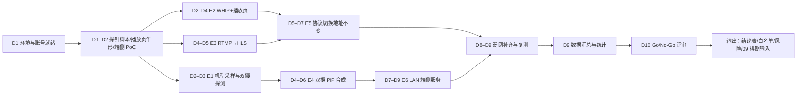
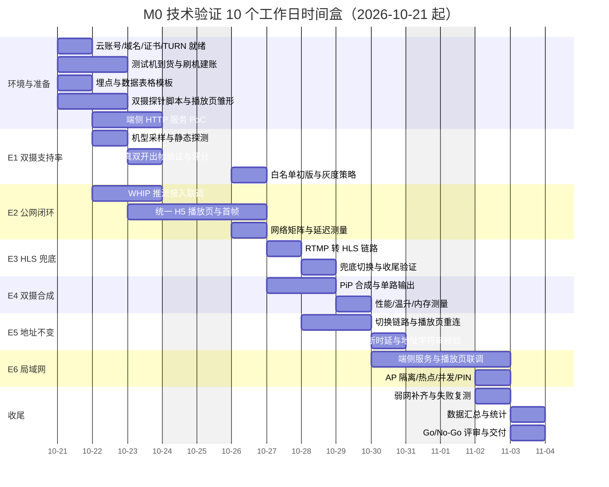
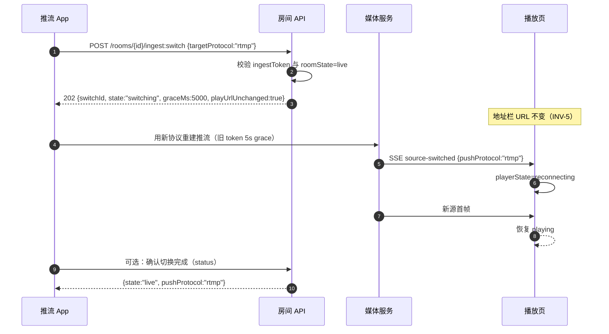

# 08 · M0 技术验证计划

| 项目 | 值 |
|---|---|
| 文档状态 | 草案（v1.0，M0 启动前冻结；执行中只增量更新“结论”列） |
| 版本 | v1.0 |
| 依赖文档 | [PRD-v1.0.md](./PRD-v1.0.md) §16–§18、[00-conventions.md](./00-conventions.md)、[01-architecture.md](./01-architecture.md)、[02-client-modules.md](./02-client-modules.md)、[03-cloud-service.md](./03-cloud-service.md)、[04-interface-contracts.md](./04-interface-contracts.md)、[05-lan-service.md](./05-lan-service.md)、[06-playback-page.md](./06-playback-page.md)、[07-security-privacy.md](./07-security-privacy.md)、[09-task-plan.md](./09-task-plan.md) |
| 适用 PRD | §9、§11、§16.2、§17 M0、§18 |
| 主责 | 交付 |
| 参与方 | 客户端、服务端、播放页、端侧、安全、测试 |
| 最后更新 | 2026-10-20 |

> 契约声明：本文所有错误码、token 声明、URL 模板、性能预算、埋点事件名均引用 [00-conventions.md](./00-conventions.md)，不新增、不改写。实验结论只回答“PRD §17 M0 的 6 个假设是否成立”，不代替 M1 功能验收。

---

## 1. 目的与范围

### 1.1 目的

1. 把 PRD §17 M0 的 6 项验证目标，转成**可在 10 个工作日内执行完**、有明确通过阈值、有证据链、有回退预案的实验。
2. 在投入 M1 开发前，用最小成本回答四个问题：双摄到底能覆盖多少设备？公网闭环是否成立？地址不变承诺能否成立？局域网端侧服务是否可用？
3. 产出可交给 09 排期直接使用的输入：结论表、白名单初版、风险登记、资源与预算、遗留技术债。
4. 为 10/11 提供验收口径与风险条目来源。

### 1.2 M0 六项验证（对应 PRD §17）

| 编号 | PRD §17 M0 条目 | 要回答的问题 | 对应 PRD 承诺 | 本文实验 |
|---|---|---|---|---|
| E1 | 验证目标机型双摄并发支持率 | 目标机型中，有多大比例能真正“前后同时出帧”？ | PRD §5.2、§16.2 | §4 |
| E2 | 验证公网 WebRTC WHIP 推流 + 统一 H5 播放页 | 公网推流→唯一播放页→WebRTC 播放能否闭环？首帧与延迟是否达标？ | PRD §7.1、§7.2、§16.2 | §5 |
| E3 | 验证 RTMP 推流后服务端转 HLS 兜底 | RTMP 接入后 HLS 兜底能否可用、起播是否可接受、结束是否收尾？ | PRD §6.1、§7.2 | §6 |
| E4 | 验证双摄 PiP 本地合成推单路 | 双摄合成单路后是否只产生 1 个播放地址且性能可控？ | PRD §5.2、§11.1 | §7 |
| E5 | 验证公网协议切换地址不变 | 热切换协议时 `playUrl` 是否字符串恒定、中断多长？ | PRD §1.3(6)、§6.2、§7.4 | §8 |
| E6 | 验证局域网端侧 HTTP 服务 + HTTP-FLV/MJPEG 播放 | 同网浏览器能否打开、能否播放、停止是否立即失效、PIN 是否生效？ | PRD §4.4、§12、§16.2 | §9 |

### 1.3 范围

| 范围内 | 范围外 |
|---|---|
| 上述 6 项实验的设计、执行、数据采集与判定 | M1 功能完整验收（复制/二维码/分享/通知栏/额度等） |
| 目标机型采样与双摄探测 | 大规模并发与容量压测（M1 后） |
| 弱网与网络矩阵下的链路行为 | 商业化与账号体系 |
| 安全相关的最小验证项（token 失效、LAN 无 token、PIN 限速，见 [07](./07-security-privacy.md) §13.1） | 完整渗透测试（M1 RC） |
| 10 个工作日时间盒内的资源与排期 | 生产容量规划与成本优化 |

### 1.4 方法论

- **假设驱动**：每个实验先写可证伪假设（H-E1…H-E6），再用数据判定“成立/不成立/部分成立”。
- **双人复核**：每份实验记录由执行人与复核人双签；关键指标（地址不变、失效时延）用录屏 + 日志双证据。
- **一次一变量**：网络矩阵内只改一个网络参数（丢包/时延/带宽），避免归因困难。
- **结论带区间**：比例类指标给 95% 置信区间（Wilson），时延类给 p50/p95，不只给均值。
- **失败也是结论**：实验失败必须产出“回退方案是否可行”的判断，不允许只写“未通过”。

---

## 2. 总体计划

### 2.1 验证流程



### 2.2 实验总表

| 实验 | 目标摘要 | 方法摘要 | 样本量 | 关键阈值 | 工期 | 负责人 |
|---|---|---|---|---|---|---|
| E1 | 双摄并发支持率 | 24 台机型静态探测 + 真双开出帧 | 24 台 | 支持率 ≥50% 通过；30–50% 带条件 | D2–D3（2 人日） | 客户端 + 测试 |
| E2 | WHIP + 统一播放页 | 5 机型 × 3 网络 × 5 次 + 弱网 5 机型 × 5 次 | 75 + 25 = 100 次 | 推流成功率 ≥95%；首帧 p95 ≤2 s | D2–D4（3 人日） | 服务端 + 播放页 |
| E3 | RTMP→HLS 兜底 | 3 机型 × 3 网络 × 5 次 | 45 次 | HLS 可播率 ≥95%；起播 p95 ≤5 s | D4–D5（2 人日） | 服务端 |
| E4 | PiP 合成单路 | 白名单 5 机型 × 5 次 | 25 次 | 合成成功率 100%；CPU ≤45% | D4–D6（3 人日） | 客户端 |
| E5 | 切换地址不变 | 3 机型 × 2 切换对 × 5 次 | 30 次 | 地址恒定 100%；中断 p95 ≤5 s | D5–D7（3 人日） | 服务端 + 客户端 |
| E6 | LAN 端侧服务 | 4 机型 × 2 路由器配置 × 5 次 + 热点 20 次 | 60 次 | 同网可播率 ≥95%；停止失效 ≤1 s | D7–D9（3 人日） | 端侧 + 播放页 |

> 样本量说明：以上为**最小可判定样本**；比例类阈值在 45–75 样本下 95% CI 宽度约 ±10–14 个百分点，用于 M0 方向判断足够，不作为对外 SLA。M1 前需按 10 号文档做更大样本的验收测量。

### 2.3 10 个工作日时间盒（甘特）



### 2.4 里程碑与交付物

| 里程碑 | 时点 | 交付物 | 验收人 |
|---|---|---|---|
| M0.1 环境就绪 | D1 结束 | 云账号/域名/证书/TURN 可用；测试机清单；数据模板 | 交付 |
| M0.2 探针与 PoC | D2 结束 | 双摄探针 APK/脚本；播放页雏形；端侧 HTTP PoC | 架构 |
| M0.3 E1 初版白名单 | D4 结束 | 机型评分表 + A/B/C 分级 + 灰度建议 | 客户端 |
| M0.4 公网闭环打通 | D5 结束 | E2/E3 原始数据 + 结论草稿 | 服务端 |
| M0.5 双摄与切换 | D7 结束 | E4/E5 原始数据 + 结论草稿 | 客户端/服务端 |
| M0.6 LAN 闭环 | D9 结束 | E6 原始数据 + 结论草稿 | 端侧 |
| M0.7 Go/No-Go | D10 | 六份实验结论 + 汇总判定 + 09 排期输入 | Lead |

---

## 3. 设备与网络矩阵

### 3.1 设备分层（采样框）

| 层级 | 价格段（人民币） | 典型 SoC/内存 | Android 版本 | 采样配额 | 说明 |
|---|---|---|---|---|---|
| 低端 | ≤ 1500 元 | 4–8 核中低端 / 4–6 GB | 10–13 | 8 台 | 最可能双摄不支持、编码能力弱；LAN 服务性能风险最大 |
| 中端 | 1500–3500 元 | 中高端 / 8–12 GB | 11–14 | 9 台 | 主力人群；双摄支持参差 |
| 旗舰 | ≥ 3500 元 | 旗舰 / 12–16 GB | 13–15 | 7 台 | 多摄能力强，但不代表多摄 API 一定开放 |

厂商配额（合计 ≥20、目标 24 台）：小米/Redmi 5、OPPO/OnePlus 4、vivo/iQOO 4、荣耀/华为 4、三星 2、Google Pixel 2、realme/其他 3。要求覆盖：至少 3 台 Android 10、3 台 11、3 台 12、3 台 13、3 台 14、2 台 15；至少 2 台支持 5G；至少 2 台为 4 GB 内存低端机。

### 3.2 网络矩阵

| 网络条件 | 配置 | 用途 | 备注 |
|---|---|---|---|
| Wi-Fi 5 GHz | 同一 AP，信号 ≥ −55 dBm，无其他负载 | 基线 | 路由器关闭 AP 隔离（E1–E5 默认） |
| Wi-Fi 2.4 GHz | 同 AP 2.4G SSID，信号 ≥ −65 dBm | 兼容性 | 干扰环境下观察丢包 |
| 4G | 三大运营商各 1 张卡（不限速套餐） | 公网移动网络 | 记录 RSRP/SINR 与实测上下行 |
| 5G | 至少 1 张 5G 卡 | 公网高速 | 记录 NSA/SA |
| 手机热点 | 推流手机开热点，观看设备连接 | LAN 热点场景 | 记录热点频段与连接数 |
| 弱网 | Linux 网关 + `tc netem`（见 §3.4） | 抗丢包/时延 | Android 端可用同类工具做对照 |
| NAT 类型 | 家庭 NAT、公司 NAT、运营商 CGNAT | WebRTC/TURN | 至少覆盖 2 种；用 STUN 判定 |

### 3.3 弱网参数（tc netem）

```bash
# 说明：以下命令在 Linux 弱网网关上执行；eth0 为出口网卡，仅用于实验环境。
# 丢包
tc qdisc replace dev eth0 root netem loss 1%
tc qdisc replace dev eth0 root netem loss 5%
tc qdisc replace dev eth0 root netem loss 10%
# 时延（单向；RTT 为往返，需按路径分配）
tc qdisc replace dev eth0 root netem delay 25ms    # RTT ≈ 50ms
tc qdisc replace dev eth0 root netem delay 100ms   # RTT ≈ 200ms
tc qdisc replace dev eth0 root netem delay 250ms   # RTT ≈ 500ms
# 带宽（配合 tbf 限速，上行方向）
tc qdisc replace dev eth0 root handle 1: tbf rate 2mbit burst 32kbit latency 400ms
# 组合：10% 丢包 + RTT 200ms + 2 Mbps
tc qdisc replace dev eth0 root handle 1: netem loss 10% delay 100ms
tc qdisc replace dev eth0 parent 1: handle 2: tbf rate 2mbit burst 32kbit latency 400ms
# 清除
tc qdisc del dev eth0 root
```

弱网组合矩阵（用于 E2/E3/E5/E6）：

| 组合 ID | 丢包 | RTT | 带宽 | 预期行为 | 适用实验 |
|---|---|---|---|---|---|
| N0 | 0% | ≤ 20 ms | 不限 | 基线 | 全部 |
| N1 | 1% | 50 ms | 5 Mbps | 无感降级 | E2/E3/E5 |
| N2 | 5% | 200 ms | 2 Mbps | 自适应码率触发、WebRTC 抖动缓冲增大 | E2/E5 |
| N3 | 10% | 500 ms | 1 Mbps | 触发降级/重连；SRT 抗丢包对照 | E2/E3/E5 |
| N4 | 10% | 50 ms | 2 Mbps | 纯丢包场景（区分时延影响） | E2 |
| N5 | 0% | 500 ms | 5 Mbps | 纯时延场景 | E5 |

要求：每组至少 5 次重复；每次 ≤10 min；每次开始前记录 `ping`/`traceroute`（占位地址）与实测带宽；同一次实验内不得改动其他变量。

### 3.4 环境要求

| 项 | 要求 |
|---|---|
| 路由器 | 支持 AP 隔离/访客网络开关；2.4G/5G 双频；可查客户端列表；建议 3 台不同品牌 |
| 局域网 | 实验网段独立（例如文档专用示例网段），避免与办公网互通；DHCP 保留推流机地址 |
| 公网出口 | 上行 ≥ 20 Mbps，抖动 ≤ 10 ms（基线测量后记录） |
| 时间同步 | 所有采集设备开启 NTP；延迟测量用同一时间源（推荐录屏时间码 + 秒表） |
| 温度/电量 | 实验室 25 ± 3 ℃；每次性能测量前电量 ≥ 80% 且不充电；使用同一散热条件 |
| 账号/额度 | 媒体云试用额度 ≥ 50 小时；避免中途欠费导致数据作废 |

### 3.5 工具与数据采集

| 工具 | 用途 | 输出 |
|---|---|---|
| 埋点 SDK（测试版） | 事件：`push_start_success`、`play_first_frame`、`play_fallback`、`protocol_switch_start/end`、`lan_viewer_join` 等（名称引用 [00 §11](./00-conventions.md)） | 事件 CSV/JSON（脱敏后） |
| `adb logcat` + 本地日志（脱敏） | 状态机、错误码、时间戳 | 日志文件（按实验编号归档） |
| Perfetto / `dumpsys` | CPU、内存、温度、电量 | trace + 指标 CSV |
| 录屏（`scrcpy`/系统录屏） | 首帧、地址不变、停止失效的视觉证据 | MP4（断言证据） |
| 秒表/时间码 | 端到端延迟人工测量（拍摄秒表 + 播放秒表同框） | 截图/视频 |
| 抓包（`tcpdump`/Wireshark） | 协议行为、TLS、重连、LAN 明文复核 | pcap（不含真实凭证，导入前脱敏） |
| 数据表 | 每次执行一行（§10.2） | CSV → 汇总表 |

---

## 4. E1 · 双摄并发支持率调研

### 4.1 假设

- **H-E1**：在目标机型采样框（§3.1）中，≥50% 的机型能够通过公开 API（Camera2/CameraX）实现前后摄同时出帧；若低于 30%，则“双摄默认可用”的产品承诺不成立，需要改为白名单 + 运行时检测。

### 4.2 方法

1. **静态探测（不打开相机）**：枚举相机与能力，记录：
   - `CameraManager.getCameraIdList()` 数量；
   - 每个 id 的 `LENS_FACING`（前/后/外接）、`INFO_SUPPORTED_HARDWARE_LEVEL`；
   - `REQUEST_AVAILABLE_CAPABILITIES` 是否含 `LOGICAL_MULTI_CAMERA`；
   - `getPhysicalCameraIds()` 是否 ≥2（逻辑多摄的物理子相机）；
   - API ≥30：`CameraManager.getConcurrentCameraIds()` 返回的相机组合集合（是否包含“后+前”）；
   - API ≥30：对候选组合调用 `isConcurrentSessionConfigurationSupported()`（按目标分辨率/帧率构造 `SessionConfiguration`）；
   - CameraX：`ProcessCameraProvider.getAvailableCameraInfos()` 的 `lensFacing` 与 `CameraInfo`（是否同时存在前/后）。
2. **cameraId 组合探测**：将“后摄 id 集合 × 前摄 id 集合”做笛卡尔积（通常 ≤ 3×2），对每个组合：
   - 静态判定：`getConcurrentCameraIds()` 是否包含该组合 → 若包含，进入动态验证；
   - 动态判定：同时 `openCamera` 两路并各建一路 `CaptureSession`（或 CameraX 同时 bind 两个 `CameraSelector`），要求**两路在 5 s 内均出帧**（≥1 fps 即可，证明可并发）；
   - 若系统/厂商限制（如“仅系统相机可用双摄”），记为“厂商私有能力”，不计入“公开 API 可用”。
3. **真双开验证**：在通过静态判定的机型上，跑一次 60 s 双路采集 + 本地画中画合成，记录帧率、CPU、温度（为 E4 提供输入）。
4. **记录失败原因分类**：无前/后摄、只有单逻辑后摄、`getConcurrentCameraIds` 不可用（API <30）、组合不被支持、打开第二路报错（`ERROR_CAMERA_IN_USE` 等）、能打开但出帧超时、厂商 ROM 限制。

**探测伪代码（仅文档示意，不是交付代码）**：

```kotlin
// 仅示意探测顺序；真实实现需处理权限、异常与 API 级别分支
val ids = cameraManager.cameraIdList
val backs = ids.filter { lensFacing(it) == LENS_FACING_BACK }
val fronts = ids.filter { lensFacing(it) == LENS_FACING_FRONT }

val concurrentSets: Set<Set<String>> =
    if (Build.VERSION.SDK_INT >= 30) cameraManager.concurrentCameraIds else emptySet()

for (back in backs) for (front in fronts) {
    val pair = setOf(back, front)
    val staticOk = pair in concurrentSets
    // 动态验证：两路同时出帧 5s
    val dynamicOk = tryOpenBothAndAwaitFrames(back, front, timeoutMs = 5_000)
    record(model, apiLevel, back, front, staticOk, dynamicOk, failureReason)
}
```

### 4.3 设备与网络矩阵

- 设备：§3.1 的 24 台（≥20 台强制，24 台目标）；
- 网络：无关（本实验可离线）；但需记录每台机器的系统版本与厂商 ROM 版本；
- 环境：电量 ≥50%，温度正常（避免热节流影响双开出帧判定）。

### 4.4 指标与通过阈值

| 指标 | 口径 | 通过阈值 |
|---|---|---|
| 公开 API 双摄支持率 | 动态验证通过机型数 / 采样机型数 | ≥ 50% 通过；30–50% 带条件；<30% 不通过 |
| 静态可判定率 | 能给出明确静态结论（支持/不支持）的机型比例 | 100%（无法判定需说明原因） |
| 失败原因可解释率 | 失败机型中能归入 §4.2 分类的比例 | ≥ 90% |
| 厂商覆盖 | 支持机型覆盖的厂商数 | ≥ 4 家 |
| 低端机支持率 | 低端层级内的支持率 | 仅记录，不设阈值（用于 M2 策略） |
| API 30+ 与 <30 差异 | 两组支持率 | 记录，用于决定最低支持 Android 版本 |

### 4.5 评分模型与白名单分级

| 维度 | 分值 | 判定 |
|---|---|---|
| 存在前/后两个相机 id | 20 | `lensFacing` 覆盖前+后 |
| 含 `LOGICAL_MULTI_CAMERA` 逻辑多摄 | 15 | 能力位存在 |
| `getPhysicalCameraIds()` ≥2 | 10 | 逻辑多摄有物理子相机 |
| `getConcurrentCameraIds()` 含“后+前”组合（API 30+） | 25 | 组合存在 |
| `isConcurrentSessionConfigurationSupported` 通过（API 30+） | 15 | 目标配置（720p30）可行 |
| 真双开 5 s 内两路出帧 | 15 | 动态验证 |
| **合计** | **100** | — |

分级与灰度：

| 分级 | 分数 | 产品行为 | 灰度策略 |
|---|---|---|---|
| A | ≥ 80 | 默认展示「前后同时」，默认 PiP | 全量（但启动时仍需运行时二次探测，失败即隐藏） |
| B | 50–79 | 展示「前后同时」，首次进入提示“部分机型可能不稳定” | 服务端开关灰度 20% → 50% → 100%，按 `deviceModel` 下发 |
| C | < 50 | 隐藏「前后同时」，提示“本机不支持双摄同时工作” | 不开放；收集机型数据后每季度复评 |

白名单载体：`deviceModel + API level + ROM 版本前缀 → 等级` 的 JSON 配置，随 App 版本内置基线、云端可热更新（仅用于“隐藏/展示”开关，不改变采集实现）。运行时二次探测失败时，无论等级如何一律隐藏（以运行时为准），并上报 `dual_camera_unsupported`（`1004`）。

### 4.6 数据采集与记录模板

记录表字段：`实验号 | 机型 | 厂商 | 价格段 | Android | API | ROM 版本 | 相机 id 数 | 前后 id | 逻辑多摄 | 物理子相机数 | concurrent 组合数 | 静态结论 | 动态结论（两路出帧 Y/N） | 失败分类 | 60s 双开帧率 | CPU% | 温升 ℃ | 评分 | 分级 | 证据链接`。

每台机型至少 1 次完整记录；A/B 级机型额外记录 1 次 60 s 双开性能数据。证据：截图（能力输出）+ 录屏（双路出帧）+ 日志（失败原因）。

### 4.7 结论模板

> **H-E1 判定**：在 N = 24 台采样机型（覆盖 7 家厂商、Android 10–15）中，公开 API 真双开成功 M 台，支持率 = M/24 = x%（95% CI: a%–b%）。阈值 50%，判定：**成立 / 部分成立 / 不成立**。A/B/C 分级结果：A 级 a 台、B 级 b 台、C 级 c 台。失败主因 Top3：…。对 M2 的影响：…。证据：<表格链接>、<录屏目录>。

### 4.8 不通过的回退方案

| 情形 | 回退 | 影响 | 需上报 |
|---|---|---|---|
| 支持率 30–50% | 双摄仅对 A/B 白名单开放；M2 首发按 B 级灰度 20% | PRD §5.2 承诺范围收窄为“支持机型” | 产品 + Lead |
| 支持率 < 30% | M2 不做“同时双摄”，改为“单摄 + 前后快速切换 + 软件伪双摄（同一画面切换）”；PiP 仅旗舰演示 | 双摄卖点弱化，需 PRD 变更 | Lead + 产品 |
| 静态可判定率低 | 引入厂商白名单 + 纯运行时探测（无静态预判） | 首次进入有失败概率，需 UI 兜底 | 客户端 |

---

## 5. E2 · 公网 WebRTC WHIP 推流 + 统一 H5 播放页

### 5.1 假设

- **H-E2**：在 Wi-Fi/4G/5G 与轻度弱网下，客户端可用 WHIP 推流到云端，播放页可用同一 `playUrl` 通过 WebRTC 播放；推流成功率 ≥95%，首帧 p95 ≤2 s，端到端延迟 p50 ≤500 ms、p95 ≤800 ms。

### 5.2 方法/步骤

1. 客户端 `POST /rooms`（`accessScope=wan`）→ 拿到 `roomId`、`playUrl`、`ingestToken`；
2. WHIP `POST /whip/{roomId}`（Bearer `ingestToken`）→ 201 Answer → ICE/DTLS 建立 → `ingestState=publishing`；
3. 另一台设备浏览器打开 `playUrl` → 播放页 `play-session` → 拿到 `mediaToken` 与 `protocols` → WHEP 播放 → `playFirstFrame`；
4. 记录：点击开始→`publishing` 耗时、`playUrl` 可打开耗时、首帧耗时、延迟、卡顿、断流次数；
5. 弱网组按 §3.3 注入后重复；每次执行前后记录网络实测值；
6. 停止推流 → 验证 `410` 与页面结束态（INV-1）。

**判定口径**：

- 推流成功 = `POST /rooms` 成功 + WHIP 201 + 首帧到达接入端（`ingestState=publishing` 且服务端 `lastFrameAt` 更新），且全程 ≤10 s；
- 播放页可打开 = HTML 200 + `play-session` 200 + 渲染播放器 UI（未进入 `failed`）；
- 首帧 = `play_page_open` → `playing` 且渲染首帧；
- 端到端延迟 = 拍摄端秒表画面在播放端显示的时间差（同框录屏读秒），取 10 次中位数。

### 5.3 设备与网络矩阵

| 维度 | 取值 | 说明 |
|---|---|---|
| 推流机型 | 低端 1 台、中端 2 台、旗舰 2 台（共 5 台） | 覆盖软/硬编差异 |
| 观看设备 | 1 台笔记本 Chrome + 1 台 Android Chrome（固定） | 浏览器版本记录 |
| 网络 | Wi-Fi 5G、4G、5G、N2（5%/200 ms/2 Mbps） | 4 组 |
| 次数 | 5 台 × 3 网络 × 5 次 = 75 次；弱网 N2 追加 5 台 × 5 = 25 次 | 共 100 次 |

### 5.4 指标与通过阈值

| 指标 | 口径 | 阈值 |
|---|---|---|
| 推流成功率 | 成功次数 / 总次数 | ≥ 95%（100 次中 ≥95） |
| 播放页可打开率 | 200 + 播放器 UI 渲染 / 总次数 | ≥ 98% |
| 首帧时间 p50 / p95 | `play_first_frame.timeToFirstFrameMs` | p50 ≤ 1.5 s；p95 ≤ 2 s（预算 [00 §10.2](./00-conventions.md) ≤1.85 s） |
| 端到端延迟 p50 / p95 | 秒表法 | p50 ≤ 500 ms；p95 ≤ 800 ms（预算目标 200–800 ms，PRD §6.1） |
| 卡顿率 | 卡顿时长 / 播放时长 | ≤ 2%/10 min |
| 断流恢复 | 10 min 内断流次数与恢复耗时 | 断流 ≤1 次；恢复 ≤5 s |
| 地址可用 | 关闭后 410 | 100% |

### 5.5 数据采集

- 埋点：`push_start_clicked`、`push_start_success`（`durationMs`）、`play_page_open`、`play_first_frame`（`playProtocol`、`timeToFirstFrameMs`）、`play_failed`（`code`）、`push_stop`；
- 服务端：`X-Request-Id`、房间状态时间线、`lastFrameAt`、接入端链路质量（丢包/抖动/RTT）；
- 人工：秒表录屏 10 次/组；浏览器 `chrome://webrtc-internals` 截图（关键指标）；
- 失败样本必须附错误码（`4001`/`4003`/`5001`/`5006`/`7005` 等）与抓包。

### 5.6 结论模板

> **H-E2 判定**：N = 100 次（5 机型 × 4 网络 × 5 次），推流成功 95 次（95.0%，95% CI 88.7%–98.0%）；播放页可打开 98 次（98.0%）；首帧 p50 = 1.2 s、p95 = 1.9 s；延迟 p50 = 420 ms、p95 = 760 ms（N0 组），弱网 N2 组延迟 p95 = 1.4 s。阈值判定：**成立 / 部分成立 / 不成立**。主要失败模式：…（Top3 + 错误码）。证据：<数据表>、<录屏目录>、<webrtc-internals 截图>。

### 5.7 不通过的回退方案

| 失败模式 | 回退 | 影响 |
|---|---|---|
| WHIP 推流成功率 <90% | 换 WHIP 客户端库/服务端 SFU 实现，2 天内复测；仍失败则 M1 默认推流协议改为 RTMP（播放仍 WebRTC），保留 WHIP 灰度 | 延迟略升，PRD §6.1 默认协议需调整 |
| 首帧 p95 >2.5 s | 播放页预连接/信令并行化；极端下 M1 首帧阈值按实测重定（需 Lead 批准） | 验收口径调整 |
| 延迟 p95 >1 s | 检查 SFU 转发与抖动缓冲配置；弱网组单列，不作为 M1 阻断 | 体验风险 |
| 播放页可打开率 <95% | 排查 CDN/证书/JS 兼容；播放页降级 FLV 兜底 | 依赖 E3 |

---

## 6. E3 · RTMP 推流后服务端转 HLS 兜底

### 6.1 假设

- **H-E3**：客户端用 RTMP 推流时，服务端可实时转封装为 HLS；播放页在 WebRTC/FLV 不可用时能降级到 HLS 并在 5 s 内起播；房间关闭时写入 `#EXT-X-ENDLIST`，播放器进入结束态。

### 6.2 方法/步骤

1. 客户端选择 `pushProtocol=rtmp` 创建房间并推流（H.264/AAC，GOP ≤2 s，[00 §7](./00-conventions.md)）；
2. 服务端转封装生成 HLS（`EXT-X-TARGETDURATION:2`，保留 6 个分片，窗口 ≥12 s）；
3. 播放页强制走 HLS 降级路径（模拟 WebRTC/FLV 失败：阻断 WHEP 域名/端点）；
4. 记录起播时间、播放成功率、卡顿、音画同步；
5. 停止推流 → 校验 playlist `#EXT-X-ENDLIST` 与分片 410/404、页面结束态；
6. 变体：断流 10 s 后恢复（观察 HLS 窗口恢复）、弱网 N3。

### 6.3 设备与网络矩阵

| 维度 | 取值 |
|---|---|
| 机型 | 低/中/旗舰各 1 台（3 台） |
| 网络 | Wi-Fi 5G、4G、N3（10%/500 ms/1 Mbps）（3 组） |
| 次数 | 3 × 3 × 5 = 45 次 |
| 观看端 | 笔记本 Chrome（HLS 原生不支持 → hls.js）+ Android Chrome |

### 6.4 指标与通过阈值

| 指标 | 口径 | 阈值 |
|---|---|---|
| HLS 可播率 | 起播成功 / 尝试次数 | ≥ 95%（45 次中 ≥43） |
| HLS 起播时间 p50 / p95 | 播放页判定 HLS → 首帧 | p50 ≤ 3 s；p95 ≤ 5 s（预算 [00 §10.2](./00-conventions.md) hls 5.0 s） |
| 降级总耗时 | WebRTC+FLV 判定失败 → HLS 首帧 | ≤ 10 s（阶梯兜底总耗时预算） |
| 卡顿率 | 卡顿时长/播放时长 | ≤ 3%/10 min（HLS 本身缓冲更高，阈值放宽） |
| 结束收尾 | `closed` 后 ENDLIST 写入 + 分片不可取 | 100%，写入 ≤2 s |
| 断流恢复 | 10 s 断流后恢复 | 恢复 ≤15 s，且窗口不早于 12 s |

### 6.5 数据采集

- 播放页埋点：`play_fallback`（`from=flv`→`to=hls`，`reason`）、`play_first_frame`（`playProtocol=hls`）；
- 服务端：HLS 生成时间线、分片数量、`ENDLIST` 写入时间、分片 TTL；
- 网络：`curl` 采样 playlist 与分片（记录 `EXT-X-MEDIA-SEQUENCE` 变化）；
- 边缘失败样本：同时保存 playlist 原文与 410/404 响应。

### 6.6 结论模板

> **H-E3 判定**：N = 45 次，HLS 可播 43 次（95.6%，95% CI 85.2%–98.8%）；起播 p50 = 2.6 s、p95 = 4.4 s；降级总耗时 p95 = 8.7 s；结束收尾 45/45。判定：**成立 / 部分成立 / 不成立**。主要失败：…（如 hls.js 兼容、分片 404、ENDLIST 延迟）。证据：<数据表>、<playlist 样本>。

### 6.7 不通过的回退方案

| 失败模式 | 回退 | 影响 |
|---|---|---|
| HLS 起播 p95 >5 s | 缩短分片到 1 s（增加请求数与成本）或预加载 | 成本上升；`EXT-X-TARGETDURATION` 需评审 |
| HLS 可播率 <90% | M1 公网播放链改为 `WebRTC → FLV`，HLS 标记“实验性”不承诺 | 兼容性兜底弱化，需 PRD 风险记录 |
| ENDLIST 不收尾 | 服务端在 `closed` 时强制补写；仍失败则播放页轮询 `status` 兜底 | 短暂“假直播”风险，需 6 号文档兜底逻辑 |
| 转封装失败 | 改用 RTMP→FLV 直出，HLS 延后到 M2 | M1 兜底能力不足 |

---

## 7. E4 · 双摄 PiP 本地合成推单路

### 7.1 假设

- **H-E4**：在 E1 的 A/B 级机型上，双摄 PiP 合成可在本地完成并输出**单路**编码流；性能满足 [00 §10.4](./00-conventions.md) 双摄预算（CPU ≤45%、10 min 温升 ≤10 ℃、功耗 ≤2.2 W·h/10 min、内存 ≤320 MB）；对外只产生 1 个播放地址。

### 7.2 方法/步骤

1. 取 E1 A 级机型 3 台 + B 级 2 台（共 5 台）；
2. 启动前后双路采集 → OpenGL ES 合成 PiP（后置主画面 + 前置小窗，可拖动/缩放）→ 单路 H.264 编码 720p30 → WHIP 推流；
3. 播放端打开播放页，确认只有 1 个 `playUrl`，且画面为合成画面（小窗可见、位置可切换）；
4. 记录：合成是否成功、帧率、合成延迟、CPU、内存、温度、电量、音画同步；
5. 10 min 连续运行，每 30 s 采样一次；同时检查是否触发热降级（`7003`）与降级行为；
6. 变体：`dualLayout` 切换 pip/split_h/split_v，主次交换，验证布局不影响“单路输出”；
7. 校验 UI/剪贴板/二维码/分享只出现 1 个地址（INV-5/INV-6）。

### 7.3 设备与网络矩阵

| 维度 | 取值 |
|---|---|
| 机型 | E1 A 级 3 台 + B 级 2 台（5 台） |
| 网络 | Wi-Fi 5G 基线 + N1（1%/50 ms/5 Mbps） |
| 次数 | 5 台 × 5 次（其中 2 次 10 min 长跑） |
| 合成布局 | pip 为主（每台 ≥3 次），split_h/split_v 各 ≥1 次（覆盖 1 台旗舰即可） |

### 7.4 指标与通过阈值

| 指标 | 口径 | 阈值 |
|---|---|---|
| 合成出流成功率 | 成功出合成单路并推流成功 / 尝试次数 | 100%（25/25） |
| 地址唯一性 | UI/剪贴板/二维码/分享中地址个数 | 恒为 1（0 例外） |
| CPU | 10 min 均值（8 核口径） | ≤ 45% |
| 温升 | 10 min 表面温度上升 | ≤ 10 ℃ |
| 功耗 | 10 min 电量消耗折算 | ≤ 2.2 W·h/10 min |
| 内存 | 峰值 RSS | ≤ 320 MB |
| 输出帧率 | 合成后编码帧率 | ≥ 24 fps（目标 30 fps） |
| 音画同步 | 合成画面与音频偏移 | ≤ 150 ms |
| 热降级 | `thermalStatus ≥ SEVERE` 触发 | 触发后按 00 §10.4 降级且 UI 提示（允许触发，不允许无提示） |

### 7.5 数据采集

- Perfetto trace（CPU/GPU/内存/温度）、`dumpsys thermalservice`、`battery historian`；
- 每 30 s 采样：CPU%、RSS、温度、电量、`thermalStatus`、编码帧率、丢帧；
- 录屏：合成画面 + 播放端同框（证明单路且为合成画面）；
- 日志：合成失败原因、编码器初始化错误码（`1005/1006`）。

### 7.6 结论模板

> **H-E4 判定**：N = 25 次（5 机型），合成出流成功 25/25（100%）；地址唯一性 25/25；10 min 长跑样本 10 个，CPU 均值 38%（区间 31%–44%）、温升均值 8.2 ℃（最大 10.1 ℃）、内存峰值 296 MB、帧率均值 27 fps。判定：**成立 / 部分成立（需限定机型/分辨率）/ 不成立**。风险：…（如 B 级机型温升超阈）。证据：<Perfetto>、<录屏>。

### 7.7 不通过的回退方案

| 失败模式 | 回退 | 影响 |
|---|---|---|
| 合成帧率 <24 fps | 降分辨率到 540p / 24 fps；关闭美颜/滤镜 | 画质下降，PRD §5.2 需注明 |
| 温升 >10 ℃ | 限制单次双摄时长（如 30 min）并提示；强制省电模式 | 体验限制，需产品确认 |
| 合成失败（`1006`） | 回退单摄 + 提示；该机型降为 C 级隐藏双摄 | 双摄覆盖收窄 |
| 双路并发不稳定 | 仅在 A 级机型开放，B 级改为“固定 30 min 内可用” | 白名单策略调整 |
| 出现第二个地址（非专业模式） | 视为 P0 缺陷，停止 E4 并修复；不得上线 | 违反 INV-5/INV-6 |

---

## 8. E5 · 公网协议切换地址不变

### 8.1 假设

- **H-E5**：在 `live` 状态下通过 `POST /rooms/{roomId}/ingest:switch` 热切换 `whip ↔ rtmp ↔ srt` 时，`playUrl` 字符串完全不变；切换中断 ≤3 s（p95 ≤5 s）；播放页自动重连并恢复播放；旧 `ingestToken` 在 5 s grace 后失效。

### 8.2 方法/步骤

1. 以 `whip` 开始推流，播放端打开 `playUrl` 并记录地址字符串（截图 + DOM/字符串比对）；
2. 调用 `ingest:switch`（`targetProtocol=rtmp`）→ 观察 `202`、`switchId`、`graceMs=5000`、`playUrlUnchanged=true`；
3. 客户端按新协议重建推流；播放页收到 `source-switched`/重连 → 记录中断开始与恢复首帧时间；
4. 比对切换前后 `playUrl` 字符串（逐字节）、浏览器地址栏（不得变化，INV-5）；
5. 再切回 `whip`，重复；再覆盖 `whip→srt` 对；
6. 记录：切换成功率、中断时长、恢复时间、`ingestState`/`roomState` 状态序列、旧 token 行为（5 s 内可用、之后 `3007`）、播放页 `reconnecting` 状态是否正确。



### 8.3 设备与网络矩阵

| 维度 | 取值 |
|---|---|
| 机型 | 低/中/旗舰各 1 台（3 台） |
| 切换对 | `whip→rtmp`、`whip→srt`（各 5 次/机型），并各做 1 次回切 |
| 网络 | Wi-Fi 5G（基线）、N1（1%/50 ms/5 Mbps）、N2（5%/200 ms/2 Mbps） |
| 次数 | 3 机型 × 2 切换对 × 5 次 = 30 次（回切 6 次另计） |

### 8.4 指标与通过阈值

| 指标 | 口径 | 阈值 |
|---|---|---|
| 地址字符串恒定 | 切换前后 `playUrl` 逐字节相等 + 地址栏不变 | 100%（30/30） |
| 切换成功率 | 新源首帧到达并入 `live` / 尝试次数 | ≥ 95% |
| 中断时长 p50 / p95 | 旧源断流 → 新源首帧 | p50 ≤ 3 s；p95 ≤ 5 s（[00 §10.3](./00-conventions.md)） |
| 播放恢复率 | 切换后 10 s 内恢复 `playing` | ≥ 98% |
| 状态机正确 | `live→switching→live` 时序无跳变 | 100% |
| 旧 token 失效 | 5 s 后旧 `ingestToken` 尝试 | 拒绝（`3007`/`4004`） |
| 地址栏不变 | 浏览器 URL 快照 | 100% |

### 8.5 数据采集

- 埋点：`protocol_switch_start`/`protocol_switch_end`（`interruptMs`）、`play_fallback`、`play_first_frame`（切换后）；
- 服务端：`switchId`、状态时间线、旧/新会话时间戳、SSE 事件序列；
- 客户端：新旧协议 `ingestState` 时间戳（±100 ms）；
- 双端录屏：地址栏 + 播放画面同框，用于人工复核。

### 8.6 结论模板

> **H-E5 判定**：N = 30 次，地址字符串恒定 30/30（100%）；切换成功 29/30（96.7%）；中断 p50 = 2.1 s、p95 = 4.6 s；播放恢复 30/30；旧 token 5 s 后失效 30/30。判定：**成立 / 部分成立 / 不成立**。失败样本：…（网络/协议对/错误码）。证据：<数据表>、<双端录屏>、<SSE 日志>。

### 8.7 不通过的回退方案

| 失败模式 | 回退 | 影响 |
|---|---|---|
| 地址变化（任何 1 例） | 视为违反 PRD §1.3(6)，M0 立即停止相关设计并升级 Lead；M1 切换功能延后 | 重大承诺风险 |
| 中断 p95 >5 s | 优化服务端切源（预热新源、并行起流）；仍不达标则 UI 提示“重新连接中”并接受更长中断 | 体验风险，需 PRD 记录 |
| 切换成功率 <90% | 关闭热切换入口（M1 仅停止后可改协议），地址不变仍成立 | 功能缩水 |
| 旧 token 不失效 | 视为 P0 安全缺陷，修复后复测 | 安全风险 |

---

## 9. E6 · 局域网端侧 HTTP 服务 + HTTP-FLV/MJPEG 播放

### 9.1 假设

- **H-E6**：LAN 模式下端侧 HTTP 服务可启动并返回唯一地址 `http://{lanIp}:{port}/s/{pageToken}`；同网浏览器可打开并播放（FLV 优先、MJPEG 兜底）；停止推流后服务关闭、连接拒绝；PIN 与并发上限生效；AP 隔离时可给出明确提示。

### 9.2 方法/步骤

1. 选择 LAN 模式 → 启动端侧服务（默认端口 8089，占用则顺延 8090–8099）→ 展示 `lanIp`、`port`、`pageToken`；
2. 同网观看设备浏览器打开地址 → 播放页 → `play-session` → `/live.flv`（失败自动降级 `/stream.mjpg`）；
3. 记录首帧、卡顿、观看者数、CPU/温度；
4. 开启 PIN → 错误/正确口令各验证；连续错误验证限速与锁定（对齐 [07](./07-security-privacy.md) §5）；
5. 并发：第 1/2/3 个观看者成功；第 4 个应 `6005`；
6. 停止推流 → 观看端立即断流；`http://{lanIp}:{port}` 连接拒绝（≤1 s）；地址失效（INV-1）；
7. 变体：路由器开启 AP 隔离 → 观看端不可达并出现 `6004` 提示；手机热点场景；2.4G/5G 切换；IP 变化（断开重连 Wi-Fi）→ 地址更新且旧 token 失效。

### 9.3 设备与网络矩阵

| 维度 | 取值 |
|---|---|
| 机型 | 低端 1、中端 2、旗舰 1（4 台） |
| 路由器 | 2 台不同品牌，AP 隔离开/关各一组 |
| 网络 | Wi-Fi 5G、2.4G、手机热点 |
| 次数 | 4 机型 × 2 路由器配置 × 5 次 = 40 次；热点追加 4 × 5 = 20 次（共 60 次） |
| 观看设备 | 笔记本 Chrome、iPhone Safari（如可用）、Android Chrome |

### 9.4 指标与通过阈值

| 指标 | 口径 | 阈值 |
|---|---|---|
| 同网可播率 | 可播放 / 尝试次数（AP 隔离关闭组） | ≥ 95% |
| 首帧时间 p50 / p95 | 打开地址 → 首帧 | p50 ≤ 1.5 s；p95 ≤ 2 s（Flv 预算 2.0 s） |
| 停止失效 | 点击停止 → 观看端断流 + 连接拒绝 | 100%，≤1 s |
| 无 token 拒绝 | 直接请求 `/live.flv`（无 `mt`） | 100% 拒绝且不返回媒体字节 |
| PIN 行为 | 开启后正确/错误/锁定 | 与 00 §5.2 一致（5 次/分、10 次锁 10 分钟） |
| 并发上限 | 第 4 个观看者 | 100% 返回 `6005` |
| AP 隔离提示 | AP 隔离开启时出现 `6004` 提示 | ≥ 90% 执行出现明确提示 |
| 误报 | AP 隔离关闭时出现 `6004` | ≤ 10% |
| 资源 | CPU/温升/内存 | 3 观看者：CPU ≤35%、温升 ≤8 ℃、内存 ≤260 MB（[00 §10.4](./00-conventions.md)） |

### 9.5 数据采集

- 端侧日志：服务启动/停止、端口、并发计数、token 校验结果（脱敏）；
- 观看端：录屏 + 浏览器 Network 面板（状态码、content-type、字节数）；
- 网络：`curl -v` 记录连接被拒/超时；抓包确认无 TLS（LAN 明文风险记录，见 [07](./07-security-privacy.md) §6.3）；
- 安全最小验证：无 token、过期 token、停止后重放（对应 [07](./07-security-privacy.md) §13.2 SEC-A03/C02）。

### 9.6 结论模板

> **H-E6 判定**：N = 60 次（40 次路由器组 + 20 次热点组）；同网可播 39/40（97.5%）；首帧 p50 = 1.1 s、p95 = 1.9 s；停止失效 40/40 且 ≤1 s；无 token 拒绝 40/40；PIN 与并发行为符合契约；AP 隔离提示出现率 9/10，误报 1/10。判定：**成立 / 部分成立 / 不成立**。主要失败：…。证据：<数据表>、<录屏>、<curl 记录>。

### 9.7 不通过的回退方案

| 失败模式 | 回退 | 影响 |
|---|---|---|
| 可播率 <90% | 优先降级 MJPEG 并在播放页显式提示画质下降；排查路由器/防火墙 | 体验下降但可用 |
| 首帧 p95 >2 s | 调整 GOP（1 s）、预缓冲、减少首帧前逻辑 | 带宽上升 |
| 停止失效 >1 s | 优化关闭顺序：先结束会话 → 关连接 → 关 socket → 销毁密钥（[00 §8](./00-conventions.md)） | 安全承诺风险 |
| AP 隔离检测误报高 | 改为“用户可点按诊断”而非自动判定；降低误报优先 | 提示准确率下降 |
| 并发/CPU 超预算 | 并发上限降为 2；或限制 720p→540p | 功能缩水 |

---

## 10. 数据采集、统计与证据链

### 10.1 证据链要求

| 断言类型 | 必需证据 | 保存位置 |
|---|---|---|
| 比例类（成功率/可播率） | 明细数据表 + 每条失败的错误码 + 日志片段 | 实验目录 `data/{exp}/runs.csv` |
| 时延类（首帧/中断/停止失效） | 埋点时间戳 + 录屏（≥3 个样本） | `data/{exp}/videos/` |
| 地址不变 | 切换前后字符串快照 + 地址栏录屏 | `data/E5/snapshots/` |
| 单路输出 | UI/剪贴板/二维码/分享四入口截图 | `data/E4/single-address/` |
| 安全项 | 请求/响应记录 + 错误码 | `data/security/` |
| 设备能力 | 探测输出 JSON/截图 + 系统版本 | `data/E1/devices/` |

所有证据中的 token、PIN、完整 `roomId`、IP 必须脱敏（规则见 [07](./07-security-privacy.md) §9.2）；实验数据不得上传到非公司归档位置。

### 10.2 明细表结构（每次执行一行）

| 字段 | 示例 | 说明 |
|---|---|---|
| `runId` | `E2-20261022-014` | 实验-日期-序号 |
| `exp` | `E2` | 实验编号 |
| `deviceModel` | `Pixel 8` | 白名单字段 |
| `androidApi` | `34` | — |
| `networkProfile` | `N2` | §3.3 |
| `networkMeasured` | `ul=8.2Mbps,rtt=204ms,loss=4.8%` | 实测 |
| `startTs` / `endTs` | RFC 3339 | — |
| `result` | `pass` / `fail` / `abort` | — |
| `errorCode` | `5006` | 无则空 |
| `metrics` | `ttffMs=1780;latencyP50=430;stallMs=0` | 键值对 |
| `evidence` | `videos/E2/run014.mp4` | 相对路径 |
| `executor` / `reviewer` | 工号 | 双签 |

### 10.3 统计口径

| 指标类型 | 汇总方式 | 说明 |
|---|---|---|
| 比例 | 成功数/总数 + Wilson 95% CI | 样本 <30 时同时给出原始分子分母 |
| 时延 | p50 / p95（线性插值） | 同时给最大值；异常值（>10 s）单列并说明 |
| 资源 | 10 min 均值 + 峰值 | 温度给“上升值”而非绝对值 |
| 阈值判定 | 全部样本判定，不剔除“明显异常”样本 | 剔除需复核人签字并记录原因 |
| 样本不足 | 明确标注“未达最小样本”，结论降级为“方向性” | 不允许用小样本宣称通过 |

### 10.4 数据脱敏

实验数据沿用 [07](./07-security-privacy.md) §9.2 字段规则：`roomId` 用 `roomIdHash`，token 全量替换，IP 保留网段，PIN 不记录内容。抓包文件导入前先过滤 `Authorization`/`Cookie`/`?token=`/`?mt=` 字段。

---

## 11. 资源与预算

### 11.1 人力资源

| 角色 | 投入（人日） | 主要工作 |
|---|---|---|
| 客户端（Android） | 10 | E1 探针、E4 合成、E5 客户端切换、E6 联调 |
| 服务端 | 8 | E2 接入/SFU、E3 HLS、E5 切源、环境与 TURN |
| 播放页 | 5 | 播放页雏形、降级链、E5 重连、E6 LAN 播放页 |
| 端侧/LAN | 5 | 端侧 HTTP 服务 PoC、E6 联调 |
| 测试/交付 | 8 | 机型建账、执行、数据、复核、报告 |
| 安全 | 2 | E6 安全最小验证、脱敏、Go/No-Go 安全项 |
| 合计 | **38 人日** | 10 个工作日 × 约 4 人并行 |

### 11.2 资源清单

| 资源 | 规格/数量 | 用途 | 到位时点 | 备注 |
|---|---|---|---|---|
| 云账号（主） | 1 个，完成实名 | API/媒体/SFU/TURN | D1 | 与生产环境隔离 |
| 云账号（备） | 1 个 | 媒体云试用对比 | D1 | 防止单点不可用 |
| 媒体云试用 | 2 家，各 ≥50 小时额度 | E2/E3 | D1 | 记录计费项，避免超支 |
| TURN 服务器 | 2 台 4C8G，带宽 10 Mbps | 对称 NAT/CGNAT | D2 | coturn + TLS 证书 |
| 域名与证书 | 1 个占位域名 + 通配符证书 | WAN HTTPS | D1 | 仅文档与实验环境使用 |
| 测试机 | 24 台（自有 8 + 采购/租用 16） | E1–E6 | D1–D2 | 低/中/旗舰与版本配额见 §3.1 |
| 路由器 | 3 台（不同品牌，支持 AP 隔离） | E6 | D2 | 记录固件版本 |
| 弱网网关 | 1 台 Linux（2C4G，双网卡） | 弱网矩阵 | D2 | `tc netem` |
| 观看设备 | 笔记本 2 + 手机 2 | 播放验证 | D1 | 固定浏览器版本 |
| 流量卡 | 4G 3 张 + 5G 1 张 | 移动网络 | D1 | 不限速套餐 |
| 工具 | Perfetto、adb、scrcpy、Wireshark、录屏 | 采集 | D1 | 开源 |
| 归档 | 团队网盘/对象存储（私有） | 证据 | D1 | 90 天后清理 |

### 11.3 预算估算（人民币，仅实验期）

| 项 | 估算 | 口径 |
|---|---|---|
| 媒体云试用 | ¥0–3,000 | 试用额度耗尽后按量 |
| TURN 云主机 | ¥1,500 | 2 台 × 1 个月（含带宽） |
| 域名/证书 | ¥200 | 1 年 |
| 测试机采购/租用 | ¥40,000–60,000 | 24 台二手机/租机均价 2,000–2,500 |
| 路由器 | ¥600 | 3 台 |
| 流量卡 | ¥800 | 1 个月套餐 |
| 其他（线材/支架） | ¥500 | — |
| **合计** | **¥43,600–66,600** | 不含人力成本 |

> 预算为 M0 实验期一次性支出；测试机在 M1 可复用，需在 09 排期资源计划中标注“资产复用”。

---

## 12. 前置依赖与风险

### 12.1 前置依赖

| 依赖 | 提供方 | 最晚可用日 | 阻塞实验 | 缺失时的替代 |
|---|---|---|---|---|
| 云端最小闭环（房间/接入/SFU/WHEP） | 服务端 | D2 | E2/E5 | 用开源 SRS/mediamtx 临时替代（功能裁剪） |
| 接口契约冻结（00 §6–§7） | 架构 | D1 | E2/E3/E5 | 以本文件附录字段为准，先冻结最小集 |
| 客户端采集/编码/推流骨架 | 客户端 | D2 | E2/E4 | 用参考实现/第三方 demo 采集 |
| 播放页雏形（单 HTML + 自适应） | 播放页 | D2 | E2/E5/E6 | 先用最小播放器（仅 WHEP/FLV） |
| 端侧 HTTP 服务 PoC | 端侧 | D3 | E6 | 用 NanoHTTPD 最小 demo |
| 域名/DNS/证书 | 运维 | D1 | E2/E3 | 用 IP + 自签（仅内部，注意不可用于测 TLS 真实性） |
| 测试机与账号 | 交付 | D2 | E1/E4/E6 | 缩减样本至 20 台（仍满足下限），结论标注“小样本” |
| 媒体云账号/额度 | 交付 | D1 | E2/E3 | 自建 SFU + 自建 TURN |
| 弱网网关 | 交付 | D2 | 弱网组 | 用手机端网络模拟工具替代，标注差异 |

### 12.2 风险登记

| ID | 风险 | 概率 | 影响 | 缓解 | 触发后动作 |
|---|---|---|---|---|---|
| R01 | 双摄公开 API 支持率显著低于预期 | 高 | 高（产品卖点） | E1 前置、白名单兜底、B 级灰度 | 走 E1 回退 §4.8 |
| R02 | 媒体云试用额度/功能不满足（无 WHEP/TURN） | 中 | 高（E2 阻塞） | 双供应商 + 自建 SRS 备选 | 切自建方案，E2 延期 ≤1 天 |
| R03 | 公网环境（公司网络）限制 UDP/443 | 中 | 中 | 提前测端口；准备 4G/5G 热点 | 用移动网络执行 E2/E5 |
| R04 | 测试机到货延迟 | 中 | 中 | 先自有 8 台启动 E2/E3；租机加急 | 样本缩至 20 台，标注 |
| R05 | 播放页雏形不稳定导致“可打开率”偏低 | 中 | 中 | 播放页只做最小链路，减少变量 | 用参考播放器交叉验证 |
| R06 | AP 隔离检测误报/漏报 | 高 | 低（体验） | 仅作为提示，不自动阻断；阈值放宽 | 改为手动诊断入口 |
| R07 | 弱网工具本身引入额外变量 | 中 | 中 | 固定网关与网卡；每次先测基线 | 标注“相对比较”，不下绝对结论 |
| R08 | 数据采集不完整导致结论不可用 | 中 | 高 | 模板先行、每日收口、双签 | 当日补测，不跨日堆积 |

---

## 13. M0 退出条件与 Go/No-Go

### 13.1 判定规则

- M0 是否 Go 进入 M1，由 Lead 主持评审，六项实验逐项判定；
- 判定档位：**通过 / 带条件通过 / 不通过**；
- “带条件通过”必须写明：条件、责任人、验证时点、若条件不满足的后果；
- 以下任一情况直接 **No-Go**：E5 出现地址变化；E6 停止后地址仍可用；E1 支持率 <30% 且产品不接受范围收窄；媒体云方案不可用且无自建替代；
- 判定结果与依据写入 11 号文档风险登记与 ADR。

### 13.2 判定表

| 实验 | 必须/条件 | 通过标准 | 带条件通过的定义 | 不通过的后果 | 决策人 |
|---|---|---|---|---|---|
| E1 | 条件项 | 支持率 ≥50% | 30–50%：仅 A/B 白名单开放，M2 灰度 | <30%：双摄不进 M2，改“快速切换 + 伪双摄”；需 PRD 变更 | 产品 + Lead |
| E2 | **必须项** | 推流成功率 ≥95%、首帧 p95 ≤2 s、播放页可打开 ≥98% | 成功率 90–95%：限特定网络，M1 加监控 | M1 公网闭环不成立；需换方案或延期 | Lead |
| E3 | 条件项 | HLS 可播率 ≥95%、起播 p95 ≤5 s | 可播率 85–95%：HLS 标注“实验性兜底” | M1 公网仅 WebRTC+FLV 兜底，风险记录 | 服务端 + Lead |
| E4 | 条件项 | 合成成功率 100%、CPU ≤45%、温升 ≤10 ℃ | 仅 A 级机型满足；B 级限时长 | 双摄仅旗舰演示，M2 缩小范围 | 客户端 + Lead |
| E5 | **必须项** | 地址恒定 100%、中断 p95 ≤5 s、切换成功率 ≥95% | 中断 p95 ≤8 s 且 UI 提示充分（需评审） | 违反核心承诺；M1 关闭热切换入口 | Lead |
| E6 | **必须项** | 同网可播 ≥95%、停止失效 ≤1 s、无 token 拒绝 100%、PIN 生效 | 可播率 90–95%：仅建议 2.4G→5G 或路由器排查 | LAN 模式不成立；M1 仅保留公网模式 | Lead |
| 安全最小项 | **必须项** | 无 token 不返回媒体、停止后重放拒绝、日志无 token | — | 安全阻断上线 | 安全 |

**M0 通过的必要组合**：E2、E5、E6 必须通过或经 Lead 书面接受降级；E1/E3/E4 可带条件；安全最小项必须通过。

### 13.3 决策记录模板

> **M0 Go/No-Go 结论（yyyy-mm-dd）**：E1 带条件通过（支持率 x%，条件：…）；E2 通过；E3 带条件通过（…）；E4 部分成立（…）；E5 通过；E6 通过。安全最小项通过。**总判定：Go（进入 M1）/ Conditional Go（条件：…，验证时点：…）/ No-Go（原因：…）**。遗留技术债：…。对 09 排期的影响：…。决策人签字：Lead / 产品 / 架构 / 安全。

---

## 14. 与 09 排期的接口

### 14.1 输出给 09 的输入

| 输出 | 形式 | 用途 | 交付时点 |
|---|---|---|---|
| 六份实验结论表 | §4.7–§9.6 的结论段 + 数据表链接 | 确定 M1 功能范围与技术债 | D10 |
| 双摄白名单初版 | §4.5 的 A/B/C 清单 + 灰度策略 | M2 排期与开关配置 | D4（初版）/D10（终版） |
| M1 准入条件 | §13.2 中的“带条件”项 | 09 的 DoD 与里程碑门禁 | D10 |
| 工作包与估算 | 本文件 §11.1 人日 + 实验暴露的模块工作量 | 09 WBS 拆解与人力 | D10 |
| 依赖关系 | §12.1 前置依赖 → 09 依赖图 | 排期关键路径 | D10 |
| 风险登记 | §12.2 全部风险 → 11 号文档 | 风险看板 | D10 |
| 资源与预算 | §11.2/§11.3 | 09 资源计划与资产复用 | D10 |
| 测试用例库 | 本文件实验步骤 + [07](./07-security-privacy.md) §13.2 | 09 测试计划与 DoD | D10 |
| 环境与账号清单 | §11.2 中的云账号/域名/TURN | 09 环境交接 | D10 |
| 遗留技术债 | §13.3 记录 | M1/M2 backlog | D10 |

### 14.2 对 09 排期的三条硬约束

1. **E2/E5/E6 未通过前，M1 不排“公网默认”与“地址不变”相关的对外承诺**（PRD §1.3、§16.2）。
2. **双摄相关开发（M2）必须等 E1 白名单终版**；E1 之前只做探针与开关框架。
3. **M1 的 LAN 并发上限（1–3）、停止失效（≤1 s）、明文 HTTP 提示** 必须以 E6 实测值为准写入 DoD，不得用设计值替代。

### 14.3 与 09 的交接检查点

| 检查点 | 09 需确认 | 08 提供 |
|---|---|---|
| 范围冻结 | M1 是否包含 SRT / HLS 兜底 / 双摄 | 对应实验结论 |
| 资源确认 | 测试机复用、云账号沿用、TURN 是否保留 | 资源清单与预算 |
| 风险接受 | E1/E3/E4 的带条件项是否接受 | 风险与回退方案 |
| 门禁确认 | M1 RC 的安全/性能门禁 | 本文件阈值 + 07 Go/No-Go |

---

## 15. 失败与降级

### 15.1 实验失败的处理

| 情况 | 处理 | 是否可继续 M0 |
|---|---|---|
| 单项实验失败（非必须项） | 记录结论与回退方案，进入 D10 评审 | 是 |
| 必须项失败（E2/E5/E6） | 立即升级 Lead；48 h 内给出“换方案 / 延期 / 降级承诺”三选一 | 需 Lead 书面同意 |
| 环境/资源不可用 | 启动 §12.1 替代方案；记录差异对结论的影响 | 是（标注局限） |
| 数据不完整 | 当日补测；无法补测则结论降级为“方向性”，不得宣称通过 | 是 |
| 安全项失败（无 token 可取流/停止后仍可播） | 视为 P0，暂停相关实验并修复后复测 | 否（阻断） |

### 15.2 实验结论的降级表达

| 结论强度 | 允许的表述 | 不允许的表述 |
|---|---|---|
| 通过（达标本全） | “在 N 样本、矩阵 M 下，指标达到阈值” | “全机型可用” |
| 部分成立 | “在子集（列出条件）下成立，其余待验” | “基本可用” |
| 带条件通过 | “需满足条件 C 才成立” | “没问题，先上线” |
| 方向性 | “样本不足，仅作方向参考” | “已验证” |

### 15.3 对 M1 的降级路径

- 若 E3 不通过：M1 公网播放链为 `WebRTC → FLV`，HLS 兜底延期，需在 PRD 风险中登记；
- 若 E5 中断偏长但地址不变成立：保留“地址不变”承诺，UI 增加“切换中，请稍候”状态；
- 若 E6 可播率不达标：LAN 模式 MVP 只承诺“同一路由器、无 AP 隔离”场景，并在 UI 明示；
- 若 E1 支持率低：M2 双摄范围收窄，M1 不做双摄入口（仅保留能力探测）。

---

## 16. 验收检查点（M0 可勾选）

| # | 检查点 | 验证方式 | 通过标准 |
|---|---|---|---|
| AC-01 | 24 台机型完成 E1 探测并记录 | 数据表 | 24/24 有结论，失败原因可解释 |
| AC-02 | 双摄白名单 A/B/C 初版产出 | 配置 JSON | 可被客户端读取并控制入口 |
| AC-03 | E2 完成 100 次执行 | 数据表 | 推流成功率、首帧、延迟有分网络统计 |
| AC-04 | E2 失败样本含错误码 | 数据表 | 100% 有码 + 抓包/日志 |
| AC-05 | E3 完成 45 次执行 | 数据表 | HLS 起播与收尾均有数据 |
| AC-06 | E4 完成 25 次执行 | 数据表 + Perfetto | 有 CPU/温升/内存/帧率 |
| AC-07 | E4 单路输出四入口截图 | 截图目录 | 每台至少 1 组，地址唯一 |
| AC-08 | E5 完成 30 次切换 | 数据表 + 录屏 | 地址字符串 100% 恒定 |
| AC-09 | E6 完成 60 次执行 | 数据表 | 可播/PIN/并发/停止失效均有覆盖 |
| AC-10 | 安全最小项通过 | [07](./07-security-privacy.md) 用例记录 | 无 token 不返回媒体；停止后拒绝 |
| AC-11 | 所有数据脱敏 | 抽检 | 无 token/PIN/明文 roomId/IP |
| AC-12 | 双人复核完成 | 签字记录 | 每个实验有执行人 + 复核人 |
| AC-13 | 六份结论按模板产出 | 结论段 | 含区间、阈值、判定、证据链接 |
| AC-14 | 09 输入包交付 | 目录 | §14.1 全部条目 |
| AC-15 | Go/No-Go 评审完成并签字 | 会议记录 | 四方签署，结论可执行 |

---

## 17. 开放问题

| ID | 问题 | 候选方案 | 推荐 | 决策人 | 截止 |
|---|---|---|---|---|---|
| Q-01 | 10 个工作日是否含环境搭建？ | A. 含（D1）；B. 不含（前置完成） | A（D1 专用于环境，风险可控） | Lead | M0 启动前 |
| Q-02 | 测试机 24 台是否全部采购？ | A. 全采购；B. 8 台自有 + 16 台租用；C. 缩减到 20 台 | B（成本/时效平衡） | 交付 | D1 |
| Q-03 | 媒体云自建还是第三方（也影响 03 选型） | A. 自建 SRS/Mediamtx；B. 第三方媒体云；C. 双跑 | B 做 E2、A 做备选；D10 决策 | 架构 + 服务端 | D10 |
| Q-04 | 弱网是否必须用硬件网关？ | A. Linux 网关；B. Android 网络模拟工具；C. 两者对照 | A 为主，B 抽检对照 | 测试 | D2 |
| Q-05 | 端到端延迟测量是否引入专用时间码硬件？ | A. 秒表录屏；B. 时间码发生器；C. 软件时间戳 | A（M0 足够）；M1 用设备级时间戳校验 | 测试 | D2 |
| Q-06 | E1 是否覆盖平板/折叠屏？ | A. 不覆盖；B. 各加 2 台 | A（M0 聚焦手机）；M2 再扩 | 产品 | D2 |
| Q-07 | 双摄白名单是否随版本内置？ | A. 仅云端下发；B. 内置基线 + 云端覆盖；C. 仅内置 | B | 客户端 | D10 |
| Q-08 | M0 数据是否对外（如给合作方）？ | A. 内部；B. 脱敏后摘要对外 | A；需要时走审批 | Lead | D10 |

---

## 18. 变更记录

| 版本 | 日期 | 变更人 | 内容 |
|---|---|---|---|
| v1.0 | 2026-10-20 | 交付 | 首版：M0 六项实验（假设/方法/矩阵/阈值/样本/采集/结论模板/回退）、双摄支持率调研、弱网与设备矩阵、10 日甘特、资源预算、依赖与风险、Go/No-Go 判定表、09 排期接口 |
