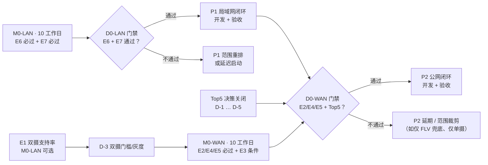
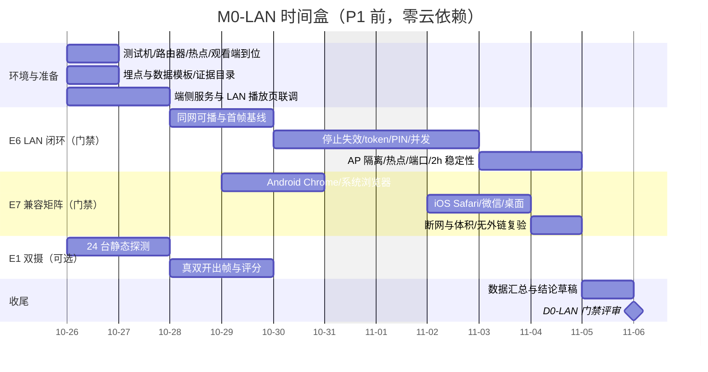
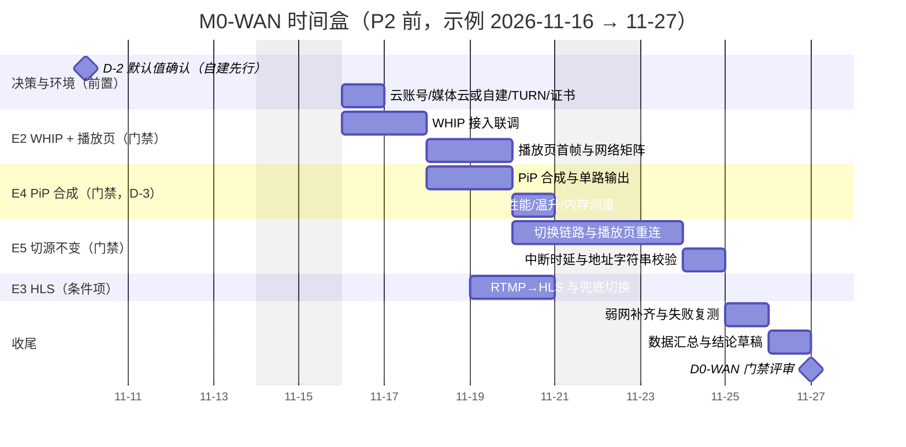
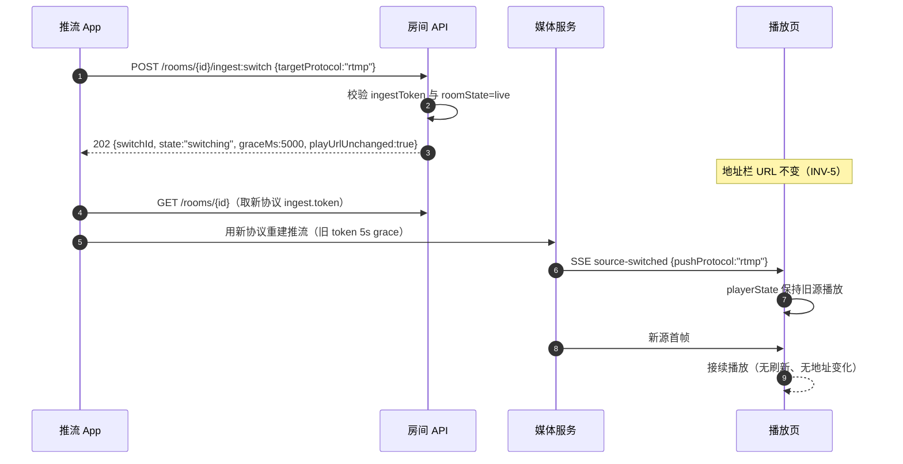

# 08 · M0 技术验证计划（M0-LAN / M0-WAN 两段式）

| 项目 | 值 |
|---|---|
| 文档状态 | 草案（v1.1，两段式；M0-LAN 启动前冻结门禁表，执行中只增量更新“结论”列） |
| 版本 | v1.1 |
| 依赖文档 | [PRD-v1.0.md](./PRD-v1.0.md) §16–§18、[00-conventions.md](./00-conventions.md) §4–§11、§17、§20、[01-architecture.md](./01-architecture.md)、[02-client-modules.md](./02-client-modules.md)、[03-cloud-service.md](./03-cloud-service.md)、[04-interface-contracts.md](./04-interface-contracts.md)、[05-lan-service.md](./05-lan-service.md)、[06-playback-page.md](./06-playback-page.md)、[07-security-privacy.md](./07-security-privacy.md)、[09-task-plan.md](./09-task-plan.md) |
| 契约基线 | 00 v1.5（§20 交付分期 P1/P2/P3、§17 v1.1 裁定、§10 预算、§9 错误码、§11 埋点） |
| 适用 PRD | §9、§11、§16.2、§17 M0、§18 |
| 主责 | 交付 |
| 参与方 | 客户端、播放页、端侧、服务端、安全、测试、产品 |
| 最后更新 | 2026-10-20 |

> 契约声明：本文所有错误码、token 声明、URL 模板、性能预算、埋点事件名均引用 [00-conventions.md](./00-conventions.md)，不新增、不改写。自 00 v1.5 起，**涉及“何时交付、何时验收、门禁条件”一律使用 P1/P2/P3 表述**（00 §20.5）；“M1/M2 起”只用于功能归属。
>
> 拆分声明：v1.0 为单段 M0（六项实验一次做完）。v1.1 依据 00 §20（LAN-first）拆为 **M0-LAN**（P1 前，E6 + E7 必过、E1 可选）与 **M0-WAN**（P2 前，E2/E4/E5 必过、E3 条件项）。E1–E6 编号与实验表保留，新增 E7（LAN 播放页兼容矩阵）。

---

## 1. 目的与范围

### 1.1 目的

1. 把 M0 从“一次性六项验证”改成**两段可独立判定**的验证：LAN 段先回答“P1 能不能零云端闭环”，WAN 段后回答“P2 能不能公网闭环且地址不变”。
2. 每段都有明确的启动门禁、必过项、条件项、退出条件与资源边界，避免 P1 被 WAN 的不确定性拖住，也避免 P2 在 Top5 决策未关闭时盲目开工。
3. 保留 PRD §17 M0 六项验证的可追溯性（E1–E6），新增 P1 必需的播放页兼容矩阵（E7），并为 Top5 决策（D-1…D-5）提供输入。
4. 产出可直接交给 09 排期的两段式输入：门禁表、工作时间盒、资源预算、风险登记、任务映射。

### 1.2 两段式总览

| 维度 | M0-LAN（P1 前） | M0-WAN（P2 前） |
|---|---|---|
| 时点 | 2026-10-26 → 11-06（10 个工作日，对齐 09 现 S0 窗口） | 示例 2026-11-16 → 11-27（10 个工作日；**以 09 重排为准**） |
| 核心问题 | 同网浏览器能否稳定播放、停止是否 ≤1 s 失效、PIN/token/并发是否成立、兼容矩阵是否覆盖 | WHIP 推流 + 唯一播放页、切源地址不变、双摄 PiP 单路输出是否成立 |
| 必过实验 | **E6**（LAN 端侧服务，P1 门禁）+ **E7**（播放页兼容矩阵，P1 必做伴随项） | **E2**、**E4**、**E5** |
| 条件/可选项 | E1 可选（仅作 D-3 输入，不阻塞 P1） | E3 条件项（可与 P2 首迭代并行） |
| 外部依赖 | 仅测试机、路由器/热点、端侧与播放页代码；**零云依赖** | D-2（未关闭按推荐值自建先行）、云账号、自建/托管媒体面、TURN、域名证书 |
| 输出 | P1 启动/退出判定 + E1 支持率报告（D-3 输入） | P2 启动判定 + WAN 风险与技术债清单 |
| 00 依据 | §20.2 P1 退出、§8 LAN 契约、§10.3/§10.4 预算、§17.1 PIN | §20.2 P2 启动、§20.4 Top5、§5 token、§7 媒体面、§10.1/§10.2 预算 |

> 两段可以**规划并行**：M0-LAN 执行期间即可启动 Top5 决策与 M0-WAN 环境预研；M0-WAN 执行不等待全部 Top5，仅要求 D-2 有明确默认值（推荐自建）；正式决策最迟 2026-12-18 关闭并对 E2 结论做一次回填校验。

### 1.3 实验编号与阶段（保留原编号，新增 E7）

| 编号 | 实验 | 所属阶段 | 是否启动门禁 | 阻塞对象 | 阈值来源 | 对应 09 任务 |
|---|---|---|---|---|---|---|
| E1 | 双摄并发支持率调研 | M0-LAN（可选执行） | 否（D-3 输入） | 不阻塞 P1；D-3 与 P2 双摄范围 | 00 §20.4 D-3、11 R-001 | T0-A1 |
| E2 | 公网 WHIP 推流 + 统一 H5 播放页 | M0-WAN | **是（P2）** | P2 启动 | 00 §10.1/§10.2、PRD §16.2 | T0-A2 / T0-S1 / T0-W1 |
| E3 | RTMP 推流 → 服务端 HLS 兜底 | M0-WAN | 否（条件项，可与 P2 首迭代并行） | P2 降级链完整性 | 00 §10.2 | T0-S2 / T0-W2 |
| E4 | 双摄 PiP 本地合成推单路 | M0-WAN | **是（P2）**；若 D-3 判定 P2 不做双摄则降为可选（需 Lead 书面） | P2 双摄范围 | 00 §10.4、PRD §5.2 | T0-A3 |
| E5 | 公网协议切换地址不变 | M0-WAN | **是（P2）** | P2 启动 | 00 §4.3/§10.3、PRD §1.3(6) | T0-S3 |
| E6 | 局域网端侧 HTTP 服务 + FLV/MJPEG | M0-LAN | **是（P1）** | P1 启动/退出 | 00 §8/§9/§10.3/§10.4/§17.1 | T0-A4 / T0-W3 |
| E7 | LAN 播放页兼容矩阵（新增） | M0-LAN | **是（P1）** | P1 退出（“同网可看”覆盖度） | 06 §11 兼容矩阵、06 §15 E2E-09/10/18 | T0-W3 + T0-Q1 |

**编号口径说明**：本表维持 v1.0 编号——**E4 = 双摄 PiP、E5 = 切源地址不变**。若口头任务把 E4/E5 的名称互换，以本表为准；P2 门禁的集合始终是“E2 + E4 + E5”这三项，不因名称顺序改变。

### 1.4 本次变更摘要（v1.0 → v1.1）

| 变更 | v1.0 | v1.1 | 原因 |
|---|---|---|---|
| 章节结构 | 单段 M0（§2–§15） | 两段式：M0-LAN（§2、§4、§9、§10）与 M0-WAN（§2、§5–§8） | 00 §20 LAN-first |
| 实验表 | 无阶段列 | 每项标“所属阶段/是否启动门禁/阻塞对象” | 门禁可判定 |
| E1 判定线 | 支持率 ≥50% 通过、30–50% 带条件 | **对照 40% 线**（00 §20.4 D-3 / 11 R-001），仅作 D-3 输入，不作 P1 门禁 | 与 00/11 决策口径一致 |
| 兼容矩阵 | 未单独验证 | 新增 **E7**（iOS Safari / Android Chrome / 微信内置 / 系统浏览器 / 桌面） | P1 承诺“同网浏览器可看”需要证据 |
| 甘特 | 单张 10 日甘特 | 拆两张：M0-LAN（对齐 09 S0 窗口）、M0-WAN（依赖 Top5，示例窗口） | 两段可并行规划、不可混排 |
| 资源预算 | 单表含云 | 按段拆分：M0-LAN 零云；M0-WAN 含云/TURN | P1 验收不得依赖云端（00 §20.3-3） |
| 退出判定 | 单一 Go/No-Go | 两张判定表：D0-LAN（P1）、D0-WAN（P2）+ 00 §20.2 对齐说明 | 与 00 门禁一致 |
| 09 接口 | “输出给 09 的输入” | 明确 P1 门禁=E6（+E7）、P2 门禁=E2/E4/E5+Top5 关闭，并列出 09 需重排项 | 09 当前仍为单段 M0，需重排 |
| E6 PIN 口径 | 单层 5 次/分 | 对齐 00 §17.1：IP 5 次/分、房间 20 次/分、10 次失败锁 10 分钟 | 契约 v1.1 裁定 |

### 1.5 范围

| 范围内 | 范围外 |
|---|---|
| M0-LAN：E6、E7、E1（可选）的设计、执行、判定 | P1 功能完整验收（复制/二维码/分享/通知栏/设置页等，属 P1 开发验收） |
| M0-WAN：E2、E3、E4、E5 的设计、执行、判定 | 生产容量规划、成本优化、SLA 压测（P2 后） |
| 两段的设备/网络/浏览器矩阵、弱网参数、数据采集、证据链 | 云端安全渗透与合规测评（M1 RC / P3 前，见 07） |
| 10 个工作日的两段时间盒、资源与预算、依赖与风险 | 双路独立推流、多地址、BYO、录制、账号与支付（P3） |
| 与 09 的接口（门禁、任务映射、重排清单） | 09 自身的排期改稿（本文件只给输入，不改 09） |

### 1.6 方法论

- **假设驱动**：每个实验先写可证伪假设（H-E1…H-E7），再用数据判定“成立/部分成立/不成立”。
- **阶段判定**：M0-LAN 的结论只用于 P1；M0-WAN 的结论只用于 P2，不互相替代（尤其不能用 LAN 的播放成功率推断 WAN）。
- **双人复核**：每份记录由执行人 + 复核人双签；关键断言（停止失效、地址不变、单路输出）必须“录屏 + 日志”双证据。
- **一次一变量**：网络矩阵内只改一个参数；浏览器矩阵内固定网络与机型。
- **结论带区间**：比例给 95% CI（Wilson），时延给 p50/p95，资源给均值 + 峰值。
- **失败也是结论**：每项失败必须给出“回退方案是否可行”的判断，不允许只写“未通过”。
- **零云约束**：M0-LAN 全程不得依赖云账号、媒体云额度或公网服务（00 §20.3-3）；发现依赖即视为实验设计缺陷。

---

## 2. 设计主体：两段式总体计划

### 2.1 两段关系与门禁位置



### 2.2 实验总表（含阶段与门禁属性）

| 实验 | 阶段 | 启动门禁 | 目标摘要 | 方法摘要 | 样本量 | 关键阈值 | 工期/人力 |
|---|---|---|---|---|---|---|---|
| E1 | M0-LAN | 否（D-3 输入） | 双摄并发支持率 | 24 台静态探测 + 真双开出帧 | 24 台 | 输出支持率 ±CI，对照 40% 线 | 4 pd（Android 3 + QA 1） |
| E6 | M0-LAN | **P1 是** | LAN 端侧服务闭环 | 4 机型 × 2 路由器配置 × 5 次 + 热点 12 次 | 52 次 | 同网可播 ≥95%；停止 ≤1 s；PIN/token/并发 | 7 pd（Android 3 + QA 4） |
| E7 | M0-LAN | P1 必做（伴随项，不单独否决） | 播放页兼容矩阵 | 8 类浏览器/环境 × 2 条路径 × 2 次 | 32 次 | 每格至少 1 条可用路径；首帧 ≤2 s | 3 pd（Web 2 + QA 1） |
| E2 | M0-WAN | **P2 是** | WHIP + 统一 H5 播放页 | 5 机型 × 4 网络 × 5 次 | 100 次 | 推流成功率 ≥95%；首帧 p95 ≤2 s | 5 pd（服务端 2 + Web 2 + QA 1） |
| E3 | M0-WAN | 否（条件项） | RTMP → HLS 兜底 | 3 机型 × 3 网络 × 5 次 | 45 次 | HLS 可播 ≥95%；起播 p95 ≤5 s | 3 pd（服务端 2 + QA 1） |
| E4 | M0-WAN | **P2 是**（D-3 决定承诺范围） | 双摄 PiP 单路输出 | 白名单 5 机型 × 5 次（含 2 次 10 min） | 25 次 | 合成 100%；CPU ≤45%；温升 ≤10 ℃ | 4 pd（Android 3 + QA 1） |
| E5 | M0-WAN | **P2 是** | 协议切换地址不变 | 3 机型 × 2 切换对 × 5 次 | 30 次 | 地址恒定 100%；中断 p95 ≤5 s | 4 pd（服务端 2 + Android 1 + QA 1） |
| 合计 | — | — | — | — | **284 次执行 + 24 台机型探测** | — | **30 pd**（实验执行人力；治理/评审见 §12.1，含缓冲前合计 47 pd） |

> 样本说明：上表为**最小可判定样本**。比例阈值在 30–52 样本下 95% CI 宽度约 ±10–18 个百分点，只用于 M0 方向判定与门禁，不作为对外 SLA；P1/P2 验收需按 10 号文档扩大样本。

### 2.3 M0-LAN 甘特（10 个工作日，2026-10-26 → 11-06）



### 2.4 M0-WAN 甘特（示例窗口，Top5 关闭后启动）

> 前提：M0-WAN 的**执行**不等待 D-1/D-3/D-4/D-5 全部关闭；D-2 若未正式关闭，按推荐值“自建（Mediasoup + SRS 终结）”先行搭环境，正式决策最迟 2026-12-18 关闭。Top5 的关门时点见 [00 §20.4](./00-conventions.md)（D-3/D-4 2026-12-11，D-1/D-2/D-5 2026-12-18），P2-GATE 2026-12-25。若 09 重排后时间窗口变化，本表按同样的 D1–D10 相对顺序平移，**不改变实验内容与门禁**。



### 2.5 阶段里程碑与交付物

| 里程碑 | 阶段 | 时点 | 交付物 | 验收人 |
|---|---|---|---|---|
| LAN.1 环境就绪 | M0-LAN | D1 | 测试机清单、路由器/热点配置、数据模板、证据目录 | 交付 |
| LAN.2 E6 主体 | M0-LAN | D6 | 可播/停止/PIN/并发原始数据 | 端侧 |
| LAN.3 E7 兼容 | M0-LAN | D8 | 兼容矩阵表 + 逐环境录屏 | 播放页 |
| LAN.4 E1 报告（可选） | M0-LAN | D5 | 24 台支持率报告 + A/B/C 分级 + 灰度建议 | 客户端 |
| LAN.5 D0-LAN | M0-LAN | D10 | M0-LAN 结论 + P1 准入判定 | Lead |
| WAN.1 决策输入确认 | M0-WAN（前置） | D-2 默认值确认时 | Top5 决策记录（D-2 正式关闭 2026-12-18；D-3/D-4 2026-12-11） | Lead + 产品 |
| WAN.2 E2 闭环 | M0-WAN | D4 | 推流/播放页数据 | 服务端 |
| WAN.3 E4/E5 | M0-WAN | D8 | PiP 性能数据、地址恒定证据 | Android + 服务端 |
| WAN.4 E3 | M0-WAN | D7 | HLS 起播/收尾数据 | 服务端 |
| WAN.5 D0-WAN | M0-WAN | D10 | M0-WAN 结论 + P2 准入判定 + 09 输入包 | Lead |

### 2.6 两段时间盒的人员安排

| 角色 | M0-LAN（人日） | M0-WAN（人日） | 说明 |
|---|---|---|---|
| Android | 5（E6 3 + E1 2） | 6（E2 1 + E4 3 + E5 1 + 复测 1） | E6 与 E7 并行时 Android 兼执行 |
| 端侧/LAN | 3（E6 联调与修复） | 1（P2 LAN 增强预研） | M0-LAN 主力 |
| 播放页/Web | 3（E7 2 + LAN 页修复 1） | 4（E2 2 + E5 1 + E3 1） | — |
| 服务端 | 0（**零云依赖**） | 9（E2 2 + E3 2 + E5 3 + 环境 2） | M0-LAN 明确不投入服务端 |
| QA | 5（E6 4 + E7 1） | 4（E2/E3/E4/E5 各 1） | 双签复核 |
| 产品 | 2（门禁与结论评审） | 2（Top5 决策输入与评审） | — |
| 安全 | 1（LAN 明文风险复核） | 2（RTMPS/D-5 输入、WAN 安全最小项） | — |
| **合计** | **19 pd** | **28 pd** | 两段合计 **47 pd**（含缓冲前） |

> 与 09 的关系：09 现 M0 为 46 pd/17 任务（单段）。两段式合计 47 pd 量级不变，但**归属与依赖变化**：服务端 9 pd 从 P1 前移到 P2 前，P1 前的 10 个工作日只投入 19 pd（Android/端侧/Web/QA/产品）。09 需按 §15.2 重排。

---

## 3. 设备与网络矩阵

### 3.1 设备分层与阶段使用

| 层级 | 价格段（人民币） | 典型 SoC/内存 | Android 版本 | 采样配额 | M0-LAN 用途 | M0-WAN 用途 |
|---|---|---|---|---|---|---|
| 低端 | ≤ 1500 元 | 4–8 核中低端 / 4–6 GB | 10–13 | 8 台 | E6 推流机（LAN 服务性能下限）、E1 | E2 推流机（移动网络） |
| 中端 | 1500–3500 元 | 中高端 / 8–12 GB | 11–14 | 9 台 | E6 主力、E7 系统浏览器 | E2/E3/E4/E5 主力 |
| 旗舰 | ≥ 3500 元 | 旗舰 / 12–16 GB | 13–15 | 7 台 | E1 双摄、E7 iOS 对照（另配 iPhone） | E4 双摄 PiP、E5 切源 |

厂商配额（合计 ≥20、目标 24 台）：小米/Redmi 5、OPPO/OnePlus 4、vivo/iQOO 4、荣耀/华为 4、三星 2、Google Pixel 2、realme/其他 3。版本覆盖：Android 10–15 各 ≥3 台（15 至少 2 台）；至少 2 台 4 GB 内存低端机；至少 2 台支持 5G（E2 用）。

**观看端（E6/E7 必需，M0-LAN 内不依赖云）**：

| 观看端 | 数量 | 用途 | 备注 |
|---|---|---|---|
| iPhone（iOS 16/17/18 各 ≥1 台或可覆盖 2 个版本） | 2 | Safari、微信 iOS | iOS 无 MSE → 走 MJPEG（06 §11） |
| Android 手机（Chrome 最新 + 1 个旧版） | 2 | Chrome、微信 Android、系统浏览器 | 覆盖 X5 与系统 WebView |
| 桌面 Chrome / Edge | 2 | 基线播放、DevTools 观测 | 同一局域网 |
| 桌面 Safari（macOS） | 1 | MJPEG 路径 | 无 MSE |
| 微信（Android + iOS） | 各 1 账号 | 内置浏览器 | 需登录、可能受限自动播放 |

### 3.2 机型采样策略（E1 与 E6 共用测试机池）

- **分层 + 厂商配额 + 版本配额**：按 §3.1 执行，避免“全是旗舰”导致高估。
- **长尾补充**：至少 2 台上市 ≥3 年的旧机（Android 10/11），验证端侧服务低端可用性。
- **来源**：自有 8 台 + 租用/采购 16 台；同型号最多 2 台（避免重复样本）。
- **记录**：每台记录 `deviceModel`、厂商、价格段、Android/API、ROM 版本、内存、屏幕、是否 root（root 机仅用于安全项，不计入性能统计）。
- **样本不足处理**：若到货 <20 台，E1 结论降级为“方向性”，E6/E7 优先保证 4 台推流机 + 全部观看端到位。

### 3.3 网络矩阵

| 阶段 | 条件 | 配置 | 用途 |
|---|---|---|---|
| M0-LAN | Wi-Fi 5 GHz（同 AP） | 信号 ≥ −55 dBm，无其他负载；关闭 AP 隔离 | E6/E7 基线 |
| M0-LAN | Wi-Fi 2.4 GHz（同 AP） | 信号 ≥ −65 dBm | E6 兼容与弱网 |
| M0-LAN | 手机热点 | 推流机开热点，观看端连接 | E6 热点场景 |
| M0-LAN | AP 隔离开启 | 路由器“AP Isolation / 客户端隔离 / 访客网络” | E6 故障提示（`6004`） |
| M0-LAN | 弱网（LAN 侧） | 手机热点限速 / Linux 网关 `tc`（见 §3.4） | E6 慢客户端、E7 弱网首帧 |
| M0-WAN | Wi-Fi 5 GHz（公网出口） | 上行 ≥20 Mbps | E2/E3/E4/E5 基线 |
| M0-WAN | 4G / 5G | 三大运营商各 1 张卡 | E2/E3 移动网络 |
| M0-WAN | 弱网 N1–N5 | Linux 网关 `tc` | E2/E5 抗丢包与时延 |
| M0-WAN | NAT 类型 | 家庭 NAT、公司 NAT、运营商 CGNAT（至少 2 种） | E2 WHEP/TURN 回落 |

### 3.4 弱网参数（tc netem，两段共用，按实验组合）

```bash
# 在 Linux 弱网网关上执行；eth0 为出口网卡；仅用于实验环境。
# 丢包
tc qdisc replace dev eth0 root netem loss 1%
tc qdisc replace dev eth0 root netem loss 5%
tc qdisc replace dev eth0 root netem loss 10%
# 时延（单向；RTT 为往返，按路径分配）
tc qdisc replace dev eth0 root netem delay 25ms    # RTT ≈ 50ms
tc qdisc replace dev eth0 root netem delay 100ms   # RTT ≈ 200ms
tc qdisc replace dev eth0 root netem delay 250ms   # RTT ≈ 500ms
# 带宽（上行方向）
tc qdisc replace dev eth0 root handle 1: tbf rate 2mbit burst 32kbit latency 400ms
# 组合：10% 丢包 + RTT 200ms + 2 Mbps
tc qdisc replace dev eth0 root handle 1: netem loss 10% delay 100ms
tc qdisc replace dev eth0 parent 1: handle 2: tbf rate 2mbit burst 32kbit latency 400ms
# 清除
tc qdisc del dev eth0 root
```

| 组合 ID | 丢包 | RTT | 带宽 | 适用阶段 | 适用实验 | 预期行为 |
|---|---|---|---|---|---|---|
| N0 | 0% | ≤20 ms | 不限 | 两段 | 全部基线 | 基线 |
| N1 | 1% | 50 ms | 5 Mbps | 两段 | E2/E5/E6 | 无感降级 |
| N2 | 5% | 200 ms | 2 Mbps | M0-WAN | E2/E5 | 自适应码率、抖动缓冲增大 |
| N3 | 10% | 500 ms | 1 Mbps | M0-WAN | E2/E3/E5 | 触发降级/重连；SRT 对照 |
| N4 | 10% | 50 ms | 2 Mbps | M0-WAN | E2 | 纯丢包归因 |
| N5 | 0% | 500 ms | 5 Mbps | M0-WAN | E5 | 纯时延归因 |
| N6 | 0% | ≤20 ms | 500 kbps | M0-LAN | E6 | 慢客户端：追帧/断连不与编码互相拖垮 |

要求：每组 ≥3 次（M0-WAN 关键组 ≥5 次）；每次 ≤10 min；执行前记录实测 `ul/dl/rtt/loss`；同一组内不改其他变量。

### 3.5 环境要求

| 项 | M0-LAN | M0-WAN |
|---|---|---|
| 云资源 | **不需要**（禁止使用云账号/媒体云额度） | 云账号 2 个（主/备）、媒体云试用或自建（D-2）、TURN 2 台 |
| 域名/证书 | 不需要 | 1 个占位域名 + 通配符证书（仅实验环境） |
| 路由器 | 3 台不同品牌，支持 AP 隔离/访客网络 | 复用 |
| 实验室 | 25 ± 3 ℃；电量 ≥80% 且不充电（性能测量） | 复用 |
| 时间同步 | 所有采集设备 NTP；延迟测量同源（录屏 + 秒表） | 复用 |
| 隔离要求 | 实验网段独立，不与办公网互通；DHCP 保留推流机地址 | 公网出口独立，避免办公网策略干扰 |

### 3.6 工具与数据采集

| 工具 | 用途 | 输出 |
|---|---|---|
| 埋点 SDK（测试版） | `push_start_success`、`play_first_frame`、`play_fallback`、`lan_viewer_join/leave`、`protocol_switch_start/end`、`ap_isolation_detected` 等（00 §11） | 事件 CSV/JSON（脱敏） |
| `adb logcat` + 本地日志（脱敏） | 状态机、错误码、时间戳 | 日志文件（按实验编号归档） |
| Perfetto / `dumpsys` | CPU、内存、温度、电量 | trace + 指标 CSV |
| 录屏（`scrcpy`/系统录屏/远程调试） | 首帧、地址不变、停止失效、兼容矩阵的视觉证据 | MP4（断言证据） |
| 秒表/时间码 | 端到端延迟人工测量 | 截图/视频 |
| 抓包（`tcpdump`/Wireshark/Charles） | 协议行为、TLS、重连、LAN 明文复核 | pcap（导入前脱敏） |
| `curl`/`nc` | 停止后 `connection refused` 计时、媒体端点取流 | 命令输出 |
| 数据表 | 每次执行一行（§11.2） | CSV → 汇总表 |

---

## 4. E1 · 双摄并发支持率调研（M0-LAN 可选，D-3 输入）

| 项 | 值 |
|---|---|
| 所属阶段 | M0-LAN（可选执行；也允许在 M0-WAN 启动前补做） |
| 是否启动门禁 | **否**（不阻塞 P1；输出 D-3 输入） |
| 阻塞对象 | D-3 双摄门槛/灰度、P2 双摄范围 |
| 阈值来源 | 00 §20.4（D-3 推荐线 40%）、11 R-001 |
| 对应 09 任务 | T0-A1（5 pd，若在 M0-LAN 执行则压缩到 4 pd） |
| 上游依赖 | 测试机 ≥20 台到位、Android 探针代码（可复用 02 的采集探测逻辑） |

### 4.1 假设与判定线

- **H-E1**：在目标机型采样框（§3.1）中，能够通过公开 API（Camera2/CameraX）做到“前后摄同时出帧”的机型占比，可被测量且可用于 D-3 决策。
- **D-3 判定线（40%）**：00 §20.4 推荐“支持率 ≥40% 才作为 v1 卖点，否则降级为实验性”。E1 报告必须给出**总体支持率 + 95% CI**，并按以下规则给 D-3 建议：CI 下限 ≥40% → 建议作为卖点；CI 上限 <40% → 建议实验性；区间跨 40% → 补样至 30 台或按保守值（下限）决策。

### 4.2 方法

1. **静态探测（不打开相机）**：记录
   - `CameraManager.getCameraIdList()` 数量；
   - 每个 id 的 `LENS_FACING`（前/后/外接）、`INFO_SUPPORTED_HARDWARE_LEVEL`；
   - `REQUEST_AVAILABLE_CAPABILITIES` 是否含 `LOGICAL_MULTI_CAMERA`；
   - `getPhysicalCameraIds()` 是否 ≥2；
   - API ≥30：`getConcurrentCameraIds()` 返回组合集合是否含“后+前”；
   - API ≥30：候选组合的 `isConcurrentSessionConfigurationSupported()`（按 720p30 构造）；
   - CameraX：`ProcessCameraProvider.getAvailableCameraInfos()` 的 `lensFacing` 覆盖。
2. **cameraId 组合探测**：后摄 id 集合 × 前摄 id 集合（通常 ≤3×2），逐组合做静态判定；通过静态判定的进入动态验证。
3. **真双开验证**：同时 `openCamera` 两路并各建 `CaptureSession`（或 CameraX 同时 bind 两个 `CameraSelector`），要求**两路 5 s 内均出帧**；厂商私有能力（仅系统相机可用双摄）记为“不可用（私有）”，不计入公开 API 支持率。
4. **失败分类**：无前/后摄、只有单逻辑后摄、API <30 无法判定、组合不被支持、第二路打开失败（相机占用）、能开但出帧超时、厂商 ROM 限制。
5. **可选长跑**：A/B 级机型各 1 台跑 60 s 双路采集 + PiP 合成，为 E4 提供输入（若 M0-WAN 未开始，可只记录 CPU/温升）。

**探测伪代码（文档示意，非交付代码）**：

```kotlin
// 仅示意顺序；真实实现需处理权限、异常与 API 级别分支
val ids = cameraManager.cameraIdList
val backs = ids.filter { lensFacing(it) == LENS_FACING_BACK }
val fronts = ids.filter { lensFacing(it) == LENS_FACING_FRONT }

val concurrentSets: Set<Set<String>> =
    if (Build.VERSION.SDK_INT >= 30) cameraManager.concurrentCameraIds else emptySet()

for (back in backs) for (front in fronts) {
    val pair = setOf(back, front)
    val staticOk = pair in concurrentSets
    val dynamicOk = tryOpenBothAndAwaitFrames(back, front, timeoutMs = 5_000)
    record(model, apiLevel, back, front, staticOk, dynamicOk, failureReason)
}
```

### 4.3 设备与网络矩阵

- **设备**：§3.1 的 24 台（下限 20 台），覆盖 7 家厂商、Android 10–15；
- **网络**：本实验离线，网络不参与；但记录每台系统版本、ROM 版本与省电模式状态；
- **环境**：电量 ≥50%，温度正常（避免热节流影响出帧判定）。

### 4.4 指标与通过阈值（非门禁，输出 D-3 输入）

| 指标 | 口径 | 目标/判定 |
|---|---|---|
| 公开 API 双摄支持率 | 动态验证通过机型数 / 采样机型数 | 输出值 + 95% CI，对照 40% 线给 D-3 建议 |
| 静态可判定率 | 能给出明确静态结论的机型比例 | 100%（无法判定需说明原因） |
| 失败原因可解释率 | 失败机型中能归入 §4.2 分类的比例 | ≥90% |
| 厂商覆盖 | 支持机型覆盖的厂商数 | ≥4 家 |
| 低端机支持率 | 低端层级内支持率 | 仅记录（M2/P3 策略输入） |
| API 30+ 与 <30 差异 | 两组支持率 | 记录（决定最低 Android 版本策略） |

### 4.5 评分模型、白名单分级与灰度（保留 v1.0 方法，供 D-3 细化）

| 维度 | 分值 | 判定 |
|---|---|---|
| 存在前/后两个相机 id | 20 | `lensFacing` 覆盖前+后 |
| 含 `LOGICAL_MULTI_CAMERA` | 15 | 能力位存在 |
| `getPhysicalCameraIds()` ≥2 | 10 | 逻辑多摄有物理子相机 |
| `getConcurrentCameraIds()` 含“后+前”（API 30+） | 25 | 组合存在 |
| `isConcurrentSessionConfigurationSupported` 通过（API 30+） | 15 | 720p30 配置可行 |
| 真双开 5 s 内两路出帧 | 15 | 动态验证 |
| **合计** | **100** | — |

| 分级 | 分数 | 产品行为（D-3 后执行） | 灰度策略 |
|---|---|---|---|
| A | ≥80 | 默认展示「前后同时」，默认 PiP | 全量（启动时仍需运行时二次探测） |
| B | 50–79 | 展示「前后同时」，首次提示“部分机型可能不稳定” | 服务端开关 20% → 50% → 100%，按 `deviceModel` 下发 |
| C | <50 | 隐藏「前后同时」，提示本机不支持 | 不开放；每季度复评 |

> 白名单只控制“展示/隐藏”，**运行时二次探测失败一律隐藏并上报 `1004`**（以运行时为准）。白名单载体：`deviceModel + API level + ROM 版本前缀 → 等级`，内置基线 + 云端可热更新。

### 4.6 数据采集与记录模板

字段：`实验号 | 机型 | 厂商 | 价格段 | Android | API | ROM 版本 | 相机 id 数 | 前后 id | 逻辑多摄 | 物理子相机数 | concurrent 组合数 | 静态结论 | 动态结论 | 失败分类 | 60s 双开帧率 | CPU% | 温升 ℃ | 评分 | 分级 | 证据链接`。每台至少 1 次完整记录；A/B 级加 1 次 60 s 长跑。证据：能力截图 + 双路出帧录屏 + 失败日志。

### 4.7 结论模板

> **H-E1 / D-3 输入**：N = 24 台（7 厂商、Android 10–15），公开 API 真双开成功 M 台，支持率 = M/24 = x%（95% CI: a%–b%），对照 40% 线：**建议作为卖点 / 建议实验性 / 样本不足需补样**。A/B/C 分级：A a 台、B b 台、C c 台。失败主因 Top3：…。对 P2 双摄范围的影响：…。证据：<表格>、<录屏目录>。

### 4.8 不通过/不可执行的回退

| 情形 | 回退 | 影响 | 决策人 |
|---|---|---|---|
| 支持率 <40%（CI 上限 <40%） | D-3 按“实验性”处理：P2 双摄仅 A 级机型 + 显式提示 | 双摄不作为 v1 卖点 | 产品 + Lead |
| 支持率 40–60% | D-3 按“卖点 + 白名单灰度”处理 | 需运行时探测兜底 | 产品 + Android |
| 静态可判定率 <80% | 引入纯运行时探测（无静态预判），白名单按机型人工维护 | 首次进入失败率上升 | 客户端 |
| M0-LAN 排不下（10 天不够） | 移至 M0-WAN 启动前 3 个工作日补做；D-3 决策时点最晚 P2 双摄开发前 | D-3 延后，不阻塞 P1 | Lead |

---

## 5. E2 · 公网 WebRTC WHIP 推流 + 统一 H5 播放页（M0-WAN 必过）

| 项 | 值 |
|---|---|
| 所属阶段 | M0-WAN |
| 是否启动门禁 | **是（P2）** |
| 阻塞对象 | P2 启动；WAN 默认推流协议、首帧与延迟基线 |
| 阈值来源 | 00 §10.1/§10.2/§10.3、PRD §16.2 |
| 对应 09 任务 | T0-A2 / T0-S1 / T0-W1（合计 12 pd，M0-WAN 内压缩到 5 pd） |
| 上游依赖 | Top5：D-1（默认范围影响首启体验与 AC-09）、D-2（自建 vs 托管决定环境） |

### 5.1 假设

- **H-E2**：在 Wi-Fi/4G/5G 与 N2 弱网下，客户端可用 WHIP 推流到云端，播放页可用同一 `playUrl` 通过 WebRTC 播放；推流成功率 ≥95%，首帧 p95 ≤2 s，端到端延迟 p50 ≤500 ms、p95 ≤800 ms。

### 5.2 方法/步骤

1. 客户端 `POST /rooms`（`accessScope=wan`）→ 拿到 `roomId`、`playUrl`、`ingestToken`；
2. WHIP `POST /whip/{roomId}`（Bearer `ingestToken`）→ 201 Answer → ICE/DTLS → `ingestState=publishing`；
3. 另一台设备浏览器打开 `playUrl` → `play-session` → `mediaToken` → WHEP 播放 → 首帧；
4. 记录：点击开始→`publishing` 耗时、播放页可打开耗时、首帧、延迟、卡顿、断流恢复、停止后 `410` 时延；
5. 弱网组按 §3.4 注入后重复；每组执行前后记录实测网络；
6. 停止推流 → 验证 `playUrl` 返回 `410`、页面进入结束态（INV-1）。

**判定口径**：

- 推流成功 = `POST /rooms` 成功 + WHIP 201 + 首帧到达接入端（`ingestState=publishing` 且 `lastFrameAt` 更新），全程 ≤10 s；
- 播放页可打开 = HTML 200 + `play-session` 200 + 播放器 UI 渲染（未进入 `failed`）；
- 首帧 = `play_page_open` → `playing` 且渲染首帧；
- 端到端延迟 = 拍摄端秒表画面在播放端显示的时间差（同框录屏读秒），取 10 次中位数。

### 5.3 设备与网络矩阵

| 维度 | 取值 | 说明 |
|---|---|---|
| 推流机型 | 低端 1、中端 2、旗舰 2（5 台） | 覆盖软/硬编差异 |
| 观看设备 | 1 台笔记本 Chrome + 1 台 Android Chrome（固定） | 记录浏览器版本 |
| 网络 | Wi-Fi 5G、4G、5G、N2（5%/200 ms/2 Mbps） | 4 组 |
| 次数 | 5 机型 × 3 网络 × 5 = 75；弱网 N2 追加 5×5 = 25 | **合计 100 次** |

### 5.4 指标与通过阈值

| 指标 | 口径 | 阈值 |
|---|---|---|
| 推流成功率 | 成功次数 / 总次数 | ≥95%（100 次中 ≥95） |
| 播放页可打开率 | 200 + 播放器 UI / 总次数 | ≥98% |
| 首帧 p50 / p95 | `play_first_frame.timeToFirstFrameMs` | p50 ≤1.5 s；p95 ≤2 s（预算 [00 §10.2](./00-conventions.md) ≤1.85 s） |
| 端到端延迟 p50 / p95 | 秒表法 | p50 ≤500 ms；p95 ≤800 ms（预算合计 ≈250/630 ms，00 §10.1） |
| 卡顿率 | 卡顿时长 / 播放时长 | ≤2%/10 min |
| 断流恢复 | 10 min 内断流次数与恢复耗时 | 断流 ≤1 次；恢复 ≤5 s |
| 停止失效 | 停止 → `410` | 100%，≤2 s（00 §10.3） |
| 唯一地址 | 复制/二维码/分享字符串 | 三者一致，且切换前后地址不变（与 E5 联合判定） |

### 5.5 数据采集

- 埋点：`push_start_clicked`、`push_start_success`（`durationMs`）、`play_page_open`、`play_first_frame`（`playProtocol`、`timeToFirstFrameMs`）、`play_failed`（`code`）、`push_stop`；
- 服务端：`X-Request-Id`、房间状态时间线、`lastFrameAt`、接入端链路质量；
- 人工：秒表录屏 10 次/组；`webrtc-internals` 关键截图；
- 失败样本必须附错误码与抓包（如 `4001`/`4003`/`5001`/`5006`/`7005`）。

### 5.6 结论模板

> **H-E2 判定**：N = 100 次（5 机型 × 4 网络 × 5 次），推流成功 95 次（95.0%，95% CI 88.7%–98.0%）；播放页可打开 98 次（98.0%）；首帧 p50 = 1.2 s、p95 = 1.9 s；延迟 p50 = 420 ms、p95 = 760 ms（N0 组），N2 组延迟 p95 = 1.4 s。判定：**成立 / 部分成立 / 不成立**。主要失败模式：…（Top3 + 错误码）。证据：<数据表>、<录屏>、<webrtc-internals 截图>。

### 5.7 不通过的回退

| 失败模式 | 回退 | 影响 |
|---|---|---|
| WHIP 推流成功率 <90% | 换 WHIP 库/服务端 SFU 实现，2 天内复测；仍失败则 WAN 默认推流协议改 RTMP（播放仍 WebRTC），WHIP 转灰度 | 延迟略升；PRD §6.1 默认协议需调整 |
| 首帧 p95 >2.5 s | 播放页预连接/信令并行；极端下 P2 验收阈值按实测重定（需 Lead 批准） | 验收口径调整 |
| 延迟 p95 >1 s | 检查 SFU 转发与抖动缓冲；弱网组单列，不阻断 P2 | 体验风险 |
| 播放页可打开率 <95% | 排查 CDN/证书/JS 兼容；FLV 兜底（依赖 E3） | 依赖 E3 |

---

## 6. E3 · RTMP 推流 → 服务端 HLS 兜底（M0-WAN 条件项）

| 项 | 值 |
|---|---|
| 所属阶段 | M0-WAN |
| 是否启动门禁 | **否**（条件项；可与 P2 首迭代并行） |
| 阻塞对象 | P2 降级链完整性；不影响 P2 启动 |
| 阈值来源 | 00 §10.2（HLS 5.0 s 预算、兜底总耗时 ≤10 s）、§4.3（`closed` 后 ENDLIST） |
| 对应 09 任务 | T0-S2 / T0-W2（6 pd → M0-WAN 内 3 pd） |
| 上游依赖 | E2 的 WAN 接入环境可用（复用） |

### 6.1 假设

- **H-E3**：RTMP 推流时服务端可实时转封装为 HLS；播放页在 WebRTC/FLV 不可用时能降级 HLS 并在 5 s 内起播；房间关闭时写入 `#EXT-X-ENDLIST`，播放器进入结束态。

### 6.2 方法/步骤

1. 客户端选 `pushProtocol=rtmp` 创建房间并推流（H.264/AAC，GOP ≤2 s，00 §7）；
2. 服务端转封装生成 HLS（`EXT-X-TARGETDURATION:2`，保留 6 分片，窗口 ≥12 s；v1 用 fMP4，00 §18.8）；
3. 播放页强制 HLS 降级路径（阻断 WHEP/FLV 端点模拟失败）；
4. 记录起播、播放成功率、卡顿、音画同步；
5. 停止推流 → 校验 `#EXT-X-ENDLIST` 与分片不可取、页面结束态；
6. 变体：断流 10 s 恢复；弱网 N3。

### 6.3 设备与网络矩阵

| 维度 | 取值 |
|---|---|
| 机型 | 低/中/旗舰各 1（3 台） |
| 网络 | Wi-Fi 5G、4G、N3（10%/500 ms/1 Mbps） |
| 次数 | 3 × 3 × 5 = **45 次** |
| 观看端 | 笔记本 Chrome（hls.js）+ Android Chrome |

### 6.4 指标与通过阈值

| 指标 | 口径 | 阈值 |
|---|---|---|
| HLS 可播率 | 起播成功 / 尝试次数 | ≥95%（45 次中 ≥43） |
| HLS 起播 p50 / p95 | 页面判定 HLS → 首帧 | p50 ≤3 s；p95 ≤5 s（00 §10.2） |
| 降级总耗时 | WebRTC+FLV 判定失败 → HLS 首帧 | ≤10 s（阶梯兜底预算） |
| 卡顿率 | 卡顿时长/播放时长 | ≤3%/10 min |
| 结束收尾 | `closed` 后 ENDLIST + 分片不可取 | 100%，写入 ≤2 s |
| 断流恢复 | 10 s 断流后恢复 | ≤15 s，窗口不早于 12 s |

### 6.5 数据采集

- 播放页埋点：`play_fallback`（`from=flv` → `to=hls`，`reason`）、`play_first_frame`（`playProtocol=hls`）；
- 服务端：HLS 生成时间线、分片数量、`ENDLIST` 写入时间、分片 TTL；
- `curl` 采样 playlist 与分片（记录 `EXT-X-MEDIA-SEQUENCE` 变化）；失败样本保存 playlist 原文与 410/404 响应。

### 6.6 结论模板

> **H-E3 判定**：N = 45 次，HLS 可播 43 次（95.6%，95% CI 85.2%–98.8%）；起播 p50 = 2.6 s、p95 = 4.4 s；降级总耗时 p95 = 8.7 s；结束收尾 45/45。判定：**成立 / 部分成立 / 不成立**（条件项，不阻断 P2 启动）。证据：<数据表>、<playlist 样本>。

### 6.7 不通过的回退

| 失败模式 | 回退 | 影响 |
|---|---|---|
| HLS 起播 p95 >5 s | 分片缩到 1 s（成本上升）或预加载 | `EXT-X-TARGETDURATION` 需评审 |
| HLS 可播率 <90% | P2 播放链为 `WebRTC → FLV`，HLS 标“实验性”不承诺 | 兼容性兜底弱化，需 09/11 风险登记 |
| ENDLIST 不收尾 | 服务端 `closed` 时强制补写；仍失败由播放页轮询 `status` 兜底 | 短暂“假直播”风险 |
| 转封装失败 | 改 RTMP→FLV 直出，HLS 转 P3 | P2 兜底能力不足，需 Lead 接受 |

---

## 7. E4 · 双摄 PiP 本地合成推单路（M0-WAN 必过，D-3 决定承诺范围）

| 项 | 值 |
|---|---|
| 所属阶段 | M0-WAN |
| 是否启动门禁 | **是（P2）**；若 D-3 判定 P2 不做双摄，则降为可选（须 Lead 书面修订 00 §20.2） |
| 阻塞对象 | P2 双摄范围、白名单、性能预算 |
| 阈值来源 | 00 §10.4 双摄预算、PRD §5.2、INV-5/INV-6 |
| 对应 09 任务 | T0-A3（3 pd → M0-WAN 内 4 pd，含性能测量） |
| 上游依赖 | E1 白名单 A/B 级机型；D-3 关闭（决定承诺范围） |

### 7.1 假设

- **H-E4**：在 E1 的 A/B 级机型上，双摄 PiP 合成可在本地完成并输出**单路**编码流；性能满足 00 §10.4 双摄预算；对外只产生 1 个播放地址。

### 7.2 方法/步骤

1. 取 E1 A 级 3 台 + B 级 2 台（共 5 台）；
2. 前后双路采集 → OpenGL ES 合成 PiP（后置主画面 + 前置可拖动/缩放小窗）→ 单路 H.264 720p30 → WHIP 推流；
3. 播放端确认只有 1 个 `playUrl`，画面为合成画面（小窗可见、可切换）；
4. 记录：合成成功、帧率、合成延迟、CPU、内存、温度、电量、音画同步；
5. 10 min 连续运行，每 30 s 采样；检查是否触发热降级（`7003`）及降级行为；
6. 变体：`dualLayout` 切换 `pip/split_h/split_v`、主次交换，验证不影响“单路输出”；
7. 校验 UI/剪贴板/二维码/分享只出现 1 个地址（INV-5/INV-6）。

### 7.3 设备与网络矩阵

| 维度 | 取值 |
|---|---|
| 机型 | E1 A 级 3 台 + B 级 2 台（5 台） |
| 网络 | Wi-Fi 5G 基线 + N1（1%/50 ms/5 Mbps） |
| 次数 | 5 台 × 5 次（其中 2 次 10 min 长跑）= **25 次** |
| 布局 | pip 为主（每台 ≥3 次）；split_h/split_v 各 ≥1 次（覆盖 1 台旗舰即可） |

### 7.4 指标与通过阈值

| 指标 | 口径 | 阈值 |
|---|---|---|
| 合成出流成功率 | 成功出合成单路并推流成功 / 尝试 | 100%（25/25） |
| 地址唯一性 | UI/剪贴板/二维码/分享中地址个数 | 恒为 1（0 例外） |
| CPU | 10 min 均值（8 核口径） | ≤45% |
| 温升 | 10 min 表面温度上升 | ≤10 ℃ |
| 功耗 | 10 min 电量消耗折算 | ≤2.2 W·h / 10 min |
| 内存 | 峰值 RSS | ≤320 MB |
| 输出帧率 | 合成后编码帧率 | ≥24 fps（目标 30 fps） |
| 音画同步 | 合成画面与音频偏移 | ≤150 ms |
| 热降级 | `thermalStatus ≥ SEVERE` | 触发后按 00 §10.4 降级且 UI 提示（允许触发，不允许无提示） |

### 7.5 数据采集

- Perfetto（CPU/GPU/内存/温度）、`dumpsys thermalservice`、`battery historian`；
- 每 30 s 采样：CPU%、RSS、温度、电量、`thermalStatus`、编码帧率、丢帧；
- 录屏：合成画面 + 播放端同框（证明单路且为合成画面）；
- 日志：合成失败原因、编码器初始化错误（`1005/1006`）。

### 7.6 结论模板

> **H-E4 判定**：N = 25 次（5 机型），合成出流 25/25（100%）；地址唯一 25/25；10 min 长跑 10 个样本：CPU 均值 38%（31%–44%）、温升均值 8.2 ℃（最大 10.1 ℃）、内存峰值 296 MB、帧率均值 27 fps。判定：**成立 / 部分成立（需限定机型/分辨率）/ 不成立**。证据：<Perfetto>、<录屏>。

### 7.7 不通过的回退

| 失败模式 | 回退 | 影响 |
|---|---|---|
| 合成帧率 <24 fps | 降 540p/24 fps；关闭美颜/滤镜 | 画质下降，PRD §5.2 需注明 |
| 温升 >10 ℃ | 限制双摄单次时长（如 30 min）并提示；强制省电模式 | 体验限制，需产品确认 |
| 合成失败（`1006`） | 回退单摄 + 提示；该机型降 C 级隐藏双摄 | 双摄覆盖收窄 |
| 双路并发不稳定 | 仅 A 级开放；B 级限“30 min 内可用” | 白名单策略调整 |
| 出现第二个地址（非专业模式） | 视为 P0 缺陷，停止 E4 并修复，不得上线 | 违反 INV-5/INV-6 |

---

## 8. E5 · 公网协议切换地址不变（M0-WAN 必过）

| 项 | 值 |
|---|---|
| 所属阶段 | M0-WAN |
| 是否启动门禁 | **是（P2）** |
| 阻塞对象 | P2 启动；PRD §1.3(6) 核心承诺 |
| 阈值来源 | 00 §4.3、§10.3（中断 ≤3 s / p95 ≤5 s）、§5.1（旧 token 5 s grace） |
| 对应 09 任务 | T0-S3（3 pd → M0-WAN 内 4 pd，含客户端配合） |
| 上游依赖 | E2 的 WAN 闭环可用 |

### 8.1 假设

- **H-E5**：`live` 状态下通过 `POST /rooms/{roomId}/ingest:switch` 热切换 `whip ↔ rtmp ↔ srt` 时，`playUrl` 字符串完全不变；切换中断 p50 ≤3 s、p95 ≤5 s；播放页自动重连并恢复；旧 `ingestToken` 在 5 s grace 后失效。

### 8.2 方法/步骤

1. 以 `whip` 开始推流，播放端打开 `playUrl`，记录地址字符串（截图 + 逐字节比对）；
2. 调用 `ingest:switch`（`targetProtocol=rtmp`）→ 观察 `202`、`switchId`、`graceMs=5000`、`playUrlUnchanged=true`；
3. 客户端按 00 §18.1 通过 `GET /rooms/{roomId}` 获取目标协议最新 `ingest.token` 并重建推流；播放页收到 `source-switched`（`switching` 期间保持旧源继续播，00 §19.2）→ 记录中断开始与恢复首帧；
4. 比对切换前后 `playUrl` 字符串、浏览器地址栏（INV-5）；
5. 再切回 `whip`；再覆盖 `whip→srt`；
6. 记录：切换成功、中断、恢复、`ingestState`/`roomState` 序列、旧 token 行为（5 s 内可用、之后 `3007`/`4004`）、播放页状态。



### 8.3 设备与网络矩阵

| 维度 | 取值 |
|---|---|
| 机型 | 低/中/旗舰各 1（3 台） |
| 切换对 | `whip→rtmp`、`whip→srt`（各 5 次/机型），并各做 1 次回切 |
| 网络 | Wi-Fi 5G（基线）、N1（1%/50 ms/5 Mbps）、N3（10%/500 ms/1 Mbps） |
| 次数 | 3 机型 × 2 切换对 × 5 = **30 次**（回切 6 次另计） |

### 8.4 指标与通过阈值

| 指标 | 口径 | 阈值 |
|---|---|---|
| 地址字符串恒定 | 切换前后逐字节相等 + 地址栏不变 | 100%（30/30） |
| 切换成功率 | 新源首帧到达并回 `live` / 尝试 | ≥95% |
| 中断时长 p50 / p95 | 旧源断流 → 新源首帧 | p50 ≤3 s；p95 ≤5 s（00 §10.3） |
| 播放恢复率 | 切换后 10 s 内恢复 `playing` | ≥98% |
| 状态机正确 | `live→switching→live` 无跳变；旧源未断时不发 `source-switched` | 100% |
| 旧 token 失效 | 5 s 后旧 `ingestToken` 请求 | 拒绝（`3007`/`4004`） |
| 地址栏不变 | 浏览器 URL 快照 | 100% |

### 8.5 数据采集

- 埋点：`protocol_switch_start`/`protocol_switch_end`（`interruptMs`）、`play_fallback`、切换后 `play_first_frame`；
- 服务端：`switchId`、状态时间线、新旧会话时间戳、SSE 事件序列；
- 客户端：新旧协议 `ingestState` 时间戳（±100 ms）；
- 双端录屏：地址栏 + 播放画面同框。

### 8.6 结论模板

> **H-E5 判定**：N = 30 次，地址字符串恒定 30/30（100%）；切换成功 29/30（96.7%）；中断 p50 = 2.1 s、p95 = 4.6 s；播放恢复 30/30；旧 token 5 s 后失效 30/30。判定：**成立 / 部分成立 / 不成立**。失败样本：…。证据：<数据表>、<双端录屏>、<SSE 日志>。

### 8.7 不通过的回退

| 失败模式 | 回退 | 影响 |
|---|---|---|
| 地址变化（任何 1 例） | 视为违反 PRD §1.3(6)，立即停 E5 并升级 Lead；P2 切换功能延后 | 核心承诺风险 |
| 中断 p95 >5 s | 优化切源（预热新源、并行起流）；仍不达标则 UI 强化“重连中”，接受更长中断 | 体验风险，需 PRD 记录 |
| 切换成功率 <90% | 关闭热切换入口（P2 仅停止后可改协议），地址不变仍成立 | 功能缩水 |
| 旧 token 不失效 | 视为 P0 安全缺陷，修复后复测 | 安全风险 |

---

## 9. E6 · 局域网端侧 HTTP 服务 + FLV/MJPEG 播放（M0-LAN 必过）

| 项 | 值 |
|---|---|
| 所属阶段 | M0-LAN |
| 是否启动门禁 | **是（P1）** |
| 阻塞对象 | P1 启动/退出；PRD §16.2 LAN 验收 |
| 阈值来源 | 00 §8（端侧契约）、§9（错误码）、§10.3（停止 ≤1 s）、§10.4（LAN 预算）、§17.1（PIN 双层限速）、§19.3（LAN 续期口径） |
| 对应 09 任务 | T0-A4 / T0-W3（3 pd → M0-LAN 内 7 pd，含测试执行） |
| 上游依赖 | 端侧 HTTP 服务 PoC、LAN 单文件播放页、测试机与路由器（**零云**） |
| 关联用例 | 05 §17.2 LAN-T-01/02/03/04/05/06/07/08/09/10/11/12/13/17/18/19/20/21 |

### 9.1 假设

- **H-E6**：LAN 模式下端侧 HTTP 服务可启动并返回唯一地址 `http://{lanIp}:{port}/s/{pageToken}`；同网浏览器可播放（FLV 优先、MJPEG 兜底）；停止推流后服务关闭、连接拒绝且 ≤1 s；PIN/token/并发上限生效；AP 隔离与热点场景有明确提示；不依赖任何云端。

### 9.2 方法/步骤

1. 选择 LAN 模式 → 启动端侧服务（默认 8089，占用顺延 8090–8099）→ 展示 `lanIp`、`port`、`pageToken`；
2. 同网观看设备打开地址 → `play-session` → `/live.flv`（失败自动降级 `/stream.mjpg`）；
3. 记录首帧、卡顿、`viewers`、CPU/温度/内存；
4. **token/鉴权**：无 token、篡改 token、过期 token（测试构建把 TTL 调短）、停止后重放；
5. **PIN**：正确/错误/连续 10 次失败；IP 层 5 次/分、房间层 20 次/分、锁定 10 分钟（对齐 00 §17.1）；
6. **并发**：第 1/2/3 个观看者成功，第 4 个 `6005`；强杀观看进程后 `viewers` 1 s 内下降；
7. **停止**：点击停止 → 观看端断流 + 端口 `connection refused` ≤1 s；
8. **网络变体**：路由器开/关 AP 隔离、2.4G/5G、手机热点、IP 变化（切 Wi-Fi）；
9. **稳定性（条件项）**：1 推 + 3 观看连续 2 h（可按 05 §17.3 方法抽样 1 次）。

### 9.3 设备与网络矩阵

| 维度 | 取值 |
|---|---|
| 推流机型 | 低端 1、中端 2、旗舰 1（4 台） |
| 路由器 | 2 台不同品牌，AP 隔离开/关各一组 |
| 网络 | Wi-Fi 5G、2.4G、手机热点 |
| 次数 | 4 机型 × 2 路由器配置 × 5 次 = 40 次；热点追加 4 × 3 = 12 次；**合计 52 次** |
| 观看端 | Android Chrome、iOS Safari、微信（Android/iOS）、桌面 Chrome 各 ≥1 |
| 专项 | AP 隔离 4 次（每机型 1 次）；2 h 稳定性 1 次（1 台中端机） |

### 9.4 指标与通过阈值

| 指标 | 口径 | 阈值 |
|---|---|---|
| 同网可播率 | 可播放 / 尝试（AP 隔离关闭组） | ≥95% |
| 首帧 p50 / p95 | 打开地址 → 首帧 | p50 ≤1.5 s；p95 ≤2 s（FLV/MJPEG 预算 2.0 s，00 §10.2） |
| 停止失效 | 点击停止 → 断流 + 连接拒绝 | 100%，≤1 s（00 §10.3、INV-1） |
| 无 token 拒绝 | 无 `mt` 请求媒体端点 | 100% 拒绝且不返回媒体字节 |
| 篡改/过期 token | 改一位 / 过期 | `3002` / `3003`，页面提示正确 |
| PIN 单 IP 限速 | 1 分钟内第 6 次 | `429` + `3008`（00 §17.1） |
| PIN 房间限速 | 1 分钟内第 21 次 | `429` + `3008` |
| PIN 锁定 | 连续失败 10 次 | `3006` + `Retry-After: 600`，锁定期正确 PIN 也拒绝 |
| 并发上限 | 第 4 个观看者 | 100% `429` + `6005` |
| AP 隔离提示 | 开 AP 隔离时出现 `6004` 提示 | ≥90%；关闭时误报 ≤10% |
| 端口行为 | 8089 占用顺延；8090–8099 全占 | 顺延成功；全占 `6002` 且不生成地址 |
| 资源（3 观看者） | CPU / 温升 / 内存 | ≤35% / ≤8 ℃ / ≤260 MB（00 §10.4） |
| 2 h 稳定性（条件） | 崩溃/ANR、内存增长、温度 | 无崩溃/ANR；峰值 ≤260 MB 且增长 ≤30 MB；不触发 `SEVERE` |

### 9.5 数据采集

- 端侧日志：服务启停、端口、并发计数、token 校验结果（脱敏）；
- 观看端：录屏 + DevTools Network（状态码、`Content-Type`、字节数）；
- 网络：`curl -v`/`nc` 记录连接拒绝与计时；抓包确认无 TLS（LAN 明文风险，见 [07](./07-security-privacy.md) §6.3）；
- 安全最小验证：无 token、过期 token、停止后重放（对应 07 §13.2 SEC-A03/C02）；
- 埋点：`lan_viewer_join`/`lan_viewer_leave`、`play_first_frame`、`play_fallback`、`ap_isolation_detected`。

### 9.6 结论模板

> **H-E6 判定**：N = 52 次（40 路由器组 + 12 热点组）；同网可播 39/40（97.5%）；首帧 p50 = 1.1 s、p95 = 1.9 s；停止失效 40/40 且 ≤1 s；无 token 拒绝 40/40；PIN 三层限速与锁定符合 00 §17.1；并发第 4 人 `6005` 40/40；AP 隔离提示 9/10、误报 1/10；资源（3 观看者）CPU 31%、温升 7.4 ℃、内存 248 MB。判定：**成立 / 部分成立 / 不成立**。主要失败：…。证据：<数据表>、<录屏>、<curl 记录>。

### 9.7 不通过的回退

| 失败模式 | 回退 | 影响 |
|---|---|---|
| 可播率 <90% | 强制优先 MJPEG 并在页面提示画质下降；排查路由器/防火墙 | 体验下降但可用 |
| 首帧 p95 >2 s | 调整 GOP（1 s）、预缓冲、减少首帧前逻辑 | 带宽上升 |
| 停止失效 >1 s | 按 00 §8 顺序优化：结束会话 → `Connection: close` → 关 `ServerSocket` → 销毁密钥；复测 | 安全承诺风险 |
| PIN 限速不生效 | 阻断 P1：PIN 是分享凭证失效前最后一道；修复后复测 | 安全阻断 |
| AP 隔离误报高 | 改为“用户点按诊断”而非自动判定，降低误报优先 | 提示准确率下降 |
| 并发/CPU 超预算 | 并发上限降为 2，或 720p→540p | 功能缩水 |
| 2 h 稳定性不达标 | 记为 P1 已知问题并限定单次时长；不阻断 P1 启动，阻断发布 | 需 09/11 登记 |

---

## 10. E7 · LAN 播放页兼容矩阵（M0-LAN 必过，v1.1 新增）

| 项 | 值 |
|---|---|
| 所属阶段 | M0-LAN |
| 是否启动门禁 | **是（P1）** |
| 阻塞对象 | P1 退出（“同网浏览器可看”覆盖度）；不阻塞 M0-WAN |
| 阈值来源 | 06 §11 兼容矩阵、06 §10.2 预算、06 §15 E2E-09/10/17/18/21、00 §10.2（LAN `flv→mjpeg`） |
| 对应 09 任务 | T0-W3（LAN 播放页原型）+ T0-Q1（矩阵与用例） |
| 上游依赖 | E6 的端侧服务可播；LAN 单文件播放页（≤64 KB） |

### 10.1 假设

- **H-E7**：P1 目标浏览器/环境中，**每一个**至少存在一条可用播放路径（FLV 或 MJPEG），首帧满足预算；iOS/微信等无 MSE 环境能稳定走 MJPEG；页面不依赖外网、不改变地址栏、无第三方请求。

### 10.2 方法与步骤

1. 固定推流机（中端机）与网络（Wi-Fi 5G，关闭 AP 隔离），逐环境打开 LAN 播放地址；
2. 每环境执行 2 次：1 次基线（N0）、1 次弱网（N1 或 N6，按环境）；
3. 记录：实际走通的协议（`play_first_frame.playProtocol`）、降级事件、首帧时间、地址栏、第三方请求数、自动播放是否被拒；
4. 特性检测断言：无 `MediaSource` → 跳过 FLV 直达 MJPEG；无 MJPEG → `img.onerror` 后 `5005`；
5. 断外网复验：关闭 Wi-Fi 外网（保留局域网）后重新打开页面；
6. 体积/外链检查：构建产物 ≤64 KB、无 `http(s)://` 外链（LAN-T-24 同口径）。

### 10.3 兼容矩阵（设备 × 期望路径 × 阈值）

| # | 环境 | 期望路径 | 首帧阈值 | 需验证的降级/限制 |
|---|---|---|---|---|
| C1 | iOS Safari 16（iPhone） | MJPEG | ≤2.0 s | FLV 因无 MSE 跳过；`playsinline`；自动播放需手势 |
| C2 | iOS Safari 17/18（iPhone） | MJPEG | ≤2.0 s | 同上；`3005` 等错误页正常 |
| C3 | 微信 iOS（WKWebView） | MJPEG | ≤10 s（06 E2E-18 口径） | 自动播放受限 → “点击播放”；不自动跳转外部浏览器 |
| C4 | Android Chrome 120+ | FLV（MSE） | ≤2.0 s | 阻断 MSE 时降级 MJPEG 并上报 `play_fallback` |
| C5 | 微信 Android（X5） | FLV 或 MJPEG | ≤10 s | 内核差异大；以实际路径记录为准 |
| C6 | 系统浏览器（小米/华为/OPPO/vivo 任 2 个） | FLV 或 MJPEG | ≤2.0 s | 部分 ROM 自带浏览器限制自动播放 |
| C7 | 桌面 Chrome / Edge | FLV | ≤2.0 s | DevTools 观测无第三方请求 |
| C8 | 桌面 Safari 17+（macOS） | MJPEG | ≤2.0 s | 无 MSE；HLS 不适用（LAN 不提供） |

样本：8 环境 × 2 条路径 × 2 次 = **32 次执行**（“2 条路径”指基线 + 弱网；实际协议由特性检测决定，不人为强切）。

### 10.4 指标与通过阈值

| 指标 | 口径 | 阈值 |
|---|---|---|
| 环境覆盖 | 至少有 1 条可用路径的环境数 / 8 | 100%（8/8） |
| 基线首帧达标率 | N0 下首帧 ≤2.0 s 的次数 / 基线次数 | ≥90%（微信类按 ≤10 s 单独统计） |
| MJPEG 兜底有效性 | 无 MSE 环境全部走通 MJPEG | 100% |
| FLV 降级正确性 | 阻断 MSE 后出现 `play_fallback{from:"flv",to:"mjpeg"}` | 100%（C4 专项） |
| 地址栏不变 | 全程 URL 快照 | 100% |
| 第三方请求 | Network 面板非 `{lanIp}` 请求数 | 0 |
| 断外网可打开 | 关外网后页面仍可打开并播放 | 100% |
| 体积/外链 | 构建产物 | ≤64 KB；0 外链 |
| 自动播放被拒处理 | 受限环境展示“点击播放” | 100% 出现可点击入口 |

### 10.5 数据采集

- 逐环境录屏（含首次打开全过程）；
- iOS：Safari Web Inspector；Android：`chrome://inspect` 远程调试；
- 埋点：`play_first_frame`（`playProtocol`、`timeToFirstFrameMs`）、`play_fallback`、`play_failed`；
- 记录 UA 家族（如 `iOS-Safari`、`Android-Chrome`、`WeChat-Android`），**不上报完整 UA**（00 §11）；
- 证据目录：`data/E7/{环境}/{runId}/`（录屏 + 首帧截图 + Network 截图）。

### 10.6 结论模板

> **H-E7 判定**：8 个环境中 8 个至少有 1 条可用路径；基线首帧达标 15/16（93.8%）；无 MSE 环境 4/4 走 MJPEG 且 ≤2.0 s；C4 阻断 MSE 后 2/2 正确降级；地址栏不变 32/32；第三方请求 0；断外网可打开 8/8；页面体积 58 KB。判定：**成立 / 部分成立 / 不成立**。不达标环境与原因：…。证据：<矩阵表>、<录屏目录>。

### 10.7 不通过的回退

| 失败模式 | 回退 | 影响 |
|---|---|---|
| 某环境无可用路径 | 播放页展示 `5005` + “请使用最新版 Chrome/Safari/Edge” | 覆盖缺口，需 P1 发布说明 |
| iOS MJPEG 异常 | 检查 multipart 分帧与 `` 重连；必要时降低分辨率/帧率 | 兼容性修复，P1 阻断 |
| 微信内自动播放失败 | 大按钮“点击播放” + 提示“如仍无法播放，请在浏览器打开” | 体验降级，可接受 |
| FLV 兼容差导致降级频繁 | P1 默认走 MJPEG（画质/带宽代价），P2 再优化 FLV | 体验/带宽取舍，需产品确认 |
| 体积超 64 KB | 裁剪自研 FLV 解复用/内联资源，或 P1 仅 MJPEG + 精简 FLV | 需 05/06 联合评审 |

---

## 11. 数据采集、统计与证据链

### 11.1 证据链要求

| 断言类型 | 必需证据 | 保存位置 |
|---|---|---|
| 比例类（成功率/可播率/覆盖率） | 明细数据表 + 每条失败的错误码 + 日志片段 | `data/{exp}/runs.csv` |
| 时延类（首帧/停止失效/切换中断） | 埋点时间戳 + 录屏（≥3 个样本） | `data/{exp}/videos/` |
| 地址不变 | 切换前后字符串快照 + 地址栏录屏 | `data/E5/snapshots/` |
| 单路输出 | UI/剪贴板/二维码/分享四入口截图 | `data/E4/single-address/` |
| 兼容矩阵 | 逐环境录屏 + 首帧截图 + Network 截图 | `data/E7/{env}/` |
| 安全项（LAN 最小集） | 请求/响应记录 + 错误码 | `data/security/` |
| 设备能力 | 探测输出 JSON/截图 + 系统版本 | `data/E1/devices/` |

所有证据中的 token、PIN、完整 `roomId`、IP 必须脱敏（规则见 [07](./07-security-privacy.md) §9.2）；证据只归档到团队私有位置，不得上传到非公司归档位置。

### 11.2 明细表结构（每次执行一行，两段共用）

| 字段 | 示例 | 说明 |
|---|---|---|
| `runId` | `E6-20261029-014` | 实验-日期-序号 |
| `phase` | `M0-LAN` / `M0-WAN` | 所属阶段（v1.1 新增） |
| `exp` | `E6` | 实验编号 |
| `deviceModel` | `Pixel 8` | 白名单字段 |
| `androidApi` | `34` | — |
| `networkProfile` | `N1` / `wifi5g` / `hotspot` | §3.3/§3.4 |
| `networkMeasured` | `ul=8.2Mbps,rtt=204ms,loss=4.8%` | 实测 |
| `browserFamily` | `iOS-Safari` | 仅 E7，UA 家族 |
| `startTs` / `endTs` | RFC 3339 | — |
| `result` | `pass` / `fail` / `abort` | — |
| `errorCode` | `6005` | 无则空 |
| `metrics` | `ttffMs=1780;stallMs=0;cpu=31` | 键值对 |
| `evidence` | `videos/E6/run014.mp4` | 相对路径 |
| `executor` / `reviewer` | 工号 | 双签 |

### 11.3 统计口径

| 指标类型 | 汇总方式 | 说明 |
|---|---|---|
| 比例 | 成功数/总数 + Wilson 95% CI | 样本 <30 时同时给出原始分子分母 |
| 时延 | p50 / p95（线性插值） | 同时给最大值；>10 s 异常值单列并说明 |
| 资源 | 10 min 均值 + 峰值 | 温度给“上升值”而非绝对值 |
| 阈值判定 | 全部样本判定，不剔除“明显异常”样本 | 剔除需复核人签字并记录原因 |
| 样本不足 | 明确标注“未达最小样本”，结论降级为“方向性” | 不允许用小样本宣称通过 |
| 跨段数据 | **不合并统计** | LAN 与 WAN 的成功率/时延各自独立，禁止用 LAN 推断 WAN |

### 11.4 数据脱敏

沿用 [07](./07-security-privacy.md) §9.2 字段规则：`roomId` 用 `roomIdHash`，token 全量替换，IP 保留网段，PIN 不记录内容。抓包文件导入前先过滤 `Authorization`/`Cookie`/`token=`/`mt=` 字段。

---

## 12. 资源与预算（按阶段拆分）

### 12.1 人力资源

| 角色 | M0-LAN（pd） | M0-WAN（pd） | 主要工作 |
|---|---|---|---|
| Android | 5 | 6 | E6 联调执行、E1 探针、E4 合成、E5 客户端 |
| 端侧/LAN | 3 | 1 | 端侧服务修复与联调 |
| 播放页/Web | 3 | 4 | E7 兼容、LAN 页修复、E2/E5/E3 页面配合 |
| 服务端 | 0 | 9 | E2 接入/SFU、E3 HLS、E5 切源、环境与 TURN |
| QA | 5 | 4 | 执行、双签复核、数据与证据 |
| 产品 | 2 | 2 | 门禁评审、Top5 决策输入 |
| 安全 | 1 | 2 | LAN 明文风险复核、D-5 输入、WAN 安全最小项 |
| **合计** | **19 pd** | **28 pd** | **47 pd**（不含 20% 缓冲） |

### 12.2 M0-LAN 资源清单（零云）

| 资源 | 规格/数量 | 用途 | 到位时点 | 备注 |
|---|---|---|---|---|
| 测试机 | 24 台（自有 8 + 采购/租用 16） | E6/E7/E1 | D1–D2 | 低/中/旗舰与版本配额见 §3.1 |
| 观看端 | iPhone 2 + Android 2 + 桌面 2 + 桌面 Safari 1 | E6/E7 | D1 | iOS 版本覆盖 2 个 |
| 路由器 | 3 台不同品牌（支持 AP 隔离/访客网络） | E6 | D1 | 记录固件版本 |
| 弱网 | Linux 网关 1 台（2C4G，双网卡）或手机热点限速 | E6/E7 | D1 | 无云成本 |
| 微信账号 | Android + iOS 各 1 | E7 | D1 | 仅用于兼容性验证，不采集个人数据 |
| 采集工具 | scrcpy/Perfetto/adb/录屏/Developer Tools | 全部 | D1 | 开源 |
| 归档 | 团队私有目录（90 天后清理） | 证据 | D1 | 脱敏后归档 |
| **云资源** | **0** | — | — | 00 §20.3-3：P1 验收不得依赖云端 |

### 12.3 M0-WAN 资源清单

| 资源 | 规格/数量 | 用途 | 到位时点 | 备注 |
|---|---|---|---|---|
| 云账号（主/备） | 2 个，完成实名 | API/媒体/SFU/TURN | D1 | 与生产隔离 |
| 媒体云试用或自建 | 2 家试用或自建 SFU（D-2 决定） | E2/E3 | D1 | 记录计费项，避免超支 |
| TURN | 2 台 4C8G，带宽 10 Mbps | 对称 NAT/CGNAT | D2 | coturn + TLS 证书 |
| 域名/证书 | 1 个占位域名 + 通配符证书 | WAN HTTPS | D1 | 仅实验环境 |
| 流量卡 | 4G 3 张 + 5G 1 张 | 移动网络 | D1 | 不限速套餐 |
| 测试机/路由器/弱网 | 复用 M0-LAN | E2–E5 | D1 | 不重复采购 |
| 采集工具 | `webrtc-internals`、`tcpdump`、hls 调试 | 全部 | D1 | 开源 |

### 12.4 预算估算（人民币，仅实验期）

| 项 | M0-LAN | M0-WAN | 合计 | 口径 |
|---|---|---|---|---|
| 测试机采购/租用 | ¥40,000–60,000 | ¥0（复用） | ¥40,000–60,000 | 24 台，均价 2,000–2,500 |
| 路由器 | ¥600 | ¥0 | ¥600 | 3 台 |
| 媒体云试用 | ¥0 | ¥0–3,000 | ¥0–3,000 | 试用耗尽后按量 |
| TURN 云主机 | ¥0 | ¥1,500 | ¥1,500 | 2 台 × 1 个月含带宽 |
| 域名/证书 | ¥0 | ¥200 | ¥200 | 1 年 |
| 流量卡 | ¥0 | ¥800 | ¥800 | 1 个月套餐 |
| 弱网/线材/支架 | ¥300 | ¥200 | ¥500 | — |
| **小计** | **¥40,900–60,900** | **¥2,700–5,700** | **¥43,600–66,600** | 不含人力 |

> 测试机在 M0-WAN 与 P1/P2 开发期复用，需在 09 资源计划中标注“资产复用”；M0-LAN 的**云成本为 0** 是 P1 独立性的一部分，不得以“提前采购云资源”为由打破。

### 12.5 两段资源冲突与调度

| 冲突点 | 描述 | 调度规则 |
|---|---|---|
| 测试机 | M0-WAN 复用 M0-LAN 的 24 台 | M0-LAN 结束后释放；E4 白名单机型优先保留 |
| 弱网网关 | 两段共用 | M0-WAN 借用前确认 M0-LAN 已归档 |
| iOS 观看端 | 两段共用（E7 与 E2 观看端） | 固定分配，不临时更换，避免 UA/版本变量 |
| 人员 | Android/QA 两段都参与 | M0-LAN 收尾后 1 个工作日交接，避免同人双线并行 |

---

## 13. 前置依赖与风险

### 13.1 M0-LAN 前置依赖

| 依赖 | 提供方 | 最晚可用日 | 阻塞实验 | 缺失时替代 |
|---|---|---|---|---|
| 端侧 HTTP 服务 PoC（NanoHTTPD + FLV/MJPEG 分发） | 端侧 | D1 | E6/E7 | 用 05 §17 的最小 demo，功能裁剪 |
| LAN 单文件播放页（≤64 KB） | 播放页 | D1 | E6/E7 | 先用最小 HTML + `` MJPEG |
| 采集/编码/推流骨架 | 客户端 | D2 | E6 | 用参考实现，仅单摄 720p30 |
| 路由器具 AP 隔离开关 | 交付 | D1 | E6 AP 隔离项 | 用手机热点 + 访客网络近似，结论标注差异 |
| 测试机与观看端 | 交付 | D2 | E6/E7/E1 | 缩减至 20 台（E1 标注“方向性”） |
| 埋点测试版 | 交付 | D2 | 全部 | 先用日志时间戳，埋点后补 |

### 13.2 M0-WAN 前置依赖与 Top5 决策门禁

| 依赖 | 提供方 | 最晚可用日 | 阻塞实验 | 缺失时替代 |
|---|---|---|---|---|
| **Top5 决策关闭** | Lead + 产品 + 架构 + 安全 | D-2 关闭时（示例 2026-11-13） | E2（环境）、E4（范围） | 不允许先开工 E2；只允许做环境预研 |
| 云端最小闭环（房间/接入/SFU/WHEP） | 服务端 | D2 | E2/E5 | 开源 SRS/mediamtx 临时替代，结论标注 |
| 接口契约冻结（00 §6–§7、§18） | 架构 | D1 | E2/E3/E5 | 以 00 + 04 最小集开工 |
| 域名/DNS/证书 | 运维 | D1 | E2/E3 | 内部自签仅联调，不用于测 TLS 真实性 |
| 媒体云额度或自建环境 | 交付 + 服务端 | D1 | E2/E3 | 自建 SFU + 自建 TURN |
| 播放页 WAN 雏形 | 播放页 | D2 | E2/E5 | 最小播放器（WHEP/FLV/HLS） |

**Top5 决策门禁表（引用 00 §20.4，不另立口径）**：

| ID | 决策项 | 推荐结论 | 决策人 | 最晚决策时点 | 对 08 的影响 |
|---|---|---|---|---|---|
| D-1 | 默认访问范围是否长期保持“公网”，还是按网络自动推荐 | 保持公网 + 首次引导 | 产品 | P2 启动前 | E2 首启体验与 AC-09 口径 |
| D-2 | 公网托管：自建媒体面 vs 第三方媒体云 | v1 自建（Mediasoup + SRS 终结）+ 评估混合 | 技术 + 产品 | P2 设计前 | **E2/E3 的环境选择与成本模型** |
| D-3 | 双摄白名单门槛与灰度策略 | 支持率 ≥40% 才作为 v1 卖点，否则实验性 | 产品 + Android | P2 双摄开发前 | **E1 结论使用方式、E4 承诺范围**（任务口径若把双摄 PiP 写作 E5，即本文件 E4；见 §1.3） |
| D-4 | 局域网端侧是否支持 RTMP | P1 仅本地直出 FLV/MJPEG；RTMP 进 P2 评估 | 架构 | P2 规划前 | E6 协议范围（P1 不测 RTMP） |
| D-5 | RTMPS 是否进入 P2 | 进入 P2 评估；v1 明文 + UI 明示 | 安全 + 产品 | P2 计划会 | E2 推流安全项与合规遗留 |

> 门禁逻辑：**D-1…D-5 全部关闭**是 P2 启动条件之一（00 §20.2）；M0-WAN 的 E2 可在 D-2 关闭后启动，其余实验的结论使用受 D-3/D-5 影响。

### 13.3 风险登记（两段）

| ID | 阶段 | 风险 | 概率 | 影响 | 缓解 | 触发后动作 |
|---|---|---|---|---|---|---|
| R01 | 两段 | 09 仍按单段 M0 排期，与两段门禁不一致 | 高 | 中 | 本文件 §15 给出重排清单；Lead 在 P1 启动前更新 09 | 以 08 门禁执行，09 延期重排 |
| R02 | M0-LAN | 测试机到货延迟 | 中 | 中 | 先自有 8 台启动 E6/E7；租机加急 | 样本缩至 20 台，标注“方向性” |
| R03 | M0-LAN | iOS/微信环境受限（自动播放、账号） | 高 | 中 | 提前准备设备与账号；仅验证“可点播” | E7 标注“受限环境”，不阻断其他环境 |
| R04 | M0-LAN | 端侧服务在 2.4G/热点下不稳定 | 中 | 中 | 优先 5G 基线；弱网单列 | 限定“推荐 5 GHz”，P2 优化 |
| R05 | M0-LAN | E1 与 E6 抢测试机 | 中 | 中 | E1 静态探测不占机（可批量跑），动态验证错峰 | E1 延至 M0-WAN 前补做 |
| R06 | M0-WAN | D-2 决策延迟导致 E2 无法开工 | 中 | 高 | P1 期间并行做 Top5 评审；先做不依赖环境的 E4 | M0-WAN 顺延，P2 同步顺延 |
| R07 | M0-WAN | 媒体云额度/功能不满足（无 WHEP/TURN） | 中 | 高 | 双供应商 + 自建 SRS 备选 | 切自建，E2 延期 ≤1 天 |
| R08 | M0-WAN | 公网环境限制 UDP/443 | 中 | 中 | 提前测端口；准备 4G/5G 热点 | 用移动网络执行 E2/E5 |
| R09 | M0-WAN | E1 支持率 <40% 导致 E4 范围摇摆 | 中 | 中 | D-3 提前到 M0-WAN 启动前关闭 | E4 仅 A 级验证，承诺收窄 |
| R10 | M0-WAN | AP 隔离检测误报（E6 遗留） | 高 | 低 | 仅作提示，不自动阻断 | 改为手动诊断入口 |

---

## 14. 退出条件与 Go/No-Go（按阶段）

### 14.1 判定规则

- 每段由 Lead 主持评审，逐项判定 **通过 / 带条件通过 / 不通过**；
- “带条件通过”必须写明：条件、责任人、验证时点、不满足的后果；
- 以下任一情况直接 **No-Go**：E6 出现“停止后仍可播”；E5 出现地址变化；E2 推流成功率 <90% 且无替代；Top5 未关闭即启动 P2；
- 判定结果写入 09 门禁记录与 11 风险登记。

### 14.2 D0-LAN（P1 门禁）

| 实验 | 必须/条件 | 通过标准 | 带条件通过的定义 | 不通过的后果 | 决策人 |
|---|---|---|---|---|---|
| E6 | **必须** | 同网可播 ≥95%；停止失效 ≤1 s；无 token 拒绝 100%；PIN 三层限速与锁定正确；并发 1–3（第 4 人 `6005`）；AP 隔离提示 ≥90% | 可播率 90–95%：限定“5 GHz、无 AP 隔离”场景并在 UI 明示 | P1 不启动；LAN 闭环不成立 | Lead |
| E7 | 必做（伴随项） | 8/8 环境至少 1 条可用路径；基线首帧达标 ≥90%；地址栏不变 100%；无第三方请求；断外网可打开 | 缺口按带条件：P1 发布说明限定浏览器/环境 + 产品确认；不单独 No-Go | 带条件通过（P1 发布说明与产品确认） | Lead + 播放页 |
| E1 | 可选 | 支持率报告（±CI）与 A/B/C 分级 | 未执行/样本 <20：标注“方向性”，D-3 沿用保守线 | 不阻塞 P1；D-3 延后 | 产品 |

**P1 Go 判定**：D0-LAN 通过 = **E6 必须通过**（E7 为 M0-LAN 必做伴随项，缺口按带条件处理）**且** 00 §20.2 的 P1 其余退出条件满足（LAN E2E、崩溃率达标、PRD §16.2 LAN 相关 AC 通过）。后者属 P1 开发验收，**不在 M0-LAN 范围内**，由 09/10 组织；M0-LAN 只对“技术可行性”负责。

### 14.3 D0-WAN（P2 门禁）

| 实验 | 必须/条件 | 通过标准 | 带条件通过的定义 | 不通过的后果 | 决策人 |
|---|---|---|---|---|---|
| E2 | **必须** | 推流成功率 ≥95%；首帧 p95 ≤2 s；播放页可打开 ≥98%；停止 `410` ≤2 s | 成功率 90–95%：限特定网络，P2 加监控 | P2 不启动；WAN 闭环不成立 | Lead |
| E4 | **必须** | 合成成功率 100%；单地址 100%；CPU ≤45%；温升 ≤10 ℃；内存 ≤320 MB | 仅 A 级机型满足（B 级限时长），按 D-3 收窄承诺 | 双摄不进 P2（需 Lead 修 00 §20.2） | Lead + 产品 |
| E5 | **必须** | 地址恒定 100%；中断 p50 ≤3 s/p95 ≤5 s；切换成功 ≥95%；播放恢复 ≥98% | 中断 p95 ≤8 s 且 UI 提示充分（需评审） | P2 关闭热切换入口，地址不变承诺保留 | Lead |
| E3 | 条件 | HLS 可播 ≥95%；起播 p95 ≤5 s；ENDLIST 收尾 100% | 可播 85–95%：HLS 标“实验性”，P2 首迭代内继续验证 | P2 播放链为 `WebRTC → FLV`，HLS 不承诺 | 服务端 + Lead |
| Top5 | **必须** | D-1…D-5 全部有明确结论与责任人 | — | P2 不启动（00 §20.2） | Lead + 产品 |

**P2 Go 判定**：D0-WAN 通过（E2 + E4 + E5）**且** Top5 全部关闭 **且** P1 验收通过。

### 14.4 门禁记录模板

> **D0-LAN（yyyy-mm-dd）**：E6 判定（…）；E7 判定（…）；E1 输出（可选，…）。总判定：**Go / Conditional Go（条件：…，验证时点：…）/ No-Go**。P1 范围调整：…。证据索引：…。签署：Lead / 端侧 / 播放页 / QA。

> **D0-WAN（yyyy-mm-dd）**：E2 判定（…）；E4 判定（…）；E5 判定（…）；E3 条件项（…）；Top5 状态（D-1…D-5 逐项）。总判定：**Go / Conditional Go / No-Go**。P2 范围裁剪：…。证据索引：…。签署：Lead / 服务端 / Android / 产品 / 安全。

### 14.5 与 00 §20.2 的对齐说明

| 00 §20.2 条件 | 08 的覆盖 | 说明 |
|---|---|---|
| P1 退出：M0-LAN 的 E6 通过 | D0-LAN 的 E6 | 一致 |
| P1 退出：LAN E2E 通过 | 不在 M0-LAN 内 | 属 P1 开发验收（09/10） |
| P1 退出：崩溃率达标 | 不在 M0-LAN 内 | 同上；E6 仅做 2 h 稳定性抽样 |
| P1 退出：PRD §16.2 LAN AC 通过 | 不在 M0-LAN 内 | 同上 |
| P2 启动：Top5 关闭 + M0-WAN（E2/E4/E5）通过 | D0-WAN | 一致；E3 不入 P2 启动门禁 |
| P2 启动：P1 验收通过 | 引用 | 由 P1 门禁负责 |

> 结论：M0-LAN 是 P1 退出条件的**技术子集**，不能单独宣布 P1 Go；P1 Go 需 00 §20.2 全部满足。

---

## 15. 与 09 排期的接口

### 15.1 输出给 09 的输入包（按阶段）

| 输出 | 形式 | 用途 | 交付时点 |
|---|---|---|---|
| M0-LAN 结论与门禁记录 | 结论段 + 数据表链接 + 证据索引 | P1 启动/范围冻结 | D0-LAN（2026-11-06） |
| E1 支持率报告（可选） | 机型评分表 + A/B/C 分级 + 灰度建议 | D-3 决策、P2 双摄范围 | D0-LAN 前 |
| E7 兼容矩阵结论 | 逐环境可用路径表 | P1 发布说明、06 兼容矩阵校准 | D0-LAN |
| M0-WAN 结论与门禁记录 | 结论段 + 数据表 + 证据索引 | P2 启动判定 | D0-WAN |
| Top5 决策输入 | D-1…D-5 的证据与建议 | P2 启动门禁 | D0-WAN 前 |
| 工作包与人日 | §2.6 + §12.1 | 09 E0 重排与人力 | D0-LAN 后 |
| 资源与预算 | §12.2–§12.4 | 09 资源计划（含资产复用） | D0-LAN 后 |
| 风险登记 | §13.3 | 11 号文档风险看板 | D0-LAN 后 |
| 测试用例库 | §4–§10 实验步骤 + 05 §17.2 + 06 §15 | 09 测试计划与 DoD | D0-LAN 后 |
| 遗留技术债 | 两段结论中的“带条件/不通过”项 | P1/P2 backlog | 各门禁日 |

### 15.2 09 需要重排的清单（本文件不改 09，只给输入）

| # | 09 现状 | 需改为 | 原因 |
|---|---|---|---|
| 1 | 单段 S0（2026-10-26 → 11-06，10 个工作日） | **S0-LAN**（同窗口，E6+E7）与 **S0-WAN**（示例 2026-11-16 → 11-27） | 两段式 |
| 2 | 单一 D0 决策门（2026-11-06，六项假设） | **D0-LAN**（2026-11-06）与 **D0-WAN**（示例 2026-11-27） | 门禁拆分 |
| 3 | Epic E0 46 pd / 17 任务，A/S/W/Q/P 混合 | E0-LAN（19 pd）+ E0-WAN（28 pd），任务 ID 保留 T0-A1…T0-P3 并标注阶段 | 归属与依赖变化 |
| 4 | S1–S3 为“WAN 骨架 + LAN + 收口” | S1–S3 改为 **LAN-first**（P1 闭环），WAN 实现移到 P2 迭代 | 00 §20 LAN-first |
| 5 | S4–S6 含双摄/云端 | 双摄按 D-3 与 E4 结论排入 P2；云端按 D-2 环境排期 | Top5 门禁 |
| 6 | 甘特与依赖图（单 M0 + 四里程碑） | 两张 M0 甘特 + P1/P2 门禁节点 | 与 08 甘特一致 |
| 7 | 发布门禁 D1（2026-12-18）按 M1 全量 | 拆为 P1 GA 评审与 P2 GA 评审（时点由 09 定） | 交付顺序变化 |
| 8 | 资源计划含 M0 云资源 | M0-LAN 云资源=0；云资源从 M0-WAN 起计入 | 00 §20.3-3 |
| 9 | 风险登记 R-001（双摄支持率） | 引用 E1 报告作为触发证据；R-006（合规）延后到 P2 | 门禁输入变化 |
| 10 | DoD 的“M0 六项假设均有结论” | 改为“M0-LAN 两项必过 + E1 可选 + M0-WAN 三项必过/一项条件” | 判定口径变化 |

### 15.3 实验 → 09 任务映射与人日

| 实验 | 09 任务 | 09 原估算 | 08 建议分段 | 说明 |
|---|---|---|---|---|
| E1 | T0-A1 | 5 pd（S0） | M0-LAN 4 pd（可选） | 若不在 M0-LAN 执行，移 M0-WAN 前 3 pd |
| E2 | T0-A2 + T0-S1 + T0-W1 | 4+5+3 = 12 pd | M0-WAN 5 pd + 实现另计 | 验证用最小闭环，不等于 P2 实现 |
| E3 | T0-S2 + T0-W2 | 4+2 = 6 pd | M0-WAN 3 pd | 条件项，可与 P2 首迭代并行 |
| E4 | T0-A3 | 3 pd | M0-WAN 4 pd | 含性能测量与温升采样 |
| E5 | T0-S3 | 3 pd | M0-WAN 4 pd | 含客户端配合与地址断言 |
| E6 | T0-A4 + T0-W3 | 2+1 = 3 pd | M0-LAN 7 pd | 含执行、PIN/并发/AP 隔离与 2 h 稳定性 |
| E7 | T0-W3 + T0-Q1 | 1+2 = 3 pd | M0-LAN 3 pd | 新增，占用 T0-Q1 的矩阵时间 |
| 治理 | T0-S4/Q2/Q3/P1/P2/P3 | 12 pd | 两段各半 | 环境、证据归档、判据、报告 |

### 15.4 门禁对齐表（旧 → 新）

| 旧（09 当前） | 新（08 v1.1） | 时点 | 通过条件 |
|---|---|---|---|
| D0（单段，2026-11-06） | **D0-LAN** | 2026-11-06 | E6 + E7 通过（E1 可选输出） |
| —（无） | **D0-WAN** | 示例 2026-11-27 | E2 + E4 + E5 通过 + Top5 关闭 + P1 验收 |
| D1（M1 发布评审） | P1 GA 评审 | 由 09 重排 | 00 §20.2 P1 退出 |
| —（无） | P2 GA 评审 | 由 09 重排 | 00 §20.2 P2 退出 |
| M0 六项“至少 4 项通过” | 两段各自门禁 | — | 以本文件 §14 为准 |

### 15.5 对 09 的三条硬约束

1. **P1 启动/退出门禁 = E6**（E7 为 M0-LAN 必做伴随项，缺口按带条件处理；E1 不阻塞）；在 P1 门禁通过前，09 不得把 WAN 工作排入 P1 迭代。
2. **P2 启动门禁 = E2 + E4 + E5 + Top5 关闭 + P1 验收通过**；E3 可与 P2 首迭代并行，但若 P2 首迭代结束仍不通过，必须将 HLS 标注“实验性”并同步 06/PRD 风险。
3. **M0-LAN 期间不得动用云资源**；09 的资源计划必须把云成本从 M0-WAN 起算，否则违反 00 §20.3-3。

### 15.6 交付物命名

| 交付物 | 命名 | 内容 |
|---|---|---|
| M0-LAN 报告 | `M0-LAN-report-{yyyy-mm-dd}.md` | E6/E7 结论、E1 报告（可选）、D0-LAN 判定 |
| M0-WAN 报告 | `M0-WAN-report-{yyyy-mm-dd}.md` | E2/E3/E4/E5 结论、Top5 状态、D0-WAN 判定 |
| 证据包 | `m0-evidence-{phase}-{date}.zip` | 脱敏后的数据表、录屏索引、pcap 索引 |

---

## 16. 失败与降级

### 16.1 实验失败的处理（按阶段）

| 情况 | 处理 | 是否可继续 |
|---|---|---|
| M0-LAN 必过项失败（E6/E7） | 立即升级 Lead；48 h 内给出“修复 / 降低 P1 承诺 / 延期”三选一 | 需 Lead 书面同意 |
| M0-LAN 条件项失败（2 h 稳定性） | 记为 P1 已知问题并限定时长；不阻断 P1 启动，阻断发布 | 是 |
| M0-WAN 必过项失败（E2/E4/E5） | 升级 Lead；给出“换方案 / 收窄承诺 / 延期 P2”三选一 | 需 Lead 书面 |
| M0-WAN 条件项失败（E3） | P2 首迭代内补验；HLS 标“实验性” | 是 |
| 环境/资源不可用 | 启动 §13 替代方案；记录差异对结论的影响 | 是（标注局限） |
| 数据不完整 | 当日补测；无法补测则结论降级“方向性”，不得宣称通过 | 是 |
| 安全项失败（停止后仍可播 / 无 token 可取流） | 视为 P0，暂停相关实验并修复后复测 | 否（阻断） |

### 16.2 结论强度表达

| 结论强度 | 允许表述 | 不允许表述 |
|---|---|---|
| 通过（达标本全） | “在 N 样本、矩阵 M 下，指标达到阈值” | “全机型可用” |
| 部分成立 | “在子集（列出条件）下成立，其余待验” | “基本可用” |
| 带条件通过 | “需满足条件 C 才成立” | “没问题，先上线” |
| 方向性 | “样本不足，仅作方向参考” | “已验证” |

### 16.3 对 P1/P2 的降级路径

| 场景 | 降级 | 影响 |
|---|---|---|
| E6 可播率不达标 | P1 只承诺“同一路由器、无 AP 隔离、5 GHz”场景并在 UI 明示 | 覆盖收窄 |
| E7 微信内不可用 | P1 发布说明标注“微信内建议在浏览器打开”，不自动跳转 | 体验降级 |
| E2 不通过 | P2 延期；或 WAN 默认协议改 RTMP（播放仍 WebRTC） | 时间/体验风险 |
| E5 中断偏长但地址不变成立 | 保留“地址不变”承诺，UI 强化“切换中”状态 | 体验下降 |
| E4 仅 A 级通过 | 双摄按 D-3 收窄为白名单/实验性 | 卖点弱化 |
| E3 不通过 | P2 播放链 `WebRTC → FLV`，HLS 标实验性 | 兼容性兜底弱化 |

---

## 17. 验收检查点（可勾选，按阶段）

### 17.1 M0-LAN / D0-LAN

| # | 检查点 | 验证方式 | 通过标准 |
|---|---|---|---|
| AC-L01 | 24 台机型完成 E1 探测（可选执行） | 数据表 | 有结论；未执行则标注“方向性” |
| AC-L02 | 双摄 A/B/C 分级与灰度建议产出（可选） | 配置 JSON | 可被客户端/服务端读取 |
| AC-L03 | E6 完成 52 次执行 | 数据表 | 可播/首帧/停止/PIN/并发/AP 隔离均有覆盖 |
| AC-L04 | 停止失效 ≤1 s | 录屏 + `nc`/`curl` 计时 | 40/40 且 ≤1 s |
| AC-L05 | 无 token/篡改/过期 token 行为正确 | 请求记录 | 100% 拒绝且无媒体字节 |
| AC-L06 | PIN 三层限速与锁定 | 抓包 + 计时 | 5 次/分、20 次/分、10 次锁 10 分钟 |
| AC-L07 | 并发 1–3 与第 4 人 `6005` | 截图 + 日志 | 100% |
| AC-L08 | E7 完成 32 次执行、8 环境覆盖 | 矩阵表 + 录屏 | 8/8 至少 1 条路径；地址栏不变；0 第三方请求 |
| AC-L09 | 断外网可打开 LAN 播放页 | 录屏 | 8/8 环境 |
| AC-L10 | 播放页体积 ≤64 KB、0 外链 | 构建检查 | 100% |
| AC-L11 | 2 h 稳定性抽样 | 监控曲线 | 无崩溃/ANR；内存 ≤260 MB 且增长 ≤30 MB |
| AC-L12 | 数据脱敏与双签 | 抽检 | 无 token/PIN/明文 roomId/IP；执行人 + 复核人 |
| AC-L13 | D0-LAN 评审与签字 | 会议记录 | Lead/端侧/播放页/QA 签署 |

### 17.2 M0-WAN / D0-WAN

| # | 检查点 | 验证方式 | 通过标准 |
|---|---|---|---|
| AC-W01 | Top5 D-1…D-5 关闭 | 决策记录 | 逐项有结论、责任人与时点 |
| AC-W02 | E2 完成 100 次执行 | 数据表 | 推流/首帧/延迟/停止失效有分网络统计 |
| AC-W03 | 首帧 p95 ≤2 s、延迟 p95 ≤800 ms | 埋点 + 秒表 | 达标 |
| AC-W04 | 停止后 `410` ≤2 s | 录屏 + curl | 100% |
| AC-W05 | E4 完成 25 次执行 | 数据表 + Perfetto | CPU/温升/内存/帧率有数据 |
| AC-W06 | E4 单路输出四入口截图 | 截图目录 | 每台 ≥1 组，地址唯一 |
| AC-W07 | E5 完成 30 次切换 | 数据表 + 录屏 | 地址字符串 100% 恒定；中断 p95 ≤5 s |
| AC-W08 | E3 完成 45 次执行（条件项） | 数据表 | HLS 起播/收尾有数据 |
| AC-W09 | 安全最小项 | 07 §13.2 用例记录 | 无 token 不返回媒体、停止后拒绝、日志无 token |
| AC-W10 | 弱网矩阵覆盖 | 数据表 | N1–N5 关键组 ≥3 次 |
| AC-W11 | 数据脱敏与双签 | 抽检 | 同 AC-L12 |
| AC-W12 | D0-WAN 评审与签字 | 会议记录 | Lead/服务端/Android/产品/安全 签署 |

---

## 18. 开放问题

| ID | 问题 | 候选方案 | 推荐 | 决策人 | 截止 |
|---|---|---|---|---|---|
| Q-01 | M0-LAN 10 个工作日内是否执行 E1？ | A. 执行（4 pd，挤占缓冲）；B. 只做静态探测（2 pd）；C. 移到 M0-WAN 前 | B（静态探测 + 少量真双开），D-3 前补足 | 交付 + 产品 | M0-LAN D1 |
| Q-02 | E1 的 D-3 判定线是否就用 40%？ | A. 40%（00 §20.4/11 R-001）；B. 50%；C. 更高 | A（契约已定） | 产品 | D0-LAN |
| Q-03 | M0-WAN 的日历窗口（示例 11-16→11-27）是否被 09 采纳？ | A. 采纳；B. 平移到 P1 中后期；C. 与 P1 末并行 | B/C 由 09 决定，门禁不变 | Lead | 09 重排时 |
| Q-04 | D-2 未关闭时，E2 是否允许用临时环境预研？ | A. 允许只做联调，不出结论；B. 不允许 | A（节省时间，结论待环境定稿复测） | 架构 + Lead | D-2 决策前 |
| Q-05 | E3 与 P2 首迭代并行的边界？ | A. 允许并行，HLS 作为迭代内交付；B. 必须 P2 启动前完成 | A（条件项性质） | 服务端 + Lead | D0-WAN |
| Q-06 | E7 的微信账号与 iOS 设备来源？ | A. 团队自有；B. 借用；C. 采购二手 | B（成本低），需提前 2 天准备 | 交付 | M0-LAN D1 |
| Q-07 | 2 h 稳定性是否升为 M0-LAN 必过？ | A. 保持条件项；B. 升必过 | A（M0 只验证可行性，稳定性属 P1 验收） | Lead + QA | D0-LAN |
| Q-08 | E4 的“若 D-3 不做双摄可裁掉”是否需要修订 00 §20.2？ | A. 需 Lead 修订；B. 保持必过但只验技术可行性 | A（保持契约一致） | Lead | D-3 关闭时 |
| Q-09 | 两段之间是否设“交叉复测”？ | A. 不复测；B. E1 白名单机型在 M0-WAN 复测 1 次 | B（防环境差异） | QA | D0-WAN |
| Q-10 | M0-WAN 是否复用 M0-LAN 的测试机批次？ | A. 全复用；B. 保留 E4 机型、其余归还 | B（减少占用成本） | 交付 | D0-LAN |

---

## 19. 变更记录

| 版本 | 日期 | 变更人 | 内容 |
|---|---|---|---|
| v1.0 | 2026-10-20 | 交付 | 首版：单段 M0 六项实验（假设/方法/矩阵/阈值/样本/采集/结论模板/回退）、双摄支持率调研、弱网与设备矩阵、10 日甘特、资源预算、依赖与风险、Go/No-Go 判定表、09 排期接口 |
| v1.1 | 2026-10-20 | 安全（代交付） | 依据 00 v1.5 §20 LAN-first 拆为两段：M0-LAN（E6+E7 必过、E1 可选、零云、10 日甘特）与 M0-WAN（E2/E4/E5 必过、E3 条件项、Top5 门禁、10 日甘特）；实验表新增“所属阶段/是否启动门禁/阻塞对象”列；新增 E7 播放页兼容矩阵（iOS Safari/Android Chrome/微信/系统浏览器/桌面）；E1 判定线改为对照 40%（D-3 输入，不作 P1 门禁）；PIN 口径对齐 00 §17.1 三层限速；退出判定拆 D0-LAN/D0-WAN；资源预算按段拆分（M0-LAN 云成本为 0）；09 接口改为 P1 门禁=E6+E7、P2 门禁=E2/E4/E5+Top5 关闭，并给出 09 重排清单与任务映射 |


