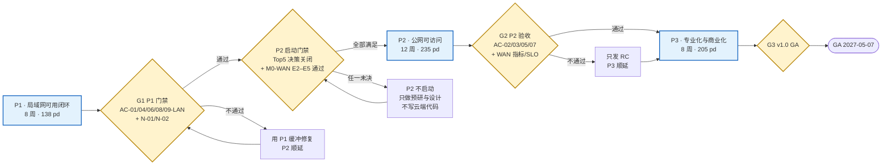
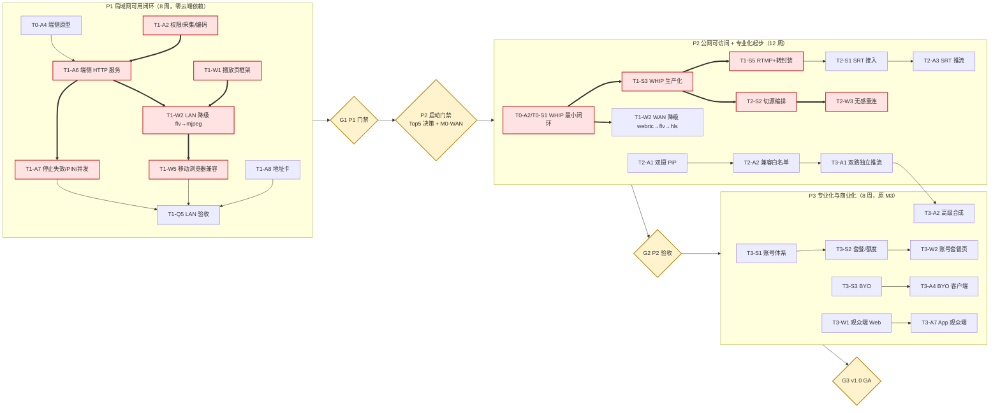
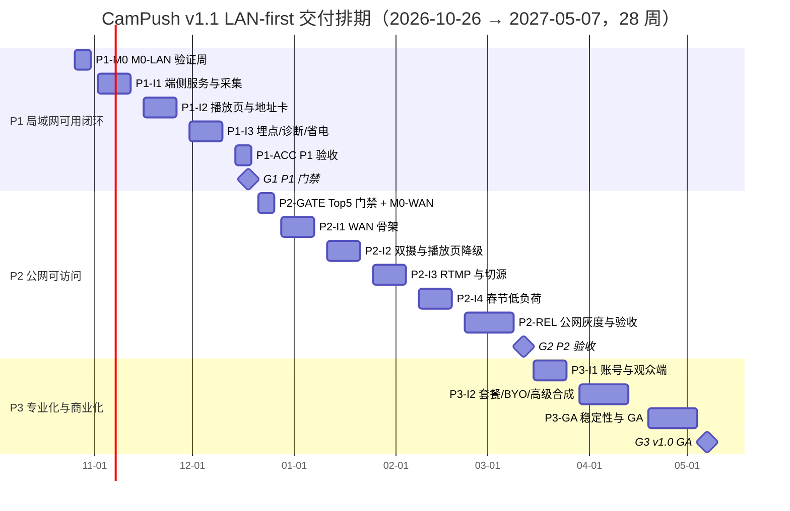

# 09 · 任务拆解、阶段排期与交付治理（LAN-first）

| 项目 | 值 |
|---|---|
| 文档状态 | 基线（Baseline） |
| 版本 | v1.1（LAN-first 阶段化重排） |
| 维护人 | 交付（delivery） |
| 依赖文档 | [00-conventions.md](./00-conventions.md)（**v1.5**：§17 裁定、§19.7 AC-01 起算裁定、**§20 交付分期与契约启用顺序**）、[PRD-v1.0.md](./PRD-v1.0.md)、[08-m0-verification.md](./08-m0-verification.md)（v1.1：E1–E7、M0-LAN/M0-WAN 拆分）、[01-architecture.md](./01-architecture.md)、[10-observability.md](./10-observability.md)、[11-risk-adr.md](./11-risk-adr.md) |
| 适用 PRD | PRD §8（功能清单）、§9（用户流程）、§16.2（验收口径）、§17（版本规划）、§18（风险与开放问题） |
| 上游输入 | 用户交付决策：**LAN-first**（P1 只做局域网闭环，P2 做公网且以 Top5 决策为启动门禁）；PRD v1.0；00 v1.1 |
| 下游消费方 | [10](./10-observability.md) 的指标启用阶段、[11](./11-risk-adr.md) 的 Top5 门禁与风险复审 |
| 最后更新 | 2026-10-20 |

> **v1.1 变更说明**：v1.0 按 M0 → M1 → M2 → M3（WAN-first，23 周）编排；v1.1 依用户决策改为 **P1（局域网可用闭环，8 周）→ P2（公网可访问 + 专业化起步，12 周）→ P3（专业化与商业化，8 周）**，共 28 周。**M0–M3 功能版本标签、4 个 Epic、31 个 Feature、118 个 Task 编号全部保留**，仅重排阶段归属、迭代位置与部分前置依赖；全期工作量与 00 契约数字不变（578 pd）。阶段定义见 §2.1，与原 23 周排期的差异见 §2.6.3。

---

## 1. 目的与范围

### 1.1 目的

1. 把 **LAN-first 交付决策**落成可执行计划：P1 在**零云端依赖**下交付“手机起服务、同网浏览器打开即可看”的闭环；P2 才引入云端与公网；P3 承接原 M3 的专业化与商业化。
2. 保留 PRD §17 的 M0–M3 功能版本语义与全部任务编号，使**功能视角**（M0–M3）与**交付视角**（P1/P2/P3）可双向追溯（§2.1.2）。
3. 用可复算的产能模型回答三个问题：P1 的 8 周够不够、P2 的 12 周瓶颈在哪、P3 的 8 周是否超配（§2.2、§2.6）。
4. 把 **Top5 决策**（D-1～D-5，见 [11](./11-risk-adr.md) §2.6）固化为 P2 的启动门禁，使“决策延迟”只阻塞 P2、不阻塞 P1。
5. 明确 PRD §16.2 的 9 条验收口径各自在 **P1 还是 P2** 验收，并给出分阶段 DoR / DoD。

### 1.2 范围

| 在范围内 | 说明 |
|---|---|
| P1/P2/P3 阶段定义、范围、不做项与退出标准 | §2.1 |
| 118 个任务的阶段归属、迭代位置、依赖与交付证据 | §2.3、§2.4 |
| 分阶段产能、负荷与 20% 缓冲 | §2.2、§2.10 |
| 阶段化关键路径（P1 LAN 链、P2 WAN 链、双摄链、P3 商业化链） | §2.5 |
| 分阶段 DoR/DoD、验收映射、交付物与评审节奏 | §2.8、§2.9、§2.11、§2.12 |

### 1.3 不在范围内

- 不定义协议、接口、字段、枚举、错误码（[00](./00-conventions.md)、[04-interface-contracts.md](./04-interface-contracts.md)）。
- 不定义指标公式与告警规则（[10](./10-observability.md)）；本文只引用其“启用阶段”。
- 不定义风险评分与 ADR 正文（[11](./11-risk-adr.md)）；本文引用其 Top5 门禁结论。
- 不给出 M0-LAN / M0-WAN 的实验方法（[08](./08-m0-verification.md)）；本文只排时间盒与退出判据。
- 不改动 00 契约；与 PRD §17 顺序不一致之处在 §5 登记并回报。

### 1.4 与 08 / 10 / 11 的边界

| 文档 | 权威内容 | 本文的引用方式 |
|---|---|---|
| [08](./08-m0-verification.md) | M0 假设 E1–E7、实验方法、设备矩阵 | M0 拆成 **M0-LAN**（P1 首周：**E6 必过 + E7 必做伴随项**、E1 可选）与 **M0-WAN**（P2 门禁周：**E2/E4/E5 必过、E3 条件项**）——与 [08 §1.3](./08-m0-verification.md) 一致 |
| [10](./10-observability.md) | 11 项指标口径、告警 ID、启用阶段 | 引用“P1 激活 / P2 启用”的指标清单作为阶段退出证据 |
| [11](./11-risk-adr.md) | 风险册、Top5 决策、ADR | 引用 D-1～D-5 与 R-019/R-020 作为 P2 启动门禁与阶段风险 |

---

## 2. 设计主体

### 2.1 交付阶段 P1 / P2 / P3

#### 2.1.1 阶段总览

| 阶段 | 周数 | 日期（含首尾） | 阶段目标 | 关键交付 | 门禁 |
|---|---|---|---|---|---|
| **P1 局域网可用闭环** | 8 | 2026-10-26 → 2026-12-18 | 已授权用户单摄推流后，同一 Wi-Fi/热点下另一设备用浏览器打开唯一地址即可观看；停止即失效 | Android LAN APK、端侧 HTTP 服务、LAN 内联播放页、地址卡、LAN 指标与看板 | **G1 P1 门禁**（2026-12-18） |
| **P2 公网可访问 + 专业化起步** | 12 | 2026-12-21 → 2027-03-12 | 复制一个 H5 地址即可在公网观看；支持 `webrtc → flv → hls` 降级、协议热切换地址不变、双摄 PiP、SRT/RTMP | 云端接入/SFU/转封装/HLS/TURN、WAN 播放页、双摄合成、WAN 指标与 SLO | **P2 启动门禁**（2026-12-25）+ **G2**（2027-03-12） |
| **P3 专业化与商业化** | 8 | 2027-03-15 → 2027-05-07 | 双路独立推流、多地址、BYO、录制、账号套餐、观众端 | 商业化客户端 + 服务端、观众端、BYO、合规与资质 | **G3 v1.0 GA**（2027-05-07） |

#### 2.1.2 功能版本（M0–M3）与交付阶段（P1–P3）映射

> 映射原则：**功能集合不变**，只改交付顺序与阶段承载。一个 M 版本可被拆到多个阶段，但每个 Task 只属于一个阶段（跨阶段提前执行的任务单列在 §2.3.2）。

| 功能版本 | PRD §17 内容 | 阶段归属 | 拆分说明 |
|---|---|---|---|
| **M0 技术验证** | 双摄支持率、WHIP+播放页、RTMP→HLS、PiP 合成、切源不变、LAN 端侧服务 | M0-LAN → **P1**（首周） M0-WAN → **P2**（门禁周） | M0-LAN：**E6 必过 + E7 必做**（8 类播放环境各 ≥1 条可用路径，缺口可带条件）、E1 可选；M0-WAN：**E2/E4/E5 必过、E3 条件项**（[00 §20.2](./00-conventions.md)、[08 §1.3](./08-m0-verification.md)） |
| **M1 可用闭环** | 访问范围开关、WAN 推流与唯一地址、LAN 端侧服务、单摄、地址卡、通知栏、停止即失效 | LAN 子集 → **P1** WAN 子集 → **P2** | P1 取 F1.1/F1.5/F1.6-LAN/F1.7/F1.8 + LAN 埋点与验证；WAN 部分（F1.2/F1.3/F1.4/F1.6-WAN/F1.9）随 P2 |
| **M2 双摄与增强** | 双摄 PiP/分屏、WAN SRT、FLV 降级、LAN WebRTC P2P、网络诊断、边推边看、录制、水印、多地址 | 网络诊断/AP 隔离/省电基础 → **P1** 双摄、SRT、FLV 降级、无感切换、LAN WebRTC、边推边看 → **P2** 录制/水印/多地址 → **P3** | 双摄依赖 D-3 门禁；SRT/RTMP 依赖 D-4/D-5；录制与多地址属专业化能力，随 P3 商业化交付 |
| **M3 专业化与商业化** | 双路独立、高级合成、账号套餐、观众端、BYO、日志导出、合规 | **P3** | 原样保留；T3-A8（省电模式）基础版提前到 P1，M3 段只留完善项 |

| 被移动的 Task | v1.0 阶段 | v1.1 阶段 | 理由 |
|---|---|---|---|
| T2-A5 网络诊断与 AP 隔离提示 | M2 / S6 | **P1** | P1 的 LAN 承诺含“AP 隔离时有明确提示”（AC-06），不能等到 P2 |
| T3-A8 省电模式基础 | M3 / S7 | **P1** | LAN 场景需要省电兜底；完善项仍在 P3 的 T3-A8 后续迭代 |
| T0-A4 / T0-W3 LAN 原型 | M0 / S0 | **P1** | M0 拆分后 M0-LAN 独立成周 |
| T2-A4 LAN WebRTC P2P | M2 / S5 | **P2** | P1 播放页只承诺 `flv → mjpeg`；WebRTC P2P 属增强，P3 产能不足 |
| T2-A6 本机边推边看 | M2 / S5 | **P2** | 依赖 WAN 播放页复用，属体验增强、非门禁 |
| T2-A7 录制/水印、T2-A8 多地址 | M2 / S6 | **P3** | 专业化能力，与商业化同批交付 |
| T1-Q3 性能与预算测试 | M1 / S3 | **P2** | P1 只做 LAN 首帧/资源预算抽样（含在 T1-Q5）；完整网络矩阵在 P2 |
| T2-S7 可观测性二期 | M2 / S6 | **P3** | 与观众端/商业化指标同批，P2 用一期指标 + SLO 即可 |

#### 2.1.3 P1 范围（局域网可用闭环）

**做**：权限引导（相机必过、麦克风可缺省）、单后/单前预览与热切换、H.264/AAC 硬编、分辨率/码率/帧率调节、静音/闪光灯、前台服务 + 通知栏、访问范围控件（LAN 可选、WAN 置灰“阶段二开放”）、LAN 设置分组（端口/PIN/并发上限/网络检测）、地址卡（复制/二维码/本机预览）、IP 变化重发地址、AP 隔离提示、省电模式基础；端侧 HTTP 服务、内联播放页、HTTP-FLV + MJPEG、`pageToken`/`mediaToken`、PIN、并发 1–3、≤ 1 s 停止失效、端口 8089→顺延；LAN 版播放页降级链 `flv → mjpeg` 与移动浏览器兼容；M0-LAN 验证、LAN E2E、停止失效/PIN/并发、崩溃率。

**不做（P1 明确排除）**：

| 排除项 | 原因 | 归属 |
|---|---|---|
| 公网/云端任何能力（房间、token、SFU、WHEP、HLS、TURN、额度） | LAN-first 的核心是用零云成本验证主链路 | P2 |
| HLS 兜底 | 端侧不承诺 HLS（[00 §8](./00-conventions.md)） | P2（公网播放页） |
| SRT / RTMP 推流 | 依赖 D-4/D-5 与云端接入 | P2 |
| 双摄合成（PiP/分屏） | 依赖 D-3 门槛；P1 只做单摄 | P2 |
| 录制/水印/多地址/账号套餐/观众端 | 专业化与商业化能力 | P3 |
| LAN WebRTC P2P | P1 播放链只承诺 FLV/MJPEG | P2（增强） |

**P1 验证口径**：M0-LAN 由 **E6（LAN 端侧服务，必过）+ E7（LAN 播放页兼容矩阵，必做伴随项，覆盖 iOS Safari / Android Chrome / 微信内置 / 系统浏览器 / 桌面等 8 类环境）** 组成，E1（双摄支持率）可选并把数据留给 D-3。

**P1 硬约束**：P1 任何交付物不得依赖云端域名、证书、TURN、账号；APK 在飞行模式下必须能完成“起服务 → 同网观看 → 停止失效”闭环。P1 的“访问范围”控件必须呈现 WAN 选项但置灰，文案“公网可访问 · 阶段二开放”，不得静默隐藏（[00 §20.3](./00-conventions.md)）。任务级校验见 §2.4.2。

#### 2.1.4 P2 范围（公网可访问 + 专业化起步）与启动门禁

**P2 启动门禁（全部满足才启动，缺一不启动）**：

| # | 门禁条件 | 判定人 | 时点 |
|---|---|---|---|
| 1 | **Top5 决策全部关闭**：D-1 默认访问范围、D-2 公网托管形态、D-3 双摄门槛、D-4 LAN 端侧 RTMP、D-5 RTMPS（权威推荐结论见 [00 §20.4](./00-conventions.md)，执行台账见 [11 §2.6](./11-risk-adr.md)） | Lead + 产品 | P2-GATE（2026-12-25） |
| 2 | **M0-WAN 通过**：**E2（WHIP + 统一播放页）、E4（双摄 PiP）、E5（切源地址不变）必过，E3（RTMP→HLS）为条件项**（可与 P2 首迭代并行） | 架构 + QA | P2-GATE |
| 3 | **P1 验收通过**（G1：AC-01/04/06/08/09 的 LAN 口径 + N-01/N-02） | Lead | 2026-12-18 |
| 4 | 云资源与占位域名/证书可用（`playHost`/`apiHost`/`whipHost`/`whepHost`/`turnHost`） | 服务端 | P2-GATE |

**做**：云端接入（WHIP/SRT/RTMP）、WHEP 播放、FLV 转封装、HLS 兜底、TURN、房间与鉴权（三类 token）、额度与限流、WAN 播放页与 `webrtc → flv → hls` 降级、协议热切换且地址不变、WAN 指标与 SLO、双摄 PiP/分屏（D-3 后）、SRT/RTMP 推流（D-4/D-5 后）、LAN WebRTC P2P 与边推边看（增强）。

**不做**：双路独立推流、多地址、BYO、录制、账号套餐、观众端（均属 P3）。

#### 2.1.5 P3 范围（专业化与商业化，原 M3）

双路独立推流与高级合成、多地址推流与录制/水印、BYO 服务端模式、账号与套餐/额度/计费、观众端（Web + App）、日志导出、合规与内容审核、灰度与 GA。

#### 2.1.6 阶段退出标准

| 阶段 | 退出标准（全部满足） | 不满足的处理 |
|---|---|---|
| P1 | ① **技术门禁**：M0-LAN 的 E6 通过、E7 达成（8 类播放环境各 ≥1 条可用路径，缺口可带条件）；② **开发验收**：LAN E2E、停止 ≤ 1 s 失效、PIN/token、并发 1–3、崩溃率 ≤ 1.0%；③ PRD §16.2 的 LAN 相关 AC（AC-01 LAN / AC-04 LAN / AC-06 / AC-08 P1 形态）+ N-01/N-02 通过；④ 无 P0/P1 缺陷；⑤ P1 看板与埋点可查。**M0-LAN 只是 P1 的前置技术门禁，不能单独宣布 P1 Go**（[00 §20.2](./00-conventions.md)） | G1 顺延，P2 启动同步顺延；用 P1 缓冲（118 pd）吸收 |
| P2 | ① AC-02/03/05/07 通过；② WAN 唯一地址可打开、首帧 < 2 s、切换地址不变、停止 410 ≤ 2 s、降级链可用（[00 §20.2](./00-conventions.md)）；③ WAN 指标进看板、SLO-1～4 生效；④ 公网灰度 10%→50%→100% 无 P0 | 只发 RC，不 GA；P3 顺延 |
| P3 | ① 全量 AC 通过；② 4 条 SLO 与错误预算达标；③ 专业模式与商业化验收（账号/套餐/BYO/观众端）端到端可用；④ 灰度与回滚演练完成（[00 §20.2](./00-conventions.md)） | GA 顺延，不超过 2 周（用 P3 缓冲 68 pd） |

### 2.2 角色、人力假设与阶段产能模型

**角色与人力（不变）**：Android 2（A）、服务端 2（S）、Web 1（W）、QA 1（Q）、产品/设计 1（P），共 7 人。

**阶段产能口径**

| 项 | 规则 |
|---|---|
| 工作日 | 1 周 = 5 个工作日；1 人日（pd）= 6 小时有效专注工时（含自测与单测，不含联调返工） |
| 假期扣减 | P1 无；P2 扣元旦 1 + 春节 5 = 6 个工作日/人；P3 扣清明 1 个工作日/人（劳动节按官方安排再评估，最多再扣 2 天，从 P3 缓冲吸收） |
| 排产上限 | 每个迭代按名义产能的 80% 排任务；假期所在阶段按**净产能**的 80% 复核 |
| 阶段缓冲 | 阶段内不预分配，由产品按周释放，单次 ≤ 10 pd；不得跨阶段提前消耗（除 §2.3.2 已列前置） |
| P1 服务端去向 | P1 不含云端交付物，服务端 2 人仅用 24 pd 做 P2 前置（§2.3.2），其余转入 P2 预研（不计入 P1 承诺） |

**阶段产能与负荷**

| 阶段 | 周数 | 名义工作日/人 | 净工作日/人 | 净产能 | 窗口计划工作量 | 负荷 | 缓冲 |
|---|---|---|---|---|---|---|---|
| P1 | 8 | 40 | 40 | 280 pd | 162 pd（承诺 138 + P2 前置 24） | 57.9% | 118 pd（42.1%） |
| P2 | 12 | 60 | 54（扣元旦 1 + 春节 5） | 378 pd | 211 pd（归属 235 − 前置 24） | 55.8% | 167 pd（44.2%） |
| P3 | 8 | 40 | 39（扣清明 1） | 273 pd | 205 pd | 75.1% | 68 pd（24.9%） |
| **合计** | **28** | **140** | **133** | **931 pd** | **578 pd** | **62.1%** | **353 pd（37.9%）** |

> 结论：三个阶段均 ≤ 80% 排产（P3 为 75.1%，其余两阶段因 LAN/WAN 拆分而更低）；全期缓冲 353 pd（37.9%）远高于 20% 红线。缓冲偏高是 LAN-first 的必然结果——P1 不含云端交付物，服务端 2 人产能富余，主动转为 P2 前置与预研，而非虚报工时。

**角色 × 阶段（工作量归属，pd）**

| 角色 | P1 | P2 | P3 | 合计 | 净产能 | 负荷 |
|---|---|---|---|---|---|---|
| Android（2 人） | 53 | 52 | 61 | 166 | 266 | 62.4% |
| 服务端（2 人） | 0 | 106 | 60 | 166 | 266 | 62.4% |
| Web（1 人） | 25 | 29 | 28 | 82 | 133 | 61.7% |
| QA（1 人） | 30 | 24 | 28 | 82 | 133 | 61.7% |
| 产品/设计（1 人） | 30 | 24 | 28 | 82 | 133 | 61.7% |
| **合计** | **138** | **235** | **205** | **578** | **931** | **62.1%** |

**阶段窗口负荷（含 P2 前置，按角色）**

| 阶段 | Android | 服务端 | Web | QA | 产品/设计 | 合计 |
|---|---|---|---|---|---|---|
| P1 | 53/80（66.2%） | 24/80（30.0%） | 25/40（62.5%） | 30/40（75.0%） | 30/40（75.0%） | 162/280（57.9%） |
| P2 | 52/108（48.1%） | 82/108（75.9%） | 29/54（53.7%） | 24/54（44.4%） | 24/54（44.4%） | 211/378（55.8%） |
| P3 | 61/78（78.2%） | 60/78（76.9%） | 28/39（71.8%） | 28/39（71.8%） | 28/39（71.8%） | 205/273（75.1%） |

> 瓶颈识别：P1 瓶颈是 **Android（66.3%）与 QA/产品（75.0%）**，服务端仅 30.0%；P2 瓶颈是 **服务端（75.9%）**，因为 WAN 的接入/转封装/切源几乎全压在这 2 人；P3 三职能均在 71.8%–78.2%，无单点过载。P2 的 12 周中服务端是唯一需要按周盯的资源。

### 2.3 WBS 三级拆解（按 P1/P2/P3 分组）

**编号规则**：Epic = `E{m}`（保留）；Feature = `F{m}.{n}`（保留）；Task = `T{m}-{角色}{序号}`（保留，不重编号）。本节在原编号基础上新增**阶段分组**与**迭代**列：同一 Feature 若被拆到两个阶段，会以“（P1/P2 部分）”标注并在两处分别列出其任务子集。

| 阶段 | 对应 Epic | Feature 数 | Task 数 | 工作量 | 主要交付 |
|---|---|---|---|---|---|
| P1 | E0-LAN（M0-LAN）、E1-LAN（M1 LAN 子集） | 14 | 35 | 138 pd | LAN 闭环 APK + 端侧服务 + 内联播放页 + LAN 指标 |
| P2 | E0-WAN、E1-WAN（M1 WAN 子集）、E2（M2 云端/双摄/SRT） | 18 | 46 | 235 pd | 云端媒体服务 + WAN 播放页 + 双摄 + SRT/RTMP + WAN 指标 |
| P3 | E2（M2 录制/多地址）、E3（M3） | 9 | 37 | 205 pd | 商业化 + 观众端 + BYO + 合规 |
| **合计** | 4 Epic | **31** | **118** | **578 pd** | — |

#### 2.3.1 P1 · 局域网可用闭环

**F0.1 双摄并发支持率验证**

| 任务 ID | 任务 | 迭代 | 估算 | 前置依赖 | 主责 | 交付证据 |
|---|---|---|---|---|---|---|
| T0-A1 | 双摄并发能力探测与机型白名单（**P1 可选**，为 D-3 门槛提供数据） | P1-ACC | 5 | 测试机到位 | Android | 支持率统计表 + 失败机型原因分类 |

**F0.6 LAN 端侧 HTTP 服务 + HTTP-FLV/MJPEG 播放**

| 任务 ID | 任务 | 迭代 | 估算 | 前置依赖 | 主责 | 交付证据 |
|---|---|---|---|---|---|---|
| T0-A4 | 端侧服务最小原型（HTTP 服务 + FLV / MJPEG 分发，端口 8089 起） | P1-M0 | 2 | 无 | Android | 同网设备可播录像 |
| T0-W3 | LAN 播放页单文件原型（内联，无外链，≤ 64 KB；支撑 **E7** 兼容矩阵） | P1-M0 | 1 | T0-A4 | Web | 单文件 HTML ≤ 64 KB |

**F0.7 验证治理与证据归档（横向）（P1 部分）**

| 任务 ID | 任务 | 迭代 | 估算 | 前置依赖 | 主责 | 交付证据 |
|---|---|---|---|---|---|---|
| T0-Q1 | 设备/浏览器矩阵与验证用例（含 **E7** 的 8 类播放环境） | P1-M0 | 2 | 无 | QA | 矩阵表（≥ 20 机型、4 内核） |
| T0-Q2 | M0-LAN 证据归档（E6 必过；E1 可选结果一并记录） | P1-ACC | 2 | T0-A4、T0-W3 | QA | M0 证据包 |
| T0-Q3 | 首帧/延迟计时方法与埋点校验 | P1-M0 | 2 | T0-W3 | QA | 计时口径说明 + 校验记录 |
| T0-P1 | 验证指标与退出条件（D0 判据）定义 | P1-M0 | 2 | 无 | 产品 | D0 判据表（对应 [08](./08-m0-verification.md)） |
| T0-P2 | 外部依赖与风险清单（测试机、云资源、媒体云试用） | P1-M0 | 2 | 无 | 产品 | 外部依赖登记表 |
| T0-P3 | M0-LAN 评审、P1 范围冻结与 P2 前置条件确认 | P1-ACC | 2 | T0-Q2 | 产品 | M0 报告 + M1 范围基线 |

**F1.1 采集与模式基线**

| 任务 ID | 任务 | 迭代 | 估算 | 前置依赖 | 主责 | 交付证据 |
|---|---|---|---|---|---|---|
| T1-A2 | 权限引导、单后/单前采集、热切换、闪光灯、静音（P1 单摄；双摄在 P2 门禁后） | P1-I1 | 6 | T0-P1 | Android | 三模式切换录屏 + 1080p 预览 |

**F1.2 访问范围开关与房间生命周期（P1 部分）**

| 任务 ID | 任务 | 迭代 | 估算 | 前置依赖 | 主责 | 交付证据 |
|---|---|---|---|---|---|---|
| T1-A1 | 访问范围控件（P1：LAN 可选、WAN 置灰并提示“阶段二开放”；P2 双向可切） | P1-I2 | 4 | T0-P1 | Android | 三态交互录屏 + `accessScope` 上报 |

**F1.5 LAN 端侧服务闭环**

| 任务 ID | 任务 | 迭代 | 估算 | 前置依赖 | 主责 | 交付证据 |
|---|---|---|---|---|---|---|
| T1-A6 | 端侧 HTTP 服务：`/s/{pageToken}`、`/api/v1/status`、`/live.flv`、`/stream.mjpg`、`/healthz`、端口顺延 | P1-I1 | 8 | T0-A4 | Android | 同网 3 设备播放记录 |
| T1-A7 | LAN token/PIN、并发 1–3（`6005`）、停止后 ≤ 1 s 连接拒绝 | P1-I2 | 4 | T1-A6 | Android | 停止即失效 + 第 4 位观看者拒绝 |

**F1.6 统一播放页与自适应降级（P1 部分）**

| 任务 ID | 任务 | 迭代 | 估算 | 前置依赖 | 主责 | 交付证据 |
|---|---|---|---|---|---|---|
| T1-W1 | 播放页框架与 `playerState` 状态机（8 态，P1 走 LAN 分支） | P1-I1 | 4 | T0-W3 | Web | 状态迁移用例 |
| T1-W3 | PIN 输入与端侧 token 刷新（不改地址栏） | P1-I1 | 4 | T1-W1 | Web | 刷新前后 URL 对比 |
| T1-W2 | 播放页降级引擎（P1：`flv → mjpeg`；P2 扩展 `webrtc → flv → hls`） | P1-I2 | 8 | T1-W1、T1-A6 | Web | 降级触发日志 + 首帧分布 |
| T1-W5 | LAN 播放页移动浏览器兼容（iOS Safari / Android Chrome / 厂商内核）与错误页 | P1-I3 | 4 | T1-W2 | Web | 兼容与错误态用例 |

**F1.7 唯一播放地址与分发动作**

| 任务 ID | 任务 | 迭代 | 估算 | 前置依赖 | 主责 | 交付证据 |
|---|---|---|---|---|---|---|
| T1-A8 | LAN 地址卡（复制/二维码/本机预览；提示“仅同一局域网可打开”） | P1-I3 | 4 | T1-A6 | Android | 四动作录屏 + 地址一致性校验 |

**F1.8 前台服务与实时状态**

| 任务 ID | 任务 | 迭代 | 估算 | 前置依赖 | 主责 | 交付证据 |
|---|---|---|---|---|---|---|
| T1-A5 | 前台服务 + 通知栏常驻控制（停止/时长/模式；P2 补 WAN 状态） | P1-I2 | 5 | T1-A2 | Android | 后台 30 min 存活记录 |
| T1-A9 | 实时状态指标（码率/帧率/上行/网络质量/LAN 观看人数） | P1-I2 | 3 | T1-A2、T1-A6 | Android | 弱网下指标滚动录屏 |

**F1.9 埋点与可观测建成（P1 部分）**

| 任务 ID | 任务 | 迭代 | 估算 | 前置依赖 | 主责 | 交付证据 |
|---|---|---|---|---|---|---|
| T1-A10 | 埋点 SDK（队列/批量/离线/脱敏）与 P1 事件子集（LAN） | P1-I3 | 4 | T0-Q3、T1-A1 | Android | 18 事件中 M1 子集全绿 |
| T1-W4 | 播放页埋点（`play_page_open`、`play_first_frame`、`play_fallback`、`play_failed`） | P1-I3 | 4 | T1-W2、T1-A10 | Web | 与 10 号文档字段比对 |
| T1-P5 | LAN 指标看板需求与告警规则评审 | P1-I3 | 6 | T1-P2 | 产品 | 看板需求确认记录 |

**F1.10 测试、合规与发布（P1 部分）**

| 任务 ID | 任务 | 迭代 | 估算 | 前置依赖 | 主责 | 交付证据 |
|---|---|---|---|---|---|---|
| T1-Q1 | 功能用例库（P1：LAN 双设备闭环，≥ 80 条，含错误码分支） | P1-I1 | 4 | T0-Q1 | QA | 用例库 v1 |
| T1-Q4 | 安全与隐私用例（token 失效、PIN 爆破限速、并发、日志脱敏） | P1-I1 | 4 | T0-Q1 | QA | 安全用例集 |
| T1-Q2 | 兼容性矩阵（P1：Top 12 机型 × 2 移动浏览器；P2 扩至 Top 20 × 4 内核） | P1-I2 | 8 | T1-A2、T1-W2 | QA | 兼容性报告 |
| T1-Q5 | P1 回归与验收报告（AC-01/04/06/08/09 的 LAN 口径 + N-01/N-02） | P1-I3 | 4 | T1-Q2、T2-Q4 | QA | 发版验收报告 |
| T1-P1 | 需求澄清与 UI 稿（主界面/LAN 设置分组/地址卡/错误态） | P1-I1 | 4 | T0-P1 | 产品 | 设计稿 v1 + 交互说明 |
| T1-P2 | P1 验收标准逐条化（PRD §16.2 的 LAN 口径映射） | P1-I1 | 4 | T1-P1 | 产品 | 映射表（本文 §2.9） |
| T1-P3 | 合规与隐私文案（“同网设备可能访问”“仅限可信局域网”） | P1-I2 | 4 | T1-P1 | 产品 | 文案清单（对齐 [07](./07-security-privacy.md)） |
| T1-P4 | 埋点与指标口径评审（LAN 子集，与 10 号文档对齐） | P1-I2 | 4 | T1-P2 | 产品 | 口径确认签字 |
| T1-P6 | P1 发布检查单与内测招募素材 | P1-I3 | 2 | T1-Q5 | 产品 | 检查单 + 素材包 |

**F2.4 LAN 增强（WebRTC P2P、诊断、AP 隔离）（P1 部分）**

| 任务 ID | 任务 | 迭代 | 估算 | 前置依赖 | 主责 | 交付证据 |
|---|---|---|---|---|---|---|
| T2-A5 | 网络诊断、IP 变化重发地址（旧 token 失效）与 AP 隔离提示（`6004`） | P1-I3 | 4 | T1-A6 | Android | 隔离环境复现 + 提示截图 |

**F2.7 兼容性验证与发布（P1 部分）**

| 任务 ID | 任务 | 迭代 | 估算 | 前置依赖 | 主责 | 交付证据 |
|---|---|---|---|---|---|---|
| T2-Q4 | LAN 并发/AP 隔离/功耗测试（3 观看者、10 min 温升） | P1-I3 | 4 | T2-A5、T1-A7 | QA | 并发与温升数据 |

**F3.5 性能、稳定性与成本（P1 部分）**

| 任务 ID | 任务 | 迭代 | 估算 | 前置依赖 | 主责 | 交付证据 |
|---|---|---|---|---|---|---|
| T3-A8 | 省电模式基础（强制单摄 + 降码率 + 降分辨率） | P1-I3 | 4 | T1-A2、T1-A9 | Android | 省电模式前后指标对比 |

> **P1 小计**：Android 53 / 服务端 0 / Web 25 / QA 30 / 产品 30 = **138 pd**（35 个任务；另有 §2.3.2 的 P2 前置 24 pd 在 P1 窗口执行）。

#### 2.3.2 P1 窗口内的 P2 前置（工作量归属 P2）

> 这些任务属于 P2 交付物，但在 P1 的 W5–W8 由服务端提前启动，目的是让 P2 的第一周就能出 WHIP 与房间骨架。它们**不构成 P1 的交付依赖**（P1 验收不引用），也**不得**在 P1 期间引入对云端资源的运行时依赖。
>
> **计数说明**：本表 5 行与 §2.3.3 中同 ID 行重复列出，仅用于说明“执行窗口在 P1、工作量归属 P2”；工作量只计一次（归 P2），故 §2.3.5 的任务数仍为 118、总工作量仍为 578 pd。

| 任务 ID | 任务 | 迭代 | 估算 | 前置依赖 | 主责 | 交付证据 |
|---|---|---|---|---|---|---|
| T0-S1 | WHIP 接入 + WHEP 播放最小链路 | P1-I2 | 5 | 云资源与占位域名 | 服务端 | 端到端可播录像 |
| T0-S4 | 验证环境搭建（占位域名、证书、TURN、监控最小集） | P1-M0 | 2 | 无 | 服务端 | 环境清单与访问方式 |
| T1-S1 | 房间生命周期 REST（创建/查询/停止、幂等键、额度、10 min 未推流回收） | P1-I2 | 9 | T0-P1 | 服务端 | 接口测试报告 + 状态机迁移日志 |
| T1-S6 | token 校验、错误信封（§9）、限流（`3008`/`429` + `Retry-After`） | P1-I3 | 4 | T1-S1 | 服务端 | 错误码矩阵测试记录 |
| T1-S7 | 云端可观测（指标导出、结构化日志、`traceId` 贯通、脱敏） | P1-I3 | 4 | T1-S1 | 服务端 | 一次完整链路 trace |

> **P2 前置小计**：24 pd（服务端 24 pd）。

#### 2.3.3 P2 · 公网可访问 + 专业化起步

**F0.2 WAN WHIP 推流 + 统一 H5 播放页闭环**

| 任务 ID | 任务 | 迭代 | 估算 | 前置依赖 | 主责 | 交付证据 |
|---|---|---|---|---|---|---|
| T0-A2 | WHIP 推流最小闭环（App → 接入端，单摄 720p30） | P2-GATE | 4 | 无（与 T0-S1 并行，接口按 [04](./04-interface-contracts.md) 初稿） | Android | 推流成功日志 + 首帧时间 |
| T0-S1 | WHIP 接入 + WHEP 播放最小链路 | P1-I2 | 5 | 云资源与占位域名 | 服务端 | 端到端可播录像 |
| T0-W1 | 播放页最小原型（WHEP 优先 + 错误态） | P2-GATE | 3 | T0-S1 | Web | 可打开的播放页 URL |

**F0.3 RTMP 推流 → 服务端转 HLS 兜底**

| 任务 ID | 任务 | 迭代 | 估算 | 前置依赖 | 主责 | 交付证据 |
|---|---|---|---|---|---|---|
| T0-S2 | RTMP 接入 → 转封装 FLV / HLS 切片验证 | P2-GATE | 4 | T0-S1 | 服务端 | HLS 可播 + 切片时长记录 |
| T0-W2 | HLS 兜底播放与首帧计时探针 | P2-I1 | 2 | T0-W1 | Web | 首帧计时数据样本 |

**F0.4 双摄 PiP 本地合成推单路**

| 任务 ID | 任务 | 迭代 | 估算 | 前置依赖 | 主责 | 交付证据 |
|---|---|---|---|---|---|---|
| T0-A3 | PiP / 分屏 OpenGL ES 合成单路输出验证 | P2-GATE | 3 | T0-A1 | Android | 合成画面 + CPU/温度采样 |

**F0.5 公网协议切换地址不变**

| 任务 ID | 任务 | 迭代 | 估算 | 前置依赖 | 主责 | 交付证据 |
|---|---|---|---|---|---|---|
| T0-S3 | `ingest:switch` 切源验证（roomId / playUrl 不变） | P2-GATE | 3 | T0-S1 | 服务端 | 切换前后 URL 对比记录 |

**F0.7 验证治理与证据归档（横向）（P2 部分）**

| 任务 ID | 任务 | 迭代 | 估算 | 前置依赖 | 主责 | 交付证据 |
|---|---|---|---|---|---|---|
| T0-S4 | 验证环境搭建（占位域名、证书、TURN、监控最小集） | P1-M0 | 2 | 无 | 服务端 | 环境清单与访问方式 |

**F1.2 访问范围开关与房间生命周期（P2 部分）**

| 任务 ID | 任务 | 迭代 | 估算 | 前置依赖 | 主责 | 交付证据 |
|---|---|---|---|---|---|---|
| T1-S1 | 房间生命周期 REST（创建/查询/停止、幂等键、额度、10 min 未推流回收） | P1-I2 | 9 | T0-P1 | 服务端 | 接口测试报告 + 状态机迁移日志 |

**F1.3 鉴权与地址安全**

| 任务 ID | 任务 | 迭代 | 估算 | 前置依赖 | 主责 | 交付证据 |
|---|---|---|---|---|---|---|
| T1-S2 | token 体系（`pageToken`/`mediaToken`/`ingestToken` 签发、撤销、刷新、签核顺序） | P2-I1 | 7 | T1-S1 | 服务端 | 三类 token 用例 + 撤销验证 |
| T1-S6 | token 校验、错误信封（§9）、限流（`3008`/`429` + `Retry-After`） | P1-I3 | 4 | T1-S1 | 服务端 | 错误码矩阵测试记录 |

**F1.4 WAN 推流（WHIP 默认 + RTMP）**

| 任务 ID | 任务 | 迭代 | 估算 | 前置依赖 | 主责 | 交付证据 |
|---|---|---|---|---|---|---|
| T1-A3 | WHIP 推流集成（重连、编码基线、码率自适应骨架） | P2-I1 | 6 | T0-A2 | Android | `ingestState` 全态覆盖 |
| T1-A4 | RTMP 推流集成与“默认协议不可用则降级” | P2-I1 | 4 | T1-A3 | Android | 降级路径录屏 + `pushProtocol` 上报 |
| T1-S3 | WHIP 接入生产化（单会话、顶号 `4004`、ICE/TURN 回落） | P2-I2 | 9 | T0-S1、T1-S2 | 服务端 | 并发接入与顶号测试 |
| T1-S5 | RTMP 接入 + 转封装 FLV/HLS（`EXT-X-TARGETDURATION:2`、6 分片、`ENDLIST`） | P2-I3 | 8 | T1-S3 | 服务端 | HLS 播放校验 + 分片统计 |

**F1.6 统一播放页与自适应降级（P2 部分）**

| 任务 ID | 任务 | 迭代 | 估算 | 前置依赖 | 主责 | 交付证据 |
|---|---|---|---|---|---|---|
| T1-S4 | WHEP 播放 + `play-session` 协议协商（`protocols` 字段） | P2-I1 | 7 | T1-S2、T1-A3 | 服务端 | 协商响应样例 + PIN 校验 |

**F1.9 埋点与可观测建成（P2 部分）**

| 任务 ID | 任务 | 迭代 | 估算 | 前置依赖 | 主责 | 交付证据 |
|---|---|---|---|---|---|---|
| T1-S7 | 云端可观测（指标导出、结构化日志、`traceId` 贯通、脱敏） | P1-I3 | 4 | T1-S1 | 服务端 | 一次完整链路 trace |

**F1.10 测试、合规与发布（P2 部分）**

| 任务 ID | 任务 | 迭代 | 估算 | 前置依赖 | 主责 | 交付证据 |
|---|---|---|---|---|---|---|
| T1-Q3 | 性能与预算测试（首帧、延迟、CPU/温度/内存；P2 补 WAN 网络矩阵） | P2-REL | 4 | T1-A3、T2-W2 | QA | 预算达标表 |

**F2.1 双摄合成生产化**

| 任务 ID | 任务 | 迭代 | 估算 | 前置依赖 | 主责 | 交付证据 |
|---|---|---|---|---|---|---|
| T2-A1 | 双摄 PiP/分屏合成生产化（`dualLayout`、`dualPrimary`、小窗拖动缩放） | P2-I2 | 10 | T0-A3、T1-A2 | Android | 三种合成方式录屏 + 资源预算达标 |
| T2-A2 | 双摄兼容性白名单与运行时检测（不支持则隐藏选项，`1004`/`2009`） | P2-I3 | 5 | T2-A1 | Android | 支持率报表 + 隐藏逻辑用例 |
| T2-A9 | 性能保护：热/电量降级（`7003`/`7004` + 提示） | P2-I3 | 3 | T2-A1 | Android | 降级触发与恢复记录 |
| T2-P1 | 双摄交互与降级提示设计（合成方式切换、耗电提示） | P2-I1 | 5 | T1-P1 | 产品 | 设计稿 v2 |

**F2.2 WAN SRT 推流与协议热切换**

| 任务 ID | 任务 | 迭代 | 估算 | 前置依赖 | 主责 | 交付证据 |
|---|---|---|---|---|---|---|
| T2-A3 | SRT 推流集成 + 推流中协议切换（`ingest:switch`） | P2-I4 | 6 | T1-A4、T2-S1 | Android | 切换前后地址对比 + `interruptMs` |
| T2-S1 | SRT 接入（listener、`streamid` token、`latency=200`） | P2-I3 | 8 | T1-S3 | 服务端 | SRT 推流成功 + 弱网对比 |
| T2-S2 | 协议热切换切源编排（`switching` 状态、15 s 无首帧判 `failed`、`graceMs` 5 s） | P2-REL | 8 | T1-S3、T1-S5 | 服务端 | 切源状态机测试 |

**F2.3 播放页 FLV 降级与切换无感**

| 任务 ID | 任务 | 迭代 | 估算 | 前置依赖 | 主责 | 交付证据 |
|---|---|---|---|---|---|---|
| T2-W1 | FLV 降级通道（MSE 解析、5 s tag 保活、2.0 s 预算） | P2-I2 | 8 | T1-W2 | Web | FLV 降级成功记录 |
| T2-W2 | 降级链重构（webrtc → flv → hls，`unsupported` 立即跳过，总兜底 ≤ 10 s） | P2-I3 | 4 | T2-W1 | Web | 阶梯时序表 |
| T2-W3 | 源切换无感重连（SSE `source-switched`、`reconnecting → playing`） | P2-REL | 4 | T2-S2 | Web | 地址栏不变 + 重连耗时 |
| T2-S3 | FLV 分发优化（`no-store`、5 s 至少 1 tag、连接复用） | P2-I4 | 5 | T1-S5 | 服务端 | 长稳 2 h 无断流 |
| T2-W5 | 埋点补全（`play_fallback` reason 枚举、降级率） | P2-REL | 4 | T2-W1、T1-W4 | Web | 降级原因分布 |

**F2.4 LAN 增强（WebRTC P2P、诊断、AP 隔离）（P2 部分）**

| 任务 ID | 任务 | 迭代 | 估算 | 前置依赖 | 主责 | 交付证据 |
|---|---|---|---|---|---|---|
| T2-A4 | LAN 端侧 WebRTC P2P / 本地低延迟通道（P2 增强，非门禁） | P2-I3 | 8 | T0-A4、T1-A6 | Android | LAN 首帧 ≤ 1.5 s 记录 |
| T2-P2 | AP 隔离排查指引与帮助文档（依据 `6004` 语义与端侧自检流程） | P2-I2 | 4 | T1-A6 | 产品 | 帮助页文案 |

**F2.5 增强能力（边推边看、录制、水印、多地址）（P2 部分）**

| 任务 ID | 任务 | 迭代 | 估算 | 前置依赖 | 主责 | 交付证据 |
|---|---|---|---|---|---|---|
| T2-A6 | 本机边推边看（复用 LAN/WAN 播放页视角） | P2-I4 | 3 | T1-W2 | Android | 边推边看 ≥ 30 min |
| T2-P3 | 专业模式边界与提示文案（多地址/双路） | P2-I2 | 4 | T1-P3 | 产品 | 文案 + 二级页面入口定义 |

**F2.6 容量、成本与稳定性（P2 部分）**

| 任务 ID | 任务 | 迭代 | 估算 | 前置依赖 | 主责 | 交付证据 |
|---|---|---|---|---|---|---|
| T2-S4 | HLS 切片与窗口调优（2 s/6 分片、直播窗口 ≥ 12 s） | P2-I4 | 5 | T1-S5 | 服务端 | 窗口与延迟实测 |
| T2-S8 | 稳定性加固（优雅重启、房间恢复、`410`/`404` 语义） | P2-REL | 6 | T2-S3 | 服务端 | 故障注入测试 |
| T2-S5 | 容量与成本工程（码率上限、并发上限、TURN 配额、单房间成本模型） | P2-REL | 7 | T2-S2、T2-S3 | 服务端 | 单房间成本测算表 |
| T2-S6 | 多地址 / BYO 推流地址签发 | P2-I4 | 5 | T1-S1、T2-S1 | 服务端 | 多地址签发样例 |
| T2-W4 | 弱网 UI 与可访问性（码率/网络提示、对比度、键盘可达） | P2-REL | 4 | T2-W2 | Web | 弱网 UI 截图 + 检查表 |

**F2.7 兼容性验证与发布（P2 部分）**

| 任务 ID | 任务 | 迭代 | 估算 | 前置依赖 | 主责 | 交付证据 |
|---|---|---|---|---|---|---|
| T2-Q1 | 双摄设备兼容性测试（Top 30 机型，支持率与失败归因） | P2-I3 | 8 | T2-A1、T0-Q1 | QA | 支持率报告（进 [11](./11-risk-adr.md) R-001） |
| T2-Q2 | 协议切换中断时长测试（p50 ≤ 3 s、p95 ≤ 5 s） | P2-REL | 4 | T2-S2、T2-W3 | QA | 中断分布（≥ 100 次切换） |
| T2-Q3 | 弱网矩阵（丢包 0–10%、抖动 0–100 ms、带宽 800 kbps–4 Mbps） | P2-I4 | 4 | T2-A3、T2-W2 | QA | 弱网矩阵报告 |
| T2-Q5 | M2 回归 + HLS 兜底触发率验证 | P2-REL | 4 | T2-Q1、T2-Q2 | QA | 回归报告 + 触发率基线 |
| T2-P4 | M2 验收评审与指标看板复核 | P2-REL | 5 | T2-Q5 | 产品 | D2 评审纪要 |
| T2-P5 | 内测反馈闭环与优先级重排 | P2-GATE | 3 | T1-Q5 | 产品 | 反馈清单与排期调整记录 |
| T2-P6 | 成本模型初版（每房间带宽/转码成本） | P2-REL | 3 | T2-S5 | 产品 | 成本模型表（供 [11](./11-risk-adr.md) R-003） |

> **P2 小计**：Android 52 / 服务端 106 / Web 29 / QA 24 / 产品 24 = **235 pd**（46 个任务，含 §2.3.2 的 24 pd 前置）。

#### 2.3.4 P3 · 专业化与商业化

**F2.5 增强能力（边推边看、录制、水印、多地址）（P3 部分）**

| 任务 ID | 任务 | 迭代 | 估算 | 前置依赖 | 主责 | 交付证据 |
|---|---|---|---|---|---|---|
| T2-A7 | 本地录制与水印（边推边录，码率不劣化 > 10%） | P3-GA | 5 | T2-A1 | Android | 录制文件 + 推流指标对比 |
| T2-A8 | 多地址推流（专业模式入口，明确提示多地址） | P3-I2 | 4 | T1-A4 | Android | 双地址同时可播 |

**F2.6 容量、成本与稳定性（P3 部分）**

| 任务 ID | 任务 | 迭代 | 估算 | 前置依赖 | 主责 | 交付证据 |
|---|---|---|---|---|---|---|
| T2-S7 | 可观测性二期（切换中断、HLS 触发率、降级率指标接入） | P3-GA | 4 | T1-S7、T2-S2 | 服务端 | 指标上线清单 |

**F3.1 双路独立推流与高级合成**

| 任务 ID | 任务 | 迭代 | 估算 | 前置依赖 | 主责 | 交付证据 |
|---|---|---|---|---|---|---|
| T3-A1 | 双路独立推流（专业模式，两个地址明确提示） | P3-I1 | 10 | T2-A1、T2-A2 | Android | 双地址并行可播 ≥ 30 min |
| T3-A2 | 高级合成（分屏完善、主次交换动画、美颜滤镜） | P3-I2 | 8 | T3-A1 | Android | 合成效果录屏 + 帧率 |

**F3.2 账号、套餐与商业化客户端**

| 任务 ID | 任务 | 迭代 | 估算 | 前置依赖 | 主责 | 交付证据 |
|---|---|---|---|---|---|---|
| T3-S1 | 账号体系与鉴权（注册/登录/设备绑定） | P3-I1 | 9 | T1-S1 | 服务端 | 登录与越权测试 |
| T3-A3 | 账号与套餐入口（登录、额度展示、购买跳转） | P3-I2 | 6 | T3-S1 | Android | 额度不足引导（`2004`）录屏 |
| T3-S2 | 套餐/额度/计费（房间分钟数、超额 `2004`） | P3-I2 | 9 | T3-S1 | 服务端 | 计费对账 + 限额测试 |
| T3-W2 | 账号与套餐页（Web 端登录、购买、额度） | P3-I2 | 4 | T3-S1 | Web | 端到端购买链路 |
| T3-P1 | 商业化方案定稿（套餐结构、BYO 免费工具边界、定价） | P3-I1 | 8 | T2-P6 | 产品 | 方案文档（对应 [11](./11-risk-adr.md) Q5） |

**F3.3 观众端与分发增强**

| 任务 ID | 任务 | 迭代 | 估算 | 前置依赖 | 主责 | 交付证据 |
|---|---|---|---|---|---|---|
| T3-A7 | App 内简易观众端（复用播放页能力观看他人房间） | P3-GA | 5 | T1-W2 | Android | 观看他人房间录屏 |
| T3-S5 | 观众端 API（房间列表/进入权限/观看限制） | P3-I2 | 4 | T1-S2、T1-S1 | 服务端 | 接口用例 |
| T3-W1 | 观众端 Web 页面（列表、进入房间、复用播放页） | P3-I1 | 8 | T1-W2 | Web | 页面可访问 + 复用验证 |
| T3-W4 | 分享落地页与 OG 卡片 | P3-I2 | 4 | T1-W2 | Web | 分享预览截图 |

**F3.4 BYO 与多地址**

| 任务 ID | 任务 | 迭代 | 估算 | 前置依赖 | 主责 | 交付证据 |
|---|---|---|---|---|---|---|
| T3-A4 | BYO 自定义推流地址配置与连通性测试 | P3-I2 | 6 | T1-S1 | Android | 三种地址协议连通结果 |
| T3-S4 | 多地址推流服务端支持（多 ingest 会话、每路线路独立状态与失败隔离） | P3-I2 | 4 | T1-S3、T2-S6 | 服务端 | 多地址并行可播 ≥ 30 min；单路失败不影响其他路 |
| T3-S3 | BYO 服务端模式（自定义域名、回源校验、能力降级提示） | P3-I1 | 7 | T2-S6 | 服务端 | BYO 端到端验证 |
| T3-A6 | 多地址推流完善（3 路并发、失败隔离） | P3-GA | 5 | T3-A1 | Android | 单路失败不影响其他路 |

**F3.5 性能、稳定性与成本（P3 部分）**

| 任务 ID | 任务 | 迭代 | 估算 | 前置依赖 | 主责 | 交付证据 |
|---|---|---|---|---|---|---|
| T3-A9 | 稳定性与崩溃治理（崩溃率 < 0.5%、ANR < 0.3%） | P3-GA | 8 | T2-A1 | Android | 灰度期崩溃看板 |
| T3-S7 | 高可用（多可用区、故障转移、SLO 看板对接 [10](./10-observability.md)） | P3-GA | 8 | T2-S8 | 服务端 | 故障演练报告 |
| T3-S6 | 成本控制与弹性（按需扩容、码率策略、HLS 按需切片） | P3-I2 | 7 | T2-S5 | 服务端 | 成本曲线 vs 用量 |
| T3-W3 | 播放页性能优化（首帧 p50 ≤ 1.7 s、单文件 ≤ 64 KB） | P3-I2 | 4 | T1-W2 | Web | 性能预算达标表 |
| T3-W6 | 前端发布流水线与灰度（`player-{semver}.js` 版本化） | P3-GA | 4 | T1-W5 | Web | 灰度发布记录 |

**F3.6 日志导出、帮助与合规**

| 任务 ID | 任务 | 迭代 | 估算 | 前置依赖 | 主责 | 交付证据 |
|---|---|---|---|---|---|---|
| T3-A5 | 日志导出与脱敏（不含 token/PIN/明文 roomId） | P3-I1 | 4 | T1-A10 | Android | 导出样本 + 脱敏抽检 |
| T3-S8 | 合规与内容审核接口（举报/审核钩子、留存策略） | P3-GA | 8 | T3-S1 | 服务端 | 审核钩子联调 |
| T3-P2 | 合规与资质推进（ICP/等保/内容审核流程） | P3-I2 | 4 | T1-P3 | 产品 | 资质清单与时间表 |
| T3-P3 | 帮助中心与用户文档 | P3-I2 | 4 | T1-P3 | 产品 | 帮助页上线 |
| T3-W5 | 播放页多语言与可访问性 | P3-GA | 4 | T3-W1 | Web | 两语言 + A11y 检查 |

**F3.7 灰度、运营与发布**

| 任务 ID | 任务 | 迭代 | 估算 | 前置依赖 | 主责 | 交付证据 |
|---|---|---|---|---|---|---|
| T3-Q6 | 回归基线与自动化用例集（含 M1/M2 用例复用） | P3-I1 | 4 | T1-Q1 | QA | 自动化通过率基线 |
| T3-Q1 | 全量回归与兼容性矩阵终测（Android 8–15、iOS Safari 16+） | P3-I2 | 8 | T2-Q1、T3-Q6 | QA | 终测报告 |
| T3-Q2 | 性能与容量压测（100 观看者/房间、并发房间数） | P3-GA | 4 | T2-S5、T3-S6 | QA | 压测曲线 + 瓶颈结论 |
| T3-Q3 | 安全与隐私测评（token 重放、越权、脱敏抽检） | P3-I2 | 4 | T1-Q4、T3-S3 | QA | 安全测评报告（对齐 [07](./07-security-privacy.md)） |
| T3-Q4 | 商业化流程测试（套餐、额度、BYO） | P3-GA | 4 | T3-S2、T3-A3 | QA | 商业化用例通过率 |
| T3-Q5 | 灰度监控与发布验收（错误预算校验，见 [10](./10-observability.md) §6） | P3-GA | 4 | T3-Q1、T3-Q2 | QA | 灰度观察报告 |
| T3-P5 | 运营数据看板与周报机制 | P3-I2 | 4 | T3-P1 | 产品 | 周报模板 + 看板 |
| T3-P4 | 灰度发布计划与回滚预案 | P3-GA | 4 | T3-P2 | 产品 | 灰度方案 + 回滚演练记录 |
| T3-P6 | M3 验收与 v1.0 发布评审（D3） | P3-GA | 4 | T3-Q5 | 产品 | D3 评审纪要 |

> **P3 小计**：Android 61 / 服务端 60 / Web 28 / QA 28 / 产品 28 = **205 pd**（37 个任务）。

#### 2.3.5 复算口径

| 校验项 | 结果 |
|---|---|
| 任务数守恒 | 35 + 46 + 37 = 118，与 v1.0 的 118 一致 |
| 工作量守恒 | 138 + 235 + 205 = 578 pd，与 v1.0 的 578 pd 一致 |
| 角色工作量守恒 | Android 166 / 服务端 166 / Web 82 / QA 82 / 产品 82，与 v1.0 一致 |
| 阶段负荷 | P1 57.9% / P2 55.8% / P3 75.1%，均 ≤ 80% |
| 迭代负荷 | 14 个迭代逐项核验均 ≤ 80% 上限（见 §2.6.1 负荷列） |

### 2.4 依赖 DAG（阶段化）

#### 2.4.1 依赖规则

| # | 规则 | 校验方式 |
|---|---|---|
| 1 | **P1 任务不得依赖任何云端任务**（不得出现 T*-S* 且其阶段为 P2/P3 的前置） | §2.3.1 全表逐条 grep；CI 增加规则检查 |
| 2 | P2 任务可依赖 P1 任务（跨阶段前置必须已完成），但 P1 不得依赖 P2 | 迭代序校验（§2.4.2） |
| 3 | Top5 决策未关闭时，P2 只允许做“不写入实现”的设计/预研，不允许启动 T1-S3 及之后的 WAN 编码任务 | 门禁评审 + 分支保护 |
| 4 | 同一迭代内的前置依赖按“第几天完成”串行安排（共 6 处：T1-S3、T2-S2/T2-S5、T2-Q2/T2-Q5、T3-Q2/T3-Q5 等），无法串行的升级为迭代风险 | 迭代计划会 |
| 5 | 跨阶段前置（如 T3-A4 依赖 P1 的 T1-S1）只允许指向已完成阶段 | 依赖表 + 阶段序校验 |

#### 2.4.2 依赖校验结果

| 校验项 | 结果 |
|---|---|
| 依赖环 | 0（DAG 无环） |
| 前置任务晚于后置（跨迭代） | 0（118 个任务的依赖全部指向同迭代或更早迭代） |
| P1 对云端的依赖 | 0（P1 的 35 个任务前置全部落在 P1 内部） |
| 缺失依赖 | 0 |

### 2.5 关键路径与浮动时间

| 路径 | 任务序列 | 工作量 | 跨越迭代 | 浮动 | 说明 |
|---|---|---|---|---|---|
| **CP-LAN-1（P1 主）** | T1-A2 → T1-A6 → T1-A7 → T1-Q5 | 6+8+4+4 = 22 pd | P1-I1 → P1-I3 | 0 | 端侧服务（8 pd）是 P1 最大单项，且 T1-A7 必须在其后；P1 门禁直接由它决定 |
| **CP-LAN-2（P1 播放链）** | T0-A4 → T1-A6 → T1-W2 → T1-W5 | 2+8+8+4 = 22 pd | P1-M0 → P1-I3 | 0 | Web 只有 1 人：T1-W2（8 pd）占满 I2，任何回流都会顺延 T1-W5 与 G1 |
| **CP-WAN（P2 主）** | T0-A2 → T1-S3 → T1-S5 → T2-S2 → T2-W3 | 4+9+8+8+4 = 33 pd | P2-I1 → P2-REL | 0 | AC-03（切换地址不变 + 中断 ≤ 5 s）完全挂在这条链上；服务端是 P2 唯一瓶颈 |
| **CP-DUAL（P2→P3）** | T0-A1 → T0-A3 → T2-A1 → T2-A2 → T3-A1 → T3-A2 | 5+3+10+5+10+8 = 41 pd | P1-ACC → P3-I2 | 2 pd | 受 D-3 门禁控制；若 D-3 在 P2-I1 前未关闭，T2-A1 后移即压缩 T3-A1（浮动 2 pd 会被吃掉） |
| **CP-COM（P3 商业化）** | T3-S1 → T3-S2 → T3-W2 → T3-P6 | 9+9+4+4 = 26 pd | P3-I1 → P3-GA | 0 | 账号→套餐→套餐页→发布评审，决定 GA；Web 侧 4 pd 需在 I2 内与观众端抢人 |
| CP-LAN-3（次） | T1-W1 → T1-W2 → T1-W4 | 4+8+4 = 16 pd | P1-I1 → P1-I3 | 3 pd | 埋点可延后到 P1-ACC 补，但会削弱 G1 的证据完整性 |
| CP-WAN-2（次） | T1-S2 → T1-S4 → T1-W2(WAN) | 7+7+8 = 22 pd | P2-I1 → P2-I2 | 3 pd | 播放页 WAN 分支可借 I2 末的 3 pd 余量 |

**进度红线**：CP-LAN-1、CP-LAN-2 任一任务实际完成晚于计划 > 2 个工作日 → 触发 P1 缓冲释放；CP-WAN 任一任务晚于计划 > 3 个工作日 → 触发 P2 范围裁剪（§2.10.2）；CP-DUAL 受 D-3 影响，D-3 未关闭不视为延期，但视为 P2 范围风险（R-019）。

### 2.6 阶段排期

#### 2.6.1 迭代排期表（14 个迭代）

| 迭代 | 日期 | 阶段 | 净工作日 | 目标 | 主要交付 | 负荷（计划/上限，pd） |
|---|---|---|---|---|---|---|
| P1-M0 | 2026-10-26 → 10-30 | P1 | 5 | 六项 LAN 假设给出结论 | 端侧原型、LAN 播放页原型、验证用例与判据 | A 2/8；S 2/4；W 1/4；Q 4/4；P 4/4 |
| P1-I1 | 2026-11-02 → 11-13 | P1 | 10 | 端侧服务可用 + 播放页框架 | 端侧 HTTP 服务骨架、采集与编码、播放页状态机、PIN 输入、用例库 | A 14/16；S 0/16；W 8/8；Q 8/8；P 8/8 |
| P1-I2 | 2026-11-16 → 11-27 | P1 | 10 | LAN 闭环可看 + 地址卡 | FLV/MJPEG 降级、停止失效/PIN/并发、地址卡、状态指标、兼容矩阵 | A 16/16；S 14/16；W 8/8；Q 8/8；P 8/8 |
| P1-I3 | 2026-11-30 → 12-11 | P1 | 10 | 收口：埋点、诊断、省电、验收准备 | 埋点 SDK、AP 隔离提示、省电基础、安全用例、P1 回归 | A 16/16；S 8/16；W 8/8；Q 8/8；P 8/8 |
| P1-ACC | 2026-12-14 → 12-18 | P1 | 5 | **G1 P1 门禁** | M0-LAN 证据归档、双摄可选验证（E1）、验收报告、P2 启动材料 | A 5/8；S 0/4；W 0/4；Q 2/4；P 2/4 |
| P2-GATE | 2026-12-21 → 12-25 | P2 | 5 | **Top5 决策关闭 + M0-WAN 通过** | D-1～D-5 结论、WHIP/播放页/E2–E5 验证、切源验证、环境就绪 | A 7/8；S 7/8；W 3/4；Q 0/4；P 3/4 |
| P2-I1 | 2026-12-28 → 2027-01-08 | P2 | 9（元旦 1 天） | WAN 骨架跑通 | 房间/token、WHIP 集成、WHEP 播放、播放页 WAN 分支 | A 10/16；S 14/16；W 2/8；Q 0/8；P 5/8 |
| P2-I2 | 2027-01-11 → 01-22 | P2 | 10 | 双摄合成 + 播放页降级 | 双摄 PiP、WHIP 生产化、FLV 通道、SSE 事件、双摄设计 | A 10/16；S 9/16；W 8/8；Q 0/8；P 8/8 |
| P2-I3 | 2027-01-25 → 02-05 | P2 | 9（春节 1 天） | RTMP 推流 + 切源可用 | RTMP 接入与转封装、SRT 接入、切源状态机、双摄白名单、双摄兼容测试 | A 16/16；S 16/16；W 4/8；Q 8/8；P 0/8 |
| P2-I4 | 2027-02-08 → 02-19 | P2 | 6（春节 4 天） | 春节低负荷：SRT 推流与 FLV 优化 | SRT 推流、边推边看、FLV 分发优化、HLS 窗口调优、多地址签发 | A 9/16；S 15/16；W 0/8；Q 4/8；P 0/8 |
| P2-REL | 2027-02-22 → 03-12 | P2 | 15 | **公网灰度与 G2 验收** | 无感重连、灰度 10%→50%→100%、WAN 指标与 SLO、性能/兼容/弱网测试 | A 0/24；S 21/24；W 12/12；Q 12/12；P 8/12 |
| P3-I1 | 2027-03-15 → 03-26 | P3 | 10 | 账号与观众端起步 | 账号体系、双路独立推流、BYO 服务端、观众端 Web、商业化方案 | A 14/16；S 16/16；W 8/8；Q 4/8；P 8/8 |
| P3-I2 | 2027-03-29 → 04-16 | P3 | 14（清明 1 天） | 套餐/BYO/高级合成 | 套餐额度、BYO 客户端、高级合成、多地址、观众端 App、回归基线 | A 24/24；S 24/24；W 12/12；Q 12/12；P 12/12 |
| P3-GA | 2027-04-19 → 05-07 | P3 | 15 | **G3 v1.0 GA** | 高可用、合规钩子、商业化测试、安全测评、灰度与 GA | A 23/24；S 20/24；W 8/12；Q 12/12；P 8/12 |

#### 2.6.2 Gantt

#### 2.6.3 与原 23 周排期的差异

| 项 | v1.0（WAN-first，23 周） | v1.1（LAN-first，28 周） | 差异 | 理由 |
|---|---|---|---|---|
| 总工期 | 23 周（22 功能 + 1 发布周） | **28 周**（P1 8 + P2 12 + P3 8） | +5 周 | ① M0 拆成 M0-LAN 与 M0-WAN 两次验证（+1）；② P2 增加 1 个门禁周（+1）；③ P1 独立验收周，不与开发周重叠（+1）；④ 双摄/SRT/RTMP 受 Top5 门禁约束、不能在 P2 首周并行启动，关键路径 +2 |
| 首个可交付 | M1 约 12 周 | **P1 约 8 周** | −4 周 | LAN-first 用零云成本先跑通主链路 |
| 云端投入起点 | 第 3 周 | **第 9 周**（P1 的 W5 起仅做前置预研） | +6 周 | 降低前置云成本与合规风险 |
| 决策依赖 | 无明显门禁，Top5 分散在迭代中讨论 | **Top5 集中为 P2 启动门禁** | 结构化 | 决策延迟只阻塞 P2，不阻塞 P1（R-019） |
| 关键路径 | 双摄链 + WAN 链并行 | **P1 LAN 链 → P2 WAN 链** 串行 | 串行化 | LAN-first 的代价：两条链不再并行，但风险暴露更早 |
| 名义产能 | 728 pd（22 周净） | **931 pd**（28 周净 133 wd/人） | +203 pd | 工期变长；计划工作量仍为 578 pd，缓冲升到 353 pd（37.9%） |

**可压缩条件**（最多压缩 3 周，需 Lead 批准）：

| 条件 | 可压缩 | 代价 |
|---|---|---|
| Top5 在 P1 第 4 周（2026-11-20）前关闭，且结论与推荐一致 | P2 门禁周与 P1 验收周并行 → −1 周 | P1 验收期人力紧张（QA/产品双线） |
| M0-WAN 的 E2/E3 在 P1-I2 期间借实验环境提前验证 | P2 门禁周缩短为 3 天 → −0.5 周 | 需提前占用服务端 8 pd（从 P1 前置预算切换） |
| P1 提前 1 周通过 G1（8 周 → 7 周） | −1 周 | 需要 3 项 LAN 验收一次通过，风险高，不推荐作为基线 |

### 2.7 并行与交叉策略

| 阶段 | 策略 | 内容 | 收益 |
|---|---|---|---|
| P1 | 端侧/播放页双轨 | A1 主攻端侧服务（T1-A6/A7），A2 主攻采集与地址卡；W1 独立做播放页与降级链 | 两条 P1 关键路径同时推进 |
| P1 | 服务端前置 | S1/S2 在 W5–W8 做 P2 前置（24 pd），不参与 P1 交付 | 避免 P2 首周空转，P1 不引入云端依赖 |
| P1 | 测试左移 | Q1 在 P1-I1 产出用例库，I2 起每迭代演示 + 冒烟 | 缺陷在阶段内暴露 |
| P2 | 门禁先行 | P2-GATE 周内必须关掉 Top5 + 跑通 M0-WAN，未关不写 WAN 代码 | 避免返工 |
| P2 | 双摄与 WAN 并行 | A1 主攻双摄（T2-A1/A2），A2 主攻 WAN 推流（T1-A3/A4）；S1 接入、S2 转封装/切源 | 双摄不阻塞公网交付 |
| P2 | 播放页分层 | W1 在 I2 完成 FLV 通道，I3 接 SSE 无感重连，REL 做兼容收口 | 播放页不阻塞服务端 |
| P3 | 商业化与观众端分离 | A1 商业化（账号/套餐/BYO），A2 专业化（双路/高级合成）；W1 观众端 + 套餐页 | 两条线互不阻塞 |
| 全期 | 契约冻结 | 每迭代第 1–2 天冻结接口变更；跨阶段接口以 04 为准 | 减少等待 |
| 全期 | 阶段冻结窗口 | G1/G2/G3 前 2 个工作日只修缺陷 | 门禁可预测 |

### 2.8 Definition of Ready / Definition of Done（分阶段）

#### 2.8.1 DoR（任务进入迭代前必须满足）

| # | 通用 DoR（P1–P3 全部适用） | 判定人 |
|---|---|---|
| 1 | 任务有 ID、描述、估算、阶段与迭代归属（本文 §2.3） | 产品 |
| 2 | 依赖任务已完成，或同迭代内有明确桩方案与拆解日期 | 主责 + 架构 |
| 3 | 涉及契约（字段/枚举/错误码/URL）在 [00](./00-conventions.md)/[04](./04-interface-contracts.md) 已定义，无“待定” | 架构 |
| 4 | 有 ≥ 1 条可测试验收条件，含失败路径（错误码级别） | QA |
| 5 | 埋点需求（若有）已在 [10](./10-observability.md) 定义且标注启用阶段 | 产品 |
| 6 | UI 任务有设计稿；新增地址入口已标注“专业模式” | 设计 |
| 7 | 若新增错误码/枚举/事件，已提契约变更请求（[00 §15](./00-conventions.md)） | Lead |

| 阶段 | 额外 DoR（缺一不可开工） |
|---|---|
| **P1** | ① 任务在 §2.1.3 的 P1 范围内，且不属于“不做”清单；② **不依赖任何云端资源**（域名/证书/TURN/账号）；③ 测试环境就绪：≥ 2 台 Android（8–15）+ 同网 Wi-Fi + 2 个移动浏览器；④ LAN 契约（[00 §8](./00-conventions.md)）已冻结 |
| **P2** | ① **P2 启动门禁 4 项全部满足**（§2.1.4）；② 任务不依赖 P3 的账号/套餐；③ 双摄相关任务需 D-3 已关闭；④ SRT/RTMP 相关任务需 D-4/D-5 已关闭；⑤ 云环境（占位域名、证书、TURN、额度）可用 |
| **P3** | ① P2 验收通过（G2）；② 商业化/合规设计已评审（D-2/D-5 结论落到实现）；③ 灰度与回滚方案已评审 |

#### 2.8.2 DoD（任务完成判定）

| # | 通用 DoD | 证据 |
|---|---|---|
| 1 | 功能按 PRD 与契约实现，成功 + 已知失败路径自测通过 | 自测记录 |
| 2 | 单测覆盖核心分支（新增逻辑 ≥ 70%，关键状态机 100%） | 覆盖率报告 |
| 3 | 状态机与 [00 §3.1](./00-conventions.md) 一致（`roomState`/`ingestState`/`playerState`） | 迁移用例 |
| 4 | 性能在 [00 §10](./00-conventions.md) 对应阶段预算内，或已登记超标并确认 | 预算对照表 |
| 5 | 埋点事件名/属性与 [10](./10-observability.md) 一致，且不超出该阶段启用范围 | 埋点自检 |
| 6 | 日志/埋点不含 token、PIN、明文 roomId、完整地址、IP | 脱敏抽检 |
| 7 | 契约测试或样例响应归档 | 样例文件 |
| 8 | 代码已评审（≥ 1 名非同模块） | PR 记录 |
| 9 | 受影响文档同步或登记“无需更新” | 文档 diff |
| 10 | 测试环境可复现演示 | 录屏/纪要 |

| 阶段 | 额外 DoD（阶段特有） |
|---|---|
| **P1** | ① 飞行模式（无外网）下完成“起服务 → 同网观看 → 停止失效”；② 停止后 ≤ 1 s 连接拒绝；③ 端口冲突顺延 8089→8099 生效；④ PIN 双层限速（`3008`/`3006`）通过；⑤ AP 隔离提示（`6004`）可见；⑥ **代码中不出现云端域名与 `playHost`/`apiHost` 依赖**（静态扫描） |
| **P2** | ① 唯一播放地址在协议切换/降级/重连全程不变；② 停止后 WAN `410` ≤ 2 s；③ 首帧 p95 ≤ 1.85 s；④ 切换中断 p50 ≤ 3 s / p95 ≤ 5 s；⑤ WAN 指标进看板且 SLO-1～4 生效；⑥ 双摄仅在支持机型出现入口 |
| **P3** | ① 商业化流程与 BYO 端到端可用；② 观众端可看他人房间；③ 4 条 SLO 达标；④ 灰度与回滚演练通过；⑤ 合规钩子联调完成 |

### 2.9 验收标准映射（PRD §16.2 逐条 + 阶段归属）

> 阶段规则：**LAN 相关 AC 必须在 P1 通过**；WAN 相关 AC 在 P2 通过；P1 不验收 WAN 条目，但必须在 P1 的“不做”清单中显式排除，避免被误解为遗漏。

| AC | PRD §16.2 条目 | 验收阶段 | 覆盖任务 | 测试用例 | 通过标准 | 证据来源 |
|---|---|---|---|---|---|---|
| AC-01 | 已授权用户从打开/点击开始到拿到可访问播放地址 ≤ 10 秒（[00 §19.7](./00-conventions.md) 裁定为 AC-01a/b 双预算） | **P1**（LAN 口径） **P2**（WAN 口径） | P1：T1-A1/A2/A6/A8/A9；P2：T1-A3/S1/S3 | TC-M1-01（AC-01a）、TC-M1-02（AC-01b）、TC-P2-01 | **AC-01a**：冷启动打开 → 地址可用 p50 ≤ 7 s、p95 ≤ 10 s；**AC-01b**：点击开始 → 地址可用 p95 ≤ 3 s；任一不达标即 AC-01 不通过。P1 验 LAN 口径，P2 验 WAN 口径 | `app_open` 时间戳 + `push_start_success.durationMs` 分布 |
| AC-02 | 公网 WebRTC 播放首帧 < 2 秒 | **P2** | T1-W2(WAN)、T1-S4、T2-W1、T2-W2、T3-W3 | TC-P2-02 | `timeToFirstFrameMs` p95 ≤ 1.85 s、达标率 ≥ 90% | `play_first_frame`；[00 §10.2](./00-conventions.md) |
| AC-03 | 公网推流协议切换后播放地址不变 | **P2** | T2-A3、T2-S2、T2-W3、T2-Q2 | TC-P2-03 | 切换前后 `playUrl` 完全相等；中断 p50 ≤ 3 s / p95 ≤ 5 s | URL 快照 + `protocol_switch_*` |
| AC-04 | 停止推流后播放地址不可用 | **P1**（LAN） **P2**（WAN） | P1：T1-A7；P2：T1-S1/S6 | TC-M1-04、TC-M1-05、TC-P2-04 | P1：≤ 1 s connection refused，媒体端点无字节；P2：≤ 2 s `410`（`2002`/`2003` → `410`，[00 §17.4](./00-conventions.md)） | 拨测 + 服务端访问日志 |
| AC-05 | 双摄不支持设备不出现不可用选项 | **P2**（P1 前置：双摄入口整体隐藏；D-3 未关闭则双摄整体不进 P2） | P2：T2-A2、T2-Q1；P1 前置：T1-P1 | TC-P2-05 | 支持机型出现 PiP/分屏；不支持机型无入口，强开返回 `1004`/`2009`；D-3 门槛（≥ 40%）见 [00 §20.4](./00-conventions.md) | 支持率报表 + 机型录屏 |
| AC-06 | 局域网：同网设备可播、停止不可用、PIN/token 生效、AP 隔离有明确提示 | **P1** | T1-A6、T1-A7、T2-A5、T2-Q4 | TC-M1-06、TC-M1-07 | 3 观看者并发可播；第 4 位 `6005`；错误 PIN `3005`；限速 `3008`、锁定 `3006`（[00 §17.1](./00-conventions.md)）；AP 隔离展示 `6004`；停止 ≤ 1 s 拒绝 | LAN 播放记录 + 错误码日志 |
| AC-07 | 公网：移动网络可播、可降级 HLS、停止后失效 | **P2** | T1-S5、T2-W1、T2-W2、T2-Q3 | TC-P2-06 | 4G/5G 可播；`webrtc→flv→hls` 降级正确；并发超限 `2008`；停止 `410` | `play_fallback` + 抓包 + 拨测 |
| AC-08 | 场景开关：开始前可切换、推流中置灰并提示、切换后地址更新且旧地址失效 | **P1**（LAN 可选 / WAN 置灰“阶段二开放”） **P2**（双向可切） | P1：T1-A1；P2：T1-A1、T1-S1 | TC-M1-08、TC-P2-07 | P1：WAN 选项置灰并显示“阶段二开放”，推流中不可切；P2：LAN↔WAN 可切且旧地址 100% `410`/拒绝 | 录屏 + 旧地址拨测 |
| AC-09 | 默认策略：首次启动默认公网；公网不可用时置灰并引导局域网 | **P2**（P1 默认 LAN，见 §5 OQ-09-06） | P2：T1-A1、T1-P3、T1-Q3 | TC-P2-08 | P2 起默认“公网可访问”；不可用（`2004`）时置灰并引导 LAN | 冷启动录屏 + 文案检查 |

**2.9.1 [00 §17](./00-conventions.md)（v1.1 裁定）补充验收点**

| 编号 | 裁定条目 | 验收阶段 | 覆盖任务 | 通过标准 |
|---|---|---|---|---|
| N-01 | 权限语义（[00 §17.3](./00-conventions.md)）：相机拒绝阻断 `1001`；麦克风拒绝**静音继续** `1002`；通知/前台服务拒绝 `1007` | **P1** | T1-A2、T1-A5、T1-A10 | 拒相机不可推流；仅拒麦克风可推流且常驻“无声音”；拒通知仍可推流并提示 |
| N-02 | PIN 双层限速（[00 §17.1](./00-conventions.md)） | **P1** | T1-A7、T1-W3、T1-S6(P2 前置不在 P1 验收) | IP 5 次/分 → `3008`；房间 20 次/分 → `3008`；10 次失败 → `3006` + 10 min |
| N-03 | 密钥轮换与长会话（[00 §17.5](./00-conventions.md)） | **P2**（LAN 密钥会话级在 P1 已实现） | P1：T1-A6/T1-A7；P2：T1-S2 | P1：进程重启后旧 LAN token 立即失效；P2：90 天轮换双 `kid` ≥ 30 天、12 h 房间不中断 |
| N-04 | RTMPS 定位（[00 §17.6](./00-conventions.md)）：v1 仅承诺 RTMP 明文 | **P2** | T1-A4、T2-A3 | 客户端/文档明示明文；不出现私有加密实现；RTMPS 不进入 v1 验收 |

**P1 必过集合**：AC-01（LAN）、AC-04（LAN）、AC-06、AC-08（P1 形态）、N-01、N-02。其余 AC 在 P1 的 DoD 中标注“P2 启用”，并在 P1 验收报告里以清单形式声明“未验收项与归属阶段”。

### 2.10 阶段风险缓冲与裁剪

| 阶段 | 净产能 | 计划工作量 | 缓冲 | 缓冲率 | 释放规则 |
|---|---|---|---|---|---|
| P1 | 280 pd | 162 pd（承诺 138 + 前置 24） | 118 pd | 42.1% | 单次 ≤ 10 pd；优先用于 CP-LAN-1/2 与 M0-LAN 返工 |
| P2 | 378 pd | 211 pd | 167 pd | 44.2% | 单次 ≤ 10 pd；优先用于 Top5 决策延迟（R-019）与双摄支持率不达标（R-001） |
| P3 | 273 pd | 205 pd | 68 pd | 24.9% | 单次 ≤ 8 pd；GA 前只用于缺陷与合规 |
| **合计** | **931 pd** | **578 pd** | **353 pd** | **37.9%** | 任何阶段缓冲耗尽即触发 §3 降级 |

**为什么 P1/P2 缓冲这么高**：LAN-first 把交付拆成“客户端重、云端轻”和“云端重、客户端轻”两段，P1 期间服务端 2 人无交付物（已转为 24 pd 前置 + 预研），P2 期间客户端需求变薄（双摄与增强占 52 pd）。高缓冲不是虚报，而是**结构性缺口**，用途已明确：吸收 M0 返工、Top5 决策延迟、双摄门槛不达标、以及 P2 服务端瓶颈（75.9%）的溢出。

**2.10.1 P1 裁剪清单（按序）**

| 序 | 裁剪项 | 任务 | 省下 | 影响 |
|---|---|---|---|---|
| 1 | 跳过双摄可选验证（E1） | T0-A1 | 5 pd | D-3 只能用 08 基线数据判定 |
| 2 | 本机预览改为“复制后用外部浏览器打开” | T1-A8 部分 | 2 pd | 体验降级，需产品批准 |
| 3 | 兼容矩阵从 Top 12 降到 Top 8 | T1-Q2 部分 | 4 pd | 长尾机型风险上升（R-001） |
| 4 | 省电模式基础延后到 P2 | T3-A8 | 4 pd | LAN 长时推流更易过热（R-013） |
| 5 | 埋点子集只保 8 个关键事件 | T1-A10 部分 | 2 pd | P1 指标只能覆盖核心链路 |

**2.10.2 P2 裁剪清单（按序）**

| 序 | 裁剪项 | 任务 | 省下 | 影响 |
|---|---|---|---|---|
| 1 | LAN WebRTC P2P 延后到 P3 | T2-A4 | 8 pd | P1 的 FLV/MJPEG 体验维持 |
| 2 | 本机边推边看延后 | T2-A6 | 3 pd | PRD §8.1 的“边推边看”顺延 |
| 3 | 双摄只保留 PiP，不做分屏 | T2-A1 部分 | 4 pd | AC-05 仍可过（提供一种合成方式） |
| 4 | RTMP 推流延后（若 D-5 最终否决 RTMPS 且安全要求升级） | T1-A4、T2-A3 部分 | 8 pd | 仅剩 WHIP/SRT，生态兼容下降 |
| 5 | SRT 推流延后（若 D-4/D-5 未按时关闭） | T2-A3、T2-S1 | 14 pd | 弱网高画质能力缺失 |

**2.10.3 P3 裁剪清单（按序）**

| 序 | 裁剪项 | 任务 | 省下 | 影响 |
|---|---|---|---|---|
| 1 | 观众端 Web 移出 v1.0 | T3-W1、T3-S5 | 12 pd | PRD §17 M3“简易观众端”延后 |
| 2 | 高级合成只保留 PiP | T3-A2 | 8 pd | 分屏/主次交换延后 |
| 3 | 商业化只保留额度校验，不做购买链路 | T3-S2、T3-W2 部分 | 10 pd | 付费转化延后 |
| 4 | 多语言/A11y 延后 | T3-W5 | 4 pd | 国际化推迟 |

### 2.11 交付物清单（阶段化）

| # | 交付物 | 形态 | 阶段 | 验收责任 | 说明 |
|---|---|---|---|---|---|
| 1 | 本套工程化文档 00–11（12 份） | Markdown + Mermaid | P1 起持续 | Lead | 每阶段末同步修订 09/10/11 |
| 2 | M0-LAN 验证报告 | Markdown + 数据附件 | P1 | 产品 | E6 必过、E1 可选；对应 [08](./08-m0-verification.md) |
| 3 | M0-WAN 验证报告 | Markdown + 数据附件 | P2 | 架构 | E2–E5；作为 P2 启动门禁证据 |
| 4 | Android APK | APK/AAB（internal、release） | P1 / P2 / P3 | QA | P1 为 LAN-only 内测包；P2 起含 WAN；P3 为 GA 包 |
| 5 | 端侧服务与内联播放页 | APK 内资产（`assets/lan/player.html` ≤ 64 KB） | P1 | Android + Web | 单文件、无外链、断网可用 |
| 6 | 公网服务端 | 容器镜像 + 部署清单 + 配置模板 | P2 | 服务端 | P1 不交付云端能力 |
| 7 | WAN 播放页静态包 | `player-{semver}.js` | P2 / P3 | Web | 版本化可回滚 |
| 8 | 埋点上报 SDK | Android 库 + schema 定义 | P1（LAN 子集）/ P2（WAN 补全） | Android | 与 [10](./10-observability.md) 18 事件对齐 |
| 9 | 接口契约与样例 | [04](./04-interface-contracts.md) + `samples/` | P2 | 服务端 | LAN 契约在 [00 §8](./00-conventions.md) |
| 10 | 测试用例库与自动化 | 用例表 + 脚本清单 | P1 起 | QA | P1 以 LAN 双设备闭环为主 |
| 11 | 指标看板与告警 | 看板定义 + 告警规则 | P1（LAN）/ P2（WAN） | 产品 + 交付 | 阶段化启用，见 [10](./10-observability.md) |
| 12 | 风险册与 ADR | [11](./11-risk-adr.md) | P1 起持续 | 交付 | 每门禁复审，含 ADR-013 |
| 13 | 发布检查单与回滚预案 | Markdown + 演练记录 | P2 / P3 | 产品 | P2 公网灰度、P3 GA |
| 14 | 帮助中心与用户文档 | Markdown/HTML | P3 | 产品 | LAN 限制、PIN、AP 隔离排查 |

### 2.12 评审节奏、变更管理与沟通计划

#### 2.12.1 会议日历与门禁

| 会议 | 频率/时点 | 参与者 | 输出 |
|---|---|---|---|
| 站会 | 每工作日 | 全体执行角色 | 阻塞项、当日计划 |
| 周会 | 每周一 | 全员 + Lead | 进度 vs 基线、缓冲台账、风险变化 |
| 迭代计划会 | 每迭代第 1 天 | 产品、各职能、QA | 迭代任务清单（满足阶段 DoR） |
| 迭代评审 | 每迭代最后 1 天 | 全员 | 可运行演示 + 缺陷清单 |
| **Top5 决策评审** | P1-I3 起每周一次，最迟 2026-12-25 | Lead、产品、安全、服务端 | D-1～D-5 结论（未关闭则 P2 不启动） |
| **G1 P1 门禁** | 2026-12-18 | 全员 + 干系人 | P1 通过/有条件通过/不通过 |
| **P2 启动门禁** | 2026-12-25 | Lead、产品、架构、QA | 4 项条件逐条确认，签发 P2 启动 |
| **G2 P2 验收** | 2027-03-12 | 全员 + 干系人 | 公网验收结论 |
| **G3 GA 评审** | 2027-05-07 | 全员 + 干系人 | GA / 延期 |
| 契约评审 | 按需（≤ 每周 1 次） | 架构、相关作者 | 契约变更结论 |

#### 2.12.2 变更管理

| 变更类型 | 审批 | 记录 |
|---|---|---|
| 阶段内任务增删 | 产品 + Lead，占用该阶段缓冲 | §6 变更记录 + 迭代计划 |
| 跨阶段搬运任务 | Lead + 干系人 | §2.1.2 映射表更新 + 本文件升版 |
| Top5 决策结论变更 | Lead + 产品（D-1/D-4）/ + 财务（D-2）/ + 安全（D-5） | [11 §2.6](./11-risk-adr.md) 记录 + P2 门禁重评 |
| 契约变更 | Lead（[00 §15](./00-conventions.md)） | 00 升版 + 影响面 |
| 阶段门禁延期 | Lead + 干系人 | 本文 §2.6 基线更新 |
| 发布范围变更 | 产品 + Lead | 发布检查单 + 裁剪清单 |

#### 2.12.3 干系人与沟通（RACI）

| 活动 | Lead | 产品 | Android | 服务端 | Web | QA | 外部干系人 |
|---|---|---|---|---|---|---|---|
| 阶段范围与门禁确认 | A | R | C | C | C | C | I |
| Top5 决策 | A | R | C | C | I | I | C |
| 排期与人力 | R/A | C | C | C | C | C | I |
| 验收口径（阶段化） | A | R | C | C | C | R | I |
| 发版决策 | A | R | C | C | C | R | I |
| 合规与资质 | C | R | I | I | I | I | A |
| 风险与开放问题 | A | R | C | C | C | C | I |

**沟通渠道**：IM 值班群（占位）用于阻塞与线上问题；`docs/` PR 用于契约与文档变更；迭代看板（占位）每日更新；周报每周一 12:00 前；P0/P1 事件 15 min 内启动应急。

---

## 3. 失败与降级（阶段失控处置）

| 失败模式 | 触发信号 | 降级动作 | 决策人 | 时限 |
|---|---|---|---|---|
| P1 关键链路延期 | CP-LAN-1/2 任务晚于计划 > 2 个工作日 | 释放 P1 缓冲；同职能换人；按 §2.10.1 裁剪（先砍 E1、再砍本机预览） | Lead | 2 个工作日内 |
| M0-LAN E6 不通过 | D0-LAN 结论“不通过”（如端侧服务无法稳定分发 FLV） | 改用 MJPEG 单通道先交付；FLV 延到 P2 前补齐；P1 范围重排并重评 G1 | Lead + 产品 | 当日 |
| P1 门禁不通过 | G1 任一条不满足 | **P2 不启动**；用 P1 缓冲修复；P2 启动门禁同步顺延（不压缩 P2 排期） | Lead | 3 个工作日内 |
| Top5 决策逾期 | 2026-12-25 仍有 D-x 未关闭 | **P2 不启动**，只做设计/预研；P2 顺延（最长等 2 周后升级到干系人） | Lead + 干系人 | 2026-12-25 当日起 |
| D-3 双摄门槛不达标 | 支持率 < 40% 或 T2-A1 无法在 P2-I2 落地 | 双摄标“实验性”并加免责提示；T3-A1 双路推流移出 v1.0（按 §2.10.2 与 P3 裁剪） | 产品 + Lead | P2-I2 前 |
| D-4/D-5 结论为“不做” | SRT/RTMP 相关任务失去前置 | 按 §2.10.2 将 T2-A3/T2-S1 移出 P2；WAN 仅保留 WHIP/FLV/HLS | Lead + 安全 | P2-GATE 当日 |
| P2 服务端瓶颈溢出 | S 职能连续 2 个迭代负荷 > 80% 或 CP-WAN 延期 > 3 个工作日 | 释放 P2 缓冲（优先给服务端 30 pd）；按 §2.10.2 裁剪；必要时把 T2-S7 留在 P3 | 服务端 + Lead | 1 个工作日内 |
| P2 验收不通过 | G2 任一条不满足 | 只发 RC，不 GA；P3 顺延 ≤ 2 周 | Lead | 1 个工作日内 |
| P3 超载 | 任一职能 > 85% 或 GA 前 2 周仍有未完成 P0 | 执行 §2.10.3 裁剪；观众端/高级合成/商业化按序砍 | 产品 + Lead | 3 个工作日内 |
| 关键角色流失 | 人员不可用 > 3 天 | 结对交接；知识落文档；从阶段缓冲扣交接成本 | Lead | 1 个工作日内 |
| 发布后 P0 | 灰度期 P0 | 立即回滚；P2/P3 门禁顺延；24 h 复盘 | Lead | 30 min 内决策 |

**阶段原则**：P1 失败不拖入 P2；P2 未启动不写 WAN 代码；任何阶段延期优先“砍范围”，其次“用缓冲”，最后才“改日期”。

---

## 4. 验收检查点

- [ ] 阶段定义完整：P1/P2/P3 各有目标、范围、不做项、退出标准（§2.1）。
- [ ] M0–M3 与 P1–P3 映射表存在，且每个 M 版本可定位到阶段（§2.1.2）。
- [ ] 118 个任务全部标注阶段与迭代；P1 的 35 个任务无任何云端前置（§2.3、§2.4.2）。
- [ ] 阶段工作量守恒：138 + 235 + 205 = 578 pd；角色守恒 166/166/82/82/82（§2.3.5）。
- [ ] 阶段负荷 P1 57.9%、P2 55.8%、P3 75.1%，均 ≤ 80%；全期缓冲 353 pd = 37.9%（§2.2）。
- [ ] 14 个迭代逐项负荷 ≤ 80% 上限（§2.6.1）。
- [ ] P1 关键路径为 LAN 链（T1-A2→T1-A6→T1-A7），且 P1 不依赖云端（§2.5）。
- [ ] 排期与任务书一致：P1 8 周、P2 12 周、P3 8 周，共 28 周，日期与 Gantt 一致（§2.6）。
- [ ] 与原 23 周排期的差异有逐项理由与可压缩条件（§2.6.3）。
- [ ] P2 启动门禁 4 项可判定，且引用 [11](./11-risk-adr.md) 的 D-1～D-5（§2.1.4）。
- [ ] DoR/DoD 分阶段，P1 含“无云端依赖”的静态扫描要求（§2.8）。
- [ ] PRD §16.2 九条 AC 全部标注验收阶段，LAN 相关 AC 在 P1（§2.9）。
- [ ] 缓冲与裁剪清单分阶段，且总量可吸收一次单阶段延期（§2.10）。
- [ ] 交付物 14 项均标注阶段与验收责任（§2.11）。
- [ ] 会议日历覆盖 G1/P2 启动门禁/G2/G3 与 Top5 决策评审（§2.12）。

---

## 5. 开放问题

| ID | 问题 | 候选方案 | 推荐结论 | 影响面 | 决策人 | 截止 |
|---|---|---|---|---|---|---|
| OQ-09-01 | AC-01 的 10 s 起算点 | A 按 PRD 字面；B 按 00 拆分 | **已裁定（[00 §19.7](./00-conventions.md)）**：AC-01a 打开 → 地址可用 p50 ≤ 7 s / p95 ≤ 10 s；AC-01b 点击 → 地址可用 p95 ≤ 3 s；本文 §2.9 已按 AC-01a/b 更新 | §2.9 AC-01 | Lead（已关闭） | 已关闭 |
| OQ-09-02 | 2027 年节假日安排未发布（影响 P2 春节 5 天、P3 清明/劳动节） | A 按预估（春节 02-05～02-11、清明 04-05）；B 等官方后重排 | **A**：先按预估排产，官方发布后按“等量缓冲置换”，不改里程碑基线 | §2.2、§2.6 | Lead | 2026-12-31 |
| OQ-09-03 | 观众端是否列入 v1.0 阻塞项 | A 阻塞（现 P3）；B 可裁剪（§2.10.3 第 1 项） | **B**：D3/GA 前按实际进度决定；P3 缓冲 68 pd 可吸收一半 | P3 范围 | 产品 + Lead | 2027-03-12 |
| OQ-09-04 | 双摄门槛（D-3）的具体阈值与是否 P2 上线 | A 40% + 实验性；B 60%；C 不做门槛 | **A**：数据来自 P1 可选的 E1 或 08 基线；结论并入 [11 D-3](./11-risk-adr.md) | P2 范围、AC-05 | 产品 | 2026-12-25 |
| OQ-09-05 | P1 期间服务端人力如何使用 | A 完全转入 P2 预研；B 部分支援 Android/Web；C 缩减投入 | **A + 少量 B**：24 pd 做 P2 前置，其余做媒体云/容量调研；不参与 P1 交付 | §2.2 产能、§2.3.2 | Lead | 2026-11-06 |
| OQ-09-06 | **P1 默认访问范围与 PRD §4.2“首次启动默认公网”冲突**：P1 只开放 LAN，默认只能是 LAN | A P1 默认 LAN 并在 UI 明示；B 呈现 WAN 选项但置灰（“公网可访问 · 阶段二开放”）并默认 LAN；C 延后 P1 | **已部分裁定（[00 §20.3](./00-conventions.md)）**：P1 必须**呈现但置灰** WAN 选项、文案“阶段二开放”、不得静默隐藏；**默认值仍按 B（默认 LAN）执行**，与 PRD §4.2 的差异待 D-1 在 P2 恢复“默认公网”时闭环 | §2.9 AC-08/AC-09、[11 D-1](./11-risk-adr.md) | Lead（默认值）/ 产品（D-1） | 2026-12-25 |
| OQ-09-07 | P1 是否需要独立分发渠道（应用商店 vs 内测链接） | A 仅内测链接（P1）；B P1 即上架；C BYO 侧载 | **A**：P1 只做内测分发，P2 再走上架流程，避免 LAN-only 版本被误解为正式产品 | §2.11 交付物、发布检查单 | 产品 | 2026-12-04 |
| OQ-09-08 | P2 启动门禁若因 D-2（托管形态）延期超过 2 周，是否允许“先自建后评估媒体云”的临时决策 | A 允许（推荐自建先行）；B 不允许，必须等结论；C 只允许 TURN/HLS 边缘用云 | **A**：D-2 的推荐结论即为“v1 自建、D2 评估混合”，可作为门禁的默认值 | §2.1.4、[11 D-2](./11-risk-adr.md) | Lead | 2026-12-25 |

---

## 6. 变更记录

| 版本 | 日期 | 变更人 | 内容 |
|---|---|---|---|
| v1.0 | 2026-10-20 | 交付（delivery） | 首次建立：4 Epic / 31 Feature / 118 Task 的 WBS；WAN-first 22 周 + 发布周排期（23 周）；产能 728 pd / 计划 578 pd / 缓冲 150 pd；CP-1/CP-2 关键路径；DoR 7 条 / DoD 10 条；PRD §16.2 九条验收映射；交付物 12 项；评审与变更管理 |
| v1.1 | 2026-10-20 | 交付（delivery） | **按用户决策改为 LAN-first**：新增 P1/P2/P3 阶段章节与 M↔P 映射（§2.1）；WBS 改为按阶段分组（保留 118 个 Task 编号，新增阶段/迭代归属，§2.3）；P2 前置 24 pd 单列（§2.3.2）；依赖 DAG 重画，P1 关键路径改为 LAN 链（§2.4、§2.5）；排期重算为 P1 8 周 / P2 12 周 / P3 8 周 = 28 周，产能 931 pd / 计划 578 pd / 缓冲 353 pd（§2.2、§2.6、§2.6.3）；DoR/DoD 分阶段（§2.8）；AC 标注验收阶段（§2.9）；缓冲与裁剪分阶段（§2.10）；交付物加阶段列（§2.11）；门禁改为 G1/P2 启动门禁/G2/G3（§2.12）；新增 OQ-09-05～08（含 P1 默认 LAN 与 PRD §4.2 的冲突）；对齐 [00 v1.5 §19.7/§20](./00-conventions.md) 与 [08 v1.1（E1–E7、M0-LAN/M0-WAN）](./08-m0-verification.md)：AC-01 改为 AC-01a/b 双预算，P1 门禁补 E7，P2 门禁改为 E2/E4/E5 必过 + E3 条件项 |