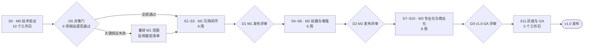
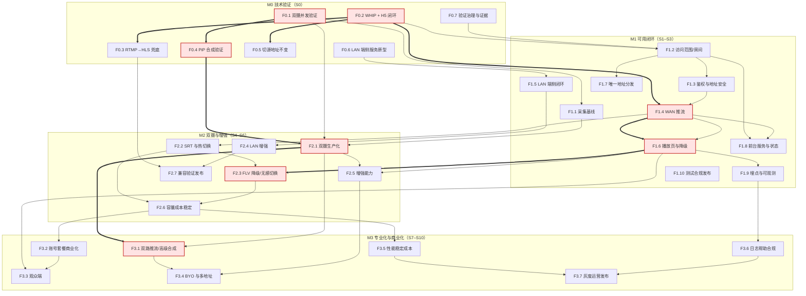
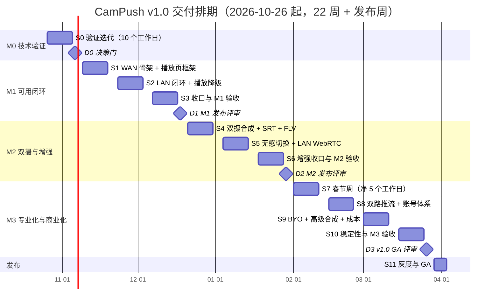

# 09 · 任务拆解、里程碑排期与交付治理

| 项目 | 值 |
|---|---|
| 文档状态 | 基线（Baseline） |
| 版本 | v1.0 |
| 维护人 | 交付（delivery） |
| 依赖文档 | [00-conventions.md](./00-conventions.md)、[PRD-v1.0.md](./PRD-v1.0.md)、[08-m0-verification.md](./08-m0-verification.md)、[01-architecture.md](./01-architecture.md) |
| 上游输入 | PRD §8（功能清单）、PRD §16.2（验收口径）、PRD §17（版本规划）、PRD §18（风险与开放问题） |
| 下游消费方 | 01/02/03/04/05/06/07/08 的作者（作为排期约束）、[10-observability.md](./10-observability.md)、[11-risk-adr.md](./11-risk-adr.md) |
| 契约依据 | [00-conventions.md](./00-conventions.md) **v1.1**：[§3](./00-conventions.md)（枚举）、[§10](./00-conventions.md)（性能预算）、[§11](./00-conventions.md)（埋点）、[§14](./00-conventions.md)（模板）、[§17](./00-conventions.md)（v1.1 裁定：PIN 限速、并发/额度码、权限语义、状态映射、密钥轮换、RTMPS） |
| 最后更新 | 2026-10-20 |

> 本文只描述“做什么、谁做、何时做完、如何判定完成”。功能行为口径以 PRD v1.0 为准，字段/枚举/错误码/预算数字以 [00-conventions.md](./00-conventions.md) 为准；本文不重复定义契约，只引用。

---

## 1. 目的与范围

### 1.1 目的

1. 把 PRD §17 的四个里程碑转成**可分配、可估算、可验证**的三级 WBS（Epic / Feature / Task），每个任务都有唯一 ID、人日估算、前置依赖与主责角色。
2. 给出**人力、产能与排期**的自洽模型：任何人按本文表格核算，都能复算“总工作量 ≤ 产能 × 80%”，且依赖关系与迭代顺序不矛盾。
3. 给出**交付治理规则**：门禁（Gate）、Definition of Ready/Done、评审节奏、变更管理、升级路径，使 7 人团队的并行开发不产生契约漂移。
4. 把 PRD §16.2 的 9 条验收口径逐条映射到任务与测试用例，使“验收”不依赖口头共识。

### 1.2 范围

| 在范围内 | 说明 |
|---|---|
| M0–M3 全部功能任务的拆解与估算 | 覆盖 PRD §8.1–§8.4 的功能清单和 PRD §17 的四个里程碑 |
| 人力模型、产能核算、20% 风险缓冲 | 见 §2.2、§2.6、§2.10 |
| 依赖 DAG、关键路径与浮动时间 | 见 §2.4、§2.5 |
| Definition of Ready / Done、里程碑退出准则 | 见 §2.8 |
| PRD §16.2 验收映射 | 见 §2.9 |
| 交付物清单、评审节奏、变更管理、干系人沟通计划 | 见 §2.11、§2.12 |

### 1.3 不在范围内

- 不定义协议、接口、字段、枚举、错误码（属 [04-interface-contracts.md](./04-interface-contracts.md) 与 [00-conventions.md](./00-conventions.md)）。
- 不定义指标公式与埋点 payload（属 [10-observability.md](./10-observability.md)）。
- 不定义风险评分细则与 ADR 正文（属 [11-risk-adr.md](./11-risk-adr.md)）。
- 不给出 M0 实验方法细节（属 [08-m0-verification.md](./08-m0-verification.md)），本文只排 M0 的**时间盒、任务与退出条件**。
- 不承诺商业定价、资质办理的外部周期（只排内部工作量与触发点）。

### 1.4 与 08 的边界

| 维度 | [08-m0-verification.md](./08-m0-verification.md) | 本文 |
|---|---|---|
| M0 内容 | 假设、实验方法、设备矩阵、通过标准的技术细节 | M0 的时间盒、任务 ID、人日、依赖、退出决策门 D0 |
| 结论物 | M0 验证报告 | M0 报告作为 M1 的 DoR 输入之一 |

---

## 2. 设计主体

### 2.1 交付治理模型与门禁

| 门禁 | 时点 | 通过条件（全部满足） | 不通过时动作 |
|---|---|---|---|
| D0 | 2026-11-06 | M0 六项假设均给出“通过/有条件通过/不通过”结论；不通过项已写入 M1 裁剪决策 | M1 启动会重排范围，24 pd 缓冲优先填补 |
| D1 | 2026-12-18 | PRD §16.2 的 AC-01/02/04/07/08/09 在测试环境全部通过；崩溃率、首帧达标率进入基线 | 延期 ≤1 周用缓冲，>1 周启动 §3 降级 |
| D2 | 2027-01-29 | AC-03/05/06 通过；双摄支持率与温升数据入库；HLS 兜底触发率进入基线 | 同上 |
| D3 | 2027-03-26 | 全量 AC 通过；SLO 与错误预算达标；灰度方案与回滚脚本就绪 | 只发 RC，GA 顺延至 S11 之后 |

### 2.2 角色、人力假设与产能模型

| 角色代码 | 角色 | 人数 | 职责边界 | 主责文档 |
|---|---|---|---|---|
| A | Android 工程师 | 2 | 采集/编码/合成、推流 SDK 集成、端侧服务、App UI、埋点 SDK | [02-client-modules.md](./02-client-modules.md) |
| S | 服务端工程师 | 2 | 接入（WHIP/SRT/RTMP）、转封装、WHEP、HLS、TURN、房间与 token、容量 | [03-cloud-service.md](./03-cloud-service.md)、[04-interface-contracts.md](./04-interface-contracts.md) |
| W | Web 前端工程师 | 1 | H5 播放页（WAN 自适应降级 + LAN 内联页）、观众端 Web、发布流水线 | [06-playback-page.md](./06-playback-page.md) |
| Q | QA 工程师 | 1 | 用例库、兼容性矩阵、性能与弱网、安全测试、回归与发版验收 | 本文 §2.8、[10-observability.md](./10-observability.md) |
| P | 产品/设计 | 1 | 需求澄清、交互稿、文案与合规提示、验收口径、指标看板需求、发布检查单 | PRD、本文 §2.9 |

**产能模型（可复算）**

- 1 个标准迭代 = 2 个自然周 = 10 个工作日；1 人日（pd）= 6 小时有效专注工时，**包含自测与单测，不含联调返工**（返工由缓冲吸收）。
- 计划期：2026-10-26（周一）→ 2027-03-26（周五），22 个自然周 = 110 个名义工作日/人。
- 假期扣减（按 2027 年节假日安排预估，若官方安排不同则按等量缓冲置换）：元旦 2027-01-01 共 1 个工作日；春节 2027-02-05 至 02-11 共 5 个工作日。合计 6 个工作日/人。
- 净工作日 = 110 − 6 = **104 个工作日/人**；团队净产能 = 104 × 7 = **728 pd**。
- 排产规则：每个迭代按**名义产能的 80%** 排入功能任务；单工程师单迭代 ≤ 8 pd（2 人职能池 = 16 pd）。假期周的排产按该迭代**净产能**的 80% 计算。
- 计划功能工作量 = **578 pd**；缓冲 = 728 − 578 = **150 pd = 20.6%**（≥ 20% 红线）。
- 另设 S11 发布周（2027-03-29 → 04-02，5 个工作日，35 pd）用于灰度、值班与 GA 材料，不计入上述 578 pd。

| 里程碑 | 周数 | 名义工作日/人 | 净工作日/人 | 里程碑净产能 | 计划工作量 | 负荷 | 缓冲 |
|---|---|---|---|---|---|---|---|
| M0 | 2（S0） | 10 | 10 | 70 pd | 46 pd | 65.7% | 24 pd |
| M1 | 6（S1–S3） | 30 | 30 | 210 pd | 168 pd | 80.0% | 42 pd |
| M2 | 6（S4–S6） | 30 | 29（扣元旦） | 203 pd | 168 pd | 82.8% | 35 pd |
| M3 | 8（S7–S10） | 40 | 35（扣春节） | 245 pd | 196 pd | 80.0% | 49 pd |
| **合计** | **22** | **110** | **104** | **728 pd** | **578 pd** | **79.4%** | **150 pd（20.6%）** |

> M2 负荷 82.8% 略高于 80% 目标：差额 2.8 个百分点（约 7 pd）由 M0 的富余缓冲（24 pd）跨里程碑调剂，全期仍为 79.4%。这是本文唯一偏离 80% 规则的位置，已显式登记，不做隐藏。

### 2.3 WBS 三级拆解（M0–M3）

**编号规则**：Epic = `E{m}`；Feature = `F{m}.{n}`；Task = `T{m}-{角色}{序号}`。估算单位人日（pd）；依赖为空表示只依赖外部输入（设备、账号、云资源）。

#### Epic E0 · M0 技术验证（PRD §17 M0，S0，46 pd / 17 任务）

**F0.1 双摄并发支持率验证**

| 任务 ID | 任务 | 迭代 | 估算 | 前置依赖 | 主责 | 交付证据 |
|---|---|---|---|---|---|---|
| T0-A1 | 双摄并发能力探测与设备白名单实验（Camera2 Multi-Camera / CameraX） | S0 | 5 | 测试机到位 | Android | 支持率统计表 + 失败机型原因分类 |

**F0.2 WAN WHIP 推流 + 统一 H5 播放页闭环**

| 任务 ID | 任务 | 迭代 | 估算 | 前置依赖 | 主责 | 交付证据 |
|---|---|---|---|---|---|---|
| T0-A2 | WHIP 推流最小闭环（App → 接入端，单摄 720p30） | S0 | 4 | 无（与 T0-S1 并行，接口按 [04](./04-interface-contracts.md) 初稿） | Android | 推流成功日志 + 首帧时间 |
| T0-S1 | WHIP 接入 + WHEP 播放最小链路 | S0 | 5 | 云资源与占位域名 | 服务端 | 端到端可播录像 |
| T0-W1 | 播放页最小原型（WHEP 优先 + 错误态） | S0 | 3 | T0-S1 | Web | 可打开的播放页 URL |

**F0.3 RTMP 推流 → 服务端转 HLS 兜底**

| 任务 ID | 任务 | 迭代 | 估算 | 前置依赖 | 主责 | 交付证据 |
|---|---|---|---|---|---|---|
| T0-S2 | RTMP 接入 → 转封装 FLV / HLS 切片验证 | S0 | 4 | T0-S1 | 服务端 | HLS 可播 + 切片时长记录 |
| T0-W2 | HLS 兜底播放与首帧计时探针 | S0 | 2 | T0-W1 | Web | 首帧计时数据样本 |

**F0.4 双摄 PiP 本地合成推单路**

| 任务 ID | 任务 | 迭代 | 估算 | 前置依赖 | 主责 | 交付证据 |
|---|---|---|---|---|---|---|
| T0-A3 | PiP / 分屏 OpenGL ES 合成单路输出验证 | S0 | 3 | T0-A1 | Android | 合成画面 + CPU/温度采样 |

**F0.5 公网协议切换地址不变**

| 任务 ID | 任务 | 迭代 | 估算 | 前置依赖 | 主责 | 交付证据 |
|---|---|---|---|---|---|---|
| T0-S3 | `ingest:switch` 切源验证（roomId / playUrl 不变） | S0 | 3 | T0-S1 | 服务端 | 切换前后 URL 对比记录 |

**F0.6 LAN 端侧 HTTP 服务 + HTTP-FLV/MJPEG 播放**

| 任务 ID | 任务 | 迭代 | 估算 | 前置依赖 | 主责 | 交付证据 |
|---|---|---|---|---|---|---|
| T0-A4 | 端侧服务最小原型（HTTP 服务 + FLV / MJPEG 分发） | S0 | 2 | 无 | Android | 同网设备可播录像 |
| T0-W3 | LAN 播放页单文件原型（内联，无外链） | S0 | 1 | T0-A4 | Web | 单文件 HTML ≤ 64 KB |

**F0.7 验证治理与证据归档（横向）**

| 任务 ID | 任务 | 迭代 | 估算 | 前置依赖 | 主责 | 交付证据 |
|---|---|---|---|---|---|---|
| T0-S4 | 验证环境搭建（占位域名、证书、TURN、监控最小集） | S0 | 2 | 无 | 服务端 | 环境清单与访问方式 |
| T0-Q1 | 设备/浏览器矩阵与验证用例 | S0 | 2 | 无 | QA | 矩阵表（≥ 20 机型、4 内核） |
| T0-Q2 | M0 六项假设执行与证据归档 | S0 | 2 | T0-A1…T0-W3 | QA | M0 证据包 |
| T0-Q3 | 首帧/延迟计时方法与埋点校验 | S0 | 2 | T0-W1 | QA | 计时口径说明 + 校验记录 |
| T0-P1 | 验证指标与退出条件（D0 判据）定义 | S0 | 2 | 无 | 产品 | D0 判据表（对应 [08](./08-m0-verification.md)） |
| T0-P2 | 外部依赖与风险清单（测试机、云资源、媒体云试用） | S0 | 2 | 无 | 产品 | 外部依赖登记表 |
| T0-P3 | M0 报告评审与 M1 范围冻结 | S0 | 2 | T0-Q2 | 产品 | M0 报告 + M1 范围基线 |

> **M0 小计**：Android 14 pd / 服务端 14 pd / Web 6 pd / QA 6 pd / 产品 6 pd = **46 pd**（负荷 65.7%，因技术验证不确定性高，主动留 34.3% 缓冲）。

#### Epic E1 · M1 可用闭环（PRD §17 M1，S1–S3，168 pd / 33 任务）

**F1.1 采集与模式基线**

| 任务 ID | 任务 | 迭代 | 估算 | 前置依赖 | 主责 | 交付证据 |
|---|---|---|---|---|---|---|
| T1-A2 | 单后/单前采集、摄像头热切换、闪光灯、静音 | S1 | 6 | T0-A1（决定采集架构） | Android | 三模式切换录屏 + 1080p 预览 |

**F1.2 访问范围开关与房间生命周期**

| 任务 ID | 任务 | 迭代 | 估算 | 前置依赖 | 主责 | 交付证据 |
|---|---|---|---|---|---|---|
| T1-A1 | 访问范围开关（推流中锁定、切换提示旧地址失效、标签展示） | S1 | 4 | T0-P3 | Android | 三态交互录屏 + `accessScope` 上报 |
| T1-S1 | 房间生命周期 REST（创建/查询/停止、幂等键、额度、10 min 未推流回收） | S1 | 9 | T0-P3 | 服务端 | 接口测试报告 + 状态机迁移日志 |

**F1.3 鉴权与地址安全**

| 任务 ID | 任务 | 迭代 | 估算 | 前置依赖 | 主责 | 交付证据 |
|---|---|---|---|---|---|---|
| T1-S2 | token 体系（`pageToken`/`mediaToken`/`ingestToken` 签发、撤销、刷新、签核顺序） | S1 | 7 | T1-S1 | 服务端 | 三类 token 用例 + 撤销验证 |
| T1-S6 | token 校验、错误信封（§9）、限流（`3008`/`429` + `Retry-After`） | S3 | 4 | T1-S1 | 服务端 | 错误码矩阵测试记录 |

**F1.4 WAN 推流（WHIP 默认 + RTMP）**

| 任务 ID | 任务 | 迭代 | 估算 | 前置依赖 | 主责 | 交付证据 |
|---|---|---|---|---|---|---|
| T1-A3 | WHIP 推流集成（重连、编码基线、码率自适应骨架） | S1 | 6 | T0-A2 | Android | `ingestState` 全态覆盖 |
| T1-A4 | RTMP 推流集成与“默认协议不可用则降级” | S3 | 4 | T1-A3 | Android | 降级路径录屏 + `pushProtocol` 上报 |
| T1-S3 | WHIP 接入生产化（单会话、顶号 `4004`、ICE/TURN 回落） | S2 | 9 | T0-S1、T1-S2 | 服务端 | 并发接入与顶号测试 |
| T1-S5 | RTMP 接入 + 转封装 FLV/HLS（`EXT-X-TARGETDURATION:2`、6 分片、`ENDLIST`） | S3 | 8 | T1-S3 | 服务端 | HLS 播放校验 + 分片统计 |

**F1.5 LAN 端侧服务闭环**

| 任务 ID | 任务 | 迭代 | 估算 | 前置依赖 | 主责 | 交付证据 |
|---|---|---|---|---|---|---|
| T1-A6 | 端侧服务：`/s/{pageToken}`、`/api/v1/status`、`/live.flv`、`/stream.mjpg`、`/healthz`、端口顺延 | S2 | 8 | T0-A4 | Android | 同网 3 设备播放记录 |
| T1-A7 | LAN token/PIN/并发上限（`6005`）、停止后连接拒绝（≤ 1 s） | S3 | 4 | T1-A6 | Android | 停止即失效 + 第 4 位观看者拒绝 |

**F1.6 统一播放页与自适应降级**

| 任务 ID | 任务 | 迭代 | 估算 | 前置依赖 | 主责 | 交付证据 |
|---|---|---|---|---|---|---|
| T1-W1 | 播放页框架与 `playerState` 状态机（8 态） | S1 | 4 | T0-W1 | Web | 状态迁移用例 |
| T1-W3 | PIN 输入、`page-token:refresh`（不改地址栏） | S1 | 4 | T1-W1 | Web | 刷新前后 URL 对比 |
| T1-W2 | WHEP 播放与降级阶梯（webrtc 2.5 s → hls 5.0 s） | S2 | 8 | T1-W1、T1-S4 | Web | 降级触发日志 + 首帧分布 |
| T1-W5 | 播放页移动端兼容与错误页（`5001`/`5002`/`5003`、`410` 已结束态、自动播放兜底） | S3 | 4 | T1-W2 | Web | 兼容与错误态用例 |
| T1-S4 | WHEP 播放 + `play-session` 协议协商（`protocols` 字段） | S2 | 7 | T1-S2、T1-A3 | 服务端 | 协商响应样例 + PIN 校验 |

**F1.7 唯一播放地址与分发动作**

| 任务 ID | 任务 | 迭代 | 估算 | 前置依赖 | 主责 | 交付证据 |
|---|---|---|---|---|---|---|
| T1-A8 | 唯一地址卡（复制/二维码/本机预览/分享，标准模式不含裸流地址） | S3 | 4 | T1-S1 | Android | 四动作录屏 + 地址一致性校验 |

**F1.8 前台服务与实时状态**

| 任务 ID | 任务 | 迭代 | 估算 | 前置依赖 | 主责 | 交付证据 |
|---|---|---|---|---|---|---|
| T1-A5 | 前台服务 + 通知栏常驻控制（停止、模式、时长） | S2 | 5 | T1-A3 | Android | 后台 30 min 存活记录 |
| T1-A9 | 基础状态指标（码率/帧率/丢包/延迟/网络质量） | S2 | 3 | T1-A3 | Android | 弱网下指标滚动录屏 |

**F1.9 埋点与可观测建成**

| 任务 ID | 任务 | 迭代 | 估算 | 前置依赖 | 主责 | 交付证据 |
|---|---|---|---|---|---|---|
| T1-A10 | 埋点 SDK（队列、批量、离线上报、脱敏）与 M1 事件子集 | S3 | 4 | T0-Q3、T1-A1 | Android | 18 事件中 M1 子集全绿 |
| T1-W4 | 播放页埋点（`play_page_open`、`play_first_frame`、`play_fallback`） | S3 | 4 | T1-W2、T1-A10 | Web | 与 10 号文档字段比对 |
| T1-S7 | 云端可观测（指标导出、结构化日志、`traceId` 贯通、脱敏） | S3 | 4 | T1-S1 | 服务端 | 一次完整链路 trace |
| T1-P5 | 指标口径与看板需求评审（对应 [10](./10-observability.md) §3） | S3 | 6 | T1-P2 | 产品 | 看板需求确认记录 |

**F1.10 测试、合规与发布**

| 任务 ID | 任务 | 迭代 | 估算 | 前置依赖 | 主责 | 交付证据 |
|---|---|---|---|---|---|---|
| T1-Q1 | 功能用例库（WAN/LAN 双模式，≥ 120 条，含错误码分支） | S1 | 4 | T0-Q1 | QA | 用例库 v1 |
| T1-Q4 | 安全与隐私用例（token 失效、PIN 爆破限速、日志脱敏、越权） | S1 | 4 | T0-Q1 | QA | 安全用例集 |
| T1-Q2 | 兼容性矩阵测试（Top 20 机型、4 浏览器内核、移动网络） | S2 | 8 | T1-A3、T1-S4 | QA | 兼容性报告 |
| T1-Q3 | 性能与预算测试（首帧、延迟、CPU/温度/内存，对齐 [00 §10](./00-conventions.md)） | S3 | 4 | T1-A3、T1-W2 | QA | 预算达标表 |
| T1-Q5 | 回归与 M1 发版验收报告（AC-01/02/04/07/08/09） | S3 | 4 | T1-Q2、T1-Q3 | QA | 发版验收报告 |
| T1-P1 | 需求澄清与 UI 稿（主界面/设置页/播放页空态与错误态） | S1 | 4 | T0-P3 | 产品 | 设计稿 v1 + 交互说明 |
| T1-P2 | 验收标准逐条化（PRD §16.2 → 用例映射） | S1 | 4 | T1-P1 | 产品 | 映射表（本文 §2.9） |
| T1-P3 | 合规与隐私文案（分享提示、LAN 限制提示、“任何拿到链接的人可观看”） | S2 | 4 | T1-P1 | 产品 | 文案清单（对齐 [07](./07-security-privacy.md)） |
| T1-P4 | 埋点与指标口径评审（与 [10](./10-observability.md) 对齐） | S2 | 4 | T1-P2 | 产品 | 口径确认签字 |
| T1-P6 | 发布检查单与商店素材 | S3 | 2 | T1-Q5 | 产品 | 检查单 + 素材包 |

> **M1 小计**：Android 48 / 服务端 48 / Web 24 / QA 24 / 产品 24 = **168 pd**（负荷 80.0%）。每迭代每职能：Android 16、服务端 16、Web 8、QA 8、产品 8。

#### Epic E2 · M2 双摄与增强（PRD §17 M2，S4–S6，168 pd / 33 任务）

**F2.1 双摄合成生产化**

| 任务 ID | 任务 | 迭代 | 估算 | 前置依赖 | 主责 | 交付证据 |
|---|---|---|---|---|---|---|
| T2-A1 | 双摄 PiP/分屏合成生产化（`dualLayout`、`dualPrimary`、小窗拖动缩放） | S4 | 10 | T0-A3、T1-A2 | Android | 三种合成方式录屏 + 资源预算达标 |
| T2-A2 | 双摄兼容性白名单与运行时检测（不支持则隐藏选项，`1004`/`2009`） | S5 | 5 | T2-A1 | Android | 支持率报表 + 隐藏逻辑用例 |
| T2-A9 | 性能保护：热/电量降级（`7003`/`7004` + 提示） | S6 | 3 | T2-A1 | Android | 降级触发与恢复记录 |
| T2-P1 | 双摄交互与降级提示设计（合成方式切换、耗电提示） | S4 | 5 | T1-P1 | 产品 | 设计稿 v2 |

**F2.2 WAN SRT 推流与协议热切换**

| 任务 ID | 任务 | 迭代 | 估算 | 前置依赖 | 主责 | 交付证据 |
|---|---|---|---|---|---|---|
| T2-A3 | SRT 推流集成 + 推流中协议切换（`ingest:switch`） | S4 | 6 | T1-A4、T1-S5 | Android | 切换前后地址对比 + `interruptMs` |
| T2-S1 | SRT 接入（listener、`streamid` token、`latency=200`） | S4 | 8 | T1-S3、T1-S5 | 服务端 | SRT 推流成功 + 弱网对比 |
| T2-S2 | 协议热切换切源编排（`switching` 状态、15 s 无首帧判 `failed`、`graceMs` 5 s） | S4 | 8 | T1-S3、T1-S5 | 服务端 | 切源状态机测试 |

**F2.3 播放页 FLV 降级与切换无感**

| 任务 ID | 任务 | 迭代 | 估算 | 前置依赖 | 主责 | 交付证据 |
|---|---|---|---|---|---|---|
| T2-W1 | FLV 降级通道（MSE 解析、5 s tag 保活、2.0 s 预算） | S4 | 8 | T1-W2 | Web | FLV 降级成功记录 |
| T2-W2 | 降级链重构（webrtc → flv → hls，`unsupported` 立即跳过，总兜底 ≤ 10 s） | S5 | 4 | T2-W1 | Web | 阶梯时序表 |
| T2-W3 | 源切换无感重连（SSE `source-switched`、`reconnecting → playing`） | S5 | 4 | T2-S2 | Web | 地址栏不变 + 重连耗时 |
| T2-S3 | FLV 分发优化（`no-store`、5 s 至少 1 tag、连接复用） | S5 | 5 | T1-S5 | 服务端 | 长稳 2 h 无断流 |
| T2-W5 | 埋点补全（`play_fallback` reason 枚举、降级率） | S6 | 4 | T2-W1、T1-W4 | Web | 降级原因分布 |

**F2.4 LAN 增强（WebRTC P2P、诊断、AP 隔离）**

| 任务 ID | 任务 | 迭代 | 估算 | 前置依赖 | 主责 | 交付证据 |
|---|---|---|---|---|---|---|
| T2-A4 | LAN 端侧 WebRTC P2P / 本地低延迟播放通道 | S5 | 8 | T0-A4、T1-A6 | Android | LAN 首帧 ≤ 1.5 s 记录 |
| T2-A5 | 网络诊断与 AP 隔离引导（`6004`）、IP 变化重发地址（旧 token 失效） | S6 | 4 | T1-A6、T2-A4 | Android | 隔离环境复现 + 提示截图 |
| T2-P2 | AP 隔离排查指引与帮助文档（依据 `6004` 语义与端侧自检流程） | S5 | 4 | T1-A6 | 产品 | 帮助页文案 |

**F2.5 增强能力（边推边看、录制、水印、多地址）**

| 任务 ID | 任务 | 迭代 | 估算 | 前置依赖 | 主责 | 交付证据 |
|---|---|---|---|---|---|---|
| T2-A6 | 本机边推边看（第二播放会话复用播放页） | S5 | 3 | T1-W2 | Android | 边推边看 ≥ 30 min |
| T2-A7 | 本地录制与水印（边推边录，码率不劣化 > 10%） | S6 | 5 | T2-A1 | Android | 录制文件 + 推流指标对比 |
| T2-A8 | 多地址推流（专业模式入口，明确提示多地址） | S6 | 4 | T1-A4 | Android | 双地址同时可播 |
| T2-P3 | 专业模式边界与提示文案 | S5 | 4 | T1-P3 | 产品 | 文案 + 二级页面入口定义 |

**F2.6 容量、成本与稳定性**

| 任务 ID | 任务 | 迭代 | 估算 | 前置依赖 | 主责 | 交付证据 |
|---|---|---|---|---|---|---|
| T2-S4 | HLS 切片与窗口调优（2 s/6 分片、直播窗口 ≥ 12 s） | S5 | 5 | T1-S5 | 服务端 | 窗口与延迟实测 |
| T2-S8 | 稳定性加固（优雅重启、房间恢复、`410`/`404` 语义） | S5 | 6 | T2-S3 | 服务端 | 故障注入测试 |
| T2-S5 | 容量与成本工程（码率上限、并发上限、TURN 配额、单房间成本模型） | S6 | 7 | T2-S2、T2-S3 | 服务端 | 单房间成本测算表 |
| T2-S6 | 多地址 / BYO 推流地址签发 | S6 | 5 | T1-S1、T2-S1 | 服务端 | 多地址签发样例 |
| T2-S7 | 可观测性二期（切换中断、HLS 触发率、降级率指标接入） | S6 | 4 | T1-S7、T2-S2 | 服务端 | 指标上线清单 |
| T2-W4 | 弱网 UI 与可访问性（码率/网络提示、对比度、键盘可达） | S6 | 4 | T2-W2 | Web | 弱网 UI 截图 + 检查表 |

**F2.7 兼容性验证与发布**

| 任务 ID | 任务 | 迭代 | 估算 | 前置依赖 | 主责 | 交付证据 |
|---|---|---|---|---|---|---|
| T2-Q1 | 双摄设备兼容性测试（Top 30 机型，支持率与失败归因） | S4 | 8 | T2-A1、T0-Q1 | QA | 支持率报告（进 [11](./11-risk-adr.md) R-001） |
| T2-Q2 | 协议切换中断时长测试（p50 ≤ 3 s、p95 ≤ 5 s） | S5 | 4 | T2-S2、T2-W3 | QA | 中断分布（≥ 100 次切换） |
| T2-Q3 | 弱网矩阵（丢包 0–10%、抖动 0–100 ms、带宽 800 kbps–4 Mbps） | S5 | 4 | T2-A3、T2-W2 | QA | 弱网矩阵报告 |
| T2-Q4 | LAN 并发/AP 隔离/功耗测试（3 观看者、10 min 温升） | S6 | 4 | T2-A4、T2-A5、T1-A7 | QA | 并发与温升数据 |
| T2-Q5 | M2 回归 + HLS 兜底触发率验证 | S6 | 4 | T2-Q1、T2-Q2 | QA | 回归报告 + 触发率基线 |
| T2-P4 | M2 验收评审与指标看板复核 | S6 | 5 | T2-Q5 | 产品 | D2 评审纪要 |
| T2-P5 | 内测反馈闭环与优先级重排 | S4 | 3 | T1-Q5 | 产品 | 反馈清单与排期调整记录 |
| T2-P6 | 成本模型初版（每房间带宽/转码成本） | S6 | 3 | T2-S5 | 产品 | 成本模型表（供 [11](./11-risk-adr.md) R-003） |

> **M2 小计**：Android 48 / 服务端 48 / Web 24 / QA 24 / 产品 24 = **168 pd**（负荷 82.8%，见 §2.2 说明）。

#### Epic E3 · M3 专业化与商业化（PRD §17 M3，S7–S10，196 pd / 35 任务）

**F3.1 双路独立推流与高级合成**

| 任务 ID | 任务 | 迭代 | 估算 | 前置依赖 | 主责 | 交付证据 |
|---|---|---|---|---|---|---|
| T3-A1 | 双路独立推流（专业模式，两个地址明确提示） | S8 | 10 | T2-A1、T2-A2 | Android | 双地址并行可播 ≥ 30 min |
| T3-A2 | 高级合成（分屏完善、主次交换动画、美颜滤镜） | S9 | 8 | T3-A1 | Android | 合成效果录屏 + 帧率 |

**F3.2 账号、套餐与商业化客户端**

| 任务 ID | 任务 | 迭代 | 估算 | 前置依赖 | 主责 | 交付证据 |
|---|---|---|---|---|---|---|
| T3-S1 | 账号体系与鉴权（注册/登录/设备绑定） | S8 | 9 | T1-S1 | 服务端 | 登录与越权测试 |
| T3-A3 | 账号与套餐入口（登录、额度展示、购买跳转） | S10 | 6 | T3-S1 | Android | 额度不足引导（`2004`）录屏 |
| T3-S2 | 套餐/额度/计费（房间分钟数、超额 `2004`） | S9 | 9 | T3-S1 | 服务端 | 计费对账 + 限额测试 |
| T3-W2 | 账号与套餐页（Web 端登录、购买、额度） | S9 | 4 | T3-S1 | Web | 端到端购买链路 |
| T3-P1 | 商业化方案定稿（套餐结构、BYO 免费工具边界、定价） | S8 | 8 | T2-P6 | 产品 | 方案文档（对应 [11](./11-risk-adr.md) Q5） |

**F3.3 观众端与分发增强**

| 任务 ID | 任务 | 迭代 | 估算 | 前置依赖 | 主责 | 交付证据 |
|---|---|---|---|---|---|---|
| T3-A7 | App 内简易观众端（复用播放页能力观看他人房间） | S10 | 5 | T1-W2 | Android | 观看他人房间录屏 |
| T3-S5 | 观众端 API（房间列表/进入权限/观看限制） | S7 | 4 | T1-S2、T1-S1 | 服务端 | 接口用例 |
| T3-W1 | 观众端 Web 页面（列表、进入房间、复用播放页） | S8 | 8 | T1-W2 | Web | 页面可访问 + 复用验证 |
| T3-W4 | 分享落地页与 OG 卡片 | S7 | 4 | T1-W2 | Web | 分享预览截图 |

**F3.4 BYO 与多地址**

| 任务 ID | 任务 | 迭代 | 估算 | 前置依赖 | 主责 | 交付证据 |
|---|---|---|---|---|---|---|
| T3-A4 | BYO 自定义推流地址配置与连通性测试 | S8 | 6 | T1-S1、T2-A8 | Android | 三种地址协议连通结果 |
| T3-S4 | 多地址推流服务端支持（多 ingest 会话、每路线路独立状态与失败隔离） | S7 | 4 | T1-S3、T2-S6 | 服务端 | 多地址并行可播 ≥ 30 min；单路失败不影响其他路 |
| T3-S3 | BYO 服务端模式（自定义域名、回源校验、能力降级提示） | S8 | 7 | T2-S6 | 服务端 | BYO 端到端验证 |
| T3-A6 | 多地址推流完善（3 路并发、失败隔离） | S10 | 5 | T3-A1 | Android | 单路失败不影响其他路 |

**F3.5 性能、稳定性与成本**

| 任务 ID | 任务 | 迭代 | 估算 | 前置依赖 | 主责 | 交付证据 |
|---|---|---|---|---|---|---|
| T3-A9 | 稳定性与崩溃治理（崩溃率 < 0.5%、ANR < 0.3%） | S9 | 8 | T2-A1 | Android | 灰度期崩溃看板 |
| T3-S7 | 高可用（多可用区、故障转移、SLO 看板对接 [10](./10-observability.md)） | S10 | 8 | T2-S8 | 服务端 | 故障演练报告 |
| T3-S6 | 成本控制与弹性（按需扩容、码率策略、HLS 按需切片） | S9 | 7 | T2-S5 | 服务端 | 成本曲线 vs 用量 |
| T3-W3 | 播放页性能优化（首帧 p50 ≤ 1.7 s、单文件 ≤ 64 KB） | S9 | 4 | T1-W2 | Web | 性能预算达标表 |
| T3-W6 | 前端发布流水线与灰度（`player-{semver}.js` 版本化） | S10 | 4 | T1-W5 | Web | 灰度发布记录 |
| T3-A8 | 省电模式与自适应码率完善 | S7 | 4 | T2-A9 | Android | 省电模式前后指标对比 |

**F3.6 日志导出、帮助与合规**

| 任务 ID | 任务 | 迭代 | 估算 | 前置依赖 | 主责 | 交付证据 |
|---|---|---|---|---|---|---|
| T3-A5 | 日志导出与脱敏（不含 token/PIN/明文 roomId） | S7 | 4 | T1-A10 | Android | 导出样本 + 脱敏抽检 |
| T3-S8 | 合规与内容审核接口（举报/审核钩子、留存策略） | S10 | 8 | T3-S1 | 服务端 | 审核钩子联调 |
| T3-P2 | 合规与资质推进（ICP/等保/内容审核流程） | S9 | 4 | T1-P3 | 产品 | 资质清单与时间表 |
| T3-P3 | 帮助中心与用户文档 | S7 | 4 | T1-P3 | 产品 | 帮助页上线 |
| T3-W5 | 播放页多语言与可访问性 | S10 | 4 | T3-W1 | Web | 两语言 + A11y 检查 |

**F3.7 灰度、运营与发布**

| 任务 ID | 任务 | 迭代 | 估算 | 前置依赖 | 主责 | 交付证据 |
|---|---|---|---|---|---|---|
| T3-Q6 | 回归基线与自动化用例集（含 M1/M2 用例复用） | S7 | 4 | T1-Q1 | QA | 自动化通过率基线 |
| T3-Q1 | 全量回归与兼容性矩阵终测（Android 8–15、iOS Safari 16+） | S8 | 8 | T2-Q1、T3-Q6 | QA | 终测报告 |
| T3-Q2 | 性能与容量压测（100 观看者/房间、并发房间数） | S9 | 4 | T2-S5、T3-S6 | QA | 压测曲线 + 瓶颈结论 |
| T3-Q3 | 安全与隐私测评（token 重放、越权、脱敏抽检） | S9 | 4 | T1-Q4、T3-S3 | QA | 安全测评报告（对齐 [07](./07-security-privacy.md)） |
| T3-Q4 | 商业化流程测试（套餐、额度、BYO） | S10 | 4 | T3-S2、T3-A3 | QA | 商业化用例通过率 |
| T3-Q5 | 灰度监控与发布验收（错误预算校验，见 [10](./10-observability.md) §6） | S10 | 4 | T3-Q1、T3-Q2 | QA | 灰度观察报告 |
| T3-P5 | 运营数据看板与周报机制 | S9 | 4 | T3-P1 | 产品 | 周报模板 + 看板 |
| T3-P4 | 灰度发布计划与回滚预案 | S10 | 4 | T3-P2 | 产品 | 灰度方案 + 回滚演练记录 |
| T3-P6 | M3 验收与 v1.0 发布评审（D3） | S10 | 4 | T3-Q5 | 产品 | D3 评审纪要 |

> **M3 小计**：Android 56 / 服务端 56 / Web 28 / QA 28 / 产品 28 = **196 pd**（负荷 80.0%）；S7 按净产能 35 pd 的 80% = 28 pd 排产（春节周）。

**2.3.5 工作量汇总（复算用）**

| 角色 | M0 | M1 | M2 | M3 | 合计 | 净产能 | 负荷 |
|---|---|---|---|---|---|---|---|
| Android（2 人） | 14 | 48 | 48 | 56 | 166 | 208 | 79.8% |
| 服务端（2 人） | 14 | 48 | 48 | 56 | 166 | 208 | 79.8% |
| Web（1 人） | 6 | 24 | 24 | 28 | 82 | 104 | 78.8% |
| QA（1 人） | 6 | 24 | 24 | 28 | 82 | 104 | 78.8% |
| 产品/设计（1 人） | 6 | 24 | 24 | 28 | 82 | 104 | 78.8% |
| **合计** | **46** | **168** | **168** | **196** | **578** | **728** | **79.4%** |

统计：**4 个 Epic、31 个 Feature、118 个 Task**。

### 2.4 依赖 DAG（Feature 级）

粗实线为主关键路径（浮时为 0），虚线为次关键路径。

### 2.5 关键路径与浮动时间

**关键路径一（双摄链）**：T0-A1 双摄并发探测 → T0-A3 PiP 合成验证 → T2-A1 双摄合成生产化 → T2-A2 兼容白名单 → T3-A1 双路独立推流 → T3-A2 高级合成。

**关键路径二（WAN 链）**：T0-S1 WHIP/WHEP 最小链路 → T1-S3 WHIP 生产化 → T1-W2 播放页降级链 → T2-S2 切源编排 + T2-W3 无感重连 → T3-S7 高可用。

| 路径 | 任务序列 | 工作量（pd） | 跨越迭代 | 浮动 | 说明 |
|---|---|---|---|---|---|
| CP-1（主） | T0-A1 → T0-A3 → T2-A1 → T2-A2 → T3-A1 → T3-A2 | 5+3+10+5+10+8 = 41 | S0, S4, S5, S8, S9 | 0 | 任何一环延期直接压缩 D2/D3；T2-A1 是关键链上的最大单项（10 pd） |
| CP-2（主） | T0-S1 → T1-S3 → T1-W2 → T2-S2 → T2-W3 → T3-S7 | 5+9+8+8+4+8 = 42 | S0, S2, S4, S5, S10 | 0 | 切源与播放页重连必须同迭代交付，否则 AC-03 无法验证 |
| CP-3（次） | T0-S1 → T1-S4 → T1-W2 → T2-W1 → T2-W2 | 5+7+8+8+4 = 32 | S0, S2, S4, S5 | 2 pd | 可借 S5 的缓冲后移 2 pd，不影响 D2 |
| CP-4（次） | T0-A4 → T1-A6 → T1-A7 → T2-A4 → T2-A5 | 2+8+4+8+4 = 26 | S0, S2, S3, S5, S6 | 5 pd | LAN 链路不是发布阻断项，可整体后移 1 个迭代 |
| CP-5（支撑） | T1-A10 → T1-W4 → T2-W5 → T3-Q5 | 4+4+4+4 = 16 | S3, S6, S10 | 3 pd | 埋点链可延后，但 T3-Q5（灰度验收）必须有基线 |

**进度红线**：只要 CP-1 或 CP-2 上任一任务的实际完成日晚于计划 > 3 个工作日，即触发 §3 的降级流程。

> 说明：依赖列中若前置任务与自身在同一迭代（共 29 处），必须在迭代计划会上拆到“第几天完成”，按串行安排；无法串行的，视为该迭代风险并在站会跟踪。跨迭代依赖一律“前置迭代完成 → 后置迭代启动”，不允许同迭代后置依赖前置。

### 2.6 迭代排期

| 迭代 | 日期（含首尾） | 里程碑 | 名义工作日 | 净工作日 | 迭代目标 | 主要交付 | 门禁/评审 |
|---|---|---|---|---|---|---|---|
| S0 | 2026-10-26 → 11-06 | M0 | 10 | 10 | 六项技术假设给出结论 | 双摄支持率表、WHIP 闭环、RTMP→HLS、PiP 合成、切源不变、LAN 原型 | D0（11-06） |
| S1 | 2026-11-09 → 11-20 | M1 | 10 | 10 | WAN 骨架 + 播放页框架 + 用例库 | 房间/token、WHIP 集成、播放页状态机、访问范围开关 | 迭代评审 11-20 |
| S2 | 2026-11-23 → 12-04 | M1 | 10 | 10 | LAN 闭环 + 播放页降级 + 兼容测试 | 端侧服务、WHEP+降级、前台服务、兼容性报告 | 迭代评审 12-04 |
| S3 | 2026-12-07 → 12-18 | M1 | 10 | 10 | 收口与发版 | RTMP、地址卡、埋点、性能预算、M1 验收报告 | D1（12-18） |
| S4 | 2026-12-21 → 2027-01-01 | M2 | 10 | 9（元旦） | 双摄合成 + SRT + FLV | 双摄 PiP、SRT 接入、切源编排、FLV 降级通道 | 迭代评审 01-01 |
| S5 | 2027-01-04 → 01-15 | M2 | 10 | 10 | 无感切换 + LAN 增强 | 降级链重构、SSE 重连、LAN WebRTC、边界看/录制启动 | 迭代评审 01-15 |
| S6 | 2027-01-18 → 01-29 | M2 | 10 | 10 | 增强收口与验收 | 弱网矩阵、AP 隔离、多地址、成本模型、M2 验收 | D2（01-29） |
| S7 | 2027-02-01 → 02-12 | M3 | 10 | 5（春节） | 低风险增强（半周产能） | 日志导出、省电模式、观众端 API、多地址服务端支持、分享落地页 | 周会同步 |
| S8 | 2027-02-15 → 02-26 | M3 | 10 | 10 | 双路推流 + 账号体系 | 双路独立推流、账号鉴权、BYO 服务端、观众端 Web、商业化方案 | 迭代评审 02-26 |
| S9 | 2027-03-01 → 03-12 | M3 | 10 | 10 | BYO + 高级合成 + 成本 | BYO 服务端、高级合成、成本控制、安全测评 | 迭代评审 03-12 |
| S10 | 2027-03-15 → 03-26 | M3 | 10 | 10 | 稳定性与验收 | 高可用、合规钩子、商业化测试、M3 验收 | D3（03-26） |
| S11 | 2027-03-29 → 04-02 | 发布 | 5 | 5 | 灰度与 GA | 灰度 10%→50%→100%、值班、GA 材料 | GA 评审（04-02） |

**排期假设与调整理由**

| 项 | 基线 | 本文采用 | 理由 |
|---|---|---|---|
| M0 | 10 个工作日 | 10 个工作日 | 与 PRD §17 一致；M0 是“验证”不是“开发”，时间盒硬约束，超时即触发 D0 重排而不是延长 |
| M1 | 6 周 | 6 周（3 个迭代） | 与 PRD §17 一致；M1 是首个可发布版本，需要 1 个迭代做加固与验收 |
| M2 | 6 周 | 6 周（3 个迭代） | 与 PRD §17 一致；双摄合成是最大单项，独占 S4 的 10 pd |
| M3 | 8 周 | 8 周（4 个迭代，其中 S7 净 5 个工作日） | **保留 8 周**而非外扩：春节假期吃掉 5 个工作日，按净产能 80% 只排 28 pd（低风险任务）；总工期增加的是 1 个**发布周 S11**，不属于 M3 功能开发 |
| 总工期 | 22 周 | 23 周（22 周 + S11） | 22 周用于功能开发与验收，S11 用于灰度与 GA，避免把发布风险压进 M3 最后一周 |

### 2.7 并行与交叉策略

| 策略 | 内容 | 适用迭代 | 收益 |
|---|---|---|---|
| 双轨并行（WAN / LAN） | S1–S3 期间 A1 专注 WAN 推流链路、A2 专注 LAN 端侧服务；S5 互换 | S1–S3 | 两条链路都不成为单点，且互相做代码评审 |
| 前后端契约先行 | 每个迭代第 1–2 天冻结接口变更（对齐 [04](./04-interface-contracts.md)），联调放在第 6–8 天 | 全部 | 减少“等服务端/等客户端”空转 |
| 播放页先行（Mock 优先） | W1 在服务端就绪前用 Mock SDP/media 源开发降级链 | S1、S4 | 播放页不阻塞在 S3/S4 的服务端产出 |
| 测试左移 | Q1 在 S1 即产出用例库，参与 S1–S2 的每迭代演示；安全用例与功能并行 | S1–S3 | 缺陷在迭代内暴露，避免末迭代堆积 |
| 埋点并行 | 埋点 SDK（A）与播放页埋点（W）在 S2–S3 同步，口径由 P5 统一评审 | S2–S3 | [10](./10-observability.md) 的验收映射可在 S3 完成 |
| 交叉评审 | 每个 PR 至少 1 名非同模块工程师评审；ADR 变更需 Lead + 相关作者 | 全部 | 降低 [11](./11-risk-adr.md) R-016（契约漂移）概率 |
| 冻结窗口 | D1/D2/D3 前 2 个工作日只允许缺陷修复 | S3、S6、S10 | 门禁可预测 |

### 2.8 Definition of Ready / Definition of Done

**DoR（任务进入迭代前必须满足）**

| # | 条目 | 判定人 |
|---|---|---|
| 1 | 任务有 ID、描述、估算（pd）、主责角色，且在 §2.3 表中 | 产品 |
| 2 | 依赖任务已完成或同迭代内有明确的 Mock/桩方案 | 主责 + 架构 |
| 3 | 涉及的契约（字段/枚举/错误码/URL）在 [00](./00-conventions.md)/[04](./04-interface-contracts.md) 中已定义，无“待定” | 架构 |
| 4 | 可测试的验收条件 ≥ 1 条，含失败路径（错误码级别） | QA |
| 5 | 埋点需求（若有）已在 [10](./10-observability.md) §4 中定义 | 产品 |
| 6 | 设计稿或交互说明已评审（仅 UI 任务） | 设计 |
| 7 | 若涉及新错误码/新枚举，已提交契约变更请求（[00 §15](./00-conventions.md)） | Lead |

**DoD（任务完成判定）**

| # | 条目 | 证据 |
|---|---|---|
| 1 | 功能按 PRD 与契约实现，成功路径 + 已知失败路径均自测通过 | 自测记录 |
| 2 | 单元测试覆盖核心分支（新增逻辑覆盖率 ≥ 70%，关键状态机 100%） | 覆盖率报告 |
| 3 | 关键状态机迁移与 [00 §3.1](./00-conventions.md) 一致（`roomState`/`ingestState`/`playerState`） | 迁移用例 |
| 4 | 性能落在 [00 §10](./00-conventions.md) 预算内，或已登记超标并与产品确认 | 预算对照表 |
| 5 | 埋点事件名与属性与 [10](./10-observability.md) §4 完全一致（含必填项） | 埋点自检截图 |
| 6 | 日志/埋点不含 token、PIN、明文 roomId、完整地址、IP | 脱敏抽检 |
| 7 | 跨模块接口有契约测试或样例响应归档 | 样例文件 |
| 8 | 代码已评审（≥ 1 名非本模块工程师），无待处理严重评论 | PR 记录 |
| 9 | 文档同步：受影响文档已更新或已登记“无需更新”理由 | 文档 diff |
| 10 | 在测试环境可复现演示 | 演示录屏/纪要 |

**里程碑退出准则**

| 里程碑 | 退出准则 |
|---|---|
| M0 | 六项假设全部有结论；至少 4 项“通过”，未通过项有替代方案并写进 M1 范围 |
| M1 | AC-01/02/04/07/08/09 通过；崩溃率与首帧达标率达到 [10](./10-observability.md) §3 的 M1 目标；M1 验收报告签字 |
| M2 | AC-03/05/06 通过；双摄支持率与温升数据入库；D2 评审通过 |
| M3 | 全部 AC 通过；SLO 与错误预算达标；灰度与回滚演练完成；D3 评审通过 |

### 2.9 验收标准映射（PRD §16.2 逐条）

| AC | PRD §16.2 条目 | 覆盖任务 | 测试用例 | 通过标准 | 证据来源 |
|---|---|---|---|---|---|
| AC-01 | 已授权用户从点击开始到拿到可访问播放地址 ≤ 10 秒 | T1-A1、T1-A3、T1-S1、T1-S3、T1-A8、T1-A9 | TC-M1-01（冷启动计时）、TC-M1-02（点击→地址可用） | 点击“开始推流”到地址可用 p95 ≤ 3 s（[00 §10.3](./00-conventions.md)）；冷启动到可推流 ≤ 10 s | `push_start_clicked`/`push_start_success.durationMs` 分布；测试录像计时 |
| AC-02 | 公网 WebRTC 播放首帧 < 2 秒 | T1-W2、T1-S4、T2-W1、T2-W2、T3-W3 | TC-M1-03（首帧预算）、TC-M2-01（弱网首帧） | `timeToFirstFrameMs` p95 ≤ 1.85 s（预算合计）且 p95 < 2000 ms 达标率 ≥ 90% | `play_first_frame` 数据；[00 §10.2](./00-conventions.md) 预算表 |
| AC-03 | 公网推流协议切换后播放地址不变 | T2-A3、T2-S2、T2-W3、T2-Q2 | TC-M2-02（切换地址不变）、TC-M2-03（中断时长） | 切换前后 `playUrl` 字符串完全相等；中断 p50 ≤ 3 s、p95 ≤ 5 s | 切换前后 URL 对比 + `protocol_switch_*` |
| AC-04 | 停止推流后播放地址不可用 | T1-A7、T1-S1、T1-S6、T1-Q3 | TC-M1-04（WAN 410）、TC-M1-05（LAN connection refused） | WAN 停止后 ≤ 2 s 返回 `410`（`2002`/`2003` → `410`，[00 §17.4](./00-conventions.md)）；LAN ≤ 1 s 连接拒绝；媒体端点不再返回字节 | 拨测记录 + 服务端访问日志 |
| AC-05 | 双摄不支持设备不出现不可用选项 | T2-A2、T2-Q1 | TC-M2-04（不支持机型隐藏） | 不支持机型设置页与主界面均无“前后同时”；误触返回 `1004`/`2009` | 支持率报表 + 机型录屏 |
| AC-06 | 局域网：同 Wi-Fi 另一设备可播、停止不可用、PIN/token 生效、AP 隔离有明确提示 | T1-A6、T1-A7、T2-A4、T2-A5、T2-Q4 | TC-M1-06（LAN 可播）、TC-M2-05（AP 隔离）、TC-M2-06（PIN 双层限速） | 3 观看者并发可播；第 4 位 `6005`（[00 §17.2](./00-conventions.md)）；错误 PIN `3005`；IP > 5 次/分或房间 > 20 次/分 → `3008`，连续 10 次失败锁 10 min → `3006`（[00 §17.1](./00-conventions.md)）；AP 隔离展示 `6004` 排查清单 | LAN 播放记录 + 错误码日志 |
| AC-07 | 公网：移动网络可播、可降级 HLS、停止后失效 | T1-S5、T1-W2、T2-W1、T2-Q3 | TC-M1-07（移动网络播放）、TC-M2-07（HLS 兜底） | 4G/5G 下可播；WebRTC 失败后自动切 FLV，再失败切 HLS；观看并发超限 `2008`（[00 §17.2](./00-conventions.md)）；停止后 `410` | `play_fallback` 记录 + 网络抓包 |
| AC-08 | 场景开关：开始前可切换、推流中置灰并提示、切换后地址更新且旧地址失效 | T1-A1、T1-S1、T1-Q3 | TC-M1-08（开关三态） | 推流中开关不可点击且提示文案正确；切换后旧地址 100% `410`/拒绝 | 交互录屏 + 旧地址拨测 |
| AC-09 | 默认策略：首次启动默认公网；公网不可用时置灰并引导局域网 | T1-A1、T1-P3、T1-Q3 | TC-M1-09（默认值与置灰） | 首次启动选中“公网可访问”；无网络/额度不足（`2004`，[00 §17.2](./00-conventions.md)）时公网项置灰并出现引导 | 冷启动录屏 + 文案检查 |

> AC-01 的口径冲突（“点击开始起算 10 s” vs [00 §10.3](./00-conventions.md) 拆成“冷启动 ≤ 10 s / 点击→地址 ≤ 3 s”）已登记为开放问题 OQ-09-01，见 §5。

**2.9.1 [00 §17](./00-conventions.md)（v1.1 裁定）补充验收点**

> 以下 4 条不属于 PRD §16.2 原文，但由 00 v1.1 裁定要求生效，故并入验收范围；用例编号 `N-xx`。

| 编号 | 裁定条目 | 覆盖任务 | 测试用例 | 通过标准 | 证据来源 |
|---|---|---|---|---|---|
| N-01 | 权限语义（[00 §17.3](./00-conventions.md)）：摄像头拒绝阻断（`1001`）；麦克风拒绝**静音继续**（`1002`，非致命）；通知/前台服务拒绝降级为前台 Activity（`1007`） | T1-A2、T1-A5、T1-A10 | TC-M1-10（三权限组合矩阵） | 拒相机 → 不可推流 + 引导；仅拒麦克风 → 可推流且常驻“无声音”标识；拒通知 → 仍可推流并提示可能被回收 | `permission_denied{permission}` 覆盖 `camera` / `microphone` / `foreground_service` 三种取值；录屏 |
| N-02 | PIN 双层限速（[00 §17.1](./00-conventions.md)） | T1-S6、T1-W3 | TC-M1-11（限速与锁定） | IP 5 次/分 → `3008`；房间 20 次/分 → `3008`；10 次失败 → `3006` + 10 min 锁定 + `Retry-After` | 错误码日志 + 自动化脚本 |
| N-03 | 密钥轮换与长会话（[00 §17.5](./00-conventions.md)）：90 天轮换、双 `kid` 并存 ≥ 30 天；LAN 密钥会话级不落盘 | T1-S2、T1-A6 | TC-M1-12（轮换期长会话） | 轮换后已签发 token 不提前失效；12 h 房间跨轮换不中断；LAN 进程重启后旧 token 立即失效 | 轮换演练记录 + 长会话日志 |
| N-04 | RTMPS 定位（[00 §17.6](./00-conventions.md)）：v1 仅承诺 RTMP 明文，不改变 v1 接口与错误码 | T1-A4、T2-A3 | TC-M2-08（明文声明与提示） | 客户端/文档/设置页均明示“RTMP 明文传输”；不出现私有加密实现；RTMPS 不进入 v1 验收 | 文案检查 + 抓包确认明文 |

### 2.10 风险缓冲与范围裁剪

**缓冲使用规则**

1. 150 pd 缓冲不预分配给任务，由产品在每个迭代的排期会上按周释放，单次释放 ≤ 10 pd。
2. 触发释放的条件（任一）：CP-1/CP-2 关键任务延期 > 3 个工作日；外部依赖（测试机、云资源、资质）延期；缺陷密度超基线 50%。
3. 缓冲耗尽（连续 2 个迭代释放 > 20 pd）时，不再延长排期，直接执行裁剪清单。

**范围裁剪清单（按优先级从低到高裁）**

| 优先级 | 裁剪项 | 影响任务 | 省下（pd） | 影响面 |
|---|---|---|---|---|
| 1 | 分享到第三方 App（保留复制 + 二维码） | T1-A8 部分 | 1 | PRD §8.1 的“分享”降级为复制 |
| 2 | 本机边推边看延后到 M3 | T2-A6 | 3 | PRD §17 M2 条目顺延 |
| 3 | 多地址推流延后到 v1.1 | T2-A8、T3-A6 | 9 | 专业模式少一个入口 |
| 4 | 录制/水印延后到 v1.1 | T2-A7 | 5 | PRD §8.3 部分延后 |
| 5 | 观众端 Web 从 M3 移出 | T3-W1、T3-S5、T3-A7 | 17 | PRD §17 M3 “简易观众端”移出 v1.0 |
| 6 | 高级合成（分屏/主次交换动画）只保留 PiP | T3-A2 | 8 | PRD §5.2 部分延后 |
| 7 | 账号与套餐只保留额度校验，不做购买链路 | T3-S2、T3-W2 部分 | 10 | 商业化推迟到 v1.1 |

累计可裁剪 53 pd，足以吸收一次“单里程碑整体延期 2 周”（约 2 周 × 7 人 × 0.8 = 78 pd 中可裁剪 53 pd + 缓冲 150 pd）。

### 2.11 交付物清单

| # | 交付物 | 形态 | 里程碑 | 验收责任 | 存储位置 |
|---|---|---|---|---|---|
| 1 | 本套工程化文档 00–11（12 份） | Markdown + Mermaid | M0 起持续 | Lead | `docs/` |
| 2 | M0 技术验证报告 | Markdown + 数据附件 | M0 | 产品 | `docs/08-m0-verification.md` 附录 |
| 3 | Android 安装包 | APK/AAB（debug、internal、release 三通道） | M1/M2/M3 | QA | 制品库（占位） |
| 4 | 服务端部署单元 | 容器镜像 + 部署清单 + 配置模板 | M1/M2/M3 | 服务端 | 制品库（占位） |
| 5 | 播放页静态包 | `player-{semver}.js` + LAN 内联 `player.html`（≤ 64 KB） | M1/M2/M3 | Web | CDN 路径（占位） |
| 6 | 埋点上报 SDK | Android 库 + schema 定义文件 | M1 | Android | 制品库（占位） |
| 7 | 接口契约文档与样例 | [04](./04-interface-contracts.md) + `samples/` 样例响应 | M1 起 | 服务端 | `docs/` |
| 8 | 测试用例库与自动化套件 | 用例表 + 自动化脚本清单 | M1 起 | QA | 测试管理工具（占位） |
| 9 | 指标看板与告警规则 | 看板定义 + 告警规则文件（对应 [10](./10-observability.md)） | M1 | 产品 | 监控平台（占位） |
| 10 | 风险登记册与 ADR | [11-risk-adr.md](./11-risk-adr.md) | M0 起持续 | 交付 | `docs/` |
| 11 | 发布检查单与回滚预案 | Markdown + 演练记录 | M3 | 产品 | `docs/` |
| 12 | 帮助中心与用户文档 | Markdown/HTML | M3 | 产品 | 帮助站点（占位） |

### 2.12 评审节奏、变更管理与沟通计划

**会议日历（固定节奏）**

| 会议 | 频率/时点 | 参与者 | 输出 | 时长 |
|---|---|---|---|---|
| 站会 | 每工作日 10:00 | 全体执行角色 | 阻塞项、当日计划 | 15 min |
| 周会（交付例会） | 每周一 15:00 | 全员 + Lead | 进度 vs 基线、缓冲使用、风险变化 | 45 min |
| 迭代计划会 | 每迭代第 1 天 | 产品、各职能、QA | 迭代任务清单（满足 DoR） | 2 h |
| 迭代评审/演示 | 每迭代最后 1 天 | 全员 + 干系人 | 可运行演示 + 缺陷清单 | 1 h |
| 迭代回顾 | 每迭代最后 1 天 | 执行角色 | 改进项（≤ 3 条可执行） | 45 min |
| 门禁评审（D0–D3） | 里程碑末 | 全员 + 干系人 | 通过/有条件通过/不通过 | 1.5 h |
| 发布评审 | D3 + S11 前 | Lead、产品、QA、服务端、Android | 发布决策与值班表 | 1 h |
| 契约评审 | 按需（≤ 每周 1 次） | 架构、相关作者 | 契约变更请求结论 | 45 min |

**变更管理**

| 变更类型 | 触发 | 审批 | 记录 |
|---|---|---|---|
| 需求新增/删除（范围内） | 产品提出 | 产品 + Lead，占用缓冲 | 本文 §6 变更记录 + 迭代计划 |
| 需求新增/删除（跨里程碑） | 产品提出 | Lead + 干系人 | 里程碑范围基线更新 + 重组排期 |
| 契约变更（字段/枚举/错误码） | 任一作者 | Lead 按 [00 §15](./00-conventions.md) 流程 | [00](./00-conventions.md) 升版 + 本文依赖影响 |
| 排期变更（> 3 个工作日） | 主责工程师 | Lead + 产品 | 本文 §2.6 基线更新 + 缓冲台账 |
| 架构决策变更 | 架构/服务端 | Lead + ADR 作者 | [11](./11-risk-adr.md) 新增/替代 ADR |
| 发布范围变更 | 产品 | Lead + 干系人 | 发布检查单 + 本文 §2.10 裁剪记录 |

**干系人与沟通计划（RACI）**

| 活动 | Lead | 产品 | Android | 服务端 | Web | QA | 外部干系人 |
|---|---|---|---|---|---|---|---|
| 范围与里程碑确认 | A | R | C | C | C | C | I |
| 技术方案与 ADR | A | C | R | R | C | I | I |
| 排期与人力 | R/A | C | C | C | C | C | I |
| 验收口径（PRD §16.2） | A | R | C | C | C | R | I |
| 发版决策 | A | R | C | C | C | R | I |
| 合规与资质 | C | R | I | I | I | I | A |
| 风险与开放问题 | A | R | C | C | C | C | I |

（R = 负责执行，A = 最终批准，C = 需咨询，I = 需知会）

**沟通渠道与产物**

| 渠道 | 用途 | 时效要求 |
|---|---|---|
| IM 值班群（占位） | 阻塞项、线上问题、每日同步 | 阻塞 30 min 内响应 |
| 文档评审（`docs/` PR） | 文档与契约变更 | 24 h 内给出意见 |
| 迭代看板（占位工具） | 任务状态、缓冲台账 | 每日更新 |
| 周报（产品汇总） | 进度、风险、指标、缓冲使用 | 每周一 12:00 前 |
| 事故/故障通知 | P0/P1 事件 | 15 min 内启动应急 |

---

## 3. 失败与降级（进度与交付失控处置）

| 失败模式 | 触发信号 | 降级动作 | 决策人 | 时限 |
|---|---|---|---|---|
| 关键路径任务延期 > 3 个工作日 | 站会/周会红标；CP-1 或 CP-2 任务完成度落后 | 释放缓冲；同一职能内换人；必要时削减该迭代非关键任务 | Lead | 2 个工作日内 |
| M0 关键假设不通过（如 WHIP 不可用） | D0 结论为“不通过” | M1 范围重排：改用 RTMP 为默认推流协议；播放页仍走唯一地址；ADR 更新 | Lead + 产品 | D0 当日 |
| 单里程碑整体延期 > 2 周 | 门禁评审“不通过” | 执行 §2.10 裁剪清单（最多 53 pd）；不再顺延 M3 | Lead + 干系人 | 3 个工作日内 |
| 双摄支持率低于门槛（见 [11](./11-risk-adr.md) R-001） | M2 支持率 < 40% | 双摄不作为 v1.0 卖点，改为“实验性”，M3 双路推流降级为 v1.1 | 产品 + Lead | M2 门禁 |
| 关键角色流失（bus factor = 1） | 人员不可用 > 3 天 | 结对交接；知识落文档；从缓冲扣减交接成本 | Lead | 1 个工作日内 |
| 外部依赖延期（云资源/资质/应用商店） | 依赖登记表状态变红 | 用占位环境推进；发布拆分为“先上应用商店后开服务”或反之 | Lead | 即时 |
| 发布后发现阻断缺陷 | 灰度期 P0 | 立即回滚至上一版本；S11 顺延 | Lead | 30 min 内决策 |
| 缓冲耗尽 | 连续 2 个迭代释放 > 20 pd | 冻结新增需求，只做裁剪与缺陷 | Lead + 产品 | 即时 |

**沟通口径**：所有延期对外只说“计划调整”，量化口径统一引用本文 §2.6 的基线日期，避免多头承诺。

---

## 4. 验收检查点

- [ ] WBS 覆盖 PRD §8.1–§8.4 全部功能条目，且每条可追溯到至少一个 Task ID。
- [ ] 4 个 Epic、31 个 Feature、118 个 Task 与 PRD §17 的 M0–M3 一一对应。
- [ ] 各里程碑工作量与 §2.2 产能表一致：46 / 168 / 168 / 196 = 578 pd；总负荷 79.4% ≤ 80%（M2 例外已登记）。
- [ ] 每个 Task 均有估算（pd）、前置依赖、主责角色、交付证据。
- [ ] 依赖 DAG 无环；所有前置依赖任务的迭代不晚于后继任务。
- [ ] 关键路径 CP-1、CP-2 标注完整，且浮动为 0 的任务均在路径上。
- [ ] 迭代排期表中 S0 = 10 个工作日、M1 = 6 周、M2 = 6 周、M3 = 8 周，偏差有理由。
- [ ] 20% 缓冲可复算：150 pd / 728 pd = 20.6%，且未被预分配。
- [ ] DoR 7 条、DoD 10 条、4 个里程碑退出准则全部可判定。
- [ ] PRD §16.2 的 9 条验收口径全部映射到 AC-01～AC-09，并落到测试用例与证据来源。
- [ ] 交付物清单 12 项均指定里程碑与验收责任。
- [ ] 评审节奏覆盖周会、迭代评审、发布评审；变更管理给出 6 类变更的审批路径。
- [ ] 干系人 RACI 覆盖 7 类活动与 7 个角色。

---

## 5. 开放问题

| ID | 问题 | 候选方案 | 推荐结论 | 影响面 | 决策人 | 截止时间 |
|---|---|---|---|---|---|---|
| OQ-09-01 | AC-01 的 10 s 从何时起算：PRD §16.2 写“从点击开始”，[00 §10.3](./00-conventions.md) 拆成“冷启动 ≤ 10 s + 点击→地址 ≤ 3 s” | A 以 PRD 字面为准（点击起算 10 s）；B 以 00 拆分为准（冷启动 10 s / 点击 3 s） | **B**：00 是唯一契约基线，且“点击→地址 ≤ 3 s”更能反映推流体验；PRD 指标口径按“已授权、冷启动后”解释，并在 [10 §3.2](./10-observability.md) 双口径记录 | 09 §2.9、10 §3、QA 用例 | Lead | 2026-10-30 |
| OQ-09-02 | 2027 年节假日安排未发布，春节与元旦的具体扣减天数可能变化 | A 按预估 1 + 5 个工作日；B 等官方安排发布后重排 | **A**：先按预估排产，官方发布后按“等量缓冲置换”，不改变里程碑基线 | 全部排期 | Lead | 2026-12-31 |
| OQ-09-03 | M3 是否把“观众端 Web”列入 v1.0 阻塞项 | A 阻塞（现方案）；B 可裁剪（§2.10 第 5 项） | **B**：观众端依赖账号与版权，工程收益低于稳定性；D3 前按实际进度决定 | M3 范围、AC 无影响 | 产品 + Lead | 2027-02-26 |
| OQ-09-04 | 双摄支持率达到多少才保留为 v1.0 卖点 | A 40%；B 60%；C 不做门槛 | **A（40%）**：低于 40% 改为“实验性”并明确提示；数据由 T2-Q1 提供 | [11](./11-risk-adr.md) R-001、M2 门禁 | 产品 | 2027-01-29 |
| OQ-09-05 | 是否引入第二 QA（外包/兼职）补 M2–M3 的兼容性测试 | A 不引入；B M2 起引入兼职 1 人 | **B**：兼容性矩阵在 M2 起是瓶颈（Top 30 机型），兼职只做执行不做设计，成本进入 §2.2 之外的资源池 | 产能表外挂 30 pd | Lead + 财务 | 2026-12-18 |

---

## 6. 变更记录

| 版本 | 日期 | 变更人 | 内容 |
|---|---|---|---|
| v1.0 | 2026-10-20 | 交付（delivery） | 首次建立：4 Epic / 31 Feature / 118 Task 的 WBS；产能模型（728 pd 净产能、578 pd 计划、150 pd 缓冲）；22 周 + 发布周排期；CP-1/CP-2 关键路径；DoR 7 条 / DoD 10 条；PRD §16.2 的 9 条验收映射；交付物 12 项；评审与变更管理 |
