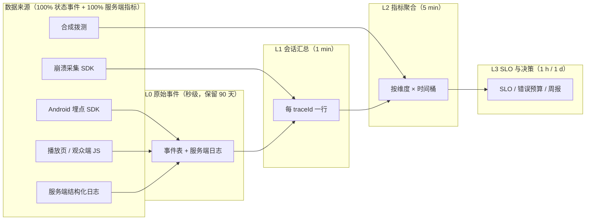
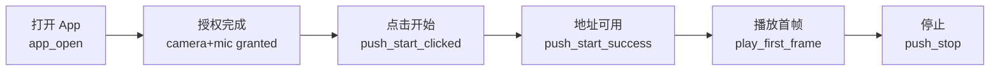

# 10 · 指标体系、埋点契约与可观测性

| 项目 | 值 |
|---|---|
| 文档状态 | 基线（Baseline） |
| 版本 | v1.0 |
| 维护人 | 交付（delivery） |
| 依赖文档 | [00-conventions.md](./00-conventions.md)、[PRD-v1.0.md](./PRD-v1.0.md)、[07-security-privacy.md](./07-security-privacy.md)、[06-playback-page.md](./06-playback-page.md)、[03-cloud-service.md](./03-cloud-service.md) |
| 适用 PRD | PRD §16.1（十一项核心指标）、PRD §16.2（验收口径）、PRD §15（安全隐私） |
| 契约依据 | [00-conventions.md](./00-conventions.md) **v1.1**：[§3](./00-conventions.md)（枚举）、[§10](./00-conventions.md)（性能预算）、[§11](./00-conventions.md)（埋点事件名与禁止项）、[§9](./00-conventions.md)（错误码）、[§17](./00-conventions.md)（v1.1 裁定：PIN 限速 `3006`/`3008`、并发与额度 `2008`/`6005`/`2004`、权限语义 `1001`/`1002`/`1007`、状态映射 `404`/`410`、密钥轮换、RTMPS） |
| 下游消费方 | [09-task-plan.md](./09-task-plan.md) §2.9 验收映射、[11-risk-adr.md](./11-risk-adr.md) 风险触发信号 |
| 最后更新 | 2026-10-20 |

> 本文只“细化”不“改写” [00-conventions.md §11](./00-conventions.md)：事件名、公共属性、禁止上报项必须逐字一致。任何需要新增事件、属性或上报端点的诉求，一律以 §5 的契约变更请求（CR）形式提出，由 Lead 按 [00 §15](./00-conventions.md) 处理，不在本文直接落地。

---

## 1. 目的与范围

### 1.1 目的

1. 把 PRD §16.1 的 **11 项核心指标**逐条转成可计算口径：定义、公式、数据源、采样与聚合窗口、目标值、告警阈值、看板位置、负责人，做到“两个人算出同一个数”。
2. 给出一套**与 00 §11 严格一致**的埋点 payload schema，使 Android、Web、服务端三方上报的数据可以直接 join。
3. 给出**SLI/SLO 与错误预算**、告警规则、值班响应与降噪机制，使“发布/回滚”有客观依据而不是拍板。
4. 把 PRD §16.2 的验收口径映射成“测试步骤 → 通过标准 → 证据/数据来源”，与 [09-task-plan.md §2.9](./09-task-plan.md) 的 AC-01～AC-09 一一对应。
5. 给出**埋点 QA 与数据校验**方案，保证数据可信（否则指标越好越危险）。

### 1.2 范围

| 在范围内 | 说明 |
|---|---|
| 11 项核心指标口径 | §2.2 |
| 18 个必埋事件的 payload、上报策略、采样、离线补报 | §2.3 |
| 主漏斗与分维度分析 | §2.4 |
| SLI/SLO、错误预算、burn rate、发布门禁 | §2.5 |
| 告警规则、分级、值班响应、抑制 | §2.6 |
| 看板清单与面板归属 | §2.7 |
| 数据保留、脱敏、合规 | §2.8（引用 [07](./07-security-privacy.md)） |
| PRD §16.2 验收映射 | §2.9 |
| 埋点 QA 与数据质量监控 | §2.10 |

### 1.3 不在范围内

- 不定义业务接口与媒体面契约（[04-interface-contracts.md](./04-interface-contracts.md)、[03-cloud-service.md](./03-cloud-service.md)）。
- 不定义播放页 UI 与降级实现（[06-playback-page.md](./06-playback-page.md)）。
- 不定义具体监控/日志产品选型与账号（属部署与运维，见 [01-architecture.md](./01-architecture.md)）；本文只定义**口径、规则与字段**。
- 不定义商业化指标（收入、ARPU、转化收入），M3 由产品另立分析文档。

### 1.4 与 07 的边界

| 维度 | [07-security-privacy.md](./07-security-privacy.md) | 本文 |
|---|---|---|
| 数据分类分级、脱敏算法、合规依据 | 权威定义 | 只引用并在 §2.8 落地到具体字段 |
| 保留期限 | 给出上限与合规约束 | 在 §2.8 给出各数据类型的实际配置值，不得突破 07 的上限 |
| 用户删除权 | 流程与时限 | 删除请求在各数据源上的执行方式 |

---

## 2. 设计主体

### 2.1 指标口径总则

**计算基线**

| 项 | 规则 |
|---|---|
| 时间基准 | 客户端 `clientTs` 为设备时间（可能偏移），服务端 `receivedAt` 为入库时间；**所有指标按 `receivedAt` 归桶**，表内注明例外 |
| 时区 | 报表与看板默认 UTC+8 自然日；SLO 滚动窗口按 UTC+8 的 28 天 |
| 统计单元 | 默认以 `traceId` 为“一次链路”，以 `sessionId` 为“一次 App 前台会话”；两者不可混用 |
| 去重 | 同一 `eventId` 只计一次（客户端重试 + 离线补报会重复） |
| 分母保护 | 分母 < 100 的指标不进入告警判定，只进看板并标注“样本不足” |
| 异常剔除 | `isTest=true`、内部账号、机房 IP 段、压测流量（`client.platform=qa`）默认剔除 |
| 分位数 | p50/p95 由 1 分钟桶的分位数再加权（t-digest），禁止对分位数再求平均 |
| 聚合窗口 | 实时：1 min 桶；看板：5 min / 1 h / 1 d；SLO：28 天滚动；月报：自然月 |

**数据分层**

| 层 | 内容 | 时效 | 用途 |
|---|---|---|---|
| L0 | 原始事件（客户端批量上报 + 服务端结构化日志） | 秒级入库 | 排查、合规、回放 |
| L1 | 会话/链路汇总（每 `traceId` 一行：模式、协议、成功与否、首帧、中断、结束原因） | 1 min | 指标计算、漏斗 |
| L2 | 指标聚合（按维度 × 时间桶） | 5 min | 看板、告警 |
| L3 | SLO/错误预算/周报 | 1 h / 1 d | 发布决策、治理 |



**分维度（全指标默认支持）**

| 维度 | 取值 | 说明 |
|---|---|---|
| `accessScope` | `lan` / `wan` | [00 §3](./00-conventions.md)；**所有 WAN/LAN 混合指标必须拆分展示** |
| `pushProtocol` | `whip` / `srt` / `rtmp` | 仅 `wan` 有意义 |
| `playProtocol` | `webrtc` / `flv` / `hls` / `mjpeg` | 播放侧降级分析 |
| `deviceTier` | `high` / `mid` / `low` | 按 `deviceModel` 映射（映射表见 §2.7 附录），用于双摄与首帧分档 |
| `networkType` | `wifi` / `cellular` / `none` | [00 §11](./00-conventions.md) 公共属性 |
| `appVersion` / `playerVersion` | semver | 版本回归与灰度对比 |
| `roomState` / `ingestState` / `playerState` | [00 §3](./00-conventions.md) 枚举 | 失败归因 |
| `code` | [00 §9](./00-conventions.md) 错误码 | 失败归因（1xxx–7xxx） |

**责任人矩阵**

| 指标类别 | 客户端指标 owner | 服务端指标 owner | 数据口径 owner | 看板 owner |
|---|---|---|---|---|
| 推流类（成功率、切换中断） | Android | 服务端 | 产品 | 产品 |
| 播放类（可打开率、首帧、延迟、卡顿、HLS 触发率） | Web | 服务端 | 产品 | 产品 |
| 设备类（双摄温升、崩溃） | Android | — | Android | Android |
| 生命周期类（地址失效、LAN 并发） | Android | 服务端 | QA | 产品 |
| 数据质量 | 交付 | 交付 | 交付 | 交付 |

> “指标 owner”负责目标值是否合理、异常时是否有人看；“数据口径 owner”负责公式与分母不被偷偷改动（改公式 = 改契约，走 CR）。

### 2.2 PRD §16.1 十一项核心指标

以下每项统一 8 个字段：定义 / 公式 / 数据源 / 采样与聚合 / 目标值 / 告警阈值 / 看板 / 负责人。目标值分 M1 / M2 两阶段（M3 沿用 M2 并收紧），与 [09 §2.8](./09-task-plan.md) 的里程碑退出准则一致。

#### 2.2.1 推流成功率 `push_success_rate`

| 字段 | 内容 |
|---|---|
| 定义 | 用户点击“开始推流”后，15 s 内进入 `ingestState=publishing` 且接入端收到首帧的推流会话占比 |
| 公式 | 分子 = 去重 `traceId` 中收到 `push_start_success` 的数量；分母 = `push_start_clicked` 且非“3 s 内主动取消”的数量；`push_success_rate = 分子 / 分母 × 100%` |
| 数据源 | 埋点 `push_start_clicked`、`push_start_success{serverConfirmed, durationMs}`、`push_failed{code}`；对账源：服务端 `roomState=live` 计数 + 接入端首帧日志 |
| 采样与聚合 | 100% 采集；1 min 桶 → 5 min 聚合；按 `accessScope` × `pushProtocol` × `deviceTier` × `networkType` 拆分 |
| 目标值 | M1：WAN `whip` ≥ 97.0%、`rtmp` ≥ 98.0%、LAN ≥ 98.5%；M2：WAN `whip` ≥ 98.0%、`srt` ≥ 97.0%、`rtmp` ≥ 98.5%、LAN ≥ 99.0% |
| 告警阈值 | < 95% 持续 10 min → P1；< 97% 持续 30 min → P2；单机型 < 90% 持续 1 h → P2 |
| 看板 | 「推流健康」→ 成功率（按协议/模式/机型/网络） |
| 负责人 | Android（失败归因 1xxx/7xxx）+ 服务端（4xxx） |

#### 2.2.2 播放页可打开率 `page_open_rate`

| 字段 | 内容 |
|---|---|
| 定义 | 播放页 HTML 与 JS 成功加载并完成 `play_page_open` 上报的比例 |
| 公式 | 分子 = `play_page_open` 去重数量；分母 = 服务端/CDN 的播放页 HTML 请求数（排除预期 4xx：`410` 已结束页单独统计，不计入分母）；`page_open_rate = 分子 / 分母` |
| 数据源 | 埋点 `play_page_open{ua, playProtocolHint, pageTokenRemainSec}`；服务端/CDN 访问日志；合成拨测（每 5 min 一次，多地域） |
| 采样与聚合 | 100% 采集；1 min 桶 → 5 min 聚合；按 `accessScope` × `appVersion`（对播放页为 `playerVersion`）× 浏览器内核拆分 |
| 目标值 | M1：WAN ≥ 99.0%、LAN ≥ 98.5%；M2：WAN ≥ 99.5%、LAN ≥ 99.0% |
| 告警阈值 | < 98% 持续 15 min → P1；拨测连续 3 次失败 → P1（立即） |
| 看板 | 「播放健康」→ 可打开率 + 拨测成功率 |
| 负责人 | Web（页面/资源）+ 服务端（410 语义、限流误伤） |

> 分母必须来自服务端/CDN 日志：只用客户端上报会把“JS 根本没执行”的失败算没掉，导致指标虚高。

#### 2.2.3 首帧时间 `time_to_first_frame`

| 字段 | 内容 |
|---|---|
| 定义 | 从 `play_page_open` 到首帧渲染完成的耗时，覆盖 token 校验、`play-session`、信令、ICE/DTLS、首关键帧解码与渲染 |
| 公式 | `p50/p95 = percentile(play_first_frame.timeToFirstFrameMs)`；达标率 `= count(timeToFirstFrameMs ≤ 2000) / count(play_first_frame)` |
| 数据源 | 埋点 `play_first_frame{playProtocol, timeToFirstFrameMs, fallbackCount}`；阶段拆分由 `play_page_open.serverTs` 与服务端信令时间戳对齐 |
| 采样与聚合 | 100% 采集；1 min 桶；按 `playProtocol` × `networkType` × `deviceTier` × 地域拆分 |
| 目标值 | 预算：WeRTC 合计 ≤ 1.85 s（[00 §10.2](./00-conventions.md)）。目标：`webrtc` p50 ≤ 1.2 s、p95 ≤ 1.85 s、达标率 ≥ 90%；`flv` p95 ≤ 2.5 s；`hls` p95 ≤ 5.5 s |
| 告警阈值 | `webrtc` p95 > 2.5 s 持续 15 min → P1；达标率 < 85% 持续 30 min → P2；`hls` p95 > 8 s 持续 30 min → P2 |
| 看板 | 「播放健康」→ 首帧分布（分协议、分网络、分机型档） |
| 负责人 | Web（播放页/降级链）+ 服务端（信令与转发） |

#### 2.2.4 端到端延迟估算 `e2e_latency_ms`

| 字段 | 内容 |
|---|---|
| 定义 | 采集帧时间戳到播放端渲染的估算延迟；WAN 目标区间 200–800 ms |
| 公式 | `e2e = (serverEgressTs − ingestArrivalTs) + jitterBufferMs + decodeRenderMs`；服务端段由帧级日志直接相减，客户端段由心跳事件上报估算值（`jitterBufferMs`、`decodeRenderMs`，**属契约缺口 CR-10-02**） |
| 数据源 | 服务端帧级日志（接入到达时间、SFU 出口时间）；客户端心跳（CR-10-02 落地后）；M1 阶段用服务端段 + 固定预算（[00 §10.1](./00-conventions.md) 的抖动缓冲区间）估算并标注“估算口径” |
| 采样与聚合 | 服务端 100% 帧级采样聚合成 10 s 桶；客户端 10% 会话 × 每分钟 1 次 |
| 目标值 | 服务端段 p50 ≤ 20 ms、p95 ≤ 60 ms；端到端 p50 ≈ 250 ms、p95 ≈ 630 ms（[00 §10.1](./00-conventions.md)） |
| 告警阈值 | 端到端 p95 > 900 ms 持续 10 min → P2；服务端段 p95 > 120 ms 持续 10 min → P1 |
| 看板 | 「播放健康」→ 延迟瀑布（采集/上行/转发/下行/缓冲/解码） |
| 负责人 | 服务端（主）+ Web（客户端段） |

#### 2.2.5 卡顿率 `rebuffer_ratio`

| 字段 | 内容 |
|---|---|
| 定义 | 播放会话中“无新帧可渲染”的累计时长占播放总时长的比例；同时给出每 10 分钟卡顿次数 |
| 公式 | `rebuffer_ratio = Σ stallDurationMs / Σ playDurationMs`；`stallPer10min = count(stall) / (Σ playDurationMs / 600000)` |
| 数据源 | 事件 `play_stall_start` / `play_stall_end`（**契约缺口 CR-10-01**）。M1 兜底口径：播放页 JS 心跳间隔 > 1 s 计为一次 stall，服务端侧用 FLV tag 间隔 > 2 s 或 MSE buffer 空转计数 |
| 采样与聚合 | 100% 会话内的 stall 事件；1 min 桶；按 `playProtocol` × `networkType` 拆分 |
| 目标值 | `webrtc` ≤ 1.0%、`flv` ≤ 2.0%、`hls` ≤ 3.0%；`stallPer10min` ≤ 0.5 |
| 告警阈值 | `rebuffer_ratio` > 3% 持续 30 min → P2；> 8% 持续 10 min → P1；`hls` > 6% 持续 30 min → P2 |
| 看板 | 「播放健康」→ 卡顿率与卡顿时长分布 |
| 负责人 | Web（解析/缓冲）+ 服务端（GOP、丢包、切片） |

#### 2.2.6 协议切换中断时长 `switch_interrupt_ms`

| 字段 | 内容 |
|---|---|
| 定义 | WAN 模式下推流协议热切换期间，从旧源中断到新源首帧可播的时长 |
| 公式 | `p50/p95 = percentile(protocol_switch_end.interruptMs)`；失败率 `= count(protocol_switch_end{result=failed}) / count(protocol_switch_start)` |
| 数据源 | 埋点 `protocol_switch_start` / `protocol_switch_end{interruptMs, result}`；服务端 `switching` 状态日志与 `switchId` 对账 |
| 采样与聚合 | 100% 采集；单次即入 L1；5 min 聚合；按 `from→to` 协议对拆分 |
| 目标值 | p50 ≤ 3 s、p95 ≤ 5 s（[00 §10.3](./00-conventions.md)）；失败率 ≤ 2%；地址不变率 100% |
| 告警阈值 | p95 > 8 s 持续 20 min → P2；失败率 > 2% → P1；地址变化 1 例即 P0（数据完整性） |
| 看板 | 「推流健康」→ 切换中断与失败 |
| 负责人 | 服务端（切源编排）+ Android（重连） |

#### 2.2.7 双摄温升与降级触发率 `thermal_rise` / `degrade_rate`

| 字段 | 内容 |
|---|---|
| 定义 | 温升：双摄推流 10 min 内的电池温度变化；降级触发率：发生自动降级（`thermal` / `battery` / `network`）的双摄会话占比 |
| 公式 | `degrade_rate = count(distinct traceId where degrade_triggered) / count(distinct traceId where captureMode=dual AND push_start_success)`；温升用现场采样 + 实验室温枪双口径 |
| 数据源 | 埋点 `degrade_triggered{reason, fromTier, toTier, thermalStatus, batteryPct}`；设备温度采样事件 `thermal_sample`（**契约缺口 CR-10-03**，5 min 一次）；实验室测试数据（[08](./08-m0-verification.md) 方法） |
| 采样与聚合 | 降级事件 100%；温度采样 5 min/次、100% 会话；日/周聚合，按机型拆分 |
| 目标值 | 温升 p95 ≤ 10 ℃（双摄，[00 §10.4](./00-conventions.md)）；`degrade_rate` 双摄 ≤ 15%、单摄 ≤ 5% |
| 告警阈值 | 双摄 `degrade_rate` > 25% 持续 1 天 → P2；单机型温升 p95 > 12 ℃ → P2（周粒度）；`thermalStatus ≥ SEVERE` 占比 > 20% → P1 |
| 看板 | 「设备健康」→ 双摄温升与降级 |
| 负责人 | Android |

#### 2.2.8 崩溃率 `crash_rate`

| 字段 | 内容 |
|---|---|
| 定义 | 发生崩溃的会话数占总会话数的比例；同时监控 ANR 率与 crash-free sessions |
| 公式 | `crash_rate = crash_sessions / total_sessions`；`crashFreeSessions = 1 − crash_rate`；ANR 率同口径 |
| 数据源 | 崩溃采集 SDK（非埋点事件，与 `sessionId` 关联）；应用商店后台数据做二次核对 |
| 采样与聚合 | 100%；实时（分钟级）；按 `appVersion` × `deviceModel` × `osVersion` × 是否双摄拆分 |
| 目标值 | M1：崩溃率 ≤ 1.0%；M2：≤ 0.7%；M3：≤ 0.5%，crash-free ≥ 99.5%，ANR ≤ 0.3% |
| 告警阈值 | crash-free < 99.0% 持续 24 h → P1；单版本 crash-free < 98.5% 2 h → P0（停灰度） |
| 看板 | 「设备健康」→ 崩溃/ANR Top 堆栈 |
| 负责人 | Android |

#### 2.2.9 地址失效准确率 `address_invalidation_accuracy`

| 字段 | 内容 |
|---|---|
| 定义 | 停止推流后，播放地址在时限内确实不可用的比例 |
| 公式 | 分子 = 停止后 5 s 内拨测得到 `410`（WAN）或 connection refused（LAN）的停止事件数；分母 = `push_stop` 成功数（以服务端 `closed` 为准）；`准确率 = 分子 / 分母` |
| 数据源 | 埋点 `push_stop`；合成拨测（每停止事件抽样 5% + 每 15 min 全量探针）；服务端访问日志（`410`/`404`/媒体端点响应） |
| 采样与聚合 | 停止事件 100%；拨测抽样 5%；1 h 聚合；按 `accessScope` 拆分 |
| 目标值 | WAN ≤ 2 s 失效、LAN ≤ 1 s 失效；准确率 ≥ 99.9% |
| 告警阈值 | < 99.0% 持续 1 h → P1；出现“停止后 60 s 仍返回媒体字节” → P0 |
| 看板 | 「生命周期」→ 地址失效准确率与失效耗时 |
| 负责人 | 服务端（WAN）+ Android（LAN） |

#### 2.2.10 局域网并发失败率 `lan_concurrency_fail_rate`

| 字段 | 内容 |
|---|---|
| 定义 | LAN 模式观看请求因并发上限被拒的比例 |
| 公式 | 分子 = `play_failed{code=6005}`；分母 = `lan_viewer_join` + `play_failed{code=6005}`；同时统计提示命中率（失败时是否展示“并发受限，建议切换公网”） |
| 数据源 | 埋点 `lan_viewer_join` / `lan_viewer_leave` / `play_failed`；端侧 `/api/v1/status.viewers` 日志；并发超限码固定为 `6005`（[00 §17.2](./00-conventions.md)），WAN 侧同类拒绝为 `2008`，账号级限流为 `3008`，三者禁止混算 |
| 采样与聚合 | 100%；5 min 聚合；按机型 × `viewers` 峰值拆分 |
| 目标值 | ≤ 2%（上限 3 人设计）；提示命中率 = 100% |
| 告警阈值 | > 5% 持续 30 min → P2；提示命中率 < 100% → P2 |
| 看板 | 「LAN 健康」→ 并发失败与观看人数分布 |
| 负责人 | Android |

#### 2.2.11 公网播放页 HLS 兜底触发率 `hls_fallback_rate`

| 字段 | 内容 |
|---|---|
| 定义 | WAN 播放页最终用 HLS 完成首帧的会话占全部播放会话的比例 |
| 公式 | `hls_fallback_rate = count(distinct traceId where play_first_frame.playProtocol=hls) / count(distinct traceId where play_page_open)`；另给“降级到 HLS”事件口径 `count(play_fallback{to=hls}) / count(play_page_open)` 做交叉验证 |
| 数据源 | 埋点 `play_first_frame`、`play_fallback`；服务端 HLS 分片请求日志 |
| 采样与聚合 | 100%；5 min 聚合；按浏览器内核 × `networkType` × 地域拆分 |
| 目标值 | **区间 3%–8%**：过低说明 WebRTC/FLV 覆盖或埋点异常，过高说明 WebRTC 可用性差 |
| 告警阈值 | > 15% 持续 30 min → P2；> 25% 持续 10 min → P1；< 1% 且样本 > 1000/日 → P3（疑似仪表失效） |
| 看板 | 「播放健康」→ 协议分布与兜底触发 |
| 负责人 | Web（降级链）+ 服务端（WHEP/TURN 可用性） |

#### 2.2.12 辅助诊断指标（非 PRD §16.1，v1.1 裁定配套）

> 这 5 项不进入 PRD 十一项核心指标的考核，但为 §2.6 告警与 [11](./11-risk-adr.md) 风险触发信号提供量化依据。

| 指标 | 定义 / 公式 | 数据源 | 目标 / 阈值 | 关联 |
|---|---|---|---|---|
| 无音频会话占比 `mute_session_ratio` | 摄像头已授权但麦克风未授权或静音的会话 / 推流会话 | `permission_denied{permission=microphone}` + 推流会话 | ≤ 20%；> 35% 提示引导优化 | [00 §17.3](./00-conventions.md)、N-01 |
| PIN 锁定率 `pin_lock_rate` | `3006` 次数 / `play-session` 次数 | 服务端错误码日志 | ≤ 0.5%；> 2% → AL-21 | [00 §17.1](./00-conventions.md) |
| 限流拒绝率 `rate_limited_ratio` | `3008` 次数 / 全部请求数（按 IP / 房间 / 账号分桶） | 服务端错误码日志 | ≤ 1%；> 3% → AL-21 | [00 §17.1](./00-conventions.md)、[§17.2](./00-conventions.md) |
| WAN 观看并发拒绝率 `wan_concurrency_reject` | `2008` 次数 / `play-session` 次数 | 服务端错误码日志 | ≤ 1%；> 5% → AL-22 | [00 §17.2](./00-conventions.md) |
| 轮换期 token 异常 `kid_rotation_error` | 轮换后 24 h 内 `3002`/`3003` 次数相对轮换前 7 天均值的变化 | 服务端错误码日志 + 轮换记录 | 变化 ≤ +10%；> +50% → AL-23 | [00 §17.5](./00-conventions.md) |

**指标总览表**

| # | 指标 | 关键量 | M1 目标 | M2 目标 | 主 owner |
|---|---|---|---|---|---|
| 1 | 推流成功率 | % | whip ≥ 97 / rtmp ≥ 98 / lan ≥ 98.5 | whip ≥ 98 / srt ≥ 97 / rtmp ≥ 98.5 / lan ≥ 99 | Android + 服务端 |
| 2 | 播放页可打开率 | % | WAN ≥ 99 / LAN ≥ 98.5 | WAN ≥ 99.5 / LAN ≥ 99 | Web |
| 3 | 首帧时间 | ms（p50/p95） | webrtc p95 ≤ 2.2 s | webrtc p50 ≤ 1.2 s / p95 ≤ 1.85 s | Web + 服务端 |
| 4 | 端到端延迟估算 | ms | p95 ≤ 800 ms | p95 ≤ 630 ms | 服务端 |
| 5 | 卡顿率 | % | ≤ 2.0（webrtc） | ≤ 1.0（webrtc） | Web |
| 6 | 协议切换中断 | ms（p95） | 不适用（M2 起） | p50 ≤ 3 s / p95 ≤ 5 s | 服务端 |
| 7 | 双摄温升/降级率 | ℃ / % | 不适用（M2 起） | 温升 p95 ≤ 10 ℃ / 降级 ≤ 15% | Android |
| 8 | 崩溃率 | % | ≤ 1.0 | ≤ 0.7 | Android |
| 9 | 地址失效准确率 | % | ≥ 99.5 | ≥ 99.9 | 服务端 + Android |
| 10 | LAN 并发失败率 | % | ≤ 3 | ≤ 2 | Android |
| 11 | HLS 兜底触发率 | % | 3–12 | 3–8 | Web |

### 2.3 埋点事件契约

#### 2.3.1 公共信封与公共属性

所有事件共享同一信封，事件名与公共属性严格来自 [00 §11](./00-conventions.md)。信封字段是“契约必需”，属性表是“细化”，属性只能新增可选字段，不能改名。

```json
{
  "eventName": "push_start_success",
  "eventVersion": 1,
  "schemaVersion": "1.0",
  "eventId": "evt_7f3k2m9q4x8p1t5w",
  "clientTs": "2026-10-20T08:00:03.412Z",
  "traceId": "tr_9f3k2m7q4x8p1t5w",
  "sessionId": "ses_3m8x2k9q7p4t1w6z",
  "accessScope": "wan",
  "pushProtocol": "whip",
  "networkType": "wifi",
  "roomIdHash": "9b2f4c1a7d3e5f60",
  "appVersion": "1.0.0",
  "osVersion": "android-15",
  "deviceModel": "pixel-8",
  "isTest": false,
  "sdkVersion": "1.0.0"
}
```

| 属性 | 类型 | 必填 | 取值范围 / 约束 | 说明 |
|---|---|---|---|---|
| `eventName` | string | 是 | [00 §11](./00-conventions.md) 的 18 个事件名白名单 | 大小写敏感，`snake_case` |
| `eventVersion` | int | 是 | 1 起步，破坏性变更 +1 | 同一事件名可多版本共存 90 天 |
| `schemaVersion` | string | 是 | semver | 校验脚本按此选 JSON Schema |
| `eventId` | string | 是 | `evt_` + 16 位 Crockford | 幂等去重键（离线补报会重复） |
| `clientTs` | string | 是 | RFC 3339 UTC，毫秒精度 | 设备时间，可能偏移；指标按 `receivedAt` 归桶 |
| `traceId` | string | 是 | WAN 云端下发 / LAN 本地生成 | 一次推流或播放链路的关联 ID |
| `sessionId` | string | 是 | App 前台会话 ID，随机串 | 与崩溃 SDK 的会话关联 |
| `accessScope` | enum | 是 | `lan` / `wan` | [00 §3](./00-conventions.md) |
| `pushProtocol` | enum | 条件必填 | `whip` / `srt` / `rtmp`；LAN 事件填当前配置值 | `accessScope=lan` 时按端侧策略填 |
| `networkType` | enum | 是 | `wifi` / `cellular` / `none` | 播放页用 `navigator.connection` 近似，取不到填 `none` |
| `roomIdHash` | string | 是 | `SHA-256(roomId)` 前 8 字节 hex（16 个 hex 字符） | **禁止明文 `roomId`** |
| `appVersion` | string | 是 | semver | 播放页填 `playerVersion` 同名属性 |
| `osVersion` | string | 是 | 如 `android-15` / `ios-18` / `macos-15` | 归一化格式 |
| `deviceModel` | string | 是 | 归一化机型串（小写、去空格） | 映射 `deviceTier` 见 §2.7 附录 |
| `playerVersion` | string | 条件必填 | semver | 所有 `play_*` 事件必填（播放页版本） |
| `isTest` | bool | 是 | 默认 `false` | QA/内部/压测为 `true`，指标默认剔除 |
| `sdkVersion` | string | 是 | semver | 埋点 SDK 版本，用于排查 SDK 缺陷 |

**禁止上报**（硬约束，来自 [00 §11](./00-conventions.md) 与 PRD §15）：`pageToken` / `mediaToken` / `ingestToken` / PIN、完整 `roomId`、完整播放地址、IP 地址、Wi‑Fi SSID、原始音视频、通讯录。日志与埋点同规则，禁止以“调试方便”为由临时放开。

#### 2.3.2 18 个必埋事件总表

| # | 事件名 | 触发时机（客户端） | 上报时机 | 采样 | 关键专有属性 |
|---|---|---|---|---|---|
| 1 | `push_start_clicked` | 用户点击“开始推流”且通过前置校验 | 立即 | 100% | `captureMode`、`dualLayout`、`accessScope`、`pushProtocol`、`pinRequired` |
| 2 | `push_start_success` | 收到接入端首个媒体帧确认（WAN）/ 端侧首个观看连接建立（LAN） | 立即 | 100% | `durationMs`、`serverConfirmed`、`resolution`、`fps`、`bitrateKbps` |
| 3 | `push_failed` | 推流失败或 15 s 未成功 | 立即 | 100% | `code`、`stage`、`retryable`、`attempt` |
| 4 | `push_stop` | 用户点击停止 / 通知栏停止 / 异常结束 | 立即 | 100% | `reason`、`durationSec`、`exitCode` |
| 5 | `play_page_open` | 播放页 JS 初始化完成、开始解析 token | 立即 | 100% | `pageTokenRemainSec`、`ua`、`pinRequired`、`source`（`copy`/`qr`/`share`/`preview`） |
| 6 | `play_first_frame` | 首帧渲染完成（`playing` 态） | 立即 | 100% | `playProtocol`、`timeToFirstFrameMs`、`fallbackCount`、`mutedAutoplay` |
| 7 | `play_fallback` | 进入降级阶梯的每一次切换 | 立即 | 100% | `from`、`to`、`reason`、`stageElapsedMs` |
| 8 | `play_failed` | `playerState=failed` | 立即 | 100% | `code`、`playProtocol`、`failedStage`、`attempts` |
| 9 | `protocol_switch_start` | 发起 `ingest:switch`（WAN，推流中） | 立即 | 100% | `fromProtocol`、`toProtocol`、`switchId` |
| 10 | `protocol_switch_end` | 新源首帧到达或切换失败 | 立即 | 100% | `interruptMs`、`result`、`fromProtocol`、`toProtocol`、`playUrlChanged` |
| 11 | `address_copied` | 点击复制播放地址成功 | 立即 | 100% | `addressType`（固定 `playUrl`）、`accessScope` |
| 12 | `qr_shown` | 二维码展示 | 立即 | 100% | `accessScope`、`expiresInSec` |
| 13 | `share_clicked` | 点击分享 | 立即 | 100% | `channel`（`system`/`browser`/`other`）、`accessScope` |
| 14 | `lan_viewer_join` | 端侧服务接受一个有效观看会话 | 立即 | 100% | `viewerIndex`、`protocol`（`flv`/`mjpeg`/`webrtc`）、`lanIpHash` |
| 15 | `lan_viewer_leave` | 观看会话结束 | 立即 | 100% | `viewerIndex`、`watchDurationMs`、`endReason` |
| 16 | `ap_isolation_detected` | 端侧判定疑似 AP 隔离/防火墙 | 立即 | 100% | `detectMethod`、`lanIpHash`、`hint` |
| 17 | `degrade_triggered` | 触发自动降级或省电模式 | 立即 | 100% | `reason`（`thermal`/`battery`/`network`/`user`）、`fromTier`、`toTier`、`thermalStatus`、`batteryPct` |
| 18 | `permission_denied` | 相机/麦克风/通知/前台服务权限被拒 | 立即 | 100% | `permission`（`camera`/`microphone`/`notification`/`foreground_service`）、`stage`、`permanentlyDenied` |

> 所有 18 个事件为**状态类事件，100% 采集、不做抽样丢弃**；采样只作用于新增的高频统计类事件（CR-10-02/03）。

#### 2.3.3 关键事件 JSON 示例

`push_start_success`：

```json
{
  "eventName": "push_start_success",
  "eventVersion": 1,
  "schemaVersion": "1.0",
  "eventId": "evt_7f3k2m9q4x8p1t5w",
  "clientTs": "2026-10-20T08:00:03.412Z",
  "traceId": "tr_9f3k2m7q4x8p1t5w",
  "sessionId": "ses_3m8x2k9q7p4t1w6z",
  "accessScope": "wan",
  "pushProtocol": "whip",
  "networkType": "wifi",
  "roomIdHash": "9b2f4c1a7d3e5f60",
  "appVersion": "1.0.0",
  "osVersion": "android-15",
  "deviceModel": "pixel-8",
  "isTest": false,
  "sdkVersion": "1.0.0",
  "durationMs": 2180,
  "serverConfirmed": true,
  "resolution": "1280x720",
  "fps": 30,
  "bitrateKbps": 2500,
  "captureMode": "single_back"
}
```

`play_first_frame`：

```json
{
  "eventName": "play_first_frame",
  "eventVersion": 1,
  "schemaVersion": "1.0",
  "eventId": "evt_2k8x4q9m7p3t6w1z",
  "clientTs": "2026-10-20T08:05:11.908Z",
  "traceId": "tr_9f3k2m7q4x8p1t5w",
  "sessionId": "pls_3m8x2k9q7p4t1w6z",
  "accessScope": "wan",
  "pushProtocol": "whip",
  "networkType": "cellular",
  "roomIdHash": "9b2f4c1a7d3e5f60",
  "appVersion": "1.0.0",
  "playerVersion": "1.0.0",
  "osVersion": "ios-18",
  "deviceModel": "iphone-15",
  "isTest": false,
  "sdkVersion": "1.0.0",
  "playProtocol": "webrtc",
  "timeToFirstFrameMs": 1420,
  "fallbackCount": 0,
  "mutedAutoplay": true
}
```

`play_fallback`：

```json
{
  "eventName": "play_fallback",
  "eventVersion": 1,
  "schemaVersion": "1.0",
  "eventId": "evt_5q1m7t3x9k2p8w4z",
  "clientTs": "2026-10-20T08:05:09.220Z",
  "traceId": "tr_9f3k2m7q4x8p1t5w",
  "sessionId": "pls_3m8x2k9q7p4t1w6z",
  "accessScope": "wan",
  "pushProtocol": "whip",
  "networkType": "cellular",
  "roomIdHash": "9b2f4c1a7d3e5f60",
  "appVersion": "1.0.0",
  "playerVersion": "1.0.0",
  "osVersion": "ios-18",
  "deviceModel": "iphone-15",
  "isTest": false,
  "sdkVersion": "1.0.0",
  "from": "webrtc",
  "to": "flv",
  "reason": "ice_failed",
  "stageElapsedMs": 2504
}
```

`protocol_switch_end`：

```json
{
  "eventName": "protocol_switch_end",
  "eventVersion": 1,
  "schemaVersion": "1.0",
  "eventId": "evt_8x2k9m4q7p1t5w3z",
  "clientTs": "2026-10-20T08:12:44.010Z",
  "traceId": "tr_9f3k2m7q4x8p1t5w",
  "sessionId": "ses_3m8x2k9q7p4t1w6z",
  "accessScope": "wan",
  "pushProtocol": "srt",
  "networkType": "wifi",
  "roomIdHash": "9b2f4c1a7d3e5f60",
  "appVersion": "1.0.0",
  "osVersion": "android-15",
  "deviceModel": "pixel-8",
  "isTest": false,
  "sdkVersion": "1.0.0",
  "switchId": "sw_8k2m9x4qp7t3",
  "fromProtocol": "whip",
  "toProtocol": "srt",
  "interruptMs": 2740,
  "result": "success",
  "playUrlChanged": false
}
```

#### 2.3.4 枚举取值（事件专有，必须与 [00 §3](./00-conventions.md) 一致）

| 属性 | 枚举值 | 备注 |
|---|---|---|
| `captureMode` | `single_back` / `single_front` / `dual` | 与 [00 §3](./00-conventions.md) 一致 |
| `dualLayout` | `pip` / `split_h` / `split_v` | 仅 `dual` 有效；非双摄事件不填 |
| `pushProtocol` / `fromProtocol` / `toProtocol` | `whip` / `srt` / `rtmp` | 仅推流协议；**不得出现 `flv`/`hls`** |
| `playProtocol` / `from` / `to` | `webrtc` / `flv` / `hls` / `mjpeg` | 局域网 `mjpeg` 合法 |
| `reason`（`play_fallback`） | `timeout` / `ice_failed` / `whep_rejected` / `flv_unavailable` / `hls_unavailable` / `no_media` / `unsupported` / `network_unstable` | 取自 [00 §9](./00-conventions.md) 语义 |
| `reason`（`degrade_triggered`） | `thermal` / `battery` / `network` / `user` | 对应 `7003`/`7004`/`7001` |
| `reason`（`push_stop`） | `user` / `notification` / `error` / `timeout` / `quota` | `timeout` 指达到 `maxDurationSec` |
| `stage`（`push_failed`） | `room_create` / `token` / `connect` / `signal` / `ice` / `codec` / `service_start` | 对应错误码号段 1xxx–6xxx |
| `permission` | `camera` / `microphone` / `notification` / `foreground_service` | 对应 `1001`/`1002`/`1007` |
| `result`（`protocol_switch_end`） | `success` / `failed` / `timeout` | `timeout` 指 15 s 无首帧（[00 §3.1](./00-conventions.md)） |
| `code` | [00 §9](./00-conventions.md) 全量错误码 | 禁止自造码；新增码走 CR |

#### 2.3.5 上报策略：时机、批量、采样与离线

| 策略项 | 规则 |
|---|---|
| 立即上报 | 18 个状态事件均“立即入队 + 尽快发出”；端上合并窗口 ≤ 2 s |
| 批量 | 单请求 ≤ 100 事件、≤ 256 KB（gzip 后）；HTTP/2；超时 5 s、重试 3 次指数退避（1/2/4 s，抖动 ±20%） |
| 关键事件优先级 | `push_failed`、`play_failed`、`permission_denied`、`degrade_triggered` 标记 `critical=true`，队列满时先保它们 |
| 采样率 | 18 状态事件 100%；新增心跳类（CR-10-02）10% 会话 × 60 s；温度采样（CR-10-03）100% 会话 × 300 s |
| 离线队列 | 本地队列上限 2000 条 / 5 MB，保留 72 h；超出后按“非关键先丢、按时间最旧丢” |
| 补报时机 | 网络恢复、App 回前台、推流结束、次日首次启动各 flush 一次 |
| 失败降级 | 连续失败 5 次进入 5 min 冷却；冷却仍失败则只保 `critical=true` 事件 |
| 时钟校正 | `clientTs` 与 `receivedAt` 偏差 > 5 min 时服务端拒绝入 L1，仅入 L0 排障表；不阻断上报 |
| 端点 | `{apiHost}/api/v1/telemetry/batch`（[00 §4.2](./00-conventions.md) v1.4 已冻结；LAN 页为 `http://{lanIp}:{port}/api/v1/telemetry/batch`） |
| 协议 | HTTPS；`Authorization` 使用短期上报 token（独立于 `pageToken`/`mediaToken`/`ingestToken`） |

**为什么状态事件不做采样**：这 11 项指标的分子分母都依赖完整状态事件；一旦按比例采样，成功率、失效准确率、并发失败率会出现系统性偏差，且无法用权重修正（拒绝类事件不是随机缺失）。

### 2.4 漏斗与分维度分析

#### 2.4.1 主漏斗



| 步骤 | 事件 / 口径 | 分母 | M1 转化目标 | 主要流失原因 | 优化 owner |
|---|---|---|---|---|---|
| 打开 | `app_open`（**CR-10-05**；M1 用 `sessionId` 首事件近似） | 设备日活会话 | — | — | Android |
| 授权 | `permission_denied` 反向计数（授权成功 = 打开 − 拒绝 − 未授权退出）；**按 [00 §17.3](./00-conventions.md) 拆分**：摄像头 `1001` 为阻断（计入流失），麦克风 `1002` 非致命（静音继续，不计流失，单独看“无音频会话占比”） | 打开 | 摄像头授权率 ≥ 95%；无音频会话占比 ≤ 20% 且不阻断推流 | 首次拒绝、永久拒绝（`1001`）；麦克风拒绝（`1002`）只影响音频 | Android |
| 点击开始 | `push_start_clicked` | 授权完成 | ≥ 70% | 双摄不支持的挫败、默认协议不可用、未理解访问范围 | 产品 |
| 地址可用 | `push_start_success` | 点击开始 | ≥ 98% | 接入失败（4xxx）、房间创建失败（2xxx）、权限/前台服务（1007） | Android + 服务端 |
| 播放首帧 | `play_first_frame`（窗口 24 h） | 地址可用 | ≥ 60% | 链接未被打开、token 过期（3003）、ICE 失败（5006） | Web + 产品 |
| 停止 | `push_stop` | 地址可用 | ≥ 90% 正常停止（非崩溃/异常退出） | 崩溃、后台被杀、电量耗尽 | Android |

> 漏斗必须按 `accessScope` 分别画出：LAN 的“播放首帧”取决于同网设备是否在场，WAN 取决于链接是否被转发，两者不可混算。

#### 2.4.2 分维度要求

| 维度 | 必看分组 | 用途 |
|---|---|---|
| `accessScope` | `lan` / `wan` | 两种模式的链路口径完全不同，**任何混合看板必须有开关** |
| `pushProtocol` | `whip` / `srt` / `rtmp` | 协议成功率与切换质量 |
| 机型 | `deviceTier` × Top 20 机型 | 双摄兼容性、编码器差异、首帧差异 |
| 网络 | `wifi` / `cellular` + 带宽档（< 1 Mbps / 1–4 Mbps / > 4 Mbps） | 弱网表现、降级触发 |
| `playProtocol` | `webrtc` / `flv` / `hls` / `mjpeg` | 降级链健康度 |
| 版本 | `appVersion`、`playerVersion`（N vs N−1） | 灰度对比、回归定位 |
| 使用场景 | 按 PRD §2.3 的五类典型场景（家庭监控 / 教室会议 / 远程协助 / 活动分享 / 开发者验证）由 `accessScope` + 设备/网络特征近似映射 | 验证产品定位与真实使用是否一致 |

### 2.5 SLI / SLO 与错误预算

**SLO 契约（28 天滚动窗口，UTC+8）**

| SLO | SLI 定义 | SLO 目标 | 错误预算 | 预算换算（示例规模） | 责任团队 |
|---|---|---|---|---|---|
| SLO-1 推流成功率 | 非“推流失败”会话 / 推流尝试会话 | ≥ 98.5%（M2 起生效；由分协议目标 `whip` 98.0% / `srt` 97.0% / `rtmp` 98.5% / LAN 99.0% 按会话量加权得到，M1 阶段只考核分协议目标） | 1.5% | 月 20,000 次尝试 → 300 次失败 | Android + 服务端 |
| SLO-2 播放页可打开率 | `play_page_open` / 页面请求 | ≥ 99.5% | 0.5% | 月 200,000 次打开 → 1,000 次失败 | Web + 服务端 |
| SLO-3 首帧达标率 | `timeToFirstFrameMs ≤ 2000` / `play_first_frame` | ≥ 90.0% | 10.0% | 月 150,000 次首帧 → 15,000 次不达标 | Web |
| SLO-4 停止失效准确率 | 时限内失效数 / 停止数 | ≥ 99.9% | 0.1% | 月 10,000 次停止 → 10 次未失效 | 服务端 + Android |

**Burn rate 告警（多窗口，参照 SRE 实践）**

| 窗口 | 燃烧率 | 含义 | 动作 | 级别 |
|---|---|---|---|---|
| 1 h | > 14.4× | 1 h 烧掉 2% 月预算 | 立即响应，冻结发布 | P1 |
| 6 h | > 6× | 6 h 烧掉 5% 月预算 | 当日排查 | P1 |
| 3 d | > 1× | 按当前速率将耗尽预算 | 迭代内修复 | P2 |
| 28 d | 已耗尽 | 预算为负 | 触发错误预算政策 | P2 |

**错误预算政策**

1. 任一 SLO 的 28 天预算耗尽 → **功能冻结**：只允许缺陷修复与稳定性改动，直至连续 7 天 burn rate < 1×。
2. 连续 2 个 28 天窗口耗尽 → 对应模块 owner 提交整改计划，由 Lead 在周会跟踪。
3. 发布门禁：灰度期间（S11）任一 SLO 的 1 h burn rate > 14.4× → 立即回滚。
4. 预算剩余 > 50% 时，允许按 [09 §2.10](./09-task-plan.md) 释放缓冲做优化项（性能、体验），但不得引入新 SLO。

### 2.6 告警规则与值班

#### 2.6.1 告警分级与响应

| 级别 | 定义 | 通知渠道 | 首次响应 | 解决目标 | 升级 |
|---|---|---|---|---|---|
| P0 | 全量不可用、数据泄露、地址停止后仍可播 | 电话 + IM 值班群 + 邮件 | 5 min | 30 min 内止血 | 立即升级 Lead + 干系人 |
| P1 | 核心链路显著受损（成功率 < 95%、可打开率 < 98%、预算燃烧 > 14.4×） | 电话 + IM 值班群 | 15 min | 2 h 内止血 | 30 min 未响应升级 Lead |
| P2 | 局部/体验劣化（单协议、单机型、单地域） | IM 值班群 + 工单 | 1 h | 当日定位、迭代内修复 | 次日未处理升级模块 owner |
| P3 | 趋势异常、数据质量、容量预警 | 工单 + 周报 | 次工作日 | 一周内评估 | 周会跟踪 |

#### 2.6.2 告警规则表

| ID | 名称 | 条件 | 持续时长 | 级别 | 通知渠道 | 值班响应 | 抑制/备注 |
|---|---|---|---|---|---|---|---|
| AL-01 | 推流成功率骤降 | `push_success_rate` < 95%（按 `accessScope`+`pushProtocol`） | 10 min | P1 | 电话 + IM | 检查接入端 4xxx、TURN、证书 | 与 AL-08 合并抑制，避免同源刷屏 |
| AL-02 | 推流成功率劣化 | < 97% | 30 min | P2 | IM + 工单 | 按机型/网络拆分定位 | 样本 < 100 不告警 |
| AL-03 | 播放页打不开 | `page_open_rate` < 98% 或拨测连续 3 次失败 | 15 min | P1 | 电话 + IM | 检查 CDN/410 误伤/限流 | 发布窗口内先看 `playerVersion` 分布 |
| AL-04 | 首帧不达标 | `webrtc` `timeToFirstFrame` p95 > 2.5 s | 15 min | P1 | 电话 + IM | 看 ICE/TURN 成功率与信令 RT | `hls` 触发率同步回看 |
| AL-05 | 首帧达标率下滑 | 达标率 < 85% | 30 min | P2 | IM + 工单 | 分网络/地域定位 | — |
| AL-06 | HLS 兜底激增 | `hls_fallback_rate` > 25% | 10 min | P1 | 电话 + IM | 判定 WHEP/FLV 可用性 | 同时触发 AL-04 时只保留 AL-04 |
| AL-07 | HLS 兜底异常（偏低） | < 1% 且日样本 > 1000 | 1 d | P3 | 工单 | 校验仪表与降级链 | 防“指标归零”假象 |
| AL-08 | 接入端 5xx/4xxx 激增 | 接入错误率 > 3% | 5 min | P1 | 电话 + IM | 看接入端实例与证书 | 与 AL-01 抑制合并 |
| AL-09 | 停止未失效 | 拨测“停止 5 s 后仍 200/媒体字节” ≥ 1 例 | 立即 | P0 | 电话 + IM + 邮件 | 立即核查房间关闭与 token 撤销 | 无抑制，最高优先级 |
| AL-10 | 无效地址仍可播 | `address_invalidation_accuracy` < 99% | 1 h | P1 | 电话 + IM | 抽样复现停止链路 | — |
| AL-11 | 切换中断超时 | `switch_interrupt_ms` p95 > 8 s 或切换失败率 > 2% | 20 min | P2 | IM + 工单 | 看 `switching` 状态与 15 s 判失败 | 单例不告警，需 ≥ 5 次/10 min |
| AL-12 | 崩溃率上升 | crash-free < 99.0%（24 h）或单版本 < 98.5%（2 h） | 2 h | P1 | 电话 + IM | 停灰度、回滚评估 | 灰度期阈值提高一档 |
| AL-13 | 双摄降级异常 | 双摄 `degrade_rate` > 25%（日）或单机型温升 p95 > 12 ℃（周） | 1 d | P2 | IM + 工单 | 查机型白名单与省电策略 | 实验室数据优先 |
| AL-14 | LAN 并发拒绝激增 | `lan_concurrency_fail_rate` > 5% | 30 min | P2 | IM + 工单 | 查上限配置与提示文案 | — |
| AL-15 | 卡顿恶化 | `rebuffer_ratio` > 3%（`webrtc`） | 30 min | P2 | IM + 工单 | 查 GOP、丢包、切片 | 与 AL-04 关联分析 |
| AL-16 | 延迟恶化 | 端到端 p95 > 900 ms 或服务端段 p95 > 120 ms | 10 min | P1 | 电话 + IM | 查 SFU 负载与跨地域 | — |
| AL-17 | 埋点数据断流 | 任一必埋事件 30 min 无新增 | 30 min | P1 | 电话 + IM | 查 SDK 与上报端点 | 与业务告警区分，避免误判 |
| AL-18 | 数据质量越界 | 必填缺失率 > 5%、重复率 > 1%、枚举越界 > 0、`roomIdHash` 非法 > 0 | 1 h | P2 | IM + 工单 | 查版本簇与 schema 变更 | 周报汇总趋势 |
| AL-19 | SLO 预算告急 | 28 天预算剩余 < 10% | 每日 | P2 | IM + 周报 | 冻结新功能，排稳定性专项 | 与 AL-01–AL-10 去重 |
| AL-20 | 成本异常 | 单房间分钟成本 > 基线 150% 或 HLS 转封装量 > 基线 200% | 1 h | P2 | IM + 工单 | 查码率策略与长尾房间 | 对应 [11](./11-risk-adr.md) R-003/R-010 |
| AL-21 | PIN 限流/锁定异常 | `3006` 或 `3008` 占比 > 3%（10 min）；或单房间 1 h 内 `3006` > 20 次 | 10 min | P2 | IM + 工单 | 查撞库来源、房间 PIN 强度 | 见 [00 §17.1](./00-conventions.md)；与 [11 R-009](./11-risk-adr.md) 联动 |
| AL-22 | WAN 观看并发拒绝激增 | `2008` 占 `play-session` > 5% | 15 min | P2 | IM + 工单 | 查并发上限与套餐错配 | 与 LAN 的 `6005`（AL-14）分开统计，禁止混算 |
| AL-23 | 密钥轮换后 token 异常 | 轮换后 24 h 内 `3002`/`3003` 较轮换前 7 天均值上升 > 50% | 24 h | P1 | 电话 + IM | 检查双 `kid` 并存与旧 `kid` 保留期 | 见 [00 §17.5](./00-conventions.md)、[11 OQ-11-08](./11-risk-adr.md) |

**降噪规则**

1. 同源抑制：AL-08/AL-01、AL-04/AL-06 同时触发时只保留因级更高的一条。
2. 发布抑制：发布窗口内（发布后 30 min）告警只 IM 不电话，除非 P0。
3. 样本保护：分母 < 100 不触发 P1/P2（记 P3 趋势）。
4. 静默窗口：计划维护与压测期间按 `isTest=true` 与机房 IP 段自动剔除，不人工静默（避免“忘记恢复”）。
5. 告警质量指标：周度统计误报率（false positive / 总告警）目标 ≤ 20%，每条告警被确认后有处置记录。

### 2.7 看板设计

| 看板 | 目标读者 | 核心面板 | 刷新 | 对应指标 |
|---|---|---|---|---|
| 推流健康 | Android、服务端、产品 | 成功率（模式×协议）、失败码 Top 10、切换中断分布、推流时长分布 | 1 min | 1、6 |
| 播放健康 | Web、服务端、产品 | 可打开率、首帧瀑布与分位数、协议分布与 HLS 兜底率、卡顿率、延迟瀑布 | 1 min | 2、3、4、5、11 |
| 生命周期 | 服务端、QA | 停止失效准确率与耗时、`410` 命中、房间创建/回收、房间时长 | 5 min | 9 |
| LAN 健康 | Android、QA | 并发失败率、观看人数分布、AP 隔离命中、LAN 首帧 | 5 min | 10 |
| 设备健康 | Android | 崩溃/ANR Top、双摄温升与降级、机型支持率、资源预算（CPU/内存/功耗） | 5 min / 1 d | 7、8 |
| 漏斗与增长 | 产品 | 主漏斗（分模式）、授权拒绝、链接打开率 | 1 h | — |
| SLO 与预算 | Lead、产品、各 owner | 4 条 SLO 当前值、28 天预算剩余、burn rate | 5 min | SLO-1–4 |
| 数据质量 | 交付、QA | 事件缺失率、重复率、schema 校验失败、时钟偏移比例 | 1 h | — |
| 发布对比 | 全员 | `appVersion`/`playerVersion` N vs N−1 全指标差异 | 1 h | 全部 |

**`deviceTier` 映射附录（首版）**

| 档位 | 判定规则（示例） | 用途 |
|---|---|---|
| `high` | 近 3 年旗舰/次旗舰 SoC，且 Android ≥ 13 | 双摄与 1080p 基准 |
| `mid` | 中端 SoC，Android 11–14 | 主流体验基线 |
| `low` | 入门 SoC 或 Android ≤ 10 | 降级与兜底验证 |

映射表由 Android 维护为可配置 JSON（`config/device-tier.json`），变更需走本文 §5 的 CR，避免口径漂移。

### 2.8 数据保留、脱敏与合规

**保留期限（不得超过 [07](./07-security-privacy.md) 的上限）**

| 数据类型 | 保留 | 说明 |
|---|---|---|
| 客户端原始事件 L0 | 90 天 | 超期自动删除；聚合后保留 |
| 服务端结构化日志（含 `traceId`） | 14 天 | 排障足够；不含敏感字段 |
| L1 会话汇总 | 13 个月 | 支撑同比分析 |
| L2 指标聚合 | 13 个月 | 看板与 SLO |
| 崩溃与 ANR | 90 天 | 堆栈可能含路径，需脱敏 |
| 拨测结果 | 90 天 | — |
| 告警与处置记录 | 13 个月 | 治理审计 |
| 删除请求执行 | ≤ 30 天 | 覆盖 L0/L1 中可关联到 `installationId` 的记录 |

**脱敏规则（落地到字段）**

| 字段 | 处理 | 说明 |
|---|---|---|
| `roomId` | 只上报 `roomIdHash` = `SHA-256(roomId)` 前 8 字节 hex | 不可逆；禁止明文 |
| token（`pageToken`/`mediaToken`/`ingestToken`） | 不上报、不落日志 | 任何日志出现即视为缺陷（见 [07](./07-security-privacy.md)） |
| PIN | 不上报、不在 URL、不在埋点 | 只允许“是否需要 PIN”的布尔值 |
| 播放地址 | 不上报完整地址；需要时只上报 host 占位与路径模板 | 分享链路用 `source` 属性代替 |
| IP | 不进入埋点；服务端日志按 `/24`（IPv4）或 `/48`（IPv6）截断，保留 7 天用于限流 | 限流也使用哈希桶 |
| `lanIpHash` | 局域网 IP 的哈希（仅 LAN 事件） | 不用于任何用户级关联 |
| Wi‑Fi SSID | 不上报 | 只上报 `networkType` |
| `deviceModel` | 归一化（小写、去空格、去渠道后缀） | 防止拼接泄露 |
| UA | 播放页 UA 截断到 200 字符并移除唯一标识 | 只保留内核与版本 |
| `installationId` | 随机 UUID，可在设置页重置 | 不使用 IMEI/Android ID/IDFA |

**合规要点**：采集范围遵循最小必要（[07](./07-security-privacy.md) 的数据分类分级）；用户可关闭“匿名使用数据”（不影响推流主功能），关闭后仅保留 `critical=true` 的失败事件用于稳定性；数据出境与第三方 SDK 需在隐私政策中披露；埋点 SDK 不得采集通讯录、短信、位置、相册。

### 2.9 PRD §16.2 验收口径映射

与 [09 §2.9](./09-task-plan.md) 的 AC-01～AC-09 一一对应；“通过标准”中的数字全部来自 [00 §10](./00-conventions.md) 预算表。

| AC | PRD §16.2 条目 | 测试步骤 | 通过标准 | 证据 / 数据来源 |
|---|---|---|---|---|
| AC-01 | 已授权用户从点击开始到拿到可访问播放地址 ≤ 10 秒 | 冷启动（已授权）→ 点击开始 → 记录地址可用时刻；重复 30 次取分位数 | 点击→地址可用 p95 ≤ 3 s；冷启动→可推流 ≤ 10 s（口径见 OQ-10-01） | `push_start_success.durationMs` 分布 + 测试录像计时 |
| AC-02 | 公网 WebRTC 播放首帧 < 2 秒 | WAN + `whip` 推流，4 地域 × 3 网络 × 20 次播放 | `timeToFirstFrame` p95 ≤ 1.85 s；达标率 ≥ 90% | `play_first_frame.timeToFirstFrameMs`；[00 §10.2](./00-conventions.md) 拆解 |
| AC-03 | 公网推流协议切换后播放地址不变 | 推流中 `whip → srt → rtmp` 各切换 10 次，记录切换前后 `playUrl` | URL 字符串完全相等；`interruptMs` p50 ≤ 3 s、p95 ≤ 5 s；无 404/410 | 切换前后 URL 快照 + `protocol_switch_*` |
| AC-04 | 停止推流后播放地址不可用 | 停止后立即（≤ 1 s）与 5 s 后各请求一次播放页与媒体端点 | WAN ≤ 2 s 返回 `410`（`2002`/`2003` → `410`，房间不存在为 `404`/`2001`，[00 §17.4](./00-conventions.md)）；LAN ≤ 1 s connection refused；媒体端点无字节返回 | 拨测记录 + 服务端访问日志 |
| AC-05 | 双摄不支持设备不出现不可用选项 | 在 30 台机型（含 10 台不支持）检查设置页与主界面，并尝试通过 Intent 强开 | 无“前后同时”入口；强开返回 `1004`/`2009` | 支持率报表 + 机型录屏 |
| AC-06 | 局域网：同网设备可播、停止不可用、PIN/token 生效、AP 隔离有提示 | 3 台同网设备依次打开地址；第 4 台并发；错误 PIN、IP 超 5 次/分、房间超 20 次/分、连续 10 次失败；黑名单网络模拟 AP 隔离 | 3 人可播；第 4 人 `6005`；错误 PIN `3005`；限速 `3008`；锁定 `3006` + 10 min + `Retry-After`（[00 §17.1](./00-conventions.md)）；隔离展示 `6004` + 排查清单 | `lan_viewer_join/leave`、`play_failed`、`ap_isolation_detected`；错误码日志 |
| AC-07 | 公网：移动网络可播、可降级 HLS、停止后失效 | 4G/5G 播放；注入 WHEP 失败与 FLV 失败各 10 次；并发超限；停止后探针 | 移动网络可播；降级链 to=`flv`→`hls` 正确；观看并发超限 `2008`（[00 §17.2](./00-conventions.md)）；停止后 `410` | `play_fallback` 记录 + 网络抓包 + 拨测 |
| AC-08 | 场景开关：开始前可切换、推流中置灰并提示、切换后旧地址失效 | 开始前切换 LAN↔WAN；推流中点击开关；切换后请求旧地址 | 推流中不可切换且有提示；旧地址 100% `410`/拒绝；新地址可用 | 交互录屏 + 旧地址拨测 + `address_copied` |
| AC-09 | 默认策略：首次启动默认公网；公网不可用时置灰并引导局域网 | 全新安装冷启动；断网/额度耗尽（`2004`）场景 | 默认选中“公网可访问”；不可用时置灰并出现引导文案；额度超限返回 `2004`（[00 §17.2](./00-conventions.md)） | 冷启动录屏 + 文案检查清单 |

### 2.10 埋点 QA 与数据校验

#### 2.10.1 测试事件与隔离

| 项 | 规则 |
|---|---|
| 测试标识 | QA/内部包的 18 个事件必须带 `isTest=true`；指标计算默认剔除 |
| 测试专用事件 | 允许 debug 包使用 `qa_` 前缀事件（如 `qa_ping`）验证上报链路；**不得进入生产事件表**（需 CR-10-06） |
| 双跑对账 | 每个里程碑用“客户端埋点 vs 服务端日志”比对关键计数，偏差 > 2% 即视为缺陷 |
| 事件配平 | `push_start_clicked ≈ push_start_success + push_failed + 取消数`；`play_page_open ≥ play_first_frame + play_failed`；配平误差 ≤ 1% |
| 覆盖率扫描 | CI 中扫描埋点常量表与 [00 §11](./00-conventions.md) 的 18 个事件名，缺失/多余均失败 |
| 字段校验 | CI 用 JSON Schema 校验示例 payload；枚举值必须来自 [00 §3](./00-conventions.md) |

#### 2.10.2 校验脚本思路（6 条断言）

| # | 断言 | 实现要点 | 失败动作 |
|---|---|---|---|
| 1 | Schema 合法 | 按 `schemaVersion` 选 JSON Schema；必填字段缺失即失败 | 阻断上报 / 告警 AL-18 |
| 2 | 事件名白名单 | 只允许 18 个事件名（+ `qa_` 前缀仅 debug） | 阻断入库 |
| 3 | 枚举越界 | 枚举字段对照 [00 §3](./00-conventions.md) 生成校验表；越界计数必须为 0 | 告警 + 定位版本簇 |
| 4 | 幂等去重 | `eventId` 唯一；重复率 > 1% 视为缺陷（重试策略问题） | 告警 AL-18 |
| 5 | 漏斗单调 | 每步转化 ≤ 上一步（按同维度同窗口） | 告警；先查口径再查数据 |
| 6 | 时钟偏移 | `|receivedAt − clientTs|` > 5 min 的比例 ≤ 1% | 告警；入 L0 排障表 |

#### 2.10.3 数据质量监控

| 监控项 | 阈值 | 级别 | 处置 |
|---|---|---|---|
| 必埋事件 30 min 无新增 | 0 条 | P1 | 查 SDK、上报端点、证书 |
| 必填字段缺失率 | > 5% | P2 | 定位版本/平台 |
| 重复率 | > 1% | P2 | 查重试与补报逻辑 |
| 枚举越界数 | > 0 | P2 | 查 schema 与代码常量 |
| `roomIdHash` 非法格式 | > 0 | P2 | 视为安全缺陷 |
| 敏感字段命中（token/PIN/明文 roomId） | ≥ 1 条 | P0 | 立即止血 + 追责（[07](./07-security-privacy.md) 事件流程） |
| 指标环比突变（±50%） | 连续 2 个桶 | P3 | 先排除仪表问题再当业务问题 |

---

## 3. 失败与降级（可观测性自身失效）

| 失败模式 | 触发信号 | 降级动作 | 影响 | 决策人 |
|---|---|---|---|---|
| 埋点 SDK 崩溃/卡死 | 主流程崩溃率上升、`sdkVersion` 异常 | SDK 熔断：同会话内失败 3 次后停用，仅保留崩溃 SDK 数据 | 指标缺口，不影响推流 | Android |
| 上报端点不可用 | AL-17 触发 | 本地队列积压（≤ 72 h）；恢复后补报；看板标注“数据延迟” | 实时性下降，SLO 按 `receivedAt` 仍可算 | 服务端 |
| 指标管道延迟 | 看板水位 > 15 min | 看板切“服务端直连指标”兜底；告警阈值临时放宽并标注 | 告警可能迟滞 | 交付 |
| 客户端数据丢失（用户关闭采集） | 采集关闭率 > 20% | 只用服务端指标 + 拨测评估；周报注明覆盖率 | 分维度分析能力下降 | 产品 |
| 告警风暴 | 10 min 内 > 20 条 | 自动聚合为 1 条“链路异常”+ 明细链接；P0 不聚合 | 值班疲劳 | 交付 |
| 告警静默失效 | 规则改动无评审 | 告警规则纳入配置文件与代码评审，禁止手工静默 > 2 h | 漏报 | 交付 |
| 口径被私自修改 | 指标环比跳变且无代码变更 | 公式与分母变更必须走 CR；看板显示“口径版本” | 指标不可比 | 交付 |
| 看板不可用 | 平台故障 | 使用备份的只读 SQL 报表 + 拨测页面 | 决策延迟 | 交付 |

**降级原则**：宁可“指标延迟并标注”，不可“指标看起来正常但其实是坏的”。任何降级必须在看板上以醒目横幅说明，并在事后补数据。

---

## 4. 验收检查点

- [ ] PRD §16.1 的 11 项指标全部有定义、公式、数据源、采样聚合、目标值、告警阈值、看板、负责人 8 个字段。
- [ ] 11 项指标的目标值与 [00 §10](./00-conventions.md) 预算一致（首帧 1.85 s/2 s、延迟 250/630 ms、切换 3/5 s、温升 10 ℃、失效 1 s/2 s）。
- [ ] 18 个必埋事件名与 [00 §11](./00-conventions.md) 逐字一致，且每个事件有触发时机、上报时机、采样率、关键属性。
- [ ] 公共属性包含 [00 §11](./00-conventions.md) 的全部 9 项，并新增 `eventId`/`clientTs`/`eventVersion`/`schemaVersion`/`isTest`/`sdkVersion`。
- [ ] 禁止上报清单与 [00 §11](./00-conventions.md) 一致，且 §2.8 给出字段级落地方式。
- [ ] 事件专有枚举全部引用 [00 §3](./00-conventions.md)，无自造值（尤其 `pushProtocol` 不得出现 `flv`/`hls`）。
- [ ] 给出 4 个关键事件的 JSON 示例，且示例可通过 schema 校验。
- [ ] 主漏斗 6 步有事件映射、转化目标、流失原因与 owner；已按 `accessScope` 拆分要求说明。
- [ ] SLI/SLO 4 条，错误预算有换算示例与 burn rate 多窗口规则；错误预算政策可执行。
- [ ] 告警规则 ≥ 20 条（实际 23 条），每条含条件、持续时长、级别、渠道、响应；含降噪规则 5 条；`3006`/`3008`/`2008`/`6005` 分属不同告警（AL-14/AL-21/AL-22），禁止混算。
- [ ] 数据保留期限表存在且不突破 [07](./07-security-privacy.md)；脱敏表覆盖 token/PIN/IP/roomId/SSID。
- [ ] PRD §16.2 的 9 条验收口径全部映射到测试步骤、通过标准、证据/数据来源，且与 [09 §2.9](./09-task-plan.md) 的 AC 编号一致。
- [ ] 埋点 QA 含测试事件隔离、6 条校验断言、7 项数据质量监控。
- [ ] 契约缺口以 CR 形式登记（CR-10-01～CR-10-07），未在本文私自改契约。
- [ ] 与 [00 §17](./00-conventions.md)（v1.1）一致：PIN 双层限速（`3006`/`3008`）、并发/额度码（`2008`/`6005`/`2004`）、权限语义（`1001` 阻断 / `1002` 静音继续 / `1007` 降级）、状态映射（`404`/`410`）、密钥轮换（双 `kid` ≥ 30 天）均有可观测口径。

---

## 5. 开放问题

### 5.1 契约变更请求（CR，提交 Lead 按 [00 §15](./00-conventions.md) 处理）

| CR | 缺口 | 提出的事件/字段 | 影响面 | 推荐结论 | 决策人 | 截止 |
|---|---|---|---|---|---|---|
| CR-10-01 | 卡顿率无数据源：[00 §11](./00-conventions.md) 的 18 个事件不含 stall 事件 | 新增 `play_stall_start` / `play_stall_end`（属性：`playProtocol`、`stallDurationMs`、`bufferEmpty`、`stallReason`）；100% 采集 | 10 §2.2.5；[06](./06-playback-page.md) 需实现；看板 | **已通过（00 v1.4 §11）**：事件已并入必埋清单 | Lead | 2026-11-06 |
| CR-10-02 | 端到端延迟缺客户端段 | 新增 `latency_sample`（00 定名；10% 会话、60 s；属性：`e2eMs`、`parts{jitterBufferMs,decodeRenderMs,rttMs}`、`bitrateKbps`、`framesDropped`） | 10 §2.2.4；服务端帧日志 | **已通过（00 v1.4 §11）**：事件名统一为 `latency_sample` | Lead | 2026-11-20 |
| CR-10-03 | 双摄温升无采样事件 | 新增 `thermal_sample`（100% 会话、300 s；属性：`thermalStatus`、`batteryPct`、`batteryTempC`、`cpuPct`） | 10 §2.2.7；[02](./02-client-modules.md) 降级策略 | **已通过（00 v1.4 §11）** | Lead | 2026-12-04 |
| CR-10-04 | 埋点上报端点未在 [00 §4.2](./00-conventions.md) 定义 | 端点 `{apiHost}/api/v1/telemetry/batch`（不新增 `telemetryHost`，复用 `apiHost`） | [00 §4.2](./00-conventions.md)、[01](./01-architecture.md)、[03](./03-cloud-service.md)、[07](./07-security-privacy.md) | **已通过（00 v1.4 §4.2）** | Lead | 2026-11-06 |
| CR-10-05 | 漏斗首步缺事件 | 新增 `app_open`（属性：`launchSource`、`coldStartMs`、`firstRun`） | 10 §2.4；[02](./02-client-modules.md) | **已通过（00 v1.4 §11）** | Lead | 2026-11-20 |
| CR-10-06 | QA 测试事件无白名单 | 允许 debug 包 `qa_` 前缀事件，生产侧 schema 拒绝 | CI 校验、数据质量 | **已通过（00 v1.4 §11）** | Lead | 2026-11-06 |
| CR-10-07 | [00 §17.3](./00-conventions.md) 的“通知/前台服务”埋点列写作 `foreground_service_denied`，但 [00 §11](./00-conventions.md) 的 18 个必埋事件中不存在该事件名（只有 `permission_denied`，且其 `permission` 枚举已含 `foreground_service`） | A 统一为 `permission_denied{permission=foreground_service}`；B 在 §11 补入 `foreground_service_denied` | 本文 §2.3.4、[02](./02-client-modules.md)、[11 OQ-11-09](./11-risk-adr.md) | **已通过（00 v1.4 §17.3，按 A）** | Lead | 2026-11-06 |

### 5.2 口径与治理问题

| ID | 问题 | 候选方案 | 推荐 | 决策人 | 截止 |
|---|---|---|---|---|---|
| OQ-10-01 | AC-01 的 10 s 起算点（PRD 字面“点击开始” vs [00 §10.3](./00-conventions.md) 拆分） | A 点击起算 10 s；B 冷启动 10 s + 点击→地址 3 s | **B，已由 [00 §19.7](./00-conventions.md) 裁定**：AC-01a ≤10 s 与 AC-01b ≤3 s 同时通过 | Lead | 已决 |
| OQ-10-02 | HLS 兜底触发率目标是否设为区间（3%–8%） | A 单边上限 ≤ 8%；B 区间 | **B**：过低同样说明降级链或埋点异常 | 产品 | 2026-11-20 |
| OQ-10-03 | 埋点存储自建 vs 第三方（对应 [11 ADR-011](./11-risk-adr.md)） | A 自建（对象存储 + 数仓）；B 第三方分析平台 | **A**：数据出境与 roomId 脱敏要求高，自建可控；成本由 [11](./11-risk-adr.md) R-010 跟踪 | Lead | 2026-11-06 |
| OQ-10-04 | 是否把 `mutedAutoplay` 纳入首帧统计分层 | A 纳入；B 纳入且单独出“需点击播放”的比例 | **B**：浏览器自动播放策略会显著影响首帧，必须可解释 | Web | 2026-12-18 |
| OQ-10-05 | 28 天滚动窗口是否改为自然月 | A 28 天滚动；B 自然月 | **A**：与 burn rate 多窗口一致，避免月初重置掩盖问题 | 交付 | 2026-11-06 |

---

## 6. 变更记录

| 版本 | 日期 | 变更人 | 内容 |
|---|---|---|---|
| v1.0 | 2026-10-20 | 交付（delivery） | 首次建立：11 项指标口径 + 5 项辅助诊断指标；18 事件 payload 与上报策略；主漏斗与分维度；4 条 SLO 与 burn rate；23 条告警规则；9 个看板；保留与脱敏；PRD §16.2 的 9 条验收映射；埋点 QA 与 6 条数据质量断言；7 个契约缺口 CR；对齐 00 v1.1 §17 裁定 |
| v1.1 | 2026-10-20 | Lead（集成） | CR-10-01/02/03/04/05/06/07 全部经 00 v1.4 通过并更新状态；上报端点改为 `{apiHost}/api/v1/telemetry/batch`；OQ-10-01 由 00 §19.7 裁定；分维度补 PRD §2.3 场景维度 |
