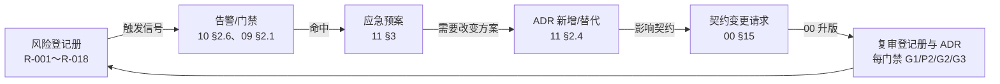
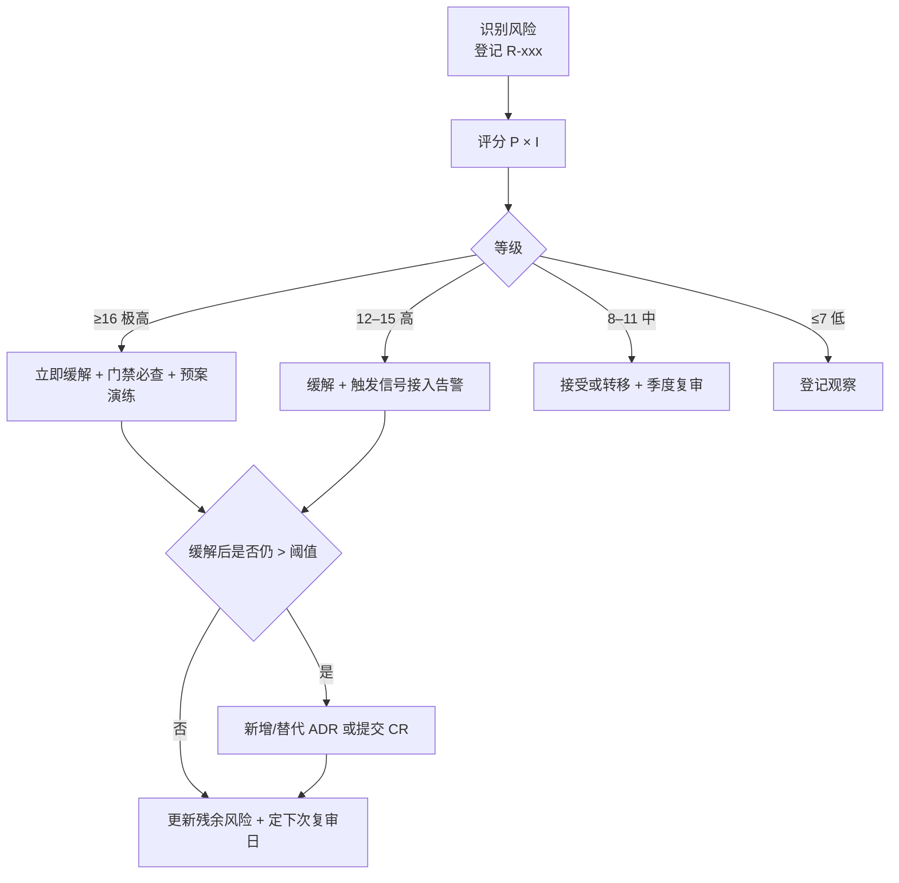

# 11 · 风险登记册、开放问题与架构决策记录

| 项目 | 值 |
|---|---|
| 文档状态 | 基线（Baseline） |
| 版本 | v1.2（LAN-first 阶段化） |
| 维护人 | 交付（delivery） |
| 依赖文档 | [00-conventions.md](./00-conventions.md)（**v1.5**，含 §17–§20 裁定与交付分期）、[PRD-v1.0.md](./PRD-v1.0.md)、[07-security-privacy.md](./07-security-privacy.md)、[08-m0-verification.md](./08-m0-verification.md)、[09-task-plan.md](./09-task-plan.md)、[10-observability.md](./10-observability.md) |
| 适用 PRD | PRD §18.1（主要风险）、PRD §18.2（开放问题）、PRD §6.1、§15、§16 |
| 契约依据 | [00 §9](./00-conventions.md)（错误码）、[00 §17–§19](./00-conventions.md)（v1.1–v1.4 裁定）、[00 §20](./00-conventions.md)（**v1.5 交付分期；§20.4 为 Top5 决策的权威推荐结论**） |
| 阶段依据 | [09 §2.1](./09-task-plan.md) 的 P1/P2/P3 与 [10 §2.1.1](./10-observability.md) 的指标启用阶段 |
| 下游消费方 | [09-task-plan.md](./09-task-plan.md) 的门禁与裁剪决策、[10-observability.md](./10-observability.md) 的告警阈值 |
| 最后更新 | 2026-10-20 |

> **v1.1 变更说明**：交付改为 **LAN-first**（P1 局域网 → P2 公网 → P3 商业化）后：① 风险册加“生效阶段”列，**R-003（公网成本）/R-004（NAT 穿透）的触发时点移到 P2**；② 新增 **R-019（P2 决策延迟阻塞 WAN 启动）**、**R-020（LAN-only 期间用户预期落差）**；③ 新增 **ADR-013（LAN-first 交付分期）**；④ 新增 **§2.6 Top5 决策门禁表**，与 [00 §20.4](./00-conventions.md) 逐条对齐；⑤ 复审日期对齐 G1/P2 启动门禁/G2/G3。

> 本文是三份交付治理文档中的“决策与不确定性”台账：风险给出**触发信号与应急预案**，开放问题给出**候选方案与推荐结论**，ADR 给出**已做出的不可逆或高代价决策**。所有结论必须可追溯到 [00-conventions.md](./00-conventions.md)（v1.4）或 PRD；与契约冲突时以 00 为准，并在 §5 登记冲突点。

---

## 1. 目的与范围

### 1.1 目的

1. 把 PRD §18.1 的六项风险 + 工程侧风险转成**可监控、可触发、可演练**的登记册：每条有概率/影响评分、缓解措施、触发信号（对齐 [10](./10-observability.md) 的告警 ID）、应急预案、复审日期。
2. 对 PRD §18.2 的五个开放问题给出**候选方案、推荐结论、影响面、决策人、截止时间**，并对 [00 §17](./00-conventions.md) 衍生的决策项（权限语义、RTMPS、密钥轮换）给出结论。
3. 用 **12 条 ADR** 固化已经做出的架构与治理决策，明确“后果（正面/负面）”和“何时复审”，避免团队反复争论或静默改口径。
4. 把风险与 [09](./09-task-plan.md) 的门禁/裁剪、[10](./10-observability.md) 的告警/错误预算串成闭环：**风险有信号 → 信号有告警 → 告警有预案 → 预案有决策**。

### 1.2 范围

| 在范围内 | 说明 |
|---|---|
| 风险登记册 18 条 | 覆盖 PRD §18.1 六项 + 12 项工程/治理风险 |
| PRD §18.2 五个开放问题 | 逐条候选方案与推荐结论 |
| v1.1 裁定衍生决策项 | 权限语义确认、RTMPS 是否入 M2、密钥轮换运维 |
| ADR-001～ADR-013 | 协议分离、唯一地址、端侧服务、切源、云端形态、默认公网、LAN 无 TLS、模式边界、RTMPS、发布灰度、埋点数据面、契约治理 |
| 风险触发后的降级路径与 ADR 回退 | §3 |

### 1.3 不在范围内

- 不重复威胁建模细节（[07](./07-security-privacy.md)）与 M0 实验方法（[08](./08-m0-verification.md)）。
- 不定义指标公式与告警规则实现（[10](./10-observability.md)）；本文只引用告警 ID。
- 不定义任务估算与排期（[09](./09-task-plan.md)）；本文只给出风险对排期的冲击与缓冲诉求。
- 不承担商务定价、法务资质结论（只登记风险与决策人与时间点）。

### 1.4 治理闭环

---

## 2. 设计主体

### 2.1 治理方法

**评分规则**：概率 P 与影响 I 均取 1–5 整数；分值 = P × I；等级：≥ 16 极高（红）、12–15 高（橙）、8–11 中（黄）、≤ 7 低（绿）。

| 分值 | 1（很低） | 2（低） | 3（中） | 4（高） | 5（很高） |
|---|---|---|---|---|---|
| 概率 P | < 5% | 5–15% | 15–40% | 40–65% | > 65% |
| 影响 I | 仅文档/工具 | 单机型或单协议体验下降 | 单里程碑延期 ≤ 1 周或局部功能不可用 | 里程碑延期 > 1 周或核心链路受损 | 发布阻断/数据泄露/合规事故 |

**复审节律**

| 时点 | 动作 | 负责人 |
|---|---|---|
| 每周一交付例会 | 更新分值、触发信号状态、缓冲释放建议 | 交付 |
| 每个门禁（G1 / P2 启动门禁 / G2 / G3） | 全量复审；高风险项必须给出“已缓解/接受/转移/规避”结论 | Lead |
| 每月 | 与 [10](./10-observability.md) 的 SLO 报告对齐，更新“残余风险” | 交付 + 产品 |
| 事件后 48 h | 复盘并回写触发信号是否有效、告警是否及时 | 交付 |

**与 09/10 的联动约定**

1. 每条风险的“触发信号”必须能指向 [10](./10-observability.md) 的具体告警 ID（AL-xx）或 [09](./09-task-plan.md) 的可量化进度条件；不能指向的，说明该风险不可观测，须补埋点或补拨测（走 CR）。
2. 任何“极高/高”风险若无对应应急预案，不得在门禁上标记“已接受”。
3. ADR 状态为“已接受”的决策，若其“何时复审”条件被触发，风险册同步升一条风险或升级原风险。

### 2.2 风险登记册（20 条）

#### 2.2.1 评分主表

| ID | 风险描述 | 类别 | 生效阶段 | P | I | 分值 | 等级 | 负责人 | 复审日期 |
|---|---|---|---|---|---|---|---|---|---|
| R-001 | 双摄兼容性：厂商多摄并发支持差异大，白名单外机型出现黑屏/掉帧/崩溃 | 产品/设备（PRD §18.1） | P2 | 4 | 4 | 16 | 极高 | Android | 2027-03-12 |
| R-002 | 端侧服务功耗与并发：手机作服务端受上行带宽、CPU、温度限制，3 观看者即可能降级 | 产品/设备（PRD §18.1） | P1 / P3 | 3 | 4 | 12 | 高 | Android | 2027-03-12 |
| R-003 | 公网成本：SFU + TURN + HLS 转封装带来带宽与计算成本，单房间成本可能超预期 | 商业/成本（PRD §18.1） | **P2**（P1 无云成本） | 4 | 4 | 16 | 极高 | 产品 + 服务端 | 2027-03-12 |
| R-004 | NAT 穿透：对称 NAT/CGNAT 下 WebRTC 播放必须依赖 TURN，TURN 不可用即不可播 | 技术（PRD §18.1） | **P2** | 4 | 3 | 12 | 高 | 服务端 | 2027-03-12 |
| R-005 | 安全隐私：公开地址被转发、截图外泄、token 被他人复用观看 | 安全（PRD §18.1） | 全期 | 3 | 5 | 15 | 高 | 安全 + 服务端 | 每月 |
| R-006 | 合规：公网直播涉及内容审核、ICP/等保资质，资质未取得可能限制上线 | 合规（PRD §18.1） | P3（P2 评估） | 3 | 5 | 15 | 高 | 产品 | 2027-05-07 |
| R-007 | 端侧服务稳定性：OOM、端口冲突（`6002`）、后台被系统回收、长时间运行句柄泄漏 | 工程 | P1 | 3 | 3 | 9 | 中 | Android | 2027-03-12 |
| R-008 | 播放页兼容：浏览器内核差异、自动播放策略、企业网络拦截 MSE/WebSocket | 工程 | P1 / P2 | 4 | 3 | 12 | 高 | Web | 2027-03-12 |
| R-009 | token 与鉴权缺陷：重放/越权、PIN 撞库、密钥轮换导致长会话中断 | 安全（含 [00 §17.1](./00-conventions.md)、[§17.5](./00-conventions.md)） | P1 / P2 | 3 | 5 | 15 | 高 | 服务端 + 安全 | 每月 |
| R-010 | 成本失控：HLS 长尾房间、转封装与 TURN 流量被刷、免费额度被滥用 | 商业/成本 | P2 | 3 | 4 | 12 | 高 | 服务端 + 产品 | 2027-03-12 |
| R-011 | 进度风险：P1/P2 范围偏大、春节假期、关键路径（CP-LAN / CP-WAN）延期 | 交付 | 全期 | 4 | 3 | 12 | 高 | 交付 | 每周一 |
| R-012 | 首帧不达标：弱网/TURN 路径下首帧 > 2 s，直接违反 PRD §16.2 | 体验 | P2（P1 另有 LAN 首帧预算） | 3 | 4 | 12 | 高 | Web + 服务端 | 2026-12-18 |
| R-013 | 热/电量降级不足：双摄长时推流温升超 10 ℃，未及时降级导致烫手/关机 | 设备 | P1 / P2 | 3 | 3 | 9 | 中 | Android | 2027-03-12 |
| R-014 | 第三方组件与专利许可：SRT/RTMP 库、H.264/AAC 专利、ZLMediaKit 许可不清 | 法务/技术 | P1 / P2 | 3 | 4 | 12 | 高 | 架构 + 法务 | 2026-12-18 |
| R-015 | 供应商依赖：云资源、CDN、证书、短信/账号供应商 SLA 事故或调价 | 供应链 | 全期 | 3 | 3 | 9 | 中 | 服务端 | 每季度 |
| R-016 | 契约漂移：多作者并行撰写 12 份文档，枚举/事件名/错误码不一致 | 治理 | 全期 | 4 | 3 | 12 | 高 | 交付 | 每周一 |
| R-017 | 灰度期崩溃/回滚失败：灰度版本 crash-free 跌破 99%，回滚后数据不兼容 | 发布 | P2 / P3 | 2 | 5 | 10 | 中 | Android + 交付 | 每次发布 |
| R-018 | RTMP 明文传输：v1 契约仅承诺明文接入（[00 §17.6](./00-conventions.md)），链路可能被监听/篡改 | 安全 | P2 | 3 | 4 | 12 | 高 | 服务端 + 安全 | 2027-03-12 |
| R-019 | **P2 决策延迟阻塞 WAN 启动**：Top5（尤其 D-2 托管形态、D-3 双摄门槛）未在 2026-12-25 前关闭，P2 无法开工或反复返工 | 治理/交付 | P1 末～P2 启动 | 4 | 4 | 16 | 极高 | Lead | 2026-12-25 |
| R-020 | **LAN-only 期间用户预期/口碑落差**：P1 无公网能力（WAN 置灰），内测者误判“产品不能用” | 产品/商业 | P1 | 3 | 3 | 9 | 中 | 产品 | 2026-12-18 |

> 分布：极高 3 条（R-001、R-003、R-019）、高 12 条、中 5 条（含新增 R-020）；PRD §18.1 的六项全部覆盖（R-001～R-006）。R-003/R-004 的**生效阶段为 P2**（P1 不产生云端成本与 TURN 流量），因此 P1 阶段的实时风险清单为 R-002/R-005/R-007/R-008/R-009/R-011/R-013/R-014/R-016/R-020/R-019（其中 R-019 在 P1 末进入）。

#### 2.2.2 缓解、触发信号与应急预案

| ID | 生效阶段 | 缓解措施（计划内） | 触发信号（可观测） | 应急预案（触发后 24 h 内启动） | 残余风险 |
|---|---|---|---|---|---|
| R-001 | P2 | T0-A1 支持率实验 → T2-A2 白名单与运行时检测（不支持即隐藏，`1004`/`2009`）；T2-Q1 Top 30 机型验证；机型档 `deviceTier` 分流 | 支持率 < 40%（[09](./09-task-plan.md) OQ-09-04）；单机型失败率 > 20%；AL-13 双摄降级异常 | 双摄降级为“实验性”入口并加免责提示；M3 双路推流移出 v1.0（[09 §2.10](./09-task-plan.md) 裁剪第 6 项）；对失败机型下发禁用配置 | 中（白名单外仍有长尾） |
| R-002 | P1 / P3 | 并发上限默认 3（`6005`）；端侧降分辨率/帧率；功耗预算对齐 [00 §10.4](./00-conventions.md)；T2-Q4 实测 | LAN 并发失败率 > 5%（AL-14）；10 min 温升 p95 > 8 ℃；CPU > 35% 持续 10 min | 上限降到 2 并在 UI 明示；默认降为 720p24；提示切换 WAN 模式；必要时关闭 LAN WebRTC 通道回退 FLV/MJPEG | 中 |
| R-003 | **P2**（P1 无云成本） | M0 起记录单房间带宽/转码成本；T2-S5 容量与成本工程；T2-P6 成本模型；套餐限额（`2004`） | **P2 起才监控**：AL-20 单房间分钟成本 > 基线 150%；TURN 流量占比 > 30%；HLS 请求占比 > 25%（P1 无云端成本） | 收紧默认码率（2.5→2.0 Mbps）；HLS 仅对失败会话按需开启；对高成本房间限时长；触发 [00 §6.3](./00-conventions.md) 额度上限 | 中 |
| R-004 | **P2** | TURN 作为 WHEP 的 ICE 回落（`7005`）；T1-S3 接入 TURN；多地域 TURN 与容量预留 | **P2 起才监控**：ICE 失败率 > 5%；AL-04 首帧 P1；AL-06 HLS 兜底 > 25%（P1 无 WebRTC/TURN） | 播放页强制 FLV 降级（不依赖 TURN）；扩容 TURN；对 CGNAT 用户提示“建议使用 FLV 已自动切换” | 低 |
| R-005 | 全期 | token 短时 + 房间关闭立即失效；PIN 可选；分享文案明示“任何拿到链接的人可观看”；日志/埋点脱敏（[10 §2.8](./10-observability.md)） | AL-18 敏感字段命中（P0）；`address_copied` 后短时内异地高并发观看；用户举报截图外泄 | 立即吊销房间 token（停止即失效已覆盖）；临时强制 PIN；事件按 [07](./07-security-privacy.md) 流程处置并复盘 | 中（转发无法技术阻断） |
| R-006 | P3（P2 评估） | T3-S8 审核钩子；T3-P2 资质推进；M3 前完成 ICP/等保评估；举报入口 | 资质未在 D3 前取得；举报量周环比 > 200%；监管通知 | GA 延后（只发 RC）；先开“受控范围”（邀请制 + PIN）；限制公网房间时长与并发 | 中 |
| R-007 | P1 | 前台服务 + 通知栏；电池白名单引导；T2-S8 端侧稳定性加固；端口顺延 8089–8099 | 端侧崩溃/ANR 上升；`6001`/`6002` 激增；服务存活 < 30 min 比例 > 5% | 自动重启端侧服务并重发地址（旧 token 失效）；降级为 MJPEG 单通道；必要时提示“重启 App 后重新推流” | 低 |
| R-008 | P1 / P2 | 播放页内联无外链；降级阶梯（webrtc→flv→hls）；T1-Q2/T3-Q1 兼容矩阵；`mutedAutoplay` 兜底 | AL-03 可打开率 < 98%；单内核失败率 > 5%；HLS 兜底 > 15%（AL-06） | 对问题内核关闭 WebRTC 直接 FLV；展示“点击播放”引导；发布回滚 `player-{semver}.js` | 中 |
| R-009 | P1 / P2 | PIN 双层限速（IP 5 次/分、房间 20 次/分 → `3008`；10 次失败锁 10 分钟 `3006`，[00 §17.1](./00-conventions.md)）；签名→exp→房间状态→会话/并发 校验顺序；90 天轮换双 `kid` ≥ 30 天（[00 §17.5](./00-conventions.md)）；LAN 密钥会话级不落盘 | `3006`/`3008` 激增；`3002`/`3003` 异常上升；同一 `jti` 复用；AL-10 失效准确率下降 | 对来源 IP/房间加严限速；强制全房间 PIN；轮换回滚到旧 `kid`（30 天并存期内安全）；审计 `jti` 重放日志 | 中 |
| R-010 | P2 | 额度与套餐（`2004`）；码率自适应上限 4 Mbps；HLS 按需、TURN 配额；异常流量检测 | AL-20 成本异常；单账号 24 h 房间数 > 基线 300%；HLS 转封装量 > 200% | 对异常账号限流（`3008`）；关闭其 HLS 兜底；冻结免费额度；业务侧介入 | 中 |
| R-011 | 全期 | 分阶段缓冲（353 pd = 37.9%）；[09 §2.10](./09-task-plan.md) 分阶段裁剪清单（P1 17 pd / P2 37 pd / P3 34 pd）；关键路径每周红黄绿跟踪 | CP-LAN 落后 > 2 个工作日、CP-WAN 落后 > 3 个工作日；连续 2 迭代释放缓冲 > 20 pd | 执行 [09 §3](./09-task-plan.md) 降级流程：先裁范围、再换人、最后才议延期 | 中 |
| R-012 | P2（P1 另有 LAN 首帧预算） | 首帧预算拆解（[00 §10.2](./00-conventions.md)）；降级阶梯时限；T1-Q3/T2-Q3 性能与弱网测试 | AL-04：webrtc p95 > 2.5 s；AL-05 达标率 < 85% | 弱网自动提前降级（WebRTC 2.5 s → FLV）；预连接与预取；必要时调整降级阈值（需评审） | 中 |
| R-013 | P1 / P2 | 双摄默认降分辨率/帧率；`thermalStatus ≥ SEVERE` 或电量 ≤ 20% 触发降级（`7003`/`7004`）；省电模式 | AL-13：单机型温升 p95 > 12 ℃；SEVERE 占比 > 20% | 强制进入省电模式（单摄 + 低码率）；提示“设备过热，已降级”；记录机型并加入限制名单 | 中 |
| R-014 | P1 / P2 | SBOM 与许可证清单；T0 阶段完成组件选型评审；法务在 M1 前给出结论 | 出现 GPL/AGPL 传染性许可；专利许可未覆盖 H.264/AAC；替换成本 > 10 pd | 替换为许可清晰组件（如开源 SRT/自研 RTMP 封装）；商业授权采购；必要时关闭对应协议仅保留 WHIP | 中 |
| R-015 | 全期 | 多供应商备份（证书、CDN）；SLA 与告警；关键依赖去单点 | 供应商 SLA 事件；证书到期 < 15 天；错误率突增且与供应商状态页相关 | 切换备份供应商；证书提前 30 天续期；降级为单地域服务并公告 | 低 |
| R-016 | 全期 | 00 为唯一契约源；CR 流程；`scripts/check_docs.py --strict` 文档 CI（[00 §17.7](./00-conventions.md)）；交叉评审 | 文档 CI 失败；同一枚举在两文档取值不同；错误码/事件名对不上 | 阻断合并；由 Lead 裁定并在 00 升版；受影响文档同批修订 | 低 |
| R-017 | P2 / P3 | 灰度 10%→50%→100%；回滚脚本与数据兼容策略；发布检查单（T3-P4） | AL-12：单版本 crash-free < 98.5% 持续 2 h；SLO burn rate > 14.4× | 立即回滚到上一版本；停灰度；24 h 内出复盘；必要时下架商店版本 | 低 |
| R-018 | P2 | v1 只承诺 RTMP 明文（[00 §17.6](./00-conventions.md)）；在 UI/文档明示；优先推荐 WHIP/SRT；RTMPS 列入 M2 评估（ADR-009） | 企业网络重置 RTMP 连接；中间设备告警；客户要求加密接入 | 引导改用 WHIP/SRT；对企业客户评估 RTMPS 或 BYO 加密链路；记录为合规风险（[07](./07-security-privacy.md) T-S3） | 中 |
| R-019 | P1 末～P2 启动 | 每周 Top5 决策评审（§2.6）；D-2 预置“自建”默认值；P1-I3 起锁定决策材料 | 2026-12-25 仍有 D-x 未关闭；决策会两次延期 | **P2 不启动**，只做不写码的设计/预研；P2 顺延；第 2 周仍无结论升级干系人；必要时按 [00 §20.4](./00-conventions.md) 推荐值执行并记录“默认生效” | 中 |
| R-020 | P1 | 访问范围控件呈现 WAN 置灰（“公网可访问 · 阶段二开放”，[00 §20.3](./00-conventions.md)）；内测说明明确“P2 开放公网”；LAN 体验做足 | 内测反馈“打不开/不能用”占比 > 20%；公网相关负面反馈 > 10 条/周 | 发布 P1 说明公告与路线图；一对一引导；必要时提前开放 P2 内测白名单 | 低 |

#### 2.2.3 重点跟踪（Top 5）

| 排名 | 风险 | 为什么排前 | 本周动作 | 观察指标 |
|---|---|---|---|---|
| 1 | R-019 P2 决策延迟 | 决策是 P2 的启动开关；延迟 1 周即整体顺延 1 周且无替代路径 | 每周一 Top5 决策评审；P1-I3 起材料锁定 | D-x 关闭数 / 5 |
| 2 | R-001 双摄兼容性 | 直接决定“双摄”卖点是否成立，且不可通过代码完全消除 | M0 支持率实验（T0-A1）第 3 天中期检查 | 支持率、失败归因分布 |
| 3 | R-003 公网成本 | 决定商业模式可行性，且与 R-010 联动 | T0 阶段先跑 24 h 成本基线 | 单房间分钟成本 |
| 4 | R-009 token/鉴权 | 一旦出错是“可看但不该看”的隐私事故 | 用 §17.1 双层限速用例覆盖 PIN 撞库 | `3006`/`3008`/`3002` 计数 |
| 5 | R-005 地址转发 | 产品承诺“有地址即可看”，天然存在泄露面 | 分享文案与 PIN 引导在 M1 落地 | 举报量、异地并发 |
| 6 | R-011 进度 | 决定 P1/P2 能否按门禁交付 | 每周一红黄绿 | CP-LAN / CP-WAN 偏差天数 |

### 2.3 PRD §18.2 五个开放问题

> 每条给出候选方案、推荐结论、影响面、决策人、截止时间；“截止时间”与 [09 §2.6](./09-task-plan.md) 的门禁对齐，避免悬空。

**OQ-11-01 默认访问范围是否长期保持“公网可访问”，还是按网络环境自动推荐**（PRD §18.2）

| 项 | 内容 |
|---|---|
| 候选方案 | A 固定默认公网（PRD 现方案）；B 按网络环境自动推荐（如仅 Wi-Fi 时默认 LAN）；C 首次引导用户显式选择并记住 |
| 推荐结论 | **A + C 的弱化版**：默认公网不变，首次进入时用一次性气泡解释“公网=异地可看 / 局域网=零成本”，不自动切换。理由：自动推荐会在切换时改变播放地址，违反“一个地址”的体验预期（[00 §4.3](./00-conventions.md) 唯一地址不变量） |
| 影响面 | [09](./09-task-plan.md) AC-09；[10](./10-observability.md) 漏斗“点击开始”转化；成本（公网默认推高 R-003） |
| 决策人 | 产品负责人（Lead 会签） |
| 截止 | 2026-12-18（D1） |

**OQ-11-02 局域网模式是否在 M1 即支持端侧 RTMP，还是仅本地直出 HTTP-FLV/MJPEG**（PRD §18.2）

| 项 | 内容 |
|---|---|
| 候选方案 | A 仅本地直出 HTTP-FLV/MJPEG（PRD §17 M1 现方案）；B M1 即增加端侧 RTMP 服务；C A + M2 端侧 WebRTC P2P |
| 推荐结论 | **C**：M1 维持 A（省 5–8 pd 且避免端侧二次编码功耗），M2 直接上 WebRTC P2P（延迟更低、无转码），RTMP 端侧不列入 v1 |
| 影响面 | [09](./09-task-plan.md) T1-A6/T1-A7、T2-A4；[11 ADR-003](./11-risk-adr.md)；R-002 |
| 决策人 | Lead（架构） |
| 截止 | 2026-11-06（D0） |

**OQ-11-03 双摄双路独立推流的入口是否放入专业模式二级页面**（PRD §18.2）

| 项 | 内容 |
|---|---|
| 候选方案 | A 仅专业模式二级页面（现方案）；B 主界面直接暴露；C 二级页面 + 首次使用强提示“将生成两个地址” |
| 推荐结论 | **C**：入口收敛在专业模式（不破坏标准模式单一地址承诺），首次进入必须确认“两个地址/两条链路”并计入 [10](./10-observability.md) 的 `address_copied` 分维度 |
| 影响面 | [09](./09-task-plan.md) T2-A8/T3-A1；[00 §15.4](./00-conventions.md)“新增地址展示入口必须标注专业模式”；PRD §1.3 第 8 条 |
| 决策人 | 产品负责人 |
| 截止 | 2026-12-04（M1 迭代 S2 末，影响 M3 设计） |

**OQ-11-04 公网托管服务是自建还是接入第三方媒体云**（PRD §18.2）

| 项 | 内容 |
|---|---|
| 候选方案 | A 全自建（SFU + TURN + 转封装 + HLS）；B 全托管媒体云；C 混合（自建信令/鉴权/房间，媒体面用云） |
| 推荐结论 | **v1 用 A 的最小闭环，M2 末（D2）评估 C**。理由：M0 已验证自建 WHIP/WHEP 链路可行；团队 2 名服务端工程师可控；全托管会在成本与合规（数据出境、`roomId` 脱敏）上引入新不确定性。B 作为备选保留 |
| 影响面 | [11 ADR-005](./11-risk-adr.md)；R-003/R-010/R-015；[03](./03-cloud-service.md) 部署形态；[04](./04-interface-contracts.md) 无需变更（协议面向自建实现） |
| 决策人 | Lead + 干系人（含财务） |
| 截止 | 2027-01-29（D2） |

**OQ-11-05 商业化模式：流量套餐、时长套餐、BYO 免费工具模式**（PRD §18.2）

| 项 | 内容 |
|---|---|
| 候选方案 | A 时长套餐（房间分钟数）；B 流量/带宽套餐；C BYO 免费工具 + 托管按时长付费（Freemium） |
| 推荐结论 | **C**：BYO 作为免费入口（降低获客成本、把成本转给用户自有服务端），托管侧按时长套餐计费（口径简单、可与 `maxDurationSec` 和 `2004` 额度直接对齐）。流量套餐作为 B 备选，M3 数据（R-003 成本模型）出来后再定 |
| 影响面 | [09](./09-task-plan.md) T3-S2/T3-W2/T3-P1；R-003/R-010；PRD §13.1 额度与套餐 |
| 决策人 | 产品负责人 + 商务 |
| 截止 | 2027-02-26（S8 末，M3 商业化开发前） |

### 2.4 v1.1 裁定与 v1.5 交付分期衍生的决策项

> [00-conventions.md](./00-conventions.md) v1.1 §17 有两条裁定明确要求由本文件承接（§17.3 权限取舍“见 11 号文档开放问题”、§17.6 RTMPS“由 11 号文档 ADR 决策”）。

| ID | 决策项 | 候选方案 | 推荐结论 | 影响面 | 决策人 | 截止 |
|---|---|---|---|---|---|---|
| OQ-11-06 | 权限语义确认：摄像头拒绝阻断（`1001`）、麦克风拒绝静音继续（`1002`，非致命） | A 接受 [00 §17.3](./00-conventions.md) 裁定；B 麦克风也阻断；C 麦克风缺失时强制二次确认 | **A**：核心承诺是“打开即可看到画面”，音频缺失不应阻断；UI 必须常驻“无声音”标识，`permission_denied{permission=microphone}` 单独统计 | [09](./09-task-plan.md) AC 补充项 N-01；[10](./10-observability.md) 漏斗“授权”步定义；[02](./02-client-modules.md) | 产品负责人（Lead 会签） | 2026-11-06（D0） |
| OQ-11-07 | RTMPS 是否列入 M2 | A 不列入（v1 明文 + 文档明示）；B 列入 M2 作为可选增强；C 直接放弃 RTMP 只保留 WHIP/SRT | **B**：按 [00 §17.6](./00-conventions.md) 定位，M2 评估实现（不改变 v1 接口与错误码）；若 M2 期间出现企业客户加密硬需求，升级为 A→B 强制项；对应 ADR-009 | [09](./09-task-plan.md) T2-A3/M2 范围；R-018；[07](./07-security-privacy.md) T-S3 | Lead + 安全 | 2026-12-18（P2 启动前） |
| OQ-11-08 | 密钥轮换运维窗口：90 天轮换 + 双 `kid` 并存 ≥ 30 天（[00 §17.5](./00-conventions.md)） | A 固定每季度首周轮换；B 按签发量 > 阈值触发；C 无人值守自动轮换 | **A**：与季度规划对齐，人工值班在场；轮换前后各跑一次长会话（12 h 房间）验证；旧 `kid` 保留 30 天后再下线 | R-009；[03](./03-cloud-service.md) 密钥管理；[10](./10-observability.md) AL-23 | 服务端 + 安全 | 2026-11-20 |

### 2.5 ADR 决策记录

**格式**：背景 / 决策 / 备选方案 / 后果（正面/负面）/ 状态 / 关联文档 / 何时复审。状态取值：`已接受`、`提议`、`暂缓`、`已替代`。

#### ADR-001 推流协议与播放协议分离

| 项 | 内容 |
|---|---|
| 状态 | 已接受（2026-10-20，Lead） |
| 背景 | 用户不应理解协议；PRD §3.1 明确“推流协议只列推流协议”，HLS/FLV 是播放侧兼容能力。工程上推流面与播放面解耦后，两端可独立演进（WHIP 接入、FLV 分发、HLS 兜底互不阻塞） |
| 决策 | 推流协议仅 `whip`/`srt`/`rtmp`；播放协议由播放页内部按 `webrtc → flv → hls`（LAN 为 `flv → mjpeg`，P2 起前置 `webrtc`）决定，用户不可见、不可选 |
| 备选 | A 统一 RTMP 推流 + HLS 播放（简单但延迟 1–3 s，违背“超低延迟”卖点）；B 推流协议暴露给用户挑选（增加理解成本与错误配置） |
| 后果（正面） | 播放页可独立降级；服务端可按协议分别优化；错误码可按面划分（4xxx 推流 / 5xxx 播放） |
| 后果（负面） | 需维护转封装（RTMP→FLV/HLS）与切源能力；同一房间存在“推流协议 ≠ 播放协议”的排障复杂度；埋点必须严格区分 `pushProtocol` 与 `playProtocol`（[10 §2.3.4](./10-observability.md)） |
| 关联文档 | PRD §3.1、§6、§7；[00 §2](./00-conventions.md)、[§3](./00-conventions.md)、[§7](./00-conventions.md)；[04](./04-interface-contracts.md)；[06](./06-playback-page.md) |
| 何时复审 | 新增任一推流或播放协议时；或播放页降级阶梯不再满足首帧预算（[00 §10.2](./00-conventions.md)）时 |

#### ADR-002 唯一播放地址

| 项 | 内容 |
|---|---|
| 状态 | 已接受（2026-10-20，Lead） |
| 背景 | 产品核心承诺“一个地址即看”；多地址会让用户在复制/二维码/分享上做选择 |
| 决策 | 标准模式对外只输出 `{playHost}/s/{roomId}?token={pageToken}`（LAN 为 `http://{lanIp}:{port}/s/{pageToken}`），复制/二维码/分享/本机预览全部指向同一字符串；协议切换、降级、重连均不得改变地址栏（[00 §4.3](./00-conventions.md)） |
| 备选 | A 按协议输出多个地址；B 输出裸流地址 + 播放页地址；C 使用短链跳转（302）到当前协议 |
| 后果（正面） | 分享链路最短；支持“停止即失效”的统一语义（410）；播放页成为唯一产品面 |
| 后果（负面） | 服务端必须实现切源与协议协商；地址一旦泄露无法通过“换地址”止损（只能靠 token 失效与 PIN）；C 的 302 方案会破坏“地址不变”可测试性，被否决 |
| 关联文档 | PRD §3.2、§7.1、§7.4；[00 §4.2](./00-conventions.md)、[§4.3](./00-conventions.md)、[§15.4](./00-conventions.md)；[03](./03-cloud-service.md)；[04](./04-interface-contracts.md) |
| 何时复审 | 出现“必须按协议分发不同地址”的商业需求时；专业模式新增地址入口时（需标注专业模式） |

#### ADR-003 端侧服务：自研轻量 HTTP 服务 vs ZLMediaKit

| 项 | 内容 |
|---|---|
| 状态 | 已接受（2026-10-20，Lead）；ZLMediaKit 作为 M2 评估项 |
| 背景 | LAN 模式需在 App 内提供播放页、FLV/MJPEG 分发、token/PIN、并发计数；PRD §11.3 允许 NanoHTTPD 或同类库，ZLMediaKit “需评估 APK 体积、功耗、稳定性，不作为 MVP 默认” |
| 决策 | v1 自研轻量 HTTP 服务（NanoHTTPD 类）+ MediaCodec 直出，单文件内联播放页（≤ 64 KB）；不引入 ZLMediaKit 作为默认；M2 若 LAN 延迟/并发不达标，再评估引入 |
| 备选 | A 直接集成 ZLMediaKit Android 版（能力全但 APK 体积、功耗、GPL/许可与维护成本高）；B 端侧 RTMP + 通用播放器（依赖第三方播放器，LAN 无外网时不可用） |
| 后果（正面） | APK 体积可控；启动快、功耗低；契约完全可控（[00 §8](./00-conventions.md) 的端侧 API 由我们定义）；许可风险低 |
| 后果（负面） | 需自行实现 FLV 封装、MJPEG 分帧、并发与连接管理（T1-A6 8 pd）；不支持 HLS；LAN 延迟优化空间受限（M2 才引入 WebRTC P2P） |
| 关联文档 | PRD §11.3、§12；[00 §8](./00-conventions.md)；[05-lan-service.md](./05-lan-service.md)；[02](./02-client-modules.md)；R-002/R-007 |
| 何时复审 | P2-I2（T2-A4 立项时）；或 LAN 首帧 > 1.5 s、并发 3 人时 CPU > 35% 触发 |

#### ADR-004 协议切换地址不变（服务端切源）

| 项 | 内容 |
|---|---|
| 状态 | 已接受（2026-10-20，Lead） |
| 背景 | PRD §1.3 第 6 条与 §6.2：公网模式切换推流协议后播放地址保持不变；用户已分享出去的链接不能失效 |
| 决策 | 切源在 `roomId` 维度完成：`POST /rooms/{roomId}/ingest:switch` → `roomState=switching` → 新源首帧到达回 `live`；`playUrl` 不变；15 s 内新源无首帧则 `failed`；旧 `ingestToken` 有 5 s grace（[00 §5.1](./00-conventions.md)）；播放页通过 SSE `source-switched` 自动重连 |
| 备选 | A 重新生成 roomId + 新地址（用户需重新分享，违背承诺）；B 播放页轮询 `status` 判断切换（延迟高、耗电）；C 用 302 把旧地址指向新地址（破坏唯一地址不变量，且缓存/中间层不可控） |
| 后果（正面） | 分享出去的链接在切换后仍可用；播放页可无感重连；切换可回滚（回到原协议）；埋点可用 `interruptMs` 量化体验 |
| 后果（负面） | 服务端需维护“同一 roomId 多接入会话”的生命周期与竞态；`switching` 是新增状态，需全链路（客户端/播放页/SSE）理解；切源失败会进入 `failed` 终态，需重推 |
| 关联文档 | PRD §1.3、§6.2、§13.2；[00 §3.1](./00-conventions.md)（状态机）、[§6.2](./00-conventions.md)（`ingest:switch`）、[§4.3](./00-conventions.md)；[03](./03-cloud-service.md)；[06](./06-playback-page.md)；[10 §2.2.6](./10-observability.md) |
| 何时复审 | 切换失败率 > 2% 或 `interruptMs` p95 > 5 s 连续 2 周；或新增第四种推流协议时 |

#### ADR-005 云端形态：自建 vs 第三方媒体云

| 项 | 内容 |
|---|---|
| 状态 | 已接受（2026-10-20，Lead）；D2 复审混合方案 |
| 背景 | PRD §4.5 要求公网可用，“纯客户端无法保证公网可达”；§13.1 列出最小闭环（WHIP/SRT/RTMP 接入、WHEP、FLV、HLS、TURN、token、房间、额度）。成本与合规风险（R-003/R-010/R-015）要求可控 |
| 决策 | v1 自建：媒体接入（WHIP/SRT/RTMP）+ SFU（WHEP）+ 转封装（FLV/HLS）+ TURN + 房间/token/额度，部署在自有云账号；与 [00 §20.4 D-2](./00-conventions.md) 一致：**v1 自建（Mediasoup + SRS 终结）+ D2 评估混合**；第三方媒体云仅作边缘能力备选 |
| 备选 | A 全托管媒体云（上线快但成本不可控、token 与房间模型受制于人、数据出境与合规不确定）；B 全自建（延期风险、运维负担）；C 混合（自建信令/鉴权 + 云媒体面） |
| 后果（正面） | 成本可测（T2-P6 成本模型可控）；`roomId`/token/房间状态完全自持，符合 [00 §4](./00-conventions.md)/[§5](./00-conventions.md)；可控的 SLO 与错误预算 |
| 后果（负面） | 服务端 2 人需覆盖接入、转发、转封装、TURN、容量（M1 48 pd 偏紧）；多地域与弹性扩容需自行建设（R-004/R-015）；故障自担，无供应商兜底 |
| 关联文档 | PRD §4.5、§13；[00 §6](./00-conventions.md)、[§7](./00-conventions.md)；[01](./01-architecture.md)；[03](./03-cloud-service.md)；OQ-11-04；R-003/R-010/R-015 |
| 何时复审 | 2027-01-29（D2）；或单房间分钟成本 > 目标 150%（AL-20）；或并发房间数超自建容量 70% |

#### ADR-006 默认访问范围为“公网可访问”

| 项 | 内容 |
|---|---|
| 状态 | 已接受（2026-10-20，Lead）；长期策略见 OQ-11-01 |
| 背景 | PRD §4.2：首次启动默认公网，保证“复制地址即可看”的核心承诺；若公网不可用需置灰并引导局域网 |
| 决策 | **P2 起**默认 `accessScope=wan`；**P1 期间 WAN 选项呈现但置灰**（文案“公网可访问 · 阶段二开放”，[00 §20.3](./00-conventions.md)），默认 LAN；公网服务未配置/无网络/额度不足（`2004`）时置灰并给出引导；推流中锁定；切换必须停止推流并明示旧地址失效 |
| 备选 | A 默认局域网（隐私优先但违背核心承诺、异地不可看）；B 按网络自动推荐（切换会改地址，体验风险）；C 首次强制选择（增加一次决策成本） |
| 后果（正面） | 新用户首次即可“复制—粘贴—观看”；商业模式（套餐）有默认入口；与 PRD §16.2 “默认策略”验收一致 |
| 后果（负面） | 默认产生云端成本（R-003/R-010）；隐私敏感用户可能误用公网（需 PIN 与提示引导）；公网依赖成为首启动故障点（`2004`/网络错误） |
| 关联文档 | PRD §4.2、§9.1、§16.2；[00 §4.4](./00-conventions.md)（局域网检测）；[02](./02-client-modules.md)；[09 AC-09](./09-task-plan.md) |
| 何时复审 | OQ-11-01 决策时（D1，2026-12-18）；或公网成本超预算 2 个季度 |

#### ADR-007 局域网模式不提供 HTTPS（风险接受）

| 项 | 内容 |
|---|---|
| 状态 | 已接受（2026-10-20，Lead + 安全） |
| 背景 | LAN 校验为 `http://{lanIp}:{port}`；局域网内无受信任证书，自签证书会触发浏览器告警并被用户忽略，反而降低安全性；企业 CA 不可分发 |
| 决策 | 端侧只提供 HTTP（`6007 lan_https_unavailable` 用于提示语义）；UI 明示“仅限可信局域网”“同网设备可能访问”；用短时 `mediaToken`（300 s）+ 可选 PIN + 停止即失效（连接拒绝）作为补偿控制；不提供跨域（`Access-Control-Allow-Origin` 不设置） |
| 备选 | A 自签证书 + 用户点“继续访问”（告警疲劳、教育成本高）；B 要求用户安装 CA（不现实）；C 放弃 LAN 模式（违背“零服务端成本”卖点） |
| 后果（正面） | 零配置可播；无证书运维；浏览器兼容性最好（无混合内容拦截） |
| 后果（负面） | 同网段可被被动嗅探（明文视频流）；无法防中间人；企业/公共 Wi-Fi 场景需明确告知（[07](./07-security-privacy.md) 威胁清单）；不能承诺“加密传输” |
| 关联文档 | PRD §4.4、§15；[00 §8](./00-conventions.md)；[05](./05-lan-service.md)；[07](./07-security-privacy.md)；[06](./06-playback-page.md)；R-005 |
| 何时复审 | 出现企业/商用 LAN 场景需求时；或浏览器对 HTTP + MSE/WebRTC 施加新限制时；M3 商业化定稿时 |

#### ADR-008 标准模式与专业模式边界

| 项 | 内容 |
|---|---|
| 状态 | 已接受（2026-10-20，Lead + 产品） |
| 背景 | PRD §1.3 第 8 条与 §3.4：双路独立推流为专业模式例外，会生成两个地址，但不得影响标准模式的单一地址承诺；[00 §15.4](./00-conventions.md) 要求任何新增地址展示入口必须标注“专业模式” |
| 决策 | 标准模式 = 单路合成画面 + 单一 `playUrl`；专业模式 = 双路独立推流、多地址推流、BYO 自定义地址，入口收敛在设置/二级页面，首次进入强提示“将生成多个地址或由用户自有服务端提供播放能力”；标准模式的地址卡、二维码、分享永不出现第二个地址 |
| 备选 | A 不分层，全部能力平铺（破坏核心承诺、理解成本高）；B 专业模式完全独立 App（维护成本翻倍）；C 专业模式仅对企业开放（M3 商业化前无法验证） |
| 后果（正面） | 核心承诺可测试（只有一个地址）；高级能力有明确归属与免责提示；商业化（BYO）有落点 |
| 后果（负面） | 两套 UX 与提示文案（额外设计与测试成本）；专业模式的埋点需新增维度（多地址计数）才能评估使用率；权限/账号体系可能只在专业模式生效，产生分叉 |
| 关联文档 | PRD §1.3、§3.4、§5.2、§8.3；[00 §15.4](./00-conventions.md)；[09 T2-A8/T3-A1/T3-A4](./09-task-plan.md)；OQ-11-03 |
| 何时复审 | M3 商业化定稿（T3-P1，2027-02-26）；或专业模式使用率 > 20% 需重新评估信息架构 |

#### ADR-009 RTMPS 定位：v1 明文 + M2 可选增强

| 项 | 内容 |
|---|---|
| 状态 | 已接受（2026-10-20，Lead + 安全）；M2 是否实装待 OQ-11-07 |
| 背景 | [00 §17.6](./00-conventions.md) 裁定：v1 契约只承诺 RTMP 明文接入（PRD §6.1 口径），RTMPS 作为 M2 可选增强，不改变 v1 接口与错误码；风险见 R-018 与 [07](./07-security-privacy.md) T-S3 |
| 决策 | v1 不实现 RTMPS：`rtmp://` 明文 + query token；文档与 UI 明示传输未加密，优先推荐 WHIP/SRT；客户端不得自行降级为明文以外的私有实现；与 [00 §20.4 D-5](./00-conventions.md) 对齐：**RTMPS 进入 P2 评估**（若实现，仍复用 `pushProtocol=rtmp`，仅传输层变化，不新增枚举） |
| 备选 | A v1 即做 RTMPS（证书链与自签问题、老旧设备兼容、M1 排期 +4–6 pd）；B 放弃 RTMP 只保留 WHIP/SRT（生态兼容诉求未满足，PRD §6.1 明确保留 RTMP）；C v1 明文但默认关闭 RTMP（用户选择变少） |
| 后果（正面） | 兼容成熟生态（OBS 类工具、老旧服务端）；M1 不增加排期；与 PRD §6.1 与 00 裁定一致 |
| 后果（负面） | 推流内容在公网明文传输，存在被监听/篡改风险（R-018）；对安全敏感客户需给出替代（WHIP 的 DTLS-SRTP / SRT 的 AES）；合规审查可能要求整改 |
| 关联文档 | [00 §17.6](./00-conventions.md)、[00 §7](./00-conventions.md)；PRD §6.1；[07](./07-security-privacy.md) T-S3；[09 T1-A4/T2-A3](./09-task-plan.md)；R-018；OQ-11-07 |
| 何时复审 | 2026-12-18（P2 启动前决策）；P2 实施期间出现企业客户加密硬需求、监管明确要求时 |

#### ADR-010 发布策略：内测 → 定向灰度 → 全量

| 项 | 内容 |
|---|---|
| 状态 | 已接受（2026-10-20，Lead + 产品） |
| 背景 | 推流质量受设备/网络/浏览器影响巨大，一次性全量会把长尾问题放大；[10 §2.5](./10-observability.md) 的错误预算需要“可回滚的发布单元” |
| 决策 | M1/M2：内部 + 定向内测（邀请制，20–50 人，覆盖 Top 20 机型）；M3 GA：应用商店分阶段 10% → 50% → 100%，每阶段观察 ≥ 24 h；门禁为 SLO burn rate 与 crash-free；播放页独立灰度（`player-{semver}.js` 按版本号切换） |
| 备选 | A 直接全量（回滚窗口小、风险集中）；B 只做商店分阶段（播放页无法独立回滚）；C 长期双版本并行（维护成本高） |
| 后果（正面） | 问题在小流量暴露；播放页与服务端可独立回滚；错误预算门禁可执行 |
| 后果（负面） | 发布周期变长（+5 个工作日 S11）；灰度期需要值班与观察（人力占用已计入 S11 的 35 pd）；灰度数据样本小，分维度结论需谨慎 |
| 关联文档 | [09 §2.6](./09-task-plan.md)（S11）、[09 §2.12](./09-task-plan.md)；[10 §2.5](./10-observability.md)、[§2.6](./10-observability.md)；[07](./07-security-privacy.md)（事件响应）；R-017 |
| 何时复审 | 每次 GA 前；或灰度机制被证伪（回滚失败/数据不可比）时 |

#### ADR-011 埋点数据面：自建上报与数仓

| 项 | 内容 |
|---|---|
| 状态 | 已接受（2026-10-20，Lead + 交付），依赖 CR-10-04 落地 |
| 背景 | [10 §2.3](./10-observability.md) 定义了 24 个必埋事件与禁止字段；`roomId` 只允许哈希、token/PIN/IP 禁止上报，数据出境与第三方 SDK 披露要求（[07](./07-security-privacy.md)）提高 |
| 决策 | 自建上报端点（`{telemetryHost}/api/v1/telemetry/batch`，占位，**端点模板需 CR-10-04 补入 [00 §4.2](./00-conventions.md)**）+ 对象存储 L0 + 数仓 L1/L2 + 自建看板；第三方分析仅作可选导出，不接 SDK |
| 备选 | A 直接接第三方分析 SDK（开发快但 roimdId/设备标识出境与脱敏不可控，且私有字段 schema 受限）；B 只用服务端日志（缺客户端首帧/降级等关键指标）；C 自建 + 第三方双写（成本翻倍） |
| 后果（正面） | 字段与 schema 完全受控（与 00 §11 严格一致）；脱敏在入口完成；数据保留期可执行（[10 §2.8](./10-observability.md)） |
| 后果（负面） | 需自建上报 SDK、存储与看板（T1-A10 4 pd 偏紧）；无现成漏斗/留存分析能力，需自研 SQL；数据量增长后成本上升（R-010） |
| 关联文档 | [10 §2.3](./10-observability.md)、[§2.8](./10-observability.md)；CR-10-04；[07](./07-security-privacy.md)；[01](./01-architecture.md)；[03](./03-cloud-service.md) |
| 何时复审 | 日事件量 > 500 万或看板需求超出 SQL 能力时；或出现合规认可的第三方方案时 |

#### ADR-012 契约治理：单一基线 + CR 流程 + 文档 CI

| 项 | 内容 |
|---|---|
| 状态 | 已接受（2026-10-20，Lead） |
| 背景 | 12 份文档由多人并行撰写，枚举/事件名/错误码极易漂移（R-016）；[00 §17.7](./00-conventions.md) 已把文档一致性检查固化为 CI 门禁 |
| 决策 | [00-conventions.md](./00-conventions.md) 是唯一契约源（子文档只能细化不能改写）；变更一律走 CR（[00 §15](./00-conventions.md)），契约升次版本、破坏性变更升主版本；`python3 scripts/check_docs.py --strict` 作为合并门禁（行数、章节、Mermaid、坏链、PRD 引用、错误码、占位域名、密钥泄漏 8 类检查） |
| 备选 | A 以 PRD 为契约（PRD 是产品口径，缺字段/错误码/预算等工程约束）；B 各文档自持契约（漂移不可控）；C 只靠人工评审（已证明不可靠） |
| 后果（正面） | 字段/枚举/错误码只有一处定义；CI 可在合并前拦截漂移；ADR 与 CR 形成可追溯决策链 |
| 后果（负面） | 变更流程有成本（每次 CR 需要评审与升版）；00 成为瓶颈，Lead 需在 2 个工作日内响应；文档 CI 误报会阻塞合并（需维护检查脚本） |
| 关联文档 | [00 §15](./00-conventions.md)、[§17.7](./00-conventions.md)、[§20](./00-conventions.md)；`scripts/check_docs.py`；[09 §2.12](./09-task-plan.md)；[10 §5](./10-observability.md)；R-016 |
| 何时复审 | 每个门禁（G1 / P2 启动门禁 / G2 / G3）；或 CR 积压 > 5 条 / 平均响应 > 3 个工作日时 |

#### ADR-013 LAN-first 交付分期

| 项 | 内容 |
|---|---|
| 状态 | 已接受（2026-10-20，Lead；用户决策） |
| 背景 | 原计划（v1.0 的 09）按 M0→M1→M2→M3 顺序交付，即 WAN-first：第 3 周就要建立云端媒体面并承担 SFU/TURN/HLS 成本与合规前置。用户决定改为 **LAN-first**：P1 只做 Android 局域网闭环，P2 才做公网，P3 承接专业化与商业化。该决策已写入 [00 §20](./00-conventions.md)（契约不删减、仅分期启用），需要一条 ADR 说明取舍与后果 |
| 决策 | ① 交付顺序为 **P1（8 周，零云端依赖）→ P2（12 周，公网，启动门禁 = Top5 决策关闭 + M0-WAN 通过 + P1 验收）→ P3（8 周，专业化与商业化）**；② M0–M3 仅作**功能归属标签**保留，排期、门禁、验收一律以 P1/P2/P3 表述（[00 §20.5](./00-conventions.md)）；③ 契约面按 [00 §20.3](./00-conventions.md) 分期启用，P1 不得新建私有 LAN 契约；④ P2 启动前必须关闭 Top5（见 §2.6） |
| 备选 | A **并行双线**（LAN 与 WAN 两个小队同时推进）：交付最快，但 7 人团队会被拉成 2 条各 3.5 人的线，两条链都缺人，且云端成本与合规风险立刻发生；B **WAN-first**（v1.0 原方案，23 周）：能最早验证商业闭环，但 P1 阶段就要支付云成本、承担 Top5 未决下的返工；C **只做 LAN 不做公网**：成本最低，但违背 PRD“复制地址即可看”的核心承诺，产品不成立 |
| 后果（正面） | ① **无云端即可验证核心链路**（采集→编码→端侧分发→浏览器播放），验证成本接近 0；② 8 周即可交付可内测的 LAN 版本，风险与用户反馈更早；③ 云端成本与合规风险推迟到 P2，且 P2 启动前强制关闭 Top5，减少“边做边改架构”；④ 服务端 2 人在 P1 的富余产能转为 P2 前置（24 pd），不浪费 |
| 后果（负面） | ① **公网承诺与商业验证延后**：P2 结束（第 20 周）才具备公网能力，比原计划晚约 2 个月；② **P2 上下文切换风险**：客户端在 P2 从“单机+LAN”切到“云端+WAN”，服务端从 0 起建媒体面，P2 前 2 周效率偏低（已用门禁周与前置 24 pd 抵消一部分）；③ **Top5 决策成为 P2 的关键路径**（R-019，极高）；④ **LAN-only 期间的用户预期落差**（R-020）；⑤ 双摄、RTMP、SRT 受门禁约束后移，原 23 周变为 28 周（+5 周，见 [09 §2.6.3](./09-task-plan.md)） |
| 关联文档 | [00 §20](./00-conventions.md)（§20.1 分期、§20.2 门禁、§20.3 契约启用矩阵、§20.4 Top5、§20.5 映射）；[09 §2.1](./09-task-plan.md)、[§2.6.3](./09-task-plan.md)；[10 §2.1.1](./10-observability.md)；[08 §1.3](./08-m0-verification.md)（M0-LAN/M0-WAN 拆分）；R-019、R-020；ADR-006（默认公网）、ADR-005（云端形态） |
| 何时复审 | ① P2 启动门禁评审（2026-12-25）：若 Top5 无法关闭或 P1 未通过，评估是否回退为并行双线；② P1 门禁延期 > 2 周；③ 用户/市场要求提前公网（提前开放 P2 内测白名单或压缩门禁周）；④ P2 结束（2027-03-12）复盘“LAN-first 是否值得” |

### 2.6 Top5 决策门禁（P2 启动前必须关闭）

> 权威推荐结论来自 [00 §20.4](./00-conventions.md)；本表补充**决策人、最晚时点、阻塞的 P2 工作、不决策后果**与 09/10 的落地位置。规则：**任一项未关闭 → P2 不启动**（[00 §20.2](./00-conventions.md)），只允许做“不写码”的设计与预研；逾期第 2 周按推荐值执行并记录“默认生效”（转为 R-019 的应急预案）。

| ID | 决策项 | 推荐结论（00 §20.4） | 决策人 | 最晚决策时点 | 阻塞的 P2 工作项 | 不决策后果 | 落地位置 | 状态 |
|---|---|---|---|---|---|---|---|---|
| D-1 | 默认访问范围是否长期保持“公网”，还是按网络自动推荐 | 保持公网 + 首次引导 | 产品 | **P2 启动前**（2026-12-25） | WAN 默认值、首启引导、AC-09、T1-A1 的 WAN 分支 | P2 无法定义首启体验，AC-09 无法验收 | [09 OQ-09-06](./09-task-plan.md)、[10 AC-09](./10-observability.md)、ADR-006 | 待决 |
| D-2 | 公网托管：自建媒体面 vs 第三方媒体云 | v1 自建（Mediasoup + SRS 终结）+ D2 评估混合 | 技术 + 产品 | **P2 设计前**（2026-12-25） | 接入/SFU 选型、成本模型、E2 环境、T1-S3/T1-S4、T2-S5 | 云端工作无法开工，P2 12 周整体顺延 | [09 OQ-11-04](./11-risk-adr.md)、ADR-005、R-003/R-010 | 待决 |
| D-3 | 双摄白名单门槛与灰度策略 | 支持率 ≥ 40% 才作为 v1 卖点，否则实验性 | 产品 + Android | **P2 启动前**（2026-12-11，输入来自 M0-LAN E1） | T2-A1、T2-A2、AC-05（[00 §20.4](./00-conventions.md) 写作“AC-04”，按 PRD §16.2 顺序应为 AC-05，已回报 Lead） | 双摄范围无法冻结，P2 末返工或整体移出 P2 | [09 OQ-09-04](./09-task-plan.md)、R-001 | 待决 |
| D-4 | 局域网端侧是否支持 RTMP | P1 仅本地直出 FLV/MJPEG；RTMP 进 P2 评估 | 架构 | **P2 规划前**（2026-12-25） | P1 协议锁定、P2 LAN 增强、T2-A4 设计 | P1 范围摇摆，LAN 兼容方案无法定稿 | [09 OQ-11-02](./11-risk-adr.md)、ADR-003 | 待决 |
| D-5 | RTMPS 是否进入 P2 | 进入 P2 评估；v1 明文 + UI 明示 | 安全 + 产品 | **P2 启动前**（2026-12-18） | T1-A4/T2-A3 的传输层与文案、合规评估 | 安全遗留项无归属；RTMP 可能被安全评审否决 | [09 N-04](./09-task-plan.md)、R-018、ADR-009 | 待决 |

**门禁判定表（P2-GATE 2026-12-25 使用）**

| 条件 | 判定人 | 通过标准 | 不通过动作 |
|---|---|---|---|
| Top5 全部关闭 | Lead + 产品 | D-1～D-5 均有“已决”记录与影响面确认 | P2 不启动；按 §2.6 规则处理逾期 |
| M0-WAN 通过 | 架构 + QA | E2/E4/E5 必过、E3 条件项满足（[00 §20.2](./00-conventions.md)） | P2 不启动，M0-WAN 补验 |
| P1 验收通过 | Lead | [09 §2.1.6](./09-task-plan.md) 的 P1 退出标准全部满足 | P2 顺延，用 P1 缓冲修复 |
| 云环境就绪 | 服务端 | 占位域名/证书/TURN/额度可用 | P2 不启动 |

---

## 3. 失败与降级（风险与决策失效时的处置）

### 3.1 风险触发的降级路径

| 触发场景 | 降级路径（按顺序执行） | 停止条件 | 决策人 |
|---|---|---|---|
| R-001 双摄兼容性失控 | ① 白名单收紧 → ② 双摄标“实验性”+ 免责提示 → ③ M3 双路推流移出 v1.0（裁剪第 6 项）→ ④ 双摄整体延后 v1.1 | 支持率回到 ≥ 40% 且单机型失败率 < 20% | 产品 + Lead |
| R-003/R-010 成本失控 | ① 收紧默认码率 2.5→2.0 Mbps → ② HLS 仅失败会话按需开启 → ③ 降低并发上限/房间时长 → ④ 暂停免费额度、只保留 BYO | 单房间分钟成本回落到基线 110% 以内 | 产品 + 财务 |
| R-004 TURN 不可用 | ① 播放页强制 FLV（跳过 WebRTC）→ ② 提示“已自动切换低延迟模式” → ③ 扩容 TURN / 换地域 | ICE 成功率回升至 ≥ 95% | 服务端 |
| R-006 合规不达标 | ① GA 延后、只发 RC → ② 公网房间限时长/限并发/PIN 强制 → ③ 邀请制“受控范围” → ④ 仅保留局域网模式发布 | 资质取得或法务出具可上线结论 | 产品 + 法务 |
| R-008 播放页兼容 | ① 问题内核禁用 WebRTC 直落 FLV → ② 显示“点击播放”引导 → ③ 回滚 `player-{semver}.js` → ④ 展示降级说明页 | 单内核失败率 < 2% | Web |
| R-009 鉴权事故 | ① 立即吊销受影响房间（停止/关闭 → `410`）→ ② 全房间强制 PIN → ③ 收紧限速（`3006`/`3008`）→ ④ 回滚密钥轮换到旧 `kid` | 审计确认无持续越权 | 服务端 + 安全 |
| R-011 进度失控 | ① 释放阶段缓冲 → ② 执行 [09 §2.10](./09-task-plan.md) 分阶段裁剪 → ③ 门禁降级为“有条件通过” → ④ 才讨论延期 | CP-LAN 偏差 ≤ 2、CP-WAN 偏差 ≤ 3 个工作日 | Lead |
| R-016 契约漂移 | ① CI 阻断合并 → ② Lead 裁定并在 00 升版 → ③ 受影响文档同批修订 → ④ 记录到本文 §6 | `check_docs.py --strict` 通过 | Lead |
| R-017 灰度崩溃 | ① 停灰度并回滚 → ② 商店版本下架/回滚 → ③ 24 h 复盘 → ④ 重新灰度需 Lead 批准 | crash-free 恢复 ≥ 99.5% 且持续 24 h | Lead + 产品 |
| **R-019 Top5 决策逾期** | ① P1-I3 起每周决策评审 → ② 2026-12-25 仍未关闭则 **P2 不启动**（只做设计与预研）→ ③ 第 2 周升级干系人 → ④ 按 [00 §20.4](./00-conventions.md) 推荐值执行并记录“默认生效” | D-1～D-5 全部关闭且影响面确认 | Lead + 产品 |
| **R-020 LAN-only 口碑落差** | ① 访问范围控件呈现 WAN 置灰并写“阶段二开放”（[00 §20.3](./00-conventions.md)）→ ② 内测说明与帮助页写清 P2 路线 → ③ 负面反馈集中时发公告 → ④ 提前开放 P2 内测白名单 | 内测负面反馈占比 < 10% 且无“骗人/不能用”类集中投诉 | 产品 |
| **P1 门禁不通过** | ① 用 P1 缓冲（118 pd）修复 → ② 按 [09 §2.10.1](./09-task-plan.md) 裁剪 → ③ **P2 不启动**，P2 启动门禁同步顺延 | [09 §2.1.6](./09-task-plan.md) 的 P1 退出标准全部满足 | Lead |
| **P2 启动后服务端溢出** | ① P2 缓冲优先给服务端（30 pd）→ ② 按 [09 §2.10.2](./09-task-plan.md) 裁剪（先砍 LAN WebRTC/边推边看）→ ③ S/F2 只保留 WHIP 链 | 服务端迭代负荷 ≤ 80% 且 CP-WAN 偏差 ≤ 3 个工作日 | 服务端 + Lead |

### 3.2 ADR 失效与回退

| ADR | 失效信号 | 回退/替代动作 | 谁批准 |
|---|---|---|---|
| ADR-001 协议分离 | 播放页降级阶梯无法满足首帧预算；或出现无法映射的播放协议 | 新增 ADR 替代；考虑“推流即播放”的同协议直通（如 WHEP 直出） | Lead + 架构 |
| ADR-002 唯一地址 | 业务要求按协议分发地址；或第三方播放器必须拿裸流 | 新增 ADR，且必须保留标准模式单一地址；新增入口标注“专业模式” | Lead + 产品 |
| ADR-003 端侧自研 | LAN 首帧 > 1.5 s 或 3 人并发 CPU > 35%；ZLMediaKit 许可澄清 | 引入 ZLMediaKit 或改为端侧 WebRTC P2P（提前 T2-A4） | Lead + Android |
| ADR-004 切源不变 | 切换失败率 > 2% 或中断 p95 > 5 s 连续 2 周 | 回退到“停止后切换”并对用户明示新地址（需产品批准，破坏承诺） | Lead + 产品 |
| ADR-005 自建 | 单房间成本 > 目标 150%；并发超容量 70%；关键故障 2 次/月 | 启动混合方案（自建信令 + 云媒体面），新增 ADR | Lead + 财务 |
| ADR-006 默认公网 | OQ-11-01 改判；或公网成本连续 2 季度超预算 | 改默认 LAN 或首次引导选择，同步改 [09 AC-09](./09-task-plan.md) 与 [10](./10-observability.md) 漏斗 | 产品 + Lead |
| ADR-007 LAN 无 TLS | 企业场景硬需求；浏览器新限制 | 仅对企业版提供自签证书模式并单独提示，不改标准模式 | Lead + 安全 |
| ADR-008 模式边界 | 专业模式使用率 > 20%；或标准模式被要求支持多地址 | 重构信息架构，新增 ADR；不得削弱单一地址承诺 | 产品 + Lead |
| ADR-009 RTMPS | OQ-11-07 改判为“M2 必须实现”；监管要求 | 在 M2 排入 RTMPS（复用 `pushProtocol=rtmp`，不新增枚举），更新 [00 §17.6](./00-conventions.md) 与 07 | Lead + 安全 |
| ADR-010 灰度 | 灰度机制导致回滚失败或数据不可比 | 改为“小流量白名单 + 快速回滚”，更新发布检查单 | Lead + 产品 |
| ADR-011 自建埋点 | 日事件量 > 500 万；分析能力不足 | 评估第三方（需先通过 [07](./07-security-privacy.md) 合规评估），新增 ADR | Lead + 交付 |
| ADR-012 契约治理 | 00 响应 > 3 个工作日成为瓶颈；CI 误报率高 | 拆分 00 为“契约 + 附录”，或授权代理审批人；保持单一源不变 | Lead |

### 3.3 治理机制自身失效

| 失效 | 表现 | 处置 |
|---|---|---|
| 风险册“僵尸化”（只登记不复审） | 复审日期过期 > 2 周；分值长期不变 | 周会强制逐条过 Top 5；门禁上必须逐条给结论 |
| 告警未被处置 | 告警确认后无处置记录 | [10 §2.6](./10-observability.md) 告警质量指标纳入周报；误报率 > 20% 需整改规则 |
| ADR 被绕过 | 代码/文档与 ADR 不一致 | 文档 CI + 评审检查；发现即回写 ADR 状态或修订实现 |
| 开放问题悬空 | 截止日已过仍“待定” | 由 Lead 在门禁上强制二选一；仍不决则按推荐结论执行并记录“默认生效” |

---

## 4. 验收检查点

- [ ] 风险登记册 ≥ 12 条（实际 20 条），每条含 ID、描述、概率、影响、分值、等级、**生效阶段**、缓解、负责人、触发信号、应急预案、复审日期。
- [ ] PRD §18.1 六项风险全部覆盖（R-001～R-006），并有工程补充（R-007～R-020）。
- [ ] R-003（公网成本）/R-004（NAT 穿透）的**生效阶段为 P2**，P1 阶段的实时风险清单与 [09 §2.2](./09-task-plan.md) 的阶段口径一致（§2.2 末尾说明）。
- [ ] 每条“高/极高”风险的触发信号都能指向 [10](./10-observability.md) 的 AL-xx 或可量化进度条件。
- [ ] PRD §18.2 五个开放问题逐条给出候选方案、推荐结论、影响面、决策人、截止时间（OQ-11-01～OQ-11-05）。
- [ ] v1.1 裁定衍生决策项已承接：[00 §17.3](./00-conventions.md) 权限语义（OQ-11-06）、[§17.6](./00-conventions.md) RTMPS（ADR-009 + OQ-11-07）、[§17.5](./00-conventions.md) 密钥轮换（OQ-11-08）。
- [ ] ADR ≥ 8 条（实际 13 条），每条含背景、决策、备选、后果（正面/负面）、状态、关联文档、何时复审。
- [ ] ADR-001～ADR-008 覆盖任务要求的八个决策主题；ADR-009～ADR-012 覆盖 v1.1 裁定与治理；**ADR-013 覆盖 LAN-first 交付分期**并给出复审条件。
- [ ] §2.6 Top5 决策门禁表与 [00 §20.4](./00-conventions.md) 逐条一致（D-1～D-5 的推荐结论、决策人、最晚时点、阻塞项、不决策后果），且门禁判定表可用于 P2-GATE（2026-12-25）。
- [ ] 每条 ADR 的“何时复审”是可判定的条件（事件或指标阈值），不是“待定”。
- [ ] 所有错误码引用与 [00 §9](./00-conventions.md)/[§17](./00-conventions.md)/[§20](./00-conventions.md) 一致（`1001`/`1002`/`1007`/`1004`、`2001`/`2002`/`2003`/`2004`/`2008`、`3002`/`3003`/`3006`/`3008`、`6001`/`6002`/`6005`、`7001`/`7003`/`7004`/`7005`）。
- [ ] 应急预案与 [09 §2.10](./09-task-plan.md) 裁剪清单、[10 §2.6](./10-observability.md) 告警规则可对应。
- [ ] §3.2 给出 13 条 ADR 的失效信号与回退批准人；§3.1 含 P1 门禁不通过、Top5 逾期、LAN-only 口碑三类阶段降级路径。
- [ ] 与 [00 §17.7](./00-conventions.md) 一致：文档需通过 `scripts/check_docs.py --strict`。

---

## 5. 开放问题

| ID | 问题 | 候选方案 | 推荐结论 | 影响面 | 决策人 | 截止 |
|---|---|---|---|---|---|---|
| OQ-11-09 | [00 §17.3](./00-conventions.md) 的“通知/前台服务”埋点列写为 `foreground_service_denied`，但 [00 §11](./00-conventions.md) 的必埋事件清单曾无此事件名（当时只有 `permission_denied`） | A 统一为 `permission_denied{permission=foreground_service}`（不改事件数）；B 在 §11 补入 `foreground_service_denied`；C 两者并存但只在 P0 场景用新事件 | **A，已由 [00 v1.4 §17.3](./00-conventions.md) 修正并关闭**：统一为 `permission_denied{permission=foreground_service}`（00 §11 现为 24 个必埋事件，含 `app_open`/`permission_granted`/`play_stall_*`/`thermal_sample`/`latency_sample`） | [00 §11](./00-conventions.md)、[00 §17.3](./00-conventions.md)、[10 §2.3](./10-observability.md)、[02](./02-client-modules.md) | Lead | 2026-11-06 |
| OQ-11-10 | R-003 成本模型缺少“目标单房间分钟成本”这一财务基线，导致 AL-20 无法量化 | A 由财务在 M0 末给出目标值；B 以“当前自建实测成本 × 1.3”作为内部基线；C 不设阈值只做趋势 | **B 先行、A 在 D1 前补齐**：先用实测 × 1.3 启动告警，避免空窗 | [10 AL-20](./10-observability.md)、[09 T2-P6](./09-task-plan.md)、R-003 | 产品 + 财务 | 2026-12-18 |
| OQ-11-11 | 双摄降级阈值（温升 10 ℃ / `SEVERE` / 电量 20%）是否随机型档调整 | A 全局统一（[00 §10.4](./00-conventions.md)）；B 按 `deviceTier` 分档阈值；C 白名单机型自定义 | **B**：全局值作为上限，低端机提前降级；需在 [00 §10](./00-conventions.md) 补充“机型档系数”条款 | [00 §10.4](./00-conventions.md)、[02](./02-client-modules.md)、[10 §2.2.7](./10-observability.md)、R-013 | Lead + Android | 2027-01-15 |
| OQ-11-12 | 专业模式（双路/多地址/BYO）是否需要独立隐私与合规提示（受众不同） | A 复用标准模式提示；B 专业模式独立合规弹窗与确认；C 仅在 BYO 时提示 | **B**：多地址与 BYO 会扩大数据面（用户自有服务端），独立提示可降低 R-005/R-006 概率 | [00 §15.4](./00-conventions.md)、[07](./07-security-privacy.md)、[09 T3-P1](./09-task-plan.md) | 产品 + 法务 | 2027-02-26 |

---

## 6. 变更记录

| 版本 | 日期 | 变更人 | 内容 |
|---|---|---|---|
| v1.0 | 2026-10-20 | 交付（delivery） | 首次建立：18 条风险登记册（含 PRD §18.1 六项 + 12 项工程/治理风险）；PRD §18.2 五个开放问题；v1.1 裁定衍生决策项（权限语义、RTMPS、密钥轮换）；ADR-001～ADR-013；风险降级路径与 ADR 回退；治理机制失效处置；4 条开放问题（含 §17.3 埋点事件名冲突） |
| v1.1 | 2026-10-20 | Lead（集成） | 依赖版本升至 00 v1.4；OQ-11-09（埋点事件名）按 00 v1.4 §17.3 关闭；补齐 §18–§19 裁定引用 |
| v1.2 | 2026-10-20 | 交付（delivery） | **按 LAN-first 重构**：风险册加“生效阶段”列、R-003/R-004 触发时点移到 P2、新增 R-019（Top5 决策延迟）与 R-020（LAN-only 口碑）、复审日期对齐 G1/P2 门禁/G2/G3（§2.2）；新增 **ADR-013 LAN-first 交付分期**（§2.5）；新增 **§2.6 Top5 决策门禁表**并与 [00 §20.4](./00-conventions.md) 对齐；ADR-005/006/009 对齐 [00 §20.2/§20.3/§20.4](./00-conventions.md)；§3 增加 P1 门禁/Top5 逾期/口碑三类降级路径；元信息升至 v1.2 |
