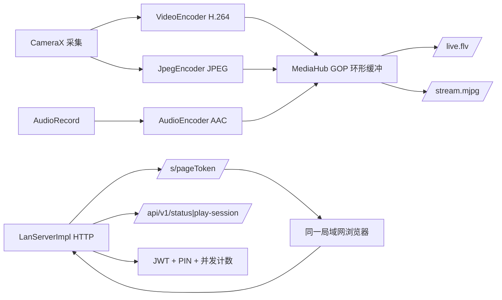

# 12 · P1 实现说明（局域网可用闭环）

| 项目 | 值 |
|---|---|
| 文档状态 | 实现基线（Implementation Baseline） |
| 版本 | v1.0 |
| 对应交付阶段 | **P1 · 局域网可用闭环**（见 [README §2](../README.md)、[00 §20](./00-conventions.md)） |
| 依赖文档 | [00-conventions.md](./00-conventions.md)、[05-lan-service.md](./05-lan-service.md)、[06-playback-page.md](./06-playback-page.md)、[09-task-plan.md](./09-task-plan.md) |
| 代码位置 | `app/`（Android 客户端）、`lan-core/`（纯 JVM 端侧服务）、`tools/player-selftest/` |
| 验证环境 | macOS arm64 + JDK 21（Android Studio JBR）+ AGP 8.4.2 + Gradle 8.7 + compileSdk 34；Android 14 arm64 模拟器（API 34 google_apis） |
| 最后更新 | 2026-10-20 |

---

## 1. 目的与范围

本文记录 **P1 里程碑的落地实现**：在零云端依赖下，Android 客户端完成「采集 → 编码 → 端侧 HTTP 服务 → 同一局域网浏览器播放」闭环，并给出构建方式、验收证据与已知限制。

不在本文范围：P2 公网能力（WHIP/SRT/RTMP、SFU、HLS、TURN）、双摄合成、录制/水印/多地址、账号与套餐。

---

## 2. 代码结构

```text
camPush/
├── app/                          # Android 客户端（Compose + CameraX）
│   └── src/main/kotlin/com/campush/app/
│       ├── CamPushApp.kt         # Application：P1Controller 单例
│       ├── MainActivity.kt       # 权限门 + Compose 入口
│       ├── core/                 # P1Contracts（UI 契约）+ P1ControllerImpl
│       ├── camera/               # CameraController：Preview + ImageAnalysis
│       ├── streaming/            # VideoEncoder / JpegEncoder / AudioEncoder /
│       │                         # LanStreamEngine / StreamingBridge / YuvUtils
│       ├── service/              # LanStreamingService：前台服务 + 通知
│       ├── network/              # NetworkMonitor：Wi-Fi/IP 变化/AP 隔离提示
│       └── ui/                   # Compose：主界面/设置/地址卡/二维码/预览/主题
├── lan-core/                     # 纯 JVM 端侧服务（无 Android 依赖）
│   └── src/main/kotlin/com/campush/lan/
│       ├── Api.kt                # Lead 冻结的公共 API（LanServer/LanConfig/…）
│       ├── Jwt.kt / Tokens.kt    # HS256 JWT + page/media token + 随机密钥
│       ├── PinGuard.kt           # PIN 双层限速与锁定
│       ├── PortAllocator.kt      # 8089→8099 端口分配
│       ├── MediaHub.kt           # GOP 环形缓冲 + 订阅者背压
│       ├── FlvMuxer.kt           # FLV header/metadata/AVC/AAC tag
│       ├── HttpServer.kt         # 手写 HTTP/1.1 服务
│       ├── LanServerImpl.kt      # 路由、鉴权、观看者计数、生命周期
│       └── ErrorCodes.kt / Json.kt
│   └── src/main/resources/com/campush/lan/player.html   # 单文件播放页（≈43.5 KB）
├── tools/player-selftest/run.mjs # 播放页 Node 自检（26 项）
├── scripts/setup-toolchain.sh    # workspace 内准备 SDK/Gradle/签名
├── scripts/build.sh              # 统一构建入口
└── docs/                         # 工程化文档（本文为第 12 篇）
```

依赖方向：`app → lan-core`；`lan-core` 不依赖 Android，可用 JVM 单测覆盖全部服务端行为。



---

## 3. 构建与运行

### 3.1 一次性准备（沙箱友好，全部落在 workspace）

```bash
scripts/setup-toolchain.sh          # 下载 cmdline-tools / platform-34 / build-tools-34 / Gradle 8.7
```

脚本会写入 `.android-sdk/`、`.tooling/`、`.gradle-home/`、`local.properties` 与 `app/debug.keystore`；这些目录已被 `.gitignore` 排除。

### 3.2 构建

```bash
scripts/build.sh :lan-core:test          # 46 个单元/E2E 测试
scripts/build.sh :app:assembleDebug      # 产物 app/build/outputs/apk/debug/app-debug.apk
```

环境变量由 `scripts/build.sh` 统一设置（`JAVA_HOME` 指向 Android Studio JBR，`ANDROID_HOME` 指向 workspace SDK，`GRADLE_USER_HOME`/`ANDROID_USER_HOME` 落在 workspace）。直接使用 Gradle 时等价于：

```bash
JAVA_HOME="/Applications/Android Studio.app/Contents/jbr/Contents/Home" \
ANDROID_HOME="$PWD/.android-sdk" GRADLE_USER_HOME="$PWD/.gradle-home" \
./gradlew --no-daemon :app:assembleDebug
```

### 3.3 安装与使用

1. `adb install -r app/build/outputs/apk/debug/app-debug.apk`；
2. 首次启动授予相机（必需）与麦克风（可选，拒绝则静音推流）；
3. 「仅局域网」默认选中（公网置灰“阶段二开放”），点击「开始推流」；
4. 地址卡出现唯一地址 `http://{lanIp}:{port}/s/{token}`，同网设备浏览器打开即可观看；
5. 可复制、看二维码、用 App 内 WebView 本机预览、分享；停止推流后地址立即失效。

---

## 4. P1 功能清单与实现位置

| P1 能力 | 状态 | 实现/证据 |
|---|---|---|
| 相机权限（1001 阻断）、麦克风（1002 静音继续） | ✅ | `ui/PermissionGate.kt`、`P1ControllerImpl.start()` |
| 单摄预览 + 前后摄热切换 | ✅ | `camera/CameraController.kt`；模拟器实测「后置→前置」 |
| H.264 编码（720p30/1080p、1500–4000 kbps、24/30fps、I 帧 2s、ABR） | ✅ | `streaming/VideoEncoder.kt`；状态栏实时码率/fps |
| AAC 音频（48 kHz mono，muted/无权限静音帧，音轨连续） | ✅ | `streaming/AudioEncoder.kt` |
| MJPEG 出流 | ✅ | `streaming/JpegEncoder.kt` → `/stream.mjpg`（实测 3s 516 KB） |
| HTTP-FLV 出流 | ✅ | `FlvMuxer` + `MediaHub` → `/live.flv`（实测 3s 461 KB，FLV 头正确） |
| 端侧 HTTP 服务（播放页/状态/会话/媒体/token/PIN/健康检查） | ✅ | `lan-core`：`HttpServer` + `LanServerImpl` |
| pageToken / mediaToken / 短时失效 | ✅ | `Jwt.kt`、`Tokens.kt`；停止后连接拒绝 |
| PIN（4–6 位、IP 5 次/分、房间 20 次/分、10 次锁 10 分钟） | ✅ | `PinGuard.kt`；实测 3004/3005/24689 通过 |
| 并发观看 1–3 / 第 4 人 6005 | ✅ | `MediaHub` + 计数；实测 429+6005 |
| 端口 8089–8099，修改后重启生效 | ✅ | `PortAllocator` + 设置页；实测 8090 |
| 停止 ≤1s 失效 | ✅ | `LanServerImpl.stop()`；实测服务 0、LISTEN 0、连接拒绝 |
| 前台服务 + 常驻通知（停止 action） | ✅ | `service/LanStreamingService.kt` |
| 访问范围开关（LAN 可选、WAN 置灰“阶段二开放”） | ✅ | `ui/Components.kt`、`MainScreen` |
| 唯一播放地址卡（复制/二维码/本机预览/分享） | ✅ | `ui/AddressCard.kt`、`QrDialog`、`PreviewDialog` |
| 网络类型 / IP / AP 隔离提示 | ✅ | `network/NetworkMonitor.kt` + 设置页排查清单 |
| 画质/码率/帧率/自适应/省电/音频设置持久化 | ✅ | `P1ControllerImpl` + SharedPreferences |
| LAN 播放页（FLV→MSE → MJPEG 降级、PIN、错误文案） | ✅ | `player.html` + `tools/player-selftest`（26/26） |
| 停播地址失效、PIN 生效、并发限制 | ✅ | 见 §5 E2E 证据 |

---

## 5. 验收证据

### 5.1 自动化

| 项 | 结果 |
|---|---|
| `:lan-core:test` | **46/46 通过**（Jwt 8、Tokens 5、PinGuard 7、PortAllocator 4、FlvMuxer 6、MediaHub 6、HTTP E2E 10） |
| 播放页 Node 自检 | **26/26 通过**（FLV 解析、avcC、fMP4、体积/外链/CSP/localStorage/eval 门禁） |
| `:app:assembleDebug` | **BUILD SUCCESSFUL**，APK ≈18 MB，使用 workspace debug.keystore 签名 |

### 5.2 模拟器端到端（Android 14 arm64，API 34）

| 用例 | 结果 |
|---|---|
| 启动 App → 授权 → 点击开始 | 状态「局域网推流中」，地址 `http://10.0.2.16:8089/s/...` |
| 播放页 | `GET /s/{token}` → **200, 43 KB HTML** |
| 状态/会话 | `/api/v1/status` 200（state=live、viewers、bitrateKbps、fps）；`play-session` 200 返回 mediaToken |
| MJPEG | `/stream.mjpg` 3s **516 KB**，`--frame` + `image/jpeg` 边界正确 |
| FLV | `/live.flv` 3s **461 KB**，头 `46 4c 56 01 05`，video/audio tag 时间戳同源 |
| 并发 | 3 路观看 `viewers=3/3`；第 4 路 **429 + 6005**；断开后归零 |
| PIN | 开 PIN 后 status `pinRequired=true`；无口令 **401/3004**、错误口令 **401/3005**、正确口令 200 |
| 端口 | 改 8090 → 重启推流后地址 `:8090`，状态接口 `port=8090` |
| 分享/刷新/埋点 | 复制、二维码、WebView 预览可用；`page-token:refresh` 200（Authorization Bearer 与 X-Page-Token 均可）；`favicon.ico` 204；`telemetry/batch` 202 |
| 停止失效 | 服务数 0、服务端 LISTEN 0、`/healthz` 连接失败；UI 回到「未推流」 |

### 5.3 真实浏览器播放（宿主 Chrome headless）

- 打开唯一地址 → **FLV→MSE 成功**：`video.readyState=4`、`currentTime≈0.8s`、`buffered≈2.1s`、`videoWidth=1920`；
- 无控制台错误；HUD 显示「直播中 / 0/3 人观看 / 871 kbps · 20 fps」；
- 开 PIN 场景：页面先显示「需要观看口令」，输入 24689 后进入直播，`readyState=4`；
- App 内 WebView 预览：DevTools 显示 `readyState=4`、`currentTime=8.46s`、`videoWidth=1920`（截图黑屏是 WebView 硬件视频层不被 screencap 捕获，非功能问题）。

截图见：

- [主界面（深色 UI / 状态栏 / 开始按钮）](./assets/p1-main.png)
- [浏览器 FLV→MSE 实播画面](./assets/p1-player-flv.png)
- [二维码分享弹窗](./assets/p1-qr.png)

---

## 6. 与文档的差异（实现裁定）

| 项 | 文档 | 实现 | 原因 |
|---|---|---|---|
| A/V 时间戳 | 00 §7 未规定同源 | 视频/音频统一用 `System.nanoTime()` 减同一 origin | 初版视频用 CameraX sensor 时间、音频用采样计数，导致 A/V 相差数分钟，FLV→MSE 无法播放；修复后实测同源 |
| pageToken 头 | 00 §5.1 `Authorization: Bearer`；05 §6 `X-Page-Token` | 两者兼容 | 播放页用 X-Page-Token，刷新接口按契约用 Authorization |
| 播放页错误 | 05 §6.3 内联 HTML | `/s/*` 错误用 HTML，API/媒体面用 JSON envelope | 保持浏览器可读 |
| favicon | 未定义 | `GET /favicon.ico` → 204 | 避免播放页控制台 404 噪音 |
| LAN token 续期 | 00 §19.3 M1 可不实现 | 未实现（60 min 后提示重取地址） | 与 05/06 O-05-1/O-06-2 的 M1 决策一致 |

---

## 7. 已知限制

1. **未做真机验证**：相机 binder/flexible YUV、热点 IP 判定、通知/前台服务类型在个别厂商 ROM 上仍需真机回归（[02 §13](./02-client-modules.md) 的真机矩阵）。
2. **模拟器性能不代表真机**：虚拟相机 + 软件编码下 720p 约 10–28 fps；真机硬编预期 30 fps / ≤45% CPU。
3. **AAC 轨仅结构级验证**：MSE 能解析 AAC init，但未用真实麦克风音频做主观听测（模拟器无真实麦克风输入）。
4. **播放页兼容边界**：iOS Safari 无 MSE → 直接 MJPEG（无音频）；微信 X5 / Firefox 未真机验证。
5. **WebView 预览黑屏截图**：硬件视频层不参与 screencap，功能正常（DevTools 已证）。
6. **LAN 无 HTTPS**：明文 HTTP 为 P1 风险接受项（[07](./07-security-privacy.md)），UI 已明示。
7. **无 instrumentation/UI 自动化测试**：当前以 JVM E2E + 模拟器手工脚本覆盖；P2 建议补 Compose UI 测试与真机自动化。

---

## 8. 验收检查点

- [x] `:lan-core:test` 46/46 通过，0 failure；
- [x] `tools/player-selftest/run.mjs` 26/26 通过，`node --check` 通过；
- [x] `:app:assembleDebug` 构建成功，APK 可安装启动；
- [x] 同网浏览器打开唯一地址可播放（FLV→MSE `readyState=4`；失败可降级 MJPEG）；
- [x] 停止推流后服务停止、地址不可访问（≤1 s）；
- [x] PIN：无口令 3004、错误口令 3005、正确口令 200；
- [x] 并发上限 3：第 4 个观看者 429 + 6005；
- [x] 端口修改后重启生效（8089→8090）；
- [x] 访问范围：LAN 可选、WAN 置灰“阶段二开放”、推流中锁定；
- [x] 地址卡四动作（复制/二维码/预览/分享）与设置项可用；
- [x] 前后摄切换、静音、torch 入口无崩溃；
- [x] 文档门禁 `scripts/check_docs.py --strict` 通过（含本文）。

## 9. 开放问题

| ID | 问题 | 候选方案 | 建议 | 决策人 |
|---|---|---|---|---|
| P1-IMPL-01 | 真机兼容性未覆盖（binder/flexible YUV/热点 IP/FGS） | A. P1 发版前补 Top 20 机型回归；B. 先内测收集 | A | Android + QA |
| P1-IMPL-02 | AAC 真实音频未做听测 | A. 真机 48 kHz 录音测试；B. 模拟器静音帧 | A | Android |
| P1-IMPL-03 | 弱网/慢客户端策略仅单测 | A. 增加 tc 弱网 + 慢客户端设备实测；B. 依赖 M0-LAN E6 | A | QA |
| P1-IMPL-04 | 播放页 iOS Safari/微信 X5 未真机验证 | A. P1 内测覆盖 3 端；B. P2 再补 | A | Web |
| P1-IMPL-05 | 60 min 后 LAN 地址过期需重取 | A. M1 提示重取；B. M2 实现 LAN 续期 | A | Lead |

## 10. 变更记录

| 版本 | 日期 | 变更人 | 内容 |
|---|---|---|---|
| v1.0 | 2026-10-20 | Team Lead | 首次落地 P1：app + lan-core 实现、46 项测试、模拟器与浏览器端到端验证、构建脚本与本文档 |
