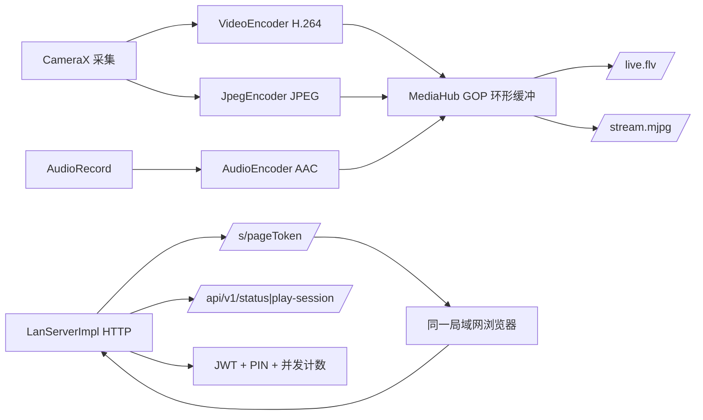

# 12 · P1 实现说明（局域网可用闭环）

| 项目 | 值 |
|---|---|
| 文档状态 | 实现基线（Implementation Baseline） |
| 版本 | v1.0 |
| 对应交付阶段 | **P1 · 局域网可用闭环**（见 [README §2](../README.md)、[00 §20](./00-conventions.md)） |
| 依赖文档 | [00-conventions.md](./00-conventions.md)、[05-lan-service.md](./05-lan-service.md)、[06-playback-page.md](./06-playback-page.md)、[09-task-plan.md](./09-task-plan.md) |
| 代码位置 | `app/`（Android 客户端）、`lan-core/`（纯 JVM 端侧服务）、`tools/player-selftest/` |
| 验证环境 | macOS arm64 + JDK 21（Android Studio JBR）+ AGP 8.4.2 + Gradle 8.7 + compileSdk 34；Android 14 arm64 模拟器（API 34 google_apis） |
| 最后更新 | 2026-10-20 |

---

## 1. 目的与范围

本文记录 **P1 里程碑的落地实现**：在零云端依赖下，Android 客户端完成「采集 → 编码 → 端侧 HTTP 服务 → 同一局域网浏览器播放」闭环，并给出构建方式、验收证据与已知限制。

不在本文范围：P2 公网能力（WHIP/SRT/RTMP、SFU、HLS、TURN）、双摄合成、录制/水印/多地址、账号与套餐。

---

## 2. 代码结构

```text
camPush/
├── app/                          # Android 客户端（Compose + CameraX）
│   └── src/main/kotlin/com/campush/app/
│       ├── CamPushApp.kt         # Application：P1Controller 单例
│       ├── MainActivity.kt       # 权限门 + Compose 入口
│       ├── core/                 # P1Contracts（UI 契约）+ P1ControllerImpl
│       ├── camera/               # CameraController：Preview + ImageAnalysis
│       ├── streaming/            # VideoEncoder / JpegEncoder / AudioEncoder /
│       │                         # LanStreamEngine / StreamingBridge / YuvUtils
│       ├── service/              # LanStreamingService：前台服务 + 通知
│       ├── network/              # NetworkMonitor：Wi-Fi/IP 变化/AP 隔离提示
│       └── ui/                   # Compose：主界面/设置/地址卡/二维码/预览/主题
├── lan-core/                     # 纯 JVM 端侧服务（无 Android 依赖）
│   └── src/main/kotlin/com/campush/lan/
│       ├── Api.kt                # Lead 冻结的公共 API（LanServer/LanConfig/…）
│       ├── Jwt.kt / Tokens.kt    # HS256 JWT + page/media token + 随机密钥
│       ├── PinGuard.kt           # PIN 双层限速与锁定
│       ├── PortAllocator.kt      # 8089→8099 端口分配
│       ├── MediaHub.kt           # GOP 环形缓冲 + 订阅者背压
│       ├── FlvMuxer.kt           # FLV header/metadata/AVC/AAC tag
│       ├── HttpServer.kt         # 手写 HTTP/1.1 服务
│       ├── LanServerImpl.kt      # 路由、鉴权、观看者计数、生命周期
│       └── ErrorCodes.kt / Json.kt
│   └── src/main/resources/com/campush/lan/player.html   # 单文件播放页（≈43.5 KB）
├── tools/player-selftest/run.mjs # 播放页 Node 自检（26 项）
├── scripts/setup-toolchain.sh    # workspace 内准备 SDK/Gradle/签名
├── scripts/build.sh              # 统一构建入口
└── docs/                         # 工程化文档（本文为第 12 篇）
```

依赖方向：`app → lan-core`；`lan-core` 不依赖 Android，可用 JVM 单测覆盖全部服务端行为。



---

## 3. 构建与运行

### 3.1 一次性准备（沙箱友好，全部落在 workspace）

```bash
scripts/setup-toolchain.sh          # 下载 cmdline-tools / platform-34 / build-tools-34 / Gradle 8.7
```

脚本会写入 `.android-sdk/`、`.tooling/`、`.gradle-home/`、`local.properties` 与 `app/debug.keystore`；这些目录已被 `.gitignore` 排除。

### 3.2 构建

```bash
scripts/build.sh :lan-core:test          # 46 个单元/E2E 测试
scripts/build.sh :app:assembleDebug      # 产物 app/build/outputs/apk/debug/app-debug.apk
```

环境变量由 `scripts/build.sh` 统一设置（`JAVA_HOME` 指向 Android Studio JBR，`ANDROID_HOME` 指向 workspace SDK，`GRADLE_USER_HOME`/`ANDROID_USER_HOME` 落在 workspace）。直接使用 Gradle 时等价于：

```bash
JAVA_HOME="/Applications/Android Studio.app/Contents/jbr/Contents/Home" \
ANDROID_HOME="$PWD/.android-sdk" GRADLE_USER_HOME="$PWD/.gradle-home" \
./gradlew --no-daemon :app:assembleDebug
```

### 3.3 安装与使用

1. `adb install -r app/build/outputs/apk/debug/app-debug.apk`；
2. 首次启动授予相机（必需）与麦克风（可选，拒绝则静音推流）；
3. 「仅局域网」默认选中（公网置灰“阶段二开放”），点击「开始推流」；
4. 地址卡出现唯一地址 `http://{lanIp}:{port}/s/{token}`，同网设备浏览器打开即可观看；
5. 可复制、看二维码、用 App 内 WebView 本机预览、分享；停止推流后地址立即失效。

---

## 4. P1 功能清单与实现位置

| P1 能力 | 状态 | 实现/证据 |
|---|---|---|
| 相机权限（1001 阻断）、麦克风（1002 静音继续） | ✅ | `ui/PermissionGate.kt`、`P1ControllerImpl.start()` |
| 单摄预览 + 前后摄热切换 | ✅ | `camera/CameraController.kt`；模拟器实测「后置→前置」 |
| H.264 编码（720p30/1080p、1500–4000 kbps、24/30fps、I 帧 2s、ABR） | ✅ | `streaming/VideoEncoder.kt`；状态栏实时码率/fps |
| AAC 音频（48 kHz mono，muted/无权限静音帧，音轨连续） | ✅ | `streaming/AudioEncoder.kt` |
| MJPEG 出流 | ✅ | `streaming/JpegEncoder.kt` → `/stream.mjpg`（实测 3s 516 KB） |
| HTTP-FLV 出流 | ✅ | `FlvMuxer` + `MediaHub` → `/live.flv`（实测 3s 461 KB，FLV 头正确） |
| 端侧 HTTP 服务（播放页/状态/会话/媒体/token/PIN/健康检查） | ✅ | `lan-core`：`HttpServer` + `LanServerImpl` |
| pageToken / mediaToken / 短时失效 | ✅ | `Jwt.kt`、`Tokens.kt`；停止后连接拒绝 |
| PIN（4–6 位、IP 5 次/分、房间 20 次/分、10 次锁 10 分钟） | ✅ | `PinGuard.kt`；实测 3004/3005/24689 通过 |
| 并发观看 1–3 / 第 4 人 6005 | ✅ | `MediaHub` + 计数；实测 429+6005 |
| 端口 8089–8099，修改后重启生效 | ✅ | `PortAllocator` + 设置页；实测 8090 |
| 停止 ≤1s 失效 | ✅ | `LanServerImpl.stop()`；实测服务 0、LISTEN 0、连接拒绝 |
| 前台服务 + 常驻通知（停止 action） | ✅ | `service/LanStreamingService.kt` |
| 访问范围开关（LAN 可选、WAN 置灰“阶段二开放”） | ✅ | `ui/Components.kt`、`MainScreen` |
| 唯一播放地址卡（复制/二维码/本机预览/分享） | ✅ | `ui/AddressCard.kt`、`QrDialog`、`PreviewDialog` |
| 网络类型 / IP / AP 隔离提示 | ✅ | `network/NetworkMonitor.kt` + 设置页排查清单 |
| 画质/码率/帧率/自适应/省电/音频设置持久化 | ✅ | `P1ControllerImpl` + SharedPreferences |
| LAN 播放页（FLV→MSE → MJPEG 降级、PIN、错误文案） | ✅ | `player.html` + `tools/player-selftest`（26/26） |
| 停播地址失效、PIN 生效、并发限制 | ✅ | 见 §5 E2E 证据 |

---

## 5. 验收证据

### 5.1 自动化

| 项 | 结果 |
|---|---|
| `:lan-core:test` | **46/46 通过**（Jwt 8、Tokens 5、PinGuard 7、PortAllocator 4、FlvMuxer 6、MediaHub 6、HTTP E2E 10） |
| 播放页 Node 自检 | **26/26 通过**（FLV 解析、avcC、fMP4、体积/外链/CSP/localStorage/eval 门禁） |
| `:app:assembleDebug` | **BUILD SUCCESSFUL**，APK ≈18 MB，使用 workspace debug.keystore 签名 |

### 5.2 模拟器端到端（Android 14 arm64，API 34）

| 用例 | 结果 |
|---|---|
| 启动 App → 授权 → 点击开始 | 状态「局域网推流中」，地址 `http://10.0.2.16:8089/s/...` |
| 播放页 | `GET /s/{token}` → **200, 43 KB HTML** |
| 状态/会话 | `/api/v1/status` 200（state=live、viewers、bitrateKbps、fps）；`play-session` 200 返回 mediaToken |
| MJPEG | `/stream.mjpg` 3s **516 KB**，`--frame` + `image/jpeg` 边界正确 |
| FLV | `/live.flv` 3s **461 KB**，头 `46 4c 56 01 05`，video/audio tag 时间戳同源 |
| 并发 | 3 路观看 `viewers=3/3`；第 4 路 **429 + 6005**；断开后归零 |
| PIN | 开 PIN 后 status `pinRequired=true`；无口令 **401/3004**、错误口令 **401/3005**、正确口令 200 |
| 端口 | 改 8090 → 重启推流后地址 `:8090`，状态接口 `port=8090` |
| 分享/刷新/埋点 | 复制、二维码、WebView 预览可用；`page-token:refresh` 200（Authorization Bearer 与 X-Page-Token 均可）；`favicon.ico` 204；`telemetry/batch` 202 |
| 省电模式 | 开启后重启：UI 显示「后置 · 480p · 24fps（省电）」+ 警告条；服务端码率稳定 ≈900 kbps（上限 1 Mbps）、fps ≈22 |
| 通知栏停止 | 展开通知点击「停止推流」：服务数 0、通知消失、UI「未推流」 |
| 复制/分享 | 复制后提示「播放地址已复制」；分享面板标题「Sharing text」并携带唯一地址 |
| 停止失效 | 服务数 0、服务端 LISTEN 0、`/healthz` 连接失败；UI 回到「未推流」 |

### 5.3 1080p 性能回归（用户反馈：1080p 下码率 93 kbps / 1 fps / 延迟 7 s）

**定位到的根因与修复**

| 问题 | 根因 | 修复 |
|---|---|---|
| 1080p 下编码异常/帧率骤降 | 编码器固定声明 AVC Level 3.1（只覆盖到 720p30），1080p 时部分编码器降速/拒绝 | 按分辨率选择 Level：1080p→4.0、720p→3.1，并记录到日志 |
| “1080p”实际是 1920×1440 | 仅用 `setTargetResolution(1920,1080)`，相机无精确尺寸时回落到 4:3 最大尺寸 | 改用 `ResolutionSelector`：16:9 优先 + 最近目标尺寸；视频编码始终使用相机实际输出尺寸 |
| 码率被压到很低 | ABR 把“编码耗时高”等同于拥塞，持续降到 800 kbps 地板 | ABR 只依据真实丢帧（>15%）降档，地板提升为 max(800 kbps, 目标/2)；优先 CBR（设备支持时） |
| MJPEG 拖慢主线程 | 1080p 每 2 帧做全尺寸 NV21 转换 + JPEG 压缩 | MJPEG 缩到 ≤960 宽、每 3 帧一次，仅作降级通道 |
| 延迟累积 | 慢编码设备上编码队列越积越长；播放器追帧阈值 2.5 s | 编码器输出落后采集 >2.5 s 时 flush 重建流水线（3 s 冷却）；播放端追帧阈值 2.5 s→1.2 s |
| 码率数值误解 | VBR 下静态画面实际码率远低于目标值 | 日志与 UI 区分「目标码率/实际码率」，并新增「实际编码分辨率」显示 |
| 真机 1–2 fps / 79 kbps | 可能：相机输出尺寸抖动导致每帧重建编码器；或设备 1080p 分析输出本身很低；或 AE 低照度降档 | ① 尺寸变化去抖 60 帧并缩放喂入现有编码器；② 每 5 s 输出编码诊断日志（inFps/outFps/drops/restarts/size/target/avgEncodeMs）；③ 记录 CameraX 实际分析分辨率 |
| 局域网内浏览器显示 14 fps（目标 ≥30fps） | 低照度下 AE 常把采集降到 15 fps 档；或 HAL 对 1080p 分析限帧 | 对 ImageAnalysis 强制 `CONTROL_AE_TARGET_FPS_RANGE=(30,30)`（不支持时自动回退重绑）；<25fps 自动降一档分辨率（播放地址不变，最多 2 档）；诊断日志增加 inFps/outFps |

**修复后实测（模拟器，1080p 设定）**

| 场景 | 实际编码 | fps | 实际码率 | 说明 |
|---|---|---|---|---|
| 前摄（模拟器 1920×1080） | 1920×1080 · Level 4.0 | 27–30 | ≈1.1 Mbps | 静态测试画面，VBR 实际值低属正常；编码时间戳与服务器 uptime 对齐，无累积延迟 |
| 后摄（模拟器仅支持 1280×720） | 1280×720（UI 显示「设定 1080p」） | 22–27 | ≈3.5 Mbps | 复杂虚拟场景；证明 UI 不再虚标分辨率 |

- 播放端：`FLV→MSE` `readyState=4`，缓冲约 0.2–2.4 s，`currentTime` 与墙钟 1:1 前进，无 7 s 级累积延迟；
- 日志：`VideoEncoder: encoder started: 1920x1080 ... level=2048 ... mode=VBR`（模拟器软编码不支持 CBR；真机硬编码通常支持 CBR，实际码率更接近目标值）；
- 诊断日志（每 5 s）：`diag: in=281 out=251 drops=0 restarts=0 size=1280x720 target=4000000 avgEncodeMs=4.0`；若真机出现 `restarts` 持续增长或 `out` 远小于 `in`，即为 1 fps 的直接证据；
- 相机实际分析分辨率：`CameraController: analysis resolution=1280x720 target=1920x1080`（设备不支持 1080p 分析输出时可见）。

> 说明：用户报告的 93 kbps/1 fps 未在同一模拟器上复现（模拟器修复前为 ≈900 kbps/29 fps）；上述 Level、分辨率、ABR、JPEG 四项是 1080p 下最可能的真实设备诱因，需在真机复测确认。

### 5.4 相机被抢占 / 黑屏自动恢复（真机问题复现）

**用户现象**：推流中打开系统相机后，App 预览黑屏、浏览器地址也连不上；停止再开始才恢复。

**根因**

1. 相机被其他应用抢占时，部分 ROM 只回调 `CLOSED(error=null)`，不报错也不重建，预览黑屏但 UI 仍显示“推流中”；
2. 原实现把任何相机错误都当作致命错误：`fail()` 会关闭 **LanServer**，所以浏览器地址连不上；
3. 没有自动重试，只能手动停止/重开。

**修复**

| 机制 | 行为 |
|---|---|
| 帧流看门狗 | 推流中超过 **2 s** 没有分析帧 → 判定相机丢失，进入恢复流程 |
| 保持端侧服务 | 相机丢失期间 **不关闭 LanServer/不换地址**，浏览器仍可访问，画面短暂停顿后自动续播 |
| 自动重试 | 每秒尝试重新绑定 CameraX，最多 **30 次**；成功即重新出帧、请求 IDR，并提示“摄像头已恢复，画面继续” |
| 超时兜底 | 30 s 仍无法恢复 → 明确停止推流（`1003`）并提示“摄像头被其他应用占用”，地址失效，用户可重新开始 |
| 预览恢复 | 恢复时重新绑定 Preview surface，黑屏消失 |

**实测（模拟器杀掉 cameraserver 模拟相机丢失）**

- 丢失期间：`healthz` 始终 **200**，播放地址与 token 不变；
- 日志：`no camera frames for 2320 ms, try recovery` → `camera unavailable, keep LAN server alive and retry` → `camera recovery attempt 1/30` → `camera recovered`（约 1 s）；
- 恢复后：状态 `fps=26 / bitrate=2515kbps`，FLV 标签继续，UI 提示“摄像头已恢复，画面继续”；
- 截图：[相机恢复后的预览](./assets/p1-camera-recovered.png)。

### 5.5 画质优先 + 帧率提示（不再自动降画质）

**背景**：上一版为了保帧率会在低帧率时自动降分辨率，用户实测出现 `630×340` 一类画质，明确要求最高画质。本版改为**画质优先**：

| 机制 | 行为 |
|---|---|
| 不再自动降分辨率 | 删除低帧率自动降档逻辑；用户选择的 720p/1080p 就是采集目标，编码使用相机实际输出尺寸并在主界面如实显示 |
| 最高画质编码 | 720p/1080p 优先使用 **AVC High Profile**（不支持时自动回退 Baseline/默认）；码率上限 **8 Mbps**，设置页新增 **6000 kbps** 档 |
| 强制 30fps 采集 | `CONTROL_AE_TARGET_FPS_RANGE=(30,30)`，避免低照度 AE 自动降到 15fps；不支持时自动回退 |
| 降低自造开销 | 无 MJPEG 观看者时跳过 JPEG；推流期间屏幕常亮；编码诊断每 5s 输出 inFps/outFps |
| 帧率不足提示 | 连续低于 30fps 仅提示“最高画质受设备性能限制，可在设置中选 720p 提升帧率”，**不改变画质/地址** |

**实测（模拟器，1080p 设定，后摄实际 1280×720）**

- 编码：`inFps=29 / outFps=25`、`target=4000000`、无管线重启、无自动降档；
- 浏览器：FLV→MSE `readyState=4`，High Profile 正常解码，地址稳定；
- 主界面显示实际编码分辨率（如 `1280×720（设定 1080p）`），不再出现 640×360 降档。

> 30fps 上限取决于设备相机 HAL/编码器/散热；App 侧不再为了帧率牺牲画质，由用户按需在 720p/1080p 之间选择。

**低帧率提示增强**：`编码帧率过低（<5 fps）` 的提示现在会带上实际编码器信息，
例如 `（编码器 c2.android.avc.encoder/软编，in=30fps out=2fps 1920x1080）`，便于直接判断是
“相机进帧不足”还是“落到软件编码器”。播放器追帧阈值从 1.2s 降到 0.6s，降低观看端延迟。

### 5.6 推流时释放 Preview：1080p 30fps 的关键修复

**对比 UU 远程等成熟产品后定位**：CameraX 同时跑 `Preview + ImageAnalysis` 时，部分机型/ROM 会把分析流压到 **~15fps**（正是用户看到的 14fps）。成熟串流产品不会在推流时保留独立的预览管线。

**修复**

| 状态 | 相机管线 | App 内预览 |
|---|---|---|
| 空闲 | 仅 CameraX `Preview`（全质量预览） | `PreviewView` |
| 推流中 | **仅 `ImageAnalysis`**（释放 Preview，避免并发限帧） | 由编码管线的 JPEG（≤960 宽、每 3 帧一次，约 10fps）在 Compose 中渲染 |

**实测（模拟器）**

| 场景 | 实际编码 | fps（in/out） | 浏览器 |
|---|---|---|---|
| 后摄 1280×720（设定 1080p） | 1280×720 · 4 Mbps | **30 / 30**，0 drops | HUD 30fps，`readyState=4` |
| 前摄 1920×1080 | **1920×1080 · High Profile** | **29 / 29**，0 drops | 同上 |

- 修复前同样场景约 22–27fps；释放 Preview 后稳定 29–30fps；
- 推流中 App 内预览为 960 宽 / ~10fps（流本身仍是 1080p/720p 全质量）；停止推流后自动切回 CameraX 全质量预览。

> 取舍说明：推流期间降低“本机预览”的开销来换采集/编码 30fps，这是局域网推流更合理的产品选择；若后续要做到“App 内预览也 1080p30”，需要 Camera2 + Surface 零拷贝管线。

### 5.7 预览 30fps、一点开始推流就掉到 2fps：硬件编码器选择修复

**用户现象**：App 打开预览很流畅（约 30fps），点击「开始推流」后编码帧率直接掉到 2fps；局域网内观看同样只有 2fps。

**根因**：预览走的是相机 Preview 通路（不经过编码器），所以预览正常；开始推流后创建 `MediaCodec`，原实现固定请求
`COLOR_FormatYUV420Flexible` 并用 `createEncoderByType` 默认选择。**很多机型的硬件 H.264 编码器并不暴露 Flexible 输入**
（只支持 SemiPlanar/Planar 或仅 Surface 输入），默认选择会落到 **软件编码器**——1080p 软件编码正好只有几帧每秒，
表现为“预览 30fps、推流 2fps”。

**修复**（`VideoEncoder`）

| 机制 | 行为 |
|---|---|
| 编码器枚举 | 遍历 `MediaCodecList`，**优先硬件编码器**（`isHardwareAccelerated`），并校验目标分辨率 |
| 颜色格式匹配 | 按编码器能力选择 **SemiPlanar(NV12) → Planar(I420) → Flexible**；非 Flexible 时用 ByteBuffer 输入 |
| YUV 转换 | 新增 `imageToNv12Into` / `imageToI420Into`，复用 ByteArray 缓冲，避免 30fps 下每帧数 MB 的 GC 压力 |
| 可诊断 | 日志输出 `encoder choice=<codec> hardware=true/false color=<fmt>`，可直接确认是否选到硬件编码器 |
| 兜底 | 硬件配置失败自动回退 Baseline/默认；全部失败走原 Flexible 软件路径并报 `1005` |
| 极低帧率救援 | 1080p 连续 3s 只有 1–4fps 时，自动切到 720p（只重启媒体子管线，**播放地址不变**），提示“已自动切换到 720p”；720p 仍低则只提示不再降档 |

**实测（模拟器只有软件编码器）**

- `encoder choice=c2.android.avc.encoder hardware=false color=21`（模拟器无硬件编码器，符合预期）；
- 但配合“推流时释放 Preview”（§5.6），1080p 输入/输出稳定 **29/29fps**、0 drops，浏览器 `readyState=4`；
- 真机上若选到 `hardware=true` 的硬件编码器（高通/联发科/三星等），1080p 30fps 应可达成；若日志仍 `hardware=false`，
  说明该机型硬件编码器只支持 Surface 输入，需要 Camera2 + Surface 零拷贝管线（下一步改造）。

### 5.8 零拷贝 Surface 管线（Camera2 + MediaRecorder，默认启用）

**目标**：对齐抖音直播类产品的相机性能——预览 30fps、推流 30fps，且不再受 CameraX ImageAnalysis 的 YUV 转换/并发限帧影响。

**架构**

```
Camera2 ──Surface──> MediaRecorder(SURFACE, MPEG_2_TS) ──硬件 H.264──> TS pipe
   └──SurfaceView 原生预览（30fps，全画质）                  │
                                                      TsDemuxer（PAT/PMT/PES → Annex-B）
                                                             │
                                                     MediaHub → FLV → 浏览器 MSE
```

- 相机帧直接进硬件编码器 Surface，**没有 YUV 转换、没有 JPEG 预览开销**；
- App 内预览用 SurfaceView 直接吃相机会话输出，与推流互不抢带宽；
- 音频仍由独立 AAC 编码器采集，时间戳共用 `originNs` 基准；
- 切换摄像头时同步释放旧相机会话（`stopAwait` 消除竞争），视频 PTS 追加管线重启时刻，保证时间戳单调；
- 初始化失败自动回退 CameraX 兼容管线（播放地址不变）。

**实测（模拟器）**

| 场景 | 实际编码 | 浏览器 |
|---|---|---|
| 前摄 | **1920×1080 · 30fps** | HUD 29–30fps，`readyState=4`，`videoWidth=1920` |
| 后摄（模拟器仅 720p） | 1280×720 · 30fps | HUD 29fps，`readyState=4` |
| 推流中切换前后摄 | 新管线 30fps | 播放不中断，时间戳单调 |

- App 内预览为原生 SurfaceView（相机全画质 30fps），不再是 960 宽 JPEG；
- 播放器追帧阈值 0.6s，观看端延迟约 0.6–1s。

**已知限制**

- Surface 模式不产出 MJPEG（浏览器优先 FLV；回退兼容模式仍有 MJPEG）；
- 画面方向为相机传感器方向，竖屏观看如需旋转需后续增加旋转元数据/播放器 CSS 处理；
- 需要 API 26+；低版本自动走兼容管线。

### 5.9 局域网诊断日志下载（无需 adb）

**目标**：真机出问题时不再依赖 `adb logcat`，在局域网电脑浏览器直接下载 App 内诊断日志。

| 项 | 说明 |
|---|---|
| 下载地址 | `http://{手机IP}:{端口}/s/{pageToken}/logs`（即播放地址后加 `/logs`） |
| 入口 | 推流中地址卡新增「日志」按钮：复制日志下载地址，发到电脑浏览器打开即下载 `campush-log-<时间>.txt` |
| 鉴权 | 复用页面 token；token 错误返回 401/`3002`，停止推流后地址失效 |
| 内容 | App/设备信息、当前引擎状态（phase/管线/分辨率/fps/码率/设置）、最近 800 行 App 内日志、上一次崩溃栈；不包含 token/PIN |
| 实现 | `DiagLog` 进程内环形缓冲 + `LanConfig.logProvider` + lan-core `GET /s/{token}/logs`（`Content-Disposition: attachment`） |

**实测（模拟器）**：`GET .../s/<token>/logs` → `200 text/plain`，983 字节，包含
`phase=STREAMING surface=true actual=1280x720 serverFps=29` 与 `Surface: recorder ready ...` 等日志；
token 篡改 → 401。

### 5.10 管线抽象重构（架构红线落地）

**问题**：`LanStreamEngine` 直接引用 `Camera2SurfacePipeline` 与 `CameraHost`，违反“可替换管线必须隐藏在抽象后”。

**重构**

| 层 | 内容 |
|---|---|
| 契约（core） | `MediaPipeline`、`MediaPipelineFactory`、`MediaPipelineSpec`、`MediaPipelineCallbacks`、`PipelineDiagnostics` |
| 适配器（streaming/pipeline） | `SurfaceMediaPipeline`（Camera2+MediaRecorder）、`CameraXMediaPipeline`（兼容管线） |
| 组合根 | `LanStreamingService` 创建 `CameraMediaPipelineFactory` 注入 `LanStreamEngine` |
| 引擎 | 只 import `core.MediaPipeline*`，不再出现 `CameraHost` / `Camera2SurfacePipeline` / `VideoEncoder` / `JpegEncoder` |

**验证**

```bash
grep -n "CameraHost\|Camera2SurfacePipeline\|VideoEncoder\|JpegEncoder"   app/src/main/kotlin/com/campush/app/streaming/LanStreamEngine.kt   # 无输出
```

- 行为回归：模拟器推流 Surface 管线正常启动（`pipeline started kind=SURFACE`），浏览器 `readyState=4`、28–30fps；
- lan-core 47/47、assembleDebug、文档门禁通过；
- 后续新增管线只需实现 `MediaPipeline` 并在工厂装配，UI/引擎无需改动。

### 5.11 真实浏览器播放（宿主 Chrome headless）

- 打开唯一地址 → **FLV→MSE 成功**：`video.readyState=4`、`currentTime≈0.8s`、`buffered≈2.1s`、`videoWidth=1920`；
- 无控制台错误；HUD 显示「直播中 / 0/3 人观看 / 871 kbps · 20 fps」；
- 开 PIN 场景：页面先显示「需要观看口令」，输入 24689 后进入直播，`readyState=4`；
- App 内 WebView 预览：DevTools 显示 `readyState=4`、`currentTime=8.46s`、`videoWidth=1920`（截图黑屏是 WebView 硬件视频层不被 screencap 捕获，非功能问题）。

截图见：

- [主界面（深色 UI / 状态栏 / 开始按钮）](./assets/p1-main.png)
- [浏览器 FLV→MSE 实播画面](./assets/p1-player-flv.png)
- [二维码分享弹窗](./assets/p1-qr.png)
- [省电模式（480p · 24fps · ≤1 Mbps）](./assets/p1-powersave.png)
- [1080p 设定下的实际编码分辨率提示](./assets/p1-1080p-main.png)

---

## 6. 与文档的差异（实现裁定）

| 项 | 文档 | 实现 | 原因 |
|---|---|---|---|
| A/V 时间戳 | 00 §7 未规定同源 | 视频/音频统一用 `System.nanoTime()` 减同一 origin | 初版视频用 CameraX sensor 时间、音频用采样计数，导致 A/V 相差数分钟，FLV→MSE 无法播放；修复后实测同源 |
| pageToken 头 | 00 §5.1 `Authorization: Bearer`；05 §6 `X-Page-Token` | 两者兼容 | 播放页用 X-Page-Token，刷新接口按契约用 Authorization |
| 播放页错误 | 05 §6.3 内联 HTML | `/s/*` 错误用 HTML，API/媒体面用 JSON envelope | 保持浏览器可读 |
| favicon | 未定义 | `GET /favicon.ico` → 204 | 避免播放页控制台 404 噪音 |
| LAN token 续期 | 00 §19.3 M1 可不实现 | 未实现（60 min 后提示重取地址） | 与 05/06 O-05-1/O-06-2 的 M1 决策一致 |

---

## 7. 已知限制

1. **未做真机验证**：相机 binder/flexible YUV、热点 IP 判定、通知/前台服务类型在个别厂商 ROM 上仍需真机回归（[02 §13](./02-client-modules.md) 的真机矩阵）。
2. **模拟器性能不代表真机**：虚拟相机 + 软件编码下 720p 约 10–28 fps；真机硬编预期 30 fps / ≤45% CPU。
3. **AAC 轨仅结构级验证**：MSE 能解析 AAC init，但未用真实麦克风音频做主观听测（模拟器无真实麦克风输入）。
4. **播放页兼容边界**：iOS Safari 无 MSE → 直接 MJPEG（无音频）；微信 X5 / Firefox 未真机验证。
5. **WebView 预览黑屏截图**：硬件视频层不参与 screencap，功能正常（DevTools 已证）。
6. **实际码率随画面复杂度变化**：VBR 编码下静态画面码率显著低于目标值；设备支持 CBR 时更接近设定值。UI 已展示实际编码分辨率，避免“设定 1080p、实际 720p”的误解。
6. **LAN 无 HTTPS**：明文 HTTP 为 P1 风险接受项（[07](./07-security-privacy.md)），UI 已明示。
7. **无 instrumentation/UI 自动化测试**：当前以 JVM E2E + 模拟器手工脚本覆盖；P2 建议补 Compose UI 测试与真机自动化。

---

## 8. 验收检查点

- [x] `:lan-core:test` 46/46 通过，0 failure；
- [x] `tools/player-selftest/run.mjs` 26/26 通过，`node --check` 通过；
- [x] `:app:assembleDebug` 构建成功，APK 可安装启动；
- [x] 同网浏览器打开唯一地址可播放（FLV→MSE `readyState=4`；失败可降级 MJPEG）；
- [x] 停止推流后服务停止、地址不可访问（≤1 s）；
- [x] PIN：无口令 3004、错误口令 3005、正确口令 200；
- [x] 并发上限 3：第 4 个观看者 429 + 6005；
- [x] 端口修改后重启生效（8089→8090）；
- [x] 访问范围：LAN 可选、WAN 置灰“阶段二开放”、推流中锁定；
- [x] 地址卡四动作（复制/二维码/预览/分享）与设置项可用；
- [x] 前后摄切换、静音、torch 入口无崩溃；
- [x] 文档门禁 `scripts/check_docs.py --strict` 通过（含本文）。

## 9. 开放问题

| ID | 问题 | 候选方案 | 建议 | 决策人 |
|---|---|---|---|---|
| P1-IMPL-01 | 真机兼容性未覆盖（binder/flexible YUV/热点 IP/FGS） | A. P1 发版前补 Top 20 机型回归；B. 先内测收集 | A | Android + QA |
| P1-IMPL-02 | AAC 真实音频未做听测 | A. 真机 48 kHz 录音测试；B. 模拟器静音帧 | A | Android |
| P1-IMPL-03 | 弱网/慢客户端策略仅单测 | A. 增加 tc 弱网 + 慢客户端设备实测；B. 依赖 M0-LAN E6 | A | QA |
| P1-IMPL-04 | 播放页 iOS Safari/微信 X5 未真机验证 | A. P1 内测覆盖 3 端；B. P2 再补 | A | Web |
| P1-IMPL-05 | 60 min 后 LAN 地址过期需重取 | A. M1 提示重取；B. M2 实现 LAN 续期 | A | Lead |

## 10. 变更记录

| 版本 | 日期 | 变更人 | 内容 |
|---|---|---|---|
| v1.0 | 2026-10-20 | Team Lead | 首次落地 P1：app + lan-core 实现、46 项测试、模拟器与浏览器端到端验证、构建脚本与本文档 |
